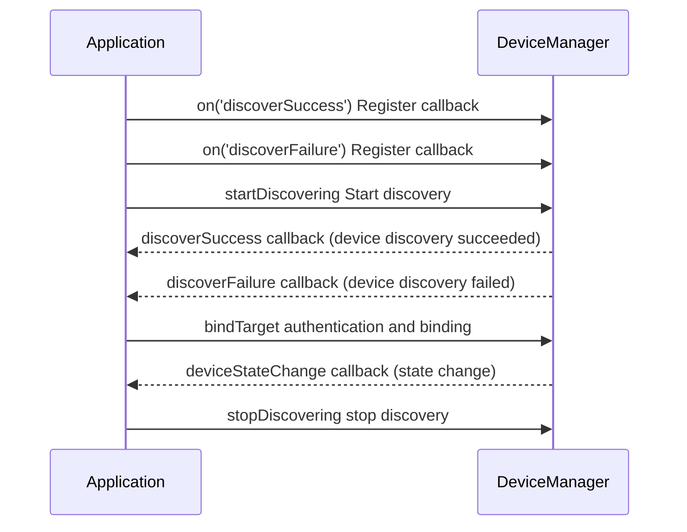

# @ohos.distributedDeviceManager (Device Management)
<!--Kit: Distributed Service Kit-->
<!--Subsystem: DistributedHardware-->
<!--Owner: @hwzhangchuang-->
<!--Designer: @hwzhangchuang-->
<!--Tester: @zhaodengqi-->
<!--Adviser: @hu-zhiqiong-->
<!-- md-trans-meta sourceCommit=de574f1d5345cee4beccdf4872c91ac8f76a4074 translatedAt=2026-11-03T11:01:23.967Z pushedAt=2026-11-03T12:06:47.101Z nl=1 -->

This module provides distributed device management capabilities, including device discovery, authentication, status listening, and information query. Based on the device trust model, device management discovers nearby devices and performs authentication and binding to establish trusted connections. Authenticated trusted devices can be used for distributed services.

Applications can call the APIs to:

- Registers and unregisters listeners for device status changes, device name changes, and service death.
- Discovers nearby devices.
- Authenticate or deauthenticate a device.
- Query the trusted device list.
- Queries local device information, including the device name, type, and ID.

> **NOTE**
>
> The initial APIs of this module are supported since API version 10. Newly added APIs will be marked with a superscript to indicate their earliest API version.

## Modules to Import

```ts
import { distributedDeviceManager } from '@kit.DistributedServiceKit';
```

## distributedDeviceManager.createDeviceManager

createDeviceManager(bundleName: string): DeviceManager

Creates a device management instance, which serves as the entry point for calling distributed device management methods. This instance is used to obtain the trusted device list and information such as the name, type, identifier, and network identifier of the local device. When the device management instance is no longer used, call releaseDeviceManager to release the instance to avoid resource leakage.

**System capability**: SystemCapability.DistributedHardware.DeviceManager

**Parameters**

| Name       | Type                                                 | Mandatory | Description                                                        |
| ---------- | ---------------------------------------------------- | --------- | ----------------------------------------------------------- |
| bundleName | string                                               | Yes       | Bundle name of the application. The length range is 1 to 255 characters. If the value is out of range, error code 401 is returned.  |

**Return value**

  | Type                                        | Description        |
  | ------------------------------------------- | --------- |
  | [DeviceManager](#devicemanager) | Device manager object instance, used to obtain the trusted device list and information such as the name, type, identifier, and network identifier of the local device. |

**Error codes**

For details about the error codes, see [Universal Error Codes](../errorcode-universal.md).

| ID | Error Message                                                        |
| -------- | --------------------------------------------------------------- |
| 401 | Parameter error. Possible causes: 1. Mandatory parameters are left unspecified; 2. Incorrect parameter type; 3. Parameter verification failed. |

**Example**

  ```ts
  import { distributedDeviceManager } from '@kit.DistributedServiceKit';
  import { BusinessError } from '@kit.BasicServicesKit';

  try {
    // Create a device management instance.
    let dmInstance = distributedDeviceManager.createDeviceManager('ohos.samples.jsHelloWorld');
  } catch (err) {
    let error: BusinessError = err as BusinessError;
    console.error(`Failed to create device manager. Code: ${error.code}, message: ${error.message}`);
  }
  ```

## distributedDeviceManager.releaseDeviceManager

releaseDeviceManager(deviceManager: DeviceManager): void

Releases the DeviceManager instance through this method when the device management instance is no longer in use.

**System capability**: SystemCapability.DistributedHardware.DeviceManager

**Parameters**

| Name     | Type                                                 | Mandatory | Description                                |
| ---------- | ---------------------------------------------------- | ---- | --------------------------------- |
| deviceManager | [DeviceManager](#devicemanager)    | Yes   | Device manager object instance created by createDeviceManager.                                  |

**Error codes**

For details about the error codes, see [Universal Error Codes](../errorcode-universal.md) and [Device Management Error Codes](errorcode-device-manager.md).

| ID | Error Message                                                        |
| -------- | --------------------------------------------------------------- |
| 401 | Parameter error. Possible causes: 1. Mandatory parameters are left unspecified; 2. Incorrect parameter types; 3. Parameter verification failed. |
| 11600101 | Failed to execute the function.                                 |

**Example**

  ```ts
  import { distributedDeviceManager } from '@kit.DistributedServiceKit';
  import { BusinessError } from '@kit.BasicServicesKit';

  try {
    // Create a device management instance.
    let dmInstance = distributedDeviceManager.createDeviceManager('ohos.samples.jsHelloWorld');
    // Release the device management instance.
    distributedDeviceManager.releaseDeviceManager(dmInstance);
  } catch (err) {
    let error: BusinessError = err as BusinessError;
    console.error(`Failed to release device manager. Code: ${error.code}, message: ${error.message}`);
  }
  ```

## DeviceBasicInfo

Basic information about a distributed device.

**System capability**: SystemCapability.DistributedHardware.DeviceManager

**Device behavior difference**: Calling this API on a Wearable device that does not support distributed services returns error code 801.

| Name | Type | Read-Only | Optional | Description |
| ---------------------- | ------------------------- | --- | ---- | -------- |
| deviceId | string | No | No | Device identifier. The actual value is the udid-hash obfuscated with the app ID and a salt value using SHA-256. |
| deviceName | string | No | No | Device name. |
| deviceType | string | No | No | Device type. |
| networkId | string | No | Yes | Device network identifier. Defaults to an empty string when not provided. |

## DeviceStateChange

Enumerates the device states.

**System capability**: SystemCapability.DistributedHardware.DeviceManager

**Device Behavior Difference**: When this API is called on a Wearable device that does not support distributed services, error code 801 is returned.

| Name        | Value | Description              |
| ----------- | ---- | --------------- |
| UNKNOWN     | 0    | The device is physically online, but its state is unknown. Before the state changes to available, distributed services cannot be used.           |
| AVAILABLE   | 1    | The device is available, indicating that information between devices has been synchronized in distributed data and distributed services can run. |
| UNAVAILABLE | 2    | The device is physically offline, and its state is unknown.           |

## DeviceManager

The device management instance is the entry point for calling distributed device management methods. It provides capabilities such as device discovery, device authentication, status listening, and information query. Before calling the methods of DeviceManager, you need to create a DeviceManager instance dmInstance through createDeviceManager.

**System capability**: SystemCapability.DistributedHardware.DeviceManager

**Device Behavior Difference**: Calling this API on a Wearable device that does not support distributed services returns error code 801.

### getAvailableDeviceListSync

getAvailableDeviceListSync(): Array&lt;DeviceBasicInfo&gt;

Synchronously obtains all online trusted devices. Before calling this method, create a DeviceManager instance by calling createDeviceManager. The difference from getAvailableDeviceList is that this method is a synchronous call and directly returns the result, whereas getAvailableDeviceList is an asynchronous call and returns the result through a callback or a Promise. It is recommended to use this method in scenarios where blocking and waiting for the result is required, and to use getAvailableDeviceList in scenarios where blocking the thread is not desired.

**Required permissions**: ohos.permission.DISTRIBUTED_DATASYNC

**System capability**: SystemCapability.DistributedHardware.DeviceManager

**Device behavior difference**: Calling this API on a Wearable device that does not support distributed services returns error code 801.

**Return value**

  | Type                                        | Description        |
  | ------------------------------------------- | --------- |
  | Array&lt;[DeviceBasicInfo](#devicebasicinfo)&gt; | Returns the trusted device list, including information such as the device identifier, name, type, and network identifier. |

**Error codes**

For details about the error codes, see [Universal Error Codes](../errorcode-universal.md) and [Device Management Error Codes](errorcode-device-manager.md).

| ID | Error Message                                                        |
| -------- | --------------------------------------------------------------- |
| 201 | Permission verification failed. The application does not have the permission required to call the API.                                            |
| 11600101 | Failed to execute the function.                                 |

**Example**

  ```ts
  import { distributedDeviceManager } from '@kit.DistributedServiceKit';
  import { BusinessError } from '@kit.BasicServicesKit';

  try {
    // Create a device management instance.
    let dmInstance = distributedDeviceManager.createDeviceManager('ohos.samples.jsHelloWorld');
    // Synchronously obtain all online trusted devices.
    let deviceInfoList: Array<distributedDeviceManager.DeviceBasicInfo> = dmInstance.getAvailableDeviceListSync();
  } catch (err) {
    let error: BusinessError = err as BusinessError;
    console.error(`Failed to get available device list sync. Code: ${error.code}, message: ${error.message}`);
  }
  ```

### getAvailableDeviceList

getAvailableDeviceList(callback: AsyncCallback&lt;Array&lt;DeviceBasicInfo&gt;&gt;): void

Obtains all online trusted devices. Before calling this API, you must create a DeviceManager instance by calling createDeviceManager. This API uses an asynchronous callback to return the result. The difference from getAvailableDeviceListSync is that this API is an asynchronous call and returns the result through the callback, whereas getAvailableDeviceListSync is a synchronous call and returns the result directly. It is recommended to use this API in scenarios where you do not want to block the thread, and to use getAvailableDeviceListSync in scenarios where you need to block and wait for the result.

**Required permissions**: ohos.permission.DISTRIBUTED_DATASYNC

**System capability**: SystemCapability.DistributedHardware.DeviceManager

**Device behavior difference**: Calling this API on a Wearable device that does not support distributed services returns error code 801.

**Parameters**

  | Name       | Type                                     | Mandatory   | Description                    |
  | -------- | ---------------------------------------- | ---- | --------------------- |
  | callback | AsyncCallback&lt;Array&lt;[DeviceBasicInfo](#devicebasicinfo)&gt;&gt; | Yes    | Callback invoked to return the trusted device list. If the operation is successful, **err** is **undefined** and **data** is the trusted device list obtained; otherwise, **err** is an error object. |

**Error codes**

For details about the error codes, see [Universal Error Codes](../errorcode-universal.md) and [Device Management Error Codes](errorcode-device-manager.md).

| ID | Error Message                                                        |
| -------- | --------------------------------------------------------------- |
| 201 | Permission verification failed. The application does not have the permission required to call the API.                                            |
| 11600101 | Failed to execute the function.                                 |

**Example**

  ```ts
  import { distributedDeviceManager } from '@kit.DistributedServiceKit';
  import { BusinessError } from '@kit.BasicServicesKit';

  try {
    // Create a device management instance.
    let dmInstance = distributedDeviceManager.createDeviceManager('ohos.samples.jsHelloWorld');
    // Obtain all online trusted devices.
    dmInstance.getAvailableDeviceList((err: BusinessError, data: Array<distributedDeviceManager.DeviceBasicInfo>) => {
      if (err) {
        console.error(`Failed to get available device list. Code: ${err.code}, message: ${err.message}`);
        return;
      }
      console.info('get available device info: ' + JSON.stringify(data));
    });
  } catch (err) {
    let error: BusinessError = err as BusinessError;
    console.error(`Failed to get available device list. Code: ${error.code}, message: ${error.message}`);
  }
  ```

### getAvailableDeviceList

getAvailableDeviceList(): Promise&lt;Array&lt;DeviceBasicInfo&gt;&gt;

Obtains all online trusted devices. Before calling this method, create a DeviceManager instance by calling createDeviceManager. This API uses a promise to return the result asynchronously. The difference from getAvailableDeviceListSync is that this method is an asynchronous call that returns the result through a promise, whereas getAvailableDeviceListSync is a synchronous call that returns the result directly. It is recommended to use this method in scenarios where blocking the thread is not desired, and to use getAvailableDeviceListSync in scenarios where blocking to wait for the result is required.

**Required permissions**: ohos.permission.DISTRIBUTED_DATASYNC

**System capability**: SystemCapability.DistributedHardware.DeviceManager

**Device behavior difference**: Calling this API on a Wearable device that does not support distributed services returns error code 801.

**Return value**

  | Type                                                       | Description                               |
  | ---------------------------------------------------------- | ---------------------------------- |
  | Promise&lt;Array&lt;[DeviceBasicInfo](#devicebasicinfo)&gt;&gt; | Promise used to return the basic information list of distributed devices when resolved, and the error message when rejected. |

**Error codes**

For details about the error codes, see [Universal Error Codes](../errorcode-universal.md) and [Device Management Error Codes](errorcode-device-manager.md).

| ID | Error Message                                                        |
| -------- | --------------------------------------------------------------- |
| 201 | Permission verification failed. The application does not have the permission required to call the API.                                            |
| 11600101 | Failed to execute the function.                                 |

**Example**

  ```ts
  import { distributedDeviceManager } from '@kit.DistributedServiceKit';
  import { BusinessError } from '@kit.BasicServicesKit';

  try {
    // Create a DeviceManager instance.
    let dmInstance = distributedDeviceManager.createDeviceManager('ohos.samples.jsHelloWorld');
    // Obtain all online trusted devices.
    dmInstance.getAvailableDeviceList().then((data: Array<distributedDeviceManager.DeviceBasicInfo>) => {
      console.info('get available device info: ' + JSON.stringify(data));
    }).catch((err: BusinessError) => {
      console.error(`Failed to get available device list. Code: ${err.code}, message: ${err.message}`);
    });
  } catch (err) {
    let error: BusinessError = err as BusinessError;
    console.error(`Failed to get available device list. Code: ${error.code}, message: ${error.message}`);
  }
  ```

### getLocalDeviceNetworkId

getLocalDeviceNetworkId(): string

Obtains the local device network identifier.

**Required permissions**: ohos.permission.DISTRIBUTED_DATASYNC

**System capability**: SystemCapability.DistributedHardware.DeviceManager

**Device behavior difference**: Calling this API on a Wearable device that does not support Distributed Service returns error code 801.

**Return value**

  | Type                      | Description              |
  | ------------------------- | ---------------- |
  | string | Local device network identifier, that is, the unique identifier string of the device in the distributed network. |

**Error codes**

For details about the error codes, see [Universal Error Codes](../errorcode-universal.md) and [Device Management Error Codes](errorcode-device-manager.md).

| ID | Error Message                                                        |
| -------- | --------------------------------------------------------------- |
| 201 | Permission verification failed. The application does not have the permission required to call the API.                                            |
| 11600101 | Failed to execute the function.                                 |

**Example**

  ```ts
  import { distributedDeviceManager } from '@kit.DistributedServiceKit';
  import { BusinessError } from '@kit.BasicServicesKit';

  try {
    // Create a device management instance.
    let dmInstance = distributedDeviceManager.createDeviceManager('ohos.samples.jsHelloWorld');
    // Obtain the local device network identifier.
    let deviceNetworkId: string = dmInstance.getLocalDeviceNetworkId();
    console.info('local device networkId: ' + JSON.stringify(deviceNetworkId));
  } catch (err) {
    let error: BusinessError = err as BusinessError;
    console.error(`Failed to get local device network id. Code: ${error.code}, message: ${error.message}`);
  }
  ```

### getLocalDeviceName

getLocalDeviceName(): string

Obtains the name of the local device.

**Required permissions**: ohos.permission.DISTRIBUTED_DATASYNC

**System capability**: SystemCapability.DistributedHardware.DeviceManager

**Device Behavior Difference** This API returns error code 801 when called on a Wearable device that does not support distributed services.

**Return value**

  | Type                      | Description              |
  | ------------------------- | ---------------- |
  | string                    | Returns the local device name, which can be used for device display and identification. |

**Error codes**

For details about the error codes, see [Universal Error Codes](../errorcode-universal.md) and [Device Management Error Codes](errorcode-device-manager.md).

| ID | Error Message                                                        |
| -------- | --------------------------------------------------------------- |
| 201 | Permission verification failed. The application does not have the permission required to call the API.                                            |
| 11600101 | Failed to execute the function.                                 |

**Example**

  ```ts
  import { distributedDeviceManager } from '@kit.DistributedServiceKit';
  import { BusinessError } from '@kit.BasicServicesKit';

  try {
    // Create a device management instance.
    let dmInstance = distributedDeviceManager.createDeviceManager('ohos.samples.jsHelloWorld');
    // Obtain the local device name.
    let deviceName: string = dmInstance.getLocalDeviceName();
    console.info('local device name: ' + JSON.stringify(deviceName));
  } catch (err) {
    let error: BusinessError = err as BusinessError;
    console.error(`Failed to get local device name. Code: ${error.code}, message: ${error.message}`);
  }
  ```

### getLocalDeviceType

getLocalDeviceType(): number

Gets the local device type.

**Required permissions**: ohos.permission.DISTRIBUTED_DATASYNC

**System capability**: SystemCapability.DistributedHardware.DeviceManager

**Device behavior difference** This API returns error code 801 when called on a Wearable device that does not support distributed services.

**Return value**

  | Type                      | Description              |
  | ------------------------- | ---------------- |
  | number                    | <!--RP1-->Return local device type.<!--RP1End--> |

**Error codes**

For details about the error codes, see [Universal Error Codes](../errorcode-universal.md) and [Device Management Error Codes](errorcode-device-manager.md).

| ID | Error Message                                                        |
| -------- | --------------------------------------------------------------- |
| 201 | Permission verification failed. The application does not have the permission required to call the API.                                            |
| 11600101 | Failed to execute the function.                                 |

**Example**

  ```ts
  import { distributedDeviceManager } from '@kit.DistributedServiceKit';
  import { BusinessError } from '@kit.BasicServicesKit';

  try {
    // Create a device management instance.
    let dmInstance = distributedDeviceManager.createDeviceManager('ohos.samples.jsHelloWorld');
    // Get the local device type.
    let deviceType: number = dmInstance.getLocalDeviceType();
    console.info('local device type: ' + JSON.stringify(deviceType));
  } catch (err) {
    let error: BusinessError = err as BusinessError;
    console.error(`Failed to get local device type. Code: ${error.code}, message: ${error.message}`);
  }
  ```

### getLocalDeviceId

getLocalDeviceId(): string

Obtains the local device ID. The actual value is the result of obfuscating the udid-hash, app ID, and salt value using SHA-256.

**Required permissions**: ohos.permission.DISTRIBUTED_DATASYNC

**System capability**: SystemCapability.DistributedHardware.DeviceManager

**Device Behavior Difference**: Calling this API on a Wearable device that does not support Distributed Service returns error code 801.

**Return value**

  | Type                      | Description              |
  | ------------------------- | ---------------- |
  | string                    | Local device ID. The actual value is the result of obfuscating the udid-hash, app ID, and salt value using SHA-256. |

**Error codes**

For details about the error codes, see [Universal Error Codes](../errorcode-universal.md) and [Device Management Error Codes](errorcode-device-manager.md).

| ID | Error Message                                                        |
| -------- | --------------------------------------------------------------- |
| 201 | Permission verification failed. The application does not have the permission required to call the API.                                            |
| 11600101 | Failed to execute the function.                                 |

**Example**

  ```ts
  import { distributedDeviceManager } from '@kit.DistributedServiceKit';
  import { BusinessError } from '@kit.BasicServicesKit';

  try {
    // Create a device management instance.
    let dmInstance = distributedDeviceManager.createDeviceManager('ohos.samples.jsHelloWorld');
    // Obtain the local device identifier.
    let deviceId: string = dmInstance.getLocalDeviceId();
    console.info('local device id: ' + JSON.stringify(deviceId));
  } catch (err) {
    let error: BusinessError = err as BusinessError;
    console.error(`Failed to get local device id. Code: ${error.code}, message: ${error.message}`);
  }
  ```

### getDeviceName

getDeviceName(networkId: string): string

Obtains the name of a device based on its network identifier.

**Required permissions**: ohos.permission.DISTRIBUTED_DATASYNC

**System capability**: SystemCapability.DistributedHardware.DeviceManager

**Device behavior difference**: When this API is called on a Wearable device that does not support distributed services, error code 801 is returned.

**Parameters**

  | Name       | Type                                     | Mandatory   | Description        |
  | -------- | ---------------------------------------- | ---- | --------- |
  | networkId| string                                   | Yes   | Network identifier of the device. It can be obtained from the trusted device list (DeviceBasicInfo returned by getAvailableDeviceListSync or getAvailableDeviceList). Note: If the obtained networkId is an empty string, it cannot be used to call this API. Length range: 1 to 255 characters. Error code 401 is returned if the value is out of range. |

**Return value**

  | Type                      | Description              |
  | ------------------------- | ---------------- |
  | string                    | Name of the specified device, which can be used for device display and identification. |

**Error codes**

For details about the error codes, see [Universal Error Codes](../errorcode-universal.md) and [Device Management Error Codes](errorcode-device-manager.md).

| ID | Error Message                                                        |
| -------- | --------------------------------------------------------------- |
| 201 | Permission verification failed. The application does not have the permission required to call the API.                                            |
| 401 | Parameter error. Possible causes: 1. Mandatory parameters are left unspecified; 2. Incorrect parameter type; 3. Parameter verification failed; 4. The size of specified networkId is greater than 255. |
| 11600101 | Failed to execute the function.                                 |

**Example**

  ```ts
  import { distributedDeviceManager } from '@kit.DistributedServiceKit';
  import { BusinessError } from '@kit.BasicServicesKit';

  try {
    // Network identifier of the device. It can be obtained from DeviceBasicInfo.networkId in the trusted device list returned by getAvailableDeviceListSync or getAvailableDeviceList.
    let networkId = 'xxxxxxx';
    // Create a device management instance.
    let dmInstance = distributedDeviceManager.createDeviceManager('ohos.samples.jsHelloWorld');
    // Obtain the device name based on the device network identifier.
    let deviceName: string = dmInstance.getDeviceName(networkId);
    console.info('device name: ' + JSON.stringify(deviceName)); 
  } catch (err) {
    let error: BusinessError = err as BusinessError;
    console.error(`Failed to get device name. Code: ${error.code}, message: ${error.message}`);
  }
  ```

### getDeviceType

getDeviceType(networkId: string): number

Obtains the device type based on the network identifier of the specified device.

**Required permissions**: ohos.permission.DISTRIBUTED_DATASYNC

**System capability**: SystemCapability.DistributedHardware.DeviceManager

**Device behavior difference**: When this API is called on a Wearable device that does not support distributed services, error code 801 is returned.

**Parameters**

  | Name       | Type                                     | Mandatory   | Description        |
  | -------- | ---------------------------------------- | ---- | --------- |
  | networkId| string                                   | Yes   | Network identifier of the device. It can be obtained from the trusted device list (DeviceBasicInfo returned by getAvailableDeviceListSync or getAvailableDeviceList). Note: If the obtained networkId is an empty string, it cannot be used to call this API. The length range is 1 to 255 characters. If the value is out of range, error code 401 is returned. |

**Return value**

  | Type                      | Description              |
  | ------------------------- | ---------------- |
  | number                    | <!--RP2-->Returns the type of the specified device, indicating the category information of the specified device.<!--RP2End--> |

**Error codes**

For details about the error codes, see [Universal Error Codes](../errorcode-universal.md) and [Device Management Error Codes](errorcode-device-manager.md).

| ID | Error Message                                                        |
| -------- | --------------------------------------------------------------- |
| 201 | Permission verification failed. The application does not have the permission required to call the API.                                            |
| 401 | Parameter error. Possible causes: 1. Mandatory parameters are left unspecified; 2. Incorrect parameter type; 3. Parameter verification failed; 4. The size of specified networkId is greater than 255. |
| 11600101 | Failed to execute the function.                                 |

**Example**

  ```ts
  import { distributedDeviceManager } from '@kit.DistributedServiceKit';
  import { BusinessError } from '@kit.BasicServicesKit';

  try {
    // Obtain the device network identifier from DeviceBasicInfo.networkId in the trusted device list returned by getAvailableDeviceListSync or getAvailableDeviceList.
    let networkId = 'xxxxxxx';
    // Create a device management instance.
    let dmInstance = distributedDeviceManager.createDeviceManager('ohos.samples.jsHelloWorld');
    // Obtain the device type based on the device network identifier.
    let deviceType: number = dmInstance.getDeviceType(networkId);
    console.info('device type: ' + JSON.stringify(deviceType)); 
  } catch (err) {
    let error: BusinessError = err as BusinessError;
    console.error(`Failed to get device type. Code: ${error.code}, message: ${error.message}`);
  }
  ```

### startDiscovering

startDiscovering(discoverParam: {[key:&nbsp;string]:&nbsp;Object;} , filterOptions?: {[key:&nbsp;string]:&nbsp;Object;} ): void

Discovers nearby devices to search for available devices before establishing a distributed connection. The discovery state lasts for two minutes and stops automatically after timeout, with a maximum of 99 devices discoverable. When using Wi-Fi for device discovery, the discovering party and the discovered party must be on the same LAN. Before calling this method, you must register the device discovery success callback through [on('discoverSuccess')](#ondiscoversuccess) to receive the discovered device information, and register the device discovery failure callback through [on('discoverFailure')](#ondiscoverfailure) to receive failure notifications. After discovery is complete, you can call stopDiscovering to stop discovery.

The device discovery and authentication interaction process is as follows:



**Required permissions**: ohos.permission.DISTRIBUTED_DATASYNC

**System capability**: SystemCapability.DistributedHardware.DeviceManager

**Device Behavior Difference**: When this API is called on a Wearable device that does not support Distributed Service, error code 801 is returned.

**Parameters**

  | Name            | Type                        | Mandatory   | Description    |
  | ------------- | ------------------------------- | ---- | -----  |
  | discoverParam  | {[key:&nbsp;string]:&nbsp;Object;}      | Yes   | Discovery configuration parameters, used to specify the target type of discovery.<br>discoverTargetType: type of the discovery target. The value 1 indicates the device type. Other values do not take effect.|
  | filterOptions | {[key:&nbsp;string]:&nbsp;Object;}          | No   | Filtering information for discovered devices. Optional. The default value is undefined, indicating discovery of devices that are not online. The following keys are carried (if a key is not passed, filtering is not performed by that dimension):<br>availableStatus(0-1): filters the available status of discovered devices. Values out of range do not take effect.<br />-0: The device is offline. The client needs to call bindTarget to bind the device.<br />-1: The device is online. The client can connect to it.<br>discoverDistance(0-100): discovers devices within the specified distance around the local device based on the passed distance value, in cm. Values out of range do not take effect. This parameter is not supported when WiFi is used for Device Discovery; if passed, it does not take effect. <br>authenticationStatus(0-1): discovers devices based on different authentication statuses. Values out of range do not take effect:<br />-0: The device is not authenticated. The client needs to call bindTarget for authentication and binding.<br />-1: The device is authenticated and can be used for Distributed Service.<br>authorizationType(0-2): discovers devices based on different authorization types. Values out of range do not take effect:<br />-0: Devices authenticated based on a temporarily negotiated session key.<br />-1: Devices authenticated based on the same-account key.<br />-2: Devices authenticated based on credentials keys of different accounts.|

**Error codes**

For details about the error codes, see [Universal Error Codes](../errorcode-universal.md) and [Device Management Error Codes](errorcode-device-manager.md).

| ID | Error Message                                                        |
| -------- | --------------------------------------------------------------- |
| 201 | Permission verification failed. The application does not have the permission required to call the API.                                            |
| 401 | Parameter error. Possible causes: 1. Mandatory parameters are left unspecified; 2. Incorrect parameter type; 3. Parameter verification failed. |
| 11600101 | Failed to execute the function.                                 |
| 11600104 | Discovery unavailable.                                          |

**Example**

  ```ts
  import { distributedDeviceManager } from '@kit.DistributedServiceKit';
  import { BusinessError } from '@kit.BasicServicesKit';

  // Discovery identifier. discoverTargetType 1 indicates that the discovery target is a device.
  let discoverParam: Record<string, number> = {
    'discoverTargetType': 1
  };
  // Filtering information for discovered devices. availableStatus 0 indicates discovery of offline devices.
  let filterOptions: Record<string, number> = {
    'availableStatus': 0
  };

  try {
    // Create a device management instance.
    let dmInstance = distributedDeviceManager.createDeviceManager('ohos.samples.jsHelloWorld');
    dmInstance.startDiscovering(discoverParam, filterOptions); // When a device is discovered, notify the application through the discoverSuccess callback.
  } catch (err) {
    let error: BusinessError = err as BusinessError;
    console.error(`Failed to start discovering. Code: ${error.code}, message: ${error.message}`);
  }
  ```

### stopDiscovering

stopDiscovering(): void

Stops discovering nearby devices. This method is used together with startDiscovering to manually stop device discovery before the discovery timeout (two minutes). It must be called after startDiscovering.

**Required permissions**: ohos.permission.DISTRIBUTED_DATASYNC

**System capability**: SystemCapability.DistributedHardware.DeviceManager

**Device Behavior Difference**: Calling this API on a Wearable device that does not support Distributed Service returns error code 801.

**Error codes**

For details about the error codes, see [Universal Error Codes](../errorcode-universal.md) and [Device Management Error Codes](errorcode-device-manager.md).

| ID | Error Message                                                        |
| -------- | --------------------------------------------------------------- |
| 201 | Permission verification failed. The application does not have the permission required to call the API.                                            |
| 11600101 | Failed to execute the function.                                 |

**Example**

  ```ts
  import { distributedDeviceManager } from '@kit.DistributedServiceKit';
  import { BusinessError } from '@kit.BasicServicesKit';

  try {
    // Create a device management instance.
    let dmInstance = distributedDeviceManager.createDeviceManager('ohos.samples.jsHelloWorld');
    // Stop discovering nearby devices.
    dmInstance.stopDiscovering();
  } catch (err) {
    let error: BusinessError = err as BusinessError;
    console.error(`Failed to stop discovering. Code: ${error.code}, message: ${error.message}`);
  }
  ```

### bindTarget

bindTarget(deviceId: string, bindParam: {[key:&nbsp;string]:&nbsp;Object;} , callback: AsyncCallback&lt;{deviceId: string;}>): void

Authenticates a device and binds a discovered untrusted device as a trusted device through the authentication process<!--RP3--><!--RP3End-->. During authentication, the system initiates an authentication request based on the authentication type specified in bindParam. After successful authentication, the device is added to the trusted device list and can be queried through getAvailableDeviceListSync. When distributed services with the target device are no longer needed, call unbindTarget to unbind it. This API uses an asynchronous callback to return the result.

**Required permissions**: ohos.permission.DISTRIBUTED_DATASYNC

**System capability**: SystemCapability.DistributedHardware.DeviceManager

**Device behavior difference**: Calling this API on a Wearable device that does not support distributed services returns error code 801.

**Parameters**

  | Name     | Type                                                | Mandatory  | Description         |
  | ---------- | --------------------------------------------------- | ----- | ------------ |
  | deviceId   | string                                              | Yes    | Device identifier, which can be obtained from the device discovery result (DeviceBasicInfo returned by the discoverSuccess callback of startDiscovering). The length range is 1 to 255 characters. If the value is out of range, error code 401 is returned.   |
  | bindParam  | {[key:&nbsp;string]:&nbsp;Object;}                             | Yes    | Authentication parameters. The following key values are supported:<br>bindType (number, mandatory): type of binding. The value 1 indicates PIN code authentication. Passing any other value returns a parameter error.<br>targetPkgName (string, optional): bundle name of the binding target. If not passed, the bundle name of the caller application is used by default.<br>appName (string, optional): name of the application attempting to bind the target, used to display the name of the application initiating the binding on the authentication UI. If not passed, it is not displayed.<br>appOperation (string, optional): reason why the application wants to bind the target, used to show the user the purpose of the binding. If not passed, it is not displayed.<br>customDescription (string, optional): detailed supplementary description of the binding operation, used to show the user a more specific operation description. If not passed, it is not displayed.   |
  | callback   | AsyncCallback&lt;{deviceId:&nbsp;string;&nbsp;}&gt; | Yes    | Callback for the authentication result. If authentication succeeds, err is undefined and data is an object containing deviceId. If authentication fails, err is an error object. |

**Error codes**

For details about the error codes, see [Universal Error Codes](../errorcode-universal.md) and [Device Management Error Codes](errorcode-device-manager.md).

| ID | Error Message                                                         |
| -------- | --------------------------------------------------------------- |
| 201 | Permission verification failed. The application does not have the permission required to call the API.                                            |
| 401 | Parameter error. Possible causes: 1. Mandatory parameters are left unspecified; 2. Incorrect parameter type; 3. Parameter verification failed; 4. The size of specified deviceId is greater than 255.  |
| 11600101 | Failed to execute the function.                                 |
| 11600103 | Authentication unavailable.                                     |

**Example**

  ```ts
  import { distributedDeviceManager } from '@kit.DistributedServiceKit';
  import { BusinessError } from '@kit.BasicServicesKit';

  class BindResultData {
    deviceId: string = '';
  }
  // Device identifier. After discovering devices through startDiscovering, obtain DeviceBasicInfo.deviceId from the discoverSuccess callback, or obtain DeviceBasicInfo.deviceId of a trusted device through getAvailableDeviceListSync/getAvailableDeviceList.
  let deviceId = 'XXXXXXXX';
  // Authentication parameters.
  let bindParam: Record<string, string | number> = {
    'bindType': 1, // Binding type: 1 - PIN code authentication.
    'targetPkgName': 'xxxx',
    'appName': 'xxxx',
    'appOperation': 'xxxx',
    'customDescription': 'xxxx'
  };

  try {
    // Create a device management instance.
    let dmInstance = distributedDeviceManager.createDeviceManager('ohos.samples.jsHelloWorld');
    // Authenticate the device.
    dmInstance.bindTarget(deviceId, bindParam, (err: BusinessError, data: BindResultData) => {
      if (err) {
        console.error(`Failed to bind target. Code: ${err.code}, message: ${err.message}`);
        return;
      }
      console.info('bindTarget result:' + JSON.stringify(data));
    });
  } catch (err) {
    let error: BusinessError = err as BusinessError;
    console.error(`Failed to bind target. Code: ${error.code}, message: ${error.message}`);
  }
  ```

### unbindTarget

unbindTarget(deviceId: string): void

Unbinds an authenticated device. This API is used to unbind the authentication relationship with a target device when distributed services with that device are no longer needed<!--RP4--><!--RP4End-->. It is used together with the bindTarget method and can unbind only trusted devices that have been authenticated and bound through bindTarget. After unbinding, the device is removed from the trusted device list. You can confirm this by querying getAvailableDeviceListSync or getAvailableDeviceList.

**Required permissions**: ohos.permission.DISTRIBUTED_DATASYNC

**System capability**: SystemCapability.DistributedHardware.DeviceManager

**Device behavior difference**: Calling this API on a Wearable device that does not support distributed services returns error code 801.

**Parameters**

  | Name   | Type                      | Mandatory | Description       |
  | -------- | ------------------------- | ---- | ---------- |
  | deviceId | string                    | Yes   |  Device identifier. Only trusted devices that have been authenticated and bound through bindTarget are supported. It can be obtained from the trusted device list (DeviceBasicInfo returned by getAvailableDeviceListSync or getAvailableDeviceList). The length range is 1 to 255 characters. If the value is out of range, error code 401 is returned.|

**Error codes**

For details about the error codes, see [Universal Error Codes](../errorcode-universal.md) and [Device Management Error Codes](errorcode-device-manager.md).

| ID | Error Message                                                        |
| -------- | --------------------------------------------------------------- |
| 201 | Permission verification failed. The application does not have the permission required to call the API.                                            |
| 401 | Parameter error. Possible causes: 1. Mandatory parameters are left unspecified; 2. Incorrect parameter type; 3. Parameter verification failed; 4. The size of specified deviceId is greater than 255.  |
| 11600101 | Failed to execute the function.                                 |

**Example**

  ```ts
  import { distributedDeviceManager } from '@kit.DistributedServiceKit';
  import { BusinessError } from '@kit.BasicServicesKit';

  try {
    // Device identifier, which can be obtained from the discovery result (the discoverSuccess callback of startDiscovering) or the trusted device list (DeviceBasicInfo returned by getAvailableDeviceListSync/getAvailableDeviceList).
    let deviceId = 'XXXXXXXX';
    // Create a device management instance.
    let dmInstance = distributedDeviceManager.createDeviceManager('ohos.samples.jsHelloWorld');
    // Unbind the authenticated device.
    dmInstance.unbindTarget(deviceId);
  } catch (err) {
    let error: BusinessError = err as BusinessError;
    console.error(`Failed to unbind target. Code: ${error.code}, message: ${error.message}`);
  }
  ```

### on('deviceStateChange')

on(type: 'deviceStateChange', callback: Callback&lt;{ action: DeviceStateChange; device: DeviceBasicInfo; }&gt;): void

Registers a device state callback to notify the application when the device state changes. This API uses an asynchronous callback.

**Required permissions**: ohos.permission.DISTRIBUTED_DATASYNC

**System capability**: SystemCapability.DistributedHardware.DeviceManager

**Device behavior difference**: Calling this API on a Wearable device that does not support distributed services returns error code 801.

**Parameters**

  | Name       | Type                                     | Mandatory   | Description                             |
  | -------- | ---------------------------------------- | ---- | ------------------------------ |
  | type     | string                                   | Yes    | Device state callback to register, which is fixed at **deviceStateChange**. |
  | callback | Callback&lt;{&nbsp;action:&nbsp;[DeviceStateChange](#devicestatechange);&nbsp;device:&nbsp;[DeviceBasicInfo](#devicebasicinfo);&nbsp;}&gt; | Yes    | Callback invoked to return the device state and device information.      |

**Error codes**

For details about the error codes, see [Universal Error Codes](../errorcode-universal.md).

| ID | Error Message                                                        |
| -------- | --------------------------------------------------------------- |
| 201 | Permission verification failed. The application does not have the permission required to call the API.                                            |
| 401 | Parameter error. Possible causes: 1. Mandatory parameters are left unspecified; 2. Incorrect parameter type; 3. Parameter verification failed; 4. The size of specified type is greater than 255.  |

**Example**

  ```ts
  import { distributedDeviceManager } from '@kit.DistributedServiceKit';
  import { BusinessError } from '@kit.BasicServicesKit';

  class DeviceStateChangeData {
    action: distributedDeviceManager.DeviceStateChange = 0;
    device: distributedDeviceManager.DeviceBasicInfo = {
      deviceId: '',
      deviceName: '',
      deviceType: '',
      networkId: ''
    };
  }

  try {
    // Create a device management instance.
    let dmInstance = distributedDeviceManager.createDeviceManager('ohos.samples.jsHelloWorld');
    // Register the device state change callback.
    dmInstance.on('deviceStateChange', (data: DeviceStateChangeData) => {
      console.info('deviceStateChange on:' + JSON.stringify(data));
    });
  } catch (err) {
    let error: BusinessError = err as BusinessError;
    console.error(`Failed to register device state change. Code: ${error.code}, message: ${error.message}`);
  }
  ```

### off('deviceStateChange')

off(type: 'deviceStateChange', callback?: Callback&lt;{ action: DeviceStateChange; device: DeviceBasicInfo; }&gt;): void

Unsubscribes from the device state change event. This API uses an asynchronous callback to return the result.

**Required permissions**: ohos.permission.DISTRIBUTED_DATASYNC

**System capability**: SystemCapability.DistributedHardware.DeviceManager

**Device Behavior Difference**: Calling this API on a Wearable device that does not support Distributed Service returns error code 801.

**Parameters**

  | Name       | Type                                     | Mandatory   | Description                          |
  | -------- | ---------------------------------------- | ---- | --------------------------- |
  | type     | string                                   | Yes    | Device state change event to unsubscribe from. The value is fixed at **deviceStateChange**.        |
  | callback | Callback&lt;{&nbsp;action:&nbsp;[DeviceStateChange](#devicestatechange);&nbsp;device:&nbsp;[DeviceBasicInfo](#devicebasicinfo);&nbsp;}&gt; | No    | Callback for the device state change event, which returns the device state and device information. If this parameter is specified, the corresponding callback is unsubscribed from; otherwise, all registered **deviceStateChange** callbacks are unsubscribed from. |

**Error codes**

For details about the error codes, see [Universal Error Codes](../errorcode-universal.md).

| ID | Error Message                                                        |
| -------- | --------------------------------------------------------------- |
| 201 | Permission verification failed. The application does not have the permission required to call the API.                                            |
| 401 | Parameter error. Possible causes: 1. Mandatory parameters are left unspecified; 2. Incorrect parameter type; 3. Parameter verification failed; 4. The size of specified type is greater than 255.  |

**Example**

  ```ts
  import { distributedDeviceManager } from '@kit.DistributedServiceKit';
  import { BusinessError } from '@kit.BasicServicesKit';

  class DeviceStateChangeData {
    action: distributedDeviceManager.DeviceStateChange = 0;
    device: distributedDeviceManager.DeviceBasicInfo = {
      deviceId: '',
      deviceName: '',
      deviceType: '',
      networkId: ''
    };
  }

  try {
    // Create a device management instance.
    let dmInstance = distributedDeviceManager.createDeviceManager('ohos.samples.jsHelloWorld');
    // Unsubscribe from the device state change callback.
    dmInstance.off('deviceStateChange', (data: DeviceStateChangeData) => {
      console.info('deviceStateChange' + JSON.stringify(data));
    });
  } catch (err) {
    let error: BusinessError = err as BusinessError;
    console.error(`Failed to unregister device state change. Code: ${error.code}, message: ${error.message}`);
  }
  ```

### on('discoverSuccess')

on(type: 'discoverSuccess', callback: Callback&lt;{ device: DeviceBasicInfo; }&gt;): void

Registers a callback for successful device discovery. This API uses an asynchronous callback to return the result. The callback is triggered when startDiscovering discovers a nearby device, and returns the discovered device information (DeviceBasicInfo). This callback must be registered before startDiscovering is called.

**Required permissions**: ohos.permission.DISTRIBUTED_DATASYNC

**System capability**: SystemCapability.DistributedHardware.DeviceManager

**Device behavior difference**: Calling this API on a Wearable device that does not support distributed services returns error code 801.

**Parameters**

  | Name       | Type                                     | Mandatory   | Description                         |
  | -------- | ---------------------------------------- | ---- | -------------------------- |
  | type     | string                                   | Yes    | Registers the device discovery callback to notify the application when a nearby device is discovered. The value is fixed at discoverSuccess. |
  | callback | Callback&lt;{&nbsp;device:&nbsp;[DeviceBasicInfo](#devicebasicinfo);&nbsp;}&gt; | Yes    | Callback invoked to return the discovered device information (DeviceBasicInfo).               |

**Error codes**

For details about the error codes, see [Universal Error Codes](../errorcode-universal.md).

| ID | Error Message                                                        |
| -------- | --------------------------------------------------------------- |
| 201 | Permission verification failed. The application does not have the permission required to call the API.                                            |
| 401 | Parameter error. Possible causes: 1. Mandatory parameters are left unspecified; 2. Incorrect parameter type; 3. Parameter verification failed; 4. The size of specified type is greater than 255.  |

**Example**

  ```ts
  import { distributedDeviceManager } from '@kit.DistributedServiceKit';
  import { BusinessError } from '@kit.BasicServicesKit';

  class DiscoverSuccessData {
    device: distributedDeviceManager.DeviceBasicInfo = {
      deviceId: '',
      deviceName: '',
      deviceType: '',
      networkId: ''
    };
  }
  
  try {
    // Create a device management instance.
    let dmInstance = distributedDeviceManager.createDeviceManager('ohos.samples.jsHelloWorld');
    // Register the callback for successful device discovery.
    dmInstance.on('discoverSuccess', (data: DiscoverSuccessData) => {
      console.info('discoverSuccess:' + JSON.stringify(data));
    });
  } catch (err) {
    let error: BusinessError = err as BusinessError;
    console.error(`Failed to register discover success callback. Code: ${error.code}, message: ${error.message}`);
  }
  ```

### off('discoverSuccess')

off(type: 'discoverSuccess', callback?: Callback&lt;{ device: DeviceBasicInfo; }&gt;): void

Unregisters the callback for device discovery success. This API uses an asynchronous callback to return the result.

**Required permissions**: ohos.permission.DISTRIBUTED_DATASYNC

**System capability**: SystemCapability.DistributedHardware.DeviceManager

**Device Behavior Difference**: When this API is called on a Wearable device that does not support Distributed Service, error code 801 is returned.

**Parameters**

  | Name       | Type                                     | Mandatory   | Description                          |
  | -------- | ---------------------------------------- | ---- | --------------------------- |
  | type     | string                                   | Yes    | Type of the callback to unregister. The value is fixed at **discoverSuccess**.                 |
  | callback | Callback&lt;{&nbsp;device:&nbsp;[DeviceBasicInfo](#devicebasicinfo);&nbsp;}&gt; | No    | Callback for the device discovery event, which returns the discovered device information. If this parameter is specified, only the corresponding callback is unregistered; otherwise, all registered **discoverSuccess** callbacks are unregistered. |

**Error codes**

For details about the error codes, see [Universal Error Codes](../errorcode-universal.md).

| ID | Error Message                                                        |
| -------- | --------------------------------------------------------------- |
| 201 | Permission verification failed. The application does not have the permission required to call the API.                                            |
| 401 | Parameter error. Possible causes: 1. Mandatory parameters are left unspecified; 2. Incorrect parameter type; 3. Parameter verification failed; 4. The size of specified type is greater than 255.  |

**Example**

  ```ts
  import { distributedDeviceManager } from '@kit.DistributedServiceKit';
  import { BusinessError } from '@kit.BasicServicesKit';

  class DiscoverSuccessData {
    device: distributedDeviceManager.DeviceBasicInfo = {
      deviceId: '',
      deviceName: '',
      deviceType: '',
      networkId: ''
    };
  }

  try {
    // Create a device management instance.
    let dmInstance = distributedDeviceManager.createDeviceManager('ohos.samples.jsHelloWorld');
    // Unregister the callback for device discovery success.
    dmInstance.off('discoverSuccess', (data: DiscoverSuccessData) => {
      console.info('discoverSuccess' + JSON.stringify(data));
    });
  } catch (err) {
    let error: BusinessError = err as BusinessError;
    console.error(`Failed to unregister discover success callback. Code: ${error.code}, message: ${error.message}`);
  }
  ```

### on('deviceNameChange')

on(type: 'deviceNameChange', callback: Callback&lt;{ deviceName: string; }&gt;): void

Registers a callback for device name changes, so that the application is notified when the device name changes. This API uses an asynchronous callback to return the result.

**Required permissions**: ohos.permission.DISTRIBUTED_DATASYNC

**System capability**: SystemCapability.DistributedHardware.DeviceManager

**Device behavior difference**: Calling this API on a Wearable device that does not support distributed services returns error code 801.

**Parameters**

  | Name       | Type                                     | Mandatory   | Description                             |
  | -------- | ---------------------------------------- | ---- | ------------------------------ |
  | type     | string                                   | Yes    | Registers a callback for device name changes, so that the application is notified when the device name changes. The value is fixed at **deviceNameChange**. |
  | callback | Callback&lt;{&nbsp;deviceName:&nbsp;string;}&gt; | Yes    | Callback invoked to return the changed device name.                |

**Error codes**

For details about the error codes, see [Universal Error Codes](../errorcode-universal.md).

| ID | Error Message                                                        |
| -------- | --------------------------------------------------------------- |
| 201 | Permission verification failed. The application does not have the permission required to call the API.                                            |
| 401 | Parameter error. Possible causes: 1. Mandatory parameters are left unspecified; 2. Incorrect parameter type; 3. Parameter verification failed; 4. The size of specified type is greater than 255.  |

**Example**

  ```ts
  import { distributedDeviceManager } from '@kit.DistributedServiceKit';
  import { BusinessError } from '@kit.BasicServicesKit';

  class DeviceNameChangeData {
    deviceName: string = '';
  }

  try {
    // Create a device management instance.
    let dmInstance = distributedDeviceManager.createDeviceManager('ohos.samples.jsHelloWorld');
    // Register the callback for device name changes.
    dmInstance.on('deviceNameChange', (data: DeviceNameChangeData) => {
      console.info('deviceNameChange on:' + JSON.stringify(data));
    });
  } catch (err) {
    let error: BusinessError = err as BusinessError;
    console.error(`Failed to register device name change callback. Code: ${error.code}, message: ${error.message}`);
  }
  ```

### off('deviceNameChange')

off(type: 'deviceNameChange', callback?: Callback&lt;{ deviceName: string; }&gt;): void

Unregisters the callback for device name change. This API uses an asynchronous callback to return the result.

**Required permissions**: ohos.permission.DISTRIBUTED_DATASYNC

**System capability**: SystemCapability.DistributedHardware.DeviceManager

**Device behavior difference**: When this API is called on a Wearable device that does not support distributed services, error code 801 is returned.

**Parameters**

  | Name       | Type                                     | Mandatory   | Description                             |
  | -------- | ---------------------------------------- | ---- | ------------------------------ |
  | type     | string                                   | Yes    | Unregisters the callback for device name change. The value is fixed at **deviceNameChange**. |
  | callback | Callback&lt;{&nbsp;deviceName:&nbsp;string;}&gt; | No    | Callback for the device name change event. If this parameter is specified, only the corresponding callback is unregistered; otherwise, all registered **deviceNameChange** callbacks are unregistered.                 |

**Error codes**

For details about the error codes, see [Universal Error Codes](../errorcode-universal.md).

| ID | Error Message                                                        |
| -------- | --------------------------------------------------------------- |
| 201 | Permission verification failed. The application does not have the permission required to call the API.                                            |
| 401 | Parameter error. Possible causes: 1. Mandatory parameters are left unspecified; 2. Incorrect parameter type; 3. Parameter verification failed; 4. The size of specified type is greater than 255.  |

**Example**

  ```ts
  import { distributedDeviceManager } from '@kit.DistributedServiceKit';
  import { BusinessError } from '@kit.BasicServicesKit';

  class DeviceNameChangeData {
    deviceName: string = '';
  }

  try {
    // Create a device management instance.
    let dmInstance = distributedDeviceManager.createDeviceManager('ohos.samples.jsHelloWorld');
    // Unregister the callback for device name change.
    dmInstance.off('deviceNameChange', (data: DeviceNameChangeData) => {
      console.info('deviceNameChange' + JSON.stringify(data));
    });
  } catch (err) {
    let error: BusinessError = err as BusinessError;
    console.error(`Failed to unregister device name change callback. Code: ${error.code}, message: ${error.message}`);
  }
  ```

### on('discoverFailure')

on(type: 'discoverFailure', callback: Callback&lt;{ reason: number; }&gt;): void

Registers a callback for device discovery failure. This API uses an asynchronous callback. The callback is triggered when startDiscovering fails to discover devices, and returns the failure reason. This callback must be registered before startDiscovering is called.

**Required permissions**: ohos.permission.DISTRIBUTED_DATASYNC

**System capability**: SystemCapability.DistributedHardware.DeviceManager

**Device behavior difference**: When this API is called on a Wearable device that does not support Distributed Service, error code 801 is returned.

**Parameters**

  | Name       | Type                                     | Mandatory   | Description                             |
  | -------- | ---------------------------------------- | ---- | ------------------------------ |
  | type     | string                                   | Yes    | Registers a callback for device discovery failure to notify the application when discovering nearby devices fails. The value is fixed at **discoverFailure**. |
  | callback | Callback&lt;{&nbsp;reason:&nbsp;number;&nbsp;}&gt; | Yes    | Callback invoked to return the reason for device discovery failure. The callback parameter **reason** is of the number type and indicates the error code of the discovery failure. For details about the values, see [Device Management Error Codes](errorcode-device-manager.md).                 |

**Error codes**

For details about the error codes, see [Universal Error Codes](../errorcode-universal.md).

| ID | Error Message                                                        |
| -------- | --------------------------------------------------------------- |
| 201 | Permission verification failed. The application does not have the permission required to call the API.                                            |
| 401 | Parameter error. Possible causes: 1. Mandatory parameters are left unspecified; 2. Incorrect parameter type; 3. Parameter verification failed; 4. The size of specified type is greater than 255.  |

**Example**

  ```ts
  import { distributedDeviceManager } from '@kit.DistributedServiceKit';
  import { BusinessError } from '@kit.BasicServicesKit';

  class DiscoverFailureData {
    reason: number = 0;
  }

  try {
    // Create a device management instance.
    let dmInstance = distributedDeviceManager.createDeviceManager('ohos.samples.jsHelloWorld');
    // Register the callback for device discovery failure.
    dmInstance.on('discoverFailure', (data: DiscoverFailureData) => {
      console.info('discoverFailure on:' + JSON.stringify(data));
    });
  } catch (err) {
    let error: BusinessError = err as BusinessError;
    console.error(`Failed to register discover failure callback. Code: ${error.code}, message: ${error.message}`);
  }
  ```

### off('discoverFailure')

off(type: 'discoverFailure', callback?: Callback&lt;{ reason: number; }&gt;): void

Unregisters the callback for device discovery failure. This API uses an asynchronous callback.

**Required permissions**: ohos.permission.DISTRIBUTED_DATASYNC

**System capability**: SystemCapability.DistributedHardware.DeviceManager

**Device behavior difference**: Calling this API on a Wearable device that does not support distributed services returns error code 801.

**Parameters**

  | Name       | Type                                     | Mandatory   | Description                |
  | -------- | ---------------------------------------- | ---- | ----------------- |
  | type     | string                                   | Yes    | Unregisters the callback for device discovery failure. The value is fixed at **discoverFailure**.     |
  | callback | Callback&lt;{&nbsp;reason:&nbsp;number;&nbsp;}&gt; | No    | Callback for the device discovery failure event to unregister. If this parameter is specified, the corresponding callback is unregistered; otherwise, all registered **discoverFailure** callbacks are unregistered. |

**Error codes**

For details about the error codes, see [Universal Error Codes](../errorcode-universal.md).

| ID | Error Message                                                        |
| -------- | --------------------------------------------------------------- |
| 201 | Permission verification failed. The application does not have the permission required to call the API.                                            |
| 401 | Parameter error. Possible causes: 1. Mandatory parameters are left unspecified; 2. Incorrect parameter type; 3. Parameter verification failed; 4. The size of specified type is greater than 255.  |

**Example**

  ```ts
  import { distributedDeviceManager } from '@kit.DistributedServiceKit';
  import { BusinessError } from '@kit.BasicServicesKit';

  class DiscoverFailureData {
    reason: number = 0;
  }

  try {
    // Create a device management instance.
    let dmInstance = distributedDeviceManager.createDeviceManager('ohos.samples.jsHelloWorld');
    // Unregister the callback for device discovery failure.
    dmInstance.off('discoverFailure', (data: DiscoverFailureData) => {
      console.info('discoverFailure' + JSON.stringify(data));
    });
  } catch (err) {
    let error: BusinessError = err as BusinessError;
    console.error(`Failed to unregister discover failure callback. Code: ${error.code}, message: ${error.message}`);
  }
  ```

### on('serviceDie')

on(type: 'serviceDie', callback?: Callback&lt;{}&gt;): void

Registers a callback for the death of the device management service, so that the application is notified when the service dies. This API uses an asynchronous callback.

**Required permissions**: ohos.permission.DISTRIBUTED_DATASYNC

**System capability**: SystemCapability.DistributedHardware.DeviceManager

**Device behavior difference**: Calling this API on a Wearable device that does not support distributed services returns error code 801.

**Parameters**

  | Name       | Type                    | Mandatory   | Description                                       |
  | -------- | ----------------------- | ---- | ---------------------------------------- |
  | type     | string                  | Yes    | Even type. A callback is registered for the death of the device management service, so that the app is notified when the **DeviceManager** service terminates abnormally. The value is fixed at **serviceDie**. |
  | callback | Callback&lt;{}&gt; | No    | Callback for the **serviceDie** event. If this parameter is not passed, the death callback notification cannot be received.                       |

**Error codes**

For details about the error codes, see [Universal Error Codes](../errorcode-universal.md).

| ID | Error Message                                                        |
| -------- | --------------------------------------------------------------- |
| 201 | Permission verification failed. The application does not have the permission required to call the API.                                            |
| 401 | Parameter error. Possible causes: 1. Mandatory parameters are left unspecified; 2. Incorrect parameter type; 3. Parameter verification failed; 4. The size of specified type is greater than 255.  |

**Example**

  ```ts
  import { distributedDeviceManager } from '@kit.DistributedServiceKit';
  import { BusinessError } from '@kit.BasicServicesKit';

  try {
    // Create a device management instance.
    let dmInstance = distributedDeviceManager.createDeviceManager('ohos.samples.jsHelloWorld');
    // Register the callback for the death of the device management service.
    dmInstance.on('serviceDie', () => {
      console.info('serviceDie on');
    });
  } catch (err) {
    let error: BusinessError = err as BusinessError;
    console.error(`Failed to register service die callback. Code: ${error.code}, message: ${error.message}`);
  }
  ```

### off('serviceDie')

off(type: 'serviceDie', callback?: Callback&lt;{}&gt;): void

Unregisters the callback for the death of the device management service. This API uses an asynchronous callback to return the result.

**Required permissions**: ohos.permission.DISTRIBUTED_DATASYNC

**System capability**: SystemCapability.DistributedHardware.DeviceManager

**Device behavior difference**: Calling this API on a Wearable device that does not support the distributed service returns error code 801.

**Parameters**

  | Name       | Type                    | Mandatory   | Description                                       |
  | -------- | ----------------------- | ---- | ---------------------------------------- |
  | type     | string                  | Yes    | Unregisters the serviceDie callback. The value is fixed to serviceDie. |
  | callback | Callback&lt;{}&gt; | No    | Callback for the serviceDie event to unregister. If this parameter is specified, the corresponding callback is unregistered; otherwise, all registered serviceDie callbacks are unregistered.                  |

**Error codes**

For details about the error codes, see [Universal Error Codes](../errorcode-universal.md).

| ID | Error Message                                                        |
| -------- | --------------------------------------------------------------- |
| 201 | Permission verification failed. The application does not have the permission required to call the API.                                            |
| 401 | Parameter error. Possible causes: 1. Mandatory parameters are left unspecified; 2. Incorrect parameter type; 3. Parameter verification failed; 4. The size of specified type is greater than 255.  |

**Example**

  ```ts
  import { distributedDeviceManager } from '@kit.DistributedServiceKit';
  import { BusinessError } from '@kit.BasicServicesKit';

  try {
    // Create a device management instance.
    let dmInstance = distributedDeviceManager.createDeviceManager('ohos.samples.jsHelloWorld');
    // Unregister the callback for the death of the device management service.
    dmInstance.off('serviceDie', () => {
      console.info('serviceDie off');
    });
  } catch (err) {
    let error: BusinessError = err as BusinessError;
    console.error(`Failed to unregister service die callback. Code: ${error.code}, message: ${error.message}`);
  }
  ```