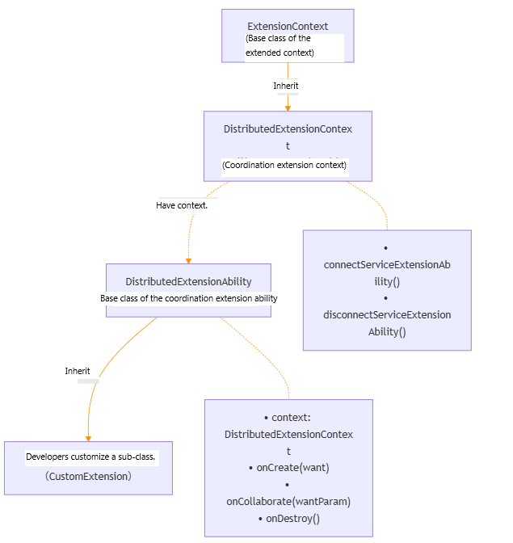

# @ohos.application.DistributedExtensionAbility (Distributed Extension)
<!--Kit: Distributed Service Kit-->
<!--Subsystem: DistributedSched-->
<!--Owner: @hobbycao-->
<!--Designer: @gsxiaowen-->
<!--Tester: @hanjiawei-->
<!--Adviser: @hu-zhiqiong-->
<!-- md-trans-meta sourceCommit=a7527b1bdb02bfea835e9bc50c20bb3d2f59d798 translatedAt=2026-11-03T11:01:45.362Z pushedAt=2026-11-03T12:12:08.926Z nl=1 -->

The DistributedExtensionAbility module provides the base class of extension abilities for multi-device restricted collaboration scenarios (for example, dedicated communication services between wearables and phones).

As the base class of extension abilities for multi-device restricted collaboration scenarios, this module provides the following capabilities:

- **Lifecycle management**: provides three lifecycle callbacks, namely onCreate (creation), onCollaborate (collaboration), and onDestroy (destruction), covering the complete lifecycle of a collaboration extension from creation to destruction, so that applications can execute business logic such as initialization, collaboration decision, and resource cleanup at different stages.

- **Collaboration decision**: through the onCollaborate callback, when an application is pulled up across devices, it can independently decide whether to accept the collaboration request (ACCEPT/REJECT) based on the collaboration parameters transferred by the caller, thereby flexibly controlling whether the collaboration process continues.

- **Context environment**: provides the distributedExtensionContext context environment, which supports connecting to and disconnecting from a remote ServiceExtensionAbility to implement cross-device service invocation and data interworking.

The following figure shows the core class structure of the collaboration extension and its relationships with the context and custom subclasses.



As shown in the preceding figure:
- **Inheritance relationship**: `DistributedExtensionContext` inherits from `ExtensionContext`; the custom subclass defined by the developer inherits from `DistributedExtensionAbility`.
- **Composition relationship**: `DistributedExtensionAbility` holds the `context` attribute of the `DistributedExtensionContext` type, which provides collaboration capabilities such as connecting to and disconnecting from a remote `ServiceExtensionAbility`.

By inheriting `DistributedExtensionAbility` and implementing the `onCreate`, `onCollaborate`, and `onDestroy` lifecycle callbacks, developers can obtain the corresponding capabilities for multi-device restricted collaboration scenarios.

> **NOTE**
>
> The initial APIs of this module are supported since API version 20. Newly added APIs will be marked with a superscript to indicate their earliest API version.
>
> The APIs of this module can be used only in the stage model.

## Modules to Import

```ts
import { DistributedExtensionAbility } from '@kit.DistributedServiceKit';
```

## DistributedExtensionAbility

### Attributes

**Model restriction**: This API can be used only in the stage model.

**System capability**: SystemCapability.DistributedSched.AppCollaboration

**Device behavior differences:** This API does not take effect on Wearable devices that do not support distributed services.

| Name   | Type                         | Read-Only| Optional| Description                                                      |
| ------- | ----------------------------- | ---- | ---- | ---------------------------------------------------------- |
| context | DistributedExtensionContext | No | No | Context of the DistributedExtension (collaboration Extension), which inherits from ExtensionContext. |

### onCreate

onCreate(want: Want): void

Callback invoked to initialize the service logic when a **DistributedExtensionAbility** instance is created.

**Model restriction**: This API can be used only in the stage model.

**System capability**: SystemCapability.DistributedSched.AppCollaboration

**Device behavior differences:** This API does not take effect on Wearable devices that do not support distributed services.

**Parameters**

| Name    | Type| Mandatory                                                            | Description|
| ----------| ---- | ---------------------------------------------------------------- | ---- |
| want      | [Want](../apis-ability-kit/js-apis-app-ability-want.md) | Yes   | Want information related to the current Extension, used to carry the initialization configuration information required for creating the Extension. |

**Example**

```ts
import { Want } from '@kit.AbilityKit';
import { DistributedExtensionAbility } from '@kit.DistributedServiceKit';

export default class DistributedExtension extends DistributedExtensionAbility {
  onCreate(want: Want) {
    console.info(`DistributedExtension Create ok`);
    console.info(`DistributedExtension on Create want: ${JSON.stringify(want)}`);
    console.info(`DistributedExtension Create end`);
  }
}
```

### onCollaborate

onCollaborate(wantParam: Record<string, Object>): AbilityConstant.CollaborateResult

Extension lifecycle callback. In a multi-device restricted collaboration scenario, it returns the result of whether to accept the collaboration while the collaborating application is being started. The returned result determines whether the collaboration process continues.

**Model restriction**: This API can be used only in the stage model.

**System capability**: SystemCapability.DistributedSched.AppCollaboration

**Device behavior differences:** This API does not take effect on Wearable devices that do not support distributed services.

**Parameters**

| Name   | Type  | Mandatory| Description                                                                                                                                  |
| --------- | ------ | ---- | -------------------------------------------------------------------------------------------------------------------------------------- |
| wantParam | Record<string, Object> | Yes | Collaboration callback parameters, a key-value pair object that carries collaboration-related data transferred by the caller. Developers can obtain this data through keys such as "ohos.extra.param.key.supportCollaborateIndex" and "CollaborationValues" to decide whether to accept the collaboration request and process the collaboration logic, which affects whether the collaboration process continues. |

**Return value**

| Type| Description|
| ---------- | ---- |
| [AbilityConstant.CollaborateResult](../apis-ability-kit/js-apis-app-ability-abilityConstant.md#collaborateresult18) | Indicates whether the collaborating application accepts the collaboration. The values are as follows: **ACCEPT** indicates that the collaboration is accepted and the collaboration process continues; **REJECT** indicates that the collaboration is rejected and the collaboration process is terminated. |

**Example**

```ts
import { abilityConnectionManager, DistributedExtensionAbility } from '@kit.DistributedServiceKit';
import { AbilityConstant } from '@kit.AbilityKit';

export default class DistributedExtension extends DistributedExtensionAbility {
  onCollaborate(wantParam: Record<string, Object>) {
    console.info(`DistributedExtension onCollabRequest Accept to the result of Ability collaborate`);
    const collaborationValues = wantParam["CollaborationValues"] as abilityConnectionManager.CollaborationValues;
    if (!collaborationValues) {
      console.error('Failed to get collaborationValues.');
      return AbilityConstant.CollaborateResult.REJECT;
    }
    console.info(`onCollab, collaborationValues: ${JSON.stringify(collaborationValues)}`);
    return AbilityConstant.CollaborateResult.ACCEPT;
  }
}
```

### onDestroy

onDestroy(): void

Callback invoked to clear resources when a **ServiceExtensionAbility** instance is destroyed.

**Model restriction**: This API can be used only in the stage model.

**System capability**: SystemCapability.DistributedSched.AppCollaboration

**Device behavior differences:** This API does not take effect on Wearable devices that do not support distributed services.

**Example**

```ts
import { DistributedExtensionAbility } from '@kit.DistributedServiceKit';

export default class DistributedExtension extends DistributedExtensionAbility {
  onDestroy() {
    console.info('DistributedExtension onDestroy ok');
  }
}
```

## Appendix

DistributedExtensionAbility does not support referencing the following modules.
| Kit | Module |
| -------- | -------- | 
| Ability Kit | [@ohos.ability.featureAbility (FeatureAbility Module)](../apis-ability-kit/js-apis-ability-featureAbility.md)  |
| Ability Kit  | [@ohos.ability.particleAbility (ParticleAbility Module)](../apis-ability-kit/js-apis-ability-particleAbility.md)  |
|<!--DelRow-->Ability Kit| [ServiceExtensionContext (System API)](../apis-ability-kit/js-apis-inner-application-serviceExtensionContext-sys.md)  |
|<!--DelRow-->Ability Kit| [UIAbilityContext (UIAbility Context) (System API)](../apis-ability-kit/js-apis-inner-application-uiAbilityContext-sys.md)  |
| Ability Kit| [UIAbilityContext (UIAbility Context)](../apis-ability-kit/js-apis-inner-application-uiAbilityContext.md)  |
| Ability Kit| [@ohos.continuation.continuationManager (Continuation/Collaboration Management)](../apis-ability-kit/js-apis-continuation-continuationManager.md)  |
|<!--DelRow-->Accessibility Kit | [@ohos.accessibility.config (System Accessibility Configuration) (System API)](../apis-accessibility-kit/js-apis-accessibility-config-sys.md)|
| ArkUI | [@ohos.prompt (Popup)](../apis-arkui/js-apis-prompt.md)  |
|<!--DelRow-->ArkUI| [@ohos.promptAction (Popup) (System API)](../apis-arkui/js-apis-promptAction-sys.md)  |
| ArkUI  | [@ohos.promptAction (Popup)](../apis-arkui/js-apis-promptAction.md)  |
|<!--DelRow-->ArkUI| [@ohos.screen (Screen) (System API)](../apis-arkui/js-apis-screen-sys.md)  |
| ArkUI  | [@ohos.screenshot (Screenshot)](../apis-arkui/js-apis-screenshot.md)  |
|<!--DelRow-->ArkUI  | [@ohos.window (Window) (System API)](../apis-arkui/js-apis-window-sys.md)  |
|<!--DelRow-->Audio Kit| [@ohos.multimedia.audio (Audio Management) (System API)](../apis-audio-kit/js-apis-audio-sys.md)|
|<!--DelRow-->AVSession Kit | [@ohos.multimedia.avsession (Media Session Management) (System API)](../apis-avsession-kit/js-apis-avsession-sys.md)  |
| Background Tasks Kit| [@ohos.reminderAgent (Agent-powered Reminder)](../apis-backgroundtasks-kit/js-apis-reminderAgent.md)  |
| Background Tasks Kit | [@ohos.reminderAgentManager (Agent-powered Reminder)](../apis-backgroundtasks-kit/js-apis-reminderAgentManager.md)  |
| Basic Services Kit| [@ohos.account.appAccount (App Account Management)](../apis-basic-services-kit/js-apis-appAccount.md)  |
| Basic Services Kit  | [@ohos.account.distributedAccount (Distributed Account Management)](../apis-basic-services-kit/js-apis-distributed-account.md)  |
| Basic Services Kit  | [@ohos.account.osAccount (System Account Management)](../apis-basic-services-kit/js-apis-osAccount.md)  |
| Basic Services Kit  | [@ohos.power (System Power Management)](../apis-basic-services-kit/js-apis-power.md)  |
| Basic Services Kit  | [@ohos.wallpaper (Wallpaper)](../apis-basic-services-kit/js-apis-wallpaper.md)  |
|<!--DelRow-->Camera Kit| [@ohos.multimedia.camera (Camera Management) (System API)](../apis-camera-kit/js-apis-camera-sys.md)  |
| Camera Kit| [@ohos.multimedia.cameraPicker (Camera Picker)](../apis-camera-kit/js-apis-cameraPicker.md)  |
| Connectivity Kit| [@ohos.connectedTag (Active Tags)](../apis-connectivity-kit/js-apis-connectedTag.md)  |
| Connectivity Kit| [nfctech (Standard NFC Tag Nfc Technology)](../apis-connectivity-kit/js-apis-nfctech.md)  |
| Connectivity Kit| [@ohos.nfc.cardEmulation (Standard NFC Card Emulation)](../apis-connectivity-kit/js-apis-cardEmulation.md)  |
| Connectivity Kit| [@ohos.nfc.controller (Standard NFC)](../apis-connectivity-kit/js-apis-nfcController.md)  |
| Connectivity Kit| [@ohos.nfc.tag (Standard NFC Tags)](../apis-connectivity-kit/js-apis-nfcTag.md)  |
| Connectivity Kit| [tagSession (Standard NFC Tag Session)](../apis-connectivity-kit/js-apis-tagSession.md)  |
| Contacts Kit| [@ohos.contact (Contacts)](../apis-contacts-kit/js-apis-contact.md)  |
|<!--DelRow-->Core File Kit| [@ohos.file.picker (Picker) (System API)](../apis-core-file-kit/js-apis-file-picker-sys.md)  |
| Core File Kit| [@ohos.file.picker (Picker)](../apis-core-file-kit/js-apis-file-picker.md)  |
| Form Kit | [@ohos.app.form.formBindingData (Card Data Binding Class)](../apis-form-kit/js-apis-app-form-formBindingData.md)  |
|<!--DelRow-->Form Kit| [@ohos.app.form.FormExtensionAbility (FormExtensionAbility) (System API)](../apis-form-kit/js-apis-app-form-formExtensionAbility-sys.md)  |
| Form Kit| [@ohos.app.form.FormExtensionAbility (FormExtensionAbility)](../apis-form-kit/js-apis-app-form-formExtensionAbility.md)  |
|<!--DelRow-->Form Kit| [@ohos.app.form.formHost (formHost) (System API)](../apis-form-kit/js-apis-app-form-formHost-sys.md)  |
|<!--DelRow-->Form Kit| [@ohos.app.form.formInfo (formInfo) (System API)](../apis-form-kit/js-apis-app-form-formInfo-sys.md)  |
| Form Kit | [@ohos.app.form.formInfo (formInfo)](../apis-form-kit/js-apis-app-form-formInfo.md)  |
|<!--DelRow-->Form Kit| [@ohos.app.form.formProvider (formProvider) (System API)](../apis-form-kit/js-apis-app-form-formProvider-sys.md)  |
| Form Kit | [@ohos.app.form.formProvider (formProvider)](../apis-form-kit/js-apis-app-form-formProvider.md)  |
|<!--DelRow-->Form Kit | [@ohos.application.formBindingData (Card Data Binding Class)](../apis-form-kit/js-apis-application-formBindingData.md)  |
|<!--DelRow-->Form Kit | [@ohos.application.formError (formError) (System API)](../apis-form-kit/js-apis-application-formError-sys.md)  |
| Form Kit | [@ohos.application.formError (formError)](../apis-form-kit/js-apis-application-formError.md)  |
|<!--DelRow-->Form Kit | [@ohos.application.formHost (formHost) (System API)](../apis-form-kit/js-apis-application-formHost-sys.md)  |
|<!--DelRow-->Form Kit| [@ohos.application.formInfo (formInfo) (System API)](../apis-form-kit/js-apis-application-formInfo-sys.md)  |
| Form Kit | [@ohos.application.formInfo (formInfo)](../apis-form-kit/js-apis-application-formInfo.md)  |
| Form Kit | [@ohos.application.formProvider (formProvider)](../apis-form-kit/js-apis-application-formProvider.md)  |
| IME Kit| [@ohos.inputMethod (Input Method Framework)](../apis-ime-kit/js-apis-inputmethod.md)  |
|<!--DelRow-->Input Kit| [@ohos.multimodalInput.inputMonitor (Input Monitor) (System API)](../apis-input-kit/js-apis-inputmonitor-sys.md)  |
|<!--DelRow-->Media Kit| [@ohos.multimedia.media (Media) (System API)](../apis-media-kit/js-apis-media-sys.md)  |
| MultimediaKit | @ohos.multimedia.mediaLibrary |
|<!--DelRow-->Media Library Kit | [@ohos.file.photoAccessHelper (Album Management Module) (System API)](../apis-media-library-kit/js-apis-photoAccessHelper-sys.md) |
|<!--DelRow-->Media Library Kit | [@ohos.file.sendablePhotoAccessHelper (Album Management Module) (System API)](../apis-media-library-kit/js-apis-sendablePhotoAccessHelper-sys.md) |
| Media Library Kit | [@ohos.file.sendablePhotoAccessHelper (Sendable-based Album Management Module)](../apis-media-library-kit/js-apis-sendablePhotoAccessHelper.md) |
| Media Library Kit | [@ohos.file.AlbumPickerComponent (Album Picker Component)](../apis-media-library-kit/ohos-file-AlbumPickerComponent.md) |
| Media Library Kit | [@ohos.file.PhotoPickerComponent (Photo Picker Component)](../apis-media-library-kit/ohos-file-PhotoPickerComponent.md) |
| Media Library Kit | [@ohos.file.RecentPhotoComponent (Recent Photo Component)](../apis-media-library-kit/ohos-file-RecentPhotoComponent.md) |
|<!--DelRow-->Media Library Kit | [@ohos.multimedia.movingphotoview (MovingPhotoView Component) (System API)](../apis-media-library-kit/ohos-multimedia-movingphotoview-sys.md) |
| Media Library Kit | [@ohos.multimedia.movingphotoview (MovingPhotoView Component)](../apis-media-library-kit/ohos-multimedia-movingphotoview.md) |
| Notification Kit| [@ohos.notification (Notification Module)](../apis-notification-kit/js-apis-notification.md)  |
| Notification Kit| [@ohos.notificationManager (NotificationManager Module)](../apis-notification-kit/js-apis-notificationManager.md)  |
|<!--DelRow-->Notification Kit| [@ohos.notificationSubscribe (NotificationSubscribe Module) (System API)](../apis-notification-kit/js-apis-notificationSubscribe-sys.md)  |
| Sensor Service Kit| [@ohos.vibrator (Vibration)](../apis-sensor-service-kit/js-apis-vibrator.md)  |
| Telephony Kit| [@ohos.telephony.call (Call)](../apis-telephony-kit/js-apis-call.md)  |
| Telephony Kit | [@ohos.telephony.sim (SIM Management)](../apis-telephony-kit/js-apis-sim.md)  |
| Telephony Kit | [@ohos.telephony.sms (SMS)](../apis-telephony-kit/js-apis-sms.md)  |
|<!--DelRow-->User Authentication Kit| [@ohos.userIAM.faceAuth (Face Authentication) (System API)](../apis-user-authentication-kit/js-apis-useriam-faceauth-sys.md)  |
|<!--DelRow-->User Authentication Kit| [@ohos.userIAM.userAuth (User Authentication) (System API)](../apis-user-authentication-kit/js-apis-useriam-userauth-sys.md)  |
| User Authentication Kit| [@ohos.userIAM.userAuth (User Authentication)](../apis-user-authentication-kit/js-apis-useriam-userauth.md)  |
<!--RP1--><!--RP1End-->
