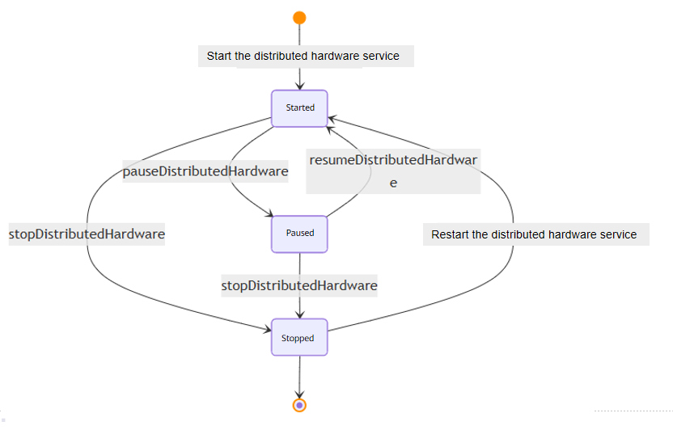

# @ohos.distributedHardware.hardwareManager (Distributed Hardware Management) (System API)
<!--Kit: Distributed Service Kit-->
<!--Subsystem: DistributedHardware-->
<!--Owner: @hwzhangchuang-->
<!--Designer: @hwzhangchuang-->
<!--Tester: @zhaodengqi-->
<!--Adviser: @hu-zhiqiong-->
<!-- md-trans-meta sourceCommit=0497207d7b71549760d29800f6f838e9f57796b7 translatedAt=2026-11-04T05:30:46.140Z pushedAt=2026-11-04T10:12:33.571Z nl=1 -->

The distributed hardware management module provides the capability to control distributed hardware, including pausing, resuming, and stopping the distributed hardware service on the controlled device. This module can temporarily stop the synchronization of distributed hardware (for example, pausing the connection of a distributed camera or microphone), release or restore hardware resources in specific situations, and optimize resource utilization. When users need to save resources on the controlled device or reduce power consumption, they can pause the service to reduce the impact on the controlled device. When the service needs to be re-enabled, it can be quickly resumed or restarted. The module supports controlling various distributed hardware types such as cameras, screens, microphones, and speakers, supports fine-grained control based on the source device, and provides asynchronous operation APIs to ensure that the main process is not affected.

**Service state transition diagram:**



> **NOTE**
>
> The initial APIs of this module are supported since API version 11. Newly added APIs will be marked with a superscript to indicate their earliest API version.
>
> The APIs provided by this module are system APIs.

## Modules to Import

```js
import { hardwareManager } from '@kit.DistributedServiceKit';
```

## HardwareDescriptor

Represents the distributed hardware information.

**Required permissions**: ohos.permission.ACCESS_DISTRIBUTED_HARDWARE

**System capability**: SystemCapability.DistributedHardware.DistributedHardwareFWK

| Name        | Type                                               | Read-Only| Optional| Description                                                        |
| ------------ | --------------------------------------------------- | ---- | ---- | ------------------------------------------------------------ |
| type         | [DistributedHardwareType](#distributedhardwaretype) | No   | No   | Specifies the type of distributed hardware to operate, which determines the hardware scope of the pause, resume, or stop operation. For example, when set to CAMERA, only the distributed camera is operated; when set to ALL, all distributed hardware is operated. Before using this parameter, ensure that the corresponding distributed hardware service has been started. |
| srcNetworkId | string                                              | No   | Yes  | Indicates the source device. When it is a valid device network ID string, the hardware of the specified type on the specified source device is operated; when it is not provided or an empty string is passed, all source devices are indicated. If an invalid value is passed, Error Code 401 is returned. |

## DistributedHardwareType

Enumerates the types of the distributed hardware.

**System capability**: SystemCapability.DistributedHardware.DistributedHardwareFWK

| Name         | Value  | Description                        |
| :------------ | ---- | ---------------------------- |
| ALL           | 0    | All distributed hardware.        |
| CAMERA        | 1    | Distributed camera.            |
| SCREEN        | 8    | Distributed screen.            |
| MODEM_MIC     | 256  | Distributed microphone for mobile calls.|
| MODEM_SPEAKER | 512  | Distributed speaker for mobile calls.|
| MIC           | 1024 | Distributed microphone.          |
| SPEAKER       | 2048 | Distributed speaker.          |

## DistributedHardwareErrorCode

Enumerates the error codes used for the distributed hardware.

**System capability**: SystemCapability.DistributedHardware.DistributedHardwareFWK

| Name                                     | Value      | Description                  |
| ----------------------------------------- | -------- | ---------------------- |
| ERR_CODE_DISTRIBUTED_HARDWARE_NOT_STARTED | 24200101 | Indicates that the specified distributed hardware service is not started. |
| ERR_CODE_DEVICE_NOT_CONNECTED             | 24200102 | Indicates that the specified source device is not connected.   |

## hardwareManager.pauseDistributedHardware

pauseDistributedHardware(description: HardwareDescriptor): Promise&lt;void&gt;

Pauses the distributed hardware service on the controlled device. The controlled device refers to a remote device connected through distributed capabilities, and the distributed hardware service refers to hardware functions such as cameras and microphones invoked through distributed capabilities. This API uses a promise to return the result asynchronously. After pausing, you can call resumeDistributedHardware to resume the service or stopDistributedHardware to stop the service. Before calling this API, ensure that the distributed hardware has been started. Usage scenario: temporarily pausing the hardware functions of certain devices in a multi-device collaboration scenario (for example, pausing a remote camera to save bandwidth); pausing non-critical distributed hardware to release resources when system resources are tight; temporarily stopping the current hardware synchronization when switching device configurations.

**Required permissions**: ohos.permission.ACCESS_DISTRIBUTED_HARDWARE

**System capability**: SystemCapability.DistributedHardware.DistributedHardwareFWK

**Parameters**

| Name      | Type                                      | Mandatory  | Description      |
| --------- | ---------------------------------------- | ---- | -------- |
| description | [HardwareDescriptor](#hardwaredescriptor) | Required | Hardware description used to specify the distributed hardware type and source device to operate. |

**Return value**

| Type                 | Description              |
| ------------------- | ---------------- |
| Promise&lt;void&gt; | Promise object. No return result is returned when the asynchronous operation succeeds; an error code and error message are returned when it fails. |

**Error codes**

| ID| Error Message                                            |
| -------- | ---------------------------------------------------- |
| 201      | Permission verification failed.                      |
| 202      | Permission denied, non-system app called system api. |
| 401      | Input parameter error.                               |
| 24200101 | The specified distributed hardware is not started.   |
| 24200102 | The specified source device is not connected.        |

**Example**

  ```ts
  import { hardwareManager } from '@kit.DistributedServiceKit';
  import { BusinessError } from '@kit.BasicServicesKit';
  
  try {
    let description: hardwareManager.HardwareDescriptor = {
      type: 1, // Distributed hardware type. 1 indicates the camera.
      srcNetworkId: '1111' // Network ID of the source device.
    };
    hardwareManager.pauseDistributedHardware(description).then(() => { // Pause the distributed hardware service.
      console.info('pause distributed hardware successfully');
    }).catch((error: BusinessError) => {
      console.error(`pause distributed hardware failed, cause: ${error.code}, message: ${error.message}`);
    });
  } catch (error) {
    const err: BusinessError = error as BusinessError;
    console.error(`pause distributed hardware failed, code: ${err.code}, message: ${err.message}`);
  }
  ```

## hardwareManager.resumeDistributedHardware

resumeDistributedHardware(description: HardwareDescriptor): Promise&lt;void&gt;

Resumes the distributed hardware service on the controlled device. The distributed hardware service corresponding to the controlled device resumes normal operation. This API uses a promise to return the result asynchronously. It must be called after pauseDistributedHardware pauses the service, and is used to resume the paused service. Before calling this API, ensure that the distributed hardware has been started. Usage scenario: when the paused hardware functions need to be re-enabled in a multi-device collaboration scenario; when non-critical distributed hardware is reactivated after system resources are restored; when hardware synchronization is resumed after device configuration switching is complete.

**Required permissions**: ohos.permission.ACCESS_DISTRIBUTED_HARDWARE

**System capability**: SystemCapability.DistributedHardware.DistributedHardwareFWK

**Parameters**

| Name     | Type                                     | Mandatory| Description          |
| ----------- | ----------------------------------------- | ---- | -------------- |
| Description | [HardwareDescriptor](#hardwaredescriptor) | Yes | Hardware description used to specify the distributed hardware type and source device to operate. |

**Return value**

| Type               | Description                     |
| ------------------- | ------------------------- |
| Promise&lt;void&gt; | Promise object. No return result is returned when the asynchronous operation succeeds; an error code and error message are returned when it fails. |

**Error codes**

| ID| Error Message                                            |
| -------- | ---------------------------------------------------- |
| 201      | Permission verification failed.                      |
| 202      | Permission denied, non-system app called system api. |
| 401      | Input parameter error.                               |
| 24200101 | The specified distributed hardware is not started.   |
| 24200102 | The specified source device is not connected.        |

**Example**

  ```ts
  import { hardwareManager } from '@kit.DistributedServiceKit';
  import { BusinessError } from '@kit.BasicServicesKit';

  try {
    let description: hardwareManager.HardwareDescriptor = {
      type: 1, // Distributed hardware type. 1 indicates camera.
      srcNetworkId: '1111' // Network ID of the source device.
    };
    hardwareManager.resumeDistributedHardware(description).then(() => { // Resume the distributed hardware service.
      console.info('resume distributed hardware successfully');
    }).catch((error: BusinessError) => {
      console.error(`resume distributed hardware failed, cause: ${error.code}, message: ${error.message}`);
    });
  } catch (error) {
    const err: BusinessError = error as BusinessError;
    console.error(`resume distributed hardware failed, code: ${err.code}, message: ${err.message}`);
  }


  ```

## hardwareManager.stopDistributedHardware

stopDistributedHardware(description: HardwareDescriptor): Promise&lt;void&gt;

Stops the distributed hardware service on the controlled device. The distributed hardware service corresponding to the controlled device is stopped. This API uses a promise to return the result asynchronously. After stopping, the service cannot be resumed through resumeDistributedHardware. The distributed hardware service needs to be restarted, and pauseDistributedHardware or resumeDistributedHardware can no longer be called. Before calling this API, ensure that the distributed hardware has been started. Usage scenario: when the application exits or no longer needs the distributed hardware functions; when the user actively disables the distributed hardware service; when the device is disconnected and the distributed hardware resources need to be released.

**Required permissions**: ohos.permission.ACCESS_DISTRIBUTED_HARDWARE

**System capability**: SystemCapability.DistributedHardware.DistributedHardwareFWK

**Parameters**

| Name     | Type                                     | Mandatory| Description          |
| ----------- | ----------------------------------------- | ---- | -------------- |
| description | [HardwareDescriptor](#hardwaredescriptor) | Yes | Hardware description used to specify the distributed hardware type and source device to operate. |

**Return value**

| Type               | Description                     |
| ------------------- | ------------------------- |
| Promise&lt;void&gt; | Promise object. No return result is returned when the asynchronous operation succeeds; an error code and error message are returned when it fails. |

**Error codes**

| ID| Error Message                                            |
| -------- | ---------------------------------------------------- |
| 201      | Permission verification failed.                      |
| 202      | Permission denied, non-system app called system api. |
| 401      | Input parameter error.                               |
| 24200101 | The specified distributed hardware is not started.   |
| 24200102 | The specified source device is not connected.        |

**Example**

  ```ts
  import { hardwareManager } from '@kit.DistributedServiceKit';
  import { BusinessError } from '@kit.BasicServicesKit';
  
  try {
    let description: hardwareManager.HardwareDescriptor = {
      type: 1,  // Distributed hardware type. 1 indicates a camera.
      srcNetworkId: '1111' // Network ID of the source device.
    };
    hardwareManager.stopDistributedHardware(description).then(() => { // Stop the distributed hardware service.
      console.info('stop distributed hardware successfully');
    }).catch((error: BusinessError) => {
      console.error(`stop distributed hardware failed, cause: ${error.code}, message: ${error.message}`);
    });
  } catch (error) {
    const err: BusinessError = error as BusinessError;
    console.error(`stop distributed hardware failed, code: ${err.code}, message: ${err.message}`);
  }
  ```
