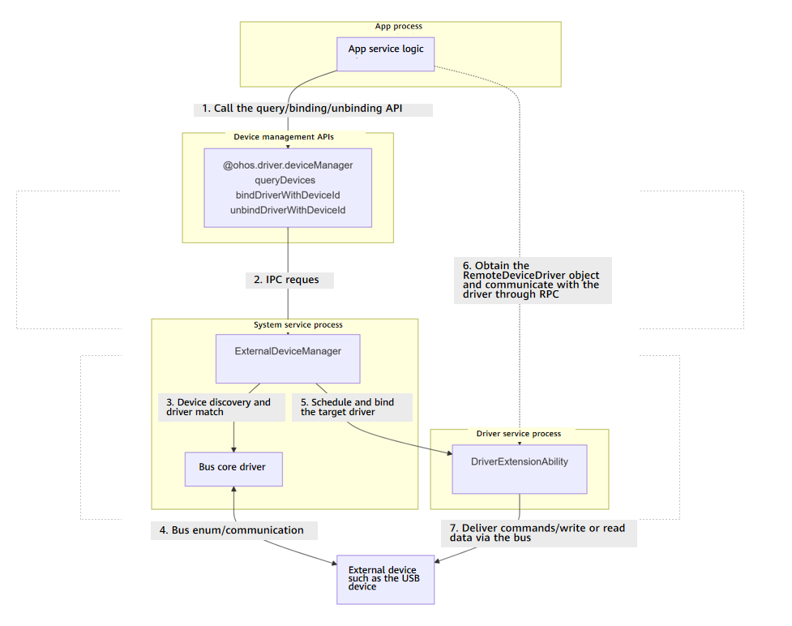

# @ohos.driver.deviceManager(Peripheral Management)

This module is a collection of device management APIs provided by Driver Development Kit. It allows you to query information about external devices and bind or unbind apps to or from peripheral drivers. The APIs of this module can be used to implement the following functions:

- Queries the list of connected peripherals in the system.  
- Binds a specified peripheral and obtains the remote driver communication object, so that data can be exchanged with  
the peripheral driver through inter-process communication (IPC).  
- Unbinds the device and releases resources after use.

The peripheral access capability of this module requires the combination of multiple APIs. The typical calling process is as follows: Query the device → Bind the device to obtain the communication object → Interact with the driver through the communication object → Unbind the device to release resources. The lifecycle view of device binding is as follows:



**Since:** 10

<!--Device-unnamed-declare namespace deviceManager--><!--Device-unnamed-declare namespace deviceManager-End-->

**System capability:** SystemCapability.Driver.ExternalDevice

## Modules to Import

```TypeScript
import { deviceManager } from '@kit.DriverDevelopmentKit';
```

## Summary

### Functions

| Name | Description |
| --- | --- |
| [bindDriverWithDeviceId](arkts-driverdevelopment-devicemanager-binddriverwithdeviceid-f.md#binddriverwithdeviceid-1) | Binds a peripheral device based on the device information returned by **queryDevices()**. This API must be used together with **unbindDriverWithDeviceId**. This API uses a promise to return the result. |
| [queryDevices](arkts-driverdevelopment-devicemanager-querydevices-f.md#querydevices-1) | Queries the list of peripheral devices. If the device has no peripheral device connected, an empty list is returned. |
| [unbindDriverWithDeviceId](arkts-driverdevelopment-devicemanager-unbinddriverwithdeviceid-f.md#unbinddriverwithdeviceid-1) | Unbinds a device. Before calling this method, you must call **bindDriverWithDeviceId** to bind the device. This API uses a promise to return the result. |
| [bindDevice](arkts-driverdevelopment-devicemanager-binddevice-f.md#binddevice-1) | Binds a peripheral device based on the device information returned by **queryDevices()**. This function must be used in pairs with **unbindDevice**. |
| [bindDevice](arkts-driverdevelopment-devicemanager-binddevice-f.md#binddevice-2) | Binds a peripheral device based on the device information returned by **queryDevices()**. This function must be used in pairs with **unbindDevice**. This API uses a promise to return the result. |
| [bindDeviceDriver](arkts-driverdevelopment-devicemanager-binddevicedriver-f.md#binddevicedriver-1) | Binds a peripheral device based on the device information returned by **queryDevices()**. This function must be used in pairs with **unbindDevice**. |
| [bindDeviceDriver](arkts-driverdevelopment-devicemanager-binddevicedriver-f.md#binddevicedriver-2) | Binds a peripheral device based on the device information returned by **queryDevices()**. This function must be used in pairs with **unbindDevice**. This API uses a promise to return the result. |
| [unbindDevice](arkts-driverdevelopment-devicemanager-unbinddevice-f.md#unbinddevice-1) | Unbinds a peripheral device. You must call **bindDevice** to bind the device first. |
| [unbindDevice](arkts-driverdevelopment-devicemanager-unbinddevice-f.md#unbinddevice-2) | Unbinds a peripheral device. You must call **bindDevice** to bind the device first. This API uses a promise to return the result. |

<!--Del-->
### Functions(System API)

| Name | Description |
| --- | --- |
| [queryDeviceInfo](arkts-driverdevelopment-devicemanager-querydeviceinfo-f-sys.md#querydeviceinfo-1) | Obtains the list of detailed information about peripherals. If the device has no peripheral device connected, an empty list is returned. |
| [queryDriverInfo](arkts-driverdevelopment-devicemanager-querydriverinfo-f-sys.md#querydriverinfo-1) | Obtains the list of detailed information about peripheral drivers. If the device has no peripheral device connected, an empty list is returned. |
<!--DelEnd-->

### Interfaces

| Name | Description |
| --- | --- |
| [Device](arkts-driverdevelopment-devicemanager-device-i.md) | Represents the peripheral device information. |
| [RemoteDeviceDriver](arkts-driverdevelopment-devicemanager-remotedevicedriver-i.md) | Represents information about a remote device driver. |
| [USBDevice](arkts-driverdevelopment-devicemanager-usbdevice-i.md) | USB device information, which is inherited from [Device](arkts-driverdevelopment-devicemanager-device-i.md). |

<!--Del-->
### Interfaces(System API)

| Name | Description |
| --- | --- |
| [DeviceInfo](arkts-driverdevelopment-devicemanager-deviceinfo-i-sys.md) | Defines the detailed information about a device. |
| [DriverInfo](arkts-driverdevelopment-devicemanager-driverinfo-i-sys.md) | Defines detailed information about a driver. |
| [USBDeviceInfo](arkts-driverdevelopment-devicemanager-usbdeviceinfo-i-sys.md) | Defines detailed information about the USB device. It is inherited from [DeviceInfo](arkts-driverdevelopment-devicemanager-deviceinfo-i-sys.md). |
| [USBDriverInfo](arkts-driverdevelopment-devicemanager-usbdriverinfo-i-sys.md) | Defines detailed information about the USB device driver. It is inherited from [DriverInfo](arkts-driverdevelopment-devicemanager-driverinfo-i-sys.md). |
| [USBInterfaceDesc](arkts-driverdevelopment-devicemanager-usbinterfacedesc-i-sys.md) | Defines the interface descriptor of a USB device. |
<!--DelEnd-->

### Enums

| Name | Description |
| --- | --- |
| [BusType](arkts-driverdevelopment-devicemanager-bustype-e.md) | Enumerates the device bus types. |
