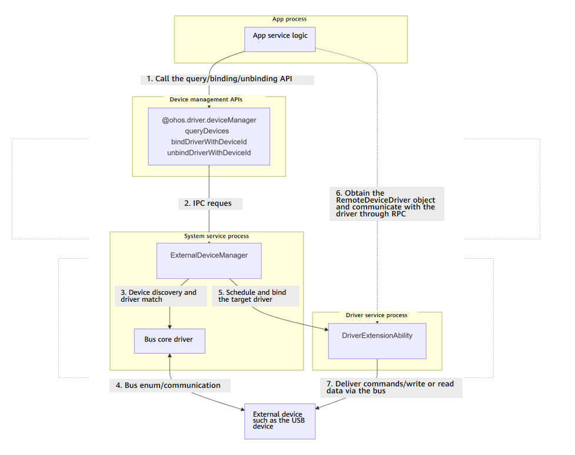

# @ohos.driver.deviceManager (Peripheral Management)
<!--Kit: Driver Development Kit-->
<!--Subsystem: Driver-->
<!--Owner: @zgene94-->
<!--Designer: @w00373942-->
<!--Tester: @dong-dongzhen-->
<!--Adviser: @hu-zhiqiong-->
<!-- md-trans-meta sourceCommit=451e36dee22d047833da6215878b888c723693f0 translatedAt=2026-10-29T12:25:42.347Z pushedAt=2026-10-30T08:16:54.675Z nl=1 -->

This module is a collection of device management APIs provided by Driver Development Kit. It allows you to query information about external devices and bind or unbind apps to or from peripheral drivers. The APIs of this module can be used to implement the following functions:

- Queries the list of connected peripherals in the system.
- Binds a specified peripheral and obtains the remote driver communication object, so that data can be exchanged with the peripheral driver through inter-process communication (IPC).
- Unbinds the device and releases resources after use.

The peripheral access capability of this module requires the combination of multiple APIs. The typical calling process is as follows: Query the device → Bind the device to obtain the communication object → Interact with the driver through the communication object → Unbind the device to release resources. The lifecycle view of device binding is as follows:



>  **NOTE**
> 
> The initial APIs of this module are supported since API version 10. Newly added APIs will be marked with a superscript to indicate their earliest API version. To call the APIs of this module, you need to request **ohos.permission.ACCESS_EXTENSIONAL_DEVICE_DRIVER** for querying, binding, and unbinding or **ohos.permission.ACCESS_DDK_DRIVERS** for the binding and unbinding APIs of the new version.

## Modules to Import

```ts
import { deviceManager } from '@kit.DriverDevelopmentKit';
```

## deviceManager.queryDevices

queryDevices(busType?: number): Array&lt;Readonly&lt;Device&gt;&gt;

Queries the list of peripheral devices. If the device has no peripheral device connected, an empty list is returned.

**Required permissions**: ohos.permission.ACCESS_EXTENSIONAL_DEVICE_DRIVER

**System capability**: SystemCapability.Driver.ExternalDevice

**Parameters**

| Name | Type  | Mandatory| Description                                |
| ------- | ------ | ---- | ------------------------------------ |
| busType | number | No  | Device bus type specified by [BusType](#bustype). If this parameter is left empty, all types of devices are searched.|

**Return value**

| Type                                          | Description          |
| ---------------------------------------------- | -------------- |
| Array&lt;Readonly&lt;[Device](#device)&gt;&gt; | List of peripheral devices obtained.|

**Error codes**

For details about the error codes, see [Universal Error Codes](../errorcode-universal.md) and [Driver Error Codes](errorcode-deviceManager.md).

| ID| Error Message                                |
| -------- | ---------------------------------------- |
| 201      | Permission verification failed. The application does not have the permission required to call the API. |
| 22900001 | ExternalDeviceManager service exception or busType parameter error. |

**Example**

```ts
import { deviceManager } from '@kit.DriverDevelopmentKit';

try {
  let devices: Array<deviceManager.Device> = deviceManager.queryDevices(deviceManager.BusType.USB);
  for (let item of devices) {
    let device: deviceManager.USBDevice = item as deviceManager.USBDevice;
    console.info(`Device id is ${device.deviceId}`);
  }
} catch (error) {
  console.error(`Failed to query device. Code is ${error.code}, message is ${error.message}`);
}
```

## deviceManager.bindDriverWithDeviceId<sup>19+</sup>

bindDriverWithDeviceId(deviceId: number, onDisconnect: AsyncCallback&lt;number&gt;): Promise&lt;RemoteDeviceDriver&gt;

Binds a peripheral device based on the device information returned by **queryDevices()**. This API must be used together with **unbindDriverWithDeviceId**. This API uses a promise to return the result.

You need to use [deviceManager.queryDevices](#devicemanagerquerydevices) to obtain the peripheral device list.

**Required permissions**: ohos.permission.ACCESS_DDK_DRIVERS

**System capability**: SystemCapability.Driver.ExternalDevice

**Parameters**

| Name      | Type                       | Mandatory| Description                        |
| ------------ | --------------------------- | ---- | ---------------------------- |
| deviceId     | number                      | Yes  | Device ID, which can be obtained via [queryDevices](#devicemanagerquerydevices).|
| onDisconnect | AsyncCallback&lt;number&gt; | Yes  | Callback used to return the result. When the bound device is disconnected, the value of **err** is **undefined** and the value of **data** is the ID of the unbound device. Otherwise, **err** is an error object. |

**Return value**

| Type                             | Description                                     |
| --------------------------------- | -----------------------------------------|
| Promise&lt;[RemoteDeviceDriver](#remotedevicedriver11)&gt; | Promise used to return a **RemoteDeviceDriver** object.|

**Error codes**

For details about the error codes, see [Universal Error Codes](../errorcode-universal.md) and [Driver Error Codes](errorcode-deviceManager.md).

| ID| Error Message                                |
| -------- | ---------------------------------------- |
| 201      | Permission verification failed. The application does not have the permission required to call the API. |
| 26300001  | ExternalDeviceManager service exception. |
| 26300002  | The driver service does not allow any client to bind. |

**Example**

```ts
import { deviceManager } from '@kit.DriverDevelopmentKit';
import { BusinessError } from '@kit.BasicServicesKit';

try {
  // For example, deviceId is 12345678. You can use queryDevices() to obtain the deviceId.
  deviceManager.bindDriverWithDeviceId(12345678, (error: BusinessError, data: number) => {
    console.error(`Device is disconnected`);
  }).then((data: deviceManager.RemoteDeviceDriver) => {
    console.info(`bindDriverWithDeviceId success, Device_Id is ${data.deviceId}.
    remote is ${data.remote != null ? data.remote.getDescriptor(): "null"}`);
  }, (error: BusinessError) => {
    console.error(`bindDriverWithDeviceId async fail. Code is ${error.code}, message is ${error.message}`);
  });
} catch (error) {
  console.error(`bindDriverWithDeviceId fail. Code is ${error.code}, message is ${error.message}`);
}
```

## deviceManager.unbindDriverWithDeviceId<sup>19+</sup>

unbindDriverWithDeviceId(deviceId: number): Promise&lt;number&gt;

Unbinds a device. Before calling this method, you must call **bindDriverWithDeviceId** to bind the device. This API uses a promise to return the result.

**Required permissions**: ohos.permission.ACCESS_DDK_DRIVERS

**System capability**: SystemCapability.Driver.ExternalDevice

**Parameters**

| Name  | Type  | Mandatory| Description                          |
| -------- | ------ | ---- | ------------------------------ |
| deviceId | number | Yes  | Device ID, which can be obtained via [queryDevices](#devicemanagerquerydevices).|

**Return value**

| Type                 | Description                     |
| --------------------- | ------------------------- |
| Promise&lt;number&gt; | Promise used to return the ID of the unbound device.|

**Error codes**

For details about the error codes, see [Universal Error Codes](../errorcode-universal.md) and [Driver Error Codes](errorcode-deviceManager.md).

| ID| Error Message                                |
| -------- | ---------------------------------------- |
| 201      | Permission verification failed. The application does not have the permission required to call the API. |
| 26300001 | ExternalDeviceManager service exception. |
| 26300003 | There is no binding relationship. |

**Example**

```ts
import { deviceManager } from '@kit.DriverDevelopmentKit';
import { BusinessError } from '@kit.BasicServicesKit';

try {
  // For example, deviceId is 12345678. You can use queryDevices() to obtain the deviceId.
  deviceManager.unbindDriverWithDeviceId(12345678).then((data: number) => {
    console.info(`unbindDriverWithDeviceId success, Device_Id is ${data}.`);
  }, (error: BusinessError) => {
    console.error(`unbindDriverWithDeviceId async fail. Code is ${error.code}, message is ${error.message}`);
  });
} catch (error) {
  console.error(`unbindDriverWithDeviceId fail. Code is ${error.code}, message is ${error.message}`);
}
```

## deviceManager.bindDevice<sup>(deprecated)</sup>

bindDevice(deviceId: number, onDisconnect: AsyncCallback&lt;number&gt;, callback: AsyncCallback&lt;{deviceId: number; remote: rpc.IRemoteObject;}&gt;): void

Binds a peripheral device based on the device information returned by **queryDevices()**. This function must be used in pairs with **unbindDevice**.

You need to use [deviceManager.queryDevices()](#devicemanagerquerydevices) to obtain the peripheral device list.

> **NOTE**
> This API is supported since API version 10 and deprecated since API version 19. You are advised to use [deviceManager.bindDriverWithDeviceId](#devicemanagerbinddriverwithdeviceid19) instead.

**Required permissions**: ohos.permission.ACCESS_EXTENSIONAL_DEVICE_DRIVER

**System capability**: SystemCapability.Driver.ExternalDevice

**Parameters**

| Name      | Type                                                                                                | Mandatory| Description                                  |
| ------------ | ---------------------------------------------------------------------------------------------------- | ---- | -------------------------------------- |
| deviceId     | number                                                                                               | Yes  | Device ID, which can be obtained via [queryDevices](#devicemanagerquerydevices).          |
| onDisconnect | AsyncCallback&lt;number&gt;  | Yes  | Callback used to return the result. When the bound device is disconnected, the value of **err** is **undefined** and the value of **data** is the ID of the unbound device. Otherwise, **err** is an error object.                    |
| callback     | AsyncCallback&lt;{deviceId: number; remote: [rpc.IRemoteObject](../apis-ipc-kit/js-apis-rpc.md#iremoteobject);}&gt; | Yes  | Callback used to return the result. When the device is bound successfully, **err** is **undefined**, and **data** contains the device ID and the bound device driver communication object. Otherwise, **err** is an error object.|

**Error codes**

For details about the error codes, see [Universal Error Codes](../errorcode-universal.md) and [Driver Error Codes](errorcode-deviceManager.md).

| ID| Error Message                                |
| -------- | ---------------------------------------- |
| 201      | Permission verification failed. The application does not have the permission required to call the API. |
| 401      | Parameter error. Possible causes: 1.Mandatory parameters are left unspecified. 2.Incorrect parameter types. 3.Parameter verification failed. |
| 22900001 | ExternalDeviceManager service exception. |

**Example**

```ts
import { deviceManager } from '@kit.DriverDevelopmentKit';
import { BusinessError } from '@kit.BasicServicesKit';
import { rpc } from '@kit.IPCKit';

interface DataType {
  deviceId: number;
  remote: rpc.IRemoteObject;
}

try {
  // For example, deviceId is 12345678. You can use queryDevices() to obtain the deviceId.
  deviceManager.bindDevice(12345678, (error: BusinessError, data: number) => {
    console.error(`Device is disconnected`);
  }, (error: BusinessError, data: DataType) => {
    if (error) {
      console.error(`bindDevice async fail. Code is ${error.code}, message is ${error.message}`);
      return;
    }
    console.info(`bindDevice success`);
  });
} catch (error) {
  console.error(`bindDevice fail. Code is ${error.code}, message is ${error.message}`);
}
```

## deviceManager.bindDeviceDriver<sup>(deprecated)</sup>
bindDeviceDriver(deviceId: number, onDisconnect: AsyncCallback&lt;number&gt;, callback: AsyncCallback&lt;RemoteDeviceDriver&gt;): void

Binds a peripheral device based on the device information returned by **queryDevices()**. This function must be used in pairs with **unbindDevice**.

You need to use [deviceManager.queryDevices()](#devicemanagerquerydevices) to obtain the peripheral device list.

> **NOTE**
> This API is supported since API version 11 and deprecated since API version 19. You are advised to use [deviceManager.bindDriverWithDeviceId](#devicemanagerbinddriverwithdeviceid19) instead.

**Required permissions**: ohos.permission.ACCESS_EXTENSIONAL_DEVICE_DRIVER

**System capability**: SystemCapability.Driver.ExternalDevice

**Parameters**

| Name      | Type                       | Mandatory| Description                        |
| ------------ | --------------------------- | ---- | ---------------------------- |
| deviceId     | number                      | Yes  | Device ID, which can be obtained via [queryDevices](#devicemanagerquerydevices).|
| onDisconnect | AsyncCallback&lt;number&gt; | Yes  | Callback used to return the result. When the bound device is disconnected, the value of **err** is **undefined** and the value of **data** is the ID of the unbound device. Otherwise, **err** is an error object.    |
| callback     | AsyncCallback&lt;[RemoteDeviceDriver](#remotedevicedriver11)&gt;| Yes| Callback used to return the result. When the device driver is successfully bound, **err** is **undefined** and **data** is a [RemoteDeviceDriver](#remotedevicedriver11) object that contains the device ID and remote object. Otherwise, **err** is an error object.|

**Error codes**

For details about the error codes, see [Universal Error Codes](../errorcode-universal.md) and [Driver Error Codes](errorcode-deviceManager.md).

| ID| Error Message                                |
| -------- | ---------------------------------------- |
| 201      | Permission verification failed. The application does not have the permission required to call the API. |
| 401      | Parameter error. Possible causes: 1.Mandatory parameters are left unspecified. 2.Incorrect parameter types. 3.Parameter verification failed. |
| 22900001 | ExternalDeviceManager service exception. |

**Example**

```ts
import { deviceManager } from '@kit.DriverDevelopmentKit';
import { BusinessError } from '@kit.BasicServicesKit';

try {
  // For example, deviceId is 12345678. You can use queryDevices() to obtain the deviceId.
  deviceManager.bindDeviceDriver(12345678, (error: BusinessError, data: number) => {
    console.error(`Device is disconnected`);
  }, (error: BusinessError, data: deviceManager.RemoteDeviceDriver) => {
    if (error) {
      console.error(`bindDeviceDriver async fail. Code is ${error.code}, message is ${error.message}`);
      return;
    }
    console.info(`bindDeviceDriver success`);
  });
} catch (error) {
  console.error(`bindDeviceDriver fail. Code is ${error.code}, message is ${error.message}`);
}
```

## deviceManager.bindDevice<sup>(deprecated)</sup>

bindDevice(deviceId: number, onDisconnect: AsyncCallback&lt;number&gt;): Promise&lt;{deviceId: number; remote: rpc.IRemoteObject;}&gt;

Binds a peripheral device based on the device information returned by **queryDevices()**. This function must be used in pairs with **unbindDevice**. This API uses a promise to return the result.

You need to use [deviceManager.queryDevices](#devicemanagerquerydevices) to obtain the peripheral device list.

> **NOTE**
> This API is supported since API version 10 and deprecated since API version 19. You are advised to use [deviceManager.bindDriverWithDeviceId](#devicemanagerbinddriverwithdeviceid19) instead.

**Required permissions**: ohos.permission.ACCESS_EXTENSIONAL_DEVICE_DRIVER

**System capability**: SystemCapability.Driver.ExternalDevice

**Parameters**

| Name      | Type                       | Mandatory| Description                        |
| ------------ | --------------------------- | ---- | ---------------------------- |
| deviceId     | number                      | Yes  | Device ID, which can be obtained via [queryDevices](#devicemanagerquerydevices).|
| onDisconnect | AsyncCallback&lt;number&gt; | Yes  | Callback used to return the result. When the bound device is disconnected, the value of **err** is **undefined** and the value of **data** is the ID of the unbound device. Otherwise, **err** is an error object.          |

**Return value**

| Type                                                                                          | Description                                        |
| ---------------------------------------------------------------------------------------------- | -------------------------------------------- |
| Promise&lt;{deviceId: number; remote: [rpc.IRemoteObject](../apis-ipc-kit/js-apis-rpc.md#iremoteobject);}&gt; | Promise used to return an object containing the device ID and **IRemoteObject**.|

**Error codes**

For details about the error codes, see [Universal Error Codes](../errorcode-universal.md) and [Driver Error Codes](errorcode-deviceManager.md).

| ID| Error Message                                |
| -------- | ---------------------------------------- |
| 201      | Permission verification failed. The application does not have the permission required to call the API. |
| 401      | Parameter error. Possible causes: 1.Mandatory parameters are left unspecified. 2.Incorrect parameter types. 3.Parameter verification failed. |
| 22900001 | ExternalDeviceManager service exception. |

**Example**

```ts
import { deviceManager } from '@kit.DriverDevelopmentKit';
import { BusinessError } from '@kit.BasicServicesKit';

try {
  // For example, deviceId is 12345678. You can use queryDevices() to obtain the deviceId.
  deviceManager.bindDevice(12345678, (error: BusinessError, data: number) => {
    console.error(`Device is disconnected`);
  }).then(data => {
    console.info(`bindDevice success, Device_Id is ${data.deviceId}.
    remote is ${data.remote != null ? data.remote.getDescriptor(): "null"}`);
  }, (error: BusinessError) => {
    console.error(`bindDevice async fail. Code is ${error.code}, message is ${error.message}`);
  });
} catch (error) {
  console.error(`bindDevice fail. Code is ${error.code}, message is ${error.message}`);
}
```

## deviceManager.bindDeviceDriver<sup>(deprecated)</sup>

bindDeviceDriver(deviceId: number, onDisconnect: AsyncCallback&lt;number&gt;): Promise&lt;RemoteDeviceDriver&gt;

Binds a peripheral device based on the device information returned by **queryDevices()**. This function must be used in pairs with **unbindDevice**. This API uses a promise to return the result.

You need to use [deviceManager.queryDevices](#devicemanagerquerydevices) to obtain the peripheral device list.

> **NOTE**
> This API is supported since API version 11 and deprecated since API version 19. You are advised to use [deviceManager.bindDriverWithDeviceId](#devicemanagerbinddriverwithdeviceid19) instead.

**Required permissions**: ohos.permission.ACCESS_EXTENSIONAL_DEVICE_DRIVER

**System capability**: SystemCapability.Driver.ExternalDevice

**Parameters**

| Name      | Type                       | Mandatory| Description                        |
| ------------ | --------------------------- | ---- | ---------------------------- |
| deviceId     | number                      | Yes  | Device ID, which can be obtained via [queryDevices](#devicemanagerquerydevices).|
| onDisconnect | AsyncCallback&lt;number&gt; | Yes  | Callback used to return the result. When the bound device is disconnected, the value of **err** is **undefined** and the value of **data** is the ID of the unbound device. Otherwise, **err** is an error object.          |

**Return value**

| Type                             | Description                                     |
| --------------------------------- | -----------------------------------------|
| Promise&lt;[RemoteDeviceDriver](#remotedevicedriver11)&gt; | Promise used to return a **RemoteDeviceDriver** object.|

**Error codes**

For details about the error codes, see [Universal Error Codes](../errorcode-universal.md) and [Driver Error Codes](errorcode-deviceManager.md).

| ID| Error Message                                |
| -------- | ---------------------------------------- |
| 201      | Permission verification failed. The application does not have the permission required to call the API. |
| 401      | Parameter error. Possible causes: 1.Mandatory parameters are left unspecified. 2.Incorrect parameter types. 3.Parameter verification failed. |
| 22900001 | ExternalDeviceManager service exception. |

**Example**

```ts
import { deviceManager } from '@kit.DriverDevelopmentKit';
import { BusinessError } from '@kit.BasicServicesKit';

try {
  // For example, deviceId is 12345678. You can use queryDevices() to obtain the deviceId.
  deviceManager.bindDeviceDriver(12345678, (error: BusinessError, data: number) => {
    console.error(`Device is disconnected`);
  }).then((data: deviceManager.RemoteDeviceDriver) => {
    console.info(`bindDeviceDriver success, Device_Id is ${data.deviceId}.
    remote is ${data.remote != null ? data.remote.getDescriptor(): "null"}`);
  }, (error: BusinessError) => {
    console.error(`bindDeviceDriver async fail. Code is ${error.code}, message is ${error.message}`);
  });
} catch (error) {
  console.error(`bindDeviceDriver fail. Code is ${error.code}, message is ${error.message}`);
}
```

## deviceManager.unbindDevice<sup>(deprecated)</sup>

unbindDevice(deviceId: number, callback: AsyncCallback&lt;number&gt;): void

Unbinds a peripheral device. You must call **bindDevice** to bind the device first.

> **NOTE**
> This API is supported since API version 10 and deprecated since API version 19. You are advised to use [deviceManager.unbindDriverWithDeviceId](#devicemanagerunbinddriverwithdeviceid19) instead.

**Required permissions**: ohos.permission.ACCESS_EXTENSIONAL_DEVICE_DRIVER

**System capability**: SystemCapability.Driver.ExternalDevice

**Parameters**

| Name  | Type                       | Mandatory| Description                          |
| -------- | --------------------------- | ---- | ------------------------------ |
| deviceId | number                      | Yes  | Device ID, which can be obtained via [queryDevices](#devicemanagerquerydevices).|
| callback | AsyncCallback&lt;number&gt; | Yes  | Callback used to return the result. When the bound device is disconnected, the value of **err** is **undefined** and the value of **data** is the ID of the unbound device. Otherwise, **err** is an error object.              |

**Error codes**

For details about the error codes, see [Universal Error Codes](../errorcode-universal.md) and [Driver Error Codes](errorcode-deviceManager.md).

| ID| Error Message                                |
| -------- | ---------------------------------------- |
| 201      | Permission verification failed. The application does not have the permission required to call the API. |
| 401      | Parameter error. Possible causes: 1.Mandatory parameters are left unspecified. 2.Incorrect parameter types. |
| 22900001 | ExternalDeviceManager service exception. |

**Example**

```ts
import { deviceManager } from '@kit.DriverDevelopmentKit';
import { BusinessError } from '@kit.BasicServicesKit';

try {
  // For example, deviceId is 12345678. You can use queryDevices() to obtain the deviceId.
  deviceManager.unbindDevice(12345678, (error: BusinessError, data: number) => {
    if (error) {
      console.error(`unbindDevice async fail. Code is ${error.code}, message is ${error.message}`);
      return;
    }
    console.info(`unbindDevice success`);
  });
} catch (error) {
  console.error(`unbindDevice fail. Code is ${error.code}, message is ${error.message}`);
}
```

## deviceManager.unbindDevice<sup>(deprecated)</sup>

unbindDevice(deviceId: number): Promise&lt;number&gt;

Unbinds a peripheral device. You must call **bindDevice** to bind the device first. This API uses a promise to return the result.

> **NOTE**
> This API is supported since API version 10 and deprecated since API version 19. You are advised to use [deviceManager.unbindDriverWithDeviceId](#devicemanagerunbinddriverwithdeviceid19) instead.

**Required permissions**: ohos.permission.ACCESS_EXTENSIONAL_DEVICE_DRIVER

**System capability**: SystemCapability.Driver.ExternalDevice

**Parameters**

| Name  | Type  | Mandatory| Description                          |
| -------- | ------ | ---- | ------------------------------ |
| deviceId | number | Yes  | Device ID, which can be obtained via [queryDevices](#devicemanagerquerydevices).|

**Error codes**

For details about the error codes, see [Universal Error Codes](../errorcode-universal.md) and [Driver Error Codes](errorcode-deviceManager.md).

| ID| Error Message                                |
| -------- | ---------------------------------------- |
| 201      | Permission verification failed. The application does not have the permission required to call the API. |
| 401      | Parameter error. Possible causes: 1.Mandatory parameters are left unspecified. 2.Incorrect parameter types. 3.Parameter verification failed. |
| 22900001 | ExternalDeviceManager service exception. |

**Return value**

| Type                 | Description                     |
| --------------------- | ------------------------- |
| Promise&lt;number&gt; | Promise used to return the ID of the unbound device.|

**Example**

```ts
import { deviceManager } from '@kit.DriverDevelopmentKit';
import { BusinessError } from '@kit.BasicServicesKit';

try {
  // For example, deviceId is 12345678. You can use queryDevices() to obtain the deviceId.
  deviceManager.unbindDevice(12345678).then((data: number) => {
    console.info(`unbindDevice success, Device_Id is ${data}.`);
  }, (error: BusinessError) => {
    console.error(`unbindDevice async fail. Code is ${error.code}, message is ${error.message}`);
  });
} catch (error) {
  console.error(`unbindDevice fail. Code is ${error.code}, message is ${error.message}`);
}
```

## Device

Represents the peripheral device information.

**System capability**: SystemCapability.Driver.ExternalDevice

| Name       | Type               | Read-Only| Optional| Description      |
| ----------- | ------------------- | ---- | ---- | ---------- |
| busType     | [BusType](#bustype) | No  | No  | Bus type.|
| deviceId    | number              | No  | No  | ID of the peripheral device.  |
| description | string              | No  | No  | Description of the peripheral device.|

## USBDevice

USB device information, which is inherited from [Device](#device).

**System capability**: SystemCapability.Driver.ExternalDevice

| Name     | Type  | Read-Only| Optional| Description               |
| --------- | ------ | ---- | ---- | ------------------- |
| vendorId  | number | No  | No  | Vendor ID of the USB device. |
| productId | number | No  | No  | Product ID of the USB device.|

## BusType

Enumerates the device bus types.

**System capability**: SystemCapability.Driver.ExternalDevice

| Name| Value | Description         |
| ---- | --- | ------------- |
| USB  | 1   | USB bus.|

## RemoteDeviceDriver<sup>11+</sup>

Represents information about a remote device driver.

**System capability**: SystemCapability.Driver.ExternalDevice

| Name     | Type  | Read-Only| Optional| Description               |
| --------- | ------ | ---- | ---- | ------------------- |
| deviceId  | number | No   | No   | Device ID.  |
| remote | [rpc.IRemoteObject](../apis-ipc-kit/js-apis-rpc.md#iremoteobject) | No   | No   | Remote driver communication object. |