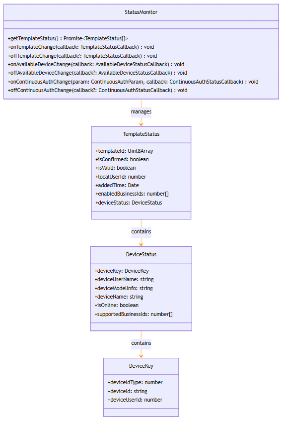

# @ohos.userIAM.companionDeviceAuth (Companion Device Authentication) (System API)
<!--Kit: User Authentication Kit-->
<!--Subsystem: UserIAM-->
<!--Owner: @WALL_EYE-->
<!--Designer: @lichangting518-->
<!--Tester: @jane_lz-->
<!--Adviser: @zengyawen-->
<!-- md-trans-meta sourceCommit=2ef498c443c82602fb8e12e0f5348710a2368dcd translatedAt=2026-10-19T10:27:32.904Z pushedAt=2026-10-19T11:36:36.154Z nl=1 -->

The **companionDeviceAuth** module is an important part of the OpenHarmony user identity and access management (UserIAM) system. It is dedicated to companion device authentication management. This module provides the system application with capabilities such as querying and subscribing to companion devices, and managing the business scope.

Design logic: Companion device authentication adopts a collaboration model between the primary device (Host) and the companion device (Companion). The primary device adds another device as a companion device through a binding process, during which both ends complete key agreement and distribute the initial authentication token. Authentication modes include token authentication and agency authentication: token authentication computes a message authentication code (MAC) based on the token issued by the primary device to the companion device to complete identity verification; agency authentication has the primary device delegate the companion device to perform local authentication and return the result. The token issued by the primary device carries the authentication trust level (**authTrustLevel**), and the token lifecycle includes the stages of issuance, timeout, revocation, and associated device offline. The authentication status of the companion device is jointly determined by the token lifecycle and the authentication retention status (such as wearing status, connection status, and so on). Applications subscribe to template status, available device changes, and continuous authentication status through status monitors, and the system proactively notifies changes through callbacks.

This module applies to the following scenarios:
- Managing the authentication relationship between a companion device and the primary device.
- Querying and subscribing to the status changes of a companion device.
- Managing the business scope supported by a companion device.
- Implementing continuous authentication.
- Processing device selection and registration.

> **NOTE**
> 
> - The initial APIs of this module are supported since API version 23. Newly added APIs will be marked with a superscript to indicate their earliest API version.
> - The APIs provided by this module are system APIs.

## Key Classes and APIs

### Key Enums

- **[BusinessId](#businessid)**: Enumerates business IDs, which are used to identify the business scenarios supported by the companion device (for example, executing voice commands without unlocking the device).
- **[DeviceIdType](#deviceidtype)**: Enumerates device ID types (for example, unified device ID).
- **[SelectPurpose](#selectpurpose)**: Enumerates the purposes for selecting a companion device (for example, adding a template or selecting an authentication device).

### Key APIs

- **[DeviceKey](#devicekey)**: Defines key device information, including the device ID type, device ID, device user ID, and device sub-identity credential ID.
- **[DeviceStatus](#devicestatus)**: Defines the device status, including the device key, device user name, device model, device name, online status, list of supported business IDs, and device sub-identity credential name.
- **[TemplateStatus](#templatestatus)**: Defines the template status, including the template ID, real-time data ID, validity flag, local user ID, adding time, list of supported business IDs, and device status.
- **[ContinuousAuthParam](#continuousauthparam)**: Defines continuous authentication parameters.
- **[DeviceSelectResult](#deviceselectresult)**: Defines the device selection result.
- **[PasscodePromptParams](#passcodepromptparams)**: Defines the parameters of a passcode input request.

### Key Callbacks

- **[TemplateStatusCallback](#templatestatuscallback)**: Defines the template status callback.
- **[ContinuousAuthStatusCallback](#continuousauthstatuscallback)**: Defines the continuous authentication status callback.
- **[AvailableDeviceStatusCallback](#availabledevicestatuscallback)**: Defines the available device status callback.
- **[DeviceSelectCallback](#deviceselectcallback)**: Defines the device selection callback.
- **[PasscodeSubmitCallback](#passcodesubmitcallback)**: Defines the passcode submission callback.
- **[PasscodePromptCallback](#passcodepromptcallback)**: Defines the passcode request callback.

### Key Classes

- **[StatusMonitor](#statusmonitor)**: Defines the status monitor class, which is used to query and subscribe to collaboration template information.



## APIs Used in Combination

The typical process of using the **companionDeviceAuth** module is as follows:

```ts
// The following is the pseudocode for describing the calling logic. It provides only the step description and does not provide detailed executable code.
// 1. Obtain the status monitor.
let statusMonitor = companionDeviceAuth.getStatusMonitor(localUserId);

// 2. Obtain the current template status.
let templateStatusList = await statusMonitor.getTemplateStatus();

// 3. Subscribe to the template status change event.
statusMonitor.onTemplateChange((templateStatusList) => {
  // Handle the template status change.
});

// 4. Subscribe to the available device status change event.
statusMonitor.onAvailableDeviceChange((deviceStatusList) => {
  // Handle the device status change.
});

// 5. Subscribe to the continuous authentication status change event.
let authParam = { templateId: specificTemplateId };
statusMonitor.onContinuousAuthChange(authParam, (isAuthPassed, authTrustLevel) => {
  // Handle the continuous authentication status change.
});

// 6. Register the device selection callback.
companionDeviceAuth.registerDeviceSelectCallback((selectPurpose) => {
  // Return the device selection result.
  return deviceSelectResult;
});

// 7. Update the business scope supported by the template.
await companionDeviceAuth.updateEnabledBusinessIds(templateId, enabledBusinessIds);

// 8. Unsubscribe from the status change event and unregister the callback.
statusMonitor.offTemplateChange();
statusMonitor.offAvailableDeviceChange();
statusMonitor.offContinuousAuthChange();
companionDeviceAuth.unregisterDeviceSelectCallback();
```

## Modules to Import

```ts
import { companionDeviceAuth } from '@kit.UserAuthenticationKit';
```

## BusinessId

Enumerates business IDs. A business ID uniquely identifies a business scenario supported by the companion device. The business scenarios supported by different companion devices vary according to the authentication security. For example, executing voice commands without screen unlocking.

The companion device relationships of different business IDs are independent of each other and do not interfere with each other. They can be added, deleted, and authenticated independently.

The current services of the companion device module include business scenarios such as screen lock unlocking, app lock unlocking, and identity authentication before voice commands are executed on the lock screen.

Adding services has requirements on the scenarios supported by the server device. For example, the multi-screen collaboration service requires that the server device support the agency authentication scenario.

**Model restriction**: This API can be used only in the stage model.

**System capability**: SystemCapability.UserIAM.UserAuth.CompanionDeviceAuth

**System API**: This is a system API.

| **Name**| **Value**| **Description**|
| ----------- | ---- | ---------- |
| DEFAULT | 0 | Default business ID. A system-preset default business used for basic Companion Device authentication scenarios. |
| VENDOR_BEGIN | 10000 | Starting value of vendor-defined business IDs. Vendors can define extended business IDs based on this value. The actual value must be greater than or equal to 10000 to avoid conflicts with system-reserved values \[0-9999\]. |

## DeviceIdType

Enumerates device ID types. They are used to define the device service identifier type. System-defined types and vendor-defined types are supported.

**Model restriction**: This API can be used only in the stage model.

**System capability**: SystemCapability.UserIAM.UserAuth.CompanionDeviceAuth

**System API**: This is a system API.

| **Name**| **Value**| **Description**|
| ----------------- | ----- | ------------------------------------------------------------ |
| UNIFIED_DEVICE_ID | 1 | Unified device ID. It is a system-defined device business ID type, used for unified device identification across devices.|
| VENDOR_BEGIN | 10000 | Start value of the vendor-defined device ID type. The vendor can extend device ID types based on this value. The actual value must be greater than or equal to 10000 to avoid conflicts with the reserved system values [1-9999].|

## SelectPurpose

Selects the purpose of the companion device.

**Model restriction**: This API can be used only in the stage model.

**System capability**: SystemCapability.UserIAM.UserAuth.CompanionDeviceAuth

**System API**: This is a system API.

| **Name**| **Value**| **Description**|
| ----------- | ---- | ---------- |
| SELECT_ADD_DEVICE | 1 | Selects a companion device to which the template is to be added. Specifically, the purpose of the current operation is to select a device for adding a new authentication template. The system returns a list of devices suitable for adding a template.|
| SELECT_AUTH_DEVICE | 2 | Selects the companion device that provides the authentication capability. Specifically, the purpose of the current operation is to select a device that has a registered template for authentication. The system returns a list of devices that have the authentication capability.|
| VENDOR_BEGIN | 10000 | Start value of the vendor-defined selection purpose. The vendor can extend the selection purpose based on this value. The actual value must be greater than or equal to 10000 to avoid conflicts with the reserved system values \[0-9999\].|

## DeviceKey

Defines the device identifier. It is used to uniquely identify a device and its user, and contains information such as the device ID type, device ID, device user ID, and device sub-identity credential ID.

**Model restriction**: This API can be used only in the stage model.

**System capability**: SystemCapability.UserIAM.UserAuth.CompanionDeviceAuth

**System API**: This is a system API.

| **Name**| **Type**| **Read-Only**| **Optional**| **Description**|
| ------------ | ---------- | ---- | ---- | -------------------- |
| deviceIdType | number | No| No| Device ID type. It is used to specify the type of the device business ID and can be extended based on [DeviceIdType](#deviceidtype). For example, you can use **UNIFIED_DEVICE_ID(1)** to indicate the unified device ID or use the vendor-defined value (≥ 10000).|
| deviceId | string | No| No| Device ID. It is a string that uniquely identifies a device. The format is determined by the value of **deviceIdType**.|
| deviceUserId | number | No | No | Device user ID. A non-negative integer that identifies a user on the device and distinguishes different users on the device. |
| deviceSubProfileId | number | No | Yes | Device sub-identity credential ID. A non-negative integer that identifies a sub-identity credential on the device and distinguishes different sub-identity credentials under the same user on the same device.<br>**Default value:** -1<br>**Since Version:** 26.0.1 |

## DeviceStatus

Defines the device status information. It is used to describe the current status of a companion device, including the device service identifier, user name, model information, device name, online status, list of supported business IDs, and device sub-identity credential name.

**Model restriction**: This API can be used only in the stage model.

**System capability**: SystemCapability.UserIAM.UserAuth.CompanionDeviceAuth

**System API**: This is a system API.

| **Name**| **Type**| **Read-Only**| **Optional**| **Description**|
| -------------------- | ------------------------- | ---- | ---- | ---------------------- |
| deviceKey | [DeviceKey](#devicekey) | No | No | Key information about the device. It contains the device ID type, device ID, device user ID, and device sub-identity credential ID, serving as the unique identifier of the device. |
| deviceUserName | string | No| No| Device user name. It is the display name of the current user on the device, and is displayed on the device selection screen.|
| deviceModelInfo | string | No| No| Device model information. It identifies the device model, such as the product model and device type.|
| deviceName | string | No| No| Device name. It is the name or alias of a device, and is displayed to the user in the device list.|
| isOnline | boolean | No| No| Device online status. The value **true** indicates that the device is online and can communicate with the primary device. The value **false** indicates that the device is offline and cannot perform authentication interaction.|
| supportedBusinessIds | number[] | No| No| List of business IDs supported by the device. It indicates the business scenarios supported by the device, such as unlocking the screen lock and unlocking the application lock. The business scenarios supported by a device vary depending on the authentication security.|
| deviceSubProfileName | string | No | Yes | Name of the device sub-identity credentials. It corresponds to the nickname of the distributed account, serving as the display name of the foreground sub-identity credentials on the device and used for display on the device selection screen.<br>**Default value:** ""<br>**Since:** 26.0.1 |

## TemplateStatus

Describes the complete status information about a registered companion device authentication template, including the template ID, data confirmation status, validity, user ID, time when the template is added, supported services, and associated device status.

**Model restriction**: This API can be used only in the stage model.

**System capability**: SystemCapability.UserIAM.UserAuth.CompanionDeviceAuth

**System API**: This is a system API.

| **Name**| **Type**| **Read-Only**| **Optional**| **Description**|
| ------------------ | ------------------------------- | ---- | ---- | -------------------- |
| templateId | Uint8Array | No| No| Template ID. Unique ID of a companion device authentication template, which is used to specify the target template when the business scope is updated or the authentication status is subscribed to.|
| isConfirmed | boolean | No| No| Data confirmation status. The value **true** indicates that the data is real-time data and has been confirmed and synchronized with the device. The value **false** indicates that the data is cached data, which may be different from the actual device status.|
| isValid | boolean | No| No| Template validity. The value **true** indicates that the template is valid and can be used for authentication. The value **false** indicates that the template is invalid, may have been deleted or expired, and cannot be used for authentication.|
| localUserId | number | No | No | Local user ID. The identifier of the user associated with the template on the primary device, which is a non-negative integer. |
| addedTime | Date | No | No | Time when the template is added, of the **Date** object type. |
| enabledBusinessIds | number[] | No| No| List of supported business IDs. It specifies the business scenarios where the template is enabled. You can update the business scenarios by calling the [updateEnabledBusinessIds](#companiondeviceauthupdateenabledbusinessids) API.|
| deviceStatus | [DeviceStatus](#devicestatus) | No| No| Device status information. It specifies the current status of the companion device associated with the template, including the online status and device name.|

## TemplateStatusCallback

type TemplateStatusCallback = (templateStatusList: TemplateStatus[]) => void

Defines the callback triggered for receiving notifications of template status changes. When the template status changes (for example, the template is added, deleted, or its validity changes), the system notifies the application through this callback.

**Model restriction**: This API can be used only in the stage model.

**System capability**: SystemCapability.UserIAM.UserAuth.CompanionDeviceAuth

**System API**: This is a system API.

**Parameters**

| **Name**| **Type** | **Mandatory**| **Description**|
| ------------------ | ------------------------------------- | ---- | -------------- |
| templateStatusList | [TemplateStatus](#templatestatus)[] | Yes| Template status list. The list contains the status information of all registered templates of the current user. The application can determine whether a template is valid based on the **isValid** field and whether the data is real-time data based on the **isConfirmed** field.|

## ContinuousAuthStatusCallback

type ContinuousAuthStatusCallback = (isAuthPassed: boolean, authTrustLevel?: UserAuth.AuthTrustLevel) => void

Defines the callback triggered for receiving notifications of continuous authentication status changes. When the authentication status of a companion device changes, the system applies the current authentication result and authentication trust level through this callback notification.

**Model restriction**: This API can be used only in the stage model.

**System capability**: SystemCapability.UserIAM.UserAuth.CompanionDeviceAuth

**System API**: This is a system API.

**Parameters**

| **Name**| **Type**| **Mandatory**| **Description**|
| -------------- | ----------------------- | ---- | ------------------------------------------------------------ |
| isAuthPassed | boolean | Yes| Whether the authentication is successful. The value **true** indicates that the companion device is successfully authenticated and the user identity is confirmed. The value **false** indicates that the authentication fails, the user identity is not confirmed, or the authentication has expired.|
| authTrustLevel | [UserAuth.AuthTrustLevel](./js-apis-useriam-userauth.md#authtrustlevel8) | No | Highest authentication trust level that the companion device can currently achieve. The value is ATL1 (10000), ATL2 (20000), ATL3 (30000), or ATL4 (40000). A higher level indicates stronger authentication security.<br>**Note:**<br>This parameter is provided only when **isAuthPassed** is **true**; otherwise, it defaults to **undefined**.<br>For the identity authentication trust level required by typical operations, see [Principles for Classifying Biometric Authentication Trust Levels](../../security/UserAuthenticationKit/user-authentication-overview.md#principles-for-classifying-biometric-authentication-trust-levels). |

## AvailableDeviceStatusCallback

type AvailableDeviceStatusCallback = (deviceStatusList: DeviceStatus[]) => void

Defines the callback triggered for receiving notifications of available device status changes. When the list of available devices changes (for example, a new device goes online or a device goes offline), the system notifies the application through this callback.

**Model restriction**: This API can be used only in the stage model.

**System capability**: SystemCapability.UserIAM.UserAuth.CompanionDeviceAuth

**System API**: This is a system API.

**Parameters**

| **Name**| **Type**| **Mandatory**| **Description**|
| ---------------- | --------------------------------- | -------------- | -------------- |
| deviceStatusList | [DeviceStatus](#devicestatus)[] | Yes| Device status list. It contains the status information about all devices that can be added as companion devices. The application can filter online devices based on the **isOnline** field and determine the business scope supported by the device based on the **supportedBusinessIds** field.|

## ContinuousAuthParam

Defines continuous authentication parameters. They are used to configure parameters related to the subscription to the continuous authentication status, for example, specifying the target template to be subscribed to.

**Model restriction**: This API can be used only in the stage model.

**System capability**: SystemCapability.UserIAM.UserAuth.CompanionDeviceAuth

**System API**: This is a system API.

| **Name**| **Type**| **Read-Only**| **Optional**| **Description**|
| ---------- | ---------- | ---- | ---- | -------------------------------------------- |
| templateId | Uint8Array | No| Yes| Template ID. It is used to specify the target template to be subscribed to. If this parameter is not specified, the continuous authentication status of all templates of the current user is subscribed to by default. If a specific template ID is specified, only the authentication status change of the template is subscribed to.|

## StatusMonitor

Status monitor object. It is used to listen for or obtain information such as the template status, continuous authentication status, and available device status. This object can be obtained by calling [getStatusMonitor](#companiondeviceauthgetstatusmonitor).

**System capability:** SystemCapability.UserIAM.UserAuth.CompanionDeviceAuth

**System API:** This is a system API.

### getTemplateStatus

getTemplateStatus(): Promise&lt;TemplateStatus[]&gt;

Obtains the status of the companion device template. This API is used to query the status of all registered companion device authentication templates of the current user, including the template validity, supported services, and associated device status. This API uses a promise to return the result.

Data source: returns an in-memory snapshot of the template status maintained by the system service (UserIAM), rather than a real-time cross-device query.

Difference from **onTemplateChange**: **getTemplateStatus** is used to obtain a one-time snapshot of the current template status and is suitable for proactive querying, whereas **onTemplateChange** is used to continuously subscribe to template status changes and is suitable for real-time responses. Use **getTemplateStatus** when the status needs to be obtained only once, and use **onTemplateChange** when changes need to be continuously monitored.

**Required permissions**: ohos.permission.USE_USER_IDM

**Model restriction**: This API can be used only in the stage model.

**System capability**: SystemCapability.UserIAM.UserAuth.CompanionDeviceAuth

**System API**: This is a system API.

**Return value**

| **Type**| **Description**|
| ------------------------------------- | ------------------------------------------------------ |
| Promise&lt;[TemplateStatus](#templatestatus)[]&gt;| Promise used to return the status list of all templates of the current user. The status of each template contains the template ID, validity, and device information. If the operation fails, an error code is returned.|

**Error codes**

For details about the following error codes, see [Universal Error Codes](../errorcode-universal.md) and [User Authentication Error Codes](errorcode-useriam.md).

| **ID**| **Error Message**|
| -------- | ------------------------------------------------------------ |
| 32600001 | The system service is not working properly. Please try again later. |

**Example**

```ts
import { BusinessError } from '@kit.BasicServicesKit';

const localUserId = 100;
const statusMonitor = companionDeviceAuth.getStatusMonitor(localUserId);
statusMonitor.getTemplateStatus()
  .then((templateStatus) => {
    console.info(`templateStatus: ${JSON.stringify(templateStatus)}`);
  })
  .catch((error: BusinessError) => {
    console.error(`Failed to get template status. Code: ${error.code}, message: ${error.message}`);
  });
```

### onTemplateChange

onTemplateChange(callback: TemplateStatusCallback): void

Subscribes to template status change events. This API uses an asynchronous callback to return the result.

Trigger timing: triggered when the template status changes, including changes to the enabled business ID, validity changes, associated device online/offline or status changes, and templates being added to or removed from the IDM. A snapshot of the current status is pushed once immediately upon subscription; no repeated notification is sent when the status remains unchanged.

**Required permissions**: ohos.permission.USE_USER_IDM

**Model restriction**: This API can be used only in the stage model.

**System capability**: SystemCapability.UserIAM.UserAuth.CompanionDeviceAuth

**System API**: This is a system API.

**Parameters**

| **Name**| **Type**| **Mandatory**| **Description**|
| -------- | --------------------------------------------------- | ---- | ---------------------------- |
| callback | [TemplateStatusCallback](#templatestatuscallback) | Yes | Callback invoked when the template status changes (for example, addition, deletion, or validity change). The callback parameter is a list of template statuses. |

**Error codes**

For details about the following error codes, see [Universal Error Codes](../errorcode-universal.md) and [User Authentication Error Codes](errorcode-useriam.md).

| **ID**| **Error Message**|
| -------- | ------------------------------------------------------------ |
| 32600001 | The system service is not working properly. Please try again later. |

**Example**

```ts
import { BusinessError } from '@kit.BasicServicesKit';

try {
  const localUserId = 100;
  const statusMonitor = companionDeviceAuth.getStatusMonitor(localUserId);
  const handler = (templates: companionDeviceAuth.TemplateStatus[]): void => {
    console.info('template status updated');
  };
  statusMonitor.onTemplateChange(handler);
} catch (error) {
  const message = (error as BusinessError).message;
  console.error(`Failed to subscribe template change. Code: ${(error as BusinessError).code}, message: ${message}`);
}
```

### offTemplateChange

offTemplateChange(callback?: TemplateStatusCallback): void

Unsubscribes from template status changes.

**Required permissions**: ohos.permission.USE_USER_IDM

**Model restriction**: This API can be used only in the stage model.

**System capability**: SystemCapability.UserIAM.UserAuth.CompanionDeviceAuth

**System API**: This is a system API.

**Parameters**

| **Name**| **Type**| **Mandatory**| **Description**|
| -------- | --------------------------------------------------- | ---- | ------------------------------------------------------------ |
| callback | [TemplateStatusCallback](#templatestatuscallback) | No | Callback for the template status event. If this parameter is specified, only this callback is unregistered; if it is omitted, all registered callbacks are unregistered. |

**Error codes**

For details about the following error codes, see [Universal Error Codes](../errorcode-universal.md) and [User Authentication Error Codes](errorcode-useriam.md).

| **ID**| **Error Message**|
| -------- | ------------------------------------------------------------ |
| 32600001 | The system service is not working properly. Please try again later. |

**Example**

```ts
import { BusinessError } from '@kit.BasicServicesKit';

try {
  const localUserId = 100;
  const statusMonitor = companionDeviceAuth.getStatusMonitor(localUserId);
  const handler = (templates: companionDeviceAuth.TemplateStatus[]): void => {
    console.info('template status updated');
  };
  statusMonitor.onTemplateChange(handler);
  statusMonitor.offTemplateChange(handler);
} catch (error) {
  const message = (error as BusinessError).message;
  console.error(`Failed to unsubscribe template change. Code: ${(error as BusinessError).code}, message: ${message}`);
}
```

### onAvailableDeviceChange

onAvailableDeviceChange(callback: AvailableDeviceStatusCallback): void

Subscribes to the events for status changes of companion devices that can be added. This API uses an asynchronous callback to return the result.

Trigger mechanism: the callback is triggered when the list of companion devices that can be added changes (for example, a new device comes online, a device goes offline, or a device binding relationship changes). The current list is pushed once immediately upon subscription.

**Required permissions**: ohos.permission.USE_USER_IDM

**Model restriction**: This API can be used only in the stage model.

**System capability**: SystemCapability.UserIAM.UserAuth.CompanionDeviceAuth

**System API**: This is a system API.

**Parameters**

| **Name**| **Type**| **Mandatory**| **Description**|
| -------- | ------------------------------------------------------------ | ---- | ---------------------------- |
| callback | [AvailableDeviceStatusCallback](#availabledevicestatuscallback) | Yes | Callback invoked when the available device status changes. Triggered when the list of addable devices changes (for example, a new device comes online or a device goes offline). The callback parameter is the device status list. |

**Error codes**

For details about the following error codes, see [Universal Error Codes](../errorcode-universal.md) and [User Authentication Error Codes](errorcode-useriam.md).

| **ID**| **Error Message**|
| -------- | ------------------------------------------------------------ |
| 32600001 | The system service is not working properly. Please try again later. |

**Example**

```ts
import { BusinessError } from '@kit.BasicServicesKit';

try {
  const localUserId = 100;
  const statusMonitor = companionDeviceAuth.getStatusMonitor(localUserId);
  const handler = (deviceStatusList: companionDeviceAuth.DeviceStatus[]): void => {
    console.info('available device changed');
  };
  statusMonitor.onAvailableDeviceChange(handler);
} catch (error) {
  const message = (error as BusinessError).message;
  console.error(`Failed to subscribe available device change. Code: ${(error as BusinessError).code}, message: ${message}`);
}
```

### offAvailableDeviceChange

offAvailableDeviceChange(callback?: AvailableDeviceStatusCallback): void

Unsubscribes from the available companion device status change. The **callback** parameter specifies the callback to unregister. If no callback is passed, all registered callbacks are unregistered.

**Required permissions**: ohos.permission.USE_USER_IDM

**Model restriction**: This API can be used only in the stage model.

**System capability**: SystemCapability.UserIAM.UserAuth.CompanionDeviceAuth

**System API**: This is a system API.

**Parameters**

| **Name**| **Type**| **Mandatory**| **Description**|
| -------- | ------------------------------------------------------------ | ---- | -------------------- |
| callback | [AvailableDeviceStatusCallback](#availabledevicestatuscallback) | No | Callback registered through **onAvailableDeviceChange**. If this parameter is specified, only this callback is unregistered; if this parameter is omitted, all registered callbacks are unregistered. |

**Error codes**

For details about the following error codes, see [Universal Error Codes](../errorcode-universal.md) and [User Authentication Error Codes](errorcode-useriam.md).

| **ID**| **Error Message**|
| -------- | ------------------------------------------------------------ |
| 32600001 | The system service is not working properly. Please try again later. |

**Example**

```ts
import { BusinessError } from '@kit.BasicServicesKit';

try {
  const localUserId = 100;
  const statusMonitor = companionDeviceAuth.getStatusMonitor(localUserId);
  const handler = (deviceStatusList: companionDeviceAuth.DeviceStatus[]): void => {
    console.info('available device changed');
  };
  statusMonitor.onAvailableDeviceChange(handler);
  statusMonitor.offAvailableDeviceChange(handler);
} catch (error) {
  const message = (error as BusinessError).message;
  console.error(`Failed to unsubscribe available device change. Code: ${(error as BusinessError).code}, message: ${message}`);
}
```

### onContinuousAuthChange

onContinuousAuthChange(param: ContinuousAuthParam, callback: ContinuousAuthStatusCallback): void

Subscribes to the events for continuous authentication status of companion devices. This API uses an asynchronous callback to return the result.

Continuous authentication: The continuous authentication status indicates whether the companion device holds a valid authentication token. The status changes and the callback is triggered when a token is issued (authentication succeeds), a token times out, the associated device goes offline, or a token is revoked. **authTrustLevel** is the highest authentication trust level among the currently valid tokens. Notification is sent only when the authentication trust level changes. The current status is pushed once immediately upon subscription.

**Required permissions**: ohos.permission.USE_USER_IDM

**Model restriction**: This API can be used only in the stage model.

**System capability**: SystemCapability.UserIAM.UserAuth.CompanionDeviceAuth

**System API**: This is a system API.

**Parameters**

| **Name**| **Type**| **Mandatory**| **Description**|
| -------- | ------------------------------------------------------------ | ---- | -------------------------------------------- |
| param | [ContinuousAuthParam](#continuousauthparam) | Yes | Subscription parameters, which can specify the target template through the templateId field. |
| callback | [ContinuousAuthStatusCallback](#continuousauthstatuscallback) | Yes | Callback invoked when the continuous authentication status changes. The callback parameters are the authentication result (**isAuthPassed**) and the authentication trust level (**authTrustLevel**). |

**Error codes**

For details about the following error codes, see [Universal Error Codes](../errorcode-universal.md) and [User Authentication Error Codes](errorcode-useriam.md).

| **ID**| **Error Message**|
| -------- | ------------------------------------------------------------ |
| 32600001 | The system service is not working properly. Please try again later. |
| 32600002 | The template is not found. |

**Example**

```ts
import { BusinessError } from '@kit.BasicServicesKit';
import { userAuth } from '@kit.UserAuthenticationKit';

const localUserId = 100;
try {
  const statusMonitor = companionDeviceAuth.getStatusMonitor(localUserId);
  const continuousAuthParam: companionDeviceAuth.ContinuousAuthParam = {
    templateId: new Uint8Array([])
  };
  const handler = (isAuthPassed: boolean, authTrustLevel?: userAuth.AuthTrustLevel): void => {
    console.info('continuous auth changed');
    console.info(`isAuthPassed: ${isAuthPassed}`);
    if (authTrustLevel !== undefined) {
      console.info(`authTrustLevel: ${authTrustLevel}`);
    }
  };

  statusMonitor.onContinuousAuthChange(continuousAuthParam, handler);
} catch (error) {
  const message = (error as BusinessError).message;
  console.error(`Failed to subscribe continuous auth change. Code: ${(error as BusinessError).code}, message: ${message}`);
}
```

### offContinuousAuthChange

offContinuousAuthChange(callback?: ContinuousAuthStatusCallback): void

Unsubscribes from the continuous authentication status change event of the companion device. After unsubscription, the application no longer receives continuous authentication status change notifications. The **callback** parameter specifies the callback to unregister. If no callback is passed, all registered callbacks are unregistered.

**Required permissions**: ohos.permission.USE_USER_IDM

**Model restriction**: This API can be used only in the stage model.

**System capability**: SystemCapability.UserIAM.UserAuth.CompanionDeviceAuth

**System API**: This is a system API.

**Parameters**

| **Name**| **Type**| **Mandatory**| **Description**|
| -------- | ------------------------------------------------------------ | ---- | ------------------------------------------------------------ |
| callback | [ContinuousAuthStatusCallback](#continuousauthstatuscallback) | No | Callback previously registered through **onContinuousAuthChange**. If this parameter is specified, only this callback is canceled; if it is omitted, all registered callbacks are canceled. |

**Error codes**

For details about the following error codes, see [Universal Error Codes](../errorcode-universal.md) and [User Authentication Error Codes](errorcode-useriam.md).

| **ID**| **Error Message**|
| -------- | ------------------------------------------------------------ |
| 32600001 | The system service is not working properly. Please try again later. |

**Example**

```ts
import { BusinessError } from '@kit.BasicServicesKit';
import { userAuth } from '@kit.UserAuthenticationKit';

const localUserId = 100;
try {
  const statusMonitor = companionDeviceAuth.getStatusMonitor(localUserId);
  const continuousAuthParam: companionDeviceAuth.ContinuousAuthParam = {
    templateId: new Uint8Array([])
  };
  const handler = (isAuthPassed: boolean, authTrustLevel?: userAuth.AuthTrustLevel): void => {
    console.info('continuous auth changed');
    console.info(`isAuthPassed: ${isAuthPassed}`);
    if (authTrustLevel !== undefined) {
      console.info(`authTrustLevel: ${authTrustLevel}`);
    }
  };

  statusMonitor.onContinuousAuthChange(continuousAuthParam, handler);
  statusMonitor.offContinuousAuthChange(handler);
} catch (error) {
  const message = (error as BusinessError).message;
  console.error(`Failed to unsubscribe continuous auth change. Code: ${(error as BusinessError).code}, message: ${message}`);
}
```

## companionDeviceAuth.getStatusMonitor

getStatusMonitor(localUserId: number): StatusMonitor

Obtains the status monitor. This API is used to obtain the status monitor object of a specified user. The object can be used to query and subscribe to the template status, continuous authentication status, and available device status of the companion device.

Lifecycle: Subscriptions are maintained per user on the system service side. Call the corresponding **off** method to unsubscribe and release resources when they are no longer needed. Registered subscriptions are automatically cleared when the application process exits.

**Required permissions**: ohos.permission.USE_USER_IDM

**Model restriction**: This API can be used only in the stage model.

**System capability**: SystemCapability.UserIAM.UserAuth.CompanionDeviceAuth

**System API**: This is a system API.

**Parameters**

| **Name**| **Type**| **Mandatory**| **Description**|
| ----------- | ---- | ---- | ------------ |
| localUserId | number | Yes | Local user ID. A non-negative integer that identifies the user on the primary device and is used to obtain the Companion Device status monitor for the user. An exception is thrown with error code 32600002 if a nonexistent user ID is passed in. |

**Return value**

| **Type**| **Description**|
| --------------------------------- | ------------------------------ |
| [StatusMonitor](#statusmonitor) | Status monitor object. It can be used to query the template status ([getTemplateStatus](#gettemplatestatus)), subscribe to template changes ([onTemplateChange](#ontemplatechange)), subscribe to available device status changes ([onAvailableDeviceChange](#onavailabledevicechange)), and subscribe to continuous authentication status changes ([onContinuousAuthChange](#oncontinuousauthchange)).|

**Error codes**

For details about the error codes, see [Universal Error Codes](../errorcode-universal.md) and [User Authentication Error Codes](errorcode-useriam.md).

| **ID**| **Error Message**|
| -------- | ------------------------------------------------------------ |
| 201 | Permission denied. |
| 202 | Not system application. |
| 32600001 | The system service is not working properly. Please try again later. |
| 32600002 | The local user is not found. |

**Example**

```ts
import { BusinessError } from '@kit.BasicServicesKit';
import { userAuth } from '@kit.UserAuthenticationKit';

const localUserId = 100;
try {
  const statusMonitor = companionDeviceAuth.getStatusMonitor(localUserId);
  const continuousAuthParam: companionDeviceAuth.ContinuousAuthParam = {
    templateId: new Uint8Array([])
  };
  const handler = (isAuthPassed: boolean, authTrustLevel?: userAuth.AuthTrustLevel): void => {
    console.info('continuous auth changed');
    console.info(`isAuthPassed: ${isAuthPassed}`);
    if (authTrustLevel !== undefined) {
      console.info(`authTrustLevel: ${authTrustLevel}`);
    }
  };

  statusMonitor.onContinuousAuthChange(continuousAuthParam, handler);
  statusMonitor.offContinuousAuthChange(handler);
} catch (error) {
  const message = (error as BusinessError).message;
  console.error(`Failed to get status monitor. Code: ${(error as BusinessError).code}, message: ${message}`);
}
```

## DeviceSelectResult

Returns the result of companion device selection. It is used to return the device information and extended context selected by the user in the device selection callback.

**Model restriction**: This API can be used only in the stage model.

**System capability**: SystemCapability.UserIAM.UserAuth.CompanionDeviceAuth

**System API**: This is a system API.

| **Name**| **Type**| **Read-Only**| **Optional**| **Description**|
| ---------------- | --------------------------- | ---- | ---- | ------------------------------------------ |
| deviceKeys | [DeviceKey](#devicekey)[] | No | No | Device information list. It contains the business identifier information of the devices selected by the user. Each **DeviceKey** contains the device ID type, device ID, device user ID, and device sub-identity credential ID. The system performs subsequent template addition or authentication operations based on this information. |
| selectionContext | Uint8Array | No | Yes | Device selection context. Carries extended information in JSON format (the specific fields are defined by the service party), which can be used to pass additional parameters during device selection. If this field is not provided, it is empty by default and carries no extended information. |

## DeviceSelectCallback

type DeviceSelectCallback = (selectPurpose: number) => DeviceSelectResult

Defines the callback triggered for the companion device selection. When the system requires the user to select a companion device (for example, when adding a template or performing authentication), this callback is triggered. The application needs to return the information about the selected device.

**Model restriction**: This API can be used only in the stage model.

**System capability**: SystemCapability.UserIAM.UserAuth.CompanionDeviceAuth

**System API**: This is a system API.

**Parameters**

| **Name**| **Type**| **Mandatory**| **Description**|
| ------------- | ---- | ---- | ------------------------------------------------------------ |
| selectPurpose | number | Yes | Selection purpose. Used to identify the intent of the current device selection. For the values, see [SelectPurpose](#selectpurpose). **SELECT_ADD_DEVICE(1)** indicates selecting a device for adding a template, and **SELECT_AUTH_DEVICE(2)** indicates selecting an authentication device. Vendors can define extended values (greater than or equal to 10000). The application should return a **DeviceSelectResult** containing the corresponding device information based on **selectPurpose**. |

**Return value**

| **Type**| **Description**|
| ------------------------------------------- | -------------------- |
| [DeviceSelectResult](#deviceselectresult) | Used to return the device information selected by the user to the system, so that the system can perform subsequent template addition or authentication operations. Contains the list of device information selected by the user (**deviceKeys**) and the optional extended context (**selectionContext**). |

## companionDeviceAuth.registerDeviceSelectCallback

registerDeviceSelectCallback(callback: DeviceSelectCallback): void

Registers a callback for companion device selection. When the system requires the user to select a companion device, this callback is triggered. The application needs to return the information about the selected device in the callback. Through this callback, the application can implement custom device selection logic, for example, displaying a device selection screen for the user to select a device.

**Required permissions**: ohos.permission.USE_USER_IDM

**Model restriction**: This API can be used only in the stage model.

**System capability**: SystemCapability.UserIAM.UserAuth.CompanionDeviceAuth

**System API**: This is a system API.

**Parameters**

| **Name**| **Type**| **Mandatory**| **Description**|
| -------- | ----------------------------------------------- | ---- | -------------------- |
| callback | [DeviceSelectCallback](#deviceselectcallback) | Yes | Callback for companion device selection. When the system invokes this callback, it passes in the selection purpose (**selectPurpose**), and the application returns a **DeviceSelectResult** containing the corresponding device information based on **selectPurpose**. |

**Error codes**

For details about the error codes, see [Universal Error Codes](../errorcode-universal.md) and [User Authentication Error Codes](errorcode-useriam.md).

| **ID**| **Error Message**|
| -------- | ------------------------------------------------------------ |
| 201 | Permission denied. |
| 202 | Not system application. |
| 32600001 | The system service is not working properly. Please try again later. |

**Example**

```ts
import { BusinessError } from '@kit.BasicServicesKit';

try {
  companionDeviceAuth.registerDeviceSelectCallback((purpose) => {
    const addDeviceId = 'addDeviceId'; // Device ID used to add a template.
    const otherDeviceId = 'otherDeviceId'; // Device ID used for authentication.
    const addDeviceUserId = 100; // User ID of the device for adding a template.
    const otherDeviceUserId = 100; // User ID of the device for authentication.
    const addDeviceSubProfileId = 100001; // Since API version 26.0.1, the device sub-identity credential ID for adding a template is supported.
    // Return the corresponding device information based on the selection purpose.
    if (purpose === companionDeviceAuth.SelectPurpose.SELECT_ADD_DEVICE) {
      // When adding a template is selected, return the device information for adding a template.
      return {
        deviceKeys: [{
          deviceIdType: companionDeviceAuth.DeviceIdType.UNIFIED_DEVICE_ID,
          deviceId: addDeviceId,
          deviceUserId: addDeviceUserId,
          deviceSubProfileId: addDeviceSubProfileId
        }]
      };
    }
    return {
      deviceKeys: [{
        deviceIdType: companionDeviceAuth.DeviceIdType.UNIFIED_DEVICE_ID,
        deviceId: otherDeviceId,
        deviceUserId: otherDeviceUserId
      }]
    };
  });
} catch (error) {
  const err = error as BusinessError;
  console.error(`Failed to register device select callback. Code: ${err.code}, message: ${err.message}`);
}
```

## companionDeviceAuth.unregisterDeviceSelectCallback

unregisterDeviceSelectCallback(): void

Unregisters a callback for companion device selection. After the callback is unregistered, the system will no longer invoke the device selection callback registered by the application, and the device selection will fall back to the default system behavior.

**Required permissions**: ohos.permission.USE_USER_IDM

**Model restriction**: This API can be used only in the stage model.

**System capability**: SystemCapability.UserIAM.UserAuth.CompanionDeviceAuth

**System API**: This is a system API.

**Error codes**

For details about the error codes, see [Universal Error Codes](../errorcode-universal.md) and [User Authentication Error Codes](errorcode-useriam.md).

| **ID**| **Error Message**|
| -------- | ------------------------------------------------------------ |
| 201 | Permission denied. |
| 202 | Not system application. |
| 32600001 | The system service is not working properly. Please try again later. |

**Example**
<!--code_no_check-->

```ts
import { BusinessError } from '@kit.BasicServicesKit';

try {
  companionDeviceAuth.unregisterDeviceSelectCallback();
} catch (error) {
  const err = error as BusinessError;
  console.error(`Failed to unregister device select callback. Code: ${err.code}, message: ${err.message}`);
}
```

## companionDeviceAuth.updateEnabledBusinessIds

updateEnabledBusinessIds(templateId: Uint8Array, enabledBusinessIds: number[]): Promise&lt;void&gt;

Updates the business scope supported by the specified companion device template. This API is used to modify the list of business IDs enabled for a registered template, thereby controlling the business scenarios in which the template can be used. This API uses a promise to return the result.

Effective mechanism: The update takes effect immediately. The next authentication is determined based on the new business scope, without the need to restart the application or re-authenticate.

**Required permissions**: ohos.permission.USE_USER_IDM

**Model restriction**: This API can be used only in the stage model.

**System capability**: SystemCapability.UserIAM.UserAuth.CompanionDeviceAuth

**System API**: This is a system API.

**Parameters**

| **Name**| **Type**| **Mandatory**| **Description**|
| ------------------ | ---------- | ---- | ------------------------ |
| templateId | Uint8Array | Yes| ID of the target template. Unique ID of the template whose business scope is to be updated, which can be obtained through [getTemplateStatus](#gettemplatestatus).|
| enabledBusinessIds | number[] | Yes | Set of business IDs supported by the template. That is, list of business scenarios to enable, for example, **[BusinessId.DEFAULT]**. Different business IDs correspond to different authentication scenarios, and applications can configure them based on business requirements (vendor-defined business IDs must be ≥ 10000). |

**Return value**

| **Type**               | **Description**           |
| ------------------- | --------------- |
| Promise&lt;void&gt; | Promise that returns no value.|

**Error codes**

For details about the error codes, see [Universal Error Codes](../errorcode-universal.md) and [User Authentication Error Codes](errorcode-useriam.md).

| **ID**| **Error Message**|
| -------- | ------------------------------------------------------------ |
| 201 | Permission denied. |
| 202 | Not system application. |
| 32600001 | The system service is not working properly. Please try again later. |
| 32600002 | The template is not found. |
| 32600003 | The business ID is invalid. |

**Example**

```ts
import { BusinessError } from '@kit.BasicServicesKit';

const templateId = new Uint8Array([1, 2, 3]);
companionDeviceAuth.updateEnabledBusinessIds(templateId, [companionDeviceAuth.BusinessId.DEFAULT])
  .then(() => {
    console.info('business scope updated');
  })
  .catch((err: BusinessError) => {
    console.error(`Failed to update enabled business ids. Code: ${err.code}, message: ${err.message}`);
  });
```

## PasscodeSubmitCallback

type PasscodeSubmitCallback = (passcode: Uint8Array) => void

Defines the passcode submission callback. The application submits the passcode entered by the user to the system through this callback.

**Since:** 26.0.1

**Model restriction:** This API can be used only in the stage model.

**System capability:** SystemCapability.UserIAM.UserAuth.CompanionDeviceAuth

**System API:** This is a system API.

**Parameters**

| Parameter | Type | Mandatory | Description |
| -------- | ---------- | ---- | ------------------------------------------------------------ |
| passcode | Uint8Array | Yes | Passcode entered by the user. |

## PasscodePromptParams

Defines the parameters of a passcode input request, used to pass context information such as the challenge value.

**Since:** 26.0.1

**Model restriction:** This API can be used only in the stage model.

**System capability:** SystemCapability.UserIAM.UserAuth.CompanionDeviceAuth

**System API:** This is a system API.

| Name | Type | Read-only | Optional | Description |
| --------- | ---------- | ---- | ---- | ------------------------------------------------------------ |
| challenge | Uint8Array | No | No | Challenge value issued by the system when a passcode is requested. |

## PasscodePromptCallback

type PasscodePromptCallback = (submit: PasscodeSubmitCallback, params: PasscodePromptParams) => void

Defines the callback type for a passcode request. When the system requires the user to enter a passcode, this callback is invoked, and the application needs to submit the passcode entered by the user through the **submit** callback.

**Since:** 26.0.1

**Model restriction:** This API can be used only in the stage model.

**System capability:** SystemCapability.UserIAM.UserAuth.CompanionDeviceAuth

**System API:** This is a system API.

**Parameters**

| Parameter | Type | Mandatory | Description |
| -------- | ------------------------------------------------- | ---- | ------------------------------------------------------------ |
| submit | [PasscodeSubmitCallback](#passcodesubmitcallback) | Yes | Callback invoked to submit the passcode. After receiving the passcode entered by the user, the application submits the passcode to the system through this callback. |
| params | [PasscodePromptParams](#passcodepromptparams) | Yes | Parameters of the passcode input request, including the challenge value and other information. |

## companionDeviceAuth.registerPasscodePromptCallback

registerPasscodePromptCallback(callback: PasscodePromptCallback): void

Registers a passcode request callback. This callback is invoked when the system requests a passcode. If a callback has already been registered, the new callback replaces the original one.

**Since:** 26.0.1

**Required permissions:** ohos.permission.ACCESS_USER_AUTH_INTERNAL

**Model restriction:** This API can be used only in the stage model.

**System capability:** SystemCapability.UserIAM.UserAuth.CompanionDeviceAuth

**System API:** This is a system API.

**Parameters**

| Parameter | Type | Mandatory | Description |
| -------- | ------------------------------------------------- | ---- | ------------------------------------------------------------ |
| callback | [PasscodePromptCallback](#passcodepromptcallback) | Yes | Passcode request callback. Invoked when the system requests a passcode. |

**Error Codes**

For details about the following error codes, see [Universal Error Codes](../errorcode-universal.md) and [User Authentication Error Codes](errorcode-useriam.md).

| Error Code ID | Error Message |
| -------- | ------------------------------------------------------------ |
| 201 | Permission denied. |
| 202 | Not system application. |
| 32600001 | The system service is not working properly. Please try again later. |

**Example**

```ts
import { BusinessError } from '@kit.BasicServicesKit';

try {
  companionDeviceAuth.registerPasscodePromptCallback((submit, params) => {
    // Display the input UI to receive the user's passcode and submit it via submit.
    const passcode = new Uint8Array([0, 1, 2, 3]);
    submit(passcode);
  });
} catch (error) {
  const err = error as BusinessError;
  console.error(`Failed to register passcode prompt callback. Code: ${err.code}, message: ${err.message}`);
}
```

## companionDeviceAuth.unregisterPasscodePromptCallback

unregisterPasscodePromptCallback(): void

Unregisters the passcode request callback. After unregistration, the system no longer invokes the passcode request callback registered by the application.

**Since:** 26.0.1

**Required permissions:** ohos.permission.ACCESS_USER_AUTH_INTERNAL

**Model restriction:** This API can be used only in the stage model.

**System capability:** SystemCapability.UserIAM.UserAuth.CompanionDeviceAuth

**System API:** This is a system API.

**Error codes**

For details about the error codes, see [Universal Error Codes](../errorcode-universal.md) and [User Authentication Error Codes](errorcode-useriam.md).

| Error Code ID | Error Message |
| -------- | ------------------------------------------------------------ |
| 201 | Permission denied. |
| 202 | Not system application. |
| 32600001 | The system service is not working properly. Please try again later. |

**Example**
<!--code_no_check-->

```ts
import { BusinessError } from '@kit.BasicServicesKit';

try {
  companionDeviceAuth.unregisterPasscodePromptCallback();
} catch (error) {
  const err = error as BusinessError;
  console.error(`Failed to unregister passcode prompt callback. Code: ${err.code}, message: ${err.message}`);
}
```
