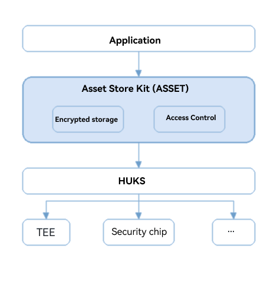

# About This Kit

<!--Kit: Asset Store Kit-->
<!--Subsystem: Security-->
<!--Owner: @HarMonkey-->
<!--Designer: @wkr321_ent-->
<!--Tester: @nacyli-->
<!--Adviser: @zengyawen-->
<!-- md-trans-meta sourceCommit=ed8297c412b85734fbf294dfc8e7d1206d2d6267 translatedAt=2026-10-10T02:56:21.778Z pushedAt=2026-10-10T03:10:16.165Z -->

Asset Store Kit (ASSET for short) provides secure storage and management of short sensitive data. Such short sensitive data includes but is not limited to passwords (accounts/passwords), tokens (application credentials), and other critical plaintext such as bank card numbers.

The asset storage service provides secure storage capabilities mainly in the following aspects:

- **Execution in a secure environment:** The encryption/decryption of assets and access control verification are performed in a secure environment (such as a trusted execution environment). The AES256-GCM algorithm is used for encryption, and the keys are stored in the [universal keystore](../UniversalKeystoreKit/huks-overview.md), ensuring that sensitive user data is not leaked.
- **Identity isolation:** Asset Store Kit verifies the application identity (the [appId](../../quick-start/common-problem-of-application.md#what-is-appid) of the application) to ensure that an application can only read or modify its own data and cannot read or modify the data of other applications. Applications in the same group can access each other's data. For details, see [Managing Assets in a Group (ArkTS)](asset-js-group-access-control.md)/[Managing Assets in a Group (C/C++)](asset-native-group-access-control.md).
- **Access control:** Supports multi-dimensional access control policies based on the owner, group, screen lock status, screen lock password setting status, and user authentication.

The ASSET data storage structure is shown in the following figure:

## Basic Concepts

The secure storage of assets depends on the underlying [universal keystore](../UniversalKeystoreKit/huks-overview.md). Specifically, the encryption/decryption of assets and access control verification are performed by the universal keystore in a secure environment (such as a trusted execution environment). Even if the system is compromised, sensitive user data is not leaked.

The AES256-GCM algorithm is used to encrypt and decrypt assets. The following access control mechanisms are used to protect assets against unauthorized access:

- Owner-based access control: All assets are protected by this mechanism by default.
  - An asset can be accessed only by its owner (service that writes the asset).
  - The identity of the asset owner (the [appId](../../quick-start/common-problem-of-application.md#what-is-appid) of the application) is obtained by ASSET from the system service. Even if the service identity is spoofed, the spoofer cannot obtain the data of other services.
  - The asset encryption/decryption also protects the integrity of the asset owner identity. Even if the owner of the asset is tampered with, attackers cannot obtain data of other services.

- Group-based access control:
  - You can add multiple applications of the same developer to a group and set group sharing when adding assets. The applications in the same group can access data with each other.
  - The group information consists of the developer ID and group ID. The developer ID does not need to be configured. The group ID is configured during application development. For details, see [Tags in the Configuration File](../../quick-start/app-configuration-file.md#tags-in-the-configuration-file). When an application is released, it is signed by a private key to ensure the group ID integrity.
  - You can configure multiple groups for an application and allocate assets to different groups based on their sharing scope. This allows fine-grained group-based access control.

- Access control based on the lock screen status: This mechanism provides the following protection levels in ascending order of security. You can set it based on site requirements. If no protection level is set, assets are accessible only after the device is unlocked for the first time.
  - **DEVICE_POWERED_ON**: allows access to assets after the device is powered on.
  - **DEVICE_FIRST_UNLOCKED**: allows access to assets after the device is unlocked for the first time after power-on.
  - **DEVICE_UNLOCKED**: allows access to assets only when the device is unlocked.

- Access control based on the setting of the lock screen password: This mechanism allows assets to be accessed only after a lock screen password is set. By default, it is disabled.
  - If this mechanism is enabled, assets can be accessed only after the user sets a screen lock password.

- Access control based on user authentication: This mechanism allows assets to be accessed only after a successful user identity authentication. By default, it is disabled.
  - If this mechanism is enabled, assets can be accessed only after a successful user identity authentication.
  - The user authentication can be fingerprint, facial, or PIN authentication.
  - You can set an authentication validity period, which allows access to multiple assets within the validity period. The maximum authentication validity period is 10 minutes.

## Constraints

- Device limitations

  This kit is not supported on lite wearables.

- Constraints

  ASSET is designed with secure storage as its core goal and provides secure storage of short sensitive data. It is not a general-purpose storage service. The following constraints apply when using it:

  - **Not suitable for storing large amounts of data:** ASSET is designed for short, limited critical sensitive information such as passwords, tokens, and bank card numbers, rather than for large-scale data scenarios. For longer data, consider using [Universal Keystore Kit](../UniversalKeystoreKit/huks-overview.md) or [Crypto Architecture Kit](../CryptoArchitectureKit/crypto-architecture-kit-intro.md) to protect the data.

  - **Not suitable for high-performance scenarios:** The encryption/decryption operations and access control verification of assets are performed in a secure environment (such as a trusted execution environment), which incurs higher performance overhead than conventional storage and is not suitable for high-frequency read/write or low-latency scenarios. For performance-sensitive services, do not use ASSET as conventional storage.

  - **Not recommended for storing non-short sensitive data:** ASSET focuses on security rather than general-purpose storage. Storing non-sensitive routine business data in ASSET neither leverages its security advantages nor avoids consuming its already limited storage resources. For non-short sensitive data, use the conventional storage capabilities provided by the system.

- Alias-based access

  Assets are stored in ciphertext in the ASSET database, with the business identity (the application's [appId](../../quick-start/common-problem-of-application.md#what-is-appid)) + alias as the unique index. Therefore, you must ensure that the alias of each asset is unique.

- Batch asset query

  The assets queried are transmitted to the service through an IPC channel. Due to the limitation of the IPC buffer size, the maximum number of assets to be queried at a time cannot exceed 40.

- Custom service data storage

  - Asset Store Kit provides 12 custom asset attributes starting with **DATA_LABEL** for services. If the 12 custom attributes are used, you can combine multiple data segments in a certain format (for example, JSON) into an attribute of this kit.

  - Asset Store Kit protects the integrity of the attributes starting with **DATA_LABEL_CRITICAL**. These attributes cannot be changed once written.

- Group-based access control

  - Asset Store Kit does not support sandbox applications, dual application storage, or data access across groups.

  - Assets with [IS_PERSISTENT](../../reference/apis-asset-store-kit/js-apis-asset.md#tag) set to **true** cannot be shared in a group.

## Data Lifecycle

Assets are deleted only in the following scenarios:
- When an application proactively calls `remove` to delete assets, the data that meets the conditions is deleted. For details, see [Deleting Assets (ArkTS)](asset-js-remove.md)/[Deleting Assets (C/C++)](asset-native-remove.md).
- When an application is uninstalled, the asset storage service clears the corresponding data. Data with the [IS_PERSISTENT](../../reference/apis-asset-store-kit/js-apis-asset.md#tag) attribute set to `true` is retained.
    - For API version 21 and later: Non-group data stored in ASSET is cleared. Group data is cleared only when all applications in the group are uninstalled.
    - For API version 20 and earlier: Both non-group and group data stored in ASSET are cleared.
- When a system sub-user is deleted, all data of that user in ASSET is cleared.
- When the device is restored to factory settings, all data in ASSET is cleared.

<!--RP1--><!--RP1End-->

## Relationship with Other Kits

Asset Store Kit provides secure storage of sensitive data less than 1 KB in size. To protect data greater than 1 KB, use [Universal Keystore Kit](../UniversalKeystoreKit/huks-overview.md) or [Crypto Architecture Kit](../CryptoArchitectureKit/crypto-architecture-kit-intro.md).