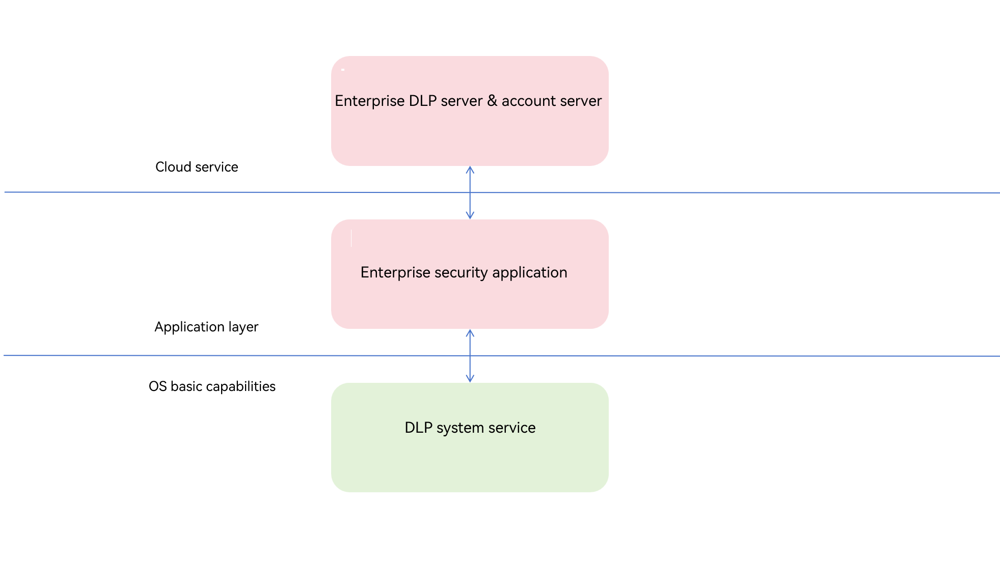

# Introduction to Data Loss Prevention
<!--Kit: Data Protection Kit-->
<!--Subsystem: Security-->
<!--Owner: @winnieHuYu-->
<!--Designer: @QRF-->
<!--Tester: @nacyli-->
<!--Adviser: @zengyawen-->
<!-- md-trans-meta sourceCommit=3e299e9c9a79e1f212b8aee0dc4c58f838506553 translatedAt=2026-10-31T07:10:42.804Z pushedAt=2026-11-02T00:50:26.279Z nl=1 -->

## Enterprise Access to DLP File Adaptation

### Introduction

In daily enterprise work, a large number of sensitive documents (contracts, financial statements, design drafts, and so on) need to be circulated and used across employee devices. These documents face data leakage risks such as being leaked through screenshots, copied without authorization, or forwarded to uncontrolled environments.

Traditional enterprise data protection solutions require developers to define encrypted file formats, implement permission control logic, and build runtime isolation environments on their own. This results in high development costs and makes it difficult to effectively coordinate with the underlying system security mechanisms.

System-level Data Loss Prevention (DLP) is a native capability for enterprise document protection scenarios that provides file encryption, access authorization, permission control, and runtime protection. Based on the system's unified file format, authorization mechanism, and controlled runtime environment, enterprise security application developers can build secure and controllable enterprise data protection solutions on top of it.

The core capabilities of DLP include file encryption protection and file permission control. The system defines a unified DLP file format, with the file extension being "original file name (including the original file extension).dlp", for example, "test.docx.dlp". A DLP file consists of file general information, an authorization policy, and the ciphertext of the original file. The authorization policy describes the file access control information, while the ciphertext of the original file protects the confidentiality of the plaintext content. Based on the unified DLP file format, the system can identify and process DLP files in a unified manner, and complete authentication and decryption in combination with the authorization information during file access. Enterprise security applications do not need to define the protected file format and related processing logic on their own; they can integrate file encryption, permission control, and other functions based on system capabilities.

In enterprise scenarios, DLP files are usually generated by enterprise security applications through encryption using related APIs. During encryption, enterprises can configure access permissions for files. Currently, two authorization types are supported: read-only and edit, with different permissions corresponding to different file access and usage scopes. After a DLP file is opened, the system also imposes restrictions on the runtime environment of the DLP sandbox application, for example, restricting capabilities such as Bluetooth, network, and NFC, to reduce the risk of data leakage during file usage.

For enterprise security applications, DLP provides access capabilities that support encrypting original files to generate DLP files, restoring original files from DLP files, obtaining file policies, and registering enterprise security application plugins with the DLP service. In enterprise scenarios, the enterprise security application client can interact with the DLP service through this plugin and further communicate with the enterprise server to obtain information such as the encryption public key and the re-encapsulated policy ciphertext, which are used to support processes such as DLP file generation and decryption. Based on these capabilities, enterprise security applications can build data protection, permission control, and policy management capabilities for enterprise scenarios.

The following figure shows the hierarchical structure of enterprise access to DLP files. Enterprise security applications implement data protection capabilities such as file encryption and permission control based on the system DLP capabilities and cloud services.

### Basic Concepts

Before integrating DLP capabilities in enterprise scenarios, you need to first understand basic concepts such as DLP files, authorization types, the DLP sandbox, and the enterprise security application communication plugin.

- **DLP File**

    A DLP file is a file generated in the system-defined protected file format. Its file extension is "original file name (including the original file extension).dlp", for example, test.docx.dlp. A DLP file consists of the file common information, the authorization policy, and the ciphertext of the original file. The authorization policy describes the file access control information, mainly including the range of users who can access the file and the corresponding permission types, and ensures the confidentiality and integrity of the related information through a protection mechanism.

- **Permission Type**

    When generating a DLP file, the enterprise security application can configure the authorization type for users. Currently, read-only and edit are supported. Different permission types correspond to different scopes of user operation control.

    | Authorization type | Modify | Copy | Print | Screenshot/screen recording | Drag |
    | -------- | -------- | -------- | -------- | -------- | -------- |
    | Read-only | Forbidden | Forbidden | Forbidden | Forbidden | Forbidden |
    | Edit | Allowed | Allowed | Allowed | Allowed | Allowed |

    In the current version, the scopes of user operation control corresponding to different permission types are as shown in the table above. They may be adjusted in later versions based on the evolution of product capabilities.

- **DLP Sandbox**

    When a DLP file is opened, the system installs and starts the corresponding sandbox application for the target application. A sandbox application is essentially a controlled application instance created for the DLP file access scenario. The system imposes capability restrictions on the running identity corresponding to this application instance, for example, restricting capabilities such as Bluetooth, network, and NFC, to reduce the risk of data leakage during file use.

    | Permission name | Description | Authorization type: read-only | Authorization type: edit |
    | -------- | -------- | -------- | -------- |
    | ohos.permission.USE_BLUETOOTH | Allow the application to use Bluetooth. | Forbidden | Forbidden |
    | ohos.permission.INTERNET | Allow the application to access the network. | Forbidden | Forbidden |
    | ohos.permission.DISTRIBUTED_DATASYNC | Allow the application to exchange user data (such as images, music, videos, and application data) with remote devices. | Forbidden | Forbidden |
    | ohos.permission.WRITE_MEDIA | This permission is required for the application to read and write user media files, such as videos, audios, and images. | Forbidden | Allowed |
    | ohos.permission.NFC_TAG | Allow the application to use NFC. | Forbidden | Allowed |

- **Enterprise Security Application Communication Plugin**
    
    The enterprise security application communication plugin is a plugin implemented and registered with the DLP service by the enterprise security application client. It is a required component for enabling the DLP service in enterprise scenarios. Only after the enterprise security application completes plugin registration can the DLP service establish an interaction channel with the enterprise security application client. During processes such as DLP file generation and decryption, the DLP service can interact with the enterprise security application client through this plugin. The enterprise security application client can further communicate with the enterprise server to obtain information such as the encryption public key.

### Constraints

- Currently, all DLP access features of the enterprise security application are supported only on PC/2-in-1 devices.
- In enterprise scenarios, the enterprise security application must first complete enterprise security application plugin registration before the related DLP capabilities can be enabled (for details, see [Enterprise Access to DLP File Adaptation](./enterprise-dlp-file-integration.md)).
- When accessing DLP capabilities in enterprise scenarios, an enterprise DLP server must be deployed to support processes such as encryption public key retrieval and decryption-related processing.

## Introduction to Application Adaptation for Opening DLP Files

### Introduction
Data Loss Prevention (DLP) is a system-level data leakage prevention solution that provides capabilities such as file permission management, encrypted storage, and authorized access. Data owners can configure permissions for confidential files based on account authentication, allowing permissions such as read-only, edit, and owner to be set. Confidential files are then stored in ciphertext. On devices that support the DLP mechanism, authentication and authorization can be performed through device-cloud coordination to obtain the capability to access and modify data.

Application adaptation recommendations: adjust the UI based on the permission status (for example, hide the save button for read-only files); avoid proactively triggering restricted functions; and provide friendly prompts to users.

### File Format
- Naming rule: original file name.extension.dlp (for example, test.docx.dlp)
- File composition: general file information + authorization policy + ciphertext of the original file

### Basic Concepts

- **Sandbox Mechanism**

    When a DLP file is accessed, the system performs the following operations:
    - Creates an independent sandbox clone of the application.
    - Decrypts the file for the application to access.
    - Restricts external access permissions (network/clipboard/screenshot/Bluetooth, etc.).
    - Automatically clears the clone and temporary data after the file is closed.

- **Sandbox Restrictions**

    For an application in the DLP sandbox state, the permissions granted to the application are restricted based on the permission on the DLP file.

    | Permission name | Description | Authorization Type: Read-Only | Authorization Type: Edit/File Owner |
    | -------- | -------- | -------- | -------- |
    | ohos.permission.USE_BLUETOOTH | Allow the application to use Bluetooth. | Forbidden | Forbidden |
    | ohos.permission.INTERNET | Allow the application to access the network. | Forbidden | Forbidden |
    | ohos.permission.DISTRIBUTED_DATASYNC | Allow the application to exchange user data (such as images, music, videos, and application data) with remote devices. | Forbidden | Forbidden |
    | ohos.permission.WRITE_MEDIA | Required for the application to read and write user media files, such as videos, audio, and images. | Forbidden | Allowed |
    | ohos.permission.NFC_TAG | Allow the application to use NFC. | Forbidden | Allowed |