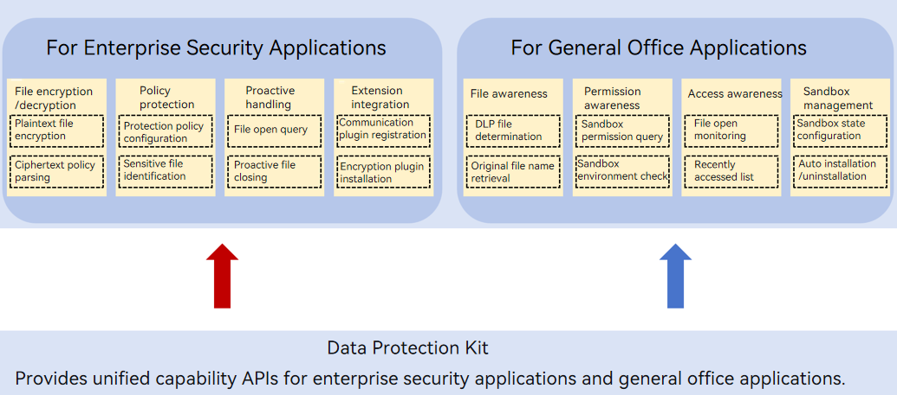

# About This Kit
<!--Kit: Data Protection Kit-->
<!--Subsystem: Security-->
<!--Owner: @winnieHuYu-->
<!--Designer: @QRF-->
<!--Tester: @nacyli-->
<!--Adviser: @zengyawen-->
<!-- md-trans-meta sourceCommit=bbcc2e37e8129d97ee49fdfc327c495aa2406a09 translatedAt=2026-10-31T07:11:29.180Z pushedAt=2026-11-02T06:08:44.482Z nl=1 -->

Data Protection Kit provides a system-level data protection foundation for enterprise data security scenarios. It enables you to build end-to-end solutions around the full file lifecycle, covering sensitive content identification, file data encryption, permission-based access control, dynamic sandbox reclamation, and user operation recording. By deeply integrating with the system's underlying permission control and file encryption mechanisms, you can achieve transparent protection and compliance governance of enterprise data on devices without building a complex security system from scratch. This effectively prevents data leakage risks and meets the complex and ever-changing security control requirements of enterprises.

## Capability Scope

**For Enterprise Security Applications: Quickly Build Data Control and Leak Prevention Solutions**

This Kit is suitable for MDM applications, enterprise secure cloud drives, and internal security control applications. You can use it to implement full-process management from sensitive data discovery and file encryption control to file operation recording.

**Highlights:**

- Sensitive content identification: Identifies sensitive content in specified files based on the scanning policies you configure and returns the matching results. You can use this capability to determine whether a file contains sensitive information, providing a trigger basis for subsequent encryption or interception.

- Encrypted file generation and policy control: Generates an encrypted file (DLP file) from the original file based on the authorized user list and permission control policies you configure. When a user opens the file, the system determines whether to allow the user to open it and what permissions the user has, such as screen capture, copy, and print. You do not need to define or maintain encrypted file formats themselves. Instead, they only need to use the system-level data protection mechanism (DLP system) to perform system-level encryption on sensitive files. This mechanism also supports collaboration with enterprise-side servers to dynamically grant file permissions.

- Dynamic file sandbox reclamation: Enterprise security applications can reclaim specified sandbox applications based on the file (sandbox) level set when the file was generated, thereby closing all files of the same level. When detecting that a device is in a risky state, you can proactively close highly sensitive files to prevent employees from leaking confidential company data in risky environments.

- User operation and file flow record reporting: When a user accesses a file or performs copy or modification operations on file content, the system proactively generates event records and publishes information through a special event ID. You can proactively subscribe to this event ID to obtain operation information related to encrypted files. In addition, when a user creates, copies, saves, or downloads an encrypted file, the system publishes file creation information and file flow information to help you reconstruct the file flow path.

**For General Office Applications: Adapt to Controlled Access to Encrypted Files**

It applies to ordinary applications such as document editors, file managers, and system preview. You can use this Kit together with the system security mechanisms to adapt the controlled access experience for encrypted files.

**Highlights:**

- **Encrypted file awareness and controlled opening:** An application can determine whether a specified file is a system-level encrypted file, listen for encrypted file open events, and obtain the current application's access permission to the file (for example, read-only or editable), so that the application can parse and display the file content within the authorized scope and complete the necessary UI adaptation.

- **Sandbox status query and collaboration:** An application can query the running status of the current application sandbox and cooperate with the system to retain and configure the sandbox environment.

- **Basic information query and format adaptation:** An application can obtain the original file name associated with an encrypted file to learn the file's actual original format (for example, whether it was originally Word or PDF), so as to open and display the file correctly. It also supports querying the protected file extension types supported by the system and the status of related system capabilities, which can be used for making preliminary judgments before the application processes a file.

## Basic Concepts

**DLP file:** A file generated in a system-defined protected file format. Its file name suffix is "original file name (including the original file extension).dlp", for example, `test.docx.dlp`. A DLP file consists of file general information, an authorization policy, and the ciphertext of the original file.

**DLP sandbox:** A controlled mechanism provided by the system for DLP file access scenarios. When a DLP file is opened, the system installs and starts the corresponding sandbox application for the target application, and imposes capability restrictions on the running identity corresponding to that application instance, so as to reduce the risk of data leakage during file use.

**Sensitive file identification:** The capability to detect sensitive content in specified files based on the scanning policy configured by the developer and return the matching results.

## Architecture

The DLP architecture is divided into two categories: one for enterprise security applications and the other for general office applications, as shown in the following figure.

<!--RP1--><!--RP1End-->