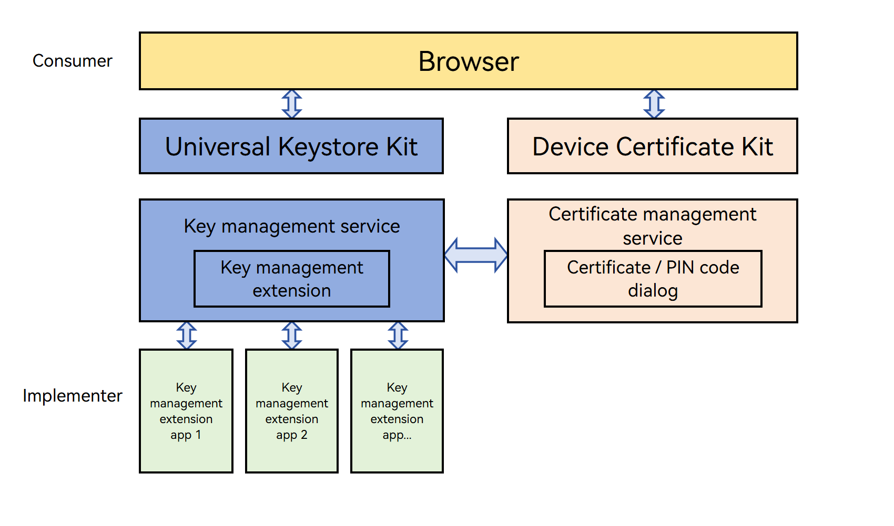

# Key Management Extension Overview

<!--Kit: Universal Keystore Kit-->
<!--Subsystem: Security-->
<!--Owner: @wutiantian-gitee-->
<!--Designer: @HighLowWorld-->
<!--Tester: @wxy1234564846-->
<!--Adviser: @zengyawen-->
<!-- md-trans-meta sourceCommit=d5358c6da14ce433fab40ec69edadd4e380d9588 translatedAt=2026-11-10T03:09:24.431Z pushedAt=2026-11-10T07:31:11.921Z nl=1 -->

Applications need to use external key management devices (such as UKey) in scenarios such as digital signature and certificate authentication. The interfaces and implementations of external key management devices from different vendors vary greatly. Directly adapting to multiple protocols imposes high development costs and is difficult to maintain.

HUKS provides a unified Ability extension interface, enabling external key management capabilities to be integrated into the OpenHarmony system: CryptoExtensionAbility adapts to underlying implementation differences and provides unified key management and certificate management APIs to upper-layer applications.

This document targets two types of developers of the key management extended capability:

- **Implementer**: responsible for integrating external key management capabilities into the HUKS framework, and completing capability exposure by implementing the CryptoExtensionAbility callback interfaces.

- **Consumer**: uses the external key management extended capability by calling the standard huksExternalCrypto and huks module interfaces provided by HUKS, and by calling the standard interfaces of the certificate management module to trigger pop-up flows such as certificate selection and PIN code authentication.

The HUKS framework remains device-agnostic, supporting both UKey physical devices and software forms, covering typical application scenarios such as [browser mutual TLS login](huks-extension-ability-best-dev.md).

## Overall Architecture

The key management extension adopts a layered architecture, which is divided from top to bottom into the ecosystem partner layer, application layer, system service layer, and key management extended application layer. The layers collaborate with each other through IPC.

- Ecosystem partner layer: represented by upper-layer applications (such as browsers), it is the ultimate consumer of the key management extended capability.
- Application layer: includes Universal Keystore Kit and Device Certificate Kit, providing unified key management and certificate management APIs to applications. Consumers invoke capabilities through the Kits without needing to know where the underlying keys are stored or who provides them.
- System service layer: centered on the key management service and certificate management service, which collaborate through IPC to jointly support the capabilities of the upper-layer Kits. The certificate management service carries the pop-up capabilities that require UI interaction, such as certificate selection and PIN code authentication.
- Key management extended application layer: implemented and run by external key management capability providers, it is the host of CryptoExtensionAbility instances. A key management extended application can register one or more CryptoExtensionAbility instances based on business needs, integrating the vendor's own external key management capability into the key management service.

## Capability Exposure Overview

Before an application or system module (such as certificate management) can use external key management capabilities, the capability implementer must complete the following tasks:

- Design and develop the external key management capabilities of the application based on service scenarios.

  The key management extension application must inherit **CryptoExtensionAbility** provided by HUKS and implement the capability APIs as required. For details, see [CryptoExtensionAbility Extension Capability Overview](huks-extension-ability-support-overview.md).

- Register the key management extension capabilities with the system HUKS service.

  **CryptoExtensionAbility** can isolate the implementation differences among different external key management capability implementers. After the key management extension application completes the API implementation, it must register **CryptoExtensionAbility** with HUKS when the device or service is available. **Once registration succeeds, the capability is exposed to the outside.** In unavailable scenarios such as device removal or service stop, the registered capability must be unregistered to avoid resource residue. For details about the specific implementation of registration and unregistration, see [CryptoExtensionAbility Registration and Unregistration](huks-extension-registration-and-unregistration-arkts-ndk.md).

  After the capability is successfully registered, it is exposed to upper-layer applications and system modules through the SDKs of HUKS and [certificate management](../DeviceCertificateKit/certManager-overview.md), covering typical operations such as certificate query, PIN authentication, and signing and signature verification.

In this way, capability consumers can call the APIs provided by HUKS and [certificate management](../DeviceCertificateKit/certManager-overview.md) to use the external key management capabilities provided by the key management extension application, including certificate query, PIN authentication, and signing and signature verification.

## Document Organization

The following documents are arranged according to the development process. It is recommended that you read them in order:

- For capability implementers, the documents progress from capability introduction to interface implementation and then to registration and launch, helping you complete the entire capability development process step by step.
- For capability consumers, the documents progress from key operations to signing/signature verification and then to access control, helping you master the invocation methods for each business scenario from basic to advanced.

Please select the corresponding path based on your role.

### Capability Implementer

1. [Introduction to CryptoExtensionAbility Extended Capability](huks-extension-ability-support-overview.md): Understand the positioning, capability exposure, capability lifecycle, and constraints of the CryptoExtensionAbility extension component.

2. [CryptoExtensionAbility Adaptation Development Guide](huks-extension-ability-support-dev.md): Refer to implementation examples of project setup, state management, and functional interfaces.

3. [CryptoExtensionAbility Registration and Unregistration](huks-extension-registration-and-unregistration-arkts-ndk.md): When the device or service is available, call registerProvider to register the implemented CryptoExtensionAbility with HUKS to expose capabilities externally; when unavailable, call unregisterProvider to unregister it and avoid resource residue.

### Capability Consumer

1. [Key Generation and Import/Export](huks-extension-key-generation-import-export.md): Capability introduction and development guide for key generation and import/export.

2. [Signing/Signature Verification](huks-extension-ability-signing-signature-verification.md): Provides capability introduction and development guide for signing/signature verification through the three-stage interface in the key management extension scenario provided by HUKS.

3. [PIN Code Access Control](huks-extension-ability-pin-authentication-management.md): PIN code access control capability and development guide in the key management extension scenario.

4. [General Operations](huks-extension-ability-general-operation.md): Introduces general capabilities such as opening/closing resources, querying, setting properties, and obtaining error information, and provides development guide.

### Use Case

[Browser Mutual SSL Login](huks-extension-ability-best-dev.md): Taking browser mutual SSL login as an example, connects the complete end-to-end process of certificate selection, PIN code authentication, and signing/signature verification.
