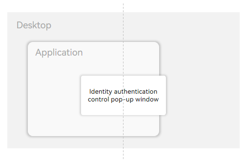
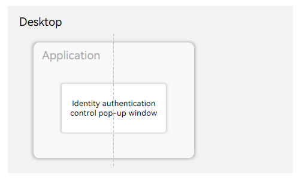

# Glossary

<!--Kit: User Authentication Kit-->
<!--Subsystem: UserIAM-->
<!--Owner: @WALL_EYE-->
<!--Designer: @lichangting518-->
<!--Tester: @jane_lz-->
<!--Adviser: @zengyawen-->
<!-- md-trans-meta sourceCommit=2d31d883fe22bae021d7b0eff08dd55df3bb9119 translatedAt=2026-10-10T03:31:44.465Z pushedAt=2026-10-10T03:41:58.888Z -->

## M

### System Modal Dialog

A system modal dialog is a system-level dialog. When launched by an application, it is fixedly centered on the desktop and its position is independent of the source application. Before the user finishes interacting with it, the entire system is blocked, meaning no other operations can be performed. It is suitable for high-priority authentication scenarios that require blocking global operations.

The following figure shows the diagram:

### Application-level Modal Dialog

A dialog that takes effect only within an application. It is displayed in the center of the application UI after being brought up by the application. Once displayed, the application UI that brought up the dialog is blocked and cannot be operated within the application until the user completes the interaction. Other UIs are not affected and remain operable.

The following figure shows the dialog:

