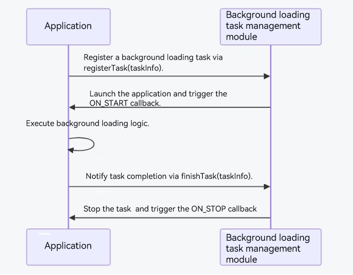

# Background Loading Task (ArkTS)

<!--Kit: Background Tasks Kit-->
<!--Subsystem: ResourceSchedule-->
<!--Owner: @xufu7-->
<!--Designer: @zhouben25-->
<!--Tester: @leetestnady-->
<!--Adviser: @HelloCrease-->
<!-- md-trans-meta sourceCommit=37a41c7e4764d3e7f831e1f47fc28c3acf56e6c1 translatedAt=2026-11-02T07:46:37.048Z pushedAt=2026-11-02T11:28:34.527Z nl=1 -->

## Overview

Starting from API version 26.1.0, the system provides the background loading task capability, which is suitable for scenarios where you want to preload application data in the background to optimize the application startup experience (such as news refresh, message retrieval, and video caching). It is not suitable for general background tasks that require scheduled or condition-triggered execution, or for long-running background scenarios. For background tasks that require scheduled or condition-triggered execution, use [deferred tasks](work-scheduler.md). For long-running background scenarios, use [continuous tasks](continuous-task.md).

## Implementation Principles

After an application registers a background loading task through this module, the system's background loading task management module schedules and executes it uniformly during idle periods. The application itself cannot determine the specific trigger time of the task. The basic workflow is as follows:

1. In the [onCreate](../reference/apis-ability-kit/js-apis-app-ability-uiAbility.md#oncreate) lifecycle of the main UIAbility, the application registers the [ON_START](../reference/apis-backgroundtasks-kit/js-apis-resourceschedule-backgroundLoader.md#constant) and [ON_STOP](../reference/apis-backgroundtasks-kit/js-apis-resourceschedule-backgroundLoader.md#constant) callback functions through [Callee](../reference/apis-ability-kit/js-apis-app-ability-uiAbility.md#callee) to receive the task start and stop events triggered by the system. The Callee callbacks exist along with the main UIAbility lifecycle and are automatically released when it is destroyed, so no manual unregistration is required.
2. The application calls the [registerTask](../reference/apis-backgroundtasks-kit/js-apis-resourceschedule-backgroundLoader.md#backgroundloaderregistertask) API to register a background loading task. The task information is specified through [TaskInfo](../reference/apis-backgroundtasks-kit/js-apis-resourceschedule-backgroundLoader.md#taskinfo), which contains the target abilityName and taskId. After registration, the application can also query the task information through [getTaskInfo](../reference/apis-backgroundtasks-kit/js-apis-resourceschedule-backgroundLoader.md#backgroundloadergettaskinfo), or unregister the task through [unregisterTask](../reference/apis-backgroundtasks-kit/js-apis-resourceschedule-backgroundLoader.md#backgroundloaderunregistertask).
3. The system's background loading task management module uniformly decides when to execute the background loading task. The application cannot intervene in the trigger timing.
4. When the decision is satisfied, the system starts the application and triggers the ON_START callback. The application executes the preloading logic (such as data requests and cache writes) in the ON_START callback, and calls the [finishTask](../reference/apis-backgroundtasks-kit/js-apis-resourceschedule-backgroundLoader.md#backgroundloaderfinishtask) API to notify the system that the task is complete. When the task stops, the system triggers the ON_STOP callback.
5. Task execution is subject to constraints: a single execution lasts at most 30 seconds; during execution, perceptible behaviors such as audio playback, audio recording, positioning, and flashlight operation are prohibited; if the application times out multiple times or performs perceptible operations, the system will disable subsequent background loading task scheduling for the application.



## Constraints


- Quantity limit: An application can register only one background loading task, and the task can specify only one unique main UIAbility.

- Timeout: After the system invokes the callback to start executing the background loading task, the task can run for a maximum of 30 seconds. If the application times out multiple times, the system disables background loading task scheduling for the application, and the task is no longer scheduled even if it is re-registered.

- Prohibited perceptible operations: During the UIAbility creation phase and the loading task execution phase, the application is prohibited from performing perceptible behaviors such as audio playback, audio recording, positioning, and operating the flashlight. If the system detects such operations, it disables background loading task scheduling for the application and cancels subsequent task scheduling.

## How to Develop

Developing a background loading task involves three steps:

1. **Implement the background loading task callback capability:** Define the [ON_START](../reference/apis-backgroundtasks-kit/js-apis-resourceschedule-backgroundLoader.md#constant) and [ON_STOP](../reference/apis-backgroundtasks-kit/js-apis-resourceschedule-backgroundLoader.md#constant) callback functions, and register them with the [Callee](../reference/apis-ability-kit/js-apis-app-ability-uiAbility.md#callee) of the application's main UIAbility.

2. **Register, unregister, and query the background loading task:** Call the [registerTask](../reference/apis-backgroundtasks-kit/js-apis-resourceschedule-backgroundLoader.md#backgroundloaderregistertask) API to register the task. You can call [unregisterTask](../reference/apis-backgroundtasks-kit/js-apis-resourceschedule-backgroundLoader.md#backgroundloaderunregistertask) to unregister it and [getTaskInfo](../reference/apis-backgroundtasks-kit/js-apis-resourceschedule-backgroundLoader.md#backgroundloadergettaskinfo) to query task information.

3. **Complete the background loading task:** After executing the loading logic in the ON_START callback, call the [finishTask](../reference/apis-backgroundtasks-kit/js-apis-resourceschedule-backgroundLoader.md#backgroundloaderfinishtask) API to notify the system that the task is complete.

### Implementing Background Loading Task Callback Capabilities

1. Declare the **ohos.permission.KEEP_BACKGROUND_RUNNING** permission. For details, see [Declaring Permissions](../security/AccessToken/declare-permissions.md#declaring-permissions-in-the-configuration-file).

2. Import the module.

   ``` TypeScript
   import { backgroundLoader } from '@kit.BackgroundTasksKit';
   import { BusinessError } from '@kit.BasicServicesKit';
   ```

3. In the [onCreate](../reference/apis-ability-kit/js-apis-app-ability-uiAbility.md#oncreate) lifecycle of the application's main UIAbility, register the `ON_START` and `ON_STOP` callback functions through [Callee](../reference/apis-ability-kit/js-apis-app-ability-uiAbility.md#callee). The Callee callback registration exists with the lifecycle of the main UIAbility and is automatically released when it is destroyed, so no manual unregistration is required.

   <!-- @[backgroundLoader_register_callee](https://gitcode.com/openharmony/applications_app_samples/blob/master/code/DocsSample/BackGroundTasksKit/BackgroundLoader/entry/src/main/ets/entryability/EntryAbility.ets) -->
   
   ``` TypeScript
   try {
     // Register the ON_START callback to trigger funCallBack when the background loading task starts.
     this.callee.on(backgroundLoader.ON_START, funCallBack);
     // Register the ON_STOP callback to trigger onStopCallBack when the background loading task stops.
     this.callee.on(backgroundLoader.ON_STOP, onStopCallBack);
   } catch (error) {
     console.error(`Callee.on catch error, error.code: ${error.code}, error.message: ${error.message}`);
   }
   ```

### Registering a Background Loading Task

If the `ohos.permission.KEEP_BACKGROUND_RUNNING` permission is not declared, the call throws error 201; error 9700003 is thrown when the system service is abnormal; and error 9700004 is thrown when the `taskInfo` parameter is invalid. For details about the error codes, see [workScheduler error codes](../reference/apis-backgroundtasks-kit/errorcode-workScheduler.md).

1. Register a background loading task.

   <!-- @[backgroundLoader_registerTask](https://gitcode.com/openharmony/applications_app_samples/blob/master/code/DocsSample/BackGroundTasksKit/BackgroundLoader/entry/src/main/ets/entryability/EntryAbility.ets) -->
   
   ``` TypeScript
   const taskInfo: backgroundLoader.TaskInfo = {
     abilityname: abilityname,
     taskId: taskId
   };
   try {
     backgroundLoader.registerTask(taskInfo);
     hilog.info(DOMAIN, 'testTag', 'registerTask successes');
     return 'Success';
   } catch (err) {
     const errMsg = JSON.stringify(err);
     hilog.error(DOMAIN, 'testTag', 'registerTask failed: %{public}s', errMsg);
     return `Failed: ${(err as BusinessError).message ?? errMsg}`;
   }
   ```

2. Unregister a background loading task.

   <!-- @[backgroundLoader_unregisterTask](https://gitcode.com/openharmony/applications_app_samples/blob/master/code/DocsSample/BackGroundTasksKit/BackgroundLoader/entry/src/main/ets/entryability/EntryAbility.ets) -->
   
   ``` TypeScript
   const taskInfo: backgroundLoader.TaskInfo = {
     abilityname: abilityname,
     taskId: taskId
   };
   try {
     backgroundLoader.unregisterTask(taskInfo);
     hilog.info(DOMAIN, 'testTag', 'unregisterTask successes');
     return 'Success';
   } catch (err) {
     const errMsg = JSON.stringify(err);
     hilog.error(DOMAIN, 'testTag', 'unregisterTask failed: %{public}s', errMsg);
     return `Failed: ${(err as BusinessError).message ?? errMsg}`;
   }
   ```

3. Query background loading task information.

   <!-- @[backgroundLoader_getTaskInfo](https://gitcode.com/openharmony/applications_app_samples/blob/master/code/DocsSample/BackGroundTasksKit/BackgroundLoader/entry/src/main/ets/entryability/EntryAbility.ets) -->
   
   ``` TypeScript
   try {
     const taskInfoData = backgroundLoader.getTaskInfo(taskId);
     const result = `taskId=${taskInfoData.taskId}, abilityName=${taskInfoData.abilityName}`;
     hilog.info(DOMAIN, 'testTag', 'getTaskInfo result: %{public}s', result);
     return result;
   } catch (err) {
     const errMsg = JSON.stringify(err);
     hilog.error(DOMAIN, 'testTag', 'getTaskInfo failed: %{public}s', errMsg);
     return `Failed: ${(err as BusinessError).message ?? errMsg}`;
   }
   ```

### Completing the Background Loading Task

1. Complete the background loading task.

   <!-- @[backgroundLoader_finishTask](https://gitcode.com/openharmony/applications_app_samples/blob/master/code/DocsSample/BackGroundTasksKit/BackgroundLoader/entry/src/main/ets/entryability/EntryAbility.ets) -->
   
   ``` TypeScript
   const taskInfo: backgroundLoader.TaskInfo = {
     abilityname: abilityname,
     taskId: taskId
   };
   try {
     backgroundLoader.finishTask(taskInfo);
     hilog.info(DOMAIN, 'testTag', 'finishTask successes');
     return 'Success';
   } catch (err) {
     const errMsg = JSON.stringify(err);
     hilog.error(DOMAIN, 'testTag', 'finishTask failed: %{public}s', errMsg);
     return `Failed: ${(err as BusinessError).message ?? errMsg}`;
   }
   ```

### Verification

After the background loading task is registered successfully, the callback is executed only when the system decision (based on conditions such as usage habits, memory, battery, and temperature; see Working Principles) is satisfied. To quickly verify whether the callback works correctly, you can use the following [hidumper command](../dfx/hidumper.md) to manually trigger the callback execution.

After the command is executed, the system starts the application and triggers the ON_START callback. You can filter `testTag` in hilog to view the logs of the callback trigger and the successful `finishTask` call, confirming that the callback execution and the task completion notification are successful.

> **NOTE**
>
> - `-s 1901`: Sends a command to the ResourceSchedule system service (1901 is the service ID).
> - `-a`: Carries additional parameters, which must be enclosed in quotation marks in the format `backgroundLoader <bundle name> <Ability name>`. Replace `com.example.myapplication` and `EntryAbility` in the example with the actual values.

```shell
$ hidumper -s 1901 -a 'backgroundLoader com.example.myapplication EntryAbility'

-------------------------------[ability]-------------------------------

----------------------------------ResourceSched----------------------------------
```

<!--no_check-->