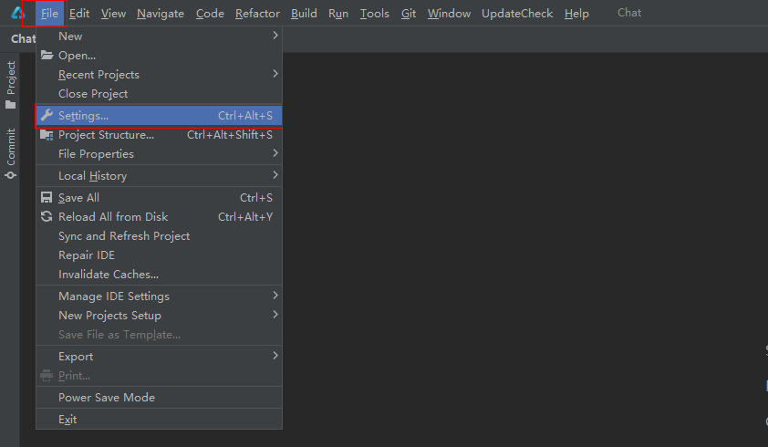
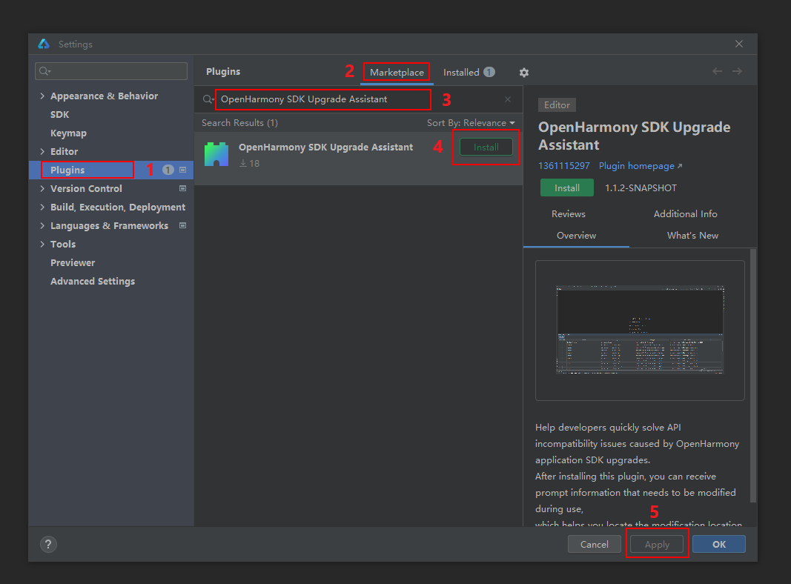
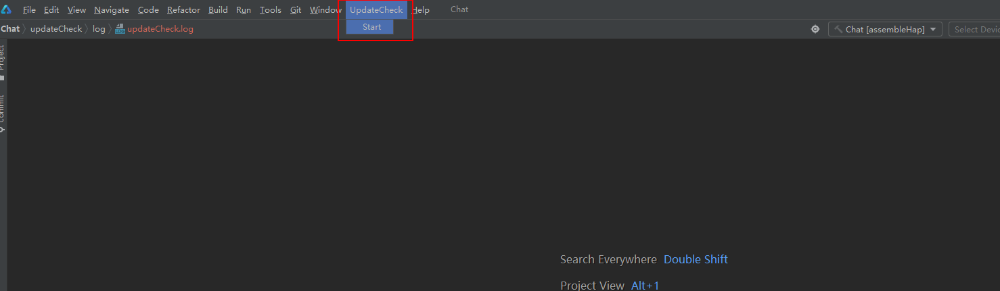

# OpenHarmony SDK Upgrade Assistant
<!--Kit: Network Kit-->
<!--Subsystem: Communication-->
<!--Owner: @wmyao_mm-->
<!--Designer: @guo-min_net-->
<!--Tester: @tongxilin-->
<!--Adviser: @zhang_yixin13-->
<!-- md-trans-meta sourceCommit=5514d36c522030bc310818103de06f4021bed4ee translatedAt=2026-10-10T03:57:26.409Z pushedAt=2026-10-12T03:41:43.600Z -->

## Introduction
OpenHarmony SDK Upgrade Assistant helps you quickly resolve API incompatibility issues caused by OpenHarmony app SDK upgrades.</br>
Since OpenHarmony SDK Beta versions do not guarantee API stability, API incompatibility may occur after an SDK upgrade. When you switch the API version of an existing project, you need to adapt to changes in APIs and their underlying behaviors, which incurs a certain upgrade cost. To address this, OpenHarmony provides the SDK Upgrade Assistant, which helps you quickly understand the full picture of upgrade adaptation and rapidly adapt through tool prompts, significantly improving SDK upgrade efficiency.

## Constraints
1. Before upgrading the SDK, back up the old SDK files to prevent them from being overwritten by the new SDK version.
2. The suap tool currently only supports OpenHarmony app SDK upgrades.

## Usage Tutorial

### Installing the Tool
1. In the DevEco Studio main menu bar, click "File" > "Settings...".

   

2. In the Settings dialog box, select "Plugins" to enter the IDE plugin module.

3. Click the "Marketplace" option, and enter "OpenHarmony SDK Upgrade Assistant" in the search box below.

4. Click the "Install" button to the right of the found plugin to download and install it. After the installation is complete, click "Apply", and restart the IDE to finish the installation (Note: The IDE must be restarted after the plugin is installed).

   

### Using the Tool

After the Upgrade Assistant plugin is installed, open the OpenHarmony project to be upgraded.

After the project is loaded, click **UpdateCheck** > **Start** on the main menu bar at the top of the window.



Manually select the path of the old SDK version, navigating to the **ets** folder. The new SDK version path is automatically obtained from the IDE configuration file and the SDK version configured for the current app. After the path selection is complete, click **OK** to start generating the upgrade report.

<!--Del-->   <!--DelEnd-->

After the report is generated successfully, a dialog box will appear. Click <b>OK</b> to close the dialog box.

<!--Del-->   <!--DelEnd-->

Follow the prompt in the dialog box to open the <b>UpdateReport</b> button in the toolbar below and view the upgrade report.

<!--Del-->   <!--DelEnd-->

### Viewing the Upgrade Report

1. The total count in the lower part of the report is the total number of problems that occur in the application due to the SDK update. You can evaluate the modification workload from this number.
2. Each column header in the report can be clicked to sort the entries.
3. In the report, you can select an upgrade type from the type drop-down list. The total count below will update based on the selected type.
4. **Modified** helps you record the problems that have been modified.
5. Double-click the code location column to quickly navigate to the position of the current code in the app.
6. The hint information column provides modification suggestions for your reference.
7. If there are multiple versions in the **Changelog** column, a dialog box is displayed after you click the cell. You can click the version number and link to go to the page. If there is a single version, the corresponding ChangeLog file is displayed after you click the cell.

<!--Del-->   <!--DelEnd-->

## Packaging and Building

1. Clone the [api_diff](https://gitcode.com/openharmony/interface_sdk-js/tree/master/build-tools/api_diff) tool (for comparing API differences between two SDK versions) and the [collect_application_api](https://gitcode.com/openharmony/interface_sdk-js/tree/master/build-tools/collect_application_api) tool (for parsing and aggregating APIs used in the app) from the [interface repository](https://gitcode.com/openharmony/interface_sdk-js/tree/master/build-tools) to the local environment.

    <!--Del-->   <!--DelEnd-->

2. Open a terminal in the local directories of the api_diff tool and the collect_application_api tool, and perform installation and compilation.

    > **NOTE**
    >
    > Ensure that the Node.js version is 14.
    >

    Run the following command: `npm install`, and then build: `npm run build`. After a successful build, `dist=>build=>api-diff.js` and `dist=>build=>api-collector.js` are generated in the corresponding tool folder.

    <!--Del-->   <!--DelEnd-->

    <!--Del-->   <!--DelEnd-->

3. On the last drive of the local disk, create a folder named `updateCheck`, and inside it create the `api-diff` and `collect_application_api` folders.</br>Place the `api-diff.js` file from step 3 into the `api-diff` folder, and place the `libs` folder and `api-collector.js` from the `collect_application_api` folder into the `collect_application_api` folder.

    <!--Del-->   <!--DelEnd-->

    <!--Del-->   <!--DelEnd-->

4. After the Upgrade Assistant source code is cloned, open it in IntelliJ IDEA, configure the Gradle environment, and create a **build.gradle.kts** file in the same directory as **src**. Paste the following content into the file, refresh Gradle, and you can then run the project and package it as a plugin from the Gradle toolbar on the right side of IntelliJ IDEA.
    ```lombok.config
    plugins {
        id("java")
        id("org.jetbrains.intellij") version "1.5.2"
    }

    group = "com.example"
    version = "1.0-SNAPSHOT"

    repositories {
        maven {
            setUrl("https://mirrors.huaweicloud.com/repository/maven")
        }
    }

    dependencies{
        implementation("org.springframework:spring-web:5.2.12.RELEASE")
        implementation("org.apache.commons:commons-compress:1.21")
        implementation("com.alibaba:fastjson:1.2.28")
        implementation("org.apache.logging.log4j:log4j-core:2.19.0")
        implementation("commons-httpclient:commons-httpclient:3.1")
    }

    intellij {
        version.set("2021.2")
        type.set("IC") // Target IDE Platform

        plugins.set(listOf(/* Plugin Dependencies */))
    }

    tasks {
        // Set the JVM compatibility versions
        withType<JavaCompile> {
            sourceCompatibility = "11"
            targetCompatibility = "11"
        }

        patchPluginXml {
            sinceBuild.set("212")
            untilBuild.set("522.*")
        }

        signPlugin {
            certificateChain.set(System.getenv("CERTIFICATE_CHAIN"))
            privateKey.set(System.getenv("PRIVATE_KEY"))
            password.set(System.getenv("PRIVATE_KEY_PASSWORD"))
        }

        publishPlugin {
            token.set(System.getenv("PUBLISH_TOKEN"))
        }
    }


    ```