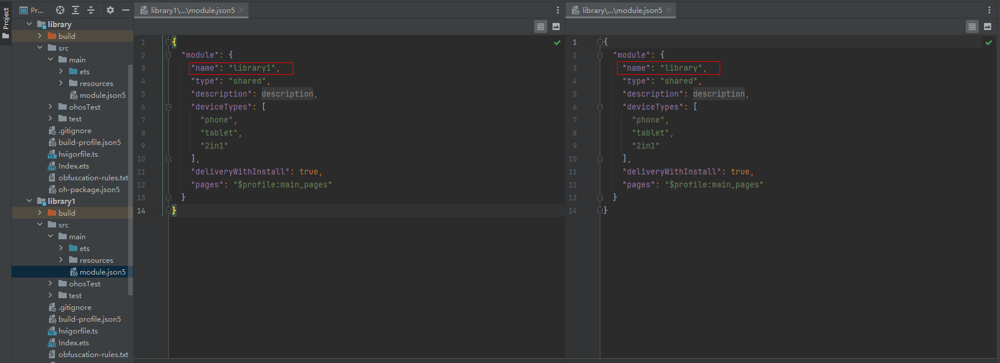

# Packing Tool
<!--Kit: Ability Kit-->
<!--Subsystem: BundleManager-->
<!--Owner: @jsjzju-->
<!--Designer: @jsjzju-->
<!--Tester: @liangchengguang-->
<!--Adviser: @HelloCrease-->
<!-- md-trans-meta sourceCommit=31661175150dbd26aebd7a7c4c7a32ee3048209a translatedAt=2026-11-20T03:23:23.250Z pushedAt=2026-11-20T09:09:45.057Z nl=1 -->

The packing tool packs compiled files for installation and release. You can use DevEco Studio or the JAR package of the packing tool to pack files. The JAR package is usually stored in the **toolchains** directory of the SDK.

The packing tool supports the generation of HAP (module package of the ability type), HSP (dynamically shared package), APP (application program package), HQF (quick fix module package), and APPQF (quick fix package) files.

You can obtain the files in the packing command from [DevEco Studio build products](https://developer.huawei.com/consumer/en/doc/harmonyos-guides/ide-compile-build) by performing the following operations:<br>
1. In the **/hvigor/hvigor-config.json5** file in the root directory of the DevEco Studio project, change the value of **level** under **logging** to **debug**.<br>
2. On the DevEco Studio menu bar, choose **Build** > **Clear projects**.<br>
3. On the DevEco Studio menu bar, choose **Build** > **Build App(s)**.<br>
4. In the **Build** window at the bottom of DevEco Studio, search for **app_packing_tool.jar** and check the file path in the packing parameters.<br>

The packing tool verifies the validity of the attributes in the **module.json** file. The **module.json** file is a build product, whose attribute values are automatically generated during building. The mapping between the attribute values and configuration items in the configuration file is as follows.

**Table 1** Mapping between attributes of the module.json file and items of the configuration file

| Attributes of module.json         | Description         | Configuration Items of [module.json5](../quick-start/module-configuration-file.md#tags-in-the-configuration-file)        | Configuration Items of [app.json5](../quick-start/app-configuration-file.md#tags-in-the-configuration-file)           | Configuration items of [Project-level build-profile.json5 File](https://developer.huawei.com/consumer/en/doc/harmonyos-guides/ide-hvigor-build-profile-app) |
| ------------------------ | ------------------------ | ------------------------ | -------------------------- | --------------------------       |
| bundleName               | Bundle name.       | -                        | bundleName                 | -                                |
| bundleType               | Bundle type.       | -                        | bundleType                 | -                                |
| versionCode              | Application version number.           | -                        | versionCode                | -                                |
| debug                    | Whether the application can be debugged.         | -                        | debug                      | -                                |
| module/name              | Module name.       | module/name              | -                          | -                                |
| minCompatibleVersionCode | Earliest compatible version number.| -                        | minCompatibleVersionCode   | -                                |
| minAPIVersion            | Minimum API version for running the application.| -                        | minAPIVersion              | compatibleSdkVersion             |
| targetAPIVersion         | Target API version required for running the application.| -                        | targetAPIVersion           | targetSdkVersion/compileSdkVersion  <br>Note: If **targetSdkVersion** is available, it determines **targetAPIVersion**.<br>Otherwise, it is determined by **compileSdkVersion**.              |
| querySchemes             | URL schemes that allow the application to perform redirection query.| querySchemes              | -                          | -                                |
| generateBuildHash        | Whether the hash value of the HAP or HSP is generated by the packing tool.| generateBuildHash    | generateBuildHash          | -                                |
| buildVersion               | Build version of an application.       | -                        | buildVersion                 | -                                |

## Constraints

- The packing tool must run in Java 8 or later.
- Parameters and parameter values must be in pairs. For example, in the HAP packing command **--resources-path \<path>**, **--resources-path** is the command parameter and **path** is the parameter value. The two parameters must be used together.
- You are not advised to use JDK 20 to run the packing tool. JDK 20 has a known issue in the validation rule for the ZIP64 extra data field. When the length of the ZIP64 extra data field in the directory of a ZIP package (such as a HAP, HSP, or any ZIP64 file) is abnormal, the error message `Invalid CEN header (invalid zip64 extra data field size)` is displayed during parsing. You are advised to use a long-term support (LTS) version, such as JDK 17 (LTS) or JDK 21 (LTS). If JDK 20 is required, add `-Djdk.util.zip.disableZip64ExtraFieldValidation=true` to the JVM startup parameters to avoid this issue.

## HAP Packing Command

You can use the JAR package of the packing tool to generate a HAP file for a module by passing in packing options and file paths.

**Validity Verification During HAP Packing**
- Since API version 21, if more than 50 URL schemes are configured for **querySchemes** in the **module.json** file when the HAP of the entry type is packaged, the value of **minAPIVersion** must be greater than or equal to 21.

**Compressing Rules During HAP Packing**
- If **compressNativeLibs** is set to **true**, files in the directory specified by **--lib-path** are compressed based on the compression level specified by **--compress-level**.
- To ensure running performance, files that are not in the directory specified by **--lib-path** are not compressed.

Packing command example:
- Stage model:


    ```bash
    java -jar app_packing_tool.jar --mode hap --json-path <path> [--resources-path <path>] [--ets-path <path>] [--index-path <path>] [--pack-info-path <path>] [--lib-path <path>] --out-path <path> [--force true] [--compress-level 5] [--pkg-context-path <path>] [--hnp-path <path>] [--pkg-sdk-info-path <path>] [--skills-path <path>]
    ```

- FA model:


    ```bash
    java -jar app_packing_tool.jar --mode hap --json-path <path> [--maple-so-path <path>] [--profile-path <path>] [--maple-so-dir <path>] [--dex-path <path>] [--lib-path <path>] [--resources-path <path>] [--index-path <path>] --out-path <path> [--force true] [--compress-level 5]
    ```

**Table 2** Parameters of the HAP packing command

| Name            | Mandatory| Option         | Description                                                        | Remarks           |
| ---------------- | ---------- | ------------- | ------------------------------------------------------------ | --------------- |
| --mode           | Yes        | hap           | Packing mode.                                                  | NA              |
| --json-path      | Yes        | NA            | Path of the JSON file. The file name must be **config.json** in the FA model and **module.json** in the stage model.| NA              |
| --profile-path   | No        | NA            | Path of the **CAPABILITY.profile** file.                                | NA              |
| --maple-so-path  | No        | NA            | Path of the Maple SO file. The file name extension must be .so. If there are multiple SO files, separate them with commas (,).| NA              |
| --maple-so-dir   | No        | NA            | Path of the maple SO directory (folder).                                      | NA              |
| --dex-path       | No        | NA            | Path of the DEX file. The file name extension must be .dex. If there are multiple DEX files, separate them with commas (,).<br>The value can also be the directory (folder) where the DEX file is stored.| NA              |
| --lib-path       | No        | NA            | Path of the library file. Since API version 22, when **--exist-src-path** is valid and **--lib-path-retain** is set to **true**, the **libs** directory is incrementally packed. That is, the **libs** directory in the source HAP file configured by **--exist-src-path** is directly copied, the **--lib-path** parameter is invalid and the **libs** directory configured by **--lib-path** is not packed.| NA              |
| --resources-path | No        | NA            | Path of the resources file.                                       | NA              |
| --index-path     | No        | NA            | Path of the INDEX file. The file name must be **resources.index**.               | NA              |
| --pack-info-path | No        | NA            | Path of the **pack.info** file. The file name must be **pack.info**.                  | NA              |
| --rpcid-path     | No        | NA            | Path of the **rpcid.sc** file. The file name must be **rpcid.sc**.                    | NA              |
| --js-path        | No        | NA            | Path of the JS file.                                        | This parameter is valid only in the stage model.|
| --ets-path       | No        | NA            | Path of the ETS file.                                       | This parameter is valid only in the stage model.|
| --out-path       | Yes        | NA            | Path of the target file. The file name extension must be .hap.                      | NA              |
| --force          | No        | boolean       | Whether to forcibly overwrite the target file if its path already exists. If the target file specified by **--out-path** already exists before packing and this parameter is set to **true**, the file is overwritten. If this parameter is set to **false**, the packing process is terminated and an error is reported. If the target file specified by **--out-path** does not exist before packing, the file is packed properly and this parameter is invalid. The default value is **false**.| NA              |
| --an-path        | No         | NA            | Path for storing the [an file](https://developer.huawei.com/consumer/en/doc/doccenter-dev-faq/faqs-arkts-52).| Effective only for the Stage model. |
| --ap-path        | No         | NA            | Path for storing the [ap file](https://developer.huawei.com/consumer/en/doc/doccenter-dev-faq/faqs-arkts-52).| Effective only for the Stage model. |
| --dir-list       | No        | NA            | List of directories (folders) to be packed into the HAP file.                     | NA              |
| --compress-level | No        | number        | Compression level of files in the **lib** library. The default value is **1**. The value ranges from 1 to 9. This parameter is valid only when **compressNativeLibs** is set to **true**. A larger value indicates a higher compression rate and a slower compression speed.| NA  |
| --pkg-context-path      | No         | NA            | Specifies the path of the context information table file. The file name must be pkgContextInfo.json. <!--Del-->This parameter is mandatory when the bundleType value in the app.json5 configuration file is not appPlugin and the requestPermissions value in the module.json5 configuration file contains "ohos.permission.kernel.SUPPORT_PLUGIN". <!--DelEnd--> | Effective only for the Stage model.              |
| --hnp-path | No| NA | Path of the native software package to be packed into the HAP file.| NA |
| --exist-src-path | No| NA | Path of the source HAP file for incremental packing, which must point to an existing and valid .hap file. When **--lib-path-retain** is set to **true**, the packing tool directly copies the **libs** directory in the source HAP file, and does not pack the **libs** directory specified by **--lib-path**. This feature is called incremental packing. When **--lib-path-retain** is set to **false**, the **libs** directory specified by **--lib-path** is packed properly, and this parameter is invalid. You can use incremental packing to speed up the compression of .so files in the **libs** directory.<br>This parameter is supported since API version 22.| This parameter is valid only in the stage model.|
| --lib-path-retain | No| boolean | Whether to perform incremental packing on the **libs** directory. The value **true** means to perform incremental packing on the **libs** directory, that is, directly copy the **libs** directory in the source HAP to which **--exist-src-path** points, and do not pack the **libs** directory specified by **--lib-path**. The value **false** means the opposite. The default value is **false**. This parameter must be used together with **--exist-src-path**. Otherwise, it does not take effect.<br>This parameter is supported since API version 22.| This parameter is valid only in the stage model.|
| --pkg-sdk-info-path | No        | NA            | Path of the **pkgSdkInfo.json** file, which contains the basic information about the HARs on which the build product depends, including the module name and version. The file name must be **pkgSdkInfo.json**.<br>This parameter is supported since API version 23.    | This parameter is valid only in the stage model. |
| --skills-path | No        | NA            | Path of the directory for storing skills. During packaging, the skill content in the **--skills-path** directory is packed into the HAP based on the **skillProfiles** configuration item in the **module.json5** file.<br>This parameter is available when **bundleType** is set to **app** or **atomicService**. This parameter is unavailable when **bundleType** is set to **shared**, **appService**, or **appPlugin**. If this parameter is passed in these cases, the packing will fail.<br>This parameter is supported starting from API version 26.0.0.| This parameter is valid only in the stage model. |

## HSP Packing Command

HSP files enable file sharing among multiple HAPs. You can use the JAR package of the packing tool to generate an HSP file for an application by passing in packing options and file paths.

**Compressing Rules During HSP Packing**
- If **compressNativeLibs** is set to **true**, files in the directory specified by **--lib-path** are compressed based on the compression level specified by **--compress-level**.
- To ensure running performance, files that are not in the directory specified by **--lib-path** are not compressed.

Packing command example:
```bash
java -jar app_packing_tool.jar --mode hsp --json-path <path> [--resources-path <path>] [--ets-path <path>] [--index-path <path>] [--pack-info-path <path>] [--lib-path <path>] --out-path <path> [--force true] [--compress-level 5] [--pkg-context-path <path>] [--pkg-sdk-info-path <path>] [--skills-path <path>]
```

**Table 3** Parameters of the HSP packing command

| Name            | Mandatory| Option         | Description                                                        |
| ---------------- | ---------- | ------------- | ------------------------------------------------------------ |
| --mode           | Yes        | hsp           | Packing mode.                                                  |
| --json-path      | Yes        | NA            | Path of the JSON file. The file name must be **module.json**.                    |
| --profile-path   | No        | NA            | Path of the **CAPABILITY.profile** file.                                |
| --dex-path       | No        | NA            | 1. Path of the DEX file. The file name extension must be .dex. If there are multiple DEX files, separate them with commas (,).<br>2. The value can also be the directory (folder) where the DEX file is stored.|
| --lib-path       | No        | NA            | Path of the library file. Since API version 22, when **--exist-src-path** is valid and **--lib-path-retain** is set to **true**, the **libs** directory is incrementally packed. That is, the **libs** directory in the source HSP file configured by **--exist-src-path** is directly copied, the **--lib-path** parameter is invalid and the **libs** directory configured by **--lib-path** is not packed.|
| --resources-path | No        | NA            | Path of the resources file.                                       |
| --index-path     | No        | NA            | Path of the INDEX file. The file name must be **resources.index**.               |
| --pack-info-path | No        | NA            | Path of the **pack.info** file. The file name must be **pack.info**.                  |
| --js-path        | No        | NA            | Path of the JS file.                                        |
| --ets-path       | No        | NA            | Path of the ETS file.                                       |
| --out-path       | Yes        | NA            | Path of the target file. The file name extension must be .hsp.                      |
| --force          | No        | boolean       | Whether to forcibly overwrite the target file if its path already exists. If the target file specified by **--out-path** already exists before packing and this parameter is set to **true**, the file is overwritten. If this parameter is set to **false**, the packing process is terminated and an error is reported. If the target file specified by **--out-path** does not exist before packing, the file is packed properly and this parameter is invalid. The default value is **false**.|
| --compress-level | No        | number        | Compression level of files in the **lib** library. The default value is **1**. The value ranges from 1 to 9. This parameter is valid only when **compressNativeLibs** is set to **true**. A larger value indicates a higher compression rate and a slower compression speed.|
| --pkg-context-path      | No         | NA            | Specifies the context information table file path. The file name must be pkgContextInfo.json. <!--Del-->This parameter is mandatory when the bundleType value in the app.json5 configuration file is not appPlugin and the requestPermissions value in the module.json5 configuration file contains "ohos.permission.kernel.SUPPORT_PLUGIN". <!--DelEnd--> |
| --exist-src-path | No| NA | Path of the source HSP file for incremental packing, which must point to an existing and valid .hsp file. When **--lib-path-retain** is set to **true**, the packing tool directly copies the **libs** directory in the source HSP file, and does not pack the **libs** directory specified by **--lib-path**. This feature is called incremental packing. When **--lib-path-retain** is set to **false**, the **libs** directory specified by **--lib-path** is packed properly, and this parameter is invalid. You can use incremental packing to speed up the compression of .so files in the **libs** directory.<br>This parameter is supported since API version 22.|
| --lib-path-retain | No| boolean | Whether to perform incremental packing on the **libs** directory. The value **true** means to perform incremental packing on the **libs** directory, that is, directly copy the **libs** directory in the source HSP to which **--exist-src-path** points, and do not pack the **libs** directory specified by **--lib-path**. The value **false** means the opposite. The default value is **false**. This parameter must be used together with **--exist-src-path**. Otherwise, it does not take effect.<br>This parameter is supported since API version 22.|
| --pkg-sdk-info-path | No        | NA            | Path of the **pkgSdkInfo.json** file, which contains the basic information about the HARs on which the build product depends, including the module name and version. The file name must be **pkgSdkInfo.json**.<br>This parameter is supported since API version 23.    |
| --skills-path | No        | NA            | Path of the directory for storing skills. During packaging, the skill content in the **--skills-path** directory is packed into the HSP based on the **skillProfiles** configuration item in the **module.json5** file.<br>This parameter is available when **bundleType** is set to **app**, **atomicService**, or **skill**. This parameter is unavailable when **bundleType** is set to **shared**, **appService**, or **appPlugin**. If this parameter is passed in these cases, the packing will fail.<br>This parameter is supported starting from API version 26.0.0.|

## APP Packing Command

You can use the JAR package of the packing tool to generate an APP file for an application by passing in packing options and file paths. The APP file is used to release the application to the application market.

**Table 4** Validity verification rules during APP packing

| Fields in module.json of HAP or HSP That Are Verified | Verification Rules                          |
| --------------------------------- | --------------------------------- |
| **name** field in module               | The **name** field values of all HAPs or HSPs must be unique.     |
| bundleName                       | The **bundleName** field values of all HAPs or HSPs must be the same. |
| bundleType                       | The **bundleType** field values of all HAPs or HSPs must be the same. |
| versionCode                      | The **versionCode** field values of all HAPs or HSPs must be the same.|
| debug                            | Since API version 20, the **debug** field values of all HAPs must be the same. If the **debug** field value of HAP is **false**, the **debug** field value of HSP must also be **false**. If the **debug** field value of HAP is **true**, there is no requirement for the **debug** field of HSP.<br>For API version 19 and earlier versions, the **debug** field values of all HAPs or HSPs must be the same.   |
| minAPIVersion                    | Since API version 20, the **minAPIVersion** field values of all HAPs must be the same and be greater than or equal to the maximum value of the **minAPIVersion** field of all HSPs.<br>For API version 19 and earlier versions, the **minAPIVersion** field values of all HAPs or HSPs must be the same.   |
| minCompatibleVersionCode         | Since API version 16, the **minCompatibleVersionCode** field values of all HAPs must be the same and be greater than or equal to the maximum value of the **minCompatibleVersionCode** field of all HSPs.<br>For API version 15 and earlier versions, the **minCompatibleVersionCode** field values of all HAPs or HSPs must be the same.   |
| targetAPIVersion                 | Since API version 16, the **targetAPIVersion** field values of all HAPs must be the same and be greater than or equal to the maximum value of the **targetAPIVersion** field of all HSPs.<br>For API version 15 and earlier versions, the **targetAPIVersion** field values of all HAPs or HSPs must be the same.   |
| versionName                | Since API version 12, the **versionName** field is no longer verified.     |
| buildVersion                | Since API version 23, the **buildVersion** field values of all HAPs or HSPs must be the same.     |

> **NOTE** 
>
> - The **module.json** file is the build product of DevEco Studio. For the mapping between the fields in the **module.json** file and the items in the configuration file, see [Table 1 Mapping between attributes of the module.json file and items of the configuration file](packing-tool.md).

**Compression rules**: During APP packing, the HAP and HSP files in release mode are compressed, while those in debug mode are not.

> **NOTE** 
> 
> If the .so files that have been compressed in the HAP or HSP are compressed again during APP packing, the size of these files will not be significantly reduced.

Packing command example:

```bash
java -jar app_packing_tool.jar --mode app [--hap-path <path>] [--hsp-path <path>] --out-path <path> [--signature-path <path>] [--certificate-path <path>] --pack-info-path <path> [--pack-res-path <path>] [--force true] [--encrypt-path <path>] [--pac-json-path <path>] [--atomic-service-entry-size-limit <size>] [--atomic-service-non-entry-size-limit <size>] [--replace-pack-info false]
```

**Table 5** Parameters of the APP packing command
<!--Table: 25%; 10%; 10%; 55%-->
| Name                | Mandatory| Option         | Description                                                          |
|--------------------|-------|-------------|--------------------------------------------------------------|
| --mode             | Yes    | app         | Packing mode. Each HAP file to pack into the APP file must pass the validity check.                                          |
| --hap-path         | No    | NA          | Path of the HAP files. The file name extension must be .hap. If there are multiple HAP files, separate them with commas (,).<br>The value can also be the directory (folder) where the HAP files are stored.|
| --hsp-path         | No    | NA          | Path of the HSP files. The file name extension must be .hsp. If there are multiple HSP files, separate them with commas (,).<br>The value can also be the directory (folder) where the HSP files are stored.|
| --pack-info-path   | Yes    | NA          | Path of the **pack.info** file. The file name must be **pack.info**.                                            |
| --out-path         | Yes    | NA          | Path of the target file. The file name extension must be .app.                                       |
| --signature-path   | No    | NA          | Path of the signature file.                                                       |
| --certificate-path | No    | NA          | Path of the certificate file.                                                       |
| --pack-res-path    | No    | NA          | Path of the **pack.res** file.                                |
| --force            | No    | boolean     | Whether to forcibly overwrite the target file if its path already exists. If the target file specified by **--out-path** already exists before packing and this parameter is set to **true**, the file is overwritten. If this parameter is set to **false**, the packing process is terminated and an error is reported. If the target file specified by **--out-path** does not exist before packing, the file is packed properly and this parameter is invalid. The default value is **false**.|
| --encrypt-path     | No    | NA          | The file name must be **encrypt.json**.                          |
| --pac-json-path     | No    | NA          | <!--RP1-->Path of the **pac.json**<!--RP1End--> file. The file name must be **pac.json**.<br>This parameter is supported since API version 20.|
| --atomic-service-entry-size-limit      | No        | NA            | Size limit of the entry package (including the size of the dependency package) of the atomic service. This parameter is valid only in the stage model and **bundleType** is set to **atomicService**. The value is an integer ranging from 0 to 4194304, in KB. The value **0** indicates that the size is not limited. If this parameter is not set, the default value **2048 KB** is used. If the entry package is in release mode (the **type** field in the **module.json5** file is set to **entry** and the **debug** field in the **app.json5** file is set to **false**), this limit applies to the compressed entry package size (including the size of the dependency package) during APP packing.                      |
| --atomic-service-non-entry-size-limit  | No        | NA            | Size limit of the non-entry package (including the size of the dependency package) of the atomic service. This parameter is valid only in the stage model and **bundleType** is set to **atomicService**. The value is an integer ranging from 0 to 4194304, in KB. The value **0** indicates that the size is not limited. If this parameter is not set, the default value **2048 KB** is used. If the non-entry package is in release mode (the **type** field in the **module.json5** file is not set to **entry** and the **debug** field in the **app.json5** file is set to **false**), this limit applies to the compressed non-entry package size (including the size of the dependency package) during APP packing.                    |
| --replace-pack-info    | No    | boolean          | Whether to use the **pack.info** file specified by the **--pack-info-path** parameter to replace the **pack.info** file in the HAP and HSP files during APP packing. The value **true** means to replace, and **false** means the opposite. The default value is **true**.<br>This parameter is supported since API version 22.|
| --stat-duplicate       | No    | boolean       | Whether to scan for duplicate .so files after the packing is complete. This parameter can be used to identify duplicate .so files to reduce the package size. If this parameter is set to **true**, the scanning is performed. After the scanning is complete, the **scan_report** directory is generated in the directory where the output file specified by **--out-path** is located. The **scan_report** directory contains the [duplicate .so file scanning report](#scanning-for-duplicate-so-files) whose file name is **scan_result**, and the **scan_report** directory path is printed in the warning message. If this parameter is set to **false**, the scanning is not performed. The default value is **false**.<br>This parameter is supported since API version 23.|
| --deduplicate-so       | No     | boolean       | Used to deduplicate so files during packing, thereby effectively reducing the app package size.<br/>Default value: `false`<br/>Value description:<br/>`true`: Execute so file deduplication. After deduplication is complete, a deduplication report [so_dedup_report.json](#so-deduplication-report) is generated under the directory specified by `--out-path`, and the deduplication result is printed in the log.<br/>`false`: Do not execute so file deduplication.<br/>Deduplication policy:<br/>- When the same so files exist between different modules in the app package, and these so files are extracted to the app root directory (that is, `compressNativeLibs` and `extractNativeLibs` in `module.json5` are not both `false`, and `libIsolation` is `false`), the packing tool performs deduplication based on configurations such as `deviceTypes`, `deliveryWithInstall`, `distributionFilter`, `requiredDeviceFeatures`, and `anyOfDeviceFeatures` to ensure that the app functions remain unchanged on all installable devices after deduplication.<br/>**Description**:<br/>- If the app code directly reads so files from the original installation package, the app behavior will change after deduplication is enabled. In this case, do not enable this feature, or modify the code logic to read the extracted so files before enabling it.<br/>- If the developer enables the so deduplication feature during packaging, it is recommended to carefully check the deduplication result and fully verify the functional integrity of the deduplicated app package before publishing to the app market.<br/>This parameter is supported from API version 26.0.0.|
| --deduplist-sdk-path | No | NA | Specifies the path of the deduplist_sdk.json file, used to delete so files that duplicate the system preinstalled so files within the HAP/HSP package during packing. HAP/HSP packages published to the app market and installed into the ROM do not contain the deleted so files.<br/>After deduplication is complete, a deduplication report dedupfiles.json is generated under the root directory of the HAP/HSP where deduplication occurs, and the deduplication result is printed in the log. For details about deduplist_sdk.json and dedupfiles.json, see [SDK Manifest so Deduplication](#sdk-manifest-so-deduplication).<br/>Deduplication policy:<br/>- When so files that duplicate the system preinstalled so files exist in the app package, and these so files are extracted to the app root directory (that is, `compressNativeLibs` and `extractNativeLibs` in `module.json5` are not both `false`, and `libIsolation` is `false`), the packing tool performs deduplication based on configurations such as `deviceTypes`, `requiredDeviceFeatures`, and `anyOfDeviceFeatures` to ensure that the app functions remain unchanged on all installable devices after deduplication.<br/>**Description**:<br/>- If the app code directly reads so files from the original installation package, the app behavior will change after deduplication is enabled. In this case, do not enable this feature, or modify the code logic to read the extracted so files before enabling it.<br/>- If the developer enables the SDK list so deduplication feature during packaging, it is recommended to carefully check the deduplication result and fully verify the functional integrity of the deduplicated app package before publishing to the app market.<br/>This parameter is supported from API version 26.1.0.|

## installer Mode Packing Command

The installer mode is supported since API version 26.0.1.

The installer mode is used to pack the HAP, HSP, and app description file of one or more apps into an .app package for the installer to read. The generated package uses the ZIP format. Its root directory contains manifest.json and the Contents directory, and the original HAP and HSP files are stored under Contents by app directory.

This package has a different internal structure from the package generated by the [APP Packing Command](#app-packing-command). When it is used, the installer must support the installer package format. The packing tool is responsible for generating the container and does not execute app installation, signing, or signature verification.

### Commands and Parameters

```bash
java -jar app_packing_tool.jar --mode installer --contents <path> [--manifest <path>] --out-path <path> [--force true]
```

**Table 6** Installer packing command parameters

| Command | Mandatory | Option | Description |
| --- | --- | --- | --- |
| --mode | Yes | installer | Packing type. |
| --contents | Yes | NA | Input directory path that contains the app directories. The directory must be non-empty, and each of its direct subdirectories corresponds to an app. For the directory structure requirements, see [Input Directory and Package Structure](#input-directory-and-package-structure). |
| --manifest | No | NA | Path of the app description file, which must point to a non-empty, readable regular file. When provided, the tool validates the app description file and retains its original content; when not provided, the tool automatically generates the app description file. For the requirements, see [App Description File](#app-description-file). |
| --out-path | Yes | NA | Output file path. The file name must end with the lowercase .app suffix. The output must be located outside the --contents directory and must not point to the same file as the input HAP, HSP, or app description file. |
| --force | No | boolean | Whether to overwrite the existing output file. true indicates that overwriting an existing regular file is allowed, and false indicates that packing is terminated and an error is reported when the output already exists. The default value is false. The existing output is replaced only after validation and writing succeed; overwriting is not allowed when the output path is a directory. |

### Input Directory and Package Structure

The directory specified by --contents must meet the following requirements:

- Direct child items can only be app directories, and at least one app directory must be contained.
- Each app directory must be non-empty and can only directly contain readable ordinary HAP and HSP files, with file names ending in lowercase .hap or .hsp. The app directory must not contain subdirectories or other files.
- All input modules must use the Stage model, the valid bundleType in module.json must be app, and the deviceTypes array must contain `2in1` and can also contain other device types.

For example, when --contents specifies `./payload`, the input structure can be:

```text
payload/
├── app1/
│   ├── entry.hap
│   └── library.hsp
└── app2/
    └── entry.hap
```

The output installer package structure is as follows. The name of the input directory itself does not affect the fixed Contents directory name within the package.

```text
example.app
├── manifest.json
└── Contents/
    ├── app1/
    │   ├── entry.hap
    │   └── library.hsp
    └── app2/
        └── entry.hap
```

During packing, the original file content of HAP and HSP is retained, files inside the module are not modified, and pack.info is not generated in the root directory of the installer package. manifest.json, HAP, and HSP all use DEFLATE compression in the outer ZIP, with the compression level fixed at 5, independent of the module's debug configuration.

### App Description File

manifest.json records app information. When --manifest is not passed in, the tool automatically generates the app description file. When it is passed in, the tool writes the original content of the external app description file into the package after validation.

**Table 7** Description of top-level fields in manifest.json

| Field | Type | Whether Mandatory | Description |
| --- | --- | --- | --- |
| version | number | No | Version number of the app description file. |
| distributionType | string | No | Distribution type. |
| apps | Array&lt;Object&gt; | Yes | Non-empty array of app information, corresponding one-to-one to the app directories under --contents. |

**Table 8** Description of fields of the apps array elements

| Field | Type | Whether Mandatory | Description |
| --- | --- | --- | --- |
| bundleName | string | Yes | Non-empty app bundle name. |
| versionCode | number | Yes | App version number. |
| versionName | string | Yes | Non-empty app version name. |
| minAPIVersion | number | Yes | Minimum API version, not lower than the maximum value of all modules in the corresponding app. |
| path | string | Yes | App directory within the package, in the format `Contents/<app directory name>`, using forward slashes. |
| coreApp | boolean | No | Whether it is a core app. The entire apps array must have exactly one true, and the remaining items can be omitted or set to false. |

Both versionCode and minAPIVersion must be integers in the range [0, 2147483647], and numeric strings are not accepted.

During automatic generation, apps are sorted by the Unicode code point order of the app directory names, minAPIVersion takes the maximum value of all modules in the corresponding app, and the first app is set as the core app. When another core app needs to be specified, an external app description file can be passed in through --manifest.

## Multi-project Packing Command

If multiple teams develop the same application but it is inconvenient to share code, you can use multi-project packing, which packs the packed HAP, HSP, and APP files into a final APP file and releases it to the application market.

**Table 9** Validity check rules for multi-project packing

| Fields in module.json of HAP or HSP That Are Verified | Verification Rules                          |
| --------------------------------- | --------------------------------- |
| **name** field in module               | The **name** field values of all HAPs or HSPs must be unique.     |
| bundleName                       | The **bundleName** field values of all HAPs or HSPs must be the same. |
| bundleType                       | The **bundleType** field values of all HAPs or HSPs must be the same. |
| versionCode                      | The **versionCode** field values of all HAPs or HSPs must be the same.|
| debug                            | Since API version 20, the **debug** field values of all HAPs must be the same. If the **debug** field value of HAP is **false**, the **debug** field value of HSP must also be **false**. If the **debug** field value of HAP is **true**, there is no requirement for the **debug** field of HSP.<br>For API version 19 and earlier versions, the **debug** field values of all HAPs or HSPs must be the same.   |
| minAPIVersion                    | Since API version 20, the **minAPIVersion** field values of all HAPs must be the same and be greater than or equal to the maximum value of the **minAPIVersion** field of all HSPs.<br>For API version 19 and earlier versions, the **minAPIVersion** field values of all HAPs or HSPs must be the same.   |
| minCompatibleVersionCode         | Since API version 16, the **minCompatibleVersionCode** field values of all HAPs must be the same and be greater than or equal to the maximum value of the **minCompatibleVersionCode** field of all HSPs.<br>For API version 15 and earlier versions, the **minCompatibleVersionCode** field values of all HAPs or HSPs must be the same.   |
| targetAPIVersion                 | Since API version 16, the **targetAPIVersion** field values of all HAPs must be the same and be greater than or equal to the maximum value of the **targetAPIVersion** field of all HSPs.<br>For API version 15 and earlier versions, the **targetAPIVersion** field values of all HAPs or HSPs must be the same.   |
| versionName                | Since API version 12, the **versionName** field is no longer verified.     |
| buildVersion                | Since API version 23, the **buildVersion** field values of all HAPs or HSPs must be the same.     |

> **NOTE** 
>
> - The **module.json** file is the build product of DevEco Studio. For the mapping between the fields in the **module.json** file and the items in the configuration file, see [Table 1 Mapping between attributes of the module.json file and items of the configuration file](packing-tool.md).

Packing command example:

```bash
java -jar app_packing_tool.jar --mode multiApp [--hap-list <path>] [--hsp-list <path>] [--app-list <path>] --out-path <option> [--force true] [--encrypt-path <path>] [--pac-json-path <path>] [--atomic-service-entry-size-limit <size>] [--atomic-service-non-entry-size-limit <size>]
```

**Table 10** Multi-project Packing Command Parameters

| Name        | Mandatory| Option       | Description                                                       |
|------------|-------|-----------|----------------------------------------------------------------|
| --mode     | Yes    | multiApp  | Packing mode. Each HAP file to pack into the APP file must pass the validity check.                                                           |
| --hap-list | No    | Path of the HAP files   | Path of the HAP files. The file name extension must be .hap. If there are multiple HAP files, separate them with commas (,).<br>The value can also be the directory (folder) where the HAP files are stored.                                         |
| --hsp-list | No    | Path of the HSP files   | Path of the HSP files. The file name extension must be .hsp. If there are multiple HSP files, separate them with commas (,).<br>The value can also be the directory (folder) where the HSP files are stored.                                         |
| --app-list | No    | Path of the APP files   | Path of the APP files. The file name extension must be .app. If there are multiple APP files, separate them with commas (,).<br>The value can also be the directory (folder) where the APP files are stored.<br>You must specify **--hap-list**, **--hsp-list**, or **--app-list**, or any of their combinations.|
| --out-path | Yes    | NA | Path of the target file. The file name extension must be .app.|
| --force    | No    | boolean | Whether to forcibly overwrite the target file if its path already exists. If the target file specified by **--out-path** already exists before packing and this parameter is set to **true**, the file is overwritten. If this parameter is set to **false**, the packing process is terminated and an error is reported. If the target file specified by **--out-path** does not exist before packing, the file is packed properly and this parameter is invalid. The default value is **false**. |
| --encrypt-path | No    | Path of **encrypt.json**| The file name must be **encrypt.json**.                                                                 |
| --pac-json-path | No    | NA          | <!--RP1-->Path of the **pac.json**<!--RP1End--> file. The file name must be **pac.json**.<br>If this parameter is not set, the app product does not contain the **pac.json** file.<br>The **pac.json** file in the APP file specified by **--app-list** is not packed into the final app.<br>This parameter is supported since API version 20.|
| --atomic-service-entry-size-limit      | No        | NA            | Size limit of the entry package (including the size of the dependency package) of the atomic service. This parameter is valid only in the stage model and **bundleType** is set to **atomicService**. The value is an integer ranging from 0 to 4194304, in KB. The value **0** indicates that the size is not limited. If this parameter is not set, the default value **2048 KB** is used. If the entry package is in release mode (the **type** field in the **module.json5** file is set to **entry** and the **debug** field in the **app.json5** file is set to **false**), this limit applies to the compressed entry package size (including the size of the dependency package) during APP packing.                      |
| --atomic-service-non-entry-size-limit  | No        | NA            | Size limit of the non-entry package (including the size of the dependency package) of the atomic service. This parameter is valid only in the stage model and **bundleType** is set to **atomicService**. The value is an integer ranging from 0 to 4194304, in KB. The value **0** indicates that the size is not limited. If this parameter is not set, the default value **2048 KB** is used. If the non-entry package is in release mode (the **type** field in the **module.json5** file is not set to **entry** and the **debug** field in the **app.json5** file is set to **false**), this limit applies to the compressed non-entry package size (including the size of the dependency package) during APP packing.                    |
| --stat-duplicate       | No    | boolean       | Whether to scan for duplicate .so files after the packing is complete. This parameter can be used to identify duplicate .so files to reduce the package size. If this parameter is set to **true**, the scanning is performed. After the scanning is complete, the **scan_report** directory is generated in the directory where the output file specified by **--out-path** is located. The **scan_report** directory contains the [duplicate .so file scanning report](#scanning-for-duplicate-so-files) whose file name is **scan_result**, and the **scan_report** directory path is printed in the warning message. If this parameter is set to **false**, the scanning is not performed. The default value is **false**.<br>This parameter is supported since API version 23.|
| --deduplicate-so       | No     | boolean       | Used to deduplicate so files during packaging, thereby effectively reducing the app package size.<br/>Default value: `false`<br/>Value description:<br/>`true`: Execute so file deduplication. After deduplication is complete, a deduplication report [so_dedup_report.json](#so-deduplication-report) is generated under the directory specified by `--out-path`, and the deduplication result is printed in the log.<br/>`false`: Do not execute so file deduplication.<br/>Deduplication policy:<br/>- When the same so files exist between different modules in the app package, and these so files are extracted to the app root directory (that is, `compressNativeLibs` and `extractNativeLibs` in `module.json5` are not both `false`, and `libIsolation` is `false`), the packing tool performs deduplication based on configurations such as `deviceTypes`, `deliveryWithInstall`, `distributionFilter`, `requiredDeviceFeatures`, and `anyOfDeviceFeatures` to ensure that the app functions remain unchanged on all installable devices after deduplication.<br/>**Description**:<br/>- If the app code directly reads so files from the original installation package, the app behavior will change after deduplication is enabled. In this case, do not enable this feature, or modify the code logic to read the extracted so files before enabling it.<br/>- If the developer enables the so deduplication feature during packaging, it is recommended to carefully check the deduplication result and fully verify the functional integrity of the app package after deduplication before publishing to the app market.<br/>This parameter is supported from API version 26.0.0.|
| --deduplist-sdk-path | No | NA | Specifies the path of the deduplist_sdk.json file, which is used to delete so files in the HAP/HSP package that duplicate the system preinstalled so files during packaging. HAP/HSP packages published to the app market and installed into the ROM do not contain the deleted so files.<br/>After deduplication is complete, a deduplication report dedupfiles.json is generated under the root directory of the HAP/HSP where deduplication occurs, and the deduplication result is printed in the log. For details about deduplist_sdk.json and dedupfiles.json, see [SDK Manifest so Deduplication](#sdk-manifest-so-deduplication).<br/>Deduplication policy:<br/>- When so files that duplicate the system preinstalled so files exist in the app package, and these so files are extracted to the app root directory (that is, `compressNativeLibs` and `extractNativeLibs` in `module.json5` are not both `false`, and `libIsolation` is `false`), the packing tool performs deduplication based on configurations such as `deviceTypes`, `requiredDeviceFeatures`, and `anyOfDeviceFeatures` to ensure that the app functions remain unchanged on all installable devices after deduplication.<br/>**Description**:<br/>- If the app code directly reads so files from the original installation package, the app behavior will change after deduplication is enabled. In this case, do not enable this feature, or modify the code logic to read the extracted so files before enabling it.<br/>- If the developer enables the SDK list so deduplication feature during packaging, it is recommended to carefully check the deduplication result and fully verify the functional integrity of the app package after deduplication before publishing to the app market.<br/>This parameter is supported from API version 26.1.0.|

## HQF Packing Command

The HQF file is used for [incremental debugging](https://developer.huawei.com/consumer/en/doc/harmonyos-guides/ide-incremental-debugging). You can use the JAR package of the packing tool to generate an HQF file for an application by passing in packing options and file paths.

> **NOTE** 
>
> - The HQF file cannot be released to the app market and is used only for incremental debugging.

Packing command example:

```bash
java -jar app_packing_tool.jar --mode hqf --json-path <path> [--lib-path <path>] [--ets-path <path>] [--resources-path <path>] --out-path <path> [--force true]
```

**Table 11** HQF packing command parameter description

| Name         | Mandatory| Option         | Description                                |
|-------------|-------|-------------|------------------------------------|
| --mode      | Yes    | hqf         | Packing mode.                             |
| --json-path | Yes    | NA          | Path of the .json file. The file name must be [patch.json](https://developer.huawei.com/consumer/en/doc/harmonyos-guides/ide-incremental-debugging#section28031446182019).       |
| --lib-path  | No    | NA          | Path of the library file.                        |
| --ets-path  | No    | NA          | Path of the ETS file.                      |
| --resources-path  | No    | NA          | Path of the resources file.                      |
| --out-path  | Yes    | NA          | Path of the target file. The file name extension must be .hqf.             |
| --force     | No    | boolean | Whether to forcibly overwrite the target file if its path already exists. If the target file specified by **--out-path** already exists before packing and this parameter is set to **true**, the file is overwritten. If this parameter is set to **false**, the packing process is terminated and an error is reported. If the target file specified by **--out-path** does not exist before packing, the file is packed properly and this parameter is invalid. The default value is **false**.|

## APPQF Packing Command

An APPQF file consists of one or more HQF files. These HQF files are split from an APPQF file in the application market and then distributed to specific devices. You can use the JAR package of the packing tool to generate an APPQF file for an application by passing in packing options and file paths.

**APPQF Packing Validity Verification**
- When packing an APPQF file, ensure that the values of **versionName**, **versionCode**, **patchVersionName**, and **patchVersionCode** in the [patch.json file](https://developer.huawei.com/consumer/en/doc/harmonyos-guides/ide-incremental-debugging#section28031446182019) of each HQF are the same.
- All HQFs must be unique. An HQF duplication occurs when both of the following conditions are met:
    1. The **name** fields under module in the **patch.json** files of the two HQFs are the same.
    2. The **deviceTypes** attributes under module in the **patch.json** files of the two HQFs intersect (at least one device type is the same).

Packing command example:

```bash
java -jar app_packing_tool.jar --mode appqf --hqf-list <path> --out-path <path> [--force true]
```

**Table 12** APPQF packing command parameter description

| Name        | Mandatory| Option         | Description                                |
|------------|-------|-------------|------------------------------------|
| --mode     | Yes    | appqf       | Packing mode.                             |
| --hqf-list | Yes    | NA          | Path of the [HQF file](packing-tool.md#hqf-packing-command). Use commas (,) to separate multiple HQF files.             |
| --out-path | Yes    | NA          | Path of the target file. The file name extension must be .appqf.           |
| --force    | No    | boolean | Whether to forcibly overwrite the target file if its path already exists. If the target file specified by **--out-path** already exists before packing and this parameter is set to **true**, the file is overwritten. If this parameter is set to **false**, the packing process is terminated and an error is reported. If the target file specified by **--out-path** does not exist before packing, the file is packed properly and this parameter is invalid. The default value is **false**.|

## versionNormalize Command

For the same APP, the values of **versionName** and **versionCode** of all the HAP and HSP files must be the same. When only one HAP or HSP needs to be updated, you can run the **versionNormalize** command to unify the versions of these HAP or HSP files. This command changes the version numbers and names of the HAP and HSP files passed in, and generates in the specified directory new HAP and HSP files with the same names and a **version_record.json** file to record their original version numbers and names.

Packing command example:
```bash
java -jar app_packing_tool.jar --mode versionNormalize --input-list 1.hap,2.hsp --version-code 1000001 --version-name 1.0.1 --out-path out
```

**Table 13** versionNormalize command parameter description

| Name            | Mandatory| Option              | Description                                                               |
|----------------|-------|------------------|-------------------------------------------------------------------|
| --mode         | Yes    | versionNormalize | Command type.                                                            |
| --input-list   | Yes    | Path of the HAP or HSP files      | 1. Path of the HAP or HSP files. The file name extension must be .hap or .hsp. If there are multiple HAP or HSP files, separate them with commas (,).<br>2. The value can also be the directory (folder) where the HAP and HSP files are stored. If this is the case, all HAP and HSP files in the directory (folder) are read.|
| --version-code | Yes    | Internal version number             | New internal version number of the HAP and HSP files. The value must be an integer and cannot be earlier than the version numbers of all the HAP and HSP files passed in.           |
| --version-name | Yes    | Version name            | New version name of the HAP and HSP files.                                   |
| --out-path     | Yes    | NA               | Target file path, which must be a directory (folder).                                                  |

## packageNormalize Command

The **packageNormalize** command is used to change the passed-in HSP bundle name and version number and generate an HSP with the same name in the specified directory.

Packing command example:
```bash
java -jar app_packing_tool.jar --mode packageNormalize --hsp-list 1.hsp,2.hsp --bundle-name com.example.myapplication --version-code 1000001 --out-path out
```

**Table 14** Parameter meaning and specification

| Name            | Mandatory| Option           | Description                                                 |
|----------------|-------|---------------|-----------------------------------------------------|
| --mode         | Yes    | packageNormalize | Command type.                                              |
| --hsp-list     | Yes    | Path of the HSP files     | 1. Path of the HSP files. The file name extension must be .hsp. If there are multiple HSP files, separate them with commas (,).<br>2. Directory of the HSP files. Only .hsp files in the directory are processed.|
| --bundle-name  | Yes    | Bundle name           | New bundle name, to which the passed-in bundle name will be changed.                            |
| --version-code | Yes    | Internal version number          | New version number, to which the passed-in version number will be changed. The value must be an integer greater than 0.                |
| --out-path     | Yes    | NA            | Target file path, which must be a directory (folder).                                    |

## generalNormalize Command

This command is used to modify the following parameters of the HAP or HSP file: **deviceType**, **bundleName**, **versionName**, **versionCode**, **minCompatibleVersionCode**, **minAPIVersion**, **targetAPIVersion**,<br>
**apiReleaseType**, **bundleTypes**, **installationFree**, and **deliveryWithInstall**. It can also generate a modified HAP or HSP file with the same name and a **general_record.json** file in the specified directory to record the original parameter names and module names of all HAPs or HSPs. The parameters set above must comply with the correct packing specifications. Otherwise, the HAP or HSP file fails to be generated in the specified directory, and no file is generated in the specified directory.

> **NOTE** 
>
> - Since API version 20, the **generalNormalize** command is supported.

Packing command example:

```bash
java -jar app_packing_tool.jar --mode generalNormalize --input-list 1.hsp,2.hsp --bundle-name com.example.myapplication --version-code 1000001 --version-name 1.0.1 --min-compatible-version-code 14 --min-api-version 14 --target-api-version 14 --api-release-type Release1 --bundle-type app --installation-free false --delivery-with-install true --device-types default,tablet --out-path out
```

**Table 15** Parameter meaning and specification

| Name                         | Mandatory| Option                                              | Description                                                        |
| ----------------------------- | ---------- | -------------------------------------------------- | ------------------------------------------------------------ |
| --mode                        | Yes        | generalNormalize                                   | Command type.                              |
| --input-list                  | Yes        | Path of the HAP or HSP files                                    | 1. Path of the HAP or HSP files. The file name extension must be .hap or .hsp. Use commas (,) to separate the paths of multiple HAP or HSP files.<br>2. The value can also be the directory (folder) where the HAP and HSP files are stored. If this is the case, all HAP and HSP files in the directory (folder) are read.|
| --bundle-name                 | No        | Bundle name                                              | New bundle name, to which the passed-in bundle name will be changed. The value cannot be empty. For details about the definition and specifications of this field, see the **bundleName** field in [app.json5](../quick-start/app-configuration-file.md#tags-in-the-configuration-file).|
| --version-code                | No        | Internal version number                                            | New version number, to which the passed-in version number will be changed. The value is an integer ranging from 0 to 2147483647. The value cannot be empty. For details about the definition and specifications of this field, see the **versionCode** field in [app.json5](../quick-start/app-configuration-file.md#tags-in-the-configuration-file).|
| --version-name                | No        | Version name                                          | Version name. The version name of the input package will be changed to this version name. The value cannot be empty. For details about the definition and specifications of this field, see the **versionName** field in [app.json5](../quick-start/app-configuration-file.md#tags-in-the-configuration-file).|
| --min-compatible-version-code | No        | Earliest compatible version number                          | New earliest compatible version number, to which the passed-in earliest compatible version number will be changed. The value is an integer ranging from 0 to 2147483647 and cannot be empty. For details about the definition and specifications of this field, see the **minCompatibleVersionCode** field in [app.json5](../quick-start/app-configuration-file.md#tags-in-the-configuration-file).|
| --min-api-version             | No        | Minimum SDK API version                                  | New minimum SDK API version, to which the passed-in minimum SDK API version will be changed. The value is an integer ranging from 0 to 2147483647 and cannot be empty. For details about the definition and specifications of this field, see the **minAPIVersion** field in [app.json5](../quick-start/app-configuration-file.md#tags-in-the-configuration-file).|
| --target-api-version          | No        | Target API version                                       | New target API version, to which the passed-in target API version will be changed. The value is an integer ranging from 0 to 2147483647 and cannot be empty. For details about the definition and specifications of this field, see the **targetAPIVersion** field in [app.json5](../quick-start/app-configuration-file.md#tags-in-the-configuration-file).|
| --api-release-type            | No        | Target API version type                                 | New target API version type, to which the passed-in target API version type will be changed. The value cannot be empty. For details about the definition and specifications of this field, see the **apiReleaseType** field in [app.json5](../quick-start/app-configuration-file.md#tags-in-the-configuration-file).|
| --bundle-type                 | No        | Bundle type                                        | New bundle type, to which the passed-in bundle type will be changed. The value cannot be empty. For details about the definition and specifications of this field, see the **bundleType** field in [app.json5](../quick-start/app-configuration-file.md#tags-in-the-configuration-file).|
| --installation-free           | No        | Installation-free feature                                | New installation-free feature, to which the passed-in installation-free feature will be changed. The value cannot be empty. For details about the definition and specifications of this field, see the **installationFree** field in [module.json5](../quick-start/module-configuration-file.md#tags-in-the-configuration-file) of the stage model or [config.json](../quick-start/application-configuration-file-overview-fa.md) of the FA model.|
| --delivery-with-install       | No        | Whether the HAP file will be installed when the user installs the application| New value indicating whether the specified HAP file will be installed when the user installs the application, to which the passed-in **deliveryWithInstall** will be changed. The value cannot be empty. For details about the definition and specifications of this field, see the **deliveryWithInstall** field in [module.json5](../quick-start/module-configuration-file.md#tags-in-the-configuration-file) of the stage model or [config.json](../quick-start/application-configuration-file-overview-fa.md) of the FA model.|
| --device-types                | No        | Type of device on which the ability can run                         | New device type, to which the passed-in device type will be changed. The value cannot be empty. For details about the definition and specifications of this field, see the **deviceTypes** field in the [module.json5](../quick-start/module-configuration-file.md#tags-in-the-configuration-file) of the stage model or [config.json](../quick-start/application-configuration-file-overview-fa.md) of the FA model. The value is a string, and multiple device types are separated by commas (,).|
| --out-path                    | Yes        | NA                                                 | Target file path, which must be a directory (folder) with read and write permissions.                  |
| --build-version                | No        | Build number.                                            | Build number, to which the passed-in build number will be changed. The value cannot be empty. For details about the definition and specifications of this field, see the **buildVersion** field in [app.json5](../quick-start/app-configuration-file.md#tags-in-the-configuration-file).|

## RES Packing Command

This command is used to pack snapshot resources of atomic services.

Packing command example:

```bash
java -jar app_packing_tool.jar --mode res --entrycard-path <path> --pack-info-path <path> --out-path <path> [--force true]
```

**Table 16** Parameter meaning and specification

| Name              | Mandatory| Option           | Description                                |
|------------------|-------|---------------|------------------------------------|
| --mode           | Yes    | res           | Command type.                             |
| --entrycard-path | Yes    | NA            | Path of the snapshot directory.                          |
| --pack-info-path | Yes    | NA            | Path of the **pack.info** file.             |
| --out-path       | Yes    | NA            | Path of the target file. The file name extension must be .res.             |
| --force          | No    | boolean   | Whether to forcibly overwrite the target file if its path already exists. If the target file specified by **--out-path** already exists before packing and this parameter is set to **true**, the file is overwritten. If this parameter is set to **false**, the packing process is terminated and an error is reported. If the target file specified by **--out-path** does not exist before packing, the file is packed properly and this parameter is invalid. The default value is **false**.|

## FastApp Packing Command

You can use the JAR package of the packing tool to generate an APP file for a fast application by passing in packing options and path of the HAP or HSP files. The APP file is used to release the application to the application market.

**Table 17** fastApp packing validity check rules

| Fields in module.json of HAP or HSP That Are Verified | Verification Rules                          |
| --------------------------------- | --------------------------------- |
| **name** field in module               | The **name** field values of all HAPs or HSPs must be unique.     |
| bundleName                       | The **bundleName** field values of all HAPs or HSPs must be the same. |
| bundleType                       | The **bundleType** field values of all HAPs or HSPs must be the same. |
| versionCode                      | The **versionCode** field values of all HAPs or HSPs must be the same.|
| debug                            | Since API version 20, the **debug** field values of all HAPs must be the same. If the **debug** field value of HAP is **false**, the **debug** field value of HSP must also be **false**. If the **debug** field value of HAP is **true**, there is no requirement for the **debug** field of HSP.<br>For API version 19 and earlier versions, the **debug** field values of all HAPs or HSPs must be the same.   |
| minAPIVersion                    | Since API version 20, the **minAPIVersion** field values of all HAPs must be the same and be greater than or equal to the maximum value of the **minAPIVersion** field of all HSPs.<br>For API version 19 and earlier versions, the **minAPIVersion** field values of all HAPs or HSPs must be the same.   |
| minCompatibleVersionCode         | Since API version 16, the **minCompatibleVersionCode** field values of all HAPs must be the same and be greater than or equal to the maximum value of the **minCompatibleVersionCode** field of all HSPs.<br>For API version 15 and earlier versions, the **minCompatibleVersionCode** field values of all HAPs or HSPs must be the same.   |
| targetAPIVersion                 | Since API version 16, the **targetAPIVersion** field values of all HAPs must be the same and be greater than or equal to the maximum value of the **targetAPIVersion** field of all HSPs.<br>For API version 15 and earlier versions, the **targetAPIVersion** field values of all HAPs or HSPs must be the same.   |
| buildVersion                      | Since API version 23, the **buildVersion** field values of all HAPs or HSPs must be the same.|

> **NOTE** 
>
> - The **module.json** file is the build product of DevEco Studio. For the mapping between the fields in the **module.json** file and the items in the configuration file, see [Table 1 Mapping between attributes of the module.json file and items of the configuration file](packing-tool.md).

**Compression rules**: During APP file packing, the HAP and HSP files in release mode are compressed, while those in debug mode are not.

> **NOTE** 
> 
> If the .so files that have been compressed in the HAP or HSP are compressed again during APP packing, the size of these files will not be significantly reduced.

Packing command example:

```bash
java -jar app_packing_tool.jar --mode fastApp [--hap-path <path>] [--hsp-path <path>] --out-path <path> [--signature-path <path>] [--certificate-path <path>] --pack-info-path <path> [--pack-res-path <path>] [--force true] [--encrypt-path <path>] [--pac-json-path <path>] [--atomic-service-entry-size-limit <size>] [--atomic-service-non-entry-size-limit <size>]
```

**Table 18** Parameter meaning and specification

| Name                | Mandatory| Option        | Description                                                    |
|--------------------|-------|------------|----------------------------------------------------|
| --mode             | Yes    | fastApp    | Packing mode. Each HAP file to pack into the APP file must pass the validity check.                                     |
| --hap-path         | No    | NA         | Path of the HAP file directory, which contains all files of the HAP. If there are multiple HAP file paths, separate them with commas (,).                                             |
| --hsp-path         | No    | NA         | 1. Path of the HSP files. The file name extension must be .hsp. If there are multiple HSP files, separate them with commas (,).<br>2. Path of the HSP file directory, which contains all files of the HSP. If there are multiple HAP file paths, separate them with commas (,).|
| --pack-info-path   | Yes    | NA         | Path of the **pack.info** file. The file name must be **pack.info**.                                              |
| --out-path         | Yes    | NA         | Path of the target file. The file name extension must be .app.                                            |
| --signature-path   | No    | NA         | Path of the signature file.                                                           |
| --certificate-path | No    | NA         | Path of the certificate file.                                               |
| --pack-res-path    | No    | NA         | Path of the **pack.res** file.                  |
| --force            | No    | boolean | Whether to forcibly overwrite the target file if its path already exists. If the target file specified by **--out-path** already exists before packing and this parameter is set to **true**, the file is overwritten. If this parameter is set to **false**, the packing process is terminated and an error is reported. If the target file specified by **--out-path** does not exist before packing, the file is packed properly and this parameter is invalid. The default value is **false**.|
| --encrypt-path     | No    | NA         | The file name must be **encrypt.json**.          |
| --pac-json-path     | No    | NA          | <!--RP1-->Path of the **pac.json**<!--RP1End--> file. The file name must be **pac.json**.<br>This parameter is supported since API version 20.|
| --atomic-service-entry-size-limit      | No        | NA            | Size limit of the entry package (including the size of the dependency package) of the atomic service. This parameter is valid only in the stage model and **bundleType** is set to **atomicService**. The value is an integer ranging from 0 to 4194304, in KB. The value **0** indicates that the size is not limited. If this parameter is not set, the default value **2048 KB** is used. If the entry package is in release mode (the **type** field in the **module.json5** file is set to **entry** and the **debug** field in the **app.json5** file is set to **false**), this limit applies to the compressed entry package size (including the size of the dependency package) during APP packing.                     |
| --atomic-service-non-entry-size-limit  | No        | NA            | Size limit of the non-entry package (including the size of the dependency package) of the atomic service. This parameter is valid only in the stage model and **bundleType** is set to **atomicService**. The value is an integer ranging from 0 to 4194304, in KB. The value **0** indicates that the size is not limited. If this parameter is not set, the default value **2048 KB** is used. If the non-entry package is in release mode (the **type** field in the **module.json5** file is not set to **entry** and the **debug** field in the **app.json5** file is set to **false**), this limit applies to the compressed non-entry package size (including the size of the dependency package) during APP packing.                    |
| --stat-duplicate       | No    | boolean       | Whether to scan for duplicate .so files after the packing is complete. This parameter can be used to identify duplicate .so files to reduce the package size. If this parameter is set to **true**, the scanning is performed. After the scanning is complete, the **scan_report** directory is generated in the directory where the output file specified by **--out-path** is located. The **scan_report** directory contains the [duplicate .so file scanning report](#scanning-for-duplicate-so-files) whose file name is **scan_result**, and the **scan_report** directory path is printed in the warning message. If this parameter is set to **false**, the scanning is not performed. The default value is **false**.<br>This parameter is supported since API version 23.|
| --deduplicate-so       | No     | boolean       | Used to deduplicate so files during packing, thereby effectively reducing the app package size.<br/>Default value: `false`<br/>Value description:<br/>`true`: Execute so file deduplication. After deduplication is complete, a deduplication report [so_dedup_report.json](#so-deduplication-report) is generated under the directory specified by `--out-path`, and the deduplication result is printed in the log.<br/>`false`: Do not execute so file deduplication.<br/>Deduplication policy:<br/>- When the same so files exist between different modules in the app package, and these so files are extracted to the app root directory (that is, `compressNativeLibs` and `extractNativeLibs` in `module.json5` are not both `false`, and `libIsolation` is `false`), the packing tool performs deduplication based on configurations such as `deviceTypes`, `deliveryWithInstall`, `distributionFilter`, `requiredDeviceFeatures`, and `anyOfDeviceFeatures`, to ensure that the app functions remain unchanged on all installable devices after deduplication.<br/>**Description**:<br/>- If the app code directly reads so files from the original installation package, the app behavior changes after deduplication is enabled. In this case, do not enable this feature, or modify the code logic to read the extracted so files before enabling it.<br/>- If the developer enables so deduplication during packaging, it is recommended to carefully check the deduplication result and fully verify the functional integrity of the deduplicated app package before publishing to the app market.<br/>This parameter is supported from API version 26.0.0.|
| --deduplist-sdk-path | No | NA | Specifies the path of the deduplist_sdk.json file, used to delete so files in the HAP/HSP package that duplicate the system preinstalled so files during packing. HAP/HSP packages published to the app market and installed into the ROM do not contain the deleted so files.<br/>After deduplication is complete, a deduplication report dedupfiles.json is generated under the root directory of the HAP/HSP where deduplication occurs, and the deduplication result is printed in the log. For details about deduplist_sdk.json and dedupfiles.json, see [SDK Manifest so Deduplication](#sdk-manifest-so-deduplication).<br/>Deduplication policy:<br/>- When so files that duplicate the system preinstalled so files exist in the app package, and these so files are extracted to the app root directory (that is, `compressNativeLibs` and `extractNativeLibs` in `module.json5` are not both `false`, and `libIsolation` is `false`), the packing tool performs deduplication based on configurations such as `deviceTypes`, `requiredDeviceFeatures`, and `anyOfDeviceFeatures`, to ensure that the app functions remain unchanged on all installable devices after deduplication.<br/>**Description**:<br/>- If the app code directly reads so files from the original installation package, the app behavior changes after deduplication is enabled. In this case, do not enable this feature, or modify the code logic to read the extracted so files before enabling it.<br/>- If the developer enables SDK list so deduplication during packaging, it is recommended to carefully check the deduplication result and fully verify the functional integrity of the deduplicated app package before publishing to the app market.<br/>This parameter is supported from API version 26.1.0.|

## Scanning for Duplicate .so Files

When an App package is generated through the [APP Packing Command](#app-packing-command), [fastApp packing command](#fastapp-packing-command), or [Multi-project Packing Command](#multi-project-packing-command), set --stat-duplicate to true to enable scanning for duplicate .so files. The system generates a scan report after the packing succeeds. After duplicate .so files are identified, developers can reduce the package size based on actual requirements. The scan report is stored in the `scan_report` directory under the directory where the generated App package resides. The content structure of the scan report is shown in Table 19, and the feature information structure of duplicate .so files is shown in Table 20. An example of the scan report is as follows:

JSON statistics result:
```json
[{
    "result":[{
        "md5":"975c41f5727b416b1ffefa5bb0f073b2",
        "size":1108880,
        "files":[
            "/application-entry-default.hap/libs/armeabi-v7a/example.so",
            "/entry-default.hap/libs/armeabi-v7a/example.so"
        ]
    }],
    "startTime": "2025-11-13 16:02:48.381",
    "stopTime": "2025-11-13 16:02:48.381",
    "taskDesc": "find the duplicated so"
}]
```
**Table 19 Duplicate .so file scan report field information**

| Field     | Type  | Description                       |
| --------- | ------ | --------------------------- |
| result    | Struct | Characteristic information of the duplicate so file, containing the MD5 value, file size, and file path. For specific content, see Table 20.       |
| startTime | String | Start time of the task.             |
| stopTime  | String | End time of the task.             |
| taskDesc  | String | Task description, which is **"find the duplicated so"**.           |

**Table 20 Field information of duplicate .so file characteristics**

| Field | Type           | Description                      |
| ----- | --------------- | -------------------------- |
| md5   | String          | MD5 value of the duplicate .so file.         |
| size  | int             | Size of the duplicate .so file, in bytes.|
| files | Vector\<String> | Path of the duplicate .so file.    |

## SO Deduplication Report

When you use the app packing command (#app-packing-command), fast app packing command (#fastapp-packing-command), or multi-project packing command (#multi-project-packing-command) to generate an app package, set **--deduplicate-so** to **true** to enable the .so file deduplication function. The system will deduplicate duplicate .so files during packing and generate a deduplication report after the packing is successful. The deduplication report is stored in the **so_dedup_report.json** file in the directory where the generated APP file is stored. The deduplication report records the timestamp of the deduplication operation, the total size of files saved, and the list of .so files retained and removed in each module.

The following is an example of the deduplication report:
```json
{
    "timestamp":"2026-07-04T09:24:50Z",
    "totalSavedSize":4120,
    "modules":{
        "feature":{
            "kept":[],
            "removed":[
                "libs/arm64-v8a/libshared.so"
            ]
        },
        "entry":{
            "kept":[
                "libs/arm64-v8a/libshared.so"
            ],
            "removed":[]
        }
    }
}
```

**Table 21 Field information of the .so deduplication report**

| Field          | Type  | Description                                                        |
| -------------- | ------ | ------------------------------------------------------------ |
| timestamp      | String | Timestamp of the SO deduplication operation. The value is in ISO 8601 format, for example, **2026-07-04T09:24:50Z**.|
| totalSavedSize | int    | Total size of files saved by deduplication, that is, the sum of the size differences between all HAPs/HSPs before and after deduplication (before app compression). The unit is byte.                 |
| modules        | Object | Deduplication details of each module. **key** is the module name, and **value** is the deduplication information object of the module.  |

**Table 22 Field information of module deduplication information**

| Field   | Type           | Description                                                        |
| ------- | --------------- | ------------------------------------------------------------ |
| kept    | Vector\<String> | List of paths of the .so files retained in the module (only for duplicate .so files).                             |
| removed | Vector\<String> | List of paths of the .so files removed from the module.|

## SDK Manifest so Deduplication

When an App package is generated through the [APP Packing Command](#app-packing-command), [fastApp packing command](#fastapp-packing-command), or [Multi-project Packing Command](#multi-project-packing-command), the --deduplist-sdk-path parameter can be set to specify the path of the deduplist_sdk.json manifest file to enable SDK manifest so deduplication: so files within the App package that duplicate system preinstalled so files are removed from the module package, reducing device ROM usage. After deduplication, a deduplication result file dedupfiles.json is generated under the root directory of each module package where deduplication occurs.

**deduplist_sdk.json manifest format:**

```json
{
    "dedupMinApiVersion": 26,
    "deviceType": [
        "phone",
        "tablet",
        "2in1"
    ],
    "libraries": [
        {
            "name": "libexample.so",
            "abi": "arm64-v8a",
            "25.0.0": "<sha256>",
            "26.0.0": "<sha256>"
        }
    ]
}
```

**Table 23 deduplist_sdk.json field information**

| Field             | Type           | Description                                                        |
| ------------------ | --------------- | ------------------------------------------------------------ |
| dedupMinApiVersion | number          | Minimum API version supported for deduplication. |
| deviceType         | Vector\<String> | List of device types supported for deduplication. |
| libraries          | Vector\<Object> | List of so libraries. Each element contains name (so file name), abi (abi name), and a mapping from API version to the SHA-256 value of the system preinstalled so; the mapping key is the API version, and the value is the corresponding SHA-256 value. |

**Deduplication rules:**
- Matching rule: for an so file under the libs directory of a module, when its SHA-256 value is the same as the SHA-256 value corresponding to a certain API version in the manifest, if that API version is not higher than the module's compatibleSdkVersion, the so is removed from the module package. The SHA-256 value corresponding to a lower API version also takes effect for a higher compatibleSdkVersion.
- Relationship with --deduplicate-so: the two are independent of each other and can be used simultaneously. When both are enabled, so deduplication is executed first, followed by SDK manifest so deduplication, and any so is removed only once.
- App-level skip conditions:
  1. The maximum compatibleSdkVersion among all modules of the app is lower than the manifest's dedupMinApiVersion.
  2. An extensionAbility of type driver exists under extensionAbilities of any module of the app.
- Module-level skip conditions:
  1. The module is not a Stage model, or the module name is empty, or deviceTypes is not declared.
  2. Both compressNativeLibs and extractNativeLibs of the module are false.
  3. libIsolation of the module is true.
  4. compileSdkType of the module is OpenHarmony.
  5. The device types declared by the module are not a subset of deviceType in the manifest.
  6. dedupfiles.json already exists in the root directory of the module package.
- For each module where deduplication occurs, dedupfiles.json is generated in the root directory of its package, recording the original paths and SHA-256 values of the removed SO files.

**dedupfiles.json format:**

```json
{
    "version": "1.0",
    "generatedTime": "2026-10-17T09:24:50Z",
    "description": "SO files removed during packaging",
    "removedSoFiles": [
        {
            "originalPathInHap": "libs/arm64-v8a/libexample.so",
            "originalSha256": "<sha256>"
        }
    ]
}
```

**Table 24 dedupfiles.json field information**

| Field            | Type            | Description                                                         |
| --------------- | --------------- | ------------------------------------------------------------ |
| version         | String          | Version number of the result file.                                    |
| generatedTime   | String          | Generation time of the result file (UTC).                                      |
| description     | String          | Description of the result file.      |
| removedSoFiles  | Vector\<Object> | List of removed SO files. Each element contains originalPathInHap (the original path of the SO file within the package) and originalSha256 (the SHA-256 value of the SO file). |

## Error Codes

### 10010001 Failed to Run the Packing Tool
**Error Message**

Execute packing tool failed.

**Description**

Failed to run the packing tool.

**Possible Causes**

1. The validity verification of the package file failed.
2. The file to be packed is being used by another application, such as a compression application or the file manager.

**Solution**

1. Check the configuration items in the [app.json5](../quick-start/app-configuration-file.md) and [module.json5](../quick-start/module-configuration-file.md) file based on the error information. If multiple error messages are displayed, check the first error message first.
2. Check whether any application (such as the compression application or file manager) is occupying the package file. If yes, close the related process and try again.

### 10010002 Failed to Parse Packing Parameters
**Error Message**

Command parser failed.

**Description**

Failed to parse the packing parameters.

**Possible Causes**

1. The parameter value format is incorrect (for example, the path is empty, the file type does not match, or invalid characters exist).
2. Mandatory parameters are missing or set to null.

**Solution**

Check the first error code in the error log to determine the error information.

### 10010003 Failed to Verify the --force Parameter Value
**Error Message**

Command verify failed.

**Description**

Failed to verify the **--force** parameter value.

**Possible Causes**

1. The value of **--force** is not of the Boolean type.
2. The parameter value is not **true** or **false**.
3. The parameter value is in incorrect format, for example, **True**, **FALSE**, **1**, or **yes**.

**Solution**

Check the parameter value and ensure that the value is **true** or **false**.

### 10011001 Parameter Verification Fails During HAP Packing
**Error Message**

Parse and check args invalid in hap mode.

**Description**

Failed to verify the parameters during HAP packing.

**Possible Causes**

The parameter value format is incorrect. For example, the path is empty, the file type does not match, or invalid characters are contained.

**Solution**

Check the first error code in the error log to determine the error information.

### 10011002 Parameter Verification Fails During HSP Packing
**Error Message**

Parse and check args invalid in hsp mode.

**Description**

Failed to verify the parameters during HSP packing.

**Possible Causes**

The parameter value format is incorrect (for example, the path is empty, the file type does not match, or invalid characters exist).

**Solution**

Check the first error code in the error log to determine the error information.

### 10011003 Parameter Verification Fails During APP Packing
**Error Message**

Parse and check args invalid in app mode.

**Description**

Failed to verify the parameters during APP packing.

**Possible Causes**

The parameter value format is incorrect (for example, the path is empty, the file type does not match, or invalid characters exist).

**Solution**

Check the first error code in the error log to determine the error information.

### 10011004 Parameter Verification Fails During Multi-Project Packing
**Error Message**

Parse and check args invalid in multiApp mode.

**Description**

Failed to verify the parameters during multi-project packing.

**Possible Causes**

The parameter value format is incorrect (for example, the path is empty, the file type does not match, or invalid characters exist).

**Solution**

Check the first error code in the error log to determine the error information.

### 10011005 Parameter Verification Fails During RES File Packing
**Error Message**

Parse and check args invalid in res mode.

**Description**

Failed to verify the parameters during RES packing.

**Possible Causes**

The parameter value format is incorrect (for example, the path is empty, the file type does not match, or invalid characters exist).

**Solution**

Check the first error code in the error log to determine the error information.

### 10011006 Parameter Verification Fails During HQF Packing
**Error Message**

Parse and check args invalid in hqf mode.

**Description**

Failed to verify the parameters during HQF packing.

**Possible Causes**

The parameter value format is incorrect (for example, the path is empty, the file type does not match, or invalid characters exist).

**Solution**

Check the first error code in the error log to determine the error information.

### 10011007 Parameter Verification Fails During APPQF Packing
**Error Message**

Parse and check args invalid in appqf mode.

**Description**

Failed to verify the parameters during APPQF packing.

**Possible Causes**

The parameter value format is incorrect (for example, the path is empty, the file type does not match, or invalid characters exist).

**Solution**

Check the first error code in the error log to determine the error information.

### 10011008 Parameter Verification Fails During Package Name Normalization
**Error Message**

Parse and check args invalid in packageNormalize mode.

**Description**

Failed to verify the parameters during package name normalization.

**Possible Causes**

The parameter value format is incorrect (for example, the path is empty, the file type does not match, or invalid characters exist).

**Solution**

Check the first error code in the error log to determine the error information.

### 10011009 Parameter Verification Fails During Version Normalization
**Error Message**

Parse and check args invalid in versionNormalize mode.

**Description**

Failed to verify the parameters during version normalization.

**Possible Causes**

The parameter value format is incorrect (for example, the path is empty, the file type does not match, or invalid characters exist).

**Solution**

Check the first error code in the error log to determine the error information.

### 10011011 Failed to Verify the --mode Parameter Value
**Error Message**

Command verify mode is invalid.

**Description**

Failed to verify the **--mode** parameter value.

**Possible Causes**

1. The **--mode** parameter value is not valid.
2. The parameter value is misspelled or the case is incorrect.
3. The packing mode is not supported by the current tool version.

**Solution**

1. Check the value of the **--mode** parameter and ensure that the valid listed packing mode is used.
2. Check whether the parameter spelling and case are the same as those in the document.
3. Check whether the packing tool version supports the packing mode.

### 10011012 Failed to Check Whether bundleType Is shared
**Error Message**

Check bundleType is shared failed.

**Description**

Failed to check whether **bundleType** is **shared**.

**Possible Causes**

Failed to parse the **module.json** file specified by **--json-path**.

**Solution**

1. Check the **module.json** file specified by **--json-path** and ensure that the file format complies with the JSON specifications.
2. Check the first error code in the error log to determine the error information.

### 10011016 Failed to Check Whether the HSP Contains the Entry UIAbility
**Error Message**

Check hsp has entry ability failed.

**Description**

Failed to check whether the HSP contains the entry UIAbility.

**Possible Causes**

Failed to parse the **module.json** file specified by **--json-path**.

**Solution**

1. Check the **module.json** file specified by **--json-path** and ensure that the file format complies with the JSON specifications.
2. Check the first error code in the error log to determine the error information.

### 10011017 Failed to Check Whether the HSP Contains the Entry ExtensionAbility
**Error Message**

Check hsp has entry extensionAbility failed.

**Description**

Failed to check whether the HSP contains the entry ExtensionAbility.

**Possible Causes**

Failed to parse the **module.json** file specified by **--json-path**.

**Solution**

1. Check the **module.json** file specified by **--json-path** and ensure that the file format complies with the JSON specifications.
2. Check the first error code in the error log to determine the error information.

### 10011018 Failed to Check the --out-path Parameter
**Error Message**

Invalid output path.

**Description**

Failed to check the **--out-path** parameter.

**Possible Causes**

1. The value of **--force** is **false**, and the file specified by **--out-path** already exists.
2. The HAP packing command is used, but the file name extension specified by **--out-path** is not **.hap**.
3. The HSP packing command is used, but the file name extension specified by **--out-path** is not **.hsp**.
4. The APP packing command is used, but the file name extension specified by **--out-path** is not **.app**.
5. The RES packing command is used, but the file name extension specified by **--out-path** is not **.res**.

**Solution**

1. If the target file specified by **--out-path** already exists, set **--force** to **true** to allow overwriting.
2. Ensure that the output file name extension specified by **--out-path** is correct based on the current packing mode.

### 10011020 Parameter Verification Fails During Version Normalization
**Error Message**

Handle hap and hsp input failed.

**Description**

Failed to verify the **--input-list** parameter during version normalization.

**Possible Causes**

The file specified by the **--input-list** parameter is neither a HAP nor an HSP.

**Solution**

Ensure that the files specified by the **--input-list** parameter are valid HAP or HSP files.

### 10011021 Parameter Verification Fails During General Normalization
**Error Message**

Parse and check args invalid in generalNormalize mode.

**Description**

Failed to verify the parameters during general normalization.

**Possible Causes**

1. Packing the normalized **pack.info** file fails.
2. The parameters are incorrectly configured in the general normalization mode.

**Solution**

Check the first error code in the error log to determine the error information.

### 10011022 Failed to Check the Atomic Service Size Limit Parameter
**Error Message**

Parse atomicService size limit failed.

**Description**

Failed to check the atomic service size limit parameter.

**Possible Causes**

1. The value of **--atomic-service-entry-size-limit** is not within the range of [0, 4194304] (unit: KB).
2. The value of **--atomic-service-non-entry-size-limit** is not within the range of [0, 4194304] (unit: KB).

**Solution**

1. Ensure that the value of **--atomic-service-entry-size-limit** is an integer within the range of [0, 4194304] (unit: KB).
2. Ensure that the value of **--atomic-service-non-entry-size-limit** is an integer within the range of [0, 4194304] (unit: KB).

### 10012001 Failed to Compress the Package
**Error Message**

Execute compress process failed.

**Description**

During packing a HAP or APP file, the file fails to be compressed. As a result, the packing is interrupted.

**Possible Causes**

1. The validity verification of the package file failed.
2. The file to be packed is being used by another application, such as a compression application or the file manager.

**Solution**

1. Check the configuration items in the [app.json5](../quick-start/app-configuration-file.md) and [module.json5](../quick-start/module-configuration-file.md) file based on the error information. If multiple error messages are displayed, check the first error message first.
2. Check whether any application (such as the compression application or file manager) is occupying the package file. If yes, close the related process and try again.

### 10012002 Failed to Compress the HAP
**Error Message**

Compress Stage Hap failed.

**Description**

The HAP file in the stage model fails to be compressed when the HAP is packed.

**Possible Causes**

1. The validity verification of packing the HAP file in the stage model failed.
2. The file to be packed is being used by another application, such as a compression application or the file manager.

**Solution**

1. Check the configuration items in the [app.json5](../quick-start/app-configuration-file.md) and [module.json5](../quick-start/module-configuration-file.md) file based on the error information. If multiple error messages are displayed, check the first error message first.
2. Check whether any application (such as the compression application or file manager) is occupying the package file. If yes, close the related process and try again.

### 10012003 Failed to Verify the HAP Information
**Error Message**

Verify stage hap info failed.

**Description**

The configuration information verification fails while packing the HAP file in the stage model.

**Possible Causes**

1. **atomicService** or **continueBundleName** in **module.json5** is incorrectly configured, or **asanEnabled** or **hwasanEnabled** in **app.json5** is incorrectly configured.
2. In the **module.json5** file, the value of **moduleType** is **skill** and the value of **bundleType** is not **skill**, or the value of **bundleType** is **skill** and the value of **moduleType** is not **skill**. For an independent skill module, the values of both **bundleType** and **moduleType** must be **skill**.

**Solution**

1. Modify the configuration items by referring to [10012004 Failed to Check the asanEnabled Parameter](#10012004-failed-to-check-the-asanenabled-parameter), [10012005 Failed to Check the hwasanEnabled Parameter](#10012005-failed-to-check-the-hwasanenabled-parameter), [10012006 Failed to Check atomicService](#10012006-failed-to-check-atomicservice), and [10012007 Invalid continueBundleName](#10012007-invalid-continuebundlename).
2. If the skill module is deployed independently, ensure that `bundleType` in [app.json5](../quick-start/app-configuration-file.md) and `type` in [module.json5](../quick-start/module-configuration-file.md) are set to `skill`.

### 10012004 Failed to Check the asanEnabled Parameter
**Error Message**

Check asanEnabled failed.

**Description**

During HAP or HSP packing, **asanEnabled** in **app.json5** is incorrectly configured.

**Possible Causes**

Both **asanEnabled** and **tsanEnabled** are set to **true**.

**Solution**

Check [app.json5](../quick-start/app-configuration-file.md) and modify **asanEnabled** and **tsanEnabled** to ensure that they are not both set to **true**.

### 10012005 Failed to Check the hwasanEnabled Parameter
**Error Message**

Check hwasanEnabled failed.

**Description**

During HAP or HSP packing, **hwasanEnabled** in **app.json5** is incorrectly configured.

**Possible Causes**

1. Both **hwasanEnabled** and **asanEnabled** are set to **true**.
2. Both **hwasanEnabled** and **tsanEnabled** are set to **true**.
3. Both **hwasanEnabled** and **GWPAsanEnabled** are set to **true**.

**Solution**

Check the [app.json5](../quick-start/app-configuration-file.md) file and ensure that **hwasanEnabled**, and any one of **asanEnabled**, **tsanEnabled**, and **GWPAsanEnabled** are not all set to **true** at the same time.

### 10012006 Failed to Check atomicService
**Error Message**

Check atomicService failed.

**Description**

Failed to check the **atomicService** configuration during HAP or HSP packing.

**Possible Causes**

1. Ability is not configured in the **entry** module of **module.json5**. As a result, the **atomicService** configuration check fails.
2. **bundleType** in **app.json5** is set to **atomicService**, but **installationFree** in **module.json5** is set to **false**.

**Solution**

1. Check the **module.json5** file. Ensure that the **abilities** tag is correctly configured and contains at least one ability. For details, see [abilities](../quick-start/module-configuration-file.md#abilities).
2. Check **module.json5** and [app.json5](../quick-start/app-configuration-file.md). If **bundleType** is set to **atomicService**, ensure that **installationFree** is set to **true**. Otherwise, set it to **false**.

### 10012007 Invalid continueBundleName
**Error Message**

Check continueBundleName invalid.

**Description**

Failed to check the **continueBundleName** configuration during HAP or HSP packing.

**Possible Causes**

The **continueBundleName** in **module.json5** is the same as the **bundleName** in **app.json5**.

**Solution**

Modify **continueBundleName** to ensure that it is different from **bundleName** in [app.json5](../quick-start/app-configuration-file.md).

### 10012008 Failed to Check the Overlay HSP
**Error Message**

Check whether is an overlay hsp failed.

**Description**

Failed to check whether the HSP has the overlay feature.

**Possible Causes**

1. Both **targetModuleName** and **requestPermissions** are configured in **module.json5**.

2. **targetModuleName** is the same as **name** in **module.json5**.

3. **targetModuleName** is not configured when **targetPriority** is configured in **module.json5**.

4. **targetModuleName** is not configured in **module.json5** when **targetBundleName** is configured in **app.json5**.

5. In **app.json5**, the value of **targetBundleName** is the same as that of **bundleName**.

**Solution**

1. Check **[module.json5](../quick-start/module-configuration-file.md)** to ensure that **targetModuleName** and **requestPermissions** are not both configured.
2. Check **module.json5** to ensure that **targetModuleName** and **name** are different.
3. Check **module.json5** and ensure that **targetModuleName** is configured when **targetPriority** is configured.
4. Check [app.json5](../quick-start/app-configuration-file.md) and **module.json5** and ensure that **targetModuleName** is configured when **targetBundleName** is configured.
5. Check **app.json5** and ensure that **targetBundleName** is different from **bundleName**.

### 10012009 Compression Exception
**Error Message**

Process compress exception.

**Description**

An exception occurs when the HAP, HSP, or APP file is compressed.

**Possible Causes**

1. The validity verification of the package file failed.
2. The file to be packed is being used by another application, such as a compression application or the file manager.

**Solution**

1. Check the configuration items in the [app.json5](../quick-start/app-configuration-file.md) and [module.json5](../quick-start/module-configuration-file.md) file based on the error information. If multiple error messages are displayed, check the first error message first.
2. Check whether any application (such as the compression application or file manager) is occupying the package file. If yes, close the related process and try again.

### 10012010 Failed to Verify the generateBuildHash Attribute of the Module
**Error Message**

Verify has generate build hash failed.

**Description**

Failed to verify the **generateBuildHash** property of the module.

**Possible Causes**

Failed to parse the **module.json** file specified by **--json-path**.

**Solution**

Check the **module.json** file specified by **--json-path** and ensure that the file format complies with the JSON specifications.

### 10012011 Failed to Set the generateBuildHash Property
**Error Message**

Set generate build hash failed.

**Description**

Failed to set the **generateBuildHash** property.

**Possible Causes**

1. Failed to parse the **module.json** file specified by **--json-path**.
2. An I/O exception occurs when the **module.json** file is formatted or written.

**Solution**

1. Check the **module.json** file specified by **--json-path** and ensure that the file format complies with the JSON specifications.
2. Locate the cause of the I/O or formatting exception based on the **Error Message:** information in the log.

### 10012012 Failed to Check the ubsanEnabled Property of the Application
**Error Message**

Check ubsanEnabled failed.

**Description**

Failed to check the **ubsanEnabled** property of the application.

**Possible Causes**

1. Both **ubsanEnabled** and **asanEnabled** are set to **true** in **app.json5**.
2. Both **ubsanEnabled** and **tsanEnabled** are set to **true** in **app.json5**.
3. Both **ubsanEnabled** and **hwasanEnabled** are set to **true** in **app.json5**.

**Solution**

Modify the **app.json5** configuration to ensure that **ubsanEnabled** is not set to **true** together with **asanEnabled**, **tsanEnabled**, or **hwasanEnabled**.

### 10012013 Failed to Parse the module.json File
**Error Message**

Read Stage hap verify info exist exception.

**Description**

Failed to parse the **module.json** file.

**Possible Causes**

1. An I/O exception occurs when the **module.json** file is parsed.
2. JDK 20 has a known issue in validation for the ZIP64 extra data field. When the length of the ZIP64 extra data field in the directory of a ZIP package (such as a HAP, HSP, or any ZIP64 file) is abnormal, the error message Invalid CEN header (invalid zip64 extra data field size) is displayed during parsing.

**Solution**

1. Locate the cause of the I/O or formatting exception based on the **Error Message:** information in the log.
2. If **Error Message:** contains `Invalid CEN header (invalid zip64 extra data field size)`, check whether the current JDK version is JDK 20. You are advised to use a long-term support (LTS) version, such as JDK 17 (LTS) or JDK 21 (LTS). If the JDK version cannot be replaced, add `-Djdk.util.zip.disableZip64ExtraFieldValidation=true` to the JVM startup parameters to avoid this issue. The following is an example of adding JVM startup parameters to the packing command:
   ```bash
   java -Djdk.util.zip.disableZip64ExtraFieldValidation=true -jar app_packing_tool.jar --mode app --hap-path <path> --out-path <path> --pack-info-path <path>
   ```

### 10012014 Failed to Pack the Directory Specified by --lib-path
**Error Message**

Parallel compress exception.

**Description**

Failed to pack the directory specified by **--lib-path**.

**Possible Causes**

1. The file to be compressed is deleted during compression.
2. An I/O error (bad disk or network file system exception) occurs when the file is read.
3. The file path is too long or contains unsupported characters.
4. The disk space is insufficient.

**Solution**

1. Ensure that the file to be compressed exists.
2. Change the storage path of the file to be compressed and compress the file again.
3. Check and modify the file path and file name, and compress the file again.
4. Clear the disk and ensure that the disk space is sufficient.

### 10012015 Failed to Build an APP File
**Error Message**

Compress app file failed.

**Description**

Failed to build the APP file.

**Possible Causes**

1. The validity verification of the APP file failed.
2. The file to be packed is being used by another application, such as a compression application or the file manager.

**Solution**

1. Check the configuration items in the [app.json5](../quick-start/app-configuration-file.md) and [module.json5](../quick-start/module-configuration-file.md) file based on the error information. If multiple error messages are displayed, check the first error message first.
2. Check whether any application (such as the compression application or file manager) is occupying the package file. If yes, close the related process and try again.

### 10012016 Invalid Specified HAP or HSP File
**Error Message**

Check input hap or hsp file is invalid.

**Description**

The specified HAP or HSP file is invalid.

**Possible Causes**

1. The HAP or HSP file name specified in the packing parameters is empty.
2. The HAP file name extension specified in the packing parameters is not **.hap** or the HSP file name extension is not **.hsp**.

**Solution**

1. Ensure that the HAP or HSP file name specified in the packing parameters is not empty.
2. Ensure that the HAP file name extension specified in the packing parameters is **.hap** or the HSP file name extension is **.hsp**.

### 10012017 Invalid SharedAPP
**Error Message**

Check shared App mode invalid.

**Description**

When the [bundleType](../quick-start/app-configuration-file.md#tags-in-the-configuration-file) tag of the APP file is set to **shared**, the HSP file is invalid.

**Possible Causes**

1. There are more than two [HSP files](../quick-start/in-app-hsp.md). For example, as shown in the following figure, when DevEco Studio is used to build an app, the project contains two HSP files **library** and **library1**. In this case, the APP file fails to be packed.

    

2. **dependencies** is configured in **module.json5** of the HSP file.

**Solution**

1. Check the package file and ensure that the APP file whose **bundleType** is **shared** contains no more than one HSP file.
2. Check the package file and delete **dependencies** configured in [module.json5](../quick-start/module-configuration-file.md) of the HSP file.

### 10012018 Invalid Bundle Type of the Application
**Error Message**

Check bundleType is invalid.

**Description**

The bundle type of the application is invalid.

**Possible Causes**

The **bundleType** values of the HAP and HSP to be packed are different.

**Solution**

Check the **app.json5** configuration files of all HAPs and HSPs to be packed and ensure that the **bundleType** configurations are the same.

### 10012019 Failed to Check the Atomic Service Package Size
**Error Message**

Check app atomicservice compress size failed.

**Description**

Failed to check the atomic service package size.

**Possible Causes**

1. An I/O exception is thrown when the atomic service package is parsed.
2. The atomic service does not contain the HAP (the **type** field in the **module.json5** file is set to **entry** or **feature**) and HSP (the **type** field in the **module.json5** file is set to **shared**) files.

**Solution**

1. Locate the cause of the I/O or formatting exception based on the **Error Message:** information in the log.
2. Check the atomic service and ensure that it contains the HAP (the value of **type** in the **module.json5** file is **entry** or **feature**) and HSP (the value of **type** in the **module.json5** file is **shared**) files.

### 10012020 Failed to Parse the config.json File of the FA
**Error Message**

Read FA hap verify info exist exception.

**Description**

Failed to parse the **config.json** file of the FA.

**Possible Causes**

An I/O exception occurs when the **config.json** file of the HAP or HSP file of the FA is parsed.

**Solution**

Locate the cause of the I/O or formatting exception based on the **Error Message:** information in the log.

### 10012021 I/O Exception During APP Packing
**Error Message**

IO exception when compress app.

**Description**

An I/O exception occurs during APP packing.

**Possible Causes**

During APP packing, an I/O exception occurs when the [pack.info](https://developer.huawei.com/consumer/en/doc/harmonyos-guides/ide-hvigor-build-profile-app#section03812484215) file of the APP overwrites that of the HAP or HSP.

**Solution**

Locate the cause of the I/O or formatting exception based on the **Error Message:** information in the log.

### 10012022 Failed to Verify the Stage HSP
**Error Message**

Verify stage hsp info failed.

**Description**

Failed to verify the HSP file in the stage model during HSP packing.

**Possible Causes**

1. **atomicService** and **continueBundleName** in **module.json5** are incorrectly configured, or **asanEnabled** and **hwasanEnabled** in **app.json5** are incorrectly configured.
2. The overlay configuration is incorrect.
3. The value of **type** in **module.json5** is neither **shared** nor **skill**. The `type` of an independent skill module must be `skill`.

**Solution**

1. Modify the configuration items by referring to [10012004 Failed to Check the asanEnabled Parameter](#10012004-failed-to-check-the-asanenabled-parameter), [10012005 Failed to Check the hwasanEnabled Parameter](#10012005-failed-to-check-the-hwasanenabled-parameter), [10012006 Failed to Check atomicService](#10012006-failed-to-check-atomicservice), and [10012007 Invalid continueBundleName](#10012007-invalid-continuebundlename).
2. Modify the configuration item by referring to [10012008 Failed to Check the Overlay HSP](#10012008-failed-to-check-the-overlay-hsp).
3. Check the [module.json5](../quick-start/module-configuration-file.md) file and ensure that the value of `type` is set to **shared** or **skill**.

### 10012023 Failed to Format the JSON File
**Error Message**

Json special process exist exception.

**Description**

Failed to format the JSON file.

**Possible Causes**

An exception is thrown during JSON file formatting.

**Solution**

Locate the cause of the I/O or formatting exception based on the **Error Message:** information in the log.

### 10012024 Failed to Verify the Atomic Service Size
**Error Message**

Check atomicService size failed.

**Description**

The size of the atomic service package exceeds the upper limit.

**Possible Causes**

The size of the atomic service package and the dependent shared library or resource file exceeds the upper limit. For details, see the **--atomic-service-entry-size-limit** and **--atomic-service-non-entry-size-limit** parameters in [**Table 5** Parameters of the APP packing command](#app-packing-command).

**Solution**

Optimize and reduce the package size, for example, delete unnecessary resources, simplify code, or reduce dependencies.

### 10012025 Failed to Pack Multiple Projects
**Error Message**

Compress in app mode for multi project failed.

**Description**

Failed to pack multiple projects.

**Possible Causes**

1. The validity verification of the multi-project packing mode fails.
2. The file to be packed is being used by another application, such as a compression application or the file manager.

**Solution**

1. Check the configuration items in the [app.json5](../quick-start/app-configuration-file.md) and [module.json5](../quick-start/module-configuration-file.md) file based on the error information. If multiple error messages are displayed, check the first error message first.
2. Check whether any application (such as the compression application or file manager) is occupying the package file. If yes, close the related process and try again.

### 10012028 Failed to Verify the --app-list Parameter
**Error Message**

Dispose app failed.

**Description**

Failed to process the APP file.

**Possible Causes**

During multi-project packing, the APP specified by **--app-list** does not contain the **pack.info** file.

**Solution**

Ensure that the APP specified by **--app-list** contains the **pack.info** file.

### 10012029 APP/HAP/HSP Does Not Contain the pack.info File
**Error Message**

pack.info does not find in hap or app.

**Description**

In multi-project packing mode, the APP, HAP, or HSP does not contain the **pack.info** file.

**Possible Causes**

In multi-project packing mode, the APP, HAP, or HSP does not contain the **pack.info** file.

**Solution**

During multi-project packing, ensure that all APPs, HAPs, and HSPs to be packed contain valid **pack.info** files.

### 10012034 Failed to Parse moduleName
**Error Message**

Get module name from line string failed.

**Description**

Failed to parse **moduleName** in RES packing mode.

**Possible Causes**

In RES packing mode, the [pack.info](https://developer.huawei.com/consumer/en/doc/harmonyos-guides/ide-hvigor-build-profile-app#section03812484215) file specified by **--pack-info-path** does not contain the **moduleName** tag or the **moduleName** tag is empty.

**Solution**

Ensure that the **pack.info** file specified by **--pack-info-path** contains the **moduleName** tag and the **moduleName** tag is not empty.

### 10012035 APPQF Packing Failed
**Error Message**

Compress in appqf mode failed.

**Description**

The APPQF packing fails.

**Possible Causes**

The **--hqf-list** parameter fails to be verified in APPQF packing mode.

**Solution**

Check the first error code in the error log to determine the error information.

### 10012037 HQF Consistency Verification Failed
**Error Message**

Check hqf has same app fields failed.

**Description**

In APPQF packing mode, the packing tool fails to verify the consistency of multiple HQF files specified by the **--hqf-list** parameter.

**Possible Causes**

1. In APPQF packing mode, the bundle names of two or more HQFs specified by the **--hqf-list** parameter are different.
2. In APPQF packing mode, the version codes of two or more HQFs specified by the **--hqf-list** parameter are different.
3. In APPQF packing mode, the version names of two or more HQFs specified by the **--hqf-list** parameter are different.
4. In APPQF packing mode, the patch version codes of two or more HQFs specified by the **--hqf-list** parameter are different.
5. In APPQF packing mode, the patch version names of two or more HQFs specified by the **--hqf-list** parameter are different.

**Solution**

1. Ensure that the bundle names of all HQFs specified by the **--hqf-list** parameter are the same.
2. Ensure that the version codes of all HQFs specified by the **--hqf-list** parameter are the same.
3. Ensure that the version names of all HQFs specified by the **--hqf-list** parameter are the same.
4. Ensure that the patch version codes of all HQFs specified by the **--hqf-list** parameter are the same.
5. Ensure that the patch version names of all HQFs specified by **--hqf-list** are the same.

### 10012038 Failed to Check the moduleName of the HQF
**Error Message**

Check hqf module is invalid.

**Description**

In APPQF packing mode, the **moduleName**s of multiple HQF files specified by **--hqf-list** fails to be verified.

**Possible Causes**

In APPQF packing mode, the **moduleName**s of two HQFs specified by **--hqf-list** are the same and the **deviceTypes** properties intersect.

**Solution**

Ensure that the **moduleName **s of all HQFs specified by **--hqf-list** are different and the **deviceTypes** properties do not intersect.

### 10012039 Version Normalization Packing Failed
**Error Message**

Version normalize failed.

**Description**

Failed to packing in version normalization mode.

**Possible Causes**

1. In version normalization packing mode, the HAP or HSP file to be packed contains both the **module.json** and **config.json** files, causing conflicts.
2. In version normalization packing mode, the HAP or HSP file to be packed does not contain the **module.json** or **config.json** file, and the necessary configuration file is missing.
3. The **pack.info**, **module.json**, or **config.json** file fails to be parsed because the file format is invalid or the file content is missing.

**Solution**

1. Ensure that the HAP or HSP file to be packed contains only the **module.json** or **config.json** file.
2. Check the first error code in the error log to determine the error information.

### 10012040 Failed to Verify the Module Version
**Error Message**

Verify module version failed.

**Description**

Failed to verify the module version in version normalization packing mode.

**Possible Causes**

In version normalization packing mode, the value of **--version-code** is less than that of **versionCode** of a HAP or HSP file specified by **--input-list**.

**Solution**

Ensure that the value of **--version-code** is greater than or equal to that of **versionCode** of the HAP or HSP file specified by **--input-list**.

### 10012041 Failed to Calculate the SHA-256 Value
**Error Message**

SHA-256 hash calculation failed.

**Description**

Failed to calculate the SHA-256 value when packing a HAP or HSP.

**Possible Causes**

An I/O exception occurs when the SHA-256 value of the HAP or HSP file is calculated.

**Solution**

Locate the exception cause based on the **Error Message:** information in the log.

### 10012042 Duplicate HAP or HSP File
**Error Message**

Select haps find duplicated hap.

**Description**

There are two HAPs or HSPs with the same file name.

**Possible Causes**

In multi-project packing mode, the two HAPs or HSPs specified by **--app-list**, **--hap-list**, and **--hsp-list** have duplicate names.

**Solution**

Ensure that the HAPs or HSPs specified by **--app-list**,**--hap-list**, and**--hsp-list** have different file names.

### 10012046 Failed to Parse the config.json File
**Error Message**

Parse and modify config.json failed.

**Description**

Failed to parse the **config.json** file in version normalization mode or general normalization mode.

**Possible Causes**

1. The **config.json** file does not contain the **app** tag.
2. The **app** tag in the **config.json** file does not contain the **version** tag.
3. The **app** or **version** tag in the **config.json** file does not contain the **code** tag.
4. The **app** or **version** tag in the **config.json** file does not contain the **name** tag.
5. The **module** tag in the **config.json** file does not contain the **name** tag.

**Solution**

1. Check the **config.json** file and ensure that it contains the **app** tag.
2. Check the **config.json** file and ensure that the **app** tag contains the **version** tag.
3. Check the **config.json** file and ensure that the **app** or **version** tag contains the **code** tag.
4. Check the **config.json** file and ensure that the **app** or **version** tag contains the **name** tag.
5. Check the **config.json** file and ensure that the **module** tag contains the **name** tag.

### 10012047 Failed to Parse the module.json File
**Error Message**

Parse and modify module.json failed.

**Description**

Failed to parse the **module.json** file in version normalization mode or general normalization mode.

**Possible Causes**

1. The **module.json** file does not contain the **app** tag.
2. The **app** tag in the **module.json** file does not contain the **versionCode** tag.
3. The **app** tag in the **module.json** file does not contain the **versionName** tag.
4. The **app** tag in the **module.json** file does not contain the **bundleName** tag.
5. The **module** tag in the **module.json** file does not contain the **name** tag.

**Solution**

1. Check the **module.json** file and ensure that it contains the **app** tag.
2. Check the **module.json** file and ensure that the **app** tag contains the **versionCode** tag.
3. Check the **module.json** file and ensure that the **app** tag contains the **versionName** tag.
4. Check the **module.json** file and ensure that the **app** tag contains the **bundleName** tag.
5. Check the **module.json** file and ensure that the **module** tag contains the **name** tag.

### 10012050 Failed to Check the Plugin Host
**Error Message**

Check is plugin host failed.

**Description**

Failed to check the plugin host during HSP packing.

**Possible Causes**

The **module.json** file specified by **--json-path** does not contain the **module** tag.

**Solution**

Check the **module.json** file specified by **--json-path** and ensure that the file contains the **module** tag.

### 10012052 Failed to Check the --pkg-context-path Parameter
**Error Message**

Check pkg context failed.

**Description**

Failed to check the **--pkg-context-path** parameter when packing a HAP or HSP.

**Possible Causes**

1. The value of **--pkg-context-path** is empty.
2. The **--pkg-context-path** parameter does not specify the **pkgContextInfo.json** file.

**Solution**

1. Ensure that the value of **--pkg-context-path** is not empty.
2. Ensure that the **--pkg-context-path** parameter specifies the **pkgContextInfo.json** file.

### 10012053 Failed to Check the Plugin Properties
**Error Message**

Check app plugin failed.

**Description**

Failed to check the plugin properties during HSP packing.

**Possible Causes**

1. The **module.json** file specified by **--json-path** does not exist.
2. The **module.json** file specified by **--json-path** does not contain the **module** tag.
3. Failed to check the **--pkg-context-path** parameter.
4. The module.json file specified by --json-path contains extensionAbilities of a non-embeddedUI type. <!--Del-->
5. When bundleType in the module.json file specified by --json-path is appPlugin, the module.json file contains the [ohos.permission.kernel.SUPPORT_PLUGIN](../security/AccessToken/restricted-permissions.md#ohospermissionkernelsupport_plugin) permission. <!--DelEnd-->

**Solution**

1. Ensure that the **module.json** file specified by **--json-path** exists.
2. Ensure that the **module.json** file specified by **--json-path** contains the **module** tag.
3. Check the first error code in the error log to determine the error information.
4. Confirm that the module.json file specified by --json-path does not contain extensionAbilities of a non-embeddedUI type. <!--Del-->
5. Confirm that when bundleType in the module.json file specified by --json-path is appPlugin, the module.json file does not contain the ohos.permission.kernel.SUPPORT_PLUGIN permission. <!--DelEnd-->

### 10012054 Failed to Verify the HAR Deduplication Attribute
**Error Message**

Check deduplicateHar field failed.

**Description**

Failed to verify the [deduplicateHar](https://developer.huawei.com/consumer/en/doc/harmonyos-guides/ide-hvigor-build-profile-app#section03812484215) property during HSP/HAP packaging.

**Possible Causes**

The value of **minAPIVersion** in the **module.json** file of the HSP/HAP module is less than 21, and the value of **deduplicateHar** is **true**.

**Solution**

When the HSP/HAP file is packaged, if the value of **deduplicateHar** is **true**, the value of **minAPIVersion** must be greater than or equal to 21.

### 10012055 Binary File Decompression Configuration Verification Failed
**Error Message**

Binary file decompression configuration verification failed.

**Description**

The binary file decompression configuration fails to be verified during HSP/HAP packaging.

**Possible Causes**

When an HSP/HAP has configured the path information of executable binary files via [executableBinaryPaths](../quick-start/module-configuration-file.md#executablebinarypaths) in [module.json5](../quick-start/module-configuration-file.md), and the binary files exist, but the package is configured to be installed without extracting the libs libraries.

**Solution**

If **executableBinaryPaths** is configured in the **module.json5** file and binary files exist, ensure that the application is installed in a way that the libs library is decompressed. That is, at least one of **extractNativeLibs** and **compressNativeLibs** in the **module.json5** file is set to **true**.

### 10013001 Exception in Parsing the module.json or config.json File
**Error Message**

Parse json object exception.

**Description**

An exception occurs when the **module.json** or **config.json** file is parsed.

**Possible Causes**

The JSON text syntax is incorrect. For example, parentheses are not closed, quotation marks are not properly used, or escape characters are invalid.

**Solution**

Check that the JSON text syntax is correct.

### 10013002 Failed to Parse the module.json or config.json File
**Error Message**

Parse json profile failed.

**Description**

Failed to parse the JSON configuration.

**Possible Causes**

1. The **module.json** or **config.json** file does not contain the **app** tag.
2. The **module.json** or **config.json** file does not contain the **module** tag.
3. An exception is thrown when the **module.json** or **config.json** file is parsed.

**Solution**

1. Check the **module.json** or **config.json** file and ensure that the file contains the **app** tag.
2. Check the **module.json** or **config.json** file and ensure that the file contains the **module** tag.
3. Check the **module.json** or **config.json** file and ensure that the file format complies with the JSON format rules.

### 10013003 Invalid atomicService Property
**Error Message**

Check module atomicService invalid.

**Description**

The **atomicService** property is invalid.

**Possible Causes**

The **bundleType** of the HAP or HSP is not **atomicService**, but the **atomicService** tag is configured in the **module.json** file.

**Solution**

The **bundleType** of the HAP or HSP is not **atomicService**. Change the **atomicService** tag configured in the **module.json** file.

### 10013004 Failed to Parse the module.json File
**Error Message**

Failed to parse module.json for the Stage module.

**Description**

Failed to parse the **module.json** file.

**Possible Causes**

1. The **module.json** file does not contain the **versionCode** tag.
2. The **module.json** file does not contain the **versionName** tag.
3. The **module.json** file does not contain the **name** tag in the **module** tag.

**Solution**

1. Check the **module.json** file and ensure that it contains the **versionCode** tag.
2. Check the **module.json** file and ensure that it contains the **versionName** tag.
3. Check the **module.json** file and ensure that the **module** tag contains the **name** tag.

### 10013005 Failed to Check the Bundle Type of a Module
**Error Message**

Failed to parse module.json and bundleType.

**Description**

Failed to check the bundle type of a module.

**Possible Causes**

The configuration does not meet the requirements. For example:
1. In the [app.json5](../quick-start/app-configuration-file.md) configuration file of the module, the value of **bundleType** is **app**, but the value of **installationFree** in [module.json5](../quick-start/module-configuration-file.md) is **true**.
2. In the **app.json5** configuration file of the module, the value of **bundleType** is **atomicService**, but the value of **installationFree** is **false** in **module.json5**.
3. In the **app.json5** configuration file of the module, the value of **bundleType** is **shared**, but the value of **type** is not **shared** in **module.json5**.
4. The value of **bundleType** is **skill**, but the value of **type** in **module.json5** is not **skill**; or the value of **type** is **skill** but the value of **bundleType** is not **skill**. For an independent skill module, the values of both **bundleType** and **moduleType** must be **skill**.

**Solution**

1. Ensure that the value of **installationFree** in **module.json5** is **false** when the value of **bundleType** in **app.json5** is **app**.
2. Ensure that the value of **installationFree** in **module.json5** is **true** when the value of **bundleType** in **app.json5** is **atomicService**.
3. Ensure that the value of **type** in **module.json5** is **shared** when the value of **bundleType** in **app.json5** is **shared**.
4. Ensure that `bundleType` in the **app.json5** configuration file and `type` in the **module.json5** configuration file are set to **skill** when the skill module is deployed independently.
5. If multiple error messages are displayed, check the first error message first.

### 10013006 Failed to Check Ability in the Entry Module
**Error Message**

check entry module at least one ability failed.

**Description**

The entry module does not contain any ability.

**Possible Causes**

**abilities** in **module.json5** is not configured or is empty.

**Solution**

Check [module.json5](../quick-start/module-configuration-file.md) and ensure that **abilities** is correctly configured for the entry module.

### 10013007 Invalid installationFree
**Error Message**

Check module atomicService installationFree invalid.

**Description**

During HAP or HSP packing, **atomicService** and **installationFree** are incorrectly configured.

**Possible Causes**

1. **bundleType** in **app.json5** is set to an invalid value.
2. When **bundleType** is set to **shared**, **installationFree** in **module.json5** is not set to **false**.
3. When **installationFree** is set to **true**, **bundleType** is not set to **atomicService**.

**Solution**

1. Check [app.json5](../quick-start/app-configuration-file.md) and ensure that **bundleType** is set to **app**, **atomicService**, **shared**<!--Del-->, or **appService**<!--DelEnd-->.
2. If **bundleType** is set to **shared**, ensure that **installationFree** in [module.json5](../quick-start/module-configuration-file.md) is set to **false**.
3. If **installationFree** is **true**, ensure that **bundleType** is set to **atomicService**.

### 10013008 Failed to Obtain the bundleName Property
**Error Message**

Get the bundleName from json file failed.

**Description**

Failed to obtain the **bundleName** property.

**Possible Causes**

The **app** tag in the **module.json** file does not contain the **bundleName** property.

**Solution**

Check the **module.json** file and ensure that the **app** tag contains the **bundleName** property.

### 10013009 Failed to Parse the proxyData Property
**Error Message**

Failed to parse module.json and proxyData object.

**Description**

Failed to parse the **proxyData** property.

**Possible Causes**

In the **module.json** file, an element in the **proxyData** tag under the **module** tag does not contain the **uri** tag.

**Solution**

Check the **module.json** file and ensure that each element in the **proxyData** tag under the **module** tag contains the **uri** tag.

### 10013010 Failed to Check the bundleType Consistency
**Error Message**

Failed to check the consistency of bundleType.

**Description**

Failed to check the **bundleType** consistency.

**Possible Causes**

1. The **bundleType** configurations in the **module.json** files of HAP modules are inconsistent.
2. The **bundleType** configurations in the **module.json** files of HSP modules are inconsistent.

**Solution**
1. Check the **module.json** files of HAP modules and ensure that the **bundleType** configurations are consistent.
2. Check the **module.json** files of HSP modules and ensure that the **bundleType** configurations are consistent.

### 10013011 Failed to Parse the Module Name in the patch.json File
**Error Message**

Failed to parse patch module name from patch.json.

**Description**

Failed to parse the module name in the **patch.json** file.

**Possible Causes**

The **module** tag in the **patch.json** file does not contain the **name** property.

**Solution**

Check the **patch.json** file and ensure that the **module** tag contains the **name** property.

### 10013012 Failed to Obtain the config.json File of the FA Model Module
**Error Message**

Failed to parse FA hap verify info from config.json.

**Description**

Failed to obtain the **config.json** file of the FA model module.

**Possible Causes**

When the FA model app is packed, some HAPs or HSPs do not contain the **config.json** file.

**Solution**

When packing the FA model app, ensure that all HAPs or HSPs contain the **config.json** file.

### 10013013 Failed to Parse the config.json File of the FA Model Module
**Error Message**

Failed to parse config.json for the FA module.

**Description**

Failed to parse the **config.json** file of the FA model module.

**Possible Causes**
1. The **app** tag in the **config.json** file does not contain the **version** tag.
2. The **version** tag in the **app** tag of the **config.json** file does not contain the **code** tag.
3. The **version** tag in the **app** tag of the **config.json** file does not contain the **name** tag.
4. The **app** tag in the **config.json** file does not contain the **apiVersion** tag.
5. The **module** tag in the **config.json** file does not contain the **distro** tag.
6. The **distro** tag in the **module** tag of the **config.json** file does not contain the **moduleName** tag.
7. The **module** tag in the **config.json** file does not contain the **package** tag.

**Solution**
1. Check the **config.json** file and ensure that the **app** tag contains the **version** tag.
2. Check the **config.json** file and ensure that the **version** tag in the **app** tag contains the **code** tag.
3. Check the **config.json** file and ensure that the **version** tag in the **app** tag contains the **name** tag.
4. Check the **config.json** file and ensure that the **app** tag contains the **apiVersion** tag.
5. Check the **config.json** file and ensure that the **module** tag contains the **distro** tag.
6. Check the **config.json** file and ensure that the **distro** tag in the **module** tag contains the **moduleName** tag.
7. Check the **config.json** file and ensure that the **module** tag contains the **package** tag.

### 10013014 Failed to Merge the pack.info File
**Error Message**

Merge two pack.info into one pack.info file failed.

**Description**

Failed to merge the **pack.info** file.

**Possible Causes**

1. Failed to verify the **pack.info** file.
2. An exception is thrown when the **pack.info** file is merged.

**Solution**

1. Check the first error code in the error log to determine the error information.
2. Check the error information based on **Error Message:** in the log.

### 10013015 Failed to Verify the pack.info File
**Error Message**

Verify pack.info file failed.

**Description**

Failed to verify the **pack.info** file.

**Possible Causes**

1. One of the two **pack.info** files to be merged does not contain the **summary** tag.
2. One of the two **pack.info** files to be merged does not contain the **app** tag.
3. Failed to verify the **app** tag in the **pack.info** file.

**Solution**

1. Check the two **pack.info** files to be merged and ensure that both files contain the **summary** tag.
2. Check the two **pack.info** files to be merged and ensure that both files contain the **app** tag.
3. Check the first error code in the error log to determine the error information.

### 10013016 Failed to Verify the pack.info File During Merging
**Error Message**

Verify app in pack.info failed.

**Description**

Failed to verify the **pack.info** file during merging.

**Possible Causes**

1. The **bundleName** values of the two **pack.info** files to be merged are different.
2. The **bundleType** values of the two **pack.info** files to be merged are different.
3. The **app** tag of one of the two **pack.info** files to be merged does not contain the **version** tag.
4. The **code** tag values in the **app** tags of the two **pack.info** files to be merged are different.

**Solution**

1. Check the two **pack.info** files to be merged and ensure that the **bundleName** values are the same.
2. Check the two **pack.info** files to be merged and ensure that the **bundleType** values are the same.
3. Check the two **pack.info** files to be merged and ensure that the **app** tags contain the **version** tag.
4. Check the two **pack.info** files to be merged and ensure that the values of the **code** tags in the **app** tags are the same.

### 10013017 Failed to Verify the bundleType of the pack.info File
**Error Message**

Verify bundleType in pack.info file failed.

**Description**

Failed to verify the **bundleType** of the **pack.info** file.

**Possible Causes**

The **bundleType** values of the two **pack.info** files to be merged are different.

**Solution**

Check the two **pack.info** files to be merged and ensure that the **bundleType** values are the same.

### 10013018 Failed to Parse the forms Tag of the pack.info File

**Error Message**

Parse forms name in pack.info file failed.

**Description**

Failed to parse the module name corresponding to the **forms** tag in the **pack.info** file.

**Possible Causes**

1. The **pack.info** file does not contain the **summary** tag.
2. The **summary** tag in the **pack.info** file does not contain the **modules** tag.
3. The **modules** tag in the **summary** tag in the **pack.info** file does not contain the **distro** tag.
4. The **summary**, **modules**, or **distro** tags in the **pack.info** file do not contain the **moduleName** tag.

**Solution**

1. Check the **pack.info** file and ensure that it contains the **summary** tag.
2. Check the **pack.info** file and ensure that the **summary** tag contains the **modules** tag.
3. Check the **pack.info** file and ensure that each element in the **modules** tag of the **summary** tag contains the **distro** tag.
4. Check the **pack.info** file and ensure that the **summary**, **modules**, and **distro** tags contain the **moduleName** tag.

### 10013019 Failed to Merge the pack.info File
**Error Message**

Failed to merge pack.info objects.

**Description**

In multi-project packing mode, the **pack.info** files of the HAP or HSP files fails to be merged.

**Possible Causes**

1. One of the two **pack.info** files to be merged does not contain the **summary** tag.
2. The **summary** tag of one of the two **pack.info** files to be merged does not contain the **modules** tag.
3. One of the two **pack.info** files to be merged does not contain the **packages** tag.

**Solution**

1. Check the two **pack.info** files to be merged and ensure that both files contain the **summary** tag.
2. Check the two **pack.info** files to be merged and ensure that the **summary** tag contains the **modules** tag.
3. Check the two **pack.info** files to be merged and ensure that both files contain the **packages** tag.

### 10013020 Failed to Merge the pack.info File
**Error Message**

Failed to merge two pack.info files into one pack.info file by packagePair.

**Description**

In multi-project packing mode, the **pack.info** files of the APPs to be packed fails to be merged.

**Possible Causes**

1. Failed to verify the **pack.info** file.
2. An exception is thrown when the **pack.info** file is merged.

**Solution**

1. Check the first error code in the error log to determine the error information.
2. Check the error information based on **Error Message:** in the log.

### 10013022 Failed to Parse the forms Property of the pack.info File
**Error Message**

Failed to parse pack.info forms.

**Description**

Failed to parse the **forms** property in the **pack.info** file.

**Possible Causes**

1. The **forms** tag in the **pack.info** file does not contain the **defaultDimension** tag.
2. The **defaultDimension** tag value of an element in the **forms** tag in the **pack.info** file contains multiple asterisks (*).
3. The **forms** tag in the **pack.info** file contains one or more elements that do not contain the **supportDimensions** tag.

**Solution**

1. Check the **pack.info** file and ensure that each element in the **forms** tag contains the **defaultDimension** tag.
2. Check the **pack.info** file and ensure that the **defaultDimension** tag value of each element in the **forms** tag contains only one asterisk (*).
3. Check the **pack.info** file and ensure that each element in the **forms** tag contains the **supportDimensions** tag.

### 10014001 No Available File
**Error Message**

File available not found exception.

**Description**

The file to be packed is unavailable.

**Possible Causes**

1. The specified file path is incorrect or the file does not exist.
2. The file is being used by another application, such as a compression application or the file manager.
3. The user does not have the permission to access the file.

**Solution**

1. Check whether the file path is correct and whether the file exists.
2. Check whether any application (such as the compression application or file manager) is occupying the file. If yes, close the related process and try again.
3. Check and adjust the file access permission. For example, grant the current user the permission to read, modify, and delete files.

### 10014002 Failed to Close the .zip Archive Output Stream
**Error Message**

Close zip output stream exception.

**Description**

An exception occurs when the .zip archive output stream is closed.

**Possible Causes**

1. The disk I/O fails.
2. The disk space is insufficient.

**Solution**

Check the error information based on **Error Message:** in the log. The solutions are as follows:
1. Ensure that the disk is normal.
2. Ensure that the remaining disk space quota is sufficient.

### 10014003 Failed to Close the I/O Input Stream
**Error Message**

IO exception when closing stream.

**Description**

An exception occurs when the I/O input stream is closed.

**Possible Causes**

The underlying file descriptor becomes invalid.

**Solution**

1. Check the error information based on **Error Message:** in the log.
2. Check the system logs and ensure that the file system and disk are normal.

### 10014004 Failed to Obtain File Content
**Error Message**

Get file content failed.

**Description**

Failed to obtain the file content.

**Possible Causes**

An exception occurs during the file I/O operation.

**Solution**

Check the error information based on **Error Message:** in the log.

### 10014005 File Does Not Exist
**Error Message**

Parse file not exist.

**Description**

The file does not exist.

**Possible Causes**

The file does not exist.

**Solution**

Check **Error Message:** in the log, and ensure that the file path is correct and the file exists.

### 10014006 Failed to Obtain File Size
**Error Message**

Get file size failed.

**Description**

Failed to obtain the file size.

**Possible Causes**

1. The file does not exist.
2. The path does not point to a file.

**Solution**

Check the file path based on **Error Message:** in the log. Ensure that the file exists and is of the file type.

### 10014007 File I/O Exception
**Error Message**

File IO exception.

**Description**

The file I/O is abnormal.

**Possible Causes**

1. The file does not exist.
2. The user does not have the permission to operate the file.
3. The disk space is insufficient.

**Solution**

Check the file path based on **Error Message:** in the log.
1. Ensure that the file exists.
2. Ensure that the current user has the permission to operate the file.
3. Ensure that the remaining disk space quota is sufficient.

### 10014008 Compressed File Exception
**Error Message**

Compress file exception.

**Description**

The compressed file is abnormal.

**Possible Causes**

An exception occurs when the file is compressed.

**Solution**

Check the error information based on **Error Message:** in the log.

Check the system logs and ensure that the file system and disk are normal.

### 10014009 Failed to Delete File
**Error Message**

File delete failed.

**Description**

Failed to delete the file.

**Possible Causes**

The file is occupied by another process.

**Solution**

Check the file path based on **Error Message:** in the log.

Ensure that the file is not occupied by another process and manually delete the file.

### 10015001 File I/O Exception
**Error Message**

IO exception.

**Description**

The file I/O is abnormal.

**Possible Causes**

1. The file does not exist.
2. The user does not have the permission to operate the file.
3. The disk space is insufficient.
4. An internal system error occurs.

**Solution**

Check the file path based on **Error Message:** in the log.
1. Ensure that the file exists.
2. Ensure that the current user has the permission to operate the file.
3. Ensure that the remaining disk space quota is sufficient.
4. Check the error information to determine the cause.

### 10015002 Null Pointer Exception
**Error Message**

Null pointer exception.

**Description**

A null pointer exception occurs.

**Possible Causes**

The program object is not initialized.

**Solution**

Check the error information based on **Error Message:** in the log.

### 10016001 Failed to Verify Application Fields
**Error Message**

App fields is invalid.

**Description**

Failed to verify the application fields during application packing.

**Possible Causes**

1. The values of **minCompatibleVersionCode** of two HAPs are different.
2. The values of **targetAPIVersion** of two HAPs are different.
3. The values of **minAPIVersion** of two HAPs are different.
4. The values of **debug** of two HAPs are different.
5. The **minCompatibleVersionCode**/**targetAPIVersion**/**minAPIVersion** value of the HAP is less than that of an HSP.
6. The **debug** value of the HAP is **false** while that of an HSP is **true**.

**Solution**

Check the error information and the name of the problematic HAP or HSP based on **Error Message:** in the log.
1. Ensure that the **minCompatibleVersionCode** values of the HAP files to be packed are the same.
2. Ensure that the **targetAPIVersion** values of the HAP files to be packed are the same.
3. Ensure that the **minAPIVersion** values of the HAP files to be packed are the same.
4. Ensure that the **debug** values of the HAP files to be packed are the same.
5. Ensure that the **minCompatibleVersionCode**, **targetAPIVersion** and **minAPIVersion** values of HAP are greater than or equal to those of all HSPs.
6. Ensure that the **debug** value of all HSPs is **false** when that of HAP is **false**.

### 10016002 Different HAP or HSP Properties
**Error Message**

Some app variable is different.

**Description**

The HAP or HSP properties are different during APP packing.

**Possible Causes**

1. The **bundleName** of a module is different from that of other modules in the HAPs or HSPs to be packed.
2. The **bundleType** of a module is different from that of other modules in the HAPs or HSPs to be packed.
3. The **versionCode** of a module is different from that of other modules in the HAPs or HSPs to be packed.
4. The **apiReleaseType** (a property in the [app.json5](../quick-start/app-configuration-file.md) file) of a module is different from that of other modules in the HAPs or HSPs to be packed.
5. The **targetBundleName** (a property in the **app.json5** file) of a module is different from that of other modules in the HAPs or HSPs to be packed.
6. The **targetPriority** (a property in the **app.json5** file) of a module is different from that of other modules in the HAPs or HSPs to be packed.
7. The **multiAppMode** of a module in the HAP to be packed is different from that of other modules. (**multiAppMode** is an attribute in the **app.json5** file.)

**Solution**

1. Ensure that the **bundleName** values of the HAPs or HSPs to be packed are the same.
2. Ensure that the **bundleType** values of the HAPs or HSPs to be packed are the same.
3. Ensure that the **versionCode** values of the HAPs or HSPs to be packed are the same.
4. Ensure that the **apiReleaseType** values of the HAPs or HSPs to be packed are the same.
5. Ensure that the **targetBundleName** values of the HAPs or HSPs to be packed are the same.
6. Ensure that the **targetPriority** values of the HAPs or HSPs to be packed are the same.
7. Ensure that the **multiAppMode** values of the HAP to be packed are the same.

### 10016003 Failed to Verify Distribution Policy Intersection
**Error Message**

Check two distroFilter policy disjoint invalid.

**Description**

[The logic for checking HAP uniqueness](https://developer.huawei.com/consumer/en/doc/harmonyos-guides/ide-hvigor-verification-rule) checks whether the distribution policies intersect. However, the distribution policies are incorrectly configured. As a result, the system cannot determine whether the distribution policies intersect.

**Possible Causes**

The **policy** and **value** tags of the distribution policy are empty or invalid.

**Solution**

Check the distribution policy configuration and ensure that the value of **policy** is **include** or **exclude**. For details about the value of **value**, see [distributionFilter](../quick-start/module-configuration-file.md#distributionfilter).

### 10016004 Failed to Verify Module Name
**Error Message**

Check module name is invalid.

**Description**

Failed to verify the module name during app packing.

**Possible Causes**

1. The **module.json** file of the HAP or HSP does not contain the **name** tag in the **module** tag.
2. Two or more **module.json** files in the packed HAPs or HSPs have identical **module/name** tag values, with intersecting **module/deviceType** and **module/metadata/resource/distributionFilter** property values.

**Solution**

1. Check the **module.json** file of the HAP or HSP and ensure that the **module** tag contains the **name** tag.
2. Check the **module.json** file of each HAP or HSP to be packed. Ensure that the values of the **module/name** tag are different, or the value sets of the **module/deviceType** property do not intersect, or the value sets of the **module/metadata/resource/distributionFilter** property do not intersect.

### 10016005 Failed to Verify Application Package Name
**Error Message**

Check packageName invalid.

**Description**

Failed to verify the application package name.

**Possible Causes**

Two or more **module.json** files in the packed HAPs or HSPs have identical **module/package** tag values, with intersecting **module/deviceType** and **module/metadata/resource/distributionFilter** property values.

**Solution**

Locate the faulty HAP or HSP based on **Error Message:** in the log.

Check the **module.json** file of each HAP or HSP to be packed. Ensure that the values of the **module/package** tag are different, or that the value sets of the **module/deviceType** property do not intersect, or that the value sets of the **module/metadata/resource/distributionFilter** property do not intersect.

### 10016006 Invalid HAP File
**Error Message**

Verify hap info is invalid.

**Description**

Failed to verify the HAP or HSP file used for building the APP file.

**Possible Causes**

The configurations of multiple HAP or HSP files conflict with each other.

**Solution**

Check the configuration items in the [app.json5](../quick-start/app-configuration-file.md) and [module.json5](../quick-start/module-configuration-file.md) file based on the error information. If multiple error messages are displayed, check the first error message first.

### 10016007 Invalid Entry Module
**Error Message**

Check entry module invalid.

**Description**

When a project contains multiple HAP files of the entry type during APP file building, the configuration information fails to be checked.

**Possible Causes**

The uniqueness check for the HAP file failed.

**Solution**

Adjust the HAP configuration of the entry type in the project by referring to [Understanding the Logic for Checking HAP Uniqueness](https://developer.huawei.com/consumer/en/doc/harmonyos-guides/ide-hvigor-verification-rule).

### 10016008 Invalid dependency Property
**Error Message**

Check dependency is invalid.

**Description**

The **dependency** property is invalid.

**Possible Causes**

The values of the **module/installationFree** properties in the **module.json** files of the HAPs or HSPs to be packed are inconsistent.

**Solution**

Check the **module.json** files of the HAPs or HSPs to be packed and ensure that the values of the **module/installationFree** properties are the same.

### 10016009 Check Dependency Error
**Error Message**

Check dependency list is invalid.

**Description**

During the APP file building, the module dependency check fails.

**Possible Causes**

1. Modules are dependent on each other cyclically. For example, if **dependencies** in **module.json5** of module **library1** is set to **library2** and **dependencies** in module **library2** is set to **library1**, the two modules are dependent on each other cyclically.
2. **type** in **module.json5** of the dependent module in the **module.json5** configuration is **entry** or **feature**.

**Solution**

1. Check **dependencies** in [module.json5](../quick-start/module-configuration-file.md) and delete all cyclic dependencies.
2. Check the **dependencies** configuration in **module.json5** and delete the dependencies on entry or feature modules.

### 10016010 Invalid Atomic Service
**Error Message**

Check atomicservice is invalid.

**Description**

The atomic service is invalid during APP file building.

**Possible Causes**

The **moduleName** configured in **preloads** of **module.json5** is incorrect.

**Solution**

Check the **moduleName** under [preloads](../quick-start/module-configuration-file.md#atomicservice) in [module.json5](../quick-start/module-configuration-file.md). The **moduleName** cannot be set to the **name** in the **module.json5** file of the module, and the module corresponding to the **moduleName** must exist.

### 10016011 Invalid Atomic Service Preloads
**Error Message**

Atomicservice preloads is invalid.

**Description**

During the building of an APP file whose **bundleType** is **atomicService**, the preloaded modules of the atomic service are invalid.

**Possible Causes**

1. Duplicate **moduleName**s are configured for **preloads** in **module.json5** of the atomic service package.
2. The **moduleName** configured for **preloads** in the atomic service package does not match the **name** in **module.json5** of other atomic service packages.
3. The **moduleName** configured for **preloads** is the same as the **name** in **module.json5** of the atomic service package.

**Solution**

Check the [preloads](../quick-start/module-configuration-file.md#atomicservice) attribute of the atomic service in [module.json5](../quick-start/module-configuration-file.md) to ensure that no duplicate modules are configured, all modules are configured, and the module name of the atomic service package is not configured.

### 10016012 Target Module Does Not Exist
**Error Message**

TargetModuleName is not exist.

**Description**

During the APP file building, the target module is configured in the module, but the module is not found.

**Possible Causes**

**targetModuleName** is configured in **module.json5**, but the value is different from **name** in **module.json5** of other modules.

**Solution**

Check the **targetModuleName** configuration item and ensure that it is correctly configured. For details, see [Tags in the module.json5 Configuration File](../quick-start/module-configuration-file.md#tags-in-the-configuration-file) and the **targetModuleName** attribute. If necessary, create a target module.

### 10016013 Inconsistent compileSdkType Properties
**Error Message**

CompileSdkType is different.

**Description**

The **compileSdkType** properties are inconsistent.

**Possible Causes**

The **app/compileSdkType** properties in the **module.json** files of the HAPs or HSPs to be packed are inconsistent.

**Solution**

Check the **module.json** files of the HAPs or HSPs to be packed and ensure that the values of the **app/compileSdkType** properties are the same.

### 10016014 The Proxy Data Is Not Unique
**Error Message**

Proxy data uri is not unique.

**Description**

The URI of the data proxy is not unique.

**Possible Causes**

Duplicate URIs are configured for **proxyData** in **module.json5**.

**Solution**

Check [module.json5](../quick-start/module-configuration-file.md) and delete duplicate URIs from **proxyData** to ensure that each URI is unique. For details, see [proxyData](../quick-start/module-configuration-file.md#proxydata).

### 10016015 Invalid ContinueType Configuration
**Error Message**

Check continueType is invalid.

**Description**

The **continueType** configuration is incorrect during APP building.

**Possible Causes**

1. Duplicate **continueType**s are configured for different abilities in the **module.json5** file.
2. Duplicate **deviceType** and **continueType** items are configured in different **module.json5** files.

**Solution**

Check [module.json5](../quick-start/module-configuration-file.md) and delete the duplicate configuration items of **continueType** or **deviceType**.

### 10016016 File Size Error
**Error Message**

Check file size failed.

**Description**

During the building of an atomic service app, the size of a single package exceeds the upper limit.

**Possible Causes**

The size of a single package exceeds the upper limit. For details, see the **--atomic-service-entry-size-limit** and **--atomic-service-non-entry-size-limit** parameters in [**Table 5** Parameters of the APP packing command](#app-packing-command).

**Solution**

Optimize and reduce the size of a single package file, for example, delete unnecessary resources, simplify code, or compress files.

### 10016017 Empty HapVerifyInfos
**Error Message**

The provided list of HapVerifyInfos is empty.

**Description**

The **HapVerifyInfos** is empty.

**Possible Causes**

During APP packing, the values of the **--hap-path** and **--hsp-path** parameters are both empty.

**Solution**

During APP packing, ensure that the values of the **--hap-path** and **--hsp-path** parameters are not both empty.

### 10016018 Failed to Check the Atomic Service Module Size
**Error Message**

Check the atomicService module size failed.

**Description**

During the building of an atomic service app, the size of a single package and its dependent shared library exceeds the upper limit.

**Possible Causes**

The total size of the single package and its dependent shared library exceeds the upper limit. For details, see the **--atomic-service-entry-size-limit** and **--atomic-service-non-entry-size-limit** parameters in [**Table 5** Parameters of the APP packing command](#app-packing-command).

**Solution**

Optimize and reduce the package size, for example, delete unnecessary resources, simplify code, or reduce dependencies.

### 10016019 Invalid Distribution Policy
**Error Message**

Check the entry module distributionFilter is invalid.

**Description**

The distribution policy of the entry module is incorrect.

**Possible Causes**

The distribution policy of the entry module is incorrect.

**Solution**

Check whether the distribution policy of the entry module is correctly configured. For example, the value of **policy** should be **exclude** or **include**. For details, see [distributionFilter](../quick-start/module-configuration-file.md#distributionfilter).

### 10017001 Failed to Verify the bundleName and versionCode Properties of the HSP in Package Name Normalization Mode
**Error Message**

Normalize HSP bundleName and versionCode failed.

**Description**

The **bundleName** and **versionCode** properties of the HSP file fail to be verified in package name normalization mode.

**Possible Causes**

1. The **module.json** file of the HSP file does not contain the **app** tag.
2. The **pack.info** file of the HSP file does not contain the **summary** tag.
3. The **pack.info** file of the HSP file does not contain the **summary/app** tag.
4. The **pack.info** file of the HSP file does not contain the **summary/version** tag.

**Solution**

1. Check the **module.json** file of the HSP file and ensure that it contains the **app** tag.
2. Check the **pack.info** file of the HSP file and ensure that it contains the **summary** tag.
3. Check the **pack.info** file of the HSP file and ensure that it contains the **summary/app** tag.
4. Check the **pack.info** file of the HSP file and ensure that it contains the **summary/version** tag.

### 10017002 Failed to Update the module.json File
**Error Message**

Update module.json failed.

**Description**

Failed to update the **module.json** file.

**Possible Causes**

The **module.json** file does not contain the **app** tag.

**Solution**

Ensure that the **module.json** file contains the **app** tag.

### 10017003 Failed to Update the pack.info File
**Error Message**

Update pack.info failed.

**Description**

Failed to update the **pack.info** file.

**Possible Causes**

1. The **pack.info** file does not contain the **summary** tag.
2. The **pack.info** file does not contain the **summary/app** tag.
3. The **pack.info** file does not contain the **summary/version** tag.

**Solution**

1. Check the **pack.info** file and ensure that it contains the **summary** tag.
2. Check the **pack.info** file and ensure that it contains the **summary/app** tag.
3. Check the **pack.info** file and ensure that it contains the **summary/version** tag.

### 10018001 Verification Failure in FastApp Packing Mode
**Error Message**

Parse and check args invalid in fast app mode.

**Description**

Failed to verify the package in fastApp packing mode.

**Possible Causes**

Failed to verify the packing parameters.

**Solution**

Check the first error code in the error log to determine the error information.

### 10018002 Failed to Check the bundleType Consistency
**Error Message**

Check bundleType consistency failed.

**Description**

Failed to check the **bundleType** consistency in fastApp packing mode.

**Possible Causes**

1. The **bundleType** values of the HAP files to be packed are inconsistent.
2. The **bundleType** values of the HSP files to be packed are inconsistent.

**Solution**

1. Check the HAP files to be packed and ensure that the **bundleType** values are the same.
2. Check the HSP files to be packed and ensure that the **bundleType** values are the same.

### 10018003 Invalid pack.info File
**Error Message**

Pack.info is invalid.

**Description**

The **pack.info** file is invalid in fastApp packing mode.

**Possible Causes**

1. The **name** tag values of two elements in the **packages** tag of the **pack.info** file specified by **--pack-info-path** are the same.
2. The **pack.info** file specified by **--pack-info-path** does not contain the **packages** tag or the **packages** tag is empty.
3. The **packages** tag of the **pack.info** file of the HAP file specified by **--hap-path** contains more than one element.
4. The **packages** tag of the **pack.info** file specified by **--pack-info-path** does not contain the HAP file specified by **--hap-path**.
5. The **packages/name** tag of the **pack.info** file of two or more HAP files specified by **--hap-path** is the same.
6. The **packages** tag of the **pack.info** file of the HSP file specified by **--hsp-path** contains more than one element.
7. The **packages** tag of the **pack.info** file specified by **--pack-info-path** does not contain the HSP file specified by **--hsp-path**.
8. The **packages/name** tag values of the **pack.info** files of two or more HSP files specified by **--hsp-path** are the same.

**Solution**

Determine the path of the faulty file based on **Error Message:** in the log.
1. Check the **pack.info** file specified by **--pack-info-path**. Ensure that the **name** tag values of each element in the **packages** tag are different.
2. Check the **pack.info** file specified by **--pack-info-path** and ensure that it contains the **packages** tag and the tag is not empty.
3. Check the **pack.info** file of the HAP file specified by **--hap-path** and ensure that the **packages** tag contains only one element.
4. Check the **pack.info** file specified by **--pack-info-path** and ensure that the **packages** tag contains the HAP file specified by **--hap-path**.
5. Check each **pack.info** file in the HAP file specified by **--hap-path** and ensure that the value of the **packages/name** tag is unique.
6. Check the **pack.info** file specified by **--hsp-path** and ensure that the **packages** tag contains only one element.
7. Check the **pack.info** file specified by **--pack-info-path** and ensure that the **packages** tag contains the HSP file specified by **--hsp-path**.
8. Check each **pack.info** file in the HSP file specified by **--hsp-path** and ensure that the value of the **packages/name** tag is unique.

### 10018004 Failed to Add a File or Directory to a Compressed Package
**Error Message**

Add archive entry failed.

**Description**

Failed to add a file or directory to the compressed package.

**Possible Causes**

The directory to be packed is empty.

**Solution**

This is only an alarm and does not need to be handled.

Check the empty file directory to be packed based on **Error Message:** and ensure that the file directory meets the requirements.

### 10018005 Failed to Pack the libs Directory
**Error Message**

Packing with multiple threads exception.

**Description**

Failed to pack the **libs** directory.

**Possible Causes**

Failed to pack the **libs** directory.

**Solution**

Check the error information based on **Error Message:** in the log.

### 10018006 HSP Repacking Exception in FastApp Mode
**Error Message**

Repack hsp exception.

**Description**

An exception occurs when the HSP is repacked in fastApp mode.

**Possible Causes**

An exception occurs when the HSP is repacked.

**Solution**

Check the error information based on **Error Message:** in the log.

### 10019001 Failed to Incrementally Pack HAP
**Error Message**

Incremental pack hap exception.

**Description**

An exception occurs when the HAP file is incrementally packed.

**Possible Causes**

An I/O exception occurs when the HAP file is incrementally packed.

**Solution**

Check the error information based on **Error Message:** in the log.

### 10019002 Failed to Incrementally Pack HSP
**Error Message**

Incremental pack hsp exception.

**Description**

An exception occurs when the HSP file is incrementally packed.

**Possible Causes**

An I/O exception occurs when the HSP file is incrementally packed.

**Solution**

Check the error information based on **Error Message:** in the log.

### 10021001 SO Deduplication Failure
**Error Message**

so deduplication failed.

**Description**

SO deduplication fails.

**Possible Causes**

1. An I/O exception occurs during .so file deduplication.
2. MD5 calculation of the .so file fails.
3. The file system operation failed.

**Solution**

1. Locate the exception cause based on the **Error Message:** information in the log.
2. Check whether the **libs** directory and .so files in the module are complete.
3. Ensure that the disk space is sufficient for .so file deduplication.

### 10021002 SDK List .so Deduplication Failure
**Error Message**

SO deduplication for sdk failed.

**Description**

Failed to deduplicate .so files in the SDK list.

**Possible Causes**

1. Failed to parse the deduplist_sdk.json list specified by --deduplist-sdk-path. For details about the format, see [SDK Manifest so Deduplication](#sdk-manifest-so-deduplication).
2. Failed to generate the result file of SDK list .so deduplication.

**Solution**

1. Based on the "Error Message:" information in the log, confirm the specific exception cause.
2. Check whether the libs directory and so files in the module are complete.
3. Ensure that there is sufficient disk space for the so deduplication operation.
4. Check the deduplist_sdk.json file specified by --deduplist-sdk-path, and ensure the file format complies with the JSON format rules and the fields are complete.

### 10022001 Invalid installer Packing Parameter

**Error Message**

Installer arguments are invalid.

**Description**

In installer mode, the mandatory parameters, output suffix, or overwrite setting does not comply with the requirement.

**Possible Causes**

1. --contents or --out-path is not provided or is empty, or the passed-in --manifest path is empty.
2. The file name specified by --out-path does not end with the lowercase .app suffix.
3. The value of --force is neither true nor false.
4. The output already exists but --force true is not set, or the output path is not a regular file.

**Solution**

1. Provide non-empty --contents and --out-path according to [installer Packing Command Parameters](#commands-and-parameters); when using an external app description file, provide a valid --manifest file path.
2. Set the output file suffix to lowercase .app.
3. Set --force to true or false, or omit this parameter to use the default value false.
4. Check the output path. Set --force true when an existing regular file needs to be overwritten; if the output path is a directory, use another output file path.

### 10022002 Invalid Installer Packing Path

**Error Message**

Installer path is invalid.

**Description**

In installer mode, the output path conflicts with the input, or a path name within the package does not comply with the requirement.

**Possible Causes**

1. The output is located inside the --contents directory.
2. The output path points to the same file as the input HAP, HSP, or external app description file, including the case where they point to the same file through a link.
3. The app directory name or module file name is `.`, `..`, or contains `/`, `\`, or `:`.

**Solution**

1. Set --out-path to a file path outside the --contents directory.
2. Use an output path different from the input file, and check the actual file pointed to by the link.
3. Based on the log, locate the directory or file with an invalid name, modify the name, and synchronously update the path in the external app description file.

### 10022003 Invalid Installer Input Directory

**Error Message**

Installer contents are invalid.

**Description**

In installer mode, the structure of the input directory or the module file suffix does not comply with the requirement.

**Possible Causes**

1. --contents is not a valid directory, or the directory is empty.
2. A non-directory item exists among the direct child items of the --contents directory.
3. The app directory is empty, or it contains child items whose suffix is not lowercase .hap or .hsp.

**Solution**

1. Check the --contents path to ensure that the directory exists and contains at least one app directory.
2. Organize the input according to [Input Directory and Package Structure](#input-directory-and-package-structure), and place each app's modules into the app directory.
3. Ensure that each app directory is non-empty and directly contains only readable regular .hap and .hsp files, and does not contain subdirectories or other files.

### 10022004 Invalid Installer Input Module

**Error Message**

Installer module is invalid.

**Description**

In installer mode, the input HAP or HSP cannot be parsed correctly, or the module type or device type does not comply with the requirement.

**Possible Causes**

1. The module is damaged, lacks a valid module.json, or the internal configuration or profile of the module cannot be parsed.
2. The input module is an FA model, or the valid bundleType is not app.
3. deviceTypes is not a valid array, or it does not contain 2in1.

**Solution**

1. Locate the issue based on the previous module parsing log, check the configuration, and rebuild the HAP and HSP to ensure the files are complete.
2. Use a Stage model module and check bundleType in [app.json5](../quick-start/app-configuration-file.md). This mode requires the valid value to be app.
3. In [module.json5](../quick-start/module-configuration-file.md), configure deviceTypes as an array containing 2in1, and rebuild the module.

### 10022005 Installer Application Validation Failure

**Error Message**

Installer application validation failed.

**Description**

In installer mode, a module under the same app directory fails application validation.

**Possible Causes**

1. The bundleName, bundleType, versionCode, buildVersion, or versionName of the same app is inconsistent.
2. The debug, API version, module name, dependency relationship, or other module configuration does not comply with the app packing requirements.

**Solution**

1. Check the app identifier and version configuration of each module under the same app directory, ensure they are consistent, modify them, and rebuild the module.
2. First check the previous module validation errors, and correct the configuration and cross-module relationships based on the log.

### 10022006 Invalid Installer App Description File

**Error Message**

Installer manifest is invalid.

**Description**

In installer mode, the external app description file cannot be parsed or fails the app description file validation.

**Possible Causes**

1. The app description file is not a parseable JSON object, or apps is not a non-empty object array; required fields are missing, empty, or have invalid types or value ranges.
2. The path in apps is duplicated, an app directory is omitted, a non-existent directory is contained, or the format does not comply with `Contents/<app directory name>`.
3. The bundleName, versionCode, or versionName in the app description file is inconsistent with the module, or minAPIVersion is lower than the maximum value of the modules in the corresponding app directory.
4. The number of coreApp=true is not 1, or coreApp uses a non-boolean value.

**Solution**

1. Check the JSON structure, required fields, and types based on the [App Description File](#app-description-file). Use integer values in the range [0, 2147483647] for versionCode and minAPIVersion, and do not use numeric strings.
2. Ensure that each input app directory corresponds to exactly one apps record, and that path uses `Contents/<app directory name>` with forward slashes.
3. Correct the app identifier and version fields based on the actual module information so that minAPIVersion is not lower than the maximum value of all modules in the corresponding app directory.
4. Set the Boolean value coreApp=true for only one app, and omit this field or set it to false for the remaining apps.

### 10022007 Failed to Write the Installer Package

**Error Message**

Write installer archive failed.

**Description**

In installer mode, an error occurs when creating temporary output, reading a module, or writing a ZIP package.

**Possible Causes**

1. The module cannot be read completely, or a ZIP write error occurs during the packing process.
2. The output directory cannot be created or written to, or the disk space is insufficient.

**Solution**

1. Locate the input module based on the log, check whether the file is complete and readable, and check the specific ZIP error cause.
2. Check the creation, write permission, and available disk space of the output directory, correct them, and retry.

### 10022008 Installer Package Submission Failure

**Error Message**

Commit installer archive failed.

**Description**

In installer mode, the temporary package has been written, but it cannot be committed to the location specified by --out-path.

**Possible Causes**

1. The permission or occupied state of the output directory or target file does not allow the commit, or the target path changes during packaging.
2. When overwriting is not allowed, the target file already exists.
3. The file system where the output resides does not support the atomic move or hard link operation required for the commit.

**Solution**

1. Check the permissions and occupied status of the output directory and target file to ensure that the output path is stable and writable.
2. Set --force true when an existing regular file needs to be overwritten; otherwise, use an output path that is not occupied.
3. Confirm the file system error based on the log, and switch to an output location that supports the corresponding file operation and retry.

### 10022009 Failure to Clean Up Installer Temporary Output

**Error Message**

Clean installer temporary output failed.

**Description**

In installer mode, a failure occurs when cleaning up the temporary files or directories generated during this packing. This diagnostic is recorded separately and does not change the success or failure result already determined for this packing.

**Possible Causes**

The temporary file or directory is occupied, the delete permission is missing, or a file system error occurs during deletion.

**Solution**

1. Based on the temporary path in the log, check the occupation status and permission, and clean up the temporary output after confirming that it is no longer in use.
2. If other packing errors exist at the same time, troubleshoot the primary error first. Do not determine whether the packing is successful based only on this cleanup diagnostic. Check the process exit code and output files.

### 10022010 Installer File Operation Failure

**Error Message**

Installer file operation failed.

**Description**

In installer mode, a file system error occurs when accessing the input directory, module, or external app description file.

**Possible Causes**

1. The input path does not exist or cannot be accessed, or the module or external app description file path is not a regular file.
2. The external app description file cannot be read, or operations such as traversing the input directory and obtaining file information fail.

**Solution**

1. Based on the log, check whether the path exists and is accessible, and ensure that the module and external app description file are readable regular files.
2. Check the access permission of the input directory, the file read permission, and the file system status, correct them, and retry.
