# Depth-of-Field Component (DepthComponent, System Applications Only)
<!--Kit: ArkUI-->
<!--Subsystem: ArkUI-->
<!--Owner: @houguobiao-->
<!--Designer: @houguobiao-->
<!--Tester: @lxl007-->
<!--Adviser: @Brilliantry_Rui-->
<!-- md-trans-meta sourceCommit=cef93e38de85900c5c47dbd07476075f3b3ca270 translatedAt=2026-11-03T07:22:49.515Z pushedAt=2026-11-03T08:08:22.842Z nl=1 -->

[DepthComponent](../reference/apis-arkui/arkui-ts/ts-basic-components-depthcomponent-sys.md) is a DepthComponent that uses a background image and a depth map (or a 3D model with built-in depth information) to render originally flat content with a three-dimensional sense of spatial depth. It can be simply understood as adding a "glasses-free 3D" effect to a flat background. Each pixel in the background presents a different sense of layering based on its distance from the camera as described by the depth map; child components (such as text and icons) can blend into this three-dimensional scene through spatial effects, achieving realistic spatial interactions such as being occluded by background objects and visual tilting. This component is supported since API version 26.0.0.

The DepthComponent is commonly used in scenarios such as wallpapers, desktops, and lock screens that require creating a three-dimensional sense of depth and spatial immersion.

## Basic Concepts

The DepthComponent integrates multiple layers of capabilities, including background resource, depth map, camera, lighting, and spatial effect, into a single component.

| Capability layer | Representation in the component | Description |
| -------- | -------- | -------- |
| Background resource | [background](../reference/apis-arkui/arkui-ts/ts-basic-components-depthcomponent-sys.md#interfaces) | A static image or 3D model serving as the base image of the depth-of-field scene. Static images support common image formats (such as jpg/png/webp) and are loaded through PixelMap or ResourceStr; 3D models support only glTF and glb formats and can be loaded only through ResourceStr. For image resource referencing, see [Loading image resources](arkts-graphics-display.md#loading-image-resources). |
| Depth map | [depthMap](../reference/apis-arkui/arkui-ts/ts-basic-components-depthcomponent-sys.md#depthmap) | A black-and-white grayscale image that uses the brightness of each pixel to describe the distance of that position in the background from the camera—the whiter, the closer; the blacker, the farther. When the background is a static image, it must be set and must have the same resolution as the background image; when the background is a 3D model, it is built into the model and no need to set. |
| Camera | [camera](../reference/apis-arkui/arkui-ts/ts-basic-components-depthcomponent-sys.md#camera) | Configures the virtual camera that observes the depth-of-field scene, determining from which position and angle the three-dimensional scene is captured. |
| Lighting | [light](../reference/apis-arkui/arkui-ts/ts-basic-components-depthcomponent-sys.md#light) | Defines the lighting that illuminates the depth-of-field scene, supplementing the scene with light, shade, and color to enhance stereoscopic realism. |
| Spatial effect | [spatialEffect](../reference/apis-arkui/arkui-ts/ts-universal-attributes-spatial-effect-sys.md#spatialeffect) | An attribute applied to child components. By setting the position and occlusion weight of child components in three-dimensional space, it enables spatial interactions with the background, such as occlusion and tilting. |

In addition, understanding the DepthComponent involves several of the most basic graphics concepts:

- **Three-dimensional coordinates**: Three numbers are used to determine the position of a point in space, where X represents left-right, Y represents up-down, and Z represents front-back. The position of the camera and the placement of child components in the component are both described using three-dimensional coordinates.

- **Vector**: A set of numbers (commonly three) that can represent either a position ("where this point is") or a direction ("which direction it faces"). The camera position `position` and the light direction `direction` are essentially three-dimensional vectors.

- **Perspective projection**: Objects close to the lens appear large, while those far away appear small—that is, "near large, far small"—exactly matching what the human eye sees. The DepthComponent simulates this perspective to give an originally flat background a sense of near-far layering and depth.

- **Depth**: The distance of an object from the camera, which is the core of the depth-of-field effect (the depth of each background pixel is provided by the depth map). Child components also have their own depth, which determines which layer of the background they are in and whether they are occluded by the background in front.

For the detailed parameters and working mechanisms of each capability, see the corresponding subsections organized by rendering pipeline stage in [Implementation Principle](#implementation-principle).

## Implementation Principle

DepthComponent reconstructs a three-dimensional scene from the background resource and the depth map, and renders content with spatial depth through a perspective camera. Its core is as follows: based on the depth map, each pixel of the background is assigned a spatial depth (when the background is a 3D model, the depth information is provided by the model itself, and there is no need to set a separate depth map), and then the projection transformation from three-dimensional space to the screen is completed through camera parameters; child components participate in the same set of three-dimensional transformations through spatial effects, thereby producing realistic spatial interactions with the background, such as occlusion and tilting.

The overall rendering process is as follows:

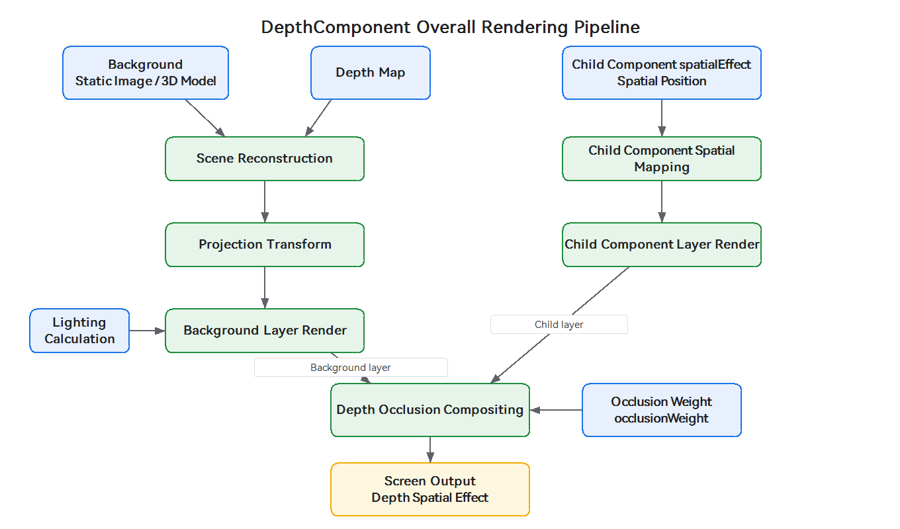

The rendering process mainly includes the following stages:

- **[Scene reconstruction](#scene-reconstruction)**: Based on the depth map [depthMap](../reference/apis-arkui/arkui-ts/ts-basic-components-depthcomponent-sys.md#depthmap), each pixel of the background is assigned a spatial depth, reconstructing a scene with stereoscopic layers from a flat background.

- **[Projection transformation](#projection-transformation)**: The background and child components uniformly pass through the same three-dimensional transformation pipeline, completing the projection from three-dimensional space to screen pixel coordinates.

- **[Mapping Child Components Space](#mapping-child-components-space)**: Child components set their own position in three-dimensional space through the spatial effect [spatialEffect](../reference/apis-arkui/arkui-ts/ts-universal-attributes-spatial-effect-sys.md#spatialeffect), and participate in projection in two coordinate modes.

- **[Composite depth occlusion](#composite-depth-occlusion)**: The depth of child components is compared with the depth of the background at the corresponding position, and the degree to which they are occluded by the background is determined by the occlusion weight [SpatialEffectParams](../reference/apis-arkui/arkui-ts/ts-universal-attributes-spatial-effect-sys.md#spatialeffectparams).

- **[Lighting calculation](#lighting-calculation)**: Through the lighting parameter [light](../reference/apis-arkui/arkui-ts/ts-basic-components-depthcomponent-sys.md#light), light and shade effects are supplemented for the scene to enhance the stereoscopic effect.

### Scene reconstruction

The depth map records the distance of each background pixel from the camera (the whiter the color, the closer it is; the blacker, the farther). The component assigns spatial depth to each background pixel based on the depth map, and then determines the projection position of each pixel on the screen in combination with camera parameters (position, rotation, and field of view), thereby reconstructing a scene with stereoscopic layering from a flat background.

The role of the depth map can be simply understood as "layering" a flat background so that each pixel carries near-far information, thereby reconstructing a stereoscopic scene. The process is as follows:

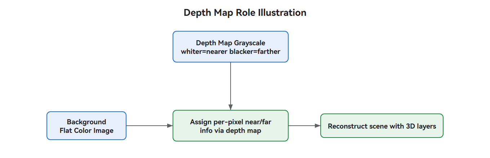

The quality of the depth map directly determines the depth-of-field effect. When the precision is insufficient, the near-far relationship of background pixels will be distorted, leading to disordered stereoscopic layering, broken edges of objects, incorrect occlusion relationships between child components and the background, and overall destruction of the sense of depth. Therefore, attention should be paid to the source and precision of the depth map.

- **Source**: The depth map can be obtained through various approaches, including direct export from 3D modeling software (highest precision), capture by depth cameras based on technologies such as ToF and structured light, generation from ordinary photos by AI (artificial intelligence) depth estimation models, and manual drawing. The precision and reliability of different sources vary greatly; depth maps exported from modeling software and captured by professional depth cameras are usually of the best quality.

- **Precision and edges**: High-precision depth maps (such as those exported from modeling) have clear layering and crisp transitions at object edges, producing a natural depth-of-field effect; lower-precision depth maps (such as some AI-generated results) may show blurring or breaks at object edges, causing unnatural depth-of-field transitions and producing a "layering" or "cutout" feel. When selecting or creating a depth map, try to ensure the clarity and continuity of object edges.

- **Parallax and depth**: The depth map essentially records the distance of objects from the camera; the related parallax is inversely proportional to depth—the greater the parallax, the closer the object, which is commonly used in binocular stereo matching.

For the differences between high-precision and low-precision depth maps at object edges and backgrounds, refer to the following figure:

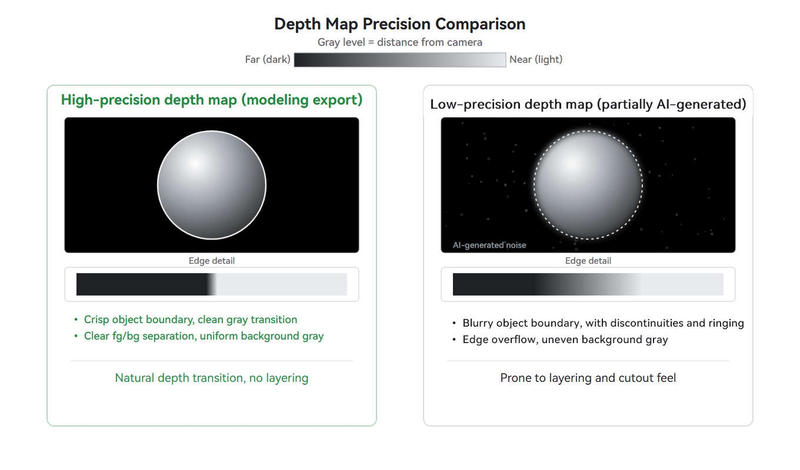

### Projection transformation

The camera parameter [camera](../reference/apis-arkui/arkui-ts/ts-basic-components-depthcomponent-sys.md#camera) is used to configure the virtual camera that observes the depth-of-field scene. It mainly includes the following parameters:

- **[position](../reference/apis-arkui/arkui-ts/ts-basic-components-depthcomponent-sys.md#depthcameraparams)**: The position of the camera itself. It determines "from which position the scene is observed". Moving the camera changes the distance and angle of what is seen. Note that "position" has different meanings in the camera parameters and in the spatial effect. For details, see the note at the end of [Mapping Child Components Space](#mapping-child-components-space).

- **[quaternion](../reference/apis-arkui/arkui-ts/ts-basic-components-depthcomponent-sys.md#depthcameraparams)**: The rotation (orientation) of the camera, expressed as a quaternion in the form (x, y, z, w). It determines "which direction to look toward". The quaternion (x, y, z, w) describes **a single complete rotation**: (x, y, z) gives the direction of the rotation axis, and w is related to the rotation angle (w = cos(θ/2), (x, y, z) = axis · sin(θ/2)). Together, the four components determine how the camera rotates. Among them, (0, 0, 0, 1) is the identity quaternion, indicating no rotation, so the camera keeps its default orientation and looks toward the -Z direction. For common orientations, you can directly use (0, 0, 0, 1) from the example. When a specific viewing angle is required, rotating around the Y axis adjusts the orientation left or right, rotating around the X axis adjusts pitch, and rotating around the Z axis adjusts roll. Then convert using the axis-angle formula above.

- **[yFov](../reference/apis-arkui/arkui-ts/ts-basic-components-depthcomponent-sys.md#depthcameraparams)**: The vertical field of view (in radians). This is the camera's field of view, similar to how wide a scene a lens can capture. A larger value means a wider field of view. The component provides only the vertical field of view. The horizontal field of view is automatically derived from yFov and the component's aspect ratio (when yFov is fixed, a larger aspect ratio results in a wider horizontal field of view). The horizontal field of view cannot and need not be set separately.

- **[zNear](../reference/apis-arkui/arkui-ts/ts-basic-components-depthcomponent-sys.md#depthcameraparams)**: The near clipping plane distance. Objects too close to the camera (closer than this value) are clipped and not displayed. It must be a positive number.

- **[zFar](../reference/apis-arkui/arkui-ts/ts-basic-components-depthcomponent-sys.md#depthcameraparams)**: The far clipping plane distance. Objects too far from the camera (farther than this value) are clipped and not displayed. It must be a positive number.

- **[cameraBufferCrop](../reference/apis-arkui/arkui-ts/ts-basic-components-depthcomponent-sys.md#camerabuffercrop)** (optional, tilt-shift cropping): Without changing the camera's position and orientation, it translates and scales the "cropping window" within the plane where the background image lies, rendering only a certain local part of the image to the component. This is similar in principle to the "shift framing" of a tilt-shift lens in photography, so it is also called off-axis rendering. It is often used to crop and enlarge a certain local part from a high-resolution wallpaper (while preserving its depth relationship). It contains four sub-parameters:

  - **[bufferWidth](../reference/apis-arkui/arkui-ts/ts-basic-components-depthcomponent-sys.md#camerabuffercrop) / [bufferHeight](../reference/apis-arkui/arkui-ts/ts-basic-components-depthcomponent-sys.md#camerabuffercrop)**: The width and height of the reference image (in pixels). They should match the actual resolution of the background image and serve as the reference frame for cropping coordinates. A mismatch may cause display anomalies (such as rendering position offset).

  - **[cropOffset](../reference/apis-arkui/arkui-ts/ts-basic-components-depthcomponent-sys.md#cropoffset)**: The offset of the top-left corner of the cropping window relative to the top-left corner of the reference image (x, y in pixels). Changing it translates the cropping window to achieve off-axis framing.

  - **[cropScale](../reference/apis-arkui/arkui-ts/ts-basic-components-depthcomponent-sys.md#camerabuffercrop)**: Scaling ratio of the cropping window. The base size of the cropping window is the component layout size. A value less than 1 means a smaller cropping window, corresponding to enlarging a local area; a value greater than 1 means a larger cropping window, corresponding to shrinking the content.

When not set, the component layout size is used as the base image by default, with an offset of (0, 0) and a scale of 1.0, that is, the default mapping that renders the entire image. When you need to crop a local area for rendering, refer to the [Using tilt-shift cropping to render a background local](#using-tilt-shift-cropping-to-render-a-background-local) example.

Among them, yFov, zNear, and zFar are core parameters that appear repeatedly in the subsequent examples: yFov controls the breadth of the field of view, and zNear and zFar together define a "visible range". Only objects whose distance from the camera falls within [zNear, zFar] will be rendered.

> **Note:**
>
> When a static image is used as the background, updates to the camera parameters (position, quaternion, yFov, zNear, zFar) do not cause changes to the background; they only affect the spatial rendering effect of child components. When observing an already-built scene from different positions, angles, and fields of view, the projection size, screen position, and visible area of child components change accordingly. When a 3D model is used as the background, the camera parameters affect both the background and the child components. For details, see item 4 in [Constraints](#constraints).

The relationship of each parameter in imaging can be referred to in the following figure (side-view schematic):

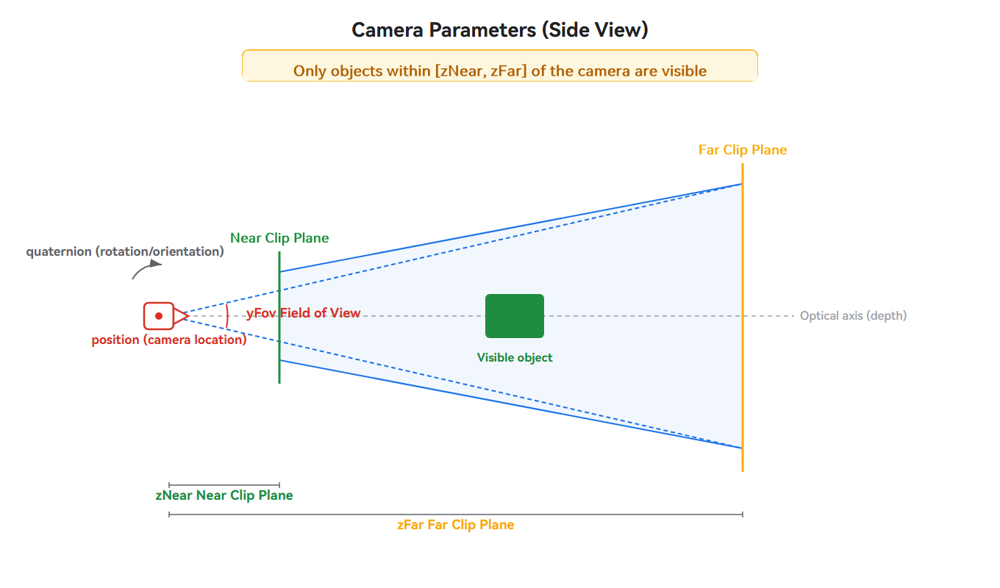

Among them, position, quaternion, yFov, zNear, and zFar determine the range that the camera "sees" in space, as shown in the figure above (side view). The meaning of each quaternion component (x, y, z, w) can be referred to in the following figure (taking rotation around the Y axis as an example):

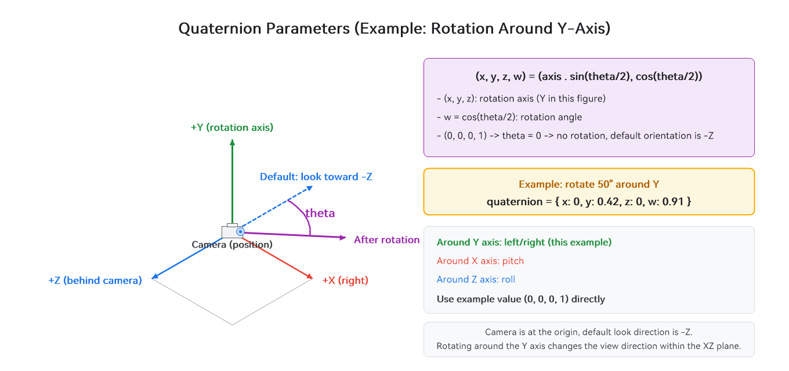

In contrast, cameraBufferCrop controls the area cropped from the already-imaged picture, which is a concept on the front view (image plane). The translation and scaling relationship of its cropping window is shown in the following figure (front view):

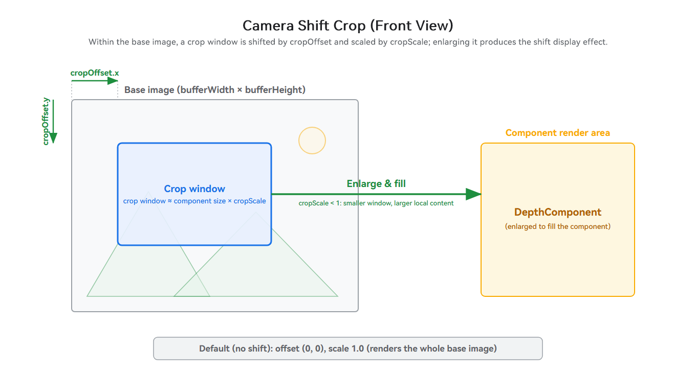

After scene reconstruction and camera setup, the background and child components uniformly pass through the same three-dimensional transformation pipeline. The camera transforms world coordinates into view space ("the world as seen by the camera") based on position and quaternion. It then performs perspective projection in combination with yFov, zNear, zFar, and the component aspect ratio, transforming them into clip space. After perspective division, Normalized Device Coordinates (NDC) are obtained, and finally they are mapped to screen pixel coordinates through viewport transformation. The process is as follows:

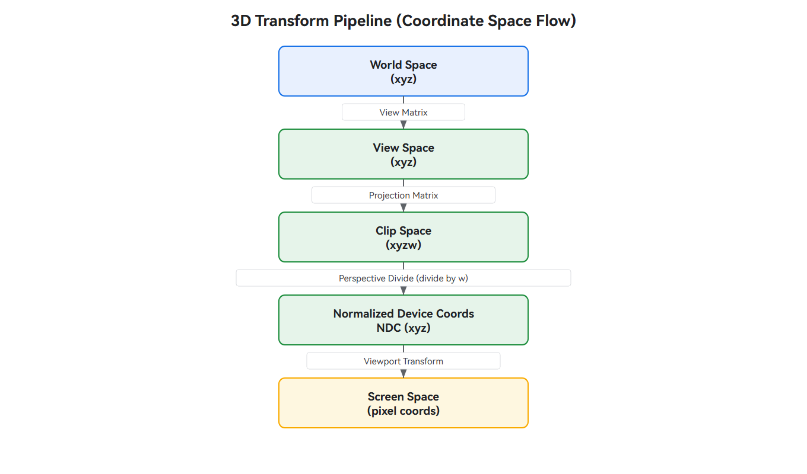

Among them, **perspective division** (division by w) is the key step that produces the perspective (near large, far small) effect: the coordinates in clip space are four-dimensional vectors `(x, y, z, w)`, and after division by w, Normalized Device Coordinates `(x/w, y/w, z/w)` are obtained. The larger the w component, the farther the object is from the camera and the smaller its projection size; the smaller the w component, the closer it is and the larger its projection size. In perspective projection, the w component takes the opposite value of the Z coordinate in view space. The distance of an object from the camera is determined by the grayscale value of the depth map (2D background) or the model's own depth (3D model), and is reflected as the above w component after projection.

**Camera movement**: When the camera moves in world space, the positions of all objects relative to it change - moving along the Z axis (forward/backward) changes the projection size of objects (near large, far small), while moving along the X axis (left/right) or Y axis (up/down) makes objects move in the opposite direction on the screen.

### Mapping Child Components Space

A child component uses spatialEffect to set its position in three-dimensional space, participates in the DepthComponent's three-dimensional transformation, and produces spatial interactions such as occlusion and tilt with the background. The child component's spatial effect is defined by SpatialEffectParams, which mainly includes the following parameters:

- **[position](../reference/apis-arkui/arkui-ts/ts-universal-attributes-spatial-effect-sys.md#spatialeffectparams)**: The child component's position in three-dimensional space. Two forms are supported — the numeric form represents the child component's depth information (determining its distance from the camera; for example, in [Set depth only to implement text occlusion effect](#set-depth-only-to-implement-text-occlusion-effect), a negative value indicates that the child component is in front of the camera, and a larger absolute value means farther from the camera); the struct form uses four corners (top-left, top-right, bottom-left, bottom-right) to position the component, which can express a tilted placement effect. Here, "position" refers to the child component's placement position, which differs from the position in the camera parameters; see the note at the end of this section for details.

- **[occlusionWeight](../reference/apis-arkui/arkui-ts/ts-universal-attributes-spatial-effect-sys.md#spatialeffectparams)**: Occlusion weight. Controls the degree to which the child component is occluded by the background, with a value range of [0, 1] and a default value of 0; 0 means not occluded, and 1 means fully occluded.

When the struct form uses four corners to position the component, you can use [positionMode](../reference/apis-arkui/arkui-ts/ts-universal-attributes-spatial-effect-sys.md#spatialpositionmode) to specify the coordinate mode used by the corner points (default `SpatialPositionMode.WORLD_XYZ`):

<!--deprecated_code_no_check-->
``` TypeScript
// Pseudocode: child component spatial effect parameter structure
.spatialEffect({
  position: {
    leftTop: { x, y, z },      // Four corner positions
    rightTop: { x, y, z },
    leftBottom: { x, y, z },
    rightBottom: { x, y, z },
    positionMode: SpatialPositionMode.WORLD_XYZ   // Coordinate mode, default WORLD_XYZ
  }
})
```

positionMode determines the coordinate system used by the four corner coordinates (see [SpatialPositionMode](../reference/apis-arkui/arkui-ts/ts-universal-attributes-spatial-effect-sys.md#spatialpositionmode) for details). The two values are compared as follows:

| Mode | Coordinate meaning | Screen motion | Applicable Scenario |
| -------- | -------- | -------- | -------- |
| WORLD_XYZ (default) | X, Y, and Z are all world coordinates. | Nonlinear (affected by perspective division). | Precisely control the child component's position in three-dimensional space, as in the [Implementing text tilt and masking (2D image background)](#implementing-text-tilt-and-masking-2d-image-background) example. |
| NDC_XY_WORLD_Z | X and Y are normalized device coordinates, and Z is a world coordinate. | Linear (XY directly correspond to the screen). | Precisely control the child component's position on the screen, with more controllable animation trajectories; see [Using NDC coordinates to implement controllable text tilt](#using-ndc-coordinates-to-implement-controllable-text-tilt) for an example. |

Whether a child component moves in world space or in NDC, the observed effect is consistent—movement along the X axis corresponds to horizontal movement on the screen, movement along the Y axis corresponds to vertical movement, and movement along the Z axis corresponds to perspective (near large, far small) (closer means larger, farther means smaller). The recommended value range for NDC X and Y is [-1, 1] (the NDC origin is at the screen center, with the X axis positive to the right and the Y axis positive downward, meaning the upper-left corner is (-1, -1) and the lower-right corner is (1, 1)). Due to the nature of perspective projection, when a child component moves along the Z axis, its projection size scales proportionally to the distance: the closer to the camera, the more noticeable the size change caused by the same displacement.

For details, see [Spatial effect](../reference/apis-arkui/arkui-ts/ts-universal-attributes-spatial-effect-sys.md).

> **Note:** 
>
> The difference between the two "position" parameters: the position in the camera parameters refers to "the location of the camera itself, the observing device" (determining where to view from); the position in the spatial effect refers to "the location where the child component is placed" (determining where the viewed object is).

### Composite depth occlusion

When rendering a child component, its depth is compared with the depth of the background at the corresponding position, and the degree to which it is occluded by the background is determined by the occlusion weight SpatialEffectParams (occlusionWeight, value range [0, 1]), so that the child component naturally blends into the spatial hierarchy of the background. The determination logic is as follows:

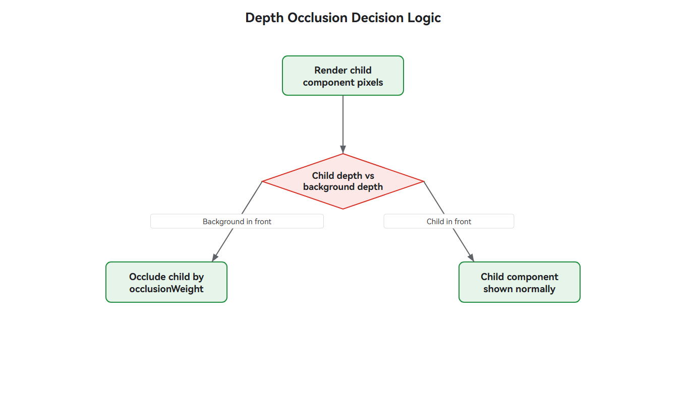

A child component is located between the near and far sides of the background in the scene. Background objects closer to the camera will occlude the child component. The spatial hierarchy relationship is illustrated as follows:

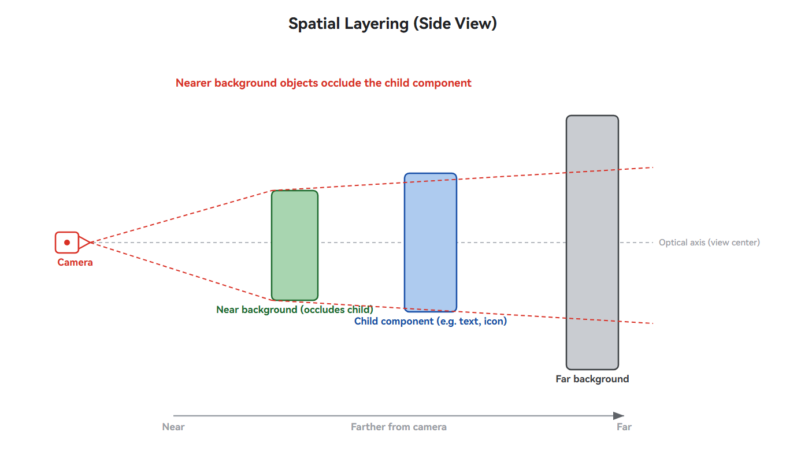

### Lighting calculation

The lighting parameter light defines the light that illuminates the depth-of-field scene. During rendering, the brightness of each pixel is calculated based on the light direction and scene geometry, and then composited with the background color to supplement the scene with light, shade, and color, enhancing the stereoscopic realism. A 2D image background itself has no geometric surface; during rendering, the surface normal is estimated for each pixel based on the depth map (the depth gradient direction is the surface orientation), and then the pixel brightness is calculated according to the light direction (that is, relief-style shading, which produces light and shade contrast based on the normal direction to simulate a stereoscopic relief effect). A 3D model uses the model's own normals in the calculation. It mainly includes the following parameters:

- **[direction](../reference/apis-arkui/arkui-ts/ts-basic-components-depthcomponent-sys.md#depthlightparams)**: Light direction, indicating the direction of light propagation (from the light source toward the illuminated object). In each scene example, light is set to { x: 0, y: 0, z: -1 }, indicating that the light shines in the -Z direction. The illuminated surface is the one whose normal faces +Z (facing the light source), while the surface whose normal faces -Z (in the same direction as light propagation, facing away from the light source) is in shadow. The camera looks toward -Z by default, so +Z is on the camera side and -Z points deeper into the scene. See the coordinate axis labels in the lighting parameter diagram below for the coordinate system.

- **[color](../reference/apis-arkui/arkui-ts/ts-basic-components-depthcomponent-sys.md#depthlightparams)**: Light color. Affects the overall tone of the scene.

- **[intensity](../reference/apis-arkui/arkui-ts/ts-basic-components-depthcomponent-sys.md#depthlightparams)**: Light intensity. The value range is [0, +∞), with a recommended range of [0, 1]. When set to 0, there is no lighting. When it exceeds 1, the lighting is too strong and may form locally highlighted spots on the illuminated surface, causing the display effect to differ from expectations. It is not recommended to exceed this range.

The effect of each parameter can be seen in the following figure:

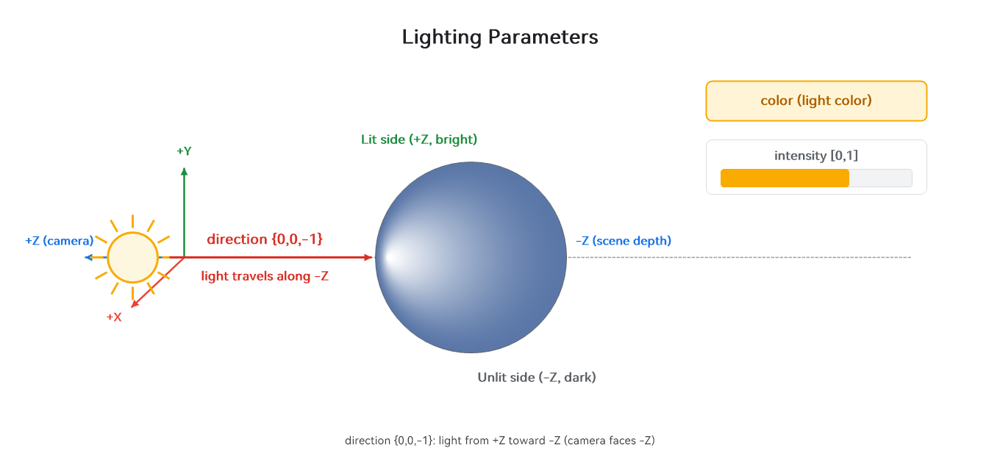

## Constraints

1. This component is a system API, available only to system applications, and can be used only in the Stage model.

2. Child components need to have the spatial effect set before they can interact with the background of the DepthComponent. The spatial effect does not support the [Web](../web/web-component-overview.md), [XComponent](../reference/apis-arkui/arkui-ts/ts-basic-components-xcomponent.md), [RichEditor](../reference/apis-arkui/arkui-ts/ts-basic-components-richeditor.md), [RichText](../reference/apis-arkui/arkui-ts/ts-basic-components-richtext.md), [Video](../reference/apis-arkui/arkui-ts/ts-media-components-video.md), [Component3D](../reference/apis-arkui/arkui-ts/ts-basic-components-component3d.md), and [EmbeddedComponent](../reference/apis-arkui/arkui-ts/ts-container-embedded-component.md) components.

3. When the background is a static image, a depth map needs to be set, and the depth map must have the same resolution as the background image. When the background is a 3D model, there is no need to set a depth map.

4. When an image is used as the background, updating camera parameters does not cause changes to the background; it only affects the spatial rendering effect of child components. When observing an already-built scene from different positions, angles, and fields of view, the projection size, screen position, and visible area of child components change accordingly.

   The reason is that a static image is a fixed flat picture that has already been captured and has no real three-dimensional structure. For example, when the observer moves their head left and right, a photo on the wall remains the same photo no matter how the camera is adjusted. Child components, however, are three-dimensional elements rendered independently in three-dimensional space. Moving the camera is equivalent to "observing them from a different angle," so their projection size, screen position, and occlusion relationships all change accordingly, thereby presenting a stereoscopic effect. In contrast, a 3D model background itself is also a real three-dimensional structure, so the camera affects both the background and the child components simultaneously. If you want the background to also change spatially as the camera moves, you should use a 3D model background instead.

5. The camera's zNear and zFar must be positive numbers, and zNear must be smaller than zFar. When they are 0 or negative, the requirement of "must be positive" is not satisfied and the parameters are invalid. When zNear is greater than or equal to zFar, the visible range is empty and the scene is not rendered.

6. The render3DScale in the constructor options ([DepthComponentOptions](../reference/apis-arkui/arkui-ts/ts-basic-components-depthcomponent-sys.md#depthcomponentoptions)) is the scaling ratio of the 3D rendering window, which applies to both width and height. Its value range is (0.0, 1.0], with a default value of 1.0. Values outside this range are invalid (the previous value is inherited, or the default value is used if none has been set).

7. The light intensity parameter intensity has a value range of [0, +∞), with a recommended range of [0, 1]. When set to 0, there is no lighting. When it exceeds 1, the lighting is too strong and may form locally highlighted spots on the illuminated surface, causing the display effect to be inconsistent with expectations. It is not recommended to exceed this range.

In addition, depth of field and spatial effects essentially simulate stereoscopic vision and relative motion. Improper use may cause visual fatigue or even dizziness. The following principles are recommended during development:

- Pay attention to accessibility and motion sensitivity: Some users (such as those with sensitive vestibular function) are more sensitive to effects such as stereoscopic parallax and relative displacement. Prolonged or intense depth-of-field changes may cause discomfort. It is recommended to refer to the system's "Reduce Motion" setting and provide a switch to disable or reduce depth-of-field and spatial effects. When the user enables this setting, reduce the depth intensity or stop spatial displacement.

- Depth intensity should be restrained: Stronger depth is not always better. An excessively large field of view (yFov), an overly close camera distance, or excessive spatial displacement will overstretch the background and cause excessive displacement of child components, which instead disrupts the visual harmony and aggravates discomfort. It is recommended to start with moderate parameters and prioritize content readability and picture stability.

- Consider rendering performance: Depth-of-field rendering relies on the GPU (Graphics Processing Unit) to perform depth reconstruction and projection calculation for each pixel of the background, which is a GPU-intensive operation. The depth map resolution should be consistent with the background image to avoid unnecessary oversized resolutions that increase video memory and computing overhead. When dynamically adjusting the camera or spatial position, pay attention to controlling the update frequency to avoid the performance pressure caused by high-frequency changes every frame.

### FAQs

If the DepthComponent display effect is not visible after configuration, troubleshoot in the following order.

- Whether the background resource is loaded successfully: Check whether the `onComplete` callback (load success) or the `onError` callback (load failure) is triggered to confirm the loading status of the background resource. If loading fails, the background is empty and the display effect cannot be seen.
- Whether the depth map is set (2D image background): A depth map must be set for a 2D background, and its resolution must be exactly the same as that of the background image. Otherwise, the stereoscopic layers cannot be reconstructed.
- Whether zNear/zFar are valid: Both must be positive numbers and zNear < zFar. Otherwise, the visible range is empty and the scene is not rendered.
- Whether the camera orientation is aimed at the scene: Confirm that position and quaternion place the child component's distance from the camera within the [zNear, zFar] range and within the field of view.
- Whether the child component has a spatial effect set: A child component without spatialEffect set still sticks to the background plane and does not produce front-back occlusion or tilt.
- Whether occlusionWeight is too large: When set to 1, the near background completely occludes the corresponding part of the child component. For initial verification, set a smaller value first (for example, 0.2).
- Whether the child component's position falls within the visible range: When the four corner coordinates deviate from the field of view or are completely occluded by a background with closer depth, the child component may be invisible.

### Parameter Tuning Suggestions

Developers can first apply the parameter values from the [Example Scenario](#example-scenario), then adjust each item according to the following table, modifying only one parameter at a time to perceive the change. The following table is grouped by camera, child component, and lighting, covering the main adjustable parameters involved in this guide.

**Camera parameters**

| Parameter | Increase | Decrease | Suggestion |
| -------- | -------- | -------- | -------- |
| yFov (vertical field of view) | Wider field of view, more background stretching | Narrower field of view, stronger compression | Start from around 1.0. |
| zNear (near clipping plane) | Near objects are more easily clipped | Near objects are more easily retained | Must be positive and < zFar. |
| zFar (far clipping plane) | Distant objects are more easily retained | Distant objects are clipped | Must be positive and > zNear. |
| Camera position.z (front/back) | Farther from the scene, smaller projection | Closer to the scene, larger projection | Perspective (near large, far small). |
| Camera quaternion (orientation) | Around Y axis: adjust orientation left/right; around X axis: pitch; around Z axis: roll | Same as left, in reverse | For common orientation, apply the example value (0, 0, 0, 1). |
| cameraBufferCrop.cropOffset (crop offset) | The framing window shifts toward +x (right) / +y (down) | Shifts toward -x (left) / -y (up) | Shift the framing off-axis as needed. |
| cameraBufferCrop.cropScale (crop scale) | >1: larger window, smaller content | <1: smaller window, enlarged local area | Start from 1.0, enlarge the local area as needed. |
| cameraBufferCrop.bufferWidth/Height (base resolution) | Not applicable | Not applicable | Must match the actual resolution of the background image, otherwise the position will be offset. |

**Child component parameters**

| Parameter | Increase | Decrease | Suggestion |
| -------- | -------- | -------- | -------- |
| Z-value difference among the four corners of the child component position | More obvious tilt | The four-corner Z values tend to be consistent, weaker tilt | No tilt when the four-corner Z values are the same. |
| Numeric notation of the child component position (depth) | Larger absolute value, farther from the camera | Smaller absolute value, closer to the camera | Use negative values, within [zNear, zFar]. |
| occlusionWeight (occlusion weight) | More occluded by the background | Less occluded by the background | Adjust gradually from 0 to 1; for initial verification, 0.2 can be used. |

**Lighting parameters**

| Parameter | Increase | Decrease | Suggestion |
| -------- | -------- | -------- | -------- |
| light direction | Changes the distribution of lit/shadowed surfaces | Not applicable | Orient toward the area to be illuminated; the example {0, 0, -1} indicates the light direction points toward -Z. |
| light intensity | Brighter | Darker (0 means no lighting) | It is recommended not to exceed 1; exceeding it tends to form light spots. |

## Example Scenario

Integrating the DepthComponent mainly involves five configurations: the background resource (constructor parameter `background`), the depth map depthMap, the camera parameters camera, the lighting parameters light, and the spatial effect spatialEffect set for child components.

The background resource supports two forms: static image (2D) and 3D model. The two differ in configuration regarding color space, depth map, camera, and other aspects:

| Configuration Item | 2D scene (static image background) | 3D scene (3D model background) |
| -------- | -------- | -------- |
| Color space ([colorSpace](../reference/apis-arkui/arkui-ts/ts-basic-components-depthcomponent-sys.md#depthcomponentoptions)) | The PixelMap built-in color space requires no setting; ResourceStr can be set as needed. | Set as needed; when the model is sRGB, no setting is required (sRGB by default); when it uses another color space (such as Display P3, Adobe RGB, etc.), specify it through colorSpace. |
| Depth map (depthMap) | Must be set, and its resolution must match that of the background image. | No need to set; the 3D model has built-in depth information. |
| Camera parameters (camera) | Does not affect the background; only affects the spatial effect of child components. | Affects both the background and the rendering effect of child components. |

The overall development workflow is: prepare the background (and depth map) resource → create a DepthComponent and pass in the background resource → set the depth map or color space as needed → configure camera and lighting parameters → set spatial effects for child components → compile, build, and verify the effect.

### Implementing text tilt and masking (2D image background)

In this scenario, a static image is used as the background, combined with a depth map. By configuring spatial effects for the child component Text, the effect of "text visually tilting and being partially masked by the image" is achieved.

**Preparing resources**

A static image background requires two resources: a background image (an ordinary static image) and a depth map (a grayscale image). The resolutions of the two must be consistent. The grayscale value of the depth map represents the distance of each background pixel (white is near, black is far; for details, see the depth map description in [Scene reconstruction](#scene-reconstruction)). After placing the resources in the application's media resource directory, reference them through `$r('app.media.xxx')`.

**Configuring the DepthComponent**

The overall structure of the DepthComponent can be summarized as follows: the background resource is passed in through constructor parameters, child components are declared inside the constructor closure, and the depth map, camera, and lighting are chained onto the component in sequence. First, use a piece of pseudocode to establish an overall understanding, then fill in the actual parameters item by item in the order of "depth map → camera → lighting".

<!--deprecated_code_no_check-->
``` TypeScript
// Pseudocode: DepthComponent skeleton
DepthComponent(background resource) {
  child component                    // Declared inside the closure; spatial effects will be set for it later
}
  .width('100%').height('100%')     // Fill the component area
  .depthMap(depth map)                  // ① Depth map: required for static image background, not needed for 3D model
  .camera(camera parameters)                  // ② Camera: position/orientation/FOV of the virtual observation point
  .light(lighting parameters)                   // ③ Lighting: direction/color/intensity of the directional light
```

**Set the depth map**

After passing a static image resource through the constructor parameter `background`, you need to set the depth map via depthMap. The second parameter is a loading callback that can be used to perceive the loading result.

<!--deprecated_code_no_check-->
``` TypeScript
// Step ①: Pass in the background resource and set the depth map
DepthComponent($r('app.media.background')) {
  // Declare child components inside the closure, and configure spatial effects for them later
}
  .width('100%')
  .height('100%')
  // A static image background must have a depth map set, and it must match the background image resolution
  .depthMap($r('app.media.depth_map'), (error: BusinessError<void>) => {
    if (error && error.code !== 0) {
      console.error(`Depth map load failed: ${error.code} - ${error.message}`);
    } else {
      console.info('Depth map loaded successfully');
    }
  })
```

**Set camera parameters**

camera defines the position, orientation (quaternion), and field of view (yFov, zNear/zFar) of the virtual observation point. Under a static image background, the camera only affects the spatial rendering of child components. Continue chaining on the DepthComponent from the previous step:

<!--deprecated_code_no_check-->
``` TypeScript
// Step ②: Chain-append camera parameters.
.camera({
  position: { x: 0, y: 0, z: 0 },
  quaternion: { x: 0, y: 0, z: 0, w: 1 },
  yFov: 1.05,
  zNear: 0.1,
  zFar: 100
})
```

**Set lighting parameters**

light provides the direction, color, and intensity of the directional light for the scene. Continue chain-appending:

<!--deprecated_code_no_check-->
``` TypeScript
// Step ③: Chain-append lighting parameters.
.light({
  direction: { x: 0, y: 0, z: -1 },
  color: { red: 255, green: 255, blue: 255 },
  intensity: 1
})
```

**Set spatial effects for child components**

Child components declared inside the DepthComponent construction closure are still on the background plane by default. Only after setting spatialEffect for them do they enter three-dimensional space and produce front-to-back occlusion relationships with the background. `position` uses four corner points (leftTop/rightTop/leftBottom/rightBottom) to define the position and tilted form of the child component in three-dimensional space; `occlusionWeight` controls the degree to which it is occluded by the background (0 means no occlusion, 1 means complete occlusion).

<!--deprecated_code_no_check-->
``` TypeScript
// Set spatial effects for the child component so that it enters the 3D scene and produces an occlusion relationship with the background.
Text('Depth Component')
  .fontSize(100)
  .spatialEffect({
    // Set the child component's position in three-dimensional space through four corner coordinates to form a tilted shape.
    position: {
      leftTop: { x: -0.355, y: 0.915, z: -1.941 },
      rightTop: { x: 0.483, y: 1.259, z: -2.295 },
      leftBottom: { x: -0.355, y: -0.281, z: -1.941 },
      rightBottom: { x: 0.483, y: 0.063, z: -2.295 }
    },
    // Occlusion weight. 0 means not occluded, 1 means completely occluded.
    occlusionWeight: 0.5
  })
```

**Complete Code**

Combine the above steps (and supplement the component with `onComplete`/`onError` event callbacks to perceive the background loading result, where onComplete is triggered when the background resource loads successfully and onError is triggered when loading fails) to obtain the complete example:

<!-- @[depth_component_2d](https://gitcode.com/openharmony/applications_app_samples/blob/master/code/DocsSample/ArkUISample/DepthComponentSample/entry/src/main/ets/pages/DepthComponent_2D.ets) -->
``` TypeScript
// xxx.ets
import { BusinessError } from '@kit.BasicServicesKit';

@Entry
@Component
struct DepthComponent2DExample {
  build() {
    Column() {
      // Replace with the actual resource file.
      DepthComponent($r('app.media.background')) {
        Text('Depth Component')
          .fontSize(100)
          .spatialEffect({
            // Set the child component's position in three-dimensional space through four-corner coordinates to form a tilted shape.
            position: {
              leftTop: { x: -0.355, y: 0.915, z: -1.941 },
              rightTop: { x: 0.483, y: 1.259, z: -2.295 },
              leftBottom: { x: -0.355, y: -0.281, z: -1.941 },
              rightBottom: { x: 0.483, y: 0.063, z: -2.295 }
            },
            // Occlusion weight. 0 means not occluded, and 1 means fully occluded.
            occlusionWeight: 0.5
          })
      }
      .width('100%')
      .height('100%')
      // A static image background must have a depth map set, and the depth map must have the same resolution as the background image.
      .depthMap($r('app.media.depth_map'), (error: BusinessError<void>) => {
        if (error && error.code !== 0) {
          console.error(`Depth map load failed: ${error.code} - ${error.message}`);
        } else {
          console.info('Depth map loaded successfully');
        }
      })
      // Set the camera parameters.
      .camera({
        position: { x: 0, y: 0, z: 0 },
        quaternion: { x: 0, y: 0, z: 0, w: 1 },
        yFov: 1.05,
        zNear: 0.1,
        zFar: 100
      })
      // Set the lighting parameters.
      .light({
        direction: { x: 0, y: 0, z: -1 },
        color: { red: 255, green: 255, blue: 255 },
        intensity: 1
      })
      .onComplete((event: DepthComponentCompleteEvent) => {
        console.info(`Background loaded: ${event.componentWidth}x${event.componentHeight}`);
      })
      .onError((event: DepthComponentErrorEvent) => {
        console.error(`Background load failed: ${event.componentWidth}x${event.componentHeight}`);
        if (event.error) {
          console.error(`Error: ${event.error.code} - ${event.error.message}`);
        }
      })
    }
    .width('100%')
    .padding(16)
  }
}
```

**Expected Results**

Open the application page. After the DepthComponent successfully loads the background image and depth map, the text "Depth Component" presents a visual tilt effect, and part of the content is occluded by objects in the background.

   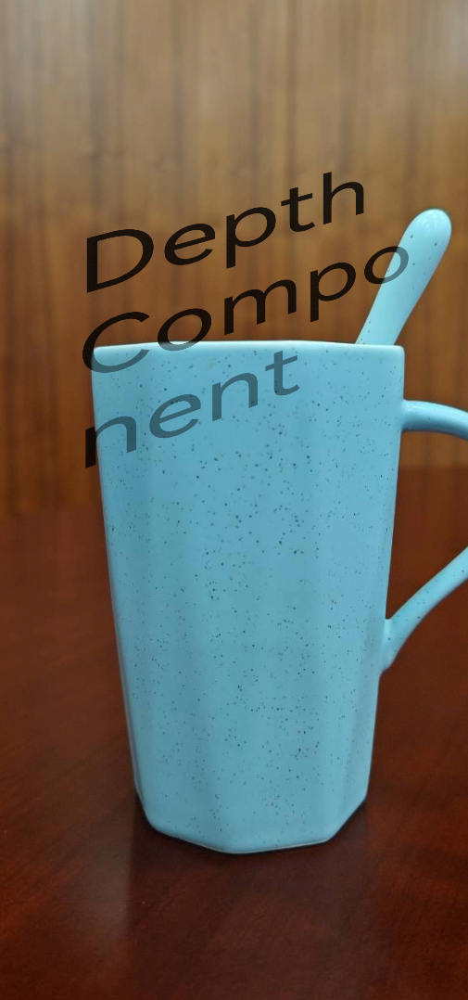

### Implementing text tilt and masking (3D model background)

The integration process for a 3D model (glTF/glb) background is basically the same as that for a 2D image background, with the same overall structure. The differences are: the background resource is a 3D model, the construction parameters can specify a color space, and the 3D model has built-in depth information, so there is no need to set a depth map. First, look at the pseudocode skeleton:

<!--deprecated_code_no_check-->
``` TypeScript
// Pseudocode: DepthComponent skeleton with a 3D model background
DepthComponent(3D model, { colorSpace }) {     // The background is a model, and a color space can be specified
  Child component
}
  .width('100%').height('100%')
  .camera(camera parameters)                          // Affects both the background and child components
  .light(lighting parameters)
// The 3D model has built-in depth information, so .depthMap() is not needed
```

**Setting the color space**

The model in this example uses the Display P3 color space. You need to first import the `@kit.ArkGraphics2D` module, and then specify the corresponding color space for the rendering surface through colorSpace. If the model is sRGB, no setting is needed and this step can be skipped.

<!--deprecated_code_no_check-->
``` TypeScript
// Step ①: Import the color gamut module and pass in the 3D model and color gamut.
import { colorSpaceManager } from '@kit.ArkGraphics2D';

DepthComponent($r('app.media.model'), {
  colorSpace: colorSpaceManager.ColorSpace.DISPLAY_P3
}) {
  // Declare the child component inside the closure.
}
  .width('100%')
  .height('100%')
```

**Set camera and lighting parameters**

The configuration of the camera and lighting is exactly the same as in the [2D image background example](#implementing-text-tilt-and-masking-2d-image-background); simply chain-append them. The difference is that the 3D model itself is a real three-dimensional structure, so the camera parameters affect the rendering of both the background and the child components simultaneously (see [Constraints](#constraints), item 4).

<!--deprecated_code_no_check-->
``` TypeScript
// Step ②: Chain-append camera and lighting parameters.
.camera({
  position: { x: 0, y: 0, z: 0 },
  quaternion: { x: 0, y: 0, z: 0, w: 1 },
  yFov: 1.05,
  zNear: 0.1,
  zFar: 100
})
.light({
  direction: { x: 0, y: 0, z: -1 },
  color: { red: 255, green: 255, blue: 255 },
  intensity: 1
})
```

**Set spatial effects for child components**

The configuration of spatial effects for child components is exactly the same as in the [2D image background example](#implementing-text-tilt-and-masking-2d-image-background): set spatialEffect for the child component inside the construction closure, define its position and tilted shape in three-dimensional space through the four-corner position, and use occlusionWeight to control the degree to which it is occluded by the background.

**Complete Code**

<!-- @[depth_component_3d](https://gitcode.com/openharmony/applications_app_samples/blob/master/code/DocsSample/ArkUISample/DepthComponentSample/entry/src/main/ets/pages/DepthComponent_3D.ets) -->
``` TypeScript
// xxx.ets
import { colorSpaceManager } from '@kit.ArkGraphics2D';

@Entry
@Component
struct DepthComponent3DExample {
  build() {
    Column() {
      // Replace with the actual 3D model resource file (glTF/glb).
      DepthComponent($rawfile('model.glb'), {
        colorSpace: colorSpaceManager.ColorSpace.DISPLAY_P3
      }) {
        Text('Depth Component')
          .fontSize(100)
          .spatialEffect({
            // Set the child component's position in three-dimensional space through the four-corner coordinates to form a tilted shape.
            position: {
              leftTop: { x: -0.355, y: 0.915, z: -1.941 },
              rightTop: { x: 0.483, y: 1.259, z: -2.295 },
              leftBottom: { x: -0.355, y: -0.281, z: -1.941 },
              rightBottom: { x: 0.483, y: 0.063, z: -2.295 }
            },
            // Occlusion weight: 0 means not occluded, 1 means fully occluded.
            occlusionWeight: 0.5
          })
      }
      .width('100%')
      .height('100%')
      // The 3D model has built-in depth information, so there is no need to set depthMap.
      .camera({
        position: { x: 0, y: 0, z: 0 },
        quaternion: { x: 0, y: 0, z: 0, w: 1 },
        yFov: 1.05,
        zNear: 0.1,
        zFar: 100
      })
      .light({
        direction: { x: 0, y: 0, z: -1 },
        color: { red: 255, green: 255, blue: 255 },
        intensity: 1
      })
      .onComplete((event: DepthComponentCompleteEvent) => {
        console.info(`Background loaded: ${event.componentWidth}x${event.componentHeight}`);
      })
      .onError((event: DepthComponentErrorEvent) => {
        console.error(`Background load failed: ${event.componentWidth}x${event.componentHeight}`);
        if (event.error) {
          console.error(`Error: ${event.error.code} - ${event.error.message}`);
        }
      })
    }
    .width('100%')
    .padding(16)
  }
}
```

**Expected Results**

Open the application page. After DepthComponent successfully loads the 3D model, the text "Depth Component" presents a visual tilt effect, and part of the content is occluded by the model.

   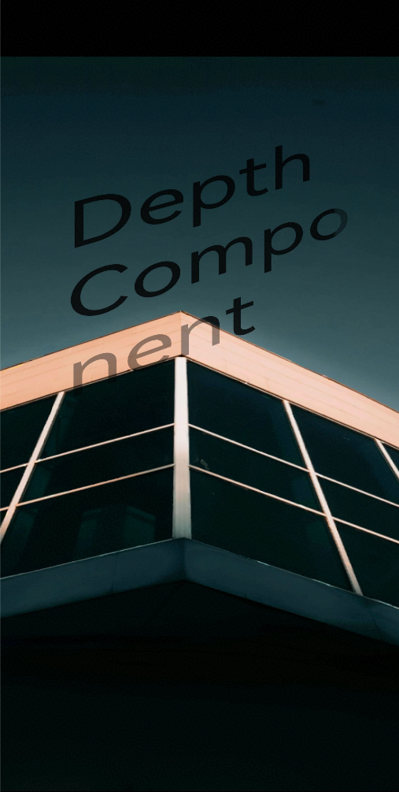

### Set depth only to implement text occlusion effect

The preceding examples position child components through the four-corner structure (leftTop/rightTop/leftBottom/rightBottom), which can express a tilted form. When you only need the child component to blend into the background by depth without tilting, the spatial effect position also supports directly providing the child component's depth information through a numeric notation. In this case, the child component maintains its layout position and flat form within the component, and only produces a front-to-back occlusion relationship with the background according to that depth.

**Set the child component's spatial effect**

<!--deprecated_code_no_check-->
``` TypeScript
// Set the spatial effect for the child component: position directly provides the depth (numeric notation).
// The child component does not tilt, and only produces occlusion with the background according to the depth.
Text('Spatial Effect')
  .fontSize(100)
  .spatialEffect({
    position: -2.0,        // Numeric notation: set the child component's depth information.
    occlusionWeight: 1.0   // Occlusion weight. 0 means not occluded, and 1 means fully occluded.
  })
```

**Complete Code**

<!-- @[depth_component_depth](https://gitcode.com/openharmony/applications_app_samples/blob/master/code/DocsSample/ArkUISample/DepthComponentSample/entry/src/main/ets/pages/DepthComponent_Depth.ets) -->
``` TypeScript
// xxx.ets
@Entry
@Component
struct DepthComponentDepthExample {
  build() {
    Column() {
      // Developers should replace this with the actual resource file.
      DepthComponent($r('app.media.background')) {
        Text('Spatial Effect')
          .fontSize(100)
          .spatialEffect({
            position: -2.0,        // Numeric notation: set the child component's depth information.
            occlusionWeight: 1.0   // Occlusion weight. 0 means not occluded, and 1 means fully occluded.
          })
      }
      .width('100%')
      .height('100%')
      .depthMap($r('app.media.depth_map')) // Replace it with the actual resource file.
      .camera({
        position: { x: 0, y: 0, z: 0 },
        quaternion: { x: 0, y: 0, z: 0, w: 1 },
        yFov: 1.05,
        zNear: 0.1,
        zFar: 100
      })
      .light({
        direction: { x: 0, y: 0, z: -1 },
        color: { red: 255, green: 255, blue: 255 },
        intensity: 1
      })
    }
    .width('100%')
    .padding(16)
  }
}
```

**Expected Results**

Open the application page. The text "Spatial Effect" is not tilted and is placed in the spatial layer of the background at depth -2.0. When the occlusion weight is 1, objects closer to the camera in the background completely occlude the corresponding parts of the text.

   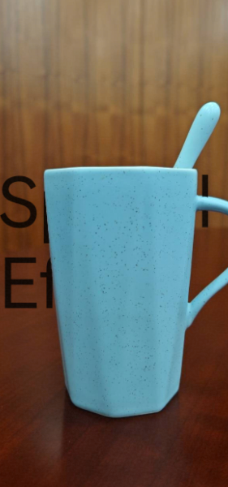

### Using NDC coordinates to implement controllable text tilt

In the previous [Implementing text tilt and masking (2D image background)](#implementing-text-tilt-and-masking-2d-image-background) example, the X, Y, and Z of the four corners' position are all world coordinates (the default `WORLD_XYZ` mode), which undergo perspective projection together with the camera view. This example instead uses the `NDC_XY_WORLD_Z` mode: the X and Y components use Normalized Device Coordinates (NDC, with a value range of [-1, 1], mapped directly to the screen without perspective division), while the Z component is a world coordinate that controls depth (for a detailed description of coordinate modes, see [Mapping Child Components Space](#mapping-child-components-space)).

In this example, the four corners' XY are directly set to a trapezoid that is narrow at the top and wide at the bottom (the top edge x is set to ±0.2 and the bottom edge x to ±0.5), and Z is uniformly set to -2.0, so the text presents a "small at the top, large at the bottom" tilted form on the screen:

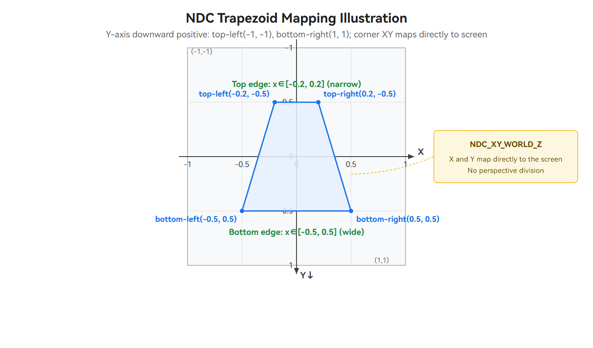

Unlike the world coordinate mode, which produces tilt through perspective projection by leveraging the Z differences of the four corners (as in the [Implementing text tilt and masking (2D image background)](#implementing-text-tilt-and-masking-2d-image-background) example), the tilt in NDC mode is entirely determined by the screen shape of XY - what you see is what you get. Therefore, when applying position or deformation animations to XY, the changes on the screen are linear and the trajectory is more controllable, making it suitable for animation scenarios that require precise control of screen landing points and deformation.

**Setting the child component's spatial effect**

<!--deprecated_code_no_check-->
``` TypeScript
// Set the spatial effect for the child component: X and Y are Normalized Device Coordinates mapped directly to the screen,
// The four corners' XY are set to a trapezoid that is narrow at the top and wide at the bottom, and Z uniformly controls the depth
Text('NDC Mode')
  .fontSize(120)
  .fontColor(Color.White)
  .spatialEffect({
    position: {
      leftTop: { x: -0.2, y: -0.5, z: -2.0 },
      rightTop: { x: 0.2, y: -0.5, z: -2.0 },
      leftBottom: { x: -0.5, y: 0.5, z: -2.0 },
      rightBottom: { x: 0.5, y: 0.5, z: -2.0 },
      positionMode: SpatialPositionMode.NDC_XY_WORLD_Z
    }
  })
```

**Complete Code**

<!-- @[depth_component_ndc](https://gitcode.com/openharmony/applications_app_samples/blob/master/code/DocsSample/ArkUISample/DepthComponentSample/entry/src/main/ets/pages/DepthComponent_NDC.ets) -->
``` TypeScript
// xxx.ets
@Entry
@Component
struct DepthComponentNdcExample {
  build() {
    Column() {
      // Developers should replace this with the actual resource file
      DepthComponent($r('app.media.background')) {
        Text('NDC Mode')
          .textAlign(TextAlign.Center)
          .fontSize(120)
          .spatialEffect({
            position: {
              leftTop: { x: -0.2, y: -0.5, z: -2.0 },
              rightTop: { x: 0.2, y: -0.5, z: -2.0 },
              leftBottom: { x: -0.5, y: 0.5, z: -2.0 },
              rightBottom: { x: 0.5, y: 0.5, z: -2.0 },
              positionMode: SpatialPositionMode.NDC_XY_WORLD_Z,
            },
            occlusionWeight: 0.5   // Occlusion weight, 0 means not occluded, 1 means fully occluded
          })
          .borderWidth(3)
          .borderColor(Color.Red)
      }
      .width('100%')
      .height('100%')
      .depthMap($r('app.media.depth_map')) // Replace with the actual resource file.
      .camera({
        position: { x: 0, y: 0, z: 0 },
        quaternion: { x: 0, y: 0, z: 0, w: 1 },
        yFov: 1.05,
        zNear: 0.1,
        zFar: 100
      })
    }
    .width('100%')
    .padding(16)
  }
}
```

**Expected Results**

Open the application page. The text "NDC Mode" appears on the screen in a tilted shape that is narrow at the top and wide at the bottom (small at the top, large at the bottom): the four corners' X and Y are directly mapped to the screen, and the top edge width (x from -0.2 to 0.2) is about 40% of the bottom edge width (x from -0.5 to 0.5). In this example, the occlusion weight is set to 0.5, so the corresponding parts of the text will be occluded by objects in the background that are closer to the camera.

   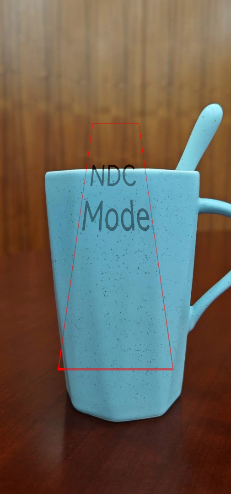


### Using tilt-shift cropping to render a background local

The previous examples all have the camera render the entire background image (by default using the component layout size as the base image, offset (0, 0), scale 1.0). This example uses the camera's optional parameter cameraBufferCrop (tilt-shift cropping, also known as off-axis rendering) to crop a local region from the background image and render it enlarged, without moving or rotating the camera. This is commonly used to take only a certain region from a high-resolution wallpaper as the depth-of-field background.

The position of cameraBufferCrop in camera and its four sub-parameters are as follows:

<!--deprecated_code_no_check-->
``` TypeScript
// Pseudocode: structure of cameraBufferCrop in camera
.camera({
  position, quaternion, yFov, zNear, zFar,
  cameraBufferCrop: {              // Optional: tilt-shift cropping (off-axis rendering)
    bufferWidth, bufferHeight,     // Base image = actual resolution of the background image
    cropOffset: { x, y },          // Offset of the cropping window's top-left corner: pan framing (off-axis)
    cropScale                      // Cropping window scale: <1 enlarges the local region, >1 shrinks the content
  }
})
```

**Setting tilt-shift cropping parameters**

For the meaning of each sub-parameter (bufferWidth/bufferHeight, cropOffset, cropScale), see the cameraBufferCrop description in [Projection transformation](#projection-transformation). This example uses the actual resolution of the background image, 1262×2560, as the base, translates the cropping window's top-left corner to (100, 100), and scales it to 0.65 times the component size, cropping the top-left local region and enlarging it. The image and depth relationship within the window are rendered together to the component.

<!--deprecated_code_no_check-->
``` TypeScript
// Configure tilt-shift cropping: based on the real resolution of the background image, crop the upper-left local area and enlarge it
.camera({
  position: { x: 0, y: 0, z: 0 },
  quaternion: { x: 0, y: 0, z: 0, w: 1 },
  yFov: 1.05,
  zNear: 0.1,
  zFar: 100,
  cameraBufferCrop: {
    bufferWidth: 1262,                  // Reference image width, must match the actual width of the background image
    bufferHeight: 2560,                 // Reference image height, must match the actual height of the background image
    cropOffset: { x: 100.0, y: 100.0 }, // Upper-left offset of the cropping window (off-axis framing)
    cropScale: 0.65                     // The cropping window is 0.65 times the component size, corresponding to enlarging the local area
  }
})
```

**Complete Code**

<!-- @[depth_component_crop](https://gitcode.com/openharmony/applications_app_samples/blob/master/code/DocsSample/ArkUISample/DepthComponentSample/entry/src/main/ets/pages/DepthComponent_Crop.ets) -->
``` TypeScript
// xxx.ets
@Entry
@Component
struct DepthComponentCropExample {
  build() {
    Column() {
      // Developers should replace this with the actual resource file
      DepthComponent($r('app.media.background')) {
        Text('Spatial Effect')
          .fontSize(100)
          .spatialEffect({
            position: -10.0,      // Numeric notation: set the child component's depth information
            occlusionWeight: 1.0
          })
      }
      .width('100%')
      .height('100%')
      .depthMap($r('app.media.depth_map')) // Developers should replace this with the actual resource file
      .camera({
        position: { x: 0, y: 0, z: 0 },
        quaternion: { x: 0, y: 0, z: 0, w: 1 },
        yFov: 1.05,
        zNear: 0.1,
        zFar: 100,
        cameraBufferCrop: {
          bufferWidth: 1262,       // Reference image width, must match the actual width of the background image
          bufferHeight: 2560,      // Reference image height, must match the actual height of the background image
          cropOffset: { x: 100.0, y: 100.0 },
          cropScale: 0.65
        }
      })
      .light({
        direction: { x: 0, y: 0, z: -1 },
        color: { red: 255, green: 255, blue: 255 },
        intensity: 1
      })
    }
    .width('100%')
    .padding(16)
  }
}
```

> **Note:**
>
> In this example, the child component uses the numeric form of the spatial effect position (directly specifying the depth, which determines the child component's distance from the camera). This form is consistent with the [Set depth only to implement text occlusion effect](#set-depth-only-to-implement-text-occlusion-effect) example (which uses -2.0, while this example uses -10.0), and is the counterpart of the four-corner struct (leftTop/rightTop/leftBottom/rightBottom) positioning form that can express tilt. For details about the two forms, see [SpatialEffectParams](../reference/apis-arkui/arkui-ts/ts-universal-attributes-spatial-effect-sys.md#spatialeffectparams).

**Expected Results**

When the application page is opened, DepthComponent crops a local region of about 0.65 times the component size starting from the upper-left corner (100, 100) of the background image, enlarges it and renders it as the depth-of-field background, with the text "Spatial Effect" floating above it.

   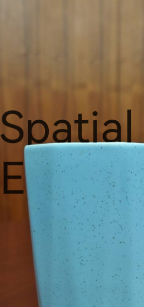
