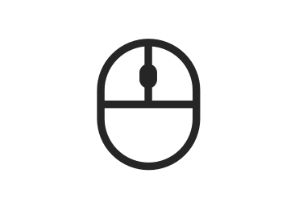
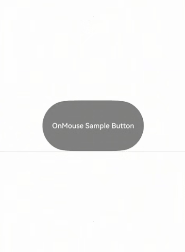
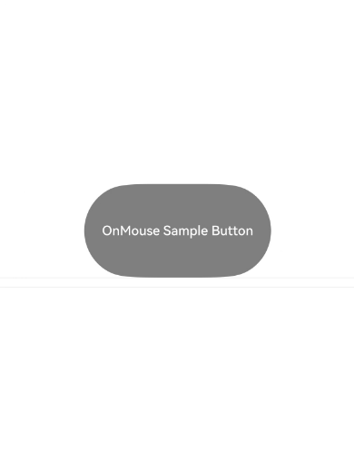
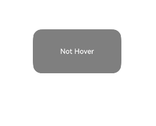
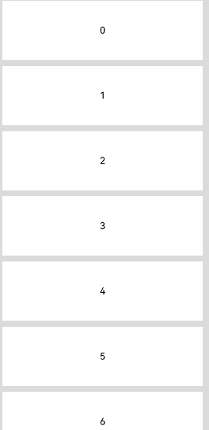
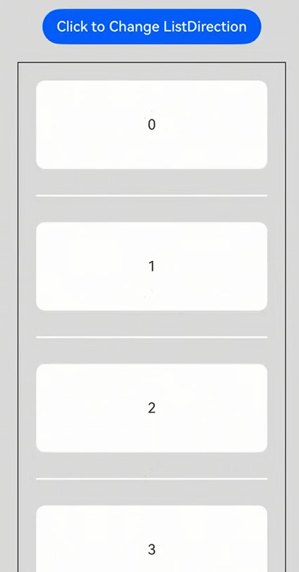
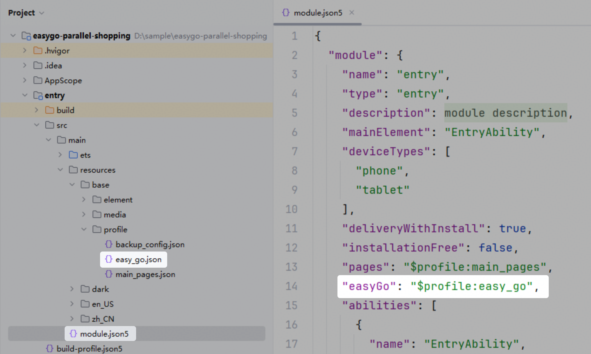

# Handling Mouse Input Events
<!--Kit: ArkUI-->
<!--Subsystem: ArkUI-->
<!--Owner: @zhou-chaobo-->
<!--Designer: @piggyguy-->
<!--Tester: @songyanhong-->
<!--Adviser: @Brilliantry_Rui-->
<!-- md-trans-meta sourceCommit=1015569863d1e74da92cadf227d7b3da662317dd translatedAt=2026-11-03T08:24:14.305Z pushedAt=2026-11-03T09:14:24.625Z nl=1 -->



A mouse is an essential input device for PC/2in1 and tablet devices. It allows click and swipe operations through buttons, scrolling through the scroll wheel, and also provides additional buttons. These events are reported to the app through [MouseEvent](../reference/apis-arkui/arkui-ts/ts-universal-mouse-key.md#mouseevent) and [AxisEvent](../reference/apis-arkui/arkui-ts/ts-universal-events-axis.md#axisevent), respectively.

>**NOTE**
>
>All touch events and gesture events that can be responded to with a single finger can also be operated and responded to with the left mouse button.
> - For example, if a developer needs to implement the function of clicking a [Button](../reference/apis-arkui/arkui-ts/ts-basic-components-button.md) to navigate to a page, and needs to support both finger taps and left mouse button clicks, binding only one click event ([onClick](../reference/apis-arkui/arkui-ts/ts-universal-events-click.md#onclick)) is sufficient to achieve this effect.
> - If different effects need to be implemented for finger taps and left mouse button clicks, the developer can use the source field in the callback parameter of onClick to determine whether the current trigger event originates from a finger or a mouse.

In addition, for applications on PC/2-in-1 and tablet devices that have not been adapted for mouse operations, developers can use a configuration file to control whether to convert events, converting left mouse button clicks, swipes, and scroll wheel events into touch events, and converting right mouse button events into long-press events.

## Processing Mouse Movement

Mouse events are handled by registering a callback using the [onMouse](../reference/apis-arkui/arkui-ts/ts-universal-mouse-key.md#onmouse) API. When a mouse action occurs, the event is dispatched to the component located beneath the cursor. This dispatch process adheres to the event bubbling mechanism.

### onMouse

```ts
onMouse(event: (event?: MouseEvent) => void)
```

Triggered when a mouse event occurs. If the mouse pointer performs an action (**MouseAction**) on a component bound to this API, the corresponding callback is triggered and receives a [MouseEvent](../reference/apis-arkui/arkui-ts/ts-universal-mouse-key.md#mouseevent) object as its parameter. This event supports custom bubbling settings, with parent-child bubbling enabled by default. This API is typically used to implement custom mouse interaction logic.


The **MouseEvent** object in the callback provides the following information: coordinates (displayX, displayY, windowX, windowY, x, y), button ([MouseButton](../reference/apis-arkui/arkui-ts/ts-appendix-enums.md#mousebutton8)), action ([MouseAction](../reference/apis-arkui/arkui-ts/ts-appendix-enums.md#mouseaction8)), timestamp (the `timestamp` property of [BaseEvent](../reference/apis-arkui/arkui-ts/ts-universal-events-click.md#baseevent8)), target area ([EventTarget](../reference/apis-arkui/arkui-ts/ts-universal-events-click.md#eventtarget8)), and event source ([SourceType](../reference/apis-arkui/arkui-ts/ts-gesture-settings.md#sourcetype8)). The **stopPropagation** callback of **MouseEvent** can be used to prevent the event from bubbling up.

> **NOTE**
>
> **MouseButton** indicates the physical mouse button (pressed or released) that triggers the mouse event. The values are **Left**, **Right**, **Middle**, **Back**, **Forward**, and **None**. **None** indicates that the event is triggered only when the mouse is moved without any mouse button pressed or released.

<!-- @[mouse_move](https://gitcode.com/openharmony/applications_app_samples/blob/master/code/DocsSample/ArkUISample/InterAction/entry/src/main/ets/pages/mouseMove/MouseMove.ets) --> 

``` TypeScript
@Entry
@Component
struct MouseMove {
  @State buttonText: string = '';
  @State columnText: string = '';
  @State text: string = 'OnMouse Sample Button';
  @State color: Color = Color.Gray;

  build() {
    Column() {
      Button(this.text, { type: ButtonType.Capsule })
        .width(200)
        .height(100)
        .backgroundColor(this.color)
        .onMouse((event?: MouseEvent) => { // Set the onMouse callback for the Button component.
          if (event) {
            this.buttonText = 'Button onMouse:\n' + '' +
              'button = ' + event.button + '\n' +
              'action = ' + event.action + '\n' +
              'x,y = ' + '\n' + '(' + event.x + ',' + event.y + ')' + '\n' +
              'windowXY=' + '\n' + '(' + event.windowX + ',' + event.windowY + ')';
          }
        })
      Column() {
        Divider()
        Text(this.buttonText).fontColor(Color.Green).padding(5)
        Divider()
        Text(this.columnText).fontColor(Color.Red).padding(5)
      }
      .width('100%')
      .alignItems(HorizontalAlign.Start)
    }
    .width('100%')
    .height('100%')
    .justifyContent(FlexAlign.Center)
    .borderWidth(2)
    .borderColor(Color.Red)
    .onMouse((event?: MouseEvent) => { // Set the onMouse callback for Column.
      if (event) {
        this.columnText = 'Column onMouse:\n' + '' +
          'button = ' + event.button + '\n' +
          'action = ' + event.action + '\n' +
          'x,y = ' + '\n' + '(' + event.x + ',' + event.y + ')' + '\n' +
          'windowXY=' + '\n' + '(' + event.windowX + ',' + event.windowY + ')';
      }
    })
  }
}
```

In the preceding example, the **onMouse** API is bound to the **Button** component. The callback displays the values of callback parameters, such as **button** and **action**. Apply the same settings to the outer **Column** container. The entire process can be divided into the following two actions:

1. Moving the mouse pointer: Before the mouse pointer moves from outside the **Button** component to inside, only the **onMouse** callback of the **Column** component is triggered. When the mouse pointer enters the **Button** component, as the **onMouse** event bubbles up by default, both the **onMouse** callbacks of the **Column** and **Button** components are invoked. Because no mouse button is clicked during this process, the displayed information shows **button** as **0** (enumerated value of **MouseButton.None**) and **action** as **3** (enumerated value of **MouseAction.Move**).

2. Clicking the mouse button: After the mouse pointer enters the **Button** component, clicking the component twice (left-click and right-click) produces the following results:

   Left-click: button = 1 (enumerated value of **MouseButton.Left**); action = 1 (enumerated value of **MouseAction.Press**); action = 2 (enumerated value of **MouseAction.Release**).

   Right-click: button = 2 (enumerated value of **MouseButton.Right**); action = 1 (enumerated value of **MouseAction.Press**); action = 2 (enumerated value of **MouseAction.Release**)




To prevent the mouse event from bubbling, call the **stopPropagation** API.
<!-- @[stop_propagation](https://gitcode.com/openharmony/applications_app_samples/blob/master/code/DocsSample/ArkUISample/InterAction/entry/src/main/ets/pages/stopPropagation/StopPropagation.ets) -->

``` TypeScript
@Entry
@Component
struct StopPropagation {
  @State buttonText: string = '';
  @State columnText: string = '';
  @State text: string = 'OnMouse Sample Button';
  @State color: Color = Color.Gray;

  build() {
    Column() {
      Button(this.text, { type: ButtonType.Capsule })
        .width(200)
        .height(100)
        .backgroundColor(this.color)
        .onMouse((event?: MouseEvent) => { // Set the onMouse callback for the Button component.
          if (event) {
            event.stopPropagation(); // Prevent the onMouse event from bubbling.
            this.buttonText = 'Button onMouse:\n' + '' +
              'button = ' + event.button + '\n' +
              'action = ' + event.action + '\n' +
              'x,y = ' + '\n' + '(' + event.x + ',' + event.y + ')' + '\n' +
              'windowXY=' + '\n' + '(' + event.windowX + ',' + event.windowY + ')';
          }
        })
      Column() {
        Divider()
        Text(this.buttonText).fontColor(Color.Green).padding(5)
        Divider()
        Text(this.columnText).fontColor(Color.Red).padding(5)
      }
      .width('100%')
      .alignItems(HorizontalAlign.Start)
    }
    .width('100%')
    .height('100%')
    .justifyContent(FlexAlign.Center)
    .borderWidth(2)
    .borderColor(Color.Red)
    .onMouse((event?: MouseEvent) => { // Set the onMouse callback for the Column component.
      if (event) {
        this.columnText = 'Column onMouse:\n' + '' +
          'button = ' + event.button + '\n' +
          'action = ' + event.action + '\n' +
          'x,y = ' + '\n' + '(' + event.x + ',' + event.y + ')' + '\n' +
          'windowXY=' + '\n' + '(' + event.windowX + ',' + event.windowY + ')';
      }
    })
  }
}
```


To prevent mouse events from bubbling up from a child component (**Button**) to its parent component (**Column**), call the **stopPropagation** API using the **event** parameter in the **onMouse** callback of **Button**, as shown in the example above.

### onHover

To detect when the mouse pointer enters or exits a component's boundary, you are advised to use the advanced [onHover](../reference/apis-arkui/arkui-ts/ts-universal-events-hover.md#onhover) event. This approach simplifies your code and avoids the complexity of manually handling mouse move events.

```ts
onHover(event: (isHover: boolean) => void)
```

It is triggered when the mouse pointer enters or leaves the component. The **isHover** parameter indicates whether the mouse pointer hovers over the component. This event supports custom bubbling settings, with parent-child bubbling enabled by default.


If this API is bound to a component, it is triggered when the mouse pointer enters the component from outside and the value of **isHover** is **true**, or when the mouse pointer leaves the component and the value of **isHover** is **false**.

<!-- @[on_hover](https://gitcode.com/openharmony/applications_app_samples/blob/master/code/DocsSample/ArkUISample/InterAction/entry/src/main/ets/pages/onHover/OnHover.ets) -->

``` TypeScript
@Entry
@Component
struct OnHover {
  @State hoverText: string = 'Not Hover';
  @State color: Color = Color.Gray;

  build() {
    Column() {
      Button(this.hoverText)
        .width(200).height(100)
        .backgroundColor(this.color)
        .onHover((isHover?: boolean) => { // Listen for whether the mouse cursor is hovered over the button.
          if (isHover) {
            this.hoverText = 'Hovered!';
            this.color = Color.Green;
          } else {
            this.hoverText = 'Not Hover';
            this.color = Color.Gray;
          }
        })
    }.width('100%').height('100%').justifyContent(FlexAlign.Center)
  }
}
```

This example creates a **Button** component with an initial gray background color and the content **Not Hover**. The component is bound to the **onHover** callback, which updates the background color and text content of the component based on the **isHover** parameter.

When the mouse pointer moves from outside the **Button** component to inside, the callback is invoked. The **isHover** value becomes true, the background color of the component changes to **Color.Green**, and the content is updated to **Hovered!**.

When the mouse pointer moves from inside the **Button** component to outside, the callback is invoked again, setting the value of **isHover** to **false**. The component then reverts to its initial style.




## Processing Mouse Buttons

When a user presses a mouse button, a mouse down event is triggered. You can access key information about the event through [MouseEvent](../reference/apis-arkui/arkui-ts/ts-universal-mouse-key.md#mouseevent), such as the occurrence time and the mouse button (MouseButton: left button, right button, etc.). You can also use the [getModifierKeyState](../reference/apis-arkui/arkui-ts/ts-universal-events-click.md#getmodifierkeystate12) API to obtain the pressed state of the **Ctrl/Alt/Shift** modifier keys on the physical keyboard when the user is using the mouse. By combining and evaluating these states, you can implement convenient operations.

The following example demonstrates multi-selection functionality using mouse button processing:

<!-- @[mouse_button](https://gitcode.com/openharmony/applications_app_samples/blob/master/code/DocsSample/ArkUISample/InterAction/entry/src/main/ets/pages/MouseButton/MouseButton.ets) -->   

``` TypeScript
class ListDataSource implements IDataSource {
  private list: number[] = [];
  private listeners: DataChangeListener[] = [];

  constructor(list: number[]) {
    this.list = list;
  }

  totalCount(): number {
    return this.list.length;
  }

  getData(index: number): number {
    return this.list[index];
  }

  registerDataChangeListener(listener: DataChangeListener): void {
    if (this.listeners.indexOf(listener) < 0) {
      this.listeners.push(listener);
    }
  }

  unregisterDataChangeListener(listener: DataChangeListener): void {
    const pos = this.listeners.indexOf(listener);
    if (pos >= 0) {
      this.listeners.splice(pos, 1);
    }
  }

  // Notify the controller of data deletion.
  notifyDataDelete(index: number): void {
    this.listeners.forEach(listener => {
      listener.onDataDelete(index);
    });
  }

  // Delete an element at the specified index.
  public deleteItem(index: number): void {
    this.list.splice(index, 1);
    this.notifyDataDelete(index);
  }
}

@Entry
@Component
struct ListExample {
  private arr: ListDataSource = new ListDataSource([0, 1, 2, 3, 4, 5, 6, 7, 8, 9]);
  private allSelectedItems: Array<number> = [];
  @State isSelected: boolean[] = [];

  @Styles
  selectedStyle(): void {
    .backgroundColor(Color.Blue);
  }

  isItemSelected(item: number): boolean {
    for (let i = 0; i < this.allSelectedItems.length; i++) {
      if (this.allSelectedItems[i] === item) {
        this.isSelected[item] = true;
        return true;
      }
    }
    this.isSelected[item] = false;
    return false;
  }

  build() {
    Column() {
      List({ space: 10, initialIndex: 0 }) {
        LazyForEach(this.arr, (index: number) => {
          ListItem() {
            Text('' + index)
              .width('100%')
              .height(100)
              .fontSize(16)
              .fontColor(this.isSelected[index] ? Color.White : Color.Black)
              .textAlign(TextAlign.Center)
          }
          .backgroundColor(Color.White)
          .selectable(true)
          .selected(this.isSelected[index])
          .stateStyles({
            selected: this.selectedStyle
          })
          .onMouse((event: MouseEvent) => {
            // Check whether the left mouse button is pressed.
            if (event.button === MouseButton.Left && event.action === MouseAction.Press) {
              // Check the item selected state.
              let isSelected: boolean = this.isItemSelected(index);
              // Check the Ctrl key state.
              let isCtrlPressing: boolean = false;
              if (event.getModifierKeyState) {
                try {
                  isCtrlPressing = event.getModifierKeyState(['Ctrl']);
                } catch (error) {
                  console.error('Get modifier key state failed!')
                }
              }
              // If the mouse is clicked without the Ctrl key held down, forcefully clear other selected items and keep only the current item selected.
              if (!isCtrlPressing) {
                this.allSelectedItems = [];
                for (let i = 0; i < this.isSelected.length; i++) {
                  this.isSelected[i] = false;
                }
              }
              if (isSelected) {
                this.allSelectedItems = this.allSelectedItems.filter(item => item !== index);
                this.isSelected[index] = false;
              } else {
                this.allSelectedItems.push(index);
                this.isSelected[index] = true;
              }
            }
          })
        }, (item: string) => item)
      }
      .listDirection(Axis.Vertical)
      .scrollBar(BarState.Off)
      .friction(0.6)
      .edgeEffect(EdgeEffect.Spring)
      .width('90%')
      .height('100%')
    }
    .width('100%')
    .height('100%')
    .backgroundColor(0xDCDCDC)
    .padding({ top: 5 })
  }
}
```



## Processing Mouse Wheel Input

The mouse wheel is an input device that can generate vertical scrolling. When a user scrolls the wheel, the system generates a vertical [axis event](../reference/apis-arkui/arkui-ts/ts-universal-events-axis.md) and dispatches it to the application. Components can handle this event using the [onAxisEvent](../reference/apis-arkui/arkui-ts/ts-universal-events-axis.md#onaxisevent) API. The event includes the cursor position and the angle of wheel rotation, accessible using the **axisVertical** property of the [BaseEvent](../reference/apis-arkui/arkui-ts/ts-universal-events-click.md#baseevent8) object.

Mouse wheel axis events follow a structured lifecycle: Each scroll interaction begins with an [AxisAction](../reference/apis-arkui/arkui-ts/ts-appendix-enums.md#axisaction17).BEGIN event. When scrolling ends, an [AxisAction](../reference/apis-arkui/arkui-ts/ts-appendix-enums.md#axisaction17).END event is emitted. For slow or intermittent scrolling, multiple **BEGIN** and **END** events may be reported. When handling **axisVertical**, make sure you understand its value meaning and unit. Key characteristics include:
- It reflects the delta of one scroll action, not the cumulative scroll distance.
- The value is influenced by system-level wheel sensitivity settings.
- The sensitivity is specified by the [AxisEvent](../reference/apis-arkui/arkui-ts/ts-universal-events-axis.md#axisevent) parameter **scrollStep** in system settings.
- A forward scroll (wheel up) yields a negative value. A backward scroll (wheel down) yields a positive value.

Built-in scrollable components automatically handle wheel input. No additional configuration is required.

When [PanGesture](../reference/apis-arkui/arkui-ts/ts-basic-gestures-pangesture.md) is used, wheel input maps to vertical offset values: For forward scrolling, **offsetY** is positive; for backward scrolling, **offsetY** is negative.

> **NOTE**
>
> 1. Wheel-generated vertical axis values only trigger vertical scrolling gestures.
> 2. If the system detects that only horizontally scrollable components are under the cursor, it may trigger horizontal scrolling.
> 3. When both vertical and horizontal scrollable elements are present, vertical scrolling takes precedence.

This example demonstrates how a **List** component responds to mouse wheel input in both vertical and horizontal orientations.

<!-- @[list_data_source](https://gitcode.com/openharmony/applications_app_samples/blob/master/code/DocsSample/ArkUISample/InterAction/entry/src/main/ets/pages/MouseWheel/ListDataSource.ets) -->

``` TypeScript
export class ListDataSource implements IDataSource {
  private list: number[] = [];
  private listeners: DataChangeListener[] = [];

  constructor(list: number[]) {
    this.list = list;
  }

  totalCount(): number {
    return this.list.length;
  }

  getData(index: number): number {
    return this.list[index];
  }

  registerDataChangeListener(listener: DataChangeListener): void {
    if (this.listeners.indexOf(listener) < 0) {
      this.listeners.push(listener);
    }
  }

  unregisterDataChangeListener(listener: DataChangeListener): void {
    const pos = this.listeners.indexOf(listener);
    if (pos >= 0) {
      this.listeners.splice(pos, 1);
    }
  }

  // Notify the controller of data deletion.
  notifyDataDelete(index: number): void {
    this.listeners.forEach(listener => {
      listener.onDataDelete(index);
    });
  }

  // Notify the controller of data insertion.
  notifyDataAdd(index: number): void {
    this.listeners.forEach(listener => {
      listener.onDataAdd(index);
    });
  }

  // Delete an element at the specified index.
  public deleteItem(index: number): void {
    this.list.splice(index, 1);
    this.notifyDataDelete(index);
  }

  // Insert an element at the specified index.
  public insertItem(index: number, data: number): void {
    this.list.splice(index, 0, data);
    this.notifyDataAdd(index);
  }
}
```

<!-- @[mouse_wheel](https://gitcode.com/openharmony/applications_app_samples/blob/master/code/DocsSample/ArkUISample/InterAction/entry/src/main/ets/pages/MouseWheel/MouseWheel.ets) --> 

``` TypeScript
import { ListDataSource } from './ListDataSource';

@Entry
@Component
struct MouseWheel {
  private arr: ListDataSource = new ListDataSource([0, 1, 2, 3, 4, 5, 6, 7, 8, 9]);
  @State dir1: Axis = Axis.Vertical;

  build() {
    Column() {
      Button('Click to Change ListDirection')
        .margin(20)
        .onClick(() => {
          if (this.dir1 === Axis.Vertical) {
            this.dir1 = Axis.Horizontal;
          } else {
            this.dir1 = Axis.Vertical;
          }
        })
      List({ space: 20, initialIndex: 0 }) {
        LazyForEach(this.arr, (item: number) => {
          ListItem() {
            Text('' + item)
              .width('100%')
              .height(100)
              .fontSize(16)
              .textAlign(TextAlign.Center)
              .borderRadius(10)
              .backgroundColor(0xFFFFFF)
          }
          .margin(20)
          // Bind a pan gesture to the ListItem. When the mouse wheel is scrolled over the ListItem, the ListItem's own pan gesture is triggered first.
          .gesture(PanGesture({ direction: PanDirection.Vertical })
            .onActionStart(() => {
            })
            .onActionUpdate(() => {
            }))
        }, (item: number) => item.toString())
      }
      .borderWidth(1)
      .listDirection(this.dir1) // Arrangement direction
      .scrollBar(BarState.Off)
      .friction(0.6)
      .divider({
        strokeWidth: 2,
        color: 0xFFFFFF,
        startMargin: 20,
        endMargin: 20
      }) // Divider between rows
      .edgeEffect(EdgeEffect.Spring) // Set the edge scrolling effect to Spring.
      .width('90%')
    }
    .width('100%')
    .height('100%')
    .backgroundColor(0xDCDCDC)
    .padding(20)
  }
}
```



## Mouse Event Conversion

If a developer only considers touch operation scenarios when developing an application and does not adapt the application for mouse operation scenarios on PC/2-in-1 and tablet devices, the actual behavior of the application when operated with a mouse may be inconsistent with expectations, or the application may even become inoperable. To address this scenario, developers can add a configuration file to the application to control whether to convert left mouse button clicks, swipes, and scroll wheel events into touch events, or convert right mouse button events into long-press events, thereby resolving the above issue.

### Adding a Configuration File
Create a configuration file named easy_go.json (an example file name; you can name it as needed) in the entry/src/main/resources/base/profile directory of the application. Add the easyGo field in the [module.json5](../quick-start/module-configuration-file.md) configuration file and point it to the referenced easy_go.json configuration file. easy_go.json is a standard Object-type JSON file with a two-level overall structure. The first level configures the [device types for which mouse event conversion takes effect](#configure-left-mouse-button-or-axis-event-to-touch); the second level allows you to configure, under the corresponding device type, the related parameters for [converting mouse left-button or axis events to touch events](#configure-left-mouse-button-or-axis-event-to-touch) and [converting mouse right-click to long-press](#configure-right-click-to-long-press).



### Device Types for Configuration to Take Effect

Use the first-level configuration in easy_go.json to select the device types on which the mouse event conversion takes effect.

``` json
{
  "common": {},
  "phone": {},
  "2in1": {},
  "tablet": {}
}
```

| Value | Description | Optional |
| --- | --- | --- |
| common | Common device configuration, providing the basic default configuration for all device types. | No |
| phone | Configuration that takes effect on phone-type devices. After configuration, the common configuration no longer takes effect on phone-type devices. | Yes |
| 2in1 | Configuration that takes effect on PC/2in1-type devices. After configuration, the common configuration no longer takes effect on PC/2in1-type devices. | Yes |
| tablet | Configuration that takes effect on tablet-type devices. After configuration, the common configuration no longer takes effect on tablet-type devices. | Yes |

### Configure Left Mouse Button or Axis Event-to-Touch

By configuring the second-level multiModalInputOptions field in easy_go.json, you can convert the left-button events and axis events of the corresponding device type into touch events and send them to the application, thereby achieving effects similar to tapping and swiping on a phone.

The following example shows how to configure a PC/2in1 device so that left-button events are not converted into touch events.

``` json
{
  "common": {},
  "2in1": {
      "multiModalInputOptions": {
         "mouse2TouchEventMode": "disabled"
      }
  }
}
```

The first-level 2in1 indicates that on a PC/2in1 device, left-button events or axis events can be converted into touch events. The second-level multiModalInputOptions field under 2in1 is used to set the event input options. The internal fields are described as follows.

| Name          | Type | Description                         | Optional |
| -------------------- | ---- | ----------------------------------- | -------- |
| mouse2TouchEventMode | string | Configures the mode for converting left-button events to touch events. | Yes |

Configurable fields of mouse2TouchEventMode.

| Value | Description |
| --- | --- |
| "all"                  | All left-button events are converted into touch events.                      |
| "xcomponentAndWebOnly" | Left-button events are converted into touch events only within XComponent and Web components. |
| "disabled"             | No left-button events are converted into touch events.                    |

### Configure Right-Click to Long-Press

Starting from API version 26.0.1, the contextMenuOptions field is supported. By configuring the second-level contextMenuOptions field in easy_go.json, you can convert the right-click event of the corresponding device type into a long-press event and send it to the application, thereby achieving an effect similar to a finger long-press on a phone.

On PC/2-in-1 devices, configure the right-click events of all ArkUI components to be converted into long-press events. The example is as follows.

``` json
{
  "common": {},
  "2in1": {
    "contextMenuOptions": {
      "rightMouse2LongPress": true,
      "needTransferComponent": ["All"]
    }
  }
}
```

The first-level 2in1 indicates that on PC/2-in-1 devices, the right mouse button can be converted into a long-press event. The second-level contextMenuOptions field under 2in1 is used to configure the rules for the right-click to long-press event conversion. Because only PC/2-in-1 devices and Tablet devices support right-click to long-press, the second level of common and phone cannot be configured with the contextMenuOptions field. The internal fields of contextMenuOptions are described as follows.

| Name              | Type | Description                         | Optional |
| -------------------- | ---- | ---------------------------- | ---- |
| rightMouse2LongPress | boolean | Whether to enable the right-click to long-press policy. Value range: true indicates that the right-click to long-press policy is enabled, and the right-click event will be converted into a long-press event; false indicates that it is not enabled, and the right-click event will be processed according to the system default behavior. When the value is false, the needTransferComponent configuration does not take effect. | No   |
| needTransferComponent | string[] | List of components that take effect, determining which components' right-click events will be converted into long-press events. The array can be empty, and when it is empty, it indicates that no component's right-click event will be converted. Each array element must be one of the enum values below. When not configured, it defaults to an empty array. When needTransferComponent is an empty array, no component's right-click event will be converted even if rightMouse2LongPress is true. | Yes   |

The optional enum types in the needTransferComponent array are described as follows.
| Value            | Description           |
| ----------------- | -------------- |
| "TextInput"         | Text input box     |
| "TextArea"          | Multi-line text input box |
| "RichEditor"        | Rich text editor   |
| "RichText"          | Rich Text         |
| "Text"              | Text           |
| "RenderNode"        | Render node       |
| "XComponent"        | Self-drawn component     |
| "Image"             | Image           |
| "RelativeContainer" | Relative layout container   |
| "All"               | All ArkUI components   |

Additional description of the needTransferComponent field is as follows.
| Rule               | Description                                                         |
| ------------------ | ------------------------------------------------------------ |
| All take effect           | Setting `"needTransferComponent": ["All"]` indicates that all ArkUI components take effect.|
| Case-sensitive         | Component names are case-sensitive and must be filled in strictly according to the list above; otherwise, a compilation error will be reported.|
| No duplicates         | Duplicate component names are not allowed in the component list; otherwise, a compilation error will be reported.|
| All coexisting with other components | When the list contains both specific component names and "All", the specific component names will be ignored, which is equivalent to configuring only "All". It is recommended to use only "All" to simplify the configuration.|
| Valid values             | The values in the list can only be the 9 component names above plus "All" (10 in total). Filling in other values will cause a compilation error.|