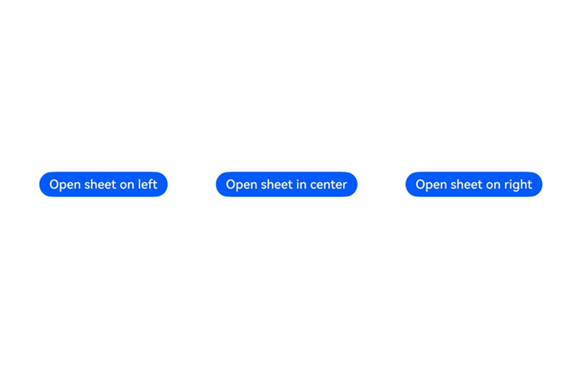

# Popup Handedness Adaptation
<!--Kit: ArkUI-->
<!--Subsystem: ArkUI-->
<!--Owner: @fenglinbailu-->
<!--Designer: @fenglinbailu-->
<!--Tester: @l30014443-->
<!--Adviser: @Brilliantry_Rui-->
<!-- md-trans-meta sourceCommit=6c65faa460f958c51d1f086bcaae53d7bd52a454 translatedAt=2026-11-12T04:01:41.071Z pushedAt=2026-11-13T08:43:20.359Z nl=1 -->

Popup handedness adaptation refers to the capability of popup components and semi-modal components to adapt to grip habits. Starting from API version 26.1.0, developers can set a handedness-following mode for popups. When a popup is displayed, it offsets to a specified side according to the handedness-following mode, shortening the thumb reach path when holding the device with one hand and improving interaction efficiency and comfort in one-handed operation scenarios.

The handedness-following mode is set through the adaptToHandedness property in the popup options. This property is of the [HandednessFollowMode](../reference/apis-arkui/js-apis-dialog.md) enum type and supports the following three modes.

| Mode | Value | Description |
| -------- | -------- | -------- |
| NONE | 0 | No handedness following. The popup keeps its current layout. This is the default mode. |
| FOLLOW_ANCHOR | 1 | Directional handedness following. The popup offsets according to the position of the component that triggered it (the most recently interacted component). |
| FOLLOW_GRIP_HAND | 2 | Smart grip handedness following. The popup offsets according to the grip posture (when held in the left hand and operated with the left hand, the popup offsets to the left; the same applies to the right hand. In a two-handed grip, it offsets in the direction of the operating hand). |

## When to Use

On wide-screen devices where the width breakpoint [WidthBreakpoint](../reference/apis-arkui/arkui-ts/ts-appendix-enums.md#widthbreakpoint13) is greater than or equal to [WIDTH_SM](../reference/apis-arkui/arkui-ts/ts-appendix-enums.md#widthbreakpoint13), users often use applications while gripping the device with one hand and operating with the thumb. In this case, if the popup is displayed centered by default, the buttons on the popup may exceed the natural reach range of the thumb, and the user needs to adjust the grip posture or use both hands to complete the interaction.

Interactive elements should be located within the user's comfortable thumb area as much as possible. After popup follow is enabled, the popup offsets toward the trigger component or the grip hand side, so the thumb can reach the popup buttons without large movements. This also reduces the risk of accidental touches caused by overstretching the fingers and reduces eye movement between the screen center and the operation area. You can select an appropriate follow mode according to the degree of association between the popup and the trigger scenario.

| Scenario characteristic | Recommended mode | Typical example |
| -------- | -------- | -------- |
| The popup is triggered by a component on the page, and its content is strongly related to that component. After the operation is complete, the user is expected to continue operating near that component. | Directional follow (FOLLOW_ANCHOR) | An operation confirmation popup that pops up when tapping the "More" button on a list item, and an information modification popup that pops up when long-pressing an avatar. |
| The popup is unrelated to the trigger position and belongs to a global operation. The user may trigger it from any position on the page. | Smart Grip Follow (FOLLOW_GRIP_HAND) | An account cancellation confirmation popup on the settings page, and a resolution switching popup during video playback. |
| The popup content needs to be displayed centered to emphasize the visual focus, or the operation itself is position-independent and does not require quick reach. | Not follow (NONE) | A loading progress popup and a system-level important notification popup. |

In directional follow mode, the popup offsets to the side of the component that triggers it:

<!--Del-->   <!--DelEnd-->

In smart grip handedness following mode, the semi-modal offsets to the side of the gripping hand:



## Implementation Principles

The service interaction flow of the popup handedness adaptation capability is as follows:

1. Set the handedness-following mode: Set the `adaptToHandedness` attribute through popup options (such as [AlertDialogParam](../reference/apis-arkui/arkui-ts/ts-methods-alert-dialog-box.md#alertdialogparam) and [SheetOptions](../reference/apis-arkui/arkui-ts/ts-universal-attributes-sheet-transition.md#sheetoptions)).
2. Determine the offset direction: When the popup is displayed, ArkUI determines the offset direction according to the handedness-following mode set in `adaptToHandedness`:
   - Directional handedness following (FOLLOW_ANCHOR): Locate the trigger component (anchor) based on the most recent interaction record, and the popup offsets to the side where the anchor is located.
   - Smart grip handedness following (FOLLOW_GRIP_HAND): Query the gripping hand status from the multimodal fusion awareness service. The popup offsets to the left when the device is held in the left hand, and to the right when held in the right hand.
   - No handedness following (NONE): No offset calculation is performed, and the popup keeps its default layout.
3. Layout and rendering: Complete the popup layout and rendering based on the offset direction and offset amount.

## Constraints

### Smart Grip Handedness Following Restrictions

Smart grip handedness following depends on the gripping hand awareness capability (smart grip) of the multimodal fusion awareness service. The following limitations apply. For detailed constraints and limitations, see [development guide for obtaining user actions](../device/stationary/motion-guidelines.md#constraints-1).

- This feature currently supports some device models. If a smart grip switch exists in the settings menu (viewable in **Settings** > **System**), the device supports this feature. If this switch does not exist, the perception capability is unavailable.
- The device screen must be on and unlocked. If a protective case is used, its thickness must not exceed 3 mm.
- The device must be held naturally with five fingers, with the palm area in contact with the device (or the four fingers other than the thumb and the palm area in contact). Wearing gloves significantly reduces recognition accuracy.
- When holding the device, the screen must face the user, and the device must not be in contact with other objects (such as a desktop or other body parts).

In addition, the operating hand recognition provided by the awareness service has the following limitations (affecting capabilities that depend on the operating hand status):

- Knuckle operations are not considered operating-hand scenarios.
- Window rotation scenarios and multi-finger simultaneous operation scenarios are not supported.
- The effective range does not include the area within 8 mm from the screen edge.

When smart grip recognition fails or the gripping hand status is unrecognized, the popup keeps its default layout.

### Permission Requirements

When using the smart grip handedness following (FOLLOW_GRIP_HAND) mode, the application must declare the [ohos.permission.DETECT_GESTURE](../security/AccessToken/permissions-for-all.md#ohospermissiondetect_gesture) permission in the module.json5 configuration file. This permission allows the application to perceive information such as the user's grip posture and operating hand. For the declaration method, see [Declaring Permissions](../security/AccessToken/declare-permissions.md).

The directional handedness following (FOLLOW_ANCHOR) and no handedness following (NONE) modes do not depend on the awareness capability and do not require this permission.

### Supported Component Scope

The component scope supported by the `adaptToHandedness` attribute is as follows.

| Component | Associated option | Description |
| -------- | -------- | -------- |
| [AlertDialog](../reference/apis-arkui/arkui-ts/ts-methods-alert-dialog-box.md) | AlertDialogParam | When [alignment](../reference/apis-arkui/js-apis-dialog.md#dialogbaseoptions) is not DialogAlignment.Default, or the [offset](../reference/apis-arkui/js-apis-dialog.md#dialogbaseoptions) value is not 0, this API does not take effect. |
| [ActionSheet](../reference/apis-arkui/arkui-ts/ts-methods-action-sheet.md) | ActionSheetOptions | When [alignment](../reference/apis-arkui/js-apis-dialog.md#dialogbaseoptions) is not DialogAlignment.Default, or the [offset](../reference/apis-arkui/js-apis-dialog.md#dialogbaseoptions) value is not 0, this API does not take effect. |
| [CustomDialog](../reference/apis-arkui/arkui-ts/ts-methods-custom-dialog-box.md) | CustomDialogControllerOptions | When customStyle is true, or [alignment](../reference/apis-arkui/js-apis-dialog.md#dialogbaseoptions) is not DialogAlignment.Default, or the [offset](../reference/apis-arkui/js-apis-dialog.md#dialogbaseoptions) value is not 0, this API does not take effect. |
| [DatePickerDialog](../reference/apis-arkui/arkui-ts/ts-methods-datepicker-dialog.md) | DatePickerDialogOptions | When [alignment](../reference/apis-arkui/js-apis-dialog.md#dialogbaseoptions) is not DialogAlignment.Default, or the [offset](../reference/apis-arkui/js-apis-dialog.md#dialogbaseoptions) value is not 0, this API does not take effect. |
| [TimePickerDialog](../reference/apis-arkui/arkui-ts/ts-methods-timepicker-dialog.md) | TimePickerDialogOptions | When [alignment](../reference/apis-arkui/js-apis-dialog.md#dialogbaseoptions) is not DialogAlignment.Default, or the [offset](../reference/apis-arkui/js-apis-dialog.md#dialogbaseoptions) value is not 0, this API does not take effect. |
| [TextPickerDialog](../reference/apis-arkui/arkui-ts/ts-methods-textpicker-dialog.md) | TextPickerDialogOptionsExt | When [alignment](../reference/apis-arkui/js-apis-dialog.md#dialogbaseoptions) is not DialogAlignment.Default, or the [offset](../reference/apis-arkui/js-apis-dialog.md#dialogbaseoptions) value is not 0, this API does not take effect. |
| [CalendarPickerDialog](../reference/apis-arkui/arkui-ts/ts-methods-calendarpicker-dialog.md) | CalendarDialogOptions | - |
| [promptAction](../reference/apis-arkui/js-apis-promptAction.md) | ShowDialogOptions, ActionMenuOptions, BaseDialogOptions | When [alignment](../reference/apis-arkui/js-apis-dialog.md#dialogbaseoptions) is not DialogAlignment.Default, or the [offset](../reference/apis-arkui/js-apis-dialog.md#dialogbaseoptions) value is not 0, this API does not take effect. |
| [@ohos.arkui.dialog](../reference/apis-arkui/js-apis-dialog.md) | DialogBaseOptions | When customStyle is true, or [alignment](../reference/apis-arkui/js-apis-dialog.md#dialogbaseoptions) is not DialogBaseAlignment.DEFAULT, or the [offset](../reference/apis-arkui/js-apis-dialog.md#dialogbaseoptions) value is not 0, this API does not take effect. |
| bindSheet ([Sheet Transition](../reference/apis-arkui/arkui-ts/ts-universal-attributes-sheet-transition.md)) | SheetOptions | Takes effect only when preferType is set to SheetType.CENTER (centered popup). This attribute does not take effect under other popup styles. |

### Device Constraints

- Smart grip capability: Smart grip handedness following takes effect only on devices that support the smart grip capability. Directional handedness following and no handedness following modes do not depend on the smart grip capability.
- Breakpoint limitations: Popup handedness adaptation takes effect only on devices whose width breakpoint is greater than or equal to WIDTH_SM and whose height breakpoint is greater than or equal to HEIGHT_MD, or on devices whose width breakpoint is greater than WIDTH_MD. The width breakpoint and height breakpoint refer to the breakpoints of the window in which the current instance is located. They can be obtained through [getWindowWidthBreakpoint](../reference/apis-arkui/arkts-apis-uicontext-uicontext.md#getwindowwidthbreakpoint13) and [getWindowHeightBreakpoint](../reference/apis-arkui/arkts-apis-uicontext-uicontext.md#getwindowheightbreakpoint13). For the breakpoint value descriptions, see [WidthBreakpoint](../reference/apis-arkui/arkui-ts/ts-appendix-enums.md#widthbreakpoint13) and [HeightBreakpoint](../reference/apis-arkui/arkui-ts/ts-appendix-enums.md#heightbreakpoint13), respectively.

## Relationship with Related Kits

The smart grip handedness following capability in handedness adaptation follow uses the action awareness capability provided by the [@ohos.multimodalAwareness.motion (Motion Awareness)](../reference/apis-multimodalawareness-kit/js-apis-awareness-motion.md) module in the Multimodal Awareness Kit. This capability is built into the ArkUI popup component, and you can use it directly after setting the follow mode.

- Provider of the awareness capability: The multimodal fusion awareness service provides two types of events through the motion module: operating hand awareness (operatingHandChanged, available since API version 15) and gripping hand awareness (holdingHandChanged, available since API version 20). It outputs hand status based on sensor data combined with recognition algorithms.
- Consumer of the awareness capability: In smart grip handedness following scenarios, ArkUI automatically queries the gripping hand status when the popup is displayed. The application does not need to subscribe to awareness events or write offset calculation logic. It only needs to declare the ohos.permission.DETECT_GESTURE permission and set the adaptToHandedness property.
- Custom awareness scenarios: If the application needs to use the action awareness capability in scenarios other than popups (for example, adjusting the page layout or toolbar position based on the gripping hand), it can call the motion module APIs to subscribe to the operating hand or gripping hand status. For development guidance, see [development guide for obtaining user actions](../device/stationary/motion-guidelines.md).

## How to Develop

This section uses AlertDialog and bindSheet (centered popup style) as examples to provide development guides for the directional handedness following, smart grip handedness following, and no handedness following modes.

### Directional Handedness Following

Directional handedness following is implemented by setting the adaptToHandedness property to HandednessFollowMode.FOLLOW_ANCHOR. When the popup is displayed, it offsets to the side of the component that triggered it (the most recently interacted component).

The following example is consistent with the example in [setting popup to adapt to grip habits](../reference/apis-arkui/arkui-ts/ts-methods-alert-dialog-box.md) for the AlertDialog component. Tapping the button displays an AlertDialog, and the popup offsets to the side of the component that triggered it.

<!-- @[follow_anchor_import](https://gitcode.com/openharmony/applications_app_samples/blob/master/code/DocsSample/ArkUISample/ArkUIHandedness/entry/src/main/ets/pages/followanchor/FollowAnchorAlertDialog.ets) -->

``` TypeScript
import { HandednessFollowMode } from '@kit.ArkUI';
```

<!-- @[follow_anchor_alert_dialog](https://gitcode.com/openharmony/applications_app_samples/blob/master/code/DocsSample/ArkUISample/ArkUIHandedness/entry/src/main/ets/pages/followanchor/FollowAnchorAlertDialog.ets) -->

``` TypeScript
this.getUIContext().showAlertDialog({
  title: 'AlertDialog Title',
  message: 'AlertDialog Text',
  primaryButton: {
    value: 'Confirm',
    action: () => {
      console.info('primaryButton');
    }
  },
  secondaryButton: {
    value: 'Cancel',
    action: () => {
      console.info('secondaryButton');
    }
  },
  adaptToHandedness: HandednessFollowMode.FOLLOW_ANCHOR
});
```

The semi-modal also supports directional follow. The following example is consistent with the example of [Example 13 (semi-modal adapting to grip habits)](../reference/apis-arkui/arkui-ts/ts-universal-attributes-sheet-transition.md) in the bindSheet attribute. Set the `adaptToHandedness` attribute in [SheetOptions](../reference/apis-arkui/arkui-ts/ts-universal-attributes-sheet-transition.md#sheetoptions), and the semi-modal offsets to the trigger component side when it pops up. Note that preferType must be set to SheetType.CENTER (centered popup); otherwise, this attribute does not take effect.

<!-- @[follow_anchor_sheet_builder](https://gitcode.com/openharmony/applications_app_samples/blob/master/code/DocsSample/ArkUISample/ArkUIHandedness/entry/src/main/ets/pages/followanchor/FollowAnchorSheet.ets) -->

``` TypeScript
@Builder
myBuilder() {
  Column() {
    Text('Sheet Content')
      .margin(20)
      .fontSize(20)
  }
  .justifyContent(FlexAlign.Center)
  .width('100%')
}
```

<!-- @[follow_anchor_sheet](https://gitcode.com/openharmony/applications_app_samples/blob/master/code/DocsSample/ArkUISample/ArkUIHandedness/entry/src/main/ets/pages/followanchor/FollowAnchorSheet.ets) -->

``` TypeScript
.bindSheet($$this.isShow, this.myBuilder(), {
  preferType: SheetType.CENTER,
  width: 400,
  showClose: true,
  title: { title: 'title', subtitle: 'subtitle' },
  adaptToHandedness: HandednessFollowMode.FOLLOW_ANCHOR,
})
```


### Smart Grip Handedness Following

Smart grip handedness following is implemented by setting the adaptToHandedness property to HandednessFollowMode.FOLLOW_GRIP_HAND. When the popup is displayed, it offsets to the side of the hand holding the device.

The development steps are as follows.

1. Before using the smart grip handedness following capability, the application must request the [ohos.permission.DETECT_GESTURE](../security/AccessToken/permissions-for-all.md#ohospermissiondetect_gesture) permission. For the request method, see [Constraints](#permission-requirements).

2. Set the `adaptToHandedness` attribute to HandednessFollowMode.FOLLOW_GRIP_HAND in the popup options.

The following example has the same structure as the AlertDialog example in directional handedness following, except that the adaptToHandedness property is set to HandednessFollowMode.FOLLOW_GRIP_HAND. When the device is held with one hand, an AlertDialog is displayed and offsets to the side of the gripping hand. When the device is held with both hands or recognition fails, the popup keeps its default layout.

<!-- @[follow_grip_hand_import](https://gitcode.com/openharmony/applications_app_samples/blob/master/code/DocsSample/ArkUISample/ArkUIHandedness/entry/src/main/ets/pages/followgriphand/FollowGripHandAlertDialog.ets) -->

``` TypeScript
import { HandednessFollowMode } from '@kit.ArkUI';
```

<!-- @[follow_grip_hand_alert_dialog](https://gitcode.com/openharmony/applications_app_samples/blob/master/code/DocsSample/ArkUISample/ArkUIHandedness/entry/src/main/ets/pages/followgriphand/FollowGripHandAlertDialog.ets) -->

``` TypeScript
this.getUIContext().showAlertDialog({
  title: 'AlertDialog Title',
  message: 'AlertDialog Text',
  primaryButton: {
    value: 'Confirm',
    action: () => {
      console.info('primaryButton');
    }
  },
  secondaryButton: {
    value: 'Cancel',
    action: () => {
      console.info('secondaryButton');
    }
  },
  adaptToHandedness: HandednessFollowMode.FOLLOW_GRIP_HAND
});
```

Smart grip handedness following for semi-modals is similar to directional handedness following. Set the adaptToHandedness property in [SheetOptions](../reference/apis-arkui/arkui-ts/ts-universal-attributes-sheet-transition.md#sheetoptions).

<!-- @[follow_grip_hand_sheet](https://gitcode.com/openharmony/applications_app_samples/blob/master/code/DocsSample/ArkUISample/ArkUIHandedness/entry/src/main/ets/pages/followgriphand/FollowGripHandSheet.ets) -->

``` TypeScript
.bindSheet($$this.isShow, this.myBuilder(), {
  preferType: SheetType.CENTER,
  width: 400,
  showClose: true,
  title: { title: 'title', subtitle: 'subtitle' },
  adaptToHandedness: HandednessFollowMode.FOLLOW_GRIP_HAND,
})
```


### No Handedness Following

No handedness following is the default behavior of the adaptToHandedness property. It can be implemented in either of the following ways:

- Do not set the adaptToHandedness property. The popup does not adapt to grip habits by default.
- Explicitly set the adaptToHandedness property to HandednessFollowMode.NONE.

<!-- @[no_follow_alert_dialog](https://gitcode.com/openharmony/applications_app_samples/blob/master/code/DocsSample/ArkUISample/ArkUIHandedness/entry/src/main/ets/pages/nofollow/NoFollowAlertDialog.ets) -->

``` TypeScript
this.getUIContext().showAlertDialog({
  title: 'AlertDialog Title',
  message: 'AlertDialog Text',
  primaryButton: {
    value: 'Confirm',
    action: () => {
      console.info('primaryButton');
    }
  },
  secondaryButton: {
    value: 'Cancel',
    action: () => {
      console.info('secondaryButton');
    }
  },
  adaptToHandedness: HandednessFollowMode.NONE
});
```

