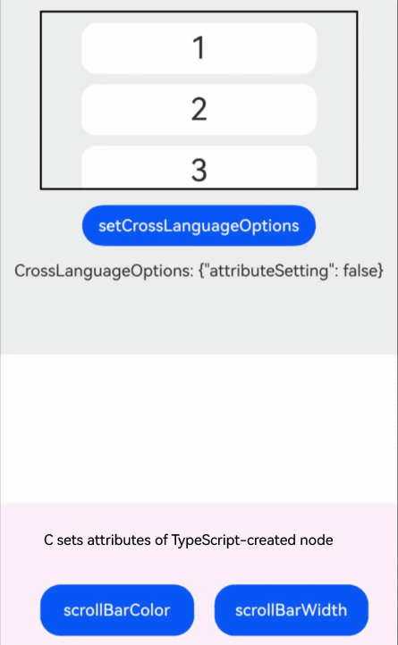

# Setting Custom Node Cross-Language Attributes
<!--Kit: ArkUI-->
<!--Subsystem: ArkUI-->
<!--Owner: @wangyang2022-->
<!--Designer: @wangyang2022-->
<!--Tester: @sally__-->
<!--Adviser: @Brilliantry_Rui-->
<!-- md-trans-meta sourceCommit=357960bf1506b71affd839365a0cdd4da2996dd2 translatedAt=2026-11-16T08:07:07.622Z pushedAt=2026-11-16T09:06:35.224Z nl=1 -->

## Overview

ArkUI supports creating imperative nodes using the ArkTS language on the frontend, that is, [FrameNodes](../reference/apis-arkui/js-apis-arkui-frameNode.md). It also allows creating imperative nodes using the C language on the native side, and both types of nodes can be used together to build pages.

For this scenario, ArkUI provides cross-language attribute setting for imperative nodes, meaning nodes created with ArkTS can have their attributes set on the native side, and nodes created in C can have their attributes set in ArkTS.

> **NOTE**
>
> In the examples below, native-side configuration must be completed first. For details, see [Integrating with ArkTS Pages](./ndk-access-the-arkts-page.md).

## Setting and Obtaining Cross-Language Options

Cross-language refers to operations between ArkTS and C languages. Cross-language options refer to permission settings for cross-language operations on imperative nodes.

You can set a node's cross-language options using [setCrossLanguageOptions](../reference/apis-arkui/js-apis-arkui-frameNode.md#setcrosslanguageoptions15) and [OH_ArkUI_NodeUtils_SetCrossLanguageOption](../reference/apis-arkui/capi-native-node-h.md#oh_arkui_nodeutils_setcrosslanguageoption). If the node cannot modify or set cross-language options, an exception will be thrown.

You can obtain the current cross-language options using [getCrossLanguageOptions](../reference/apis-arkui/js-apis-arkui-frameNode.md#getcrosslanguageoptions15) and [OH_ArkUI_NodeUtils_GetCrossLanguageOption](../reference/apis-arkui/capi-native-node-h.md#oh_arkui_nodeutils_getcrosslanguageoption).

The following example demonstrates how to set and obtain cross-language options for ArkTS imperative nodes.

```ts
// Index.ets
import { NodeController, UIContext, FrameNode, typeNode, BuilderNode } from '@kit.ArkUI';

@Builder
function insideScroll() {
  Column() {
    ForEach([1, 2, 3, 4, 5, 6, 7, 8, 9, 10], (item: number) => {
      Text(item.toString())
        .width("75%")
        .height(50)
        .backgroundColor(0xFFFFFF)
        .borderRadius(15)
        .fontSize(30)
        .textAlign(TextAlign.Center)
        .margin({ top: 10 })
    }, (item: number) => item.toString())
  }
  .width("100%")
}

class MyNodeController extends NodeController {
  uiContext: UIContext | null = null;
  rootNode: FrameNode | null = null;
  scrollNode: FrameNode | null = null;
  scroller: Scroller = new Scroller();

  makeNode(uiContext: UIContext): FrameNode | null {
    this.uiContext = uiContext;
    this.rootNode = new FrameNode(uiContext);
    this.rootNode.commonAttribute.width("80%").height("50%").borderWidth(2).margin(15);
    const scroll = typeNode.createNode(uiContext, 'Scroll');
    scroll.initialize(this.scroller).id("scroll");
    this.scrollNode = scroll;
    this.rootNode.appendChild(this.scrollNode);
    const builderNode = new BuilderNode(uiContext);
    builderNode.build(wrapBuilder(insideScroll));
    this.scrollNode?.appendChild(builderNode.getFrameNode());
    return this.rootNode;
  }
}

@Entry
@Component
struct CrossLanguage {
  myNodeController: MyNodeController = new MyNodeController()
  @State attributeSetting: boolean = false;
  @State getCrossLanguageOptions: string = '{"attributeSetting": false}';

  build() {
    Scroll() {
      Column({ space: 15 }) {
        Column() {
          Scroll() {
            Column() {
              NodeContainer(this.myNodeController)
              Button("setCrossLanguageOptions").margin({ bottom: 15})
                .onClick(() => {
                  this.attributeSetting = !this.attributeSetting;
                  this.myNodeController.scrollNode?.setCrossLanguageOptions({
                    attributeSetting: this.attributeSetting
                  });
                  // If attributeSetting is true, scrollNode supports attribute modification via non-ArkTS languages; otherwise, it does not.
                  this.getCrossLanguageOptions = JSON.stringify(this.myNodeController.scrollNode?.getCrossLanguageOptions());
                })
              Text("CrossLanguageOptions: " + this.getCrossLanguageOptions)
            }
          }.scrollBarColor(Color.Transparent)
        }
        .width('100%')
        .height(350)
        .backgroundColor(0xeeeeee)
        .id('Part_TS')
      }
      .width('100%')
    }.scrollBarColor(Color.Transparent)
  }
}
```

## Setting Cross-Language Node Attributes

After obtaining a node, if its cross-language configuration allows attribute setting, ArkTS can use the **getAttribute** API to access objects for modifying native node attributes, while the native side can use [setAttribute](../reference/apis-arkui/capi-arkui-nativemodule-arkui-nativenodeapi-1.md#setattribute) to modify ArkTS node attributes.

The following example creates an ArkTS [Scroll](../reference/apis-arkui/js-apis-arkui-frameNode.md#scroll12) node and modifies its properties on the native side.

1. Create an imperative node of the `Scroll` component type on the ArkTS side. Create a new `CrossLanguage.ets` page file. When the page is created, call the `createCrossLanguageRoot` method to notify the native side to create a cross-language example component. When the page is destroyed, call the `destroyNativeRoot` method to release the native-side component. In addition, register the `pages/CrossLanguage` page in `entry/src/main/resources/base/profile/main_pages.json`, and add a route to this page on the main page.

   <!-- @[cross_language_index](https://gitcode.com/openharmony/applications_app_samples/blob/master/code/DocsSample/ArkUISample/ButtonList/entry/src/main/ets/pages/CrossLanguage.ets) -->  
   
   ``` TypeScript
   import nativeNode from 'libentry.so';
   import { NodeController, UIContext, FrameNode, typeNode, BuilderNode, NodeContent } from '@kit.ArkUI';
   
   @Builder
   function insideScroll() {
     Column() {
       ForEach([1, 2, 3, 4, 5, 6, 7, 8, 9, 10], (item: number) => {
         Text(item.toString())
           .width('75%')
           .height(50)
           .backgroundColor(0xFFFFFF)
           .borderRadius(15)
           .fontSize(30)
           .textAlign(TextAlign.Center)
           .margin({ top: 10 })
       }, (item: number) => item.toString())
     }
     .width('100%')
   }
   
   class MyNodeController extends NodeController {
     private uiContext: UIContext | null = null;
     private rootNode: FrameNode | null = null;
     public scrollNode: FrameNode | null = null;
     private scroller: Scroller = new Scroller();
   
     makeNode(uiContext: UIContext): FrameNode | null {
       this.uiContext = uiContext;
       this.rootNode = new FrameNode(uiContext);
       this.rootNode.commonAttribute.width('80%').height('50%').borderWidth(2).margin(15);
       const scroll = typeNode.createNode(uiContext, 'Scroll');
       scroll.initialize(this.scroller).id('scroll');
       this.scrollNode = scroll;
       this.rootNode.appendChild(this.scrollNode);
       const builderNode = new BuilderNode(uiContext);
       builderNode.build(wrapBuilder(insideScroll));
       this.scrollNode?.appendChild(builderNode.getFrameNode());
       return this.rootNode;
     }
   }
   
   @Entry
   @Component
   struct CrossLanguage {
     private myNodeController: MyNodeController = new MyNodeController();
     @State attributeSetting: boolean = false;
     @State getCrossLanguageOptions: string = '{"attributeSetting": false}';
     private rootSlot = new NodeContent();
   
     aboutToAppear(): void {
       // Pass the NodeContent object for Native to create and mount a cross-language example component.
       nativeNode.createCrossLanguageRoot(this.rootSlot);
     }
   
     aboutToDisappear(): void {
       // Release the Native-side component when the page is destroyed.
       nativeNode.destroyNativeRoot();
     }
   
     build() {
       Scroll() {
         Column({ space: 15 }) {
           Column() {
             Scroll() {
               Column() {
                 NodeContainer(this.myNodeController)
                 Button('setCrossLanguageOptions').margin({ bottom: 15})
                   .onClick(() => {
                     this.attributeSetting = !this.attributeSetting;
                     this.myNodeController.scrollNode?.setCrossLanguageOptions({
                       attributeSetting: this.attributeSetting
                     });
                     // If attributeSetting is true, scrollNode supports attribute setting through a non-ArkTS language; otherwise, it is not supported.
                     this.getCrossLanguageOptions =
                       JSON.stringify(this.myNodeController.scrollNode?.getCrossLanguageOptions());
                   })
                 Text('CrossLanguageOptions: ' + this.getCrossLanguageOptions)
               }
             }.scrollBarColor(Color.Transparent)
           }
           .width('100%')
           .height(350)
           .backgroundColor(0xeeeeee)
           .id('Part_TS')
   
           Column() {
             ContentSlot(this.rootSlot)
           }
           .width(500)
           .height(400)
           .id('Part_C')
         }
         .width('100%')
       }.scrollBarColor(Color.Transparent)
     }
   }
   ```

2. Provide the API declaration and registration for the ArkTS side to reference the native bridge methods, so that the `createCrossLanguageRoot` and `destroyNativeRoot` methods referenced through `import nativeNode from 'libentry.so'` in step 1 take effect.

   The `entry/src/main/cpp/types/libentry/oh-package.json5` file is used to associate `libentry.so` with the API declaration file `Index.d.ts`.

   <!-- @[Cpp_libentry](https://gitcode.com/openharmony/applications_app_samples/blob/master/code/DocsSample/ArkUISample/ButtonList/entry/src/main/cpp/types/libentry/oh-package.json5) -->  
   
   ``` JSON5
   {
     "name": "libentry.so",
     "types": "./Index.d.ts",
     "version": "1.0.0",
     "description": "Please describe the basic information."
   }
   ```

   API declaration:

   <!-- @[Cpp_indexes](https://gitcode.com/openharmony/applications_app_samples/blob/master/code/DocsSample/ArkUISample/ButtonList/entry/src/main/cpp/types/libentry/Index.d.ts) -->  
   
   ``` TypeScript
   // entry/src/main/cpp/types/libentry/Index.d.ts
   export const createNativeRoot: (content: Object) => void;
   export const createCrossLanguageRoot: (content: Object) => void;
   export const destroyNativeRoot: () => void;
   ```

   Native implementation:

   <!-- @[napi_init](https://gitcode.com/openharmony/applications_app_samples/blob/master/code/DocsSample/ArkUISample/ButtonList/entry/src/main/cpp/napi_init.cpp) -->  
   
   ``` C++
   // entry/src/main/cpp/napi_init.cpp
   #include "napi/native_api.h"
   #include "NativeEntry.h"
   
   EXTERN_C_START
   static napi_value Init(napi_env env, napi_value exports)
   {
       // Bind the component creation and destruction on the Native side.
       napi_property_descriptor desc[] = {
           {"createNativeRoot", nullptr,
            NativeModule::CreateNativeRoot, nullptr, nullptr,
            nullptr, napi_default, nullptr},
           {"createCrossLanguageRoot", nullptr,
            NativeModule::CreateCrossLanguageRoot, nullptr, nullptr,
            nullptr, napi_default, nullptr},
           {"destroyNativeRoot", nullptr,
            NativeModule::DestroyNativeRoot, nullptr, nullptr,
            nullptr, napi_default, nullptr}};
       napi_define_properties(env, exports, sizeof(desc) / sizeof(desc[0]), desc);
       return exports;
   }
   EXTERN_C_END
   
   static napi_module demoModule = {
       .nm_version = 1,
       .nm_flags = 0,
       .nm_filename = nullptr,
       .nm_register_func = Init,
       .nm_modname = "entry",
       .nm_priv = ((void *)0),
       .reserved = {0},
   };
   
   extern "C" __attribute__((constructor)) void RegisterEntryModule(void) { napi_module_register(&demoModule); }
   ```

3. This example uses C++ to perform secondary encapsulation of the NDK C APIs. It requires the encapsulation API `NativeModule.h` for obtaining the NDK API entry, the component tree operation base class `ArkUIBaseNode.h`, and the encapsulation class `ArkUINode.h` for common properties and events. If the native-side configuration in [Accessing an ArkTS Page](./ndk-access-the-arkts-page.md) has been completed, the corresponding files can be reused directly.

   <!-- @[Cpp_NativeModule](https://gitcode.com/openharmony/applications_app_samples/blob/master/code/DocsSample/ArkUISample/ButtonList/entry/src/main/cpp/NativeModule.h) -->  
   
   ``` C
   // NativeModule.h
   // Provide the encapsulation API for obtaining the ArkUI module on the Native side.
   
   #ifndef MYAPPLICATION_NATIVEMODULE_H
   #define MYAPPLICATION_NATIVEMODULE_H
   
   #include <arkui/native_node.h>
   #include <cassert>
   
   #include <arkui/native_interface.h>
   
   namespace NativeModule {
   
   class NativeModuleInstance {
   public:
       static NativeModuleInstance *GetInstance()
       {
           static NativeModuleInstance instance;
           return &instance;
       }
       NativeModuleInstance()
       {
           OH_ArkUI_GetModuleInterface(ARKUI_NATIVE_NODE, ArkUI_NativeNodeAPI_1, arkUINativeNodeApi_);
       }
       // Expose it to other modules for use.
       ArkUI_NativeNodeAPI_1 *GetNativeNodeAPI() { return arkUINativeNodeApi_; }
   
   private:
       ArkUI_NativeNodeAPI_1 *arkUINativeNodeApi_ = nullptr;
   };
   
   } // namespace NativeModule
   
   #endif // MYAPPLICATION_NATIVEMODULE_H
   ```

   <!-- @[Cpp_ArkUIBaseNode](https://gitcode.com/openharmony/applications_app_samples/blob/master/code/DocsSample/ArkUISample/ButtonList/entry/src/main/cpp/ArkUIBaseNode.h) -->  
   
   ``` C
   // ArkUIBaseNode.h
   // Provide the base class for component tree operations.
   #ifndef MYAPPLICATION_ARKUIBASENODE_H
   #define MYAPPLICATION_ARKUIBASENODE_H
   
   #include <arkui/native_type.h>
   #include <list>
   #include <memory>
   
   #include "NativeModule.h"
   
   namespace NativeModule {
   
   class ArkUIBaseNode {
   public:
       explicit ArkUIBaseNode(ArkUI_NodeHandle handle)
           : handle_(handle), nativeModule_(NativeModuleInstance::GetInstance()->GetNativeNodeAPI()) {}
   
       virtual ~ArkUIBaseNode()
       {
           // Encapsulate the destructor to implement child node removal.
           if (!children_.empty()) {
               for (const auto& child : children_) {
                   nativeModule_->removeChild(handle_, child->GetHandle());
               }
               children_.clear();
           }
           // Encapsulate the destructor to uniformly reclaim node resources.
           nativeModule_->disposeNode(handle_);
       }
   
       void AddChild(const std::shared_ptr<ArkUIBaseNode> &child)
       {
           children_.emplace_back(child);
           OnAddChild(child);
       }
   
       void RemoveChild(const std::shared_ptr<ArkUIBaseNode> &child)
       {
           children_.remove(child);
           OnRemoveChild(child);
       }
   
       void InsertChild(const std::shared_ptr<ArkUIBaseNode> &child, int32_t index)
       {
           if (index >= children_.size()) {
               AddChild(child);
           } else {
               auto iter = children_.begin();
               std::advance(iter, index);
               children_.insert(iter, child);
               OnInsertChild(child, index);
           }
       }
   
       ArkUI_NodeHandle GetHandle() const { return handle_; }
   
   protected:
       // For parent container subclasses, override the following functions to implement component mounting and unmounting.
       virtual void OnAddChild(const std::shared_ptr<ArkUIBaseNode> &child) {}
       virtual void OnRemoveChild(const std::shared_ptr<ArkUIBaseNode> &child) {}
       virtual void OnInsertChild(const std::shared_ptr<ArkUIBaseNode> &child, int32_t index) {}
   
       ArkUI_NodeHandle handle_;
       ArkUI_NativeNodeAPI_1 *nativeModule_ = nullptr;
   
   private:
       std::list<std::shared_ptr<ArkUIBaseNode>> children_;
   };
   } // namespace NativeModule
   
   #endif // MYAPPLICATION_ARKUIBASENODE_H
   ```

   <!-- @[Cpp_ArkUINode](https://gitcode.com/openharmony/applications_app_samples/blob/master/code/DocsSample/ArkUISample/ButtonList/entry/src/main/cpp/ArkUINode.h) -->  
   
   ``` C
   // ArkUINode.h
   // Provides encapsulation of common attributes and events.
   #ifndef MYAPPLICATION_ARKUINODE_H
   #define MYAPPLICATION_ARKUINODE_H
   
   #include "ArkUIBaseNode.h"
   #include "NativeModule.h"
   #include <arkui/native_node.h>
   #include <arkui/native_type.h>
   
   namespace NativeModule {
   
   class ArkUINode : public ArkUIBaseNode {
   public:
       explicit ArkUINode(ArkUI_NodeHandle handle) : ArkUIBaseNode(handle) {}
   
       ~ArkUINode() override {}
       
       void SetWidth(float width)
       {
           ArkUI_NumberValue value[] = {{.f32 = width}};
           ArkUI_AttributeItem item = {value, 1};
           nativeModule_->setAttribute(handle_, NODE_WIDTH, &item);
       }
       void SetPercentWidth(float percent)
       {
           ArkUI_NumberValue value[] = {{.f32 = percent}};
           ArkUI_AttributeItem item = {value, 1};
           nativeModule_->setAttribute(handle_, NODE_WIDTH_PERCENT, &item);
       }
       void SetHeight(float height)
       {
           ArkUI_NumberValue value[] = {{.f32 = height}};
           ArkUI_AttributeItem item = {value, 1};
           nativeModule_->setAttribute(handle_, NODE_HEIGHT, &item);
       }
       void SetPercentHeight(float percent)
       {
           ArkUI_NumberValue value[] = {{.f32 = percent}};
           ArkUI_AttributeItem item = {value, 1};
           nativeModule_->setAttribute(handle_, NODE_HEIGHT_PERCENT, &item);
       }
       void SetBackgroundColor(uint32_t color)
       {
           ArkUI_NumberValue value[] = {{.u32 = color}};
           ArkUI_AttributeItem item = {value, 1};
           nativeModule_->setAttribute(handle_, NODE_BACKGROUND_COLOR, &item);
       }
   
   protected:
       // Connects the implementation class for component tree operations.
       void OnAddChild(const std::shared_ptr<ArkUIBaseNode> &child) override
       {
           nativeModule_->addChild(handle_, child->GetHandle());
       }
       void OnRemoveChild(const std::shared_ptr<ArkUIBaseNode> &child) override
       {
           nativeModule_->removeChild(handle_, child->GetHandle());
       }
       void OnInsertChild(const std::shared_ptr<ArkUIBaseNode> &child, int32_t index) override
       {
           nativeModule_->insertChildAt(handle_, child->GetHandle(), index);
       }
   };
   } // namespace NativeModule
   
   #endif // MYAPPLICATION_ARKUINODE_H
   ```

4. Declare bridge methods such as `CreateCrossLanguageRoot` in `NativeEntry.h`, and manage the lifecycle and memory of the native components.

   <!-- @[Cpp_Native](https://gitcode.com/openharmony/applications_app_samples/blob/master/code/DocsSample/ArkUISample/ButtonList/entry/src/main/cpp/NativeEntry.h) -->  
   
   ``` C
   // NativeEntry.h
   
   #ifndef MYAPPLICATION_NATIVEENTRY_H
   #define MYAPPLICATION_NATIVEENTRY_H
   
   #include <ArkUIBaseNode.h>
   #include <arkui/native_type.h>
   #include <js_native_api_types.h>
   
   namespace NativeModule {
   
   napi_value CreateNativeRoot(napi_env env, napi_callback_info info);
   
   napi_value CreateCrossLanguageRoot(napi_env env, napi_callback_info info);
   
   napi_value DestroyNativeRoot(napi_env env, napi_callback_info info);
   
   // Manage the lifecycle and memory of Native components.
   class NativeEntry {
   public:
       static NativeEntry *GetInstance()
       {
           static NativeEntry nativeEntry;
           return &nativeEntry;
       }
   
       void SetContentHandle(ArkUI_NodeContentHandle handle)
       {
           handle_ = handle;
       }
   
       void SetRootNode(const std::shared_ptr<ArkUIBaseNode> &baseNode)
       {
           root_ = baseNode;
           // Add the Native component to NodeContent for mounting and display.
           OH_ArkUI_NodeContent_AddNode(handle_, root_->GetHandle());
       }
       void DisposeRootNode()
       {
           // Unmount the component from NodeContent and destroy the Native component.
           OH_ArkUI_NodeContent_RemoveNode(handle_, root_->GetHandle());
           root_.reset();
       }
   
   private:
       std::shared_ptr<ArkUIBaseNode> root_;
       ArkUI_NodeContentHandle handle_;
   };
   
   } // namespace NativeModule
   
   #endif  // MYAPPLICATION_NATIVEENTRY_H
   ```

5. Implement the `CreateCrossLanguageRoot` method in `NativeEntry.cpp` to create a cross-language example component and mount and display it. `CreateNativeRoot` is the method for mounting the native text list in the [Accessing an ArkTS Page](./ndk-access-the-arkts-page.md) example.

   <!-- @[Cpp_NativeEntry](https://gitcode.com/openharmony/applications_app_samples/blob/master/code/DocsSample/ArkUISample/ButtonList/entry/src/main/cpp/NativeEntry.cpp) -->  
   
   ``` C++
   // NativeEntry.cpp
   
   #include <arkui/native_node_napi.h>
   #include <js_native_api.h>
   #include "NativeEntry.h"
   #include "CrossLanguageExample.h"
   #include "NormalTextListExample.h"
   
   namespace NativeModule {
   
   napi_value CreateNativeRoot(napi_env env, napi_callback_info info)
   {
       size_t argc = 1;
       napi_value args[1] = {nullptr};
   
       napi_get_cb_info(env, info, &argc, args, nullptr, nullptr);
   
       // Get NodeContent.
       ArkUI_NodeContentHandle contentHandle;
       OH_ArkUI_GetNodeContentFromNapiValue(env, args[0], &contentHandle);
       NativeEntry::GetInstance()->SetContentHandle(contentHandle);
   
       // Create a text list.
       auto list = CreateTextListExample();
   
       // Maintain the Native side object in the management class to maintain its lifecycle.
       NativeEntry::GetInstance()->SetRootNode(list);
       return nullptr;
   }
   
   napi_value CreateCrossLanguageRoot(napi_env env, napi_callback_info info)
   {
       size_t argc = 1;
       napi_value args[1] = {nullptr};
   
       napi_get_cb_info(env, info, &argc, args, nullptr, nullptr);
   
       // Get NodeContent.
       ArkUI_NodeContentHandle contentHandle;
       OH_ArkUI_GetNodeContentFromNapiValue(env, args[0], &contentHandle);
       NativeEntry::GetInstance()->SetContentHandle(contentHandle);
   
       // Create a cross-language attribute setting example.
       auto node = CreateCrossLanguageExample();
   
       // Maintain the Native side object in the management class to maintain its lifecycle.
       NativeEntry::GetInstance()->SetRootNode(node);
       return nullptr;
   }
   
   napi_value DestroyNativeRoot(napi_env env, napi_callback_info info)
   {
       // Release the Native side object from the management class.
       NativeEntry::GetInstance()->DisposeRootNode();
       return nullptr;
   }
   } // namespace NativeModule
   ```

6. Create a new `CrossLanguageExample.h` file, create the native-side component tree in it, obtain the target node created on the ArkTS side through `OH_ArkUI_NodeUtils_GetAttachedNodeHandleById`, and set its properties.

   <!-- @[cpp_cross_language_example](https://gitcode.com/openharmony/applications_app_samples/blob/master/code/DocsSample/ArkUISample/ButtonList/entry/src/main/cpp/CrossLanguageExample.h) -->  
   
   ``` C
   // CrossLanguageExample.h
   // Provide the creation of Native-side components in the cross-language attribute setting example.
   
   #ifndef MYAPPLICATION_CROSSLANGUAGEEXAMPLE_H
   #define MYAPPLICATION_CROSSLANGUAGEEXAMPLE_H
   
   #include "ArkUINode.h"
   #include <hilog/log.h>
   #include <memory>
   
   namespace NativeModule {
   
   // Event callback: modify the attributes of the Scroll node created on the ArkTS side from the Native side across languages.
   void HandleCrossLanguageClick(ArkUI_NodeEvent *event)
   {
       auto nodeAPI = NativeModuleInstance::GetInstance()->GetNativeNodeAPI();
   
       if (OH_ArkUI_NodeEvent_GetTargetId(event) == 0) { // Modify the scrollbar color.
           ArkUI_NodeHandle node_ptr = nullptr;
           // Obtain the node created on the ArkTS side by ID.
           auto ret = OH_ArkUI_NodeUtils_GetAttachedNodeHandleById("scroll", &node_ptr);
           if (ret != ARKUI_ERROR_CODE_NO_ERROR || node_ptr == nullptr) {
               OH_LOG_Print(LOG_APP, LOG_ERROR, 0xFF00, "CrossLanguageExample",
                   "OH_ArkUI_NodeUtils_GetAttachedNodeHandleById failed, error code: %{public}d", ret);
               return;
           }
           ArkUI_NumberValue scroll_color_value[] = {{.u32 = 0xff00ff00}};
           ArkUI_AttributeItem scroll_color_item = {scroll_color_value,
               sizeof(scroll_color_value) / sizeof(ArkUI_NumberValue)};
           // If cross-language attribute setting is not enabled on the ArkTS side, the setting fails here and an error code is returned.
           auto errCode = nodeAPI->setAttribute(node_ptr, NODE_SCROLL_BAR_COLOR, &scroll_color_item);
           if (errCode != ARKUI_ERROR_CODE_NO_ERROR) {
               OH_LOG_Print(LOG_APP, LOG_ERROR, 0xFF00, "CrossLanguageExample",
                   "crossLanguage setAttribute scroll bar color failed, error code: %{public}d", errCode);
           }
       }
   
       if (OH_ArkUI_NodeEvent_GetTargetId(event) == 1) { // Modify the scrollbar width.
           ArkUI_NodeHandle node_ptr = nullptr;
           auto ret = OH_ArkUI_NodeUtils_GetAttachedNodeHandleById("scroll", &node_ptr);
           if (ret != ARKUI_ERROR_CODE_NO_ERROR || node_ptr == nullptr) {
               OH_LOG_Print(LOG_APP, LOG_ERROR, 0xFF00, "CrossLanguageExample",
                   "OH_ArkUI_NodeUtils_GetAttachedNodeHandleById failed, error code: %{public}d", ret);
               return;
           }
           ArkUI_NumberValue scroll_width_value[] = {{.f32 = 20}};
           ArkUI_AttributeItem scroll_width_item = {scroll_width_value,
               sizeof(scroll_width_value) / sizeof(ArkUI_NumberValue)};
           auto errCode = nodeAPI->setAttribute(node_ptr, NODE_SCROLL_BAR_WIDTH, &scroll_width_item);
           if (errCode != ARKUI_ERROR_CODE_NO_ERROR) {
               OH_LOG_Print(LOG_APP, LOG_ERROR, 0xFF00, "CrossLanguageExample",
                   "crossLanguage setAttribute scroll bar width failed, error code: %{public}d", errCode);
           }
       }
   }
   
   // Create the root node Scroll.
   ArkUI_NodeHandle CreateScrollNode(ArkUI_NativeNodeAPI_1 *nodeAPI)
   {
       ArkUI_NodeHandle scroll = nodeAPI->createNode(ARKUI_NODE_SCROLL);
       ArkUI_NumberValue length_value[] = {{.f32 = 480}};
       ArkUI_AttributeItem length_item = {length_value, sizeof(length_value) / sizeof(ArkUI_NumberValue)};
       nodeAPI->setAttribute(scroll, NODE_WIDTH, &length_item);
       ArkUI_NumberValue length_value1[] = {{.f32 = 650}};
       ArkUI_AttributeItem length_item1 = {length_value1, sizeof(length_value1) / sizeof(ArkUI_NumberValue)};
       nodeAPI->setAttribute(scroll, NODE_HEIGHT, &length_item1);
       ArkUI_AttributeItem scroll_id = {.string = "Scroll_CAPI"};
       nodeAPI->setAttribute(scroll, NODE_ID, &scroll_id);
       return scroll;
   }
   
   // Create Column.
   ArkUI_NodeHandle CreateColumnNode(ArkUI_NativeNodeAPI_1 *nodeAPI)
   {
       ArkUI_NodeHandle column = nodeAPI->createNode(ARKUI_NODE_COLUMN);
       ArkUI_NumberValue value[] = {{.f32 = 480}};
       ArkUI_AttributeItem item = {value, sizeof(value) / sizeof(ArkUI_NumberValue)};
       nodeAPI->setAttribute(column, NODE_WIDTH, &item);
       ArkUI_NumberValue column_bc[] = {{.u32 = 0xFFF00BB}};
       ArkUI_AttributeItem column_item = {column_bc, 1};
       nodeAPI->setAttribute(column, NODE_BACKGROUND_COLOR, &column_item);
       ArkUI_AttributeItem column_id = {.string = "Column_CAPI"};
       nodeAPI->setAttribute(column, NODE_ID, &column_id);
       return column;
   }
   
   // Create Text.
   ArkUI_NodeHandle CreateTextNode(ArkUI_NativeNodeAPI_1 *nodeAPI)
   {
       ArkUI_NodeHandle text0 = nodeAPI->createNode(ARKUI_NODE_TEXT);
       ArkUI_NumberValue text_width[] = {{.f32 = 300}};
       ArkUI_AttributeItem text_item0 = {text_width, sizeof(text_width) / sizeof(ArkUI_NumberValue)};
       nodeAPI->setAttribute(text0, NODE_WIDTH, &text_item0);
       ArkUI_NumberValue text_height[] = {{.f32 = 50}};
       ArkUI_AttributeItem text_item1 = {text_height, sizeof(text_height) / sizeof(ArkUI_NumberValue)};
       nodeAPI->setAttribute(text0, NODE_HEIGHT, &text_item1);
       ArkUI_AttributeItem text_item = {.string = "C sets the node attribute created by TS"};
       nodeAPI->setAttribute(text0, NODE_TEXT_CONTENT, &text_item);
       ArkUI_NumberValue margin[] = {{.f32 = 10}};
       ArkUI_AttributeItem item_margin = {margin, sizeof(margin) / sizeof(ArkUI_NumberValue)};
       nodeAPI->setAttribute(text0, NODE_MARGIN, &item_margin);
       return text0;
   }
   
   // Create Row.
   ArkUI_NodeHandle CreateRowNode(ArkUI_NativeNodeAPI_1 *nodeAPI)
   {
       ArkUI_NodeHandle row0 = nodeAPI->createNode(ARKUI_NODE_ROW);
       ArkUI_NumberValue width_value[] = {{.f32 = 330}};
       ArkUI_AttributeItem width_item = {width_value, sizeof(width_value) / sizeof(ArkUI_NumberValue)};
       nodeAPI->setAttribute(row0, NODE_WIDTH, &width_item);
       ArkUI_NumberValue height_value[] = {{.f32 = 50}};
       ArkUI_AttributeItem height_item = {height_value, sizeof(height_value) / sizeof(ArkUI_NumberValue)};
       nodeAPI->setAttribute(row0, NODE_HEIGHT, &height_item);
       ArkUI_NumberValue margin[] = {{.f32 = 10}};
       ArkUI_AttributeItem item_margin = {margin, sizeof(margin) / sizeof(ArkUI_NumberValue)};
       nodeAPI->setAttribute(row0, NODE_MARGIN, &item_margin);
       return row0;
   }
   
   // Create Button to trigger cross-language attribute setting on the Native side.
   void CreateButtonNodes(ArkUI_NativeNodeAPI_1 *nodeAPI, ArkUI_NodeHandle row0)
   {
       ArkUI_NumberValue btn_width[] = {{.f32 = 150}};
       ArkUI_AttributeItem btn_item0 = {btn_width, sizeof(btn_width) / sizeof(ArkUI_NumberValue)};
       ArkUI_NumberValue height_value[] = {{.f32 = 50}};
       ArkUI_AttributeItem height_item = {height_value, sizeof(height_value) / sizeof(ArkUI_NumberValue)};
       ArkUI_NumberValue margin[] = {{.f32 = 10}};
       ArkUI_AttributeItem item_margin = {margin, sizeof(margin) / sizeof(ArkUI_NumberValue)};
   
       ArkUI_NodeHandle bt0 = nodeAPI->createNode(ARKUI_NODE_BUTTON);
       nodeAPI->setAttribute(bt0, NODE_WIDTH, &btn_item0);
       nodeAPI->setAttribute(bt0, NODE_HEIGHT, &height_item);
       nodeAPI->setAttribute(bt0, NODE_MARGIN, &item_margin);
       ArkUI_AttributeItem bt0_item = {.string = "scrollBarColor"};
       nodeAPI->setAttribute(bt0, NODE_BUTTON_LABEL, &bt0_item);
       nodeAPI->registerNodeEvent(bt0, NODE_ON_CLICK, 0, nullptr);
   
       ArkUI_NodeHandle bt1 = nodeAPI->createNode(ARKUI_NODE_BUTTON);
       nodeAPI->setAttribute(bt1, NODE_WIDTH, &btn_item0);
       nodeAPI->setAttribute(bt1, NODE_HEIGHT, &height_item);
       nodeAPI->setAttribute(bt1, NODE_MARGIN, &item_margin);
       ArkUI_AttributeItem bt1_item = {.string = "scrollBarWidth"};
       nodeAPI->setAttribute(bt1, NODE_BUTTON_LABEL, &bt1_item);
       nodeAPI->registerNodeEvent(bt1, NODE_ON_CLICK, 1, nullptr);
   
       nodeAPI->addChild(row0, bt0);
       nodeAPI->addChild(row0, bt1);
   }
   
   std::shared_ptr<ArkUIBaseNode> CreateCrossLanguageExample()
   {
       auto nodeAPI = NativeModuleInstance::GetInstance()->GetNativeNodeAPI();
   
       // Create the root node Scroll.
       ArkUI_NodeHandle scroll = CreateScrollNode(nodeAPI);
   
       // Create Column.
       ArkUI_NodeHandle column = CreateColumnNode(nodeAPI);
   
       // Create Text.
       ArkUI_NodeHandle text0 = CreateTextNode(nodeAPI);
   
       // Create Row.
       ArkUI_NodeHandle row0 = CreateRowNode(nodeAPI);
   
       // Create Button to trigger cross-language attribute setting on the Native side.
       CreateButtonNodes(nodeAPI, row0);
   
       // Register the event callback to modify the attributes of the Scroll node created on the ArkTS side from the Native side across languages.
       nodeAPI->registerNodeEventReceiver(HandleCrossLanguageClick);
   
       // Add nodes to build the component tree.
       nodeAPI->addChild(scroll, column);
       nodeAPI->addChild(column, text0);
       nodeAPI->addChild(column, row0);
   
       return std::make_shared<ArkUINode>(scroll);
   }
   } // namespace NativeModule
   
   #endif // MYAPPLICATION_CROSSLANGUAGEEXAMPLE_H
   ```

7. Update the **CMakeLists.txt** file and add the required link libraries.
   ```c
   # CMakeLists.txt
   # the minimum version of CMake.
   cmake_minimum_required(VERSION 3.5.0)
   project(CAPI_DEMO)
 
   set(NATIVERENDER_ROOT_PATH ${CMAKE_CURRENT_SOURCE_DIR})
 
   if(DEFINED PACKAGE_FIND_FILE)
       include(${PACKAGE_FIND_FILE})
   endif()
 
   include_directories(${NATIVERENDER_ROOT_PATH}
                     ${NATIVERENDER_ROOT_PATH}/include)
 
   add_library(entry SHARED napi_init.cpp NativeEntry.cpp)
   target_link_libraries(entry PUBLIC libace_napi.z.so libace_ndk.z.so hilog_ndk.z.so)
   ```

8. Run the program. On the example main page, click the **CrossLanguage** button to enter the cross-language property setting page. On the ArkTS side, click the **setCrossLanguageOptions** button to set the current `attributeSetting` to `true`. On the native side, click the button to set the color and thickness properties of the `Scroll` component scrollbar on the ArkTS side.

    

## Node Types Supporting Cross-Language Attribute Setting

Only the following node types support cross-language attribute setting. The native side must use [OH_ArkUI_NodeUtils_GetAttachedNodeHandleById](../reference/apis-arkui/capi-native-node-h.md#oh_arkui_nodeutils_getattachednodehandlebyid) to obtain the node whose attributes are to be modified. Cross-language attribute setting is not supported for target nodes obtained via [OH_ArkUI_GetNodeHandleFromNapiValue](../reference/apis-arkui/capi-native-node-napi-h.md#oh_arkui_getnodehandlefromnapivalue).

| ArkTS [TypedFrameNode](../reference/apis-arkui/js-apis-arkui-frameNode.md#typedframenode12) type| Native [ArkUI_NodeType](../reference/apis-arkui/capi-native-node-h.md#arkui_nodetype) type| ArkTS Attribute Getter| ArkTS Controller Getter/Binding|
| -------- | -------- | -------- | -------- |
| [Button](../reference/apis-arkui/js-apis-arkui-frameNode.md#button12) | ARKUI_NODE_BUTTON | [getAttribute](../reference/apis-arkui/js-apis-arkui-frameNode.md#getattributebutton20) | NA |
| [Checkbox](../reference/apis-arkui/js-apis-arkui-frameNode.md#checkbox18) | ARKUI_NODE_CHECKBOX | [getAttribute](../reference/apis-arkui/js-apis-arkui-frameNode.md#getattributecheckbox20) | NA |
| [Radio](../reference/apis-arkui/js-apis-arkui-frameNode.md#radio18) | ARKUI_NODE_RADIO | [getAttribute](../reference/apis-arkui/js-apis-arkui-frameNode.md#getattributeradio20) | NA |
| [Slider](../reference/apis-arkui/js-apis-arkui-frameNode.md#slider18) | ARKUI_NODE_SLIDER | [getAttribute](../reference/apis-arkui/js-apis-arkui-frameNode.md#getattributeslider20) | NA |
| [Toggle](../reference/apis-arkui/js-apis-arkui-frameNode.md#toggle18) | ARKUI_NODE_TOGGLE | [getAttribute](../reference/apis-arkui/js-apis-arkui-frameNode.md#getattributetoggle20) | NA |
| [Progress](../reference/apis-arkui/js-apis-arkui-frameNode.md#progress12) | ARKUI_NODE_PROGRESS | [getAttribute](../reference/apis-arkui/js-apis-arkui-frameNode.md#getattributeprogress20) | NA |
| [LoadingProgress](../reference/apis-arkui/js-apis-arkui-frameNode.md#loadingprogress12) | ARKUI_NODE_LOADING_PROGRESS | [getAttribute](../reference/apis-arkui/js-apis-arkui-frameNode.md#getattributeloadingprogress20) | NA |
| [Image](../reference/apis-arkui/js-apis-arkui-frameNode.md#image12) | ARKUI_NODE_IMAGE | [getAttribute](../reference/apis-arkui/js-apis-arkui-frameNode.md#getattributeimage20) | NA |
| [XComponent](../reference/apis-arkui/js-apis-arkui-frameNode.md#xcomponent12) | ARKUI_NODE_XCOMPONENT | [getAttribute](../reference/apis-arkui/js-apis-arkui-frameNode.md#getattributexcomponent20) | getController |
| [Column](../reference/apis-arkui/js-apis-arkui-frameNode.md#column12) | ARKUI_NODE_COLUMN | [getAttribute](../reference/apis-arkui/js-apis-arkui-frameNode.md#getattributecolumn20) | NA |
| [Row](../reference/apis-arkui/js-apis-arkui-frameNode.md#row12) | ARKUI_NODE_ROW | [getAttribute](../reference/apis-arkui/js-apis-arkui-frameNode.md#getattributerow20) | NA |
| [Stack](../reference/apis-arkui/js-apis-arkui-frameNode.md#stack12) | ARKUI_NODE_STACK | [getAttribute](../reference/apis-arkui/js-apis-arkui-frameNode.md#getattributestack20) | NA |
| [Flex](../reference/apis-arkui/js-apis-arkui-frameNode.md#flex12) | ARKUI_NODE_FLEX | [getAttribute](../reference/apis-arkui/js-apis-arkui-frameNode.md#getattributeflex20) | NA |
| [RelativeContainer](../reference/apis-arkui/js-apis-arkui-frameNode.md#relativecontainer12) | ARKUI_NODE_RELATIVE_CONTAINER | [getAttribute](../reference/apis-arkui/js-apis-arkui-frameNode.md#getattributerelativecontainer20) | NA |
| [Swiper](../reference/apis-arkui/js-apis-arkui-frameNode.md#swiper12) | ARKUI_NODE_SWIPER | [getAttribute](../reference/apis-arkui/js-apis-arkui-frameNode.md#getattributeswiper20) | [bindController](../reference/apis-arkui/js-apis-arkui-frameNode.md#bindcontrollerswiper20) |
| [Scroll](../reference/apis-arkui/js-apis-arkui-frameNode.md#scroll12) | ARKUI_NODE_SCROLL | [getAttribute](../reference/apis-arkui/js-apis-arkui-frameNode.md#getattributescroll15) | [bindController](../reference/apis-arkui/js-apis-arkui-frameNode.md#bindcontrollerscroll15) |
| [List](../reference/apis-arkui/js-apis-arkui-frameNode.md#list12) | ARKUI_NODE_LIST | [getAttribute](../reference/apis-arkui/js-apis-arkui-frameNode.md#getattributelist20) | [bindController](../reference/apis-arkui/js-apis-arkui-frameNode.md#bindcontrollerlist20) |
| [ListItem](../reference/apis-arkui/js-apis-arkui-frameNode.md#listitem12) | ARKUI_NODE_LIST_ITEM | [getAttribute](../reference/apis-arkui/js-apis-arkui-frameNode.md#getattributelistitem20) | NA |
| [ListItemGroup](../reference/apis-arkui/js-apis-arkui-frameNode.md#listitemgroup12) | ARKUI_NODE_LIST_ITEM_GROUP | [getAttribute](../reference/apis-arkui/js-apis-arkui-frameNode.md#getattributelistitemgroup20) | NA |
| [WaterFlow](../reference/apis-arkui/js-apis-arkui-frameNode.md#waterflow12) | ARKUI_NODE_WATER_FLOW | [getAttribute](../reference/apis-arkui/js-apis-arkui-frameNode.md#getattributewaterflow20) | [bindController](../reference/apis-arkui/js-apis-arkui-frameNode.md#bindcontrollerwaterflow20) |
| [FlowItem](../reference/apis-arkui/js-apis-arkui-frameNode.md#flowitem12) | ARKUI_NODE_FLOW_ITEM | [getAttribute](../reference/apis-arkui/js-apis-arkui-frameNode.md#getattributeflowitem20) | NA |
| [Grid](../reference/apis-arkui/js-apis-arkui-frameNode.md#grid14) | ARKUI_NODE_GRID | [getAttribute](../reference/apis-arkui/js-apis-arkui-frameNode.md#getattributegrid20) | [bindController](../reference/apis-arkui/js-apis-arkui-frameNode.md#bindcontrollergrid20) |
| [GridItem](../reference/apis-arkui/js-apis-arkui-frameNode.md#griditem14) | ARKUI_NODE_GRID_ITEM | [getAttribute](../reference/apis-arkui/js-apis-arkui-frameNode.md#getattributegriditem20) | NA |
| [Text](../reference/apis-arkui/js-apis-arkui-frameNode.md#text12) | ARKUI_NODE_TEXT | [getAttribute](../reference/apis-arkui/js-apis-arkui-frameNode.md#getattributetext20) | [bindController](../reference/apis-arkui/js-apis-arkui-frameNode.md#bindcontrollertext20) |
| [TextInput](../reference/apis-arkui/js-apis-arkui-frameNode.md#textinput12) | ARKUI_NODE_TEXT_INPUT | [getAttribute](../reference/apis-arkui/js-apis-arkui-frameNode.md#getattributetextinput20) | [bindController](../reference/apis-arkui/js-apis-arkui-frameNode.md#bindcontrollertextinput20) |
| [TextArea](../reference/apis-arkui/js-apis-arkui-frameNode.md#textarea14) | ARKUI_NODE_TEXT_AREA | [getAttribute](../reference/apis-arkui/js-apis-arkui-frameNode.md#getattributetextarea20) | [bindController](../reference/apis-arkui/js-apis-arkui-frameNode.md#bindcontrollertextarea20) |
