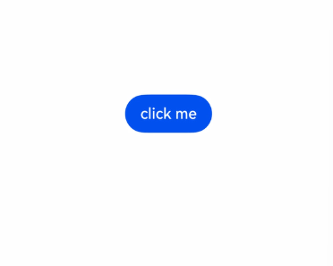
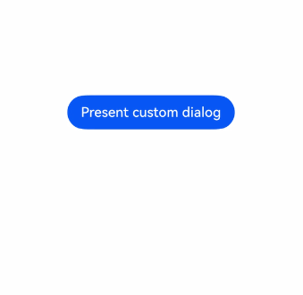
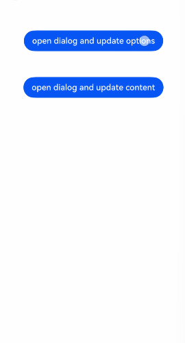
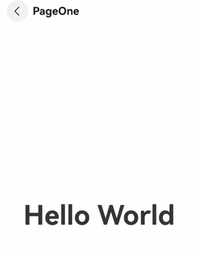

# Popup Migration Guide
<!--Kit: ArkUI-->
<!--Subsystem: ArkUI-->
<!--Owner: @houguobiao-->
<!--Designer: @houguobiao-->
<!--Tester: @lxl007-->
<!--Adviser: @Brilliantry_Rui-->
<!-- md-trans-meta sourceCommit=b4f03e0e8751411c017f2614be312e3d156cab68 translatedAt=2026-11-12T04:32:52.651Z pushedAt=2026-11-13T09:02:08.683Z nl=1 -->

## Overview

This document helps developers understand the capability differences between the new [@ohos.arkui.dialog (Popup)](../reference/apis-arkui/js-apis-dialog.md) interface and the old interfaces ([CustomDialogController](../reference/apis-arkui/arkui-ts/ts-methods-custom-dialog-box.md#customdialogcontroller), [showAlertDialog](../reference/apis-arkui/arkts-apis-uicontext-uicontext.md#showalertdialog), [showActionSheet](../reference/apis-arkui/arkts-apis-uicontext-uicontext.md#showactionsheet), [showDialog](../reference/apis-arkui/arkts-apis-uicontext-qpromptaction.md#showdialog), [showActionMenu](../reference/apis-arkui/arkts-apis-uicontext-promptaction.md#showactionmenu), [openCustomDialog](../reference/apis-arkui/arkts-apis-uicontext-promptaction.md#opencustomdialog12), [openCustomDialogWithController](../reference/apis-arkui/arkts-apis-uicontext-promptaction.md#opencustomdialogwithcontroller18), and [presentCustomDialog](../reference/apis-arkui/arkts-apis-uicontext-promptaction.md#presentcustomdialog18)), and provides migration mappings from the old interfaces to the new interface by dialog category.

Starting from API version 26.0.1, [@ohos.arkui.dialog (dialog box)](../reference/apis-arkui/js-apis-dialog.md) is added to provide unified Dialog type declaration capabilities.

## Available APIs

On the basis of fully supporting the capabilities of the old interfaces, [@ohos.arkui.dialog (dialog box)](../reference/apis-arkui/js-apis-dialog.md) additionally supports returning error codes. The key interfaces are listed in the following table.

| API | Description |
|--------|------|
| [DialogTextStyleOptions](../reference/apis-arkui/js-apis-dialog.md#dialogtextstyleoptions) | Defines text style attributes in a Dialog, which can be used as the text style of the message content. |
| [DialogButton](../reference/apis-arkui/js-apis-dialog.md#dialogbutton) | Button configuration for fixed-style dialogs. |
| [DialogSheet](../reference/apis-arkui/js-apis-dialog.md#dialogsheet) | Popup list configuration item, used for ActionSheet-style dialogs. |
| [DialogBaseOptions](../reference/apis-arkui/js-apis-dialog.md#dialogbaseoptions) | Basic options shared by all dialogs, defining common attributes such as the background, border, alignment, mask, and keyboard avoidance of a dialog. Both DialogStyleOptions and DialogCustomOptions inherit from this interface. |
| [DialogMessage](../reference/apis-arkui/js-apis-dialog.md#dialogmessage) | Message content and text style of a dialog, inheriting from DialogTextStyleOptions. |
| [DialogStyleOptions](../reference/apis-arkui/js-apis-dialog.md#dialogstyleoptions) | Options for fixed-style dialogs, inheriting from DialogBaseOptions. |
| [DialogCustomOptions](../reference/apis-arkui/js-apis-dialog.md#dialogcustomoptions) | Options for custom-style dialogs, inheriting from DialogBaseOptions. |
| [DialogBaseController](../reference/apis-arkui/js-apis-dialog.md#dialogbasecontroller) | Class used to control a dialog, which can be bound to the dialog through the controller attribute in DialogBaseOptions. |
| [DialogResult](../reference/apis-arkui/js-apis-dialog.md#dialogresult) | Response result of a dialog. |
| [DialogDismissal](../reference/apis-arkui/js-apis-dialog.md#dialogdismissal) | Provides the information and interface for closing a dialog. |
| [DialogBaseAlignment](../reference/apis-arkui/js-apis-dialog.md#dialogbasealignment) | Alignment of a dialog. |
| [DialogButtonOrientation](../reference/apis-arkui/js-apis-dialog.md#dialogbuttonorientation) | Arrangement of buttons in a dialog. |
| [DialogState](../reference/apis-arkui/js-apis-dialog.md#dialogstate) | Popup state enumeration. |

## Differences Between Old and New Dialog APIs

The old and new APIs differ in two dimensions: attributes and usage.

- **Attribute differences**: For each dialog type, the attribute mapping between the old and new interfaces is defined, along with the differences in advanced animation parameters. Each dialog type provides an attribute comparison table (covering programming model, content construction, alignment, offset, mask, border, shadow, animation callbacks, keyboard avoidance, floating mode, hierarchical mode, system material, and other attributes) and code examples before and after migration.
- **Usage differences**: Focuses on capabilities that are not supported by the old interface but are supported only by the new interface, including dynamically modifying the dialog position (alignment, offset, mask color, etc.) after the dialog is displayed without closing and reopening it, and supporting system material in custom dialog scenarios, with code examples provided.

### Attribute Differences

- CustomDialog (custom dialog)

  | Attribute | Old API ([CustomDialogController](../reference/apis-arkui/arkui-ts/ts-methods-custom-dialog-box.md#customdialogcontroller)) | New API ([DialogPresenter.present](../reference/apis-arkui/arkts-apis-uicontext-dialogpresenter.md#present)) |
  |------|------|------|
  | Programming model | The @CustomDialog decorator declares a custom component + [CustomDialogController](../reference/apis-arkui/arkui-ts/ts-methods-custom-dialog-box.md#customdialogcontroller) instantiates and controls | [UIContext.getDialogPresenter()](../reference/apis-arkui/arkts-apis-uicontext-uicontext.md#getdialogpresenter) obtains the Presenter, and [present(content, options)](../reference/apis-arkui/arkts-apis-uicontext-dialogpresenter.md#present-1) pops up |
  | Content construction | The @CustomDialog decorator wraps @Component | [CustomBuilder](../reference/apis-arkui/arkui-ts/ts-types.md#custombuilder8) / [CustomBuilderWithId](../reference/apis-arkui/arkts-apis-uicontext-t.md#custombuilderwithid18) / [ComponentContent](../reference/apis-arkui/js-apis-arkui-ComponentContent.md)\<Object\> as the first parameter of [present](../reference/apis-arkui/arkts-apis-uicontext-dialogpresenter.md#present-1) |
  | Style control | [customStyle](../reference/apis-arkui/arkui-ts/ts-methods-custom-dialog-box.md#customdialogcontrolleroptions-object-description) | [customStyle](../reference/apis-arkui/js-apis-dialog.md#dialogcustomoptions) |
  | Open | [controller.open()](../reference/apis-arkui/arkui-ts/ts-methods-custom-dialog-box.md#open) | [presenter.present(content, options)](../reference/apis-arkui/arkts-apis-uicontext-dialogpresenter.md#present-1) |
  | Disabled | [controller.close()](../reference/apis-arkui/arkui-ts/ts-methods-custom-dialog-box.md#close) | [close](../reference/apis-arkui/js-apis-dialog.md#close) or [dismiss(target)](../reference/apis-arkui/arkts-apis-uicontext-dialogpresenter.md#dismiss) |
  | State query | [controller.getState()](../reference/apis-arkui/arkui-ts/ts-methods-custom-dialog-box.md#getstate20) | [DialogBaseController.getState()](../reference/apis-arkui/js-apis-dialog.md#getstate) |
  | Alignment | [alignment](../reference/apis-arkui/arkui-ts/ts-methods-custom-dialog-box.md#customdialogcontrolleroptions-object-description) | [alignment](../reference/apis-arkui/js-apis-dialog.md#dialogbaseoptions) |
  | Offset | [offset](../reference/apis-arkui/arkui-ts/ts-methods-custom-dialog-box.md#customdialogcontrolleroptions-object-description) | [offset](../reference/apis-arkui/js-apis-dialog.md#dialogbaseoptions) |
  | Auto-cancel | [autoCancel](../reference/apis-arkui/arkui-ts/ts-methods-custom-dialog-box.md#customdialogcontrolleroptions-object-description) | [autoCancel](../reference/apis-arkui/js-apis-dialog.md#dialogbaseoptions) |
  | Mask color | [maskColor](../reference/apis-arkui/arkui-ts/ts-methods-custom-dialog-box.md#customdialogcontrolleroptions-object-description) | [maskColor](../reference/apis-arkui/js-apis-dialog.md#dialogbaseoptions) |
  | Mask area | [maskRect](../reference/apis-arkui/arkui-ts/ts-methods-custom-dialog-box.md#customdialogcontrolleroptions-object-description) | [maskRect](../reference/apis-arkui/js-apis-dialog.md#dialogbaseoptions) |
  | Modal | [isModal](../reference/apis-arkui/arkui-ts/ts-methods-custom-dialog-box.md#customdialogcontrolleroptions-object-description) | [isModal](../reference/apis-arkui/js-apis-dialog.md#dialogbaseoptions) |
  | Subwindow | [showInSubWindow](../reference/apis-arkui/arkui-ts/ts-methods-custom-dialog-box.md#customdialogcontrolleroptions-object-description) | [showInSubWindow](../reference/apis-arkui/js-apis-dialog.md#dialogbaseoptions) |
  | Focus | [focusable](../reference/apis-arkui/arkui-ts/ts-methods-custom-dialog-box.md#customdialogcontrolleroptions-object-description) (configurable, default true) | [focusable](../reference/apis-arkui/js-apis-dialog.md#dialogbaseoptions) (configurable, default true) |
  | Open animation callback | [onWillAppear](../reference/apis-arkui/arkui-ts/ts-methods-custom-dialog-box.md#customdialogcontrolleroptions-object-description) / [onDidAppear](../reference/apis-arkui/arkui-ts/ts-methods-custom-dialog-box.md#customdialogcontrolleroptions-object-description) / [onWillDisappear](../reference/apis-arkui/arkui-ts/ts-methods-custom-dialog-box.md#customdialogcontrolleroptions-object-description) / [onDidDisappear](../reference/apis-arkui/arkui-ts/ts-methods-custom-dialog-box.md#customdialogcontrolleroptions-object-description) | [onWillAppear](../reference/apis-arkui/js-apis-dialog.md#dialogbaseoptions) / [onDidAppear](../reference/apis-arkui/js-apis-dialog.md#dialogbaseoptions) / [onWillDisappear](../reference/apis-arkui/js-apis-dialog.md#dialogbaseoptions) / [onDidDisappear](../reference/apis-arkui/js-apis-dialog.md#dialogbaseoptions) |
  | Cancel callback | [cancel](../reference/apis-arkui/arkui-ts/ts-methods-custom-dialog-box.md#customdialogcontrolleroptions-object-description) + [onWillDismiss](../reference/apis-arkui/arkui-ts/ts-methods-custom-dialog-box.md#customdialogcontrolleroptions-object-description) | [onWillDismiss](../reference/apis-arkui/js-apis-dialog.md#dialogbaseoptions) |
  | Background blur | [backgroundBlurStyle](../reference/apis-arkui/arkui-ts/ts-methods-custom-dialog-box.md#customdialogcontrolleroptions-object-description) + [backgroundBlurStyleOptions](../reference/apis-arkui/arkui-ts/ts-methods-custom-dialog-box.md#customdialogcontrolleroptions-object-description) + [backgroundEffect](../reference/apis-arkui/arkui-ts/ts-methods-custom-dialog-box.md#customdialogcontrolleroptions-object-description) | [backgroundBlurStyle](../reference/apis-arkui/js-apis-dialog.md#dialogbaseoptions) + [backgroundBlurStyleOptions](../reference/apis-arkui/js-apis-dialog.md#dialogbaseoptions) + [backgroundEffect](../reference/apis-arkui/js-apis-dialog.md#dialogbaseoptions) |
  | Border | [cornerRadius](../reference/apis-arkui/arkui-ts/ts-methods-custom-dialog-box.md#customdialogcontrolleroptions-object-description) / [borderWidth](../reference/apis-arkui/arkui-ts/ts-methods-custom-dialog-box.md#customdialogcontrolleroptions-object-description) / [borderColor](../reference/apis-arkui/arkui-ts/ts-methods-custom-dialog-box.md#customdialogcontrolleroptions-object-description) / [borderStyle](../reference/apis-arkui/arkui-ts/ts-methods-custom-dialog-box.md#customdialogcontrolleroptions-object-description) | [borderRadius](../reference/apis-arkui/js-apis-dialog.md#dialogbaseoptions) / [borderWidth](../reference/apis-arkui/js-apis-dialog.md#dialogbaseoptions) / [borderColor](../reference/apis-arkui/js-apis-dialog.md#dialogbaseoptions) / [borderStyle](../reference/apis-arkui/js-apis-dialog.md#dialogbaseoptions) (the legacy version [cornerRadius](../reference/apis-arkui/arkui-ts/ts-methods-custom-dialog-box.md#customdialogcontrolleroptions-object-description) corresponds to the new version [borderRadius](../reference/apis-arkui/js-apis-dialog.md#dialogbaseoptions)) |
  | Shadow | [shadow](../reference/apis-arkui/arkui-ts/ts-methods-custom-dialog-box.md#customdialogcontrolleroptions-object-description) | [shadow](../reference/apis-arkui/js-apis-dialog.md#dialogbaseoptions): [ShadowOptions](../reference/apis-arkui/arkui-ts/ts-universal-attributes-image-effect.md#shadowoptions-object-description) \| [ShadowStyle](../reference/apis-arkui/arkui-ts/ts-universal-attributes-image-effect.md#shadowstyle10-enumeration-description) |
  | Content area animation | [openAnimation](../reference/apis-arkui/arkui-ts/ts-methods-custom-dialog-box.md#customdialogcontrolleroptions-object-description) + [closeAnimation](../reference/apis-arkui/arkui-ts/ts-methods-custom-dialog-box.md#customdialogcontrolleroptions-object-description) | [dialogTransition](../reference/apis-arkui/js-apis-dialog.md#dialogbaseoptions): [TransitionEffect](../reference/apis-arkui/arkui-ts/ts-transition-animation-component.md#transitioneffect10) |
  | Mask animation | None | [maskTransition](../reference/apis-arkui/js-apis-dialog.md#dialogbaseoptions): [TransitionEffect](../reference/apis-arkui/arkui-ts/ts-transition-animation-component.md#transitioneffect10) |
  | Keyboard Avoidance | [keyboardAvoidMode](../reference/apis-arkui/arkui-ts/ts-methods-custom-dialog-box.md#customdialogcontrolleroptions-object-description) + [keyboardAvoidDistance](../reference/apis-arkui/arkui-ts/ts-methods-custom-dialog-box.md#customdialogcontrolleroptions-object-description) | [keyboardAvoidMode](../reference/apis-arkui/js-apis-dialog.md#dialogbaseoptions) + [keyboardAvoidDistance](../reference/apis-arkui/js-apis-dialog.md#dialogbaseoptions) |
  | Floating mode | [enableHoverMode](../reference/apis-arkui/arkui-ts/ts-methods-custom-dialog-box.md#customdialogcontrolleroptions-object-description) + [hoverModeArea](../reference/apis-arkui/arkui-ts/ts-methods-custom-dialog-box.md#customdialogcontrolleroptions-object-description) | [enableHoverMode](../reference/apis-arkui/js-apis-dialog.md#dialogbaseoptions) + [hoverModeArea](../reference/apis-arkui/js-apis-dialog.md#dialogbaseoptions) |
  | Hierarchical mode | [levelMode](../reference/apis-arkui/arkui-ts/ts-methods-custom-dialog-box.md#customdialogcontrolleroptions-object-description) + [levelUniqueId](../reference/apis-arkui/arkui-ts/ts-methods-custom-dialog-box.md#customdialogcontrolleroptions-object-description) + [immersiveMode](../reference/apis-arkui/arkui-ts/ts-methods-custom-dialog-box.md#customdialogcontrolleroptions-object-description) + [levelOrder](../reference/apis-arkui/arkui-ts/ts-methods-custom-dialog-box.md#customdialogcontrolleroptions-object-description) | [levelMode](../reference/apis-arkui/js-apis-dialog.md#dialogbaseoptions) + [levelUniqueId](../reference/apis-arkui/js-apis-dialog.md#dialogbaseoptions) + [immersiveMode](../reference/apis-arkui/js-apis-dialog.md#dialogbaseoptions) + [levelOrder](../reference/apis-arkui/js-apis-dialog.md#dialogbaseoptions) |
  | System material | [systemMaterial](../reference/apis-arkui/arkui-ts/ts-methods-custom-dialog-box.md#customdialogcontrolleroptions-object-description) | [systemMaterial](../reference/apis-arkui/js-apis-dialog.md#dialogbaseoptions): [SystemUiMaterial](../reference/apis-arkui/arkui-ts/ts-universal-attributes-image-effect.md#systemuimaterial) |<!--Del-->
  | System API attributes | [distortionMode](../reference/apis-arkui/arkui-ts/ts-methods-custom-dialog-box-sys.md#customdialogcontrolleroptions), [edgeLightMode](../reference/apis-arkui/arkui-ts/ts-methods-custom-dialog-box-sys.md#customdialogcontrolleroptions) | [distortionMode](../reference/apis-arkui/js-apis-dialog-sys.md#dialogbaseoptions), [edgeLightMode](../reference/apis-arkui/js-apis-dialog-sys.md#dialogbaseoptions) |
  <!--DelEnd-->
  
> ⚠️ [翻译失败]此段需用户自行翻译
  
  <!-- @[custom_dialog_before_migrate](https://gitcode.com/openharmony/applications_app_samples/blob/master/code/DocsSample/ArkUISample/ArkuiDialogMigrationSample/entry/src/main/ets/pages/opencustomdialog/CustomDialogBeforeMigrate.ets) -->
  
  ``` TypeScript
  @CustomDialog
  struct CustomDialogExample {
    controller?: CustomDialogController
    build() {
      Column() {
        Text('Custom dialog content')
        Button('Close').onClick(() => { this.controller?.close() })
      }
    }
  }
  
  @Entry
  @Component
  export struct CustomDialogBeforeMigrate {
    dialogController: CustomDialogController = new CustomDialogController({
      builder: CustomDialogExample(),
      alignment: DialogAlignment.Center,
      autoCancel: true,
      maskColor: 0x33000000
    })
    build() {
      NavDestination() {
        Column() {
          Button('Open Dialog').onClick(() => {
            this.dialogController.open()
          })
        }
        .width('100%')
        .height('100%')
        .justifyContent(FlexAlign.Center)
      }
    }
  }
  ```
  
   
  
> ⚠️ [翻译失败]此段需用户自行翻译
  
  <!-- @[custom_dialog_after_migrate](https://gitcode.com/openharmony/applications_app_samples/blob/master/code/DocsSample/ArkUISample/ArkuiDialogMigrationSample/entry/src/main/ets/pages/opencustomdialog/CustomDialogAfterMigrate.ets) --> 
  
  ``` TypeScript
  import { DialogPresenter, DialogBaseAlignment, DialogResult, ComponentContent } from '@kit.ArkUI';
  import { BusinessError } from '@kit.BasicServicesKit';
  
  // Define a parameter class to pass data to the custom dialog content.
  class Params {
    public text: string = '';
  
    constructor(text: string) {
      this.text = text;
    }
  }
  
  // Builder function for the custom dialog content.
  @Builder
  function buildText(params: Params) {
    Column({ space: 20 }) {
      Text(params.text)
        .fontSize(30)
        .fontWeight(FontWeight.Bold)
        .margin({ bottom: 36 })
      // Button for closing the dialog, which closes the dialog through the ComponentContent reference.
      Button('Close Popup')
        .onClick(() => {
          dialogPresenter?.dismiss(contentNode)
            .then(() => {
              console.info('dismiss success');
            })
            .catch((error: BusinessError) => {
              console.error(`dismiss error code is ${error.code}, message is ${error.message}`);
            })
        })
    }
  }
  
  let contentNode: ComponentContent<Object> | null = null;
  // Global variable that stores the DialogPresenter instance.
  let dialogPresenter: DialogPresenter | null = null;
  
  @Entry
  @Component
  export struct CustomDialogAfterMigrate {
    @State result: string = '';
  
    aboutToAppear(): void {
      // Obtain the DialogPresenter instance.
      dialogPresenter = this.getUIContext().getDialogPresenter();
      // Create a ComponentContent and bind the custom builder function and parameters.
      contentNode = new ComponentContent(this.getUIContext(), wrapBuilder(buildText), new Params('Custom dialog content'));
    }
  
    build() {
      NavDestination() {
        Row() {
          Column() {
            Text('CustomDialog migration example')
              .fontSize(18)
              .fontWeight(FontWeight.Bold)
              .margin({ bottom: 20 })
  
            Button('New API: DialogPresenter.present (Custom Dialog)')
              .width('90%')
              .margin({ bottom: 10 })
              .onClick(() => {
                this.showNewCustomDialog();
              })
  
            if (this.result) {
              Text(this.result)
                .fontSize(14)
                .margin({ top: 10 })
            }
          }
          .width('100%')
        }
        .height('100%')
      }
    }
  
    private showNewCustomDialog(): void {
      dialogPresenter?.present(contentNode, {
        alignment: DialogBaseAlignment.CENTER,
        autoCancel: true,
        maskColor: 0x33000000
      }).then((result: DialogResult) => {
        this.result = 'present success, dialogId: ' + result.dialogId;
      }).catch((error: BusinessError) => {
        this.result = `present error: ${error.code}`;
      });
    }
  }
  ```
  
  

- AlertDialog (alert dialog box)

  > ⚠️ [翻译失败]此段需用户自行翻译

  **Before migration example (old interface):** Use [showAlertDialog](../reference/apis-arkui/arkts-apis-uicontext-uicontext.md#showalertdialog) to display an alert dialog box, including a title, message, and buttons.

  <!-- @[alert_dialog_before_migrate](https://gitcode.com/openharmony/applications_app_samples/blob/master/code/DocsSample/ArkUISample/ArkuiDialogMigrationSample/entry/src/main/ets/pages/opencustomdialog/AlertDialogBeforeMigrate.ets) -->
  
  ``` TypeScript
  @Entry
  @Component
  export struct AlertDialogBeforeMigrate {
    @State result: string = '';
  
    build() {
      NavDestination() {
        Column() {
          Button('Open AlertDialog')
            .onClick(() => {
              this.getUIContext().showAlertDialog({
                title: 'Information',
                message: 'Are you sure you want to delete it?',
                autoCancel: true,
                buttons: [
                  {
                    value: 'Cancel', action: () => {
                    this.result = 'Cancel';
                  }
                  },
                  {
                    value: 'OK', action: () => {
                    this.result = 'OK';
                  }
                  }
                ],
                cancel: () => {
                  this.result = 'cancel';
                }
              });
            })
  
          if (this.result) {
            Text(this.result)
              .fontSize(14)
              .margin({ top: 10 })
          }
        }
        .width('100%')
        .height('100%')
        .justifyContent(FlexAlign.Center)
      }
    }
  }
  ```
  
  
  
> ⚠️ [翻译失败]此段需用户自行翻译
  
  <!-- @[alert_dialog_after_migrate](https://gitcode.com/openharmony/applications_app_samples/blob/master/code/DocsSample/ArkUISample/ArkuiDialogMigrationSample/entry/src/main/ets/pages/opencustomdialog/AlertDialogAfterMigrate.ets) -->  
  
  ``` TypeScript
  import { DialogBaseAlignment, DialogDismissal, DialogPresenter, DialogResult } from '@kit.ArkUI';
  import { BusinessError } from '@kit.BasicServicesKit';
  
  @Entry
  @Component
  export struct AlertDialogAfterMigrate {
    private presenter: DialogPresenter = this.getUIContext().getDialogPresenter();
    @State result: ResourceStr = '';
  
    build() {
      NavDestination() {
        Row() {
          Column() {
            Text('AlertDialog migration example')
              .fontSize(18)
              .fontWeight(FontWeight.Bold)
              .margin({ bottom: 20 })
  
            Button('Old API: showAlertDialog')
              .width('90%')
              .margin({ bottom: 10 })
              .onClick(() => {
                this.result = $r('app.string.OldInterfaceAlertDialogOnClick');
              })
  
            Button('New API: DialogPresenter.present (Fixed-Style Dialog)')
              .width('90%')
              .margin({ bottom: 10 })
              .onClick(() => {
                this.showNewAlertDialog();
              })
  
            if (this.result) {
              Text(this.result)
                .fontSize(14)
                .margin({ top: 10 })
            }
          }
          .width('100%')
        }
        .height('100%')
      }
    }
  
    private showNewAlertDialog(): void {
      this.presenter.present({
        title: 'Information',
        message: { content: 'Are you sure you want to delete it?' },
        buttons: [
          {
            value: 'Cancel', action: () => {
            this.result = 'User tapped Cancel';
          }
          },
          {
            value: 'OK', action: () => {
            this.result = 'User tapped OK';
          }
          }
        ],
        alignment: DialogBaseAlignment.BOTTOM,
        onWillDismiss: (dismissal: DialogDismissal) => {
          this.result = 'onWillDismiss, reason: ' + dismissal.reason;
          dismissal.dismiss();
        }
      }).then((result: DialogResult) => {
        this.result = 'present success, dialogId: ' + result.dialogId;
      }).catch((error: BusinessError) => {
        this.result = `present error: ${error.code}`;
      });
    }
  }
  ```
  
  

- ActionSheet (action sheet)

  > ⚠️ [翻译失败]此段需用户自行翻译

  **Before migration example (old interface):** Use [showActionSheet](../reference/apis-arkui/arkts-apis-uicontext-uicontext.md#showactionsheet) to display an action sheet that includes a title and menu items.
  
  <!-- @[action_sheet_before_migrate](https://gitcode.com/openharmony/applications_app_samples/blob/master/code/DocsSample/ArkUISample/ArkuiDialogMigrationSample/entry/src/main/ets/pages/opencustomdialog/ActionSheetBeforeMigrate.ets) -->
  
  ``` TypeScript
  @Entry
  @Component
  export struct ActionSheetBeforeMigrate {
    @State result: string = '';
  
    build() {
      NavDestination() {
        Column() {
          Button('Open ActionSheet')
            .onClick(() => {
              this.getUIContext().showActionSheet({
                title: 'Select',
                message: 'Please select an action.',
                autoCancel: true,
                sheets: [
                  {
                    title: 'Copy', action: () => {
                    this.result = 'Copy';
                  }
                  },
                  {
                    title: 'Delete', action: () => {
                    this.result = 'Delete';
                  }
                  }
                ],
                cancel: () => {
                  this.result = 'Cancel';
                }
              });
            })
  
          if (this.result) {
            Text(this.result)
              .fontSize(14)
              .margin({ top: 10 })
          }
        }
        .width('100%')
        .height('100%')
        .justifyContent(FlexAlign.Center)
      }
    }
  }
  ```
  
  
  
> ⚠️ [翻译失败]此段需用户自行翻译
  
  <!-- @[action_sheet_after_migrate](https://gitcode.com/openharmony/applications_app_samples/blob/master/code/DocsSample/ArkUISample/ArkuiDialogMigrationSample/entry/src/main/ets/pages/opencustomdialog/ActionSheetAfterMigrate.ets) -->  
  
  ``` TypeScript
  import { DialogDismissal, DialogPresenter, DialogResult } from '@kit.ArkUI';
  import { BusinessError } from '@kit.BasicServicesKit';
  
  @Entry
  @Component
  export struct ActionSheetAfterMigrate {
    private presenter: DialogPresenter = this.getUIContext().getDialogPresenter();
    @State result: ResourceStr = '';
  
    build() {
      NavDestination() {
        Row() {
          Column() {
            Text('ActionSheet migration example')
              .fontSize(18)
              .fontWeight(FontWeight.Bold)
              .margin({ bottom: 20 })
  
            Button('Old API: showActionSheet')
              .width('90%')
              .margin({ bottom: 10 })
              .onClick(() => {
                this.result = $r('app.string.OldInterfaceActionSheetOnClick');
              })
  
            Button('New API: DialogPresenter.present (action sheet)')
              .width('90%')
              .margin({ bottom: 10 })
              .onClick(() => {
                this.showNewActionSheet();
              })
  
            if (this.result) {
              Text(this.result)
                .fontSize(14)
                .margin({ top: 10 })
            }
          }
          .width('100%')
        }
        .height('100%')
      }
    }
  
    private showNewActionSheet(): void {
      this.presenter.present({
        title: 'Select',
        message: { content: 'Select an action' },
        autoCancel: true,
        sheets: [
          { title: 'Copy', action: () => { this.result = 'Copy'; } },
          { title: 'Delete', action: () => { this.result = 'Delete'; } }
        ],
        onWillDismiss: (dismissal: DialogDismissal) => {
          this.result = 'Cancel';
          dismissal.dismiss();
        }
      }).then((result: DialogResult) => {
        this.result = 'present success, dialogId: ' + result.dialogId;
      }).catch((error: BusinessError) => {
        this.result = `present error: ${error.code}`;
      });
    }
  }
  ```
  
  

- promptAction.showDialog (dialog box)

  > ⚠️ [翻译失败]此段需用户自行翻译

  **Before migration example (old interface):** Use [showDialog](../reference/apis-arkui/arkts-apis-uicontext-promptaction.md#showdialog) to display a dialog that includes a title, message, and buttons.
  
  <!-- @[show_dialog_before_migrate](https://gitcode.com/openharmony/applications_app_samples/blob/master/code/DocsSample/ArkUISample/ArkuiDialogMigrationSample/entry/src/main/ets/pages/opencustomdialog/ShowDialogBeforeMigrate.ets) -->
  
  ``` TypeScript
  import { BusinessError } from '@kit.BasicServicesKit';
  
  @Entry
  @Component
  export struct ShowDialogBeforeMigrate {
    @State result: string = '';
  
    build() {
      NavDestination() {
        Column() {
          Button('Open showDialog')
            .onClick(() => {
              this.getUIContext()
                .getPromptAction()
                .showDialog({
                  title: 'Information',
                  message: 'Confirm deletion?',
                  buttons: [
                    { text: 'Cancel', color: '#666666' },
                    { text: 'OK', color: '#0000FF' }
                  ]
                })
                .then((data) => {
                  this.result = 'click button index: ' + data.index;
                })
                .catch((error: BusinessError) => {
                  this.result = `showDialog error: ${error.code}`;
                });
            })
  
          if (this.result) {
            Text(this.result)
              .fontSize(14)
              .margin({ top: 10 })
          }
        }
        .width('100%')
        .height('100%')
        .justifyContent(FlexAlign.Center)
      }
    }
  }
  ```
  
  
  
> ⚠️ [翻译失败]此段需用户自行翻译
  
  <!-- @[show_dialog_after_migrate](https://gitcode.com/openharmony/applications_app_samples/blob/master/code/DocsSample/ArkUISample/ArkuiDialogMigrationSample/entry/src/main/ets/pages/opencustomdialog/ShowDialogAfterMigrate.ets) -->  
  
  ``` TypeScript
  import { DialogPresenter, DialogResult } from '@kit.ArkUI';
  import { BusinessError } from '@kit.BasicServicesKit';
  
  @Entry
  @Component
  export struct ShowDialogAfterMigrate {
    private presenter: DialogPresenter = this.getUIContext().getDialogPresenter();
    @State result: ResourceStr = '';
  
    build() {
      NavDestination() {
        Row() {
          Column() {
            Text('showDialog migration example')
              .fontSize(18)
              .fontWeight(FontWeight.Bold)
              .margin({ bottom: 20 })
  
            Button('Old API: promptAction.showDialog')
              .width('90%')
              .margin({ bottom: 10 })
              .onClick(() => {
                this.result = $r('app.string.OldInterfaceShowDialogOnClick');
              })
  
            Button('New API: DialogPresenter.present (dialog box)')
              .width('90%')
              .margin({ bottom: 10 })
              .onClick(() => {
                this.showNewDialog();
              })
  
            if (this.result) {
              Text(this.result)
                .fontSize(14)
                .margin({ top: 10 })
            }
          }
          .width('100%')
        }
        .height('100%')
      }
    }
  
    private showNewDialog(): void {
      this.presenter.present({
        title: 'Information',
        message: { content: 'Are you sure you want to delete it?' },
        buttons: [
          { value: 'Cancel', action: () => { this.result = 'Cancel'; } },
          { value: 'OK', action: () => { this.result = 'OK'; } }
        ]
      }).then((result: DialogResult) => {
        this.result = 'present success, dialogId: ' + result.dialogId;
      }).catch((error: BusinessError) => {
        this.result = `present error: ${error.code}`;
      });
    }
  }
  ```
  
  

- promptAction.showActionMenu (action menu)

  > ⚠️ [翻译失败]此段需用户自行翻译

  **Before migration example (old interface):** Use [showActionMenu](../reference/apis-arkui/arkts-apis-uicontext-promptaction.md#showactionmenu) to display an action menu, including a title and menu items.
  
  <!-- @[action_menu_before_migrate](https://gitcode.com/openharmony/applications_app_samples/blob/master/code/DocsSample/ArkUISample/ArkuiDialogMigrationSample/entry/src/main/ets/pages/opencustomdialog/ActionMenuBeforeMigrate.ets) -->
  
  ``` TypeScript
  import { BusinessError } from '@kit.BasicServicesKit';
  
  @Entry
  @Component
  export struct ActionMenuBeforeMigrate {
    @State result: string = '';
  
    build() {
      NavDestination() {
        Column() {
          Button('Open showActionMenu')
            .onClick(() => {
              this.getUIContext()
                .getPromptAction()
                .showActionMenu({
                  title: 'Select',
                  buttons: [
                    { text: 'Save', color: '#0000FF' },
                    { text: 'Share', color: '#0000FF' },
                    { text: 'Delete', color: '#FF0000' }
                  ]
                })
                .then((data) => {
                  this.result = 'click button index: ' + data.index;
                })
                .catch((error: BusinessError) => {
                  this.result = `showActionMenu error: ${error.code}`;
                });
            })
  
          if (this.result) {
            Text(this.result)
              .fontSize(14)
              .margin({ top: 10 })
          }
        }
        .width('100%')
        .height('100%')
        .justifyContent(FlexAlign.Center)
      }
    }
  }
  ```
  
  
  
> ⚠️ [翻译失败]此段需用户自行翻译
  
  <!-- @[action_menu_after_migrate](https://gitcode.com/openharmony/applications_app_samples/blob/master/code/DocsSample/ArkUISample/ArkuiDialogMigrationSample/entry/src/main/ets/pages/opencustomdialog/ActionMenuAfterMigrate.ets) -->  
  
  ``` TypeScript
  import { DialogPresenter, DialogResult } from '@kit.ArkUI';
  import { BusinessError } from '@kit.BasicServicesKit';
  
  @Entry
  @Component
  export struct ActionMenuAfterMigrate {
    private presenter: DialogPresenter = this.getUIContext().getDialogPresenter();
    @State result: ResourceStr = '';
  
    build() {
      NavDestination() {
        Row() {
          Column() {
            Text('showActionMenu migration example')
              .fontSize(18)
              .fontWeight(FontWeight.Bold)
              .margin({ bottom: 20 })
  
            Button('Old API: promptAction.showActionMenu')
              .width('90%')
              .margin({ bottom: 10 })
              .onClick(() => {
                this.result = $r('app.string.OldInterfacePromptActionShowActionMenuOnClick');
              })
  
            Button('New API: DialogPresenter.present (action menu)')
              .width('90%')
              .margin({ bottom: 10 })
              .onClick(() => {
                this.showNewActionMenu();
              })
  
            if (this.result) {
              Text(this.result)
                .fontSize(14)
                .margin({ top: 10 })
            }
          }
          .width('100%')
        }
        .height('100%')
      }
    }
  
    private showNewActionMenu(): void {
      this.presenter.present({
        title: 'Select',
        buttons: [
          { value: 'Save', action: () => { this.result = 'Save'; } },
          { value: 'Share', action: () => { this.result = 'Share'; } },
          { value: 'Delete', action: () => { this.result = 'Delete'; } }
        ]
      }).then((result: DialogResult) => {
        this.result = 'present success, dialogId: ' + result.dialogId;
      }).catch((error: BusinessError) => {
        this.result = `present error: ${error.code}`;
      });
    }
  }
  ```
  
  

- promptAction.presentCustomDialog (custom dialog)

  | Attribute | Old interface ([promptAction.presentCustomDialog](../reference/apis-arkui/arkts-apis-uicontext-promptaction.md#presentcustomdialog18)) | New interface ([DialogPresenter.present](../reference/apis-arkui/arkts-apis-uicontext-dialogpresenter.md#present)) |
  |------|------|------|
  | Programming model | [promptAction.presentCustomDialog](../reference/apis-arkui/arkts-apis-uicontext-promptaction.md#presentcustomdialog18) | [presenter.present](../reference/apis-arkui/arkts-apis-uicontext-dialogpresenter.md#present) |
  | Content construction | [CustomBuilder](../reference/apis-arkui/arkui-ts/ts-types.md#custombuilder8) / [CustomBuilderWithId](../reference/apis-arkui/arkts-apis-uicontext-t.md#custombuilderwithid18) | [CustomBuilder](../reference/apis-arkui/arkui-ts/ts-types.md#custombuilder8) / [CustomBuilderWithId](../reference/apis-arkui/arkts-apis-uicontext-t.md#custombuilderwithid18) / [ComponentContent](../reference/apis-arkui/js-apis-arkui-ComponentContent.md)\<Object\> |
  | Controller | promptAction.[DialogController](../reference/apis-arkui/js-apis-promptAction.md#dialogcontroller18) | [DialogBaseController](../reference/apis-arkui/js-apis-dialog.md#dialogbasecontroller) |
  | Option type | [DialogOptions](../reference/apis-arkui/js-apis-promptAction.md#dialogoptions18) (inherits [BaseDialogOptions](../reference/apis-arkui/js-apis-promptAction.md#basedialogoptions11)) | [DialogCustomOptions](../reference/apis-arkui/js-apis-dialog.md#dialogcustomoptions) (inherits [DialogBaseOptions](../reference/apis-arkui/js-apis-dialog.md#dialogbaseoptions)) |
  | Style control | No `customStyle` attribute (content style is fully determined by the builder) | [customStyle](../reference/apis-arkui/js-apis-dialog.md#dialogcustomoptions): boolean |
  | Alignment | [alignment](../reference/apis-arkui/js-apis-promptAction.md#basedialogoptions11): [DialogAlignment](../reference/apis-arkui/arkui-ts/ts-methods-alert-dialog-box.md#dialogalignment-enumeration-description) | [alignment](../reference/apis-arkui/js-apis-dialog.md#dialogbaseoptions): [DialogBaseAlignment](../reference/apis-arkui/js-apis-dialog.md#dialogbasealignment) |
  | Offset | [offset](../reference/apis-arkui/js-apis-promptAction.md#basedialogoptions11): [Offset](../reference/apis-arkui/arkui-ts/ts-types.md#offset) | [offset](../reference/apis-arkui/js-apis-dialog.md#dialogbaseoptions): [Offset](../reference/apis-arkui/arkui-ts/ts-types.md#offset) |
  | Auto-cancel | [autoCancel](../reference/apis-arkui/js-apis-promptAction.md#basedialogoptions11): boolean | [autoCancel](../reference/apis-arkui/js-apis-dialog.md#dialogbaseoptions): boolean |
  | Mask color | [maskColor](../reference/apis-arkui/js-apis-promptAction.md#basedialogoptions11): [ResourceColor](../reference/apis-arkui/arkui-ts/ts-types.md#resourcecolor) | [maskColor](../reference/apis-arkui/js-apis-dialog.md#dialogbaseoptions): [ResourceColor](../reference/apis-arkui/arkui-ts/ts-types.md#resourcecolor) |
  | Mask area | [maskRect](../reference/apis-arkui/js-apis-promptAction.md#basedialogoptions11): [Rectangle](../reference/apis-arkui/arkui-ts/ts-methods-alert-dialog-box.md#rectangle8-type-description) | [maskRect](../reference/apis-arkui/js-apis-dialog.md#dialogbaseoptions): [Rectangle](../reference/apis-arkui/arkui-ts/ts-methods-alert-dialog-box.md#rectangle8-type-description) |
  | Modal | [isModal](../reference/apis-arkui/js-apis-promptAction.md#basedialogoptions11): boolean | [isModal](../reference/apis-arkui/js-apis-dialog.md#dialogbaseoptions): boolean |
  | Subwindow | [showInSubWindow](../reference/apis-arkui/js-apis-promptAction.md#basedialogoptions11): boolean | [showInSubWindow](../reference/apis-arkui/js-apis-dialog.md#dialogbaseoptions): boolean |
  | Background color | [backgroundColor](../reference/apis-arkui/js-apis-promptAction.md#dialogoptions18) | [backgroundColor](../reference/apis-arkui/js-apis-dialog.md#dialogbaseoptions) |
  | Background blur | [backgroundBlurStyle](../reference/apis-arkui/js-apis-promptAction.md#dialogoptions18) + [backgroundBlurStyleOptions](../reference/apis-arkui/js-apis-promptAction.md#basedialogoptions11) + [backgroundEffect](../reference/apis-arkui/js-apis-promptAction.md#basedialogoptions11) | [backgroundBlurStyle](../reference/apis-arkui/js-apis-dialog.md#dialogbaseoptions) + [backgroundBlurStyleOptions](../reference/apis-arkui/js-apis-dialog.md#dialogbaseoptions) + [backgroundEffect](../reference/apis-arkui/js-apis-dialog.md#dialogbaseoptions) |
  | Border | [cornerRadius](../reference/apis-arkui/js-apis-promptAction.md#dialogoptions18) / [borderWidth](../reference/apis-arkui/js-apis-promptAction.md#dialogoptions18) / [borderColor](../reference/apis-arkui/js-apis-promptAction.md#dialogoptions18) / [borderStyle](../reference/apis-arkui/js-apis-promptAction.md#dialogoptions18) | [borderRadius](../reference/apis-arkui/js-apis-dialog.md#dialogbaseoptions) / [borderWidth](../reference/apis-arkui/js-apis-dialog.md#dialogbaseoptions) / [borderColor](../reference/apis-arkui/js-apis-dialog.md#dialogbaseoptions) / [borderStyle](../reference/apis-arkui/js-apis-dialog.md#dialogbaseoptions) (the legacy version [cornerRadius](../reference/apis-arkui/js-apis-promptAction.md#dialogoptions18) corresponds to the new version [borderRadius](../reference/apis-arkui/js-apis-dialog.md#dialogbaseoptions)) |
  | Shadow | [shadow](../reference/apis-arkui/js-apis-promptAction.md#dialogoptions18) | [shadow](../reference/apis-arkui/js-apis-dialog.md#dialogbaseoptions): [ShadowOptions](../reference/apis-arkui/arkui-ts/ts-universal-attributes-image-effect.md#shadowoptions-object-description) \| [ShadowStyle](../reference/apis-arkui/arkui-ts/ts-universal-attributes-image-effect.md#shadowstyle10-enumeration-description) |
  | Size | [width](../reference/apis-arkui/js-apis-promptAction.md#dialogoptions18) / [height](../reference/apis-arkui/js-apis-promptAction.md#dialogoptions18) | [width](../reference/apis-arkui/js-apis-dialog.md#dialogbaseoptions) / [height](../reference/apis-arkui/js-apis-dialog.md#dialogbaseoptions) |
  | Transition animation | [transition](../reference/apis-arkui/js-apis-promptAction.md#basedialogoptions11): [TransitionEffect](../reference/apis-arkui/arkui-ts/ts-transition-animation-component.md#transitioneffect10) / [dialogTransition](../reference/apis-arkui/js-apis-promptAction.md#basedialogoptions11) | [dialogTransition](../reference/apis-arkui/js-apis-dialog.md#dialogbaseoptions): [TransitionEffect](../reference/apis-arkui/arkui-ts/ts-transition-animation-component.md#transitioneffect10) |
  | Mask animation | [maskTransition](../reference/apis-arkui/js-apis-promptAction.md#basedialogoptions11): [TransitionEffect](../reference/apis-arkui/arkui-ts/ts-transition-animation-component.md#transitioneffect10) | [maskTransition](../reference/apis-arkui/js-apis-dialog.md#dialogbaseoptions): [TransitionEffect](../reference/apis-arkui/arkui-ts/ts-transition-animation-component.md#transitioneffect10) |
  | Focus | [focusable](../reference/apis-arkui/js-apis-promptAction.md#basedialogoptions11): boolean | [focusable](../reference/apis-arkui/js-apis-dialog.md#dialogbaseoptions): boolean |
  | Open animation callback | [onWillAppear](../reference/apis-arkui/js-apis-promptAction.md#basedialogoptions11) / [onDidAppear](../reference/apis-arkui/js-apis-promptAction.md#basedialogoptions11) / [onWillDisappear](../reference/apis-arkui/js-apis-promptAction.md#basedialogoptions11) / [onDidDisappear](../reference/apis-arkui/js-apis-promptAction.md#basedialogoptions11) | [onWillAppear](../reference/apis-arkui/js-apis-dialog.md#dialogbaseoptions) / [onDidAppear](../reference/apis-arkui/js-apis-dialog.md#dialogbaseoptions) / [onWillDisappear](../reference/apis-arkui/js-apis-dialog.md#dialogbaseoptions) / [onDidDisappear](../reference/apis-arkui/js-apis-dialog.md#dialogbaseoptions) |
  | Cancel callback | [onWillDismiss](../reference/apis-arkui/js-apis-promptAction.md#basedialogoptions11): [Callback](../reference/apis-arkui/arkui-ts/ts-types.md#callback12)\<[DismissDialogAction](../reference/apis-arkui/arkui-ts/ts-methods-custom-dialog-box.md#dismissdialogaction12)\> | [onWillDismiss](../reference/apis-arkui/js-apis-dialog.md#dialogbaseoptions): [Callback](../reference/apis-arkui/arkui-ts/ts-types.md#callback12)\<[DialogDismissal](../reference/apis-arkui/js-apis-dialog.md#dialogdismissal)\> |
  | Keyboard Avoidance | [keyboardAvoidMode](../reference/apis-arkui/js-apis-promptAction.md#basedialogoptions11) + [keyboardAvoidDistance](../reference/apis-arkui/js-apis-promptAction.md#basedialogoptions11) | [keyboardAvoidMode](../reference/apis-arkui/js-apis-dialog.md#dialogbaseoptions) + [keyboardAvoidDistance](../reference/apis-arkui/js-apis-dialog.md#dialogbaseoptions) |
  | Floating mode | [enableHoverMode](../reference/apis-arkui/js-apis-promptAction.md#basedialogoptions11) + [hoverModeArea](../reference/apis-arkui/js-apis-promptAction.md#basedialogoptions11) | [enableHoverMode](../reference/apis-arkui/js-apis-dialog.md#dialogbaseoptions) + [hoverModeArea](../reference/apis-arkui/js-apis-dialog.md#dialogbaseoptions) |
  | Hierarchical mode | [levelMode](../reference/apis-arkui/js-apis-promptAction.md#basedialogoptions11) + [levelUniqueId](../reference/apis-arkui/js-apis-promptAction.md#basedialogoptions11) + [immersiveMode](../reference/apis-arkui/js-apis-promptAction.md#basedialogoptions11) + [levelOrder](../reference/apis-arkui/js-apis-promptAction.md#basedialogoptions11) | [levelMode](../reference/apis-arkui/js-apis-dialog.md#dialogbaseoptions) + [levelUniqueId](../reference/apis-arkui/js-apis-dialog.md#dialogbaseoptions) + [immersiveMode](../reference/apis-arkui/js-apis-dialog.md#dialogbaseoptions) + [levelOrder](../reference/apis-arkui/js-apis-dialog.md#dialogbaseoptions) |
  | System material | [systemMaterial](../reference/apis-arkui/js-apis-promptAction.md#basedialogoptions11): [SystemUiMaterial](../reference/apis-arkui/arkui-ts/ts-universal-attributes-image-effect.md#systemuimaterial) | [systemMaterial](../reference/apis-arkui/js-apis-dialog.md#dialogbaseoptions): [SystemUiMaterial](../reference/apis-arkui/arkui-ts/ts-universal-attributes-image-effect.md#systemuimaterial) |

  **Before migration example (old interface):** Use [presentCustomDialog](../reference/apis-arkui/arkts-apis-uicontext-promptaction.md#presentcustomdialog18) to present a custom dialog.
  
  <!-- @[present_custom_dialog_before_migrate](https://gitcode.com/openharmony/applications_app_samples/blob/master/code/DocsSample/ArkUISample/ArkuiDialogMigrationSample/entry/src/main/ets/pages/opencustomdialog/PresentCustomDialogBeforeMigrate.ets) -->
  
  ``` TypeScript
  import { promptAction } from '@kit.ArkUI';
  import { BusinessError } from '@kit.BasicServicesKit';
  
  @Entry
  @Component
  export struct PresentCustomDialogBeforeMigrate {
    private dialogController: promptAction.DialogController = new promptAction.DialogController();
    @State result: string = '';
  
    @Builder customDialogComponent() {
      Column() {
        Text('Custom dialog content')
          .fontSize(16)
          .margin({ bottom: 10 })
        Button('Close dialog')
          .onClick(() => {
            this.dialogController.close();
          })
      }
      .padding(20)
    }
  
    build() {
      NavDestination() {
        Column() {
          Button('Open presentCustomDialog')
            .onClick(() => {
              this.getUIContext()
                .getPromptAction()
                .presentCustomDialog(() => {
                  this.customDialogComponent()
                }, this.dialogController, { autoCancel: true })
                .then((dialogId: number) => {
                  this.result = 'present success, dialogId: ' + dialogId;
                })
                .catch((error: BusinessError) => {
                  this.result = `present error: ${error.code}`;
                });
            })
  
          if (this.result) {
            Text(this.result)
              .fontSize(14)
              .margin({ top: 10 })
          }
        }
        .width('100%')
        .height('100%')
        .justifyContent(FlexAlign.Center)
      }
    }
  }
  ```
  
  
  
> ⚠️ [翻译失败]此段需用户自行翻译
  
  <!-- @[present_custom_dialog_after_migrate](https://gitcode.com/openharmony/applications_app_samples/blob/master/code/DocsSample/ArkUISample/ArkuiDialogMigrationSample/entry/src/main/ets/pages/opencustomdialog/PresentCustomDialogAfterMigrate.ets) -->  
  
  ``` TypeScript
  import { DialogBaseController, DialogPresenter, DialogResult } from '@kit.ArkUI';
  import { BusinessError } from '@kit.BasicServicesKit';
  
  @Entry
  @Component
  export struct PresentCustomDialogAfterMigrate {
    private presenter: DialogPresenter = this.getUIContext().getDialogPresenter();
    private controller: DialogBaseController = new DialogBaseController();
    @State result: ResourceStr = '';
  
    build() {
      NavDestination() {
        Row() {
          Column() {
            Text('presentCustomDialog migration example')
              .fontSize(18)
              .fontWeight(FontWeight.Bold)
              .margin({ bottom: 20 })
  
            Button('Old interface: promptAction.presentCustomDialog')
              .width('90%')
              .margin({ bottom: 10 })
              .onClick(() => {
                this.result = $r('app.string.OldInterfacePresentCustomDialogOnClick');
              })
  
            Button('New interface: DialogPresenter.present (custom dialog)')
              .width('90%')
              .margin({ bottom: 10 })
              .onClick(() => {
                this.showNewCustomDialog();
              })
  
            if (this.result) {
              Text(this.result)
                .fontSize(14)
                .margin({ top: 10 })
            }
          }
          .width('100%')
        }
        .height('100%')
      }
    }
  
    @Builder
    CustomComponentContent() {
      Column() {
        Text('Custom dialog content')
          .fontSize(16)
          .margin({ bottom: 10 })
        Button('Close dialog')
          .onClick(() => {
            this.controller.close();
          })
      }
      .padding(20)
    }
  
    private showNewCustomDialog(): void {
      this.presenter.present(() => {
        this.CustomComponentContent()
      }, {
        controller: this.controller,
        autoCancel: true
      }).then((result: DialogResult) => {
        this.result = 'present success, dialogId: ' + result.dialogId;
      }).catch((error: BusinessError) => {
        this.result = `present error: ${error.code}`;
      });
    }
  }
  ```
  
  

- promptAction.openCustomDialogWithController (custom dialog with a controller)

  | Attribute | Old API ([promptAction.openCustomDialogWithController](../reference/apis-arkui/arkts-apis-uicontext-promptaction.md#opencustomdialogwithcontroller18)) | New API ([DialogPresenter.present](../reference/apis-arkui/arkts-apis-uicontext-dialogpresenter.md#present)) |
  |------|------|------|
  | Programming model | [promptAction.openCustomDialogWithController](../reference/apis-arkui/arkts-apis-uicontext-promptaction.md#opencustomdialogwithcontroller18) | [presenter.present](../reference/apis-arkui/arkts-apis-uicontext-dialogpresenter.md#present) |
  | Content construction | [ComponentContent](../reference/apis-arkui/js-apis-arkui-ComponentContent.md)\<Object\> | [CustomBuilder](../reference/apis-arkui/arkui-ts/ts-types.md#custombuilder8) / [CustomBuilderWithId](../reference/apis-arkui/arkts-apis-uicontext-t.md#custombuilderwithid18) / [ComponentContent](../reference/apis-arkui/js-apis-arkui-ComponentContent.md)\<Object\> |
  | Controller | [promptAction.DialogController](../reference/apis-arkui/js-apis-promptAction.md#dialogcontroller18) | [DialogBaseController](../reference/apis-arkui/js-apis-dialog.md#dialogbasecontroller) |
  | Option type | [BaseDialogOptions](../reference/apis-arkui/js-apis-promptAction.md#basedialogoptions11) | [DialogCustomOptions](../reference/apis-arkui/js-apis-dialog.md#dialogcustomoptions) (inherits [DialogBaseOptions](../reference/apis-arkui/js-apis-dialog.md#dialogbaseoptions)) |
  | Style control | No customStyle attribute (the content style is fully determined by ComponentContent) | [customStyle](../reference/apis-arkui/js-apis-dialog.md#dialogcustomoptions): boolean |
  | Alignment | [alignment](../reference/apis-arkui/js-apis-promptAction.md#basedialogoptions11): [DialogAlignment](../reference/apis-arkui/arkui-ts/ts-methods-alert-dialog-box.md#dialogalignment-enumeration-description) | [alignment](../reference/apis-arkui/js-apis-dialog.md#dialogbaseoptions): [DialogBaseAlignment](../reference/apis-arkui/js-apis-dialog.md#dialogbasealignment) |
  | Offset | [offset](../reference/apis-arkui/js-apis-promptAction.md#basedialogoptions11): [Offset](../reference/apis-arkui/arkui-ts/ts-types.md#offset) | [offset](../reference/apis-arkui/js-apis-dialog.md#dialogbaseoptions): [Offset](../reference/apis-arkui/arkui-ts/ts-types.md#offset) |
  | Auto-cancel | [autoCancel](../reference/apis-arkui/js-apis-promptAction.md#basedialogoptions11): boolean | [autoCancel](../reference/apis-arkui/js-apis-dialog.md#dialogbaseoptions): boolean |
  | Mask color | [maskColor](../reference/apis-arkui/js-apis-promptAction.md#basedialogoptions11): [ResourceColor](../reference/apis-arkui/arkui-ts/ts-types.md#resourcecolor) | [maskColor](../reference/apis-arkui/js-apis-dialog.md#dialogbaseoptions): [ResourceColor](../reference/apis-arkui/arkui-ts/ts-types.md#resourcecolor) |
  | Mask area | [maskRect](../reference/apis-arkui/js-apis-promptAction.md#basedialogoptions11): [Rectangle](../reference/apis-arkui/arkui-ts/ts-methods-alert-dialog-box.md#rectangle8-type-description) | [maskRect](../reference/apis-arkui/js-apis-dialog.md#dialogbaseoptions): [Rectangle](../reference/apis-arkui/arkui-ts/ts-methods-alert-dialog-box.md#rectangle8-type-description) |
  | Modal | [isModal](../reference/apis-arkui/js-apis-promptAction.md#basedialogoptions11): boolean | [isModal](../reference/apis-arkui/js-apis-dialog.md#dialogbaseoptions): boolean |
  | Subwindow | [showInSubWindow](../reference/apis-arkui/js-apis-promptAction.md#basedialogoptions11): boolean | [showInSubWindow](../reference/apis-arkui/js-apis-dialog.md#dialogbaseoptions): boolean |
  | Background color | None ([BaseDialogOptions](../reference/apis-arkui/js-apis-promptAction.md#basedialogoptions11) does not contain backgroundColor) | [backgroundColor](../reference/apis-arkui/js-apis-dialog.md#dialogbaseoptions) |
  | Background blur | [backgroundBlurStyleOptions](../reference/apis-arkui/js-apis-promptAction.md#basedialogoptions11) + [backgroundEffect](../reference/apis-arkui/js-apis-promptAction.md#basedialogoptions11) | [backgroundBlurStyle](../reference/apis-arkui/js-apis-dialog.md#dialogbaseoptions) + [backgroundBlurStyleOptions](../reference/apis-arkui/js-apis-dialog.md#dialogbaseoptions) + [backgroundEffect](../reference/apis-arkui/js-apis-dialog.md#dialogbaseoptions) |
  | Border | None ([BaseDialogOptions](../reference/apis-arkui/js-apis-promptAction.md#basedialogoptions11) does not contain border attributes) | [borderRadius](../reference/apis-arkui/js-apis-dialog.md#dialogbaseoptions) / [borderWidth](../reference/apis-arkui/js-apis-dialog.md#dialogbaseoptions) / [borderColor](../reference/apis-arkui/js-apis-dialog.md#dialogbaseoptions) / [borderStyle](../reference/apis-arkui/js-apis-dialog.md#dialogbaseoptions) |
  | shadow | None ([BaseDialogOptions](../reference/apis-arkui/js-apis-promptAction.md#basedialogoptions11) does not contain shadow) | [shadow](../reference/apis-arkui/js-apis-dialog.md#dialogbaseoptions): [ShadowOptions](../reference/apis-arkui/arkui-ts/ts-universal-attributes-image-effect.md#shadowoptions-object-description) \| [ShadowStyle](../reference/apis-arkui/arkui-ts/ts-universal-attributes-image-effect.md#shadowstyle10-enumeration-description) |
  | Size | None ([BaseDialogOptions](../reference/apis-arkui/js-apis-promptAction.md#basedialogoptions11) does not contain width / height) | [width](../reference/apis-arkui/js-apis-dialog.md#dialogbaseoptions) / [height](../reference/apis-arkui/js-apis-dialog.md#dialogbaseoptions) |
  | Transition animation | [transition](../reference/apis-arkui/js-apis-promptAction.md#basedialogoptions11): [TransitionEffect](../reference/apis-arkui/arkui-ts/ts-transition-animation-component.md#transitioneffect10) / [dialogTransition](../reference/apis-arkui/js-apis-promptAction.md#basedialogoptions11) | [dialogTransition](../reference/apis-arkui/js-apis-dialog.md#dialogbaseoptions): [TransitionEffect](../reference/apis-arkui/arkui-ts/ts-transition-animation-component.md#transitioneffect10) |
  | Mask animation | [maskTransition](../reference/apis-arkui/js-apis-promptAction.md#basedialogoptions11): [TransitionEffect](../reference/apis-arkui/arkui-ts/ts-transition-animation-component.md#transitioneffect10) | [maskTransition](../reference/apis-arkui/js-apis-dialog.md#dialogbaseoptions): [TransitionEffect](../reference/apis-arkui/arkui-ts/ts-transition-animation-component.md#transitioneffect10) |
  | Focus | [focusable](../reference/apis-arkui/js-apis-promptAction.md#basedialogoptions11): boolean | [focusable](../reference/apis-arkui/js-apis-dialog.md#dialogbaseoptions): boolean |
  | Open animation callback | [onWillAppear](../reference/apis-arkui/js-apis-promptAction.md#basedialogoptions11) / [onDidAppear](../reference/apis-arkui/js-apis-promptAction.md#basedialogoptions11) / [onWillDisappear](../reference/apis-arkui/js-apis-promptAction.md#basedialogoptions11) / [onDidDisappear](../reference/apis-arkui/js-apis-promptAction.md#basedialogoptions11) | [onWillAppear](../reference/apis-arkui/js-apis-dialog.md#dialogbaseoptions) / [onDidAppear](../reference/apis-arkui/js-apis-dialog.md#dialogbaseoptions) / [onWillDisappear](../reference/apis-arkui/js-apis-dialog.md#dialogbaseoptions) / [onDidDisappear](../reference/apis-arkui/js-apis-dialog.md#dialogbaseoptions) |
  | Cancel callback | [onWillDismiss](../reference/apis-arkui/js-apis-promptAction.md#basedialogoptions11): [Callback](../reference/apis-arkui/arkui-ts/ts-types.md#callback12)\<[DismissDialogAction](../reference/apis-arkui/arkui-ts/ts-methods-custom-dialog-box.md#dismissdialogaction12)\> | [onWillDismiss](../reference/apis-arkui/js-apis-dialog.md#dialogbaseoptions): [Callback](../reference/apis-arkui/arkui-ts/ts-types.md#callback12)\<[DialogDismissal](../reference/apis-arkui/js-apis-dialog.md#dialogdismissal)\> |
  | Keyboard Avoidance | [keyboardAvoidMode](../reference/apis-arkui/js-apis-promptAction.md#basedialogoptions11) + [keyboardAvoidDistance](../reference/apis-arkui/js-apis-promptAction.md#basedialogoptions11) | [keyboardAvoidMode](../reference/apis-arkui/js-apis-dialog.md#dialogbaseoptions) + [keyboardAvoidDistance](../reference/apis-arkui/js-apis-dialog.md#dialogbaseoptions) |
  | Floating mode | [enableHoverMode](../reference/apis-arkui/js-apis-promptAction.md#basedialogoptions11) + [hoverModeArea](../reference/apis-arkui/js-apis-promptAction.md#basedialogoptions11) | [enableHoverMode](../reference/apis-arkui/js-apis-dialog.md#dialogbaseoptions) + [hoverModeArea](../reference/apis-arkui/js-apis-dialog.md#dialogbaseoptions) |
  | Hierarchical mode | [levelMode](../reference/apis-arkui/js-apis-promptAction.md#basedialogoptions11) + [levelUniqueId](../reference/apis-arkui/js-apis-promptAction.md#basedialogoptions11) + [immersiveMode](../reference/apis-arkui/js-apis-promptAction.md#basedialogoptions11) + [levelOrder](../reference/apis-arkui/js-apis-promptAction.md#basedialogoptions11) | [levelMode](../reference/apis-arkui/js-apis-dialog.md#dialogbaseoptions) + [levelUniqueId](../reference/apis-arkui/js-apis-dialog.md#dialogbaseoptions) + [immersiveMode](../reference/apis-arkui/js-apis-dialog.md#dialogbaseoptions) + [levelOrder](../reference/apis-arkui/js-apis-dialog.md#dialogbaseoptions) |
  | System material | [systemMaterial](../reference/apis-arkui/js-apis-promptAction.md#basedialogoptions11): [SystemUiMaterial](../reference/apis-arkui/arkui-ts/ts-universal-attributes-image-effect.md#systemuimaterial) | [systemMaterial](../reference/apis-arkui/js-apis-dialog.md#dialogbaseoptions): [SystemUiMaterial](../reference/apis-arkui/arkui-ts/ts-universal-attributes-image-effect.md#systemuimaterial) |

  **Before migration example (old interface):** Use [openCustomDialogWithController](../reference/apis-arkui/arkts-apis-uicontext-promptaction.md#opencustomdialogwithcontroller18) to present a custom dialog with a controller.
  
  <!-- @[open_custom_dialog_with_controller_before_migrate](https://gitcode.com/openharmony/applications_app_samples/blob/master/code/DocsSample/ArkUISample/ArkuiDialogMigrationSample/entry/src/main/ets/pages/opencustomdialog/OpenCustomDialogWithControllerBeforeMigrate.ets) -->
  
  ``` TypeScript
  import { ComponentContent, promptAction } from '@kit.ArkUI';
  import { BusinessError } from '@kit.BasicServicesKit';
  
  class Params {
    public text: string = '';
  
    constructor(text: string) {
      this.text = text;
    }
  }
  
  @Builder
  function buildText(params: Params) {
    Column() {
      Text(params.text)
        .fontSize(16)
        .margin({ bottom: 10 })
    }
    .padding(20)
  }
  
  @Entry
  @Component
  export struct OpenCustomDialogWithControllerBeforeMigrate {
    private dialogController: promptAction.DialogController = new promptAction.DialogController();
    @State result: string = '';
  
    build() {
      NavDestination() {
        Column() {
          Button('Open openCustomDialogWithController')
            .onClick(() => {
              let contentNode = new ComponentContent(this.getUIContext(), wrapBuilder(buildText),
                new Params('Custom dialog content'));
              this.getUIContext()
                .getPromptAction()
                .openCustomDialogWithController(contentNode,
                  this.dialogController, {
                    autoCancel: true,
                    alignment: DialogAlignment.Center
                  })
                .then(() => {
                  this.result = 'opened';
                })
                .catch((error: BusinessError) => {
                  this.result = `open error: ${error.code}`;
                });
            })
  
          if (this.result) {
            Text(this.result)
              .fontSize(14)
              .margin({ top: 10 })
          }
        }
        .width('100%')
        .height('100%')
        .justifyContent(FlexAlign.Center)
      }
    }
  }
  ```
  
  
  
> ⚠️ [翻译失败]此段需用户自行翻译
  
  <!-- @[open_custom_dialog_with_controller_after_migrate](https://gitcode.com/openharmony/applications_app_samples/blob/master/code/DocsSample/ArkUISample/ArkuiDialogMigrationSample/entry/src/main/ets/pages/opencustomdialog/OpenCustomDialogWithControllerAfterMigrate.ets) -->  
  
  ``` TypeScript
  import { DialogBaseAlignment, DialogBaseController, DialogPresenter, DialogResult } from '@kit.ArkUI';
  import { BusinessError } from '@kit.BasicServicesKit';
  
  @Entry
  @Component
  export struct OpenCustomDialogWithControllerAfterMigrate {
    private presenter: DialogPresenter = this.getUIContext().getDialogPresenter();
    private controller: DialogBaseController = new DialogBaseController();
    @State result: ResourceStr = '';
  
    build() {
      NavDestination() {
        Row() {
          Column() {
            Text('openCustomDialogWithController migration example')
              .fontSize(18)
              .fontWeight(FontWeight.Bold)
              .margin({ bottom: 20 })
  
            Button('Old API: promptAction.openCustomDialogWithController')
              .width('90%')
              .margin({ bottom: 10 })
              .onClick(() => {
                this.result = $r('app.string.OldInterfaceOpenCustomDialogWithControllerOnClick');
              })
  
            Button('New API: DialogPresenter.present (custom dialog)')
              .width('90%')
              .margin({ bottom: 10 })
              .onClick(() => {
                this.showNewCustomDialog();
              })
  
            if (this.result) {
              Text(this.result)
                .fontSize(14)
                .margin({ top: 10 })
            }
          }
          .width('100%')
        }
        .height('100%')
      }
    }
  
    @Builder
    CustomContent() {
      Column() {
        Text('Custom dialog content')
          .fontSize(16)
          .margin({ bottom: 10 })
        Button('Close dialog')
          .onClick(() => {
            this.controller.close();
          })
      }
      .padding(20)
    }
  
    private showNewCustomDialog(): void {
      this.presenter.present(() => {
        this.CustomContent()
      }, {
        controller: this.controller,
        autoCancel: true,
        alignment: DialogBaseAlignment.CENTER
      }).then((result: DialogResult) => {
        this.result = 'present success, dialogId: ' + result.dialogId;
      }).catch((error: BusinessError) => {
        this.result = `present error: ${error.code}`;
      });
    }
  }
  ```
  
  

- Advanced animation parameter differences

> ⚠️ [翻译失败]此段需用户自行翻译

### Usage Differences

The old and new interfaces differ in the following two usage scenarios:

- **Dynamically modifying the dialog position after it is displayed**: The old interface does not support dynamically modifying the dialog position (alignment, offset, mask color, etc.) after it is displayed. You need to close it and then reopen it. The new interface supports updating it directly after it is displayed, without closing and reopening.
- **System material in custom dialog scenarios**: The old interface does not support system material in custom dialog scenarios; the new interface does.

The following uses a custom dialog as an example to compare the implementation of the old and new interfaces.

> ⚠️ [翻译失败]此段需用户自行翻译

<!-- @[custom_dialog_old_interface](https://gitcode.com/openharmony/applications_app_samples/blob/master/code/DocsSample/ArkUISample/ArkuiDialogMigrationSample/entry/src/main/ets/pages/opencustomdialog/CustomDialogOldInterface.ets) -->

``` TypeScript
import { ComponentContent } from '@kit.ArkUI';
import { AbilityConstant, Configuration, EnvironmentCallback, ConfigurationConstant } from '@kit.AbilityKit';
import { BusinessError } from '@kit.BasicServicesKit';
import { resourceManager } from '@kit.LocalizationKit';

class Params {
  public text: string = '';
  public colorMode: resourceManager.ColorMode = resourceManager.ColorMode.LIGHT

  constructor(text: string, colorMode: resourceManager.ColorMode) {
    this.text = text
    this.colorMode = colorMode
  }
}

@Builder
function builderDialog(params: Params) {
  Column() {
    Text(params.text)
      .fontSize(50)
      .fontWeight(FontWeight.Bold)
      .margin({ bottom: 36 })
  }.backgroundColor(params.colorMode == resourceManager.ColorMode.LIGHT ? '#D5D5D5' : '#004AAF')
}

@Entry
@Component
export struct CustomDialogOldInterface {
  @State message: string = 'hello';
  contentNode: ComponentContent<Params> | null = null;
  callbackId: number | undefined = 0;

  aboutToAppear(): void {
    let environmentCallback: EnvironmentCallback = {
      onMemoryLevel: (level: AbilityConstant.MemoryLevel): void => {
      },
      onConfigurationUpdated: (config: Configuration): void => {
        console.info(`onConfigurationUpdated ${config}`);
        this.getUIContext().getHostContext()?.getApplicationContext().resourceManager.getConfiguration((err,
          config) => {
          // Call the update method of ComponentContent to update the colorMode information.
          this.contentNode?.update(new Params(this.message, config.colorMode))
          setTimeout(() => {
            // Call updateConfiguration of ComponentContent to trigger a full update of the node.
            this.contentNode?.updateConfiguration()
          })
        })
      }
    }
    // Register a listener for system environment changes.
    this.callbackId =
      this.getUIContext().getHostContext()?.getApplicationContext().on('environment', environmentCallback)
    // Set the app to follow the system light/dark mode.
    this.getUIContext()
      .getHostContext()?.getApplicationContext().setColorMode(ConfigurationConstant.ColorMode.COLOR_MODE_NOT_SET)
  }

  aboutToDisappear() {
    // Unregister the callback for listening to system environment changes.
    this.getUIContext().getHostContext()?.getApplicationContext().off('environment', this.callbackId)
    this.contentNode?.dispose()
  }

  build() {
    NavDestination() {
      Row() {
        Column() {
          Button('click me')
            .onClick(() => {
              let uiContext = this.getUIContext();
              let promptAction = uiContext.getPromptAction();
              if (this.contentNode == null && uiContext.getHostContext() != undefined) {
                this.contentNode = new ComponentContent(uiContext, wrapBuilder(builderDialog), new Params(this.message,
                  uiContext.getHostContext()!!.getApplicationContext()
                    .resourceManager
                    .getConfigurationSync()
                    .colorMode))
              }
              if (this.contentNode == null) {
                return
              }
              promptAction.closeCustomDialog(this.contentNode)
              // Close the existing dialog first, and then reopen it.
              promptAction.openCustomDialog(this.contentNode).then(() => {
                console.info('succeeded')
              }).catch((error: BusinessError) => {
                console.error(`OpenCustomDialog args error code is ${error.code}, message is ${error.message}`);
              })
            })
        }
        .width('100%')
        .height('100%')
        .justifyContent(FlexAlign.Center)
      }
      .height('100%')
    }
  }
}
```



> ⚠️ [翻译失败]此段需用户自行翻译

<!-- @[custom_dialog_new_interface](https://gitcode.com/openharmony/applications_app_samples/blob/master/code/DocsSample/ArkUISample/ArkuiDialogMigrationSample/entry/src/main/ets/pages/opencustomdialog/CustomDialogNewInterface.ets) -->

``` TypeScript
// Index.ets
import {
  ComponentContent,
  DialogPresenter,
  DialogResult,
  uiMaterial
} from '@kit.ArkUI';
import { BusinessError } from '@kit.BasicServicesKit';

// Define a parameter class for passing data to the custom dialog content.
class Params {
  public text: string = '';

  constructor(text: string) {
    this.text = text;
  }
}

// Builder function for the custom dialog content.
@Builder
function buildText(params: Params) {
  Column({ space: 20 }) {
    Text(params.text)
      .fontSize(30)
      .fontWeight(FontWeight.Bold)
      .margin({ bottom: 36 })
    // Update the dialog style button to dynamically modify the mask color, alignment, and offset.
    Button('Update dialog')
      .onClick(() => {
        dialogPresenter?.update(contentNode, {
          offset: { dx: 0, dy: 30 }
        })
          .then(() => {
            console.info('update success');
          })
          .catch((error: BusinessError) => {
            console.error(`update error code is ${error.code}, message is ${error.message}`);
          })
      })
    // Close the dialog button to close the dialog through the ComponentContent reference.
    Button('Dismiss dialog')
      .onClick(() => {
        dialogPresenter?.dismiss(contentNode)
          .then(() => {
            console.info('dismiss success');
          })
          .catch((error: BusinessError) => {
            console.error(`dismiss error code is ${error.code}, message is ${error.message}`);
          })
      })
  }
}

// Global variable that stores the DialogPresenter instance.
let dialogPresenter: DialogPresenter | null = null;
// Global variable that stores the ComponentContent instance of the custom dialog.
let contentNode: ComponentContent<Object> | null = null;

@Entry
@Component
export struct CustomDialogNewInterface {
  @State message: string = 'custom dialog';

  aboutToAppear(): void {
    // Obtain the DialogPresenter instance.
    dialogPresenter = this.getUIContext().getDialogPresenter();
    // Create a ComponentContent and bind the custom builder function and parameters.
    contentNode = new ComponentContent(this.getUIContext(), wrapBuilder(buildText), new Params(this.message));
  }

  build() {
    NavDestination() {
      Row() {
        Column({ space: 10 }) {
          Button('Present custom dialog')
            .id('PresentDialog')
            .onClick(() => {
              // Display a custom-styled dialog by passing the ComponentContent and configuration options.
              dialogPresenter?.present(contentNode, {
                systemMaterial: new uiMaterial.ImmersiveMaterial({ style: uiMaterial.ImmersiveStyle.REGULAR })
              })
              // The dialog is displayed successfully. Obtain the dialog ID.
                .then((result: DialogResult) => {
                  console.info('present success, dialogId: ' + result.dialogId);
                })
                .catch((error: BusinessError) => {
                  console.error(`present error code is ${error.code}, message is ${error.message}`);
                })
            })
        }.width('100%').height('100%').justifyContent(FlexAlign.Center)
      }
      .height('100%')
    }
  }
}
```



## Typical Scenario Migration Guide

### Migrating the Global Custom Popup

> ⚠️ [翻译失败]此段需用户自行翻译

**Before migration example (old interface):**

[Complete example](arkts-uicontext-custom-dialog.md#sample-code)

**After migration example (new interface):**

<!-- @[dialog_presenter_class_new](https://gitcode.com/openharmony/applications_app_samples/blob/master/code/DocsSample/ArkUISample/ArkuiDialogMigrationSample/entry/src/main/ets/common/DialogPresenterClassNew.ts) -->

``` TypeScript
// DialogPresenterClassNew.ets
import { BusinessError } from '@kit.BasicServicesKit';
import { ComponentContent, dialog, DialogResult, UIContext } from '@kit.ArkUI';
import { hilog } from '@kit.PerformanceAnalysisKit';

const DOMAIN = 0x0000;

export class DialogPresenterClassNew {
  static ctx: UIContext;
  static contentNode: ComponentContent<Object>;
  static options: dialog.DialogBaseOptions;

  static setContext(context: UIContext) {
    DialogPresenterClassNew.ctx = context;
  }

  static setContentNode(node: ComponentContent<Object>) {
    DialogPresenterClassNew.contentNode = node;
  }

  static setOptions(options: dialog.DialogBaseOptions) {
    DialogPresenterClassNew.options = options;
  }

  // Open the dialog.
  static openDialog() {
    if (DialogPresenterClassNew.contentNode !== null) {
      DialogPresenterClassNew.ctx.getDialogPresenter()?.present(this.contentNode, DialogPresenterClassNew.options)
        .then((result: DialogResult) => {
          hilog.info(DOMAIN, 'testTag', 'testTag', 'OpenCustomDialog complete.');
        }).catch((error: BusinessError) => {
        let message = (error as BusinessError).message;
        let code = (error as BusinessError).code;
        hilog.error(DOMAIN, 'testTag', 'testTag', `OpenCustomDialog args error code is ${code}, message is ${message}`);
      });
    }
  }

  // Close the dialog.
  static closeDialog() {
    if (DialogPresenterClassNew.contentNode !== null) {
      DialogPresenterClassNew.ctx.getDialogPresenter()?.dismiss(this.contentNode)
        .then(() => {
          hilog.info(DOMAIN, 'testTag', 'testTag', 'CloseCustomDialog complete.');
        })
        .catch((error: BusinessError) => {
          let message = (error as BusinessError).message;
          let code = (error as BusinessError).code;
          hilog.error(DOMAIN, 'testTag', 'testTag', `CloseCustomDialog args error code is ${code}, message is ${message}`);
        });
    }
  }

  // Update the dialog.
  static updateDialog(options: dialog.DialogBaseOptions) {
    if (DialogPresenterClassNew.contentNode !== null) {
      DialogPresenterClassNew.ctx.getDialogPresenter()?.update(this.contentNode, options)
        .then(() => {
          hilog.info(DOMAIN, 'testTag', 'testTag', 'UpdateCustomDialog complete.');
        })
        .catch((error: BusinessError) => {
          let message = (error as BusinessError).message;
          let code = (error as BusinessError).code;
          hilog.error(DOMAIN, 'testTag', 'testTag', `UpdateCustomDialog args error code is ${code}, message is ${message}`);
        });
    }
  }
}
```

> ⚠️ [翻译失败]此段需用户自行翻译

<!-- @[open_dialog_and_update](https://gitcode.com/openharmony/applications_app_samples/blob/master/code/DocsSample/ArkUISample/ArkuiDialogMigrationSample/entry/src/main/ets/pages/opencustomdialog/OpenDialogAndUpdate.ets) -->

``` TypeScript
// Index.ets
import { ComponentContent, DialogBaseAlignment } from '@kit.ArkUI';
import { DialogPresenterClassNew } from '../../common/DialogPresenterClassNew';

class Params {
  public text: string = '';

  constructor(text: string) {
    this.text = text;
  }
}

@Builder
function buildText(params: Params) {
  Column() {
    Text(params.text)
      .fontSize(50)
      .fontWeight(FontWeight.Bold)
      .margin({ bottom: 36 })
    Button('Close')
      .onClick(() => {
        DialogPresenterClassNew.closeDialog();
      })
  }.backgroundColor('#FFF0F0F0')
}

@Entry
@Component
export struct OpenDialogAndUpdate {
  @State message: string = 'hello';
  private ctx: UIContext = this.getUIContext();
  private contentNode: ComponentContent<Object> =
    new ComponentContent(this.ctx, wrapBuilder(buildText), new Params(this.message));
  aboutToAppear(): void {
    DialogPresenterClassNew.setContext(this.ctx);
    DialogPresenterClassNew.setContentNode(this.contentNode);
    DialogPresenterClassNew.setOptions({ alignment: DialogBaseAlignment.TOP, offset: { dx: 0, dy: 50 } });
  }

  build() {
    NavDestination() {
      Row() {
        Column() {
          Button('open dialog and update options')
            .margin({ top: 50 })
            .onClick(() => {
              DialogPresenterClassNew.openDialog();

              setTimeout(() => {
                DialogPresenterClassNew.updateDialog({
                  alignment: DialogBaseAlignment.BOTTOM,
                  offset: { dx: 0, dy: -50 }
                });
              }, 1500)
            })
          Button('open dialog and update content')
            .margin({ top: 50 })
            .onClick(() => {
              DialogPresenterClassNew.openDialog();

              setTimeout(() => {
                this.contentNode.update(new Params('update'));
              }, 1500)
            })
        }
        .width('100%')
        .height('100%')
      }
      .height('100%')
    }
  }
}
```




### Page-Level Popup Migration

> ⚠️ [翻译失败]此段需用户自行翻译

**Before migration example (old interface):**

[Complete example](arkts-embedded-dialog.md#complete-example)

**After migration example (new interface):**

- Page-level dialog in the Router routing mode:

  <!-- @[page_level_dialog](https://gitcode.com/openharmony/applications_app_samples/blob/master/code/DocsSample/ArkUISample/ArkuiDialogMigrationSample/entry/src/main/ets/pages/customdialog/pageleveldialogbox/PageLevelDialogBox.ets) -->
  
  ``` TypeScript
  import { LevelMode, ImmersiveMode, DialogResult } from '@kit.ArkUI';
  
  let customDialogId: number = 0;
  
  @Builder
  function customDialogBuilder(uiContext: UIContext) {
    Column() {
      Text('Custom dialog Message').fontSize(20).height(100)
      Row() {
        Button('Next').onClick(() => {
          // Perform route navigation within the dialog.
          uiContext.getRouter().pushUrl({ url: 'pages/customdialog/pageleveldialogbox/Next' });
        })
        Blank().width(50)
        Button('Close').onClick(() => {
          uiContext.getDialogPresenter()?.dismiss(customDialogId);
        })
      }
    }.padding(20)
  }
  
  @Entry
  @Component
  export struct PageLevelDialogBox {
    @State message: string = 'Hello World';
  
    @Builder
    customDialogComponent() {
      customDialogBuilder(this.getUIContext());
    }
  
    build() {
      NavDestination() {
        Row() {
          Column() {
            Text(this.message).id('test_text')
              .fontSize(50)
              .fontWeight(FontWeight.Bold)
              .onClick(() => {
                const node: FrameNode | null = this.getUIContext().getFrameNodeById('test_text') || null;
                this.getUIContext().getDialogPresenter()?.present(() => this.customDialogComponent(), {
                  levelMode: LevelMode.EMBEDDED, // Enable the page-level dialog
                  levelUniqueId: node?.getUniqueId(), // Set the ID of any node on the page where the page-level dialog resides
                  immersiveMode: ImmersiveMode.EXTEND, // Set the display mode of the page-level dialog mask
                })
                  .then((result: DialogResult) => {
                    customDialogId = result.dialogId;
                  });
              })
          }
          .width('100%')
        }
        .height('100%')
      }
    }
  }
  ```
  
> ⚠️ [翻译失败]此段需用户自行翻译
  
  <!-- @[next](https://gitcode.com/openharmony/applications_app_samples/blob/master/code/DocsSample/ArkUISample/ArkuiDialogMigrationSample/entry/src/main/ets/pages/customdialog/pageleveldialogbox/Next.ets) -->
  
  ``` TypeScript
  // Next.ets
  @Entry
  @Component
  struct Next {
    @State message: string = 'Back';
  
    build() {
      Row() {
        Column() {
          Button(this.message)
            .fontSize(20)
            .fontWeight(FontWeight.Bold)
            .onClick(() => {
              this.getUIContext().getRouter().back();
            })
        }
        .width('100%')
      }
      .height('100%')
    }
  }
  ```
  
  

- A page-level dialog in navigation mode. Before getting started, you need to create and configure the index page and the **router_map.json** file by referring to [Using NavDestination as a Navigation Page in Navigation](../reference/apis-arkui/arkui-ts/ts-basic-components-navigation.md#example-16-using-navdestination-as-a-navigation-page-in-navigation). In addition, replace the **PageHome** and **PageOne** components described in the Navigation reference document with the **PageLevelDialogInNavigation** and **PageLevelDialogInNavigationTestTwo** components in the following sample code.

  <!-- @[page_level_dialog](https://gitcode.com/openharmony/applications_app_samples/blob/master/code/DocsSample/ArkUISample/ArkuiDialogMigrationSample/entry/src/main/ets/pages/customdialog/pageleveldialogbox/PageLevelDialogInNavigation.ets) -->
  
  ``` TypeScript
  import { LevelMode, ImmersiveMode, DialogResult } from '@kit.ArkUI';
  
  let customDialogId: number = 0;
  
  @Builder
  function customDialogBuilder(uiContext: UIContext, stack: NavPathStack | undefined) {
    Column() {
      Text('Custom dialog Message').fontSize(20).height(100)
      Row() {
        Button('Next').onClick(() => {
          // Perform route navigation inside the dialog box.
          if (stack) {
            stack.pushPath({ name: 'Custom_ROUTE_PREFIX/PageLevelDialogInNavigationPageTwo'})
          }
        })
        Blank().width(50)
        Button('Close').onClick(() => {
          uiContext.getDialogPresenter()?.dismiss(customDialogId);
        })
      }
    }.padding(20)
  }
  
  @Component
  export struct PageLevelDialogInNavigation {
    private stack: NavPathStack | undefined = undefined;
    private uiContext: UIContext = this.getUIContext();
    @State message: string = 'Hello World';
  
    @Builder
    customDialogComponent() {
      customDialogBuilder(this.uiContext, this.stack);
    }
  
    build() {
      NavDestination() {
        Stack({alignContent: Alignment.Center}) {
          Column() {
            Text(this.message).id('test_text')
              .fontSize(50)
              .fontWeight(FontWeight.Bold)
              .onClick(() => {
                const node: FrameNode | null = this.getUIContext().getFrameNodeById('test_text') || null;
                this.uiContext.getDialogPresenter()?.present(() => this.customDialogComponent(), {
                  levelMode: LevelMode.EMBEDDED, // Enable the page-level dialog.
                  levelUniqueId: node?.getUniqueId(), // Set the ID of any node on the page where the page-level dialog resides.
                  immersiveMode: ImmersiveMode.EXTEND, // Set the display mode of the mask of the page-level dialog.
                }).then((result: DialogResult) => {
                  customDialogId = result.dialogId;
                })
              })
          }
          .width('100%')
        }.width('100%').height('100%')
      }
      .width('100%').height('100%')
      .title('PageOne')
      .onReady((ctx: NavDestinationContext) => {
        this.stack = ctx.pathStack;
      })
    }
  }
  
  @Component
  export struct PageLevelDialogInNavigationTestTwo {
    @State message: string = 'Back';
    private stack: NavPathStack | undefined = undefined;
  
    build() {
      NavDestination() {
        Stack({alignContent: Alignment.Center}) {
          Column() {
            Button(this.message)
              .fontSize(20)
              .fontWeight(FontWeight.Bold)
              .onClick(() => {
                if (this.stack) {
                  this.stack.pop()
                }
              })
          }
          .width('100%')
        }.width('100%').height('100%')
      }
      .width('100%').height('100%')
      .title('PageTwo')
      .onReady((ctx: NavDestinationContext) => {
        this.stack = ctx.pathStack;
      })
    }
  }
  ```
  
  