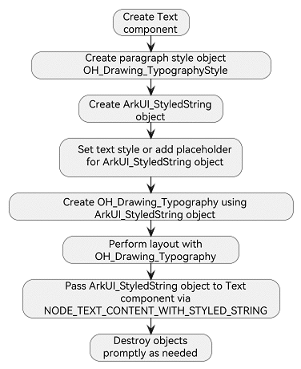
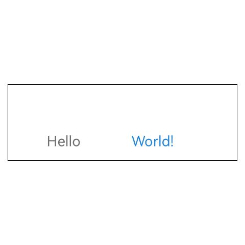

# Using Attributed Strings
<!--Kit: ArkUI-->
<!--Subsystem: ArkUI-->
<!--Owner: @hddgzw-->
<!--Designer: @xiangyuan6-->
<!--Tester: @jiaoaozihao-->
<!--Adviser: @Brilliantry_Rui-->
<!-- md-trans-meta sourceCommit=bf76fce28aeb3204bb6f3347753ae4a1bf29e8ba translatedAt=2026-11-16T08:06:27.391Z pushedAt=2026-11-16T09:06:35.226Z nl=1 -->

Some frameworks or applications have their own text layout capabilities. During porting, these capabilities are connected to the [text engine of Ark 2D graphics service](../graphics/complex-text-c.md). To avoid the need for developers to redevelop text components, the `Text` component can use the `NODE_TEXT_CONTENT_WITH_STYLED_STRING` attribute in [`ArkUI_NodeAttributeType`](../reference/apis-arkui/capi-native-node-h.md#arkui_nodeattributetype) to set the text content attribute with a formatted string object, directly rendering the text generated by the Ark text engine.

> **NOTE**
>
> - The examples in this document only show how to call the core APIs. For the complete sample project, see <!--RP1-->[StyledStringSample](https://gitcode.com/openharmony/applications_app_samples/tree/master/code/DocsSample/ArkUISample/StyledStringSample)<!--RP1End-->.
>

The following example code, based on the [Accessing the ArkTS Page](./ndk-access-the-arkts-page.md) section, describes how to create a StyledString and use [ArkUI_NodeType](../reference/apis-arkui/capi-native-node-h.md#arkui_nodetype) to render and display it in a component of the ARKUI_NODE_TEXT type.

The following figure shows the main process for using the **NODE_TEXT_CONTENT_WITH_STYLED_STRING** API.



## Creating a StyledString Object

Use the [OH_ArkUI_StyledString_Create](../reference/apis-arkui/capi-styled-string-h.md#oh_arkui_styledstring_create) API to create a StyledString object. You need to pass in the [paragraph style](#setting-the-paragraph-style) and a font collection.

<!-- @[styledstring_create](https://gitcode.com/openharmony/applications_app_samples/blob/master/code/DocsSample/ArkUISample/StyledStringSample/entry/src/main/cpp/manager.cpp) -->

``` C++
// Create a StyledString object.
ArkUI_StyledString *styledString = OH_ArkUI_StyledString_Create(typographyStyle, fontCollection);
```

## Setting Styles with StyledString

StyledString supports setting different styles for different parts of the text, including paragraph styles and text styles.

### Setting the Paragraph Style

The following APIs can be used to set the paragraph style attributes of StyledString, including the maximum line count, alignment, and so on.

> **NOTE**
>
> StyledString depends on the Ark font engine APIs prefixed with `OH_Drawing_` to set fonts and paragraph styles. For details, see [Simple Text Drawing and Display (C/C++)](../graphics/simple-text-c.md) and [Complex Text Drawing and Display (C/C++)](../graphics/complex-text-c.md). For APIs involving the font engine, add `target_link_libraries(entry PUBLIC libnative_drawing.so)` to CMakeLists.txt; otherwise, an error is reported during linking.

**Table 1** Paragraph style setting APIs

| API | Description |
| ---- | ---- |
| [OH_Drawing_CreateFontCollection](../reference/apis-arkgraphics2d/capi-drawing-font-collection-h.md#oh_drawing_createfontcollection) | Creates a font collection object. |
| [OH_Drawing_CreateTypographyStyle](../reference/apis-arkgraphics2d/capi-drawing-text-typography-h.md#oh_drawing_createtypographystyle) | Creates a paragraph style object. |
| [OH_Drawing_SetTypographyTextAlign](../reference/apis-arkgraphics2d/capi-drawing-text-typography-h.md#oh_drawing_settypographytextalign) | Sets the text alignment. |
| [OH_Drawing_SetTypographyTextMaxLines](../reference/apis-arkgraphics2d/capi-drawing-text-typography-h.md#oh_drawing_settypographytextmaxlines) | Sets the maximum line count for text. |

The following code example sets the text to be centered and limits the maximum line count to 10.

<!-- @[styledstring_paragraph_style](https://gitcode.com/openharmony/applications_app_samples/blob/master/code/DocsSample/ArkUISample/StyledStringSample/entry/src/main/cpp/manager.cpp) -->

``` C++
// Create a font collection and a paragraph style, and set the alignment and maximum line count.
OH_Drawing_FontCollection *fontCollection = OH_Drawing_CreateFontCollection();
OH_Drawing_TypographyStyle *typographyStyle = OH_Drawing_CreateTypographyStyle();
OH_Drawing_SetTypographyTextAlign(typographyStyle, OH_Drawing_TextAlign::TEXT_ALIGN_CENTER);
OH_Drawing_SetTypographyTextMaxLines(typographyStyle, NUM_10);
```

### Setting the Text Style

Text with different content can be styled differently through StyledString, but the styles must be set in the logical call order of the following three APIs; otherwise, they will not take effect.

1. [OH_ArkUI_StyledString_PushTextStyle](../reference/apis-arkui/capi-styled-string-h.md#oh_arkui_styledstring_pushtextstyle): Pushes the text style onto the stack.
2. [OH_ArkUI_StyledString_AddText](../reference/apis-arkui/capi-styled-string-h.md#oh_arkui_styledstring_addtext): Adds the text content whose style is to be modified.
3. [OH_ArkUI_StyledString_PopTextStyle](../reference/apis-arkui/capi-styled-string-h.md#oh_arkui_styledstring_poptextstyle): Pops the text style from the stack.

**Table 2** Text style setting APIs

| API | Description |
| ---- | ---- |
| [OH_Drawing_CreateTextStyle](../reference/apis-arkgraphics2d/capi-drawing-text-typography-h.md#oh_drawing_createtextstyle) | Creates a text style object. |
| [OH_Drawing_SetTextStyleFontSize](../reference/apis-arkgraphics2d/capi-drawing-text-typography-h.md#oh_drawing_settextstylefontsize) | Sets the font size. |
| [OH_Drawing_SetTextStyleColor](../reference/apis-arkgraphics2d/capi-drawing-text-typography-h.md#oh_drawing_settextstylecolor) | Sets the font color. |

Use [OH_Drawing_CreateTextStyle](../reference/apis-arkgraphics2d/capi-drawing-text-typography-h.md#oh_drawing_createtextstyle) to create a text style. The following example sets the font size of "Hello" to 28px and its color to 0xFF707070, displaying it in gray; it sets the font size of "World!" to 28px and its color to 0xFF2787D9, displaying it in blue.

<!-- @[styledstring_text_style](https://gitcode.com/openharmony/applications_app_samples/blob/master/code/DocsSample/ArkUISample/StyledStringSample/entry/src/main/cpp/manager.cpp) -->

``` C++
// The first paragraph of text (gray "Hello").
OH_Drawing_TextStyle *textStyle = OH_Drawing_CreateTextStyle();
OH_Drawing_SetTextStyleFontSize(textStyle, FONT_SIZE);
OH_Drawing_SetTextStyleColor(textStyle, TEXT_COLOR_GRAY);
OH_ArkUI_StyledString_PushTextStyle(styledString, textStyle);
OH_ArkUI_StyledString_AddText(styledString, "Hello");
OH_ArkUI_StyledString_PopTextStyle(styledString);
```

<!-- @[styledstring_world](https://gitcode.com/openharmony/applications_app_samples/blob/master/code/DocsSample/ArkUISample/StyledStringSample/entry/src/main/cpp/manager.cpp) -->

``` C++
// Second text segment (blue "World!")
OH_Drawing_TextStyle *worldTextStyle = OH_Drawing_CreateTextStyle();
OH_Drawing_SetTextStyleFontSize(worldTextStyle, FONT_SIZE);
OH_Drawing_SetTextStyleColor(worldTextStyle, TEXT_COLOR_BLUE);
OH_ArkUI_StyledString_PushTextStyle(styledString, worldTextStyle);
OH_ArkUI_StyledString_AddText(styledString, "World!");
OH_ArkUI_StyledString_PopTextStyle(styledString);
```


## Adding Placeholders

The placeholder feature is mainly used in mixed text-and-image scenarios. It inserts a blank area of a specified size into text to mount an Image component or other custom content.

Use the [OH_ArkUI_StyledString_AddPlaceholder](../reference/apis-arkui/capi-styled-string-h.md#oh_arkui_styledstring_addplaceholder) API to insert a placeholder into text.

<!-- @[styledstring_placeholder](https://gitcode.com/openharmony/applications_app_samples/blob/master/code/DocsSample/ArkUISample/StyledStringSample/entry/src/main/cpp/manager.cpp) -->

``` C++
// Add placeholder.
OH_Drawing_PlaceholderSpan placeHolder{.width = PLACEHOLDER_WIDTH, .height = PLACEHOLDER_HEIGHT};
OH_ArkUI_StyledString_AddPlaceholder(styledString, &placeHolder);
```

## Layout and Drawing

Before StyledString is set to the Text component, layout calculation must be completed first, followed by rendering.

After the text style and content are set, call the font engine API [OH_Drawing_TypographyLayout](../reference/apis-arkgraphics2d/capi-drawing-text-typography-h.md#oh_drawing_typographylayout) to lay out the text, passing in the maximum width. Text exceeding this width is automatically wrapped.

<!-- @[styledstring_layout](https://gitcode.com/openharmony/applications_app_samples/blob/master/code/DocsSample/ArkUISample/StyledStringSample/entry/src/main/cpp/manager.cpp) -->

``` C++
OH_Drawing_Typography *typography = OH_ArkUI_StyledString_CreateTypography(styledString);
OH_Drawing_TypographyLayout(typography, LAYOUT_MAX_WIDTH);
// After the layout is complete, set the StyledString to the Text component.
ArkUI_AttributeItem styledStringItem = {.object = styledString};
nodeApi->setAttribute(text, NODE_TEXT_CONTENT_WITH_STYLED_STRING, &styledStringItem);
```

## Serialization and Deserialization

Starting from API version 14, StyledString provides serialization and deserialization features, supporting deserializing byte data into a descriptor or converting a descriptor to HTML format, which facilitates data storage, transmission, and cross-platform use.

**Table 3** Serialization and deserialization APIs

| API | Description |
| ---- | ---- |
| [OH_ArkUI_StyledString_Descriptor_Create](../reference/apis-arkui/capi-styled-string-h.md#oh_arkui_styledstring_descriptor_create) | Creates a StyledString descriptor. |
| [OH_ArkUI_UnmarshallStyledStringDescriptor](../reference/apis-arkui/capi-styled-string-h.md#oh_arkui_unmarshallstyledstringdescriptor) | Deserializes byte data into a descriptor. |
| [OH_ArkUI_MarshallStyledStringDescriptor](../reference/apis-arkui/capi-styled-string-h.md#oh_arkui_marshallstyledstringdescriptor) | Serializes a descriptor to byte data. |
| [OH_ArkUI_ConvertToHtml](../reference/apis-arkui/capi-styled-string-h.md#oh_arkui_converttohtml) | Converts a descriptor to HTML format. |
| [OH_ArkUI_StyledString_Descriptor_Destroy](../reference/apis-arkui/capi-styled-string-h.md#oh_arkui_styledstring_descriptor_destroy) | Destroys a StyledString descriptor. |

The following example shows how to create a descriptor, deserialize byte data, convert it to HTML, and verify the result.

<!-- @[serializeAndDeserialize_styledString](https://gitcode.com/openharmony/applications_app_samples/blob/master/code/DocsSample/ArkUISample/StyledStringSample/entry/src/main/cpp/manager.cpp) -->

``` C++
static void SerializeAndDeserializeStyledString()
{
    // Prepare the test data.
    uint8_t data_bytes[] = {0x01, 0x02, 0x03, 0x04, 0x05, 0x06, 0x07, 0x08};
    size_t dataSize = sizeof(data_bytes) / sizeof(data_bytes[0]);

    // Create the StyledString descriptor.
    auto desc = OH_ArkUI_StyledString_Descriptor_Create();
    if (desc == nullptr) {
        OH_LOG_Print(LOG_APP, LOG_ERROR, LOG_PRINT_DOMAIN, "styledString", "Create Descriptor failed");
        return;
    }

    // Deserialize the byte data.
    auto status = OH_ArkUI_UnmarshallStyledStringDescriptor(data_bytes, dataSize, desc);
    OH_LOG_Print(LOG_APP, LOG_ERROR, LOG_PRINT_DOMAIN, "styledString", "Unmarshall status: %{public}d", status);

    // Convert to HTML format.
    const char* html = OH_ArkUI_ConvertToHtml(desc);
    OH_LOG_Print(LOG_APP, LOG_INFO, LOG_PRINT_DOMAIN, "styledString", "html: [%{public}s]", html);
    // Verify the deserialized data: serialize the descriptor again and compare it with the original data.
    uint8_t buf2[1024] = {0};
    size_t resultSize = 0;
    auto marshallStatus = OH_ArkUI_MarshallStyledStringDescriptor(buf2, sizeof(buf2), desc, &resultSize);
    bool equal = false;
    if (marshallStatus == ARKUI_ERROR_CODE_NO_ERROR && resultSize == dataSize) {
        equal = true;
        for (size_t i = 0; i < dataSize && equal; i++) equal = (data_bytes[i] == buf2[i]);
    }
    OH_LOG_Print(LOG_APP, LOG_INFO, LOG_PRINT_DOMAIN, "styledString",
        "Before: %{public}zu, After: %{public}zu, Equal: %{public}d", dataSize, resultSize, equal);

    // Release the descriptor.
    OH_ArkUI_StyledString_Descriptor_Destroy(desc);
}
```
## Destroying an Object

The **Text** component does not manage the lifecycle of any objects involved in this process. You are responsible for this.

**OH_Drawing_DestroyTextStyle(OH_Drawing_TextStyle *style)**: destroys the text style object.

**OH_Drawing_DestroyTypographyStyle(OH_Drawing_TypographyStyle *style)**: destroys the paragraph style object.

Releasing objects while the **Text** component is still displayed will cause rendering failures. Ensure that the **Text** component is no longer in use before releasing resources.

For details about the font engine cleanup APIs, see [OH_Drawing_DestroyTextStyle](../reference/apis-arkgraphics2d/capi-drawing-text-typography-h.md#oh_drawing_destroytextstyle) and [OH_Drawing_DestroyTypographyStyle](../reference/apis-arkgraphics2d/capi-drawing-text-typography-h.md#oh_drawing_destroytypographystyle).

The **Text** component provides [OH_ArkUI_StyledString_Destroy](../reference/apis-arkui/capi-styled-string-h.md#oh_arkui_styledstring_destroy) to destroy styled string objects.