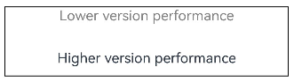
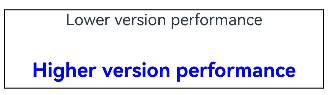

# \@Extend Decorator: Defining Extended Component Styles
<!--Kit: ArkUI-->
<!--Subsystem: ArkUI-->
<!--Owner: @BlYynNe-->
<!--Designer: @BlYynNe-->
<!--Tester: @TerryTsao-->
<!--Adviser: @zhang_yixin13-->
<!-- md-trans-meta sourceCommit=c43f545993abb1b7c978ab69ae099e2e7ecdd06c translatedAt=2026-11-03T06:31:37.469Z pushedAt=2026-11-03T07:53:55.247Z nl=1 -->

In the preceding example, you can use [\@Styles](arkts-style.md) to reuse styles. Building on \@Styles, ArkUI provides [\@Extend](../../reference/apis-arkui/arkui-ts/ts-custom-component-decorator-extend.md#extend) for extending component styles.

It also supports declaring the effective system version range of the extended style through the version condition parameter (VersionCondition). For details, see [Version Condition Parameter (VersionCondition)](#version-condition-parameter-versioncondition).

> **Note:**
>
> Supported since API version 9.
>
> Since API version 9, this decorator is supported in ArkTS cards.
>
> Since API version 11, this decorator is supported in atomic services.
>
> Since API version 26.1.0, this decorator supports passing an optional version condition parameter (VersionCondition) as the second parameter.

## How to Use


### Syntax


```ts
@Extend(UIComponentName) function functionName() { ... }
@Extend(UIComponentName, VersionCondition) function functionName() { ... }
```


### Usage Rules

- Unlike \@Styles, \@Extend can encapsulate private attributes, private events, and globally defined methods of specific components.
  <!-- @[Extend_Global_Function_Extension_one](https://gitcode.com/openharmony/applications_app_samples/blob/master/code/DocsSample/ArkUISample/ParadigmStateManagement/entry/src/main/ets/pages/extend/GlobalFunctionExtension.ets) -->
  
  ``` TypeScript
  // @Extend(Text) supports the private attribute fontColor of the Text component.
  @Extend(Text)
  function fancy() {
    .fontColor(Color.Red)
  }
  
  // superFancyText can call the predefined method fancy.
  @Extend(Text)
  function superFancyText(size: number) {
    .fontSize(size)
    .fancy()
  }
  ```

- When \@Extend is used to encapsulate the private attributes, private events, and globally defined methods of a specified component, \@Extend and \@Styles cannot be used together.
  ``` TypeScript
  @Styles
  function fancy() {
    .backgroundColor(Color.Red)
  }

  // superFancyText cannot call the predefined method fancy.
  @Extend(Text)
  function superFancyText(size: number) {
    .fontSize(size)
    .fancy()
  }
  ```

- Different from \@Styles decorated methods, the \@Extend decorated methods support passing parameters. The calling complies with the TS method calling convention.
  <!-- @[Extend_private_property_fancy_two](https://gitcode.com/openharmony/applications_app_samples/blob/master/code/DocsSample/ArkUISample/ParadigmStateManagement/entry/src/main/ets/pages/extend/ExtendParameterUsage.ets) -->
  
  ``` TypeScript
  // xxx.ets
  @Extend(Text)
  function fancy(fontSize: number) {
    .fontColor(Color.Red)
    .fontSize(fontSize)
  }
  
  @Entry
  @Component
  struct FancyUse {
    build() {
      Row({ space: 10 }) {
        Text('Fancy')
          .fancy(16)
        Text('Fancy')
          .fancy(24)
      }
    }
  }
  ```

- Parameters passed into \@Extend decorated methods can be functions serving as event handlers.
  <!-- @[Extend_Function_handle_three](https://gitcode.com/openharmony/applications_app_samples/blob/master/code/DocsSample/ArkUISample/ParadigmStateManagement/entry/src/main/ets/pages/extend/ExtendFunctionHandle.ets) --> 
  
  ``` TypeScript
  // Methods decorated with @Extend support function parameters.
  @Extend(Text)
  function makeMeClick(onClick: () => void) {
    .backgroundColor(Color.Blue)
    .onClick(onClick)
  }
  
  @Entry
  @Component
  struct FancyUse {
    @State label: string = 'Hello World';
  
    onClickHandler() {
      this.label = 'Hello ArkUI';
    }
  
    build() {
      Row({ space: 10 }) {
        Text(`${this.label}`)
          .makeMeClick(() => {
            this.onClickHandler();
          })
      }
    }
  }
  ```

- Parameters passed into \@Extend decorated methods can also be [state variables](arkts-state-management-overview.md). Changes to these state variables cause the UI to re-render.
  <!-- @[Extend_Refresh_rendering_four](https://gitcode.com/openharmony/applications_app_samples/blob/master/code/DocsSample/ArkUISample/ParadigmStateManagement/entry/src/main/ets/pages/extend/ExtendUIStateVariable.ets) --> 
  
  ``` TypeScript
  // Use a state variable as the @Extend parameter so that state changes drive the Text style refresh.
  @Extend(Text)
  function fancy(fontSize: number) {
    .fontColor(Color.Blue)
    .fontSize(fontSize)
  }
  
  @Entry
  @Component
  struct FancyUse {
    @State fontSizeValue: number = 20;
  
    build() {
      Column({ space: 10 }) {
        Text('Fancy')
          .fancy(this.fontSizeValue)
          .onClick(() => {
            this.fontSizeValue = 30;
          })
      }
      .width('100%')
    }
  }
  ```
  
  

### Version Condition Parameter (VersionCondition)

\@Extend The decorator supports passing an optional version condition parameter [VersionCondition](../../reference/apis-arkui/arkui-ts/ts-custom-component-decorator-styles.md#versioncondition) as the second parameter, which is used to declare the effective system version range of the extended style. When a version condition is carried, the property statements of the extended style take effect only when the device system version falls within the declared range.

``` TypeScript
// This extended style takes effect only when the API version is greater than or equal to 26.0.0.
@Extend(Text, { minApiVersion: '26.0.0' })
function fancy() {
  .fontColor(Color.Red)
}
```

The parameter description, value forms, and value range of the version condition are consistent with \@Styles. For details, see [Version Condition Parameter (VersionCondition)](arkts-style.md#version-condition-parameter-versioncondition).

> **Note:**
>
> When an extended style carrying a version condition is invoked on a system version outside the effective range, the style properties do not take effect, but the function parameters are still passed normally.

## Constraints

- Unlike \@Styles, \@Extend must be defined globally, outside of any component declaration.

  > **NOTE**
  >
  > @Extend can be used only in the current file and cannot be exported.
  >
  > To implement the export feature, you are advised to use [AttributeModifier](../arkts-user-defined-extension-attributeModifier.md).
  
  **Incorrect Usage**
  
  ```ts
  @Entry
  @Component
  struct FancyUse {
    // Incorrect usage. @Extend supports only global definition, not definition inside a component.
    @Extend(Text) function fancy (fontSize: number) {
      .fontSize(fontSize)
    }
  
    build() {
      Row({ space: 10 }) {
        Text('Fancy')
          .fancy(16)
      }
    }
  }
  ```
  
  **Correct Usage**
  <!-- @[Extend_Positive_Example_five](https://gitcode.com/openharmony/applications_app_samples/blob/master/code/DocsSample/ArkUISample/ParadigmStateManagement/entry/src/main/ets/pages/extend/ExtendPositiveExample.ets) --> 
  
  ``` TypeScript
  // Correct approach
  @Extend(Text)
  function fancy(fontSize: number) {
    .fontSize(fontSize)
  }
  
  @Entry
  @Component
  struct FancyUse {
    build() {
      Row({ space: 10 }) {
        Text('Fancy')
          .fancy(16)
      }
    }
  }
  ```

- Functions decorated with @Extend can be used only in the current file and cannot be exported or called in other files.

  **Incorrect Usage**

  ``` TypeScript
    // Incorrect usage: Do not use an @Extend function defined in another file (for example, pageOne) in pageTwo.
    // pageOne.ets
    @Extend(Button)
    function ButtonUse() {
      .width(100)
      .buttonStyle(ButtonStyleMode.NORMAL)
    }

    @Entry
    @Component
    struct extendUseOne {
      build() {
        Row() {
          Button()
            .ButtonUse()
            .height(200)
        }
      }
    }
  ```

  ``` TypeScript
    // pageTwo.ets
    @Entry
    @Component
    struct TextUse {
      build() {
        Row() {
          Text('this is TextUse')

          Button()
            .ButtonUse()  // A compilation warning is generated: Property 'ButtonUse' does not exist on type 'ButtonAttribute'.
            .height(50)
        }
      }
    }
  ```

  **Correct Usage**

  ``` TypeScript
    // Correct approach: In the pageTwo file, you can define an @Extend function with a different name from the @Extend function in the pageOne file.
    // pageOne.ets
    @Extend(Button)
    function ButtonUse() {
      .width(100)
      .buttonStyle(ButtonStyleMode.NORMAL)
    }

    @Entry
    @Component
    struct extendUseOne {
      build() {
        Row() {
          Button()
            .ButtonUse()
            .height(200)
        }
      }
    }
  ```

  ``` TypeScript
    // pageTwo.ets
    @Extend(Button)
    function ButtonUse2() {
      .width(200)
      .buttonStyle(ButtonStyleMode.EMPHASIZED)
    }

    @Entry
    @Component
    struct TextUse {
      build() {
        Row() {
          Text('this is TextUse')

          Button()
            .ButtonUse2()
            .height(50)
        }
      }
    }
  ```

## When to Use

The following example declares three **Text** components, each configured with [fontStyle](../../reference/apis-arkui/arkui-ts/ts-basic-components-text.md#fontstyle), [fontWeight](../../reference/apis-arkui/arkui-ts/ts-basic-components-text.md#fontweight), and [backgroundColor](../../reference/apis-arkui/arkui-ts/ts-universal-attributes-background.md#backgroundcolor) styles.
<!-- @[Extend_Usage_Scenario_one](https://gitcode.com/openharmony/applications_app_samples/blob/master/code/DocsSample/ArkUISample/ParadigmStateManagement/entry/src/main/ets/pages/extend/ExtendUsageScenario.ets) --> 

``` TypeScript
@Entry
@Component
struct FancyUse {
  @State label: string = 'Hello World';

  build() {
    Row({ space: 10 }) {
      // Repeatedly set styles for the Text component.
      Text(`${this.label}`)
        .fontStyle(FontStyle.Italic)
        .fontWeight(500)
        .backgroundColor(Color.Yellow)
      Text(`${this.label}`)
        .fontStyle(FontStyle.Italic)
        .fontWeight(600)
        .backgroundColor(Color.Pink)
      Text(`${this.label}`)
        .fontStyle(FontStyle.Italic)
        .fontWeight(700)
        .backgroundColor(Color.Orange)
    }.margin('20%')
  }
}
```


Using \@Extend for style composition and reuse:
<!-- @[Extend_Usage_Scenario_two](https://gitcode.com/openharmony/applications_app_samples/blob/master/code/DocsSample/ArkUISample/ParadigmStateManagement/entry/src/main/ets/pages/extend/ExtendUsageScenariotwo.ets) --> 

``` TypeScript
// Use @Extend to encapsulate Text style combinations for easy reuse.
@Extend(Text)
function fancyText(weightValue: number, color: Color) {
  .fontStyle(FontStyle.Italic)
  .fontWeight(weightValue)
  .backgroundColor(color)
}
```

After combining styles with \@Extend, the code becomes more concise and readable.
<!-- @[Extend_Usage_Scenario_three](https://gitcode.com/openharmony/applications_app_samples/blob/master/code/DocsSample/ArkUISample/ParadigmStateManagement/entry/src/main/ets/pages/extend/ExtendUsageScenariotwo.ets) --> 

``` TypeScript
@Entry
@Component
struct FancyUse {
  @State label: string = 'Hello World';

  build() {
    Row({ space: 10 }) {
      // Call the fancyText reusable style encapsulated by @Extend.
      Text(`${this.label}`)
        .fancyText(100, Color.Blue)
      Text(`${this.label}`)
        .fancyText(200, Color.Pink)
      Text(`${this.label}`)
        .fancyText(300, Color.Orange)
    }.margin('20%')
  }
}
```

When an extended style needs to take effect only within a specific system version range (for example, a new style is enabled only for higher system versions, or differentiated adaptation is required for lower system versions), the effective range can be declared through the version condition parameter, eliminating the need to write version checks manually at each call site.

After being invoked in a component, the style takes effect normally when the device system version falls within the effective range, and produces no effect when it falls outside the range:
<!-- @[Extend_Version_Condition](https://gitcode.com/openharmony/applications_app_samples/blob/master/code/DocsSample/ArkUISample/ParadigmStateManagement/entry/src/main/ets/pages/extend/ExtendVersionCondition.ets) -->

``` TypeScript
const lowVersionExtendText: string = 'Lower version performance';
const hightVersionExtendText: string = 'Higher version performance';

// Low-version adaptation style: takes effect only when the system version is greater than or equal to API version 12 and less than API version 26.0.0.
@Extend(Text, { minApiVersion: 12, maxApiVersion: '26.0.0' })
function lowVersionText(color: Color) {
  .fontColor(color)
  .fontSize(16)
}

// High-version style: takes effect only when the system version is greater than or equal to API version 26.0.0.
@Extend(Text, { minApiVersion: '26.0.0' })
function highVersionText(color: Color) {
  .fontColor(color)
  .fontSize(20)
  .fontWeight(700)
}

@Entry
@Component
struct VersionConditionUseDemo {
  build() {
    Column({ space: 30 }) {
      Text(lowVersionExtendText)
        .lowVersionText(Color.Gray)
      Text(hightVersionExtendText)
        .highVersionText(Color.Blue)
    }
    .width('90%')
    .height(80)
    .margin(20)
    .borderWidth(1)
  }
}
```

**On devices with a system version earlier than API version 26.0.0, the behavior is as follows:**



**On devices with a system version equal to or later than API version 26.0.0, the behavior is as follows:**


<!--no_check-->