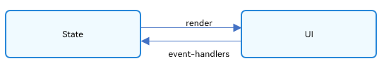
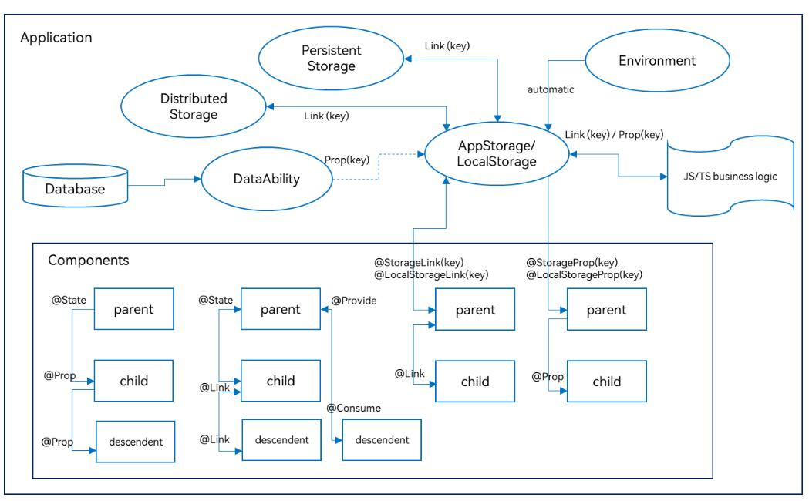

# State Management Overview
<!--Kit: ArkUI-->
<!--Subsystem: ArkUI-->
<!--Owner: @jiyujia926-->
<!--Designer: @zhangboren-->
<!--Tester: @TerryTsao-->
<!--Adviser: @zhang_yixin13-->
<!-- md-trans-meta sourceCommit=b4c16a3481f0a0bf24de133bf760018019cda10c translatedAt=2026-11-03T06:37:36.972Z pushedAt=2026-11-03T07:56:04.862Z nl=1 -->

In the preceding descriptions, the pages built are primarily static interfaces. To build a dynamic, interactive interface, the concept of "state" must be introduced.

  **Figure 1** Effect diagram

In the example above, the interaction between the user and the application triggers a change in the text state, and the state change causes UI rendering, changing the UI from "Hello World" to "Hello ArkUI".

In the declarative UI programming framework, the UI is the running result of the program state. The user builds a UI model in which the runtime state of the application serves as a parameter. When the parameter changes, the UI, as the return result, changes accordingly. These UI re-renderings caused by runtime state changes are collectively referred to as the state management mechanism in ArkUI.

Variables in a custom component must be decorated with decorators to become state variables. Changes to state variables cause the UI to be rendered and refreshed. If state variables are not used, the UI can only be rendered at initialization and will not be refreshed thereafter. The following figure shows the relationship between State and View (UI).

- View(UI): UI rendering, which refers to mapping the UI description in the build method and the UI description in the method decorated with \@Builder to the interface.

- State: State, which refers to the data that drives UI updates. The state data is changed by triggering the component's event methods. Changes in state data cause the UI to be re-rendered.

Before reading the state management documentation, developers need to understand the basic syntax of the UI paradigm. It is recommended to read [Basic Syntax Overview](./arkts-basic-syntax-overview.md), [Declarative UI Description](./arkts-declarative-ui-description.md), [State Management Glossary](./arkts-state-management-glossary.md), and [Custom Component - Creating Custom Components](./arkts-create-custom-components.md) in advance.

>**Note:**
>
>The current state management features are supported only on the UI main thread and cannot be used in child threads, Worker, or TaskPool.

## State Management Version Introduction

State management is currently divided into two versions: V1 and V2.
1. V2 is an enhanced version of V1 and is being continuously iterated and optimized to provide developers with more features and flexibility.
2. For new applications, you are advised to use the V2 paradigm for development.
3. For applications that have already used V1, if the features and performance of V1 already meet the requirements, you do not need to switch to V2 immediately.

## State Management (V1)

Developers can choose to use the State Management V1 version for application development.

### Decorator Overview

ArkUI State Management V1 provides a variety of decorators. By using these decorators, state variables can not only observe changes within a component, but also be passed between different component levels, such as parent-child components and cross-component levels, and can also observe changes in the global scope. Based on the scope of influence of state variables, all decorators can be roughly divided into:

- Decorators for managing component state: component-level state management, which can observe variable changes within a component or at different component levels on the same component tree (that is, within the same page).

- Decorators for managing application-level state: application-level state management, which can observe state changes across different pages and even different UIAbilities, and is global state management within an application.

Decorators can be divided by data transfer form and synchronization type into: read-only one-way transfer and mutable two-way transfer.

The following figure illustrates this. For detailed introduction to specific decorators, see <!--RP1-->[Managing Component-Owned State](arkts-state.md)<!--RP1End--> and <!--RP2-->[Managing Application-Owned State](arkts-application-state-management-overview.md)<!--RP2End-->. Developers can use these capabilities to implement data-UI linkage.

In the figure above, the decorators in the Components section are for component-level state management, and the Application section is for application state management. Developers can implement two-way synchronization between application and component state through [@StorageLink](arkts-appstorage.md#storagelink)/[@LocalStorageLink](arkts-localstorage.md#localstoragelink), and implement one-way synchronization between application and component state through [@StorageProp](arkts-appstorage.md#storageprop)/[@LocalStorageProp](arkts-localstorage.md#localstorageprop).

<!--RP1-->[Managing Component-Owned State](arkts-state.md)<!--RP1End-->, that is, the Components-level state management in the figure:

- [\@State](arkts-state.md): \@State decorated variables own the state of their component and can serve as the data source for one-way and two-way synchronization of its child components. When their values change, the rendering of related components is refreshed.

- [\@Prop](arkts-prop.md): The variable decorated by \@Prop can establish a one-way synchronization relationship with the parent component. The variable decorated by \@Prop is mutable, but modifications are not synchronized back to the parent component.

- [\@Link](arkts-link.md): The variable decorated by \@Link can establish a two-way synchronization relationship with the parent component. Modifications to the variable decorated by \@Link in the child component are synchronized to the data source that establishes two-way data binding in the parent component, and updates in the parent component are also synchronized to the variable decorated by \@Link.

- [\@Provide/\@Consume](arkts-provide-and-consume.md): The variable decorated by \@Provide/\@Consume is used to synchronize state variables across component levels (multi-level components). It can be bound through an alias or property name without passing through the parameter naming mechanism.

- [\@Observed](arkts-observed-and-objectlink.md): \@Observed decorates a class. A class that needs to observe multi-level nested scenarios must be decorated by \@Observed. Using \@Observed alone has no effect and must be used in combination with \@ObjectLink and \@Prop.

- [\@ObjectLink](arkts-observed-and-objectlink.md): The variable decorated by \@ObjectLink receives an instance of the class decorated by \@Observed, and is applied to observe multi-level nested scenarios and establish two-way synchronization with the parent component's data source.

> **Note:**
>
> Only [\@Observed/\@ObjectLink](arkts-observed-and-objectlink.md) can observe nested scenarios. Other state variables can only observe the first level. For details, see the "Observing Changes and Behavior" subsection in each decorator chapter.

<!--RP2-->[Managing Application-Owned State](arkts-application-state-management-overview.md)<!--RP2End-->, that is, the Application-level state management shown in the figure:

- [AppStorage](arkts-appstorage.md) is a special singleton [LocalStorage](arkts-localstorage.md) object in an application. It is an application-level database bound to the process, and can interact with components through the [@StorageProp](arkts-appstorage.md#storageprop) and [@StorageLink](arkts-appstorage.md#storagelink) decorators.

- AppStorage is the "hub" of application state. Data that needs to interact with components (UI) is stored in AppStorage, such as persistent data [PersistentStorage](arkts-persiststorage.md) and environment variables [Environment](arkts-environment.md). The UI then accesses this data through the decorators or API interfaces provided by AppStorage.

- The framework also provides LocalStorage. AppStorage is a special singleton of LocalStorage. LocalStorage is an in-memory "database" of application state declared by the application, typically used for page-level state sharing. It can interact with the UI through the [@LocalStorageProp](arkts-localstorage.md#localstorageprop) and [@LocalStorageLink](arkts-localstorage.md#localstoragelink) decorators.

### Other State Management V1 Features

[\@Watch](arkts-watch.md) Used to listen for the changes of state variables.

[$ operator](arkts-two-way-sync.md): creates two-way binding between TypeScript variables and built-in component states.

### Samples

The following samples are provided to help you better understand the page state management:

- [State Management (ArkTS) (API9)](https://gitcode.com/openharmony/applications_app_samples/tree/master/code/UI/ArkTsComponentCollection/StateManagement)

- [Target Management (ArkTS) (API 9)](https://gitcode.com/openharmony/codelabs/tree/master/ETSUI/TargetManagement)

## State Management (V2)

To enhance certain capabilities of State Management V1, such as deep observation and property-level updates, ArkUI introduces State Management V2 for developers.

### Current Status of State Management V1 and Advantages of V2

State Management V1 uses proxies to observe data. When creating state variables, a data proxy observer is created simultaneously. This observer can detect changes in the proxy but cannot detect changes in the actual data, resulting in the following limitations:

- State variables cannot exist independently of the UI. When the same data is proxied by multiple views, the change in one view cannot be synchronized to other views.
- Only changes to top-level object properties can be detected; deep observation and listening are unavailable.
- Redundant updates occur when modifying properties in objects and elements in arrays.
- Decorator usage is restrictive. The input and output of state variables are not specified in components, complicating componentization design.

State Management V2 enhances the data observation capability, enabling the data itself to be observable. When data is changed, the corresponding view is updated. Compared with State Management V1, State Management V2 offers the following advantages:

- State variables are independent of the UI. Data changes automatically trigger updates to associated views.

- Deep observation and listening of objects are supported, with no performance impact from the deep observation mechanism.

- Supports precise property-level updates in objects and minimal updates of elements in arrays.

- Decorators are more user-friendly and scalable. Components explicitly define inputs and outputs, simplifying componentization.

### Decorator Overview

State Management (V2) provides a brand-new set of decorators.

- [\@ObservedV2](arkts-new-observedV2-and-trace.md): The \@ObservedV2 decorator decorates a class, indicating that the current class is an observable object and has no observation capability itself. \@ObservedV2 and \@Trace used together can give the properties in the class the capability of deep observation.

- [\@Trace](arkts-new-observedV2-and-trace.md): The \@Trace decorator decorates the properties in a class decorated by \@ObservedV2, and the decorated properties have the capability of deep observation.

- [\@ComponentV2](arkts-create-custom-components.md#componentv2): New decorators can be used in a struct decorated with \@ComponentV2. For example: \@Local, \@Param, \@Event, \@Once, \@Monitor, \@Provider, \@Consumer.

- [\@Local](arkts-new-local.md): The variable decorated by \@Local is the internal state of the component and cannot be initialized from outside.

- [\@Param](arkts-new-param.md): The variable decorated by \@Param serves as the input of the component and can accept initialization passed in from outside and synchronize.

- [\@Once](arkts-new-once.md): The variable decorated by \@Once synchronizes only once during initialization and must be used together with \@Param.

- [\@Event](arkts-new-event.md): The \@Event decorator decorates a method type and serves as the component output, through which variables in the parent component can be affected.

- [\@Monitor](arkts-new-monitor.md): The \@Monitor decorator is used in a custom component decorated by \@ComponentV2 or a class decorated by \@ObservedV2, and can perform deep listening on state variables.

- [\@Provider and \@Consumer](arkts-new-provider-and-consumer.md): used for two-way synchronization across component levels.

- [\@Computed](arkts-new-computed.md): a computed property that is calculated only once when the computed value changes. It is mainly used to solve the performance problem caused by repeated calculation when the UI reuses this property multiple times.

- [!! syntax](arkts-new-binding.md): syntactic sugar for two-way binding.

### State Management V1 and V2 Capability Comparison

| V1 Capability   | V2 Capability                                             | Description                                                         |
| ------------ | ------------------------------------------------------ | ------------------------------------------------------------ |
| \@Observed   | \@ObservedV2                                           | Indicates that the current object is an observable object. However, the capabilities of the two are not the same.  \@Observed can observe the first-layer properties and must be used together with \@ObjectLink to take effect.  \@ObservedV2 itself has no observation capability and only indicates that the current class can be observed. To observe its properties, it must be used together with \@Trace. |
| \@Track      | \@Trace                                                | The V1 decorator \@Track provides precise observation and can be used independently without relying on @Observed. Without @Track, precise observation of class properties cannot be achieved. Properties decorated by  V2\@Trace can be precisely tracked and observed. |
| \@Component  | \@ComponentV2                                          | \@Component is the decorator for custom components in V1. \@ComponentV2 is the decorator for custom components in V2. |
| \@State      | No external initialization: \@Local  External initialization once: \@Param\@Once | \@State and \@Local are similar in that both are data source concepts. The difference is that \@State can be initialized by external input, while \@Local cannot be initialized by external input. |
| \@Prop       | \@Param                                                | \@Prop and \@Param are similar in that both are custom component parameter concepts. When the input parameter is a complex type, \@Prop performs a deep copy, while \@Param is a reference. |
| \@Link       | \@Param\@Event                                         | \@Link is a two-way synchronization implemented and encapsulated by the framework itself. For V2 developers, two-way synchronization can be implemented by themselves through \@Param\@Event. |
| \@ObjectLink            | \@Param                   | Directly compatible. \@ObjectLink needs to be initialized by an instance of a class decorated by \@Observed, while \@Param has no such restriction. |
| \@Provide    | \@Provider                                             | Compatible.                                                       |
| \@Consume    | \@Consumer                                             | Compatible.                                                       |
| \@Watch               | \@Monitor                | \@Watch is used to listen for changes in V1 state variables and has the capability to listen for changes in the state variable itself and its first-layer properties. Observable changes in the state variable trigger its \@Watch listening event.  \@Monitor is used to listen for changes in V2 state variables and, when used together with \@Trace, has deep listening capability. When a state variable changes multiple times in a single event, only the final result is used to determine whether to trigger the \@Monitor listening event. |
| LocalStorage               | Global \@ObservedV2\@Trace   | Compatible. |
| AppStorage               | AppStorageV2   | Compatible. |
| Environment       | Direct ability API calls to obtain system environment variables   | The Environment capability for obtaining environment variables is coupled with AppStorage. In V2, the Ability API can be called directly to obtain system environment variables. |
| PersistentStorage     | PersistenceV2   | The PersistentStorage persistence capability is coupled with AppStorage, while the PersistenceV2 persistence capability can be used independently. |
| Custom Component Lifecycle     | Custom Component Lifecycle   | Both are supported. [aboutToAppear](../../reference/apis-arkui/arkui-ts/ts-custom-component-lifecycle.md#abouttoappear), [onDidBuild](../../reference/apis-arkui/arkui-ts/ts-custom-component-lifecycle.md#ondidbuild12), [aboutToDisappear](../../reference/apis-arkui/arkui-ts/ts-custom-component-lifecycle.md#abouttodisappear). |
| Page lifecycle     | Page lifecycle   | Both are supported. [onPageShow](../../reference/apis-arkui/arkui-ts/ts-custom-component-lifecycle.md#onpageshow), [onPageHide](../../reference/apis-arkui/arkui-ts/ts-custom-component-lifecycle.md#onpagehide), [onBackPress](../../reference/apis-arkui/arkui-ts/ts-custom-component-lifecycle.md#onbackpress).  |
| \@Reusable   | \@ReusableV2                                                 | Component reuse. Includes: [aboutToReuse](../../reference/apis-arkui/arkui-ts/ts-custom-component-lifecycle.md#abouttoreuse10), [aboutToRecycle](../../reference/apis-arkui/arkui-ts/ts-custom-component-lifecycle.md#abouttorecycle10). |
| $$            | !!         | Two-way binding. In V2, it is recommended to use !! to implement two-way binding. |
| \@CustomDialog | [openCustomDialog](../../../application-dev/reference/apis-arkui/arkts-apis-uicontext-promptaction.md#opencustomdialog12) API   | Custom dialog box. In V2, it is recommended to use openCustomDialog to implement the custom dialog box feature. |
| WithTheme     | WithTheme   | Theme. Used to set a custom theme style for a local page of the application. Includes: [onWillApplyTheme](../../reference/apis-arkui/arkui-ts/ts-custom-component-lifecycle.md#onwillapplytheme12). Starting from API version 18, this API supports use in State Management V2 components. |
| System built-in UI component library     | System built-in UI component library    | System built-in UI component library. System built-in UI components that support V1, for example: [Dialog](../../../application-dev/reference/apis-arkui/arkui-ts/ohos-arkui-advanced-Dialog.md), [ProgressButton](../../../application-dev/reference/apis-arkui/arkui-ts/ohos-arkui-advanced-ProgressButton.md), [SegmentButton](../../../application-dev/reference/apis-arkui/arkui-ts/ohos-arkui-advanced-SegmentButton.md). Starting from API version 18, system built-in UI components support use in State Management V2 components, for example: [DialogV2](../../../application-dev/reference/apis-arkui/arkui-ts/ohos-arkui-advanced-DialogV2.md), [ProgressButtonV2](../../../application-dev/reference/apis-arkui/arkui-ts/ohos-arkui-advanced-ProgressButtonV2.md), [SegmentButtonV2](../../../application-dev/reference/apis-arkui/arkui-ts/ohos-arkui-advanced-SegmentButtonV2.md). |
| animateTo | Not supported in some scenarios | Currently, in certain scenarios, using the animateTo animation in State Management V2 produces abnormal effects. For details, see: [Abnormal effects when using animateTo animation in State Management V2](./arkts-new-local.md#using-animateto-failed-in-state-management-v2). |

For migration from V1 to V2, see [Migration Guide](./arkts-v1-v2-migration.md), <!--RP3--> and for mixed use of V1 and V2, see [Mixed Use Scenarios of State Management V1 and V2](./arkts-v1-v2-mixusage-before-api-version.md)<!--RP3End-->.
