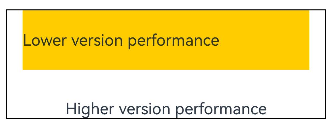
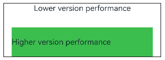

# \@Styles Decorator: Defining Reusable Component Styles
<!--Kit: ArkUI-->
<!--Subsystem: ArkUI-->
<!--Owner: @BlYynNe-->
<!--Designer: @VictorS67-->
<!--Tester: @TerryTsao-->
<!--Adviser: @BIYynNe-->
<!-- md-trans-meta sourceCommit=c43f545993abb1b7c978ab69ae099e2e7ecdd06c translatedAt=2026-11-03T06:38:46.670Z pushedAt=2026-11-03T08:06:49.443Z nl=1 -->

If the style of each component must be set separately, a large amount of repetitive style setup code is generated during development. Although you can copy and paste the code, ArkUI provides the [\@Styles](../../reference/apis-arkui/arkui-ts/ts-custom-component-decorator-styles.md#styles) decorator to extract common styles for reuse, keeping the code concise and easy to maintain.

\@Styles eliminates repetitive style setup by allowing you to apply preconfigured styles with a single method invocation.

\@Styles also supports declaring the effective system version range of a style through the version condition parameter (VersionCondition), enabling style isolation by system version. For details, see [Version Condition Parameter (VersionCondition)](#version-condition-parameter-versioncondition).

> **Description**
>
> This is supported since API version 9.
>
> Since API version 9, this decorator is supported in ArkTS cards.
>
> Since API version 11, this decorator is supported in atomic services.
>
> Since API version 26.1.0, the \@Styles decorator supports passing an optional version condition parameter (VersionCondition) in the call form `@Styles({...})` to declare the effective system version range of a style.

## How to Use

- Currently, \@Styles supports only [universal attributes](../../reference/apis-arkui/arkui-ts/ts-component-general-attributes.md) and [universal events](../../reference/apis-arkui/arkui-ts/ts-component-general-events.md).

- \@Styles can be defined within a component or globally. When it is defined globally, the **function** keyword must precede the method name. When it is defined within a component, the **function** keyword is not required. For details, see [Using Component-Local and Global \@Styles](#using-component-local-and-global-styles).

- The priority of \@Styles defined within a component is higher than that of global \@Styles. The framework preferentially searches for \@Styles within the current component. If it is not found, the framework searches globally.

> **NOTE**
>
> \@Styles can be used only in the current file and cannot be exported.
>
> To export styles, you are advised to use [AttributeModifier](../../ui/arkts-user-defined-extension-attributeModifier.md).


\@Styles defined within a component can access the component's constants and state variables through **this**, and can change the values of state variables through events in \@Styles. The following is an example:

<!-- @[inner_style](https://gitcode.com/openharmony/applications_app_samples/blob/master/code/DocsSample/ArkUISample/ComponentExtension/entry/src/main/ets/pages/StylesDecorator/StylesDecorator2.ets) --> 

``` TypeScript
@Entry
@Component
struct FancyUse {
  @State heightValue: number = 50;

  @Styles
  fancy() {
    .height(this.heightValue)
    .backgroundColor(Color.Blue)
    .onClick(() => {
      this.heightValue = 100;
    })
  }

  build() {
    Column() {
      // Provide style settings for Button through fancy.
      Button('change height')
        .fancy()
    }
    .height('100%')
    .width('100%')
  }
}
```


### Version Condition Parameter (VersionCondition)

\@Styles supports two usage forms: the bare decorator form and the invocation form (passing the version condition parameter [VersionCondition](../../reference/apis-arkui/arkui-ts/ts-custom-component-decorator-styles.md#versioncondition) to declare the effective system version range for the style).

**Syntax:**

```ts
@Styles function functionName() { ... }
@Styles({...}) function functionName() { ... }
```

**Parameters:**

| Name | type | Mandatory | Description |
|--------|------|------|------|
| minApiVersion | number \| string | No | The lower bound of the system version range in which the style takes effect, inclusive of this version. At least one of minApiVersion and maxApiVersion must be passed. |
| maxApiVersion | number \| string | No | The upper bound of the system version range in which the style takes effect, exclusive of this version. At least one of minApiVersion and maxApiVersion must be passed. |

The semantics of the version range are a left-closed, right-open interval `[minApiVersion, maxApiVersion)`: when only minApiVersion is passed, the effective range is system versions greater than or equal to the version corresponding to minApiVersion; when only maxApiVersion is passed, the effective range is system versions less than the version corresponding to maxApiVersion.

minApiVersion and maxApiVersion support the following two value forms:

- API version number: numeric or string form, such as `12` or `'18'`;
- System version number string: such as `'5.0.0'` or `'6.0.0'`; the parenthesized form (such as `'5.0.0(12)'`) is not supported.

For the valid value range, refer to [VersionCondition](../../reference/apis-arkui/arkui-ts/ts-custom-component-decorator-styles.md#versioncondition).

## Constraints

- The version condition parameter must be an object literal (passing variables, function calls, arrays, and the like is not supported), and must satisfy the following constraints. Violating any constraint causes a compilation error:
  - The version condition parameter must contain at least one of minApiVersion and maxApiVersion. An empty object `{}` is not supported.
  - Properties must be passed in the form of "property name: property value". Property shorthand is not supported.
  - Property values must be numeric literals or string literals. Variables, expressions, and the like are not supported.
  - Property values must fall within the version mapping table range. The parenthesized form (such as `'5.0.0(12)'`) is not supported.
  - The system version corresponding to minApiVersion must be earlier than the system version corresponding to maxApiVersion.

  **Incorrect Usage**

  ``` TypeScript
  // Incorrect usage: empty version condition parameter. At least one of minApiVersion or maxApiVersion is required.
  @Styles({})
  function fancy1() {
    .width(100)
  }

  // Incorrect usage: the system version corresponding to minApiVersion is not lower than maxApiVersion. It should be lower than maxApiVersion.
  @Styles({ minApiVersion: 20, maxApiVersion: 12 })
  function fancy2() {
    .width(100)
  }

  // Incorrect usage: the value is outside the version mapping table range (bracket forms and out-of-table values are not supported).
  @Styles({ minApiVersion: '5.0.0(12)' })
  function fancy3() {
    .width(100)
  }
  ```

  **Correct Usage**

  ``` TypeScript
  // Correct usage.
  @Styles({ minApiVersion: 12, maxApiVersion: 20 })
  function fancy() {
    .width(100)
  }
  ```

- \@Styles When passing parameters, there must be exactly one parameter, and that parameter must be an object literal. Passing multiple parameters causes a compilation error, and calling without parameters (such as `@Styles()`) also causes a compilation error.

  **Incorrect Usage**

  ``` TypeScript
  // Incorrect usage: no parameter is passed when calling.
  @Styles()
  function globalFancy() {
    .width(100)
  }

  // Incorrect usage: multiple parameters are passed.
  @Styles({ minApiVersion: 12 }, { maxApiVersion: 18 })
  function globalFancy2() {
    .width(100)
  }
  ```

  **Correct Usage**

  ``` TypeScript
  // Correct usage: pass a version condition object in the call form.
  @Styles({ minApiVersion: 12 })
  function globalFancy() {
    .width(100)
  }
  ```

- \@Styles does not support passing parameters. A compilation error will be thrown if parameters are provided.

``` TypeScript
  // Incorrect: @Styles does not support parameters. A compilation error will be thrown.
  @Styles
  function globalFancy (value: number) {
    .width(value)
  }

```

<!-- @[style_not_parameter](https://gitcode.com/openharmony/applications_app_samples/blob/master/code/DocsSample/ArkUISample/ComponentExtension/entry/src/main/ets/pages/StylesDecorator/StylesDecorator2.ets) --> 

``` TypeScript
// Correct usage.
  @Styles
  function globalFancy() {
    .width(100)
  }
```

- Conditional rendering statements are not supported in the \@Styles method. Attributes within conditional rendering statements do not take effect.

``` TypeScript
  // Incorrect usage.
  @Styles
  function backgroundColorStyle() {
    if (true) {
      .backgroundColor(Color.Red)
    }
  }

```

<!-- @[style_not_if](https://gitcode.com/openharmony/applications_app_samples/blob/master/code/DocsSample/ArkUISample/ComponentExtension/entry/src/main/ets/pages/StylesDecorator/StylesDecorator2.ets) -->

``` TypeScript
// Correct usage.
  @Styles
  function backgroundColorStyle() {
    .backgroundColor(Color.Red)
  }
```

## Use Scenarios

### Using Component-Local and Global \@Styles

<!-- @[global_style](https://gitcode.com/openharmony/applications_app_samples/blob/master/code/DocsSample/ArkUISample/ComponentExtension/entry/src/main/ets/pages/StylesDecorator/StylesDecorator1.ets) -->

``` TypeScript
// Styles encapsulated by @Styles defined globally.
@Styles
function globalFancy1() {
  .width(150)
  .height(100)
  .backgroundColor(Color.Pink)
}

@Entry
@Component
struct GlobalFancy {
  @State heightValue: number = 100;

  // Styles encapsulated by @Styles defined within the component.
  @Styles
  fancy() {
    .width(200)
    .height(this.heightValue)
    .backgroundColor(Color.Gray)
    .onClick(() => {
      this.heightValue = 200;
    })
  }

  build() {
    Column({ space: 10 }) {
      // Use styles encapsulated by global @Styles.
      Text('FancyA')
        .globalFancy1()
        .fontSize(30)
      // Use styles encapsulated by @Styles within the component.
      Text('FancyB')
        .fancy()
        .fontSize(30)
    }
    .width('100%')
  }
}
```


### Isolating Styles Using Version Conditions

When a style needs to take effect only within a specific system version range (for example, a new style is enabled only for higher system versions, or differentiated adaptation is required for lower system versions), you can declare the effective range through version condition parameters, eliminating the need to write version checks at every call site.

After being called in a component, the style takes effect normally when the device system version falls within the effective range, and produces no effect when it falls outside the range:
<!-- @[Styles_Version_Condition](https://gitcode.com/openharmony/applications_app_samples/blob/master/code/DocsSample/ArkUISample/ComponentExtension/entry/src/main/ets/pages/StylesDecorator/StylesVersionCondition.ets) -->

``` TypeScript
const lowVersionStyleText: string = 'Lower version performance';
const hightVersionStylesText: string = 'Higher version performance';

// Low-version adaptation style: takes effect only when the system version is greater than or equal to API version 12 and less than API version 18.
// '5.0.0' is equivalent to 12 and '12', all representing system version 5.0.0.
@Styles({ minApiVersion: '5.0.0', maxApiVersion: '26.0.0' })
function lowVersionStyle() {
  .backgroundColor('#f7ce00')
  .width('90%')
  .height(60)
}

// High-version style: takes effect only when the system version is greater than or equal to API Version 26.0.0.
@Styles({ minApiVersion: '26.0.0' })
function highVersionStyle() {
  .backgroundColor('#64bb5c')
  .width('90%')
  .height(60)
}

@Entry
@Component
struct VersionConditionUseDemo {
  build() {
    Column({ space: 30 }) {
      Text(lowVersionStyleText)
        .lowVersionStyle()
      Text(hightVersionStylesText)
        .highVersionStyle()
    }
    .width('90%')
    .margin(20)
    .borderWidth(1)
  }
}
```
**On devices with a system version earlier than API Version 26.0.0, the behavior is as follows:**



**On devices with a system version equal to or later than API Version 26.0.0, the behavior is as follows:**

