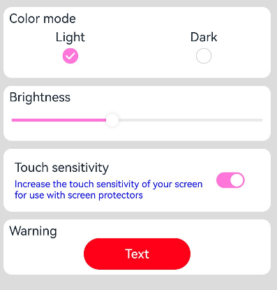

# Configuring In-Application Theme Skinning
<!--Kit: ArkUI-->
<!--Subsystem: ArkUI-->
<!--Owner: @fangzhiyuan1-->
<!--Designer: @fangzhiyuan1-->
<!--Tester: @gouyuanyuan-->
<!--Adviser: @Brilliantry_Rui-->
<!-- md-trans-meta sourceCommit=a306693f0f46e5633c549769b8338f6bd7c191f4 translatedAt=2026-10-10T06:16:36.480Z pushedAt=2026-10-12T08:48:00.801Z -->

## Overview

For applications developed with ArkTS, you can switch themes within the application, such as toggling between dark and light modes or changing the skin. Note that this feature is limited to in-application use and does not apply at the UIAbility or window level. It is not available for the C API and Node-API.

## Customizing Theme Colors
To implement theme switching for your application, you must define custom theme colors. Use [CustomTheme](../reference/apis-arkui/js-apis-arkui-theme.md#customtheme) to specify the colors you wish to modify. Its properties are optional. Only values that need to be changed from system defaults should be specified. Unmodified values inherit from the system's default settings. For details, see [System Default Token Color Values](#system-default-token-color-values). The following is an example of how to define custom theme colors:

  <!-- @[app_theme](https://gitcode.com/openharmony/applications_app_samples/blob/master/code/DocsSample/ArkUISample/ThemeSkinning/entry/src/main/ets/pages/Theme1/AppTheme.ets) -->

  ``` TypeScript
  import { CustomColors, CustomTheme } from '@kit.ArkUI';
  
  export class AppColors implements CustomColors {
    // Customize the theme color.
    public brand: ResourceColor = '#FF75D9';
    // Use $r to set different colors for the level-1 warning color in dark and light modes.
    public warning: ResourceColor = $r('sys.color.ohos_id_color_warning');
  }
  
  export class AppTheme implements CustomTheme {
    public colors: AppColors = new AppColors();
  }
  
  export let gAppTheme: CustomTheme = new AppTheme();
  ```

## Setting Custom Theme Colors for Application Components
- When setting custom theme colors at the page entry point, ensure that [ThemeControl](../reference/apis-arkui/js-apis-arkui-theme.md#themecontrol).[setDefaultTheme](../reference/apis-arkui/js-apis-arkui-theme.md#setdefaulttheme) is executed before the page is built.

  Use the [onWillApplyTheme](../reference/apis-arkui/arkui-ts/ts-custom-component-lifecycle.md#onwillapplytheme12) callback to allow custom components to access the currently active **Theme** object.

  <!-- @[display_page](https://gitcode.com/openharmony/applications_app_samples/blob/master/code/DocsSample/ArkUISample/ThemeSkinning/entry/src/main/ets/pages/Theme1/Theme1.ets) -->

    ``` TypeScript
    // Index.ets
    import { Theme, ThemeControl } from '@kit.ArkUI';
    import { gAppTheme } from './AppTheme';
    
    // Execute ThemeControl before the page is built.
    ThemeControl.setDefaultTheme(gAppTheme);
    
    @Entry
    @Component
    struct DisplayPage {
      @State menuItemColor: ResourceColor = $r('sys.color.background_primary');
    
      onWillApplyTheme(theme: Theme) {
        this.menuItemColor = theme.colors.backgroundPrimary;
      }
    
      build() {
        Column() {
          List({ space: 10 }) {
            ListItem() {
              Column({ space: '5vp' }) {
                Text('Color mode')
                  .margin({ top: '5vp', left: '14fp' })
                  .width('100%')
                Row() {
                  Column() {
                    Text('Light')
                      .fontSize('16fp')
                      .textAlign(TextAlign.Start)
                      .alignSelf(ItemAlign.Center)
                    Radio({ group: 'light or dark', value: 'light' })
                      .checked(true)
                  }
                  .width('50%')
    
                  Column() {
                    Text('Dark')
                      .fontSize('16fp')
                      .textAlign(TextAlign.Start)
                      .alignSelf(ItemAlign.Center)
                    Radio({ group: 'light or dark', value: 'dark' })
                  }
                  .width('50%')
                }
              }
              .width('100%')
              .height('90vp')
              .borderRadius('10vp')
              .backgroundColor(this.menuItemColor)
            }
    
            ListItem() {
              Column() {
                Text('Brightness')
                  .width('100%')
                  .margin({ top: '5vp', left: '14fp' })
                Slider({ value: 40, max: 100 })
              }
              .width('100%')
              .height('70vp')
              .borderRadius('10vp')
              .backgroundColor(this.menuItemColor)
            }
    
            ListItem() {
              Column() {
                Row() {
                  Column({ space: '5vp' }) {
                    Text('Touch sensitivity')
                      .fontSize('16fp')
                      .textAlign(TextAlign.Start)
                      .width('100%')
                    Text('Increase the touch sensitivity of your screen' +
                      ' for use with screen protectors')
                      .fontSize('12fp')
                      .fontColor(Color.Blue)
                      .textAlign(TextAlign.Start)
                      .width('100%')
                  }
                  .alignSelf(ItemAlign.Center)
                  .margin({ left: '14fp' })
                  .width('75%')
    
                  Toggle({ type: ToggleType.Switch, isOn: true })
                    .margin({ right: '14fp' })
                    .alignSelf(ItemAlign.Center)
                }
                .width('100%')
                .height('80vp')
              }
              .width('100%')
              .borderRadius('10vp')
              .backgroundColor(this.menuItemColor)
            }
            ListItem() {
              Column() {
                Text('Warning')
                  .width('100%')
                  .margin({ top: '5vp', left: '14fp' })
                Button('Text')
                  .type(ButtonType.Capsule)
                  .role(ButtonRole.ERROR)
                  .width('40%')
              }
              .width('100%')
              .height('70vp')
              .borderRadius('10vp')
              .backgroundColor(this.menuItemColor)
            }
          }
        }
        .padding('10vp')
        .backgroundColor('#dcdcdc')
        .width('100%')
        .height('100%')
      }
    }
    ```

- When setting custom theme colors in UIAbility, call [ThemeControl](../reference/apis-arkui/js-apis-arkui-theme.md#themecontrol).[setDefaultTheme](../reference/apis-arkui/js-apis-arkui-theme.md#setdefaulttheme) within the completion callback of windowStage.[loadContent](../reference/apis-arkui/arkts-apis-window-Window.md#loadcontent9) in the **onWindowStageCreate()** API.

    <!-- @[entry_ability](https://gitcode.com/openharmony/applications_app_samples/blob/master/code/DocsSample/ArkUISample/ThemeSkinning/entry/src/main/ets/entryability/EntryAbility.ets) -->

    ``` TypeScript
    // EntryAbility.ets
    import {AbilityConstant, UIAbility, Want } from '@kit.AbilityKit';
    import { hilog } from '@kit.PerformanceAnalysisKit';
    import { window, CustomColors, ThemeControl } from '@kit.ArkUI';
    
    class AppColors implements CustomColors {
      fontPrimary = 0xFFD53032;
      iconOnPrimary = 0xFFD53032;
      iconFourth = 0xFFD53032;
    }
    
    const abilityThemeColors = new AppColors();
    
    export default class EntryAbility extends UIAbility {
      onCreate(want: Want, launchParam: AbilityConstant.LaunchParam) {
        hilog.info(0x0000, 'testTag', '%{public}s', 'Ability onCreate');
      }
    
      onDestroy() {
        hilog.info(0x0000, 'testTag', '%{public}s', 'Ability onDestroy');
      }
    
      onWindowStageCreate(windowStage: window.WindowStage) {
        // Main window is created, set main page for this ability
        hilog.info(0x0000, 'testTag', '%{public}s', 'Ability onWindowStageCreate');
    
        windowStage.loadContent('pages/Index', (err, data) => {
          if (err.code) {
            hilog.error(0x0000, 'testTag', 'Failed to load the content. Cause: %{public}s', JSON.stringify(err) ?? '');
            return;
          }
          hilog.info(0x0000, 'testTag', 'Succeeded in loading the content. Data: %{public}s', JSON.stringify(data) ?? '');
          // Call setDefaultTheme in the onWindowStageCreate() method.
          ThemeControl.setDefaultTheme({ colors: abilityThemeColors });
          hilog.info(0x0000, 'testTag', '%{public}s', 'ThemeControl.setDefaultTheme done');
        });
      }
    }
    ```

  

  > **NOTE**
  >
  > - When the parameter passed to **setDefaultTheme** is **undefined**, the previously applied custom theme is cleared. The color values corresponding to the theme tokens will then revert to the system defaults defined in [System Default Token Color Values](#system-default-token-color-values).
  >
  > - **setDefaultTheme** must be called after ArkUI initialization completes, specifically within the **windowStage.loadContent** completion callback.

## Setting a Custom Theme Style for Specific Application Pages
You can use [WithTheme](../reference/apis-arkui/arkui-ts/ts-container-with-theme.md) to apply the color scheme of a custom theme to the default styles of internal components. Within the scope of **WithTheme**, the color scheme of components will be adjusted according to the theme's color scheme.

> **NOTE**
>
> When using [WithTheme](../reference/apis-arkui/arkui-ts/ts-container-with-theme.md) in the custom node [BuilderNode](../reference/apis-arkui/js-apis-arkui-builderNode.md), to ensure correct display, you must manually pass system environment change events to trigger a full update of the node. For details, see [updateConfiguration](../reference/apis-arkui/js-apis-arkui-builderNode.md#updateconfiguration12) for BuilderNode system environment change updates.

As demonstrated in the example, **WithTheme({ theme: this.customTheme })** applies the custom theme styling to all components within its scope. Theme styles can be dynamically updated by modifying **this.customTheme**. The [onWillApplyTheme](../reference/apis-arkui/arkui-ts/ts-custom-component-lifecycle.md#onwillapplytheme12) callback enables a custom component to obtain the currently active **Theme** object.

  <!-- @[custom_theme](https://gitcode.com/openharmony/applications_app_samples/blob/master/code/DocsSample/ArkUISample/ThemeSkinning/entry/src/main/ets/pages/Theme2/Theme2.ets) -->

  ``` TypeScript
  import { CustomColors, CustomTheme, Theme } from '@kit.ArkUI';
  import { common } from '@kit.AbilityKit';
  // Replace $r('app.color.xxx') with the actual resource file.
  class AppColors implements CustomColors {
    public fontPrimary: ResourceColor = $r('app.color.brand_purple');
    public backgroundEmphasize: ResourceColor = $r('app.color.brand_purple');
  }
  
  class AppColorsSec implements CustomColors {
    public fontPrimary: ResourceColor = $r('app.color.brand');
    public backgroundEmphasize: ResourceColor = $r('app.color.brand');
  }
  
  class AppTheme implements CustomTheme {
    public colors: AppColors = new AppColors();
  }
  
  class AppThemeSec implements CustomTheme {
    public colors: AppColors = new AppColorsSec();
  }
  
  @Entry
  @Component
  struct DisplayPage1 {
    @State customTheme: CustomTheme = new AppTheme();
    // Replace $r('app.string.SetCustomThemeStyle') with the actual resource file. In this example, the value of the resource file is "Set a custom theme style for a local page in the Settings application".
    @State message: ResourceStr = $r('app.string.SetCustomThemeStyle');
    count = 0;
  
    build() {
      WithTheme({ theme: this.customTheme }) {
        Row(){
          Column() {
            Text('WithTheme')
              .fontSize(30)
              .margin({bottom: 10})
            Text(this.message)
              .margin({bottom: 10})
            Button('change theme').onClick(() => {
              this.count++;
              if (this.count > 1) {
                this.count = 0;
              }
              switch (this.count) {
                case 0:
                  this.customTheme = new AppTheme();
                  break;
                case 1:
                  this.customTheme = new AppThemeSec();
                  break;
                default:
                  break;
              }
            })
          }
          .width('100%')
        }
        .height('100%')
        .width('100%')
      }
    }
  }
  ```


## Setting the Color Mode for Application Pages
Using [WithTheme](../reference/apis-arkui/arkui-ts/ts-container-with-theme.md), you can set three color modes: following the system mode, light mode, and dark mode.

Within the scope of **WithTheme**, component styles adapt to the specified color mode by accessing the corresponding system and application resource values. This means that the color schemes of components are adjusted according to the chosen color mode.

In the example below, components within the scope are set to dark mode using **WithTheme({ colorMode: ThemeColorMode.DARK })**.

For the light and dark modes to take effect, add a **dark.json** resource file.


Example of the **dark.json** file content:
  ```ts
    {
      "color": [
        {
          "name": "start_window_background",
          "value": "#000000"
        }
      ]
    }
  ```

  <!-- @[with_theme](https://gitcode.com/openharmony/applications_app_samples/blob/master/code/DocsSample/ArkUISample/ThemeSkinning/entry/src/main/ets/pages/Theme3/Theme3.ets) --> 

  ``` TypeScript
  import { ThemeControl } from '@kit.ArkUI';
  
  ThemeControl.setDefaultTheme(undefined);
  
  @Entry
  @Component
  struct DisplayPage3 {
    @State message: string = 'Hello World';
    @State colorMode: ThemeColorMode = ThemeColorMode.DARK;
  
    build() {
      WithTheme({ colorMode: this.colorMode }) {
        Row() {
          Column() {
            Text(this.message)
              .fontSize(50)
              .fontWeight(FontWeight.Bold)
            Button('Switch ColorMode').onClick(() => {
              if (this.colorMode === ThemeColorMode.LIGHT) {
                this.colorMode = ThemeColorMode.DARK;
              } else if (this.colorMode === ThemeColorMode.DARK) {
                this.colorMode = ThemeColorMode.LIGHT;
              }
            })
          }
          .width('100%')
        }
        .backgroundColor($r('sys.color.background_primary'))
        .height('100%')
        // Extend the safe area to achieve an immersive light/dark mode change effect.
        .expandSafeArea(
          [SafeAreaType.SYSTEM], [SafeAreaEdge.TOP, SafeAreaEdge.END, SafeAreaEdge.BOTTOM, SafeAreaEdge.START])
      }
    }
  }
  ```


## System Default Token Color Values

| Token                                      | Scenario category | Light |    Description       | Dark    |               Description                               |
|--------------------------------------------|-----| --- |-----------| ------- | -------------------------------------------- |
| theme.colors.brand                         | Brand color |#ff0a59f7|  |#ff317af7||
| theme.colors.warning                       | Level-1 warning color |#ffe84026|  |#ffd94838||
| theme.colors.alert                         | Level-2 warning color |#ffed6f21|  |#ffdb6b42||
| theme.colors.confirm                       | Confirmation color |#ff64bb5c|  |#ff5be854||
| theme.colors.fontPrimary                   | Level-1 text | #e5000000 |  |#e5ffffff||
| theme.colors.fontSecondary                 | Level-2 text | #99000000 |  |#99ffffff||
| theme.colors.fontTertiary                  | Level-3 text | #66000000 |  |#66ffffff||
| theme.colors.fontFourth                    | Level-4 text | #33000000 |  |#33ffffff||
| theme.colors.fontEmphasize                 | Highlight text | #ff0a59f7 |  |#ff317af7||
| theme.colors.fontOnPrimary                 | Level-1 text inversion | #ffffffff |  |#ff000000||
| theme.colors.fontOnSecondary               | Level-2 text inversion | #99ffffff |  |#99000000||
| theme.colors.fontOnTertiary                | Level-3 text inversion | #66ffffff |  |#66000000||
| theme.colors.fontOnFourth                  | Level-4 text inversion | #33ffffff |  |#33000000||
| theme.colors.iconPrimary                   | Level-1 icon | #e5000000 |  |#e5ffffff||
| theme.colors.iconSecondary                 | Level-2 icon | #99000000 |  |#99ffffff||
| theme.colors.iconTertiary                  | Level-3 icon | #66000000 |  |#66ffffff||
| theme.colors.iconFourth                    | Level-4 icon | #33000000 |  |#33ffffff||
| theme.colors.iconEmphasize                 | Highlight icon | #ff0a59f7 |  |#ff317af7||
| theme.colors.iconSubEmphasize              | Highlight auxiliary icon | #660a59f7 |  |#66317af7||
| theme.colors.iconOnPrimary                 | Level-1 icon inversion | #ffffffff |  |#ff000000||
| theme.colors.iconOnSecondary               | Level-2 icon inversion | #99ffffff |  |#99000000||
| theme.colors.iconOnTertiary                | Level-3 icon inversion | #66ffffff |  |#66000000||
| theme.colors.iconOnFourth                  | Level-4 icon inversion | #33ffffff |  |#33000000||
| theme.colors.backgroundPrimary             | Level-1 background (solid color/opaque color) | #ffffffff |  |#ffe5e5e5||
| theme.colors.backgroundSecondary           | Level-2 background (solid color/opaque color) | #fff1f3f5 |  |#ff191a1c||
| theme.colors.backgroundTertiary            | Level-3 background (solid color/opaque color) | #ffe5e5ea |  |#ff202224||
| theme.colors.backgroundFourth              | Level-4 background (solid color/opaque color) | #ffd1d1d6 |  |#ff2e3033||
| theme.colors.backgroundEmphasize           | Highlight background (solid color/opaque color) | #ff0a59f7 |  |#ff317af7||
| theme.colors.compForegroundPrimary         | Foreground background | #ff000000 |  | #ffe5e5e5 ||
| theme.colors.compBackgroundPrimary         | White background | #ffffffff || #ffffffff ||
| theme.colors.compBackgroundPrimaryTran     | White transparent background | #ffffffff || #33ffffff ||
| theme.colors.compBackgroundPrimaryContrary | Always-on background | #ffffffff || #ffe5e5e5 ||
| theme.colors.compBackgroundGray            | Gray background | #fff1f3f5 || #ffe5e5ea ||
| theme.colors.compBackgroundSecondary       | Level-2 background | #19000000 || #19ffffff ||
| theme.colors.compBackgroundTertiary        | Level-3 background | #0c000000 || #0cffffff ||
| theme.colors.compBackgroundEmphasize       | Highlight background | #ff0a59f7 || #ff317af7 ||
| theme.colors.compBackgroundNeutral         | Black neutral highlight background | #ff000000 || #ffffffff ||
| theme.colors.compEmphasizeSecondary        | 20% highlight background | #330a59f7 || #33317af7 ||
| theme.colors.compEmphasizeTertiary         | 10% highlight background | #190a59f7 || #19317af7 ||
| theme.colors.compDivider                   | Divider color | #33000000 || #33ffffff ||
| theme.colors.compCommonContrary            | Common inversion | #ffffffff || #ff000000 ||
| theme.colors.compBackgroundFocus           | Focused background color | #fff1f3f5 || #ff000000 ||
| theme.colors.compFocusedPrimary            | Focused level-1 inversion | #e5000000 || #e5ffffff ||
| theme.colors.compFocusedSecondary          | Focused level-2 inversion | #99000000 || #99ffffff ||
| theme.colors.compFocusedTertiary           | Focused level-3 inversion | #66000000 || #66ffffff ||
| theme.colors.interactiveHover              | Common hover interactive color | #0c000000 || #0cffffff ||
| theme.colors.interactivePressed            | Common pressed interactive color | #19000000 || #19ffffff ||
| theme.colors.interactiveFocus              | Common focused interactive color | #ff0a59f7 || #ff317af7 ||
| theme.colors.interactiveActive             | Common active interactive color | #ff0a59f7 || #ff317af7 ||
| theme.colors.interactiveSelect             | Common selected interactive color | #33000000 || #33ffffff ||
| theme.colors.interactiveClick              | Common clicked interactive color | #19000000 || #19ffffff ||

For details about the components that can be affected by each token color value, see [Colors](../reference/apis-arkui/js-apis-arkui-theme.md#colors).
