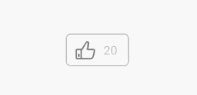

# Adding Interactions
<!--Kit: ArkUI-->
<!--Subsystem: ArkUI-->
<!--Owner: @zhou-chaobo-->
<!--Designer: @piggyguy-->
<!--Tester: @songyanhong-->
<!--Adviser: @Brilliantry_Rui-->
<!-- md-trans-meta sourceCommit=9c92183287fa23162e04874223c3b068eb1f8a4d translatedAt=2026-11-05T11:54:10.476Z pushedAt=2026-11-09T10:02:18.993Z nl=1 -->

You can make the UI interactive by binding events to components. This topic describes how to associate a click event with **\<div>**, **\<text>**, and **\<image>** components to build a like button, as shown below.




The like button is implemented by binding a click event to a **\<div>** component, which contains an **\<image>** component and a **\<text>** component.


- The **\<image>** component displays the liked or unliked state. The click event handler toggles the image source between the liked and unliked versions.

- The **\<text>** component displays the number of likes, which is updated synchronously in the click event handler.


The click event is defined as a function in the JS file, which changes the state of `isPressed` to update the displayed `image` component. If `isPressed` is `false`, the number of likes increases by 1. This function takes effect on the corresponding `div` component in the HML file, and the styles of the child components of the like button are set in the CSS file. The following is an implementation example:


```html
<!-- xxx.hml -->
<!-- Like button -->
<div>
  <div class="like" onclick="likeClick">
    <image class="like-img" src="{{likeImage}}" focusable="true"></image>
    <text class="like-num" focusable="true">{{total}}</text>
  </div>
</div>
```


```css
/* xxx.css */
.like {
  width: 104px;
  height: 54px;
  border: 2px solid #bcbcbc;
  justify-content: space-between;
  align-items: center;
  margin-left: 72px;
  border-radius: 8px;
}
.like-img {
  width: 33px;
  height: 33px;
  margin-left: 14px;
}
.like-num {
  color: #bcbcbc;
  font-size: 20px;
  margin-right: 17px;
}
```


```js
// xxx.js
export default {
  data: {
    likeImage: '/common/unLike.png',
    isPressed: false,
    total: 20,
  },
  likeClick() {
    var temp;
    if (!this.isPressed) {
      temp = this.total + 1;
      this.likeImage = '/common/like.png';
    } else {
      temp = this.total - 1;
      this.likeImage = '/common/unLike.png';
    }
    this.total = temp;
    this.isPressed = !this.isPressed;
  },
}
```


In addition, a variety of form components, such as switches, tags, and pickers, are available to help you create flexible and engaging interactions in your layouts.
