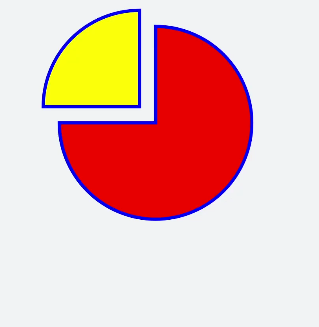

# Path Drawing
<!--Kit: ArkUI-->
<!--Subsystem: ArkUI-->
<!--Owner: @liyujie43-->
<!--Designer: @weixin_52725220-->
<!--Tester: @xiong0104-->
<!--Adviser: @Brilliantry_Rui-->
<!-- md-trans-meta sourceCommit=3678c43a52b28e0c7392aa40b5205f2c85f70610 translatedAt=2026-11-05T03:54:21.446Z pushedAt=2026-11-05T09:12:52.112Z nl=1 -->

The [\<svg>](../reference/apis-arkui/arkui-js/js-components-svg.md) component uses instructions **M** (start point), **H** (horizontal line), and **a** (drawing an arc to a specified position) to control a path and sets the fill colors to create a pie chart.

```html
<!-- xxx.hml -->
<div class="container">
  <svg fill="#00FF00" x="100" y="400">
    <path d="M300,200 h-150 a150 150 0 1 0 150 -150 z" fill="red" stroke="blue" stroke-width="5" >    
    </path> 
    <path d="M275,175 v-150 a150 150 0 0 0 -150 150 z" fill="yellow" stroke="blue" stroke-width="5">    
    </path>
  </svg>
</div>
```

```css
/* xxx.css */
.container {
  flex-direction: row;
  justify-content: flex-start;
  align-items: flex-start;
  height: 1200px;
  width: 600px;
  background-color: #F1F3F5;
}
```





> **NOTE**
> - M/m = moveto   The parameters x and y indicate the x-axis and y-axis coordinates of the point to move to. After moving the pen with the M command, the pen is only moved without drawing a line between the two points. Therefore, the M command often appears at the beginning of a path to indicate where to start drawing.
>
> - L/l = lineto   The parameters x and y indicate the x-axis and y-axis coordinates of a point. The L command draws a line segment between the current position and the new position (the point where the pen was located before the L command).
>
> - H/h = horizontal lineto    Draws a horizontal line.
>
> - V/v = vertical lineto   Draws a vertical line.
>
> - C/c = curveto  Cubic Bézier curve  Sets three sets of coordinate parameters: x1 y1, x2 y2, x y.
>
> - S/s = smooth curveto  Cubic Bézier curve command   Sets two sets of coordinate parameters: x2 y2, x y.
>
> - Q/q = quadratic Bezier curve  Quadratic Bézier curve  Sets two sets of coordinate parameters: x1 y1, x y.
>
> - T/t = smooth quadratic Bezier curveto  Quadratic Bézier curve command  Sets the parameters: x y.
>
> - A/a = elliptical Arc  Arc command  Sets the parameters: rx ry x-axis-rotation (rotation angle) large-arc-flag (angle size) sweep-flag (arc direction) x y. large-arc-flag determines whether the arc is greater than or less than 180 degrees: 0 indicates a small-angle arc, and 1 indicates a large-angle arc. sweep-flag indicates the direction of the arc: 0 draws the arc counterclockwise from the start point to the end point, and 1 draws it clockwise from the start point to the end point.
>
> - Z/z = closepath   Draws a straight line from the current point to the start point of the path.
