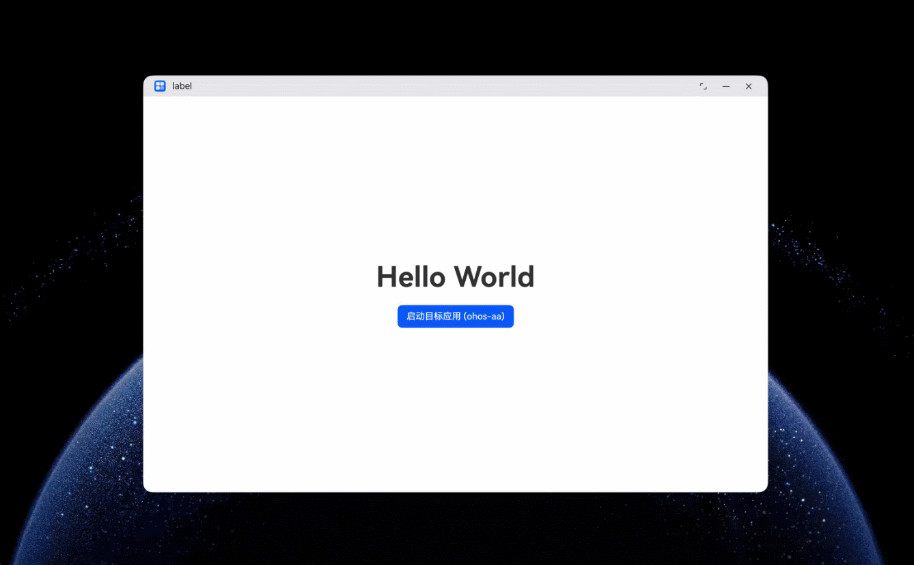

# 启动应用命令（start）

<!--Kit: Ability Kit-->
<!--Subsystem: Ability-->
<!--Owner: @zhu-feimo-->
<!--Designer: @ccllee1-->
<!--Tester: @liangchengguang-->
<!--Adviser: @HelloCrease-->

## 场景介绍

start命令用于启动一个Ability组件，目标组件可以是[Stage模型](ability-terminology.md#stage模型)的[UIAbility](../reference/apis-ability-kit/js-apis-app-ability-uiAbility.md)，支持[显式启动](explicit-implicit-want-mappings.md#显式want匹配原理)和[隐式启动](explicit-implicit-want-mappings.md#隐式want匹配原理)。

## 命令格式

显式启动：

```bash
ohos-aa start --bundlename <bundleName> --abilityname <abilityName> [--modulename <moduleName>]
```

隐式启动：

```bash
ohos-aa start [--action <action>] [--uri <uri>] [--entity <entity>] [--type <type>]
```

命令执行后，在目标Ability启动完成后返回。启动操作由系统完成，应用侧无需额外处理。

## 约束限制

- **设备与权限要求**：详见[面向Agent的CLI命令概述](cli-for-agent-overview.md#约束与限制)。
- **exported标签约束**：目标组件配置文件中的[exported标签](../quick-start/module-configuration-file.md#abilities标签)不能配置为`false`，否则启动失败。
- **显式启动约束**：显式启动时`--bundlename`和`--abilityname`必须同时提供，仅提供`--abilityname`而未提供`--bundlename`将导致错误。

## 参数说明

| 参数 | 类型 | 必填 | 说明 |
| -------- | -------- | -------- | -------- |
| --bundlename | string | 显式启动时必填 | 目标应用的Bundle名称。与`--abilityname`同时使用实现显式启动。 |
| --abilityname | string | 显式启动时必填 | 目标Ability的名称。与`--bundlename`同时使用实现显式启动。 |
| --modulename | string | 否 | 目标Ability所属的模块名称。多HAP应用中用于指定模块。 |
| --action | string | 否 | 指定隐式启动的action。隐式启动时建议提供。 |
| --uri | string | 否 | 指定隐式启动的URI。仅支持传递字符串。隐式启动时建议提供。 |
| --entity | string | 否 | 指定隐式启动的entity。 |
| --type | string | 否 | 指定隐式启动的MIME类型。 |
| --time | flag | 否 | 等待Ability启动完成并测量启动耗时。 |
| --pi | string | 否 | 整型参数键值对，JSON格式，如`'{"key1":100,"key2":101}'`。 |
| --ps | string | 否 | 字符串参数键值对，JSON格式，如`'{"key1":"value1","key2":"value2"}'`。 |
| --pb | string | 否 | 布尔参数键值对，JSON格式，如`'{"key1":true,"key2":false}'`。 |
| --sandboxCloneIndex | int | 否 | 沙箱分身应用索引（取值范围：2000-3000）。 |
| --creatorBundle | string | 否 | 沙箱分身应用的创建方包名。 |
| --help | flag | 否 | 显示start子命令的帮助信息。 |


## 错误码

命令执行失败时，JSON输出中的`errCode`字段返回以下错误码：

| 错误码 | 说明 | 处理建议 |
| ------- | -------- | -------- |
| ERR_ABILITY_VISIBLE_FALSE_DENY_REQUEST | 目标Ability可见性校验失败。 | 检查目标应用module.json5中exported标签是否为true。 |
| ERR_ABILITY_NOT_FOUND | 指定的Ability不存在。 | 检查bundleName和abilityName是否正确，确认目标应用已安装。 |
| ERR_ABILITY_SERVICE_NOT_CONNECTED | Ability服务连接失败。 | 尝试重启设备重新执行。 |
| ERR_GET_ABILITY_SERVICE_FAILED | 获取Ability信息失败。 | 检查bundleName对应的应用是否已安装。 |
| ERR_APP_RESOLVE_APP_ERR | 获取应用信息失败。 | 检查bundleName和abilityName是否正确，确认目标应用已安装。 |
| ERR_ABILITY_NO_FOUND_ABILITY_BY_CALLER | 不支持通过ohos-aa启动UIExtensionAbility。 | start命令不支持启动UIExtensionAbility，请使用其他方式。 |
| ERR_ABILITY_IMPLICIT_START_ABILITY_FAIL | 隐式启动未找到匹配应用。 | 确保隐式启动参数配置正确，且匹配的HAP包已安装。 |
| ERR_APP_CLONE_INDEX_INVALID | appCloneIndex参数无效。 | 确认sandboxCloneIndex参数值是否合法（取值范围：2000-3000）。 |
| ERR_UNLOCK_SCREEN_FAILED_IN_DEVELOPER_MODE | 开发者模式下解锁屏幕失败。 | 解锁屏幕后重新尝试。 |
| ERR_APP_CONTROLLED | 目标应用被管控。 | 检查目标应用是否被管控，如开发证书过期、应用市场管控等。 |
| ERR_STATIC_CFG_PERMISSION | 指定进程权限校验失败。 | 确认是否已申请`ohos.permission.CUSTOM_SANDBOX`权限。 |
| ERR_INNER_ERR_START | 内部错误。 | 系统内部错误，尝试重启设备或稍后重试。 |

## 示例代码

- 显式启动应用：

    ```bash
    ohos-aa start --bundlename com.example.myapplication --abilityname EntryAbility
    ```

- 显式启动并指定模块名：

    ```bash
    ohos-aa start --bundlename com.example.myapplication --abilityname EntryAbility --modulename entry
    ```

- 隐式启动（通过URI）：

    ```bash
    ohos-aa start --uri myscheme://www.test.com:8080/path
    ```

- 隐式启动（通过action和URI）：

    ```bash
    ohos-aa start --action ohos.want.action.viewData --uri https://www.example.com
    ```

## 应用内调用

在应用内通过fork+execvp方式调用start命令的完整示例。

1. 配置[module.json5配置文件](../quick-start/module-configuration-file.md#配置文件示例)，声明所需权限和设备类型。

    <!-- @[cli_start_module](https://gitcode.com/openharmony/applications_app_samples/blob/master/code/DocsSample/Ability/CliInvocation/entry/src/main/module.json5) -->
    ```json5
    {
      "module": {
        "name": "entry",
        "type": "entry",
        "deviceTypes": [
          "2in1"
        ],
        "abilities": [
          {
            "name": "EntryAbility",
            "srcEntry": "./ets/entryability/EntryAbility.ets",
            "exported": true
          }
        ],
        "requestPermissions": [
          {
            "name": "ohos.permission.CUSTOM_SANDBOX"
          }
        ]
      }
    }
    ```

2. 在Native层通过fork+execvp调用ohos-aa。

    <!-- @[cli_start_native](https://gitcode.com/openharmony/applications_app_samples/blob/master/code/DocsSample/Ability/CliInvocation/entry/src/main/cpp/napi_init.cpp) -->
    ```cpp
    #include "napi/native_api.h"
    #include <unistd.h>
    #include <sys/wait.h>
    #include <string>
    #include <vector>

    static napi_value ForkAndExecute(napi_env env, napi_callback_info info)
    {
        size_t argc = 2;
        napi_value args[2] = {nullptr};
        napi_get_cb_info(env, info, &argc, args, nullptr, nullptr);

        // 获取bundleName和abilityName参数
        const size_t bufSize = 1024;
        char buf[bufSize];
        size_t len = 0;
        napi_get_value_string_utf8(env, args[0], buf, bufSize, &len);
        std::string bundleName = std::string(buf);

        char buf2[bufSize];
        napi_get_value_string_utf8(env, args[1], buf2, bufSize, &len);
        std::string abilityName = std::string(buf2);

        // 构造ohos-aa命令参数
        std::string aaCmd = "/system/bin/cli_tool/executable/ohos-aa";
        std::string subCmd = "start";
        std::string optBundleName = "--bundlename";
        std::string optAbilityName = "--abilityname";
        std::vector<char*> execArgs;
        execArgs.push_back(const_cast<char *>(aaCmd.c_str()));
        execArgs.push_back(const_cast<char *>(subCmd.c_str()));
        execArgs.push_back(const_cast<char *>(optBundleName.c_str()));
        execArgs.push_back(const_cast<char *>(bundleName.c_str()));
        execArgs.push_back(const_cast<char *>(optAbilityName.c_str()));
        execArgs.push_back(const_cast<char *>(abilityName.c_str()));
        execArgs.push_back(nullptr);

        // fork子进程执行ohos-aa
        pid_t pid = fork();
        if (pid < 0) {
            napi_value result;
            napi_create_int32(env, -1, &result);
            return result;
        }
        if (pid == 0) {
            // 子进程：执行ohos-aa命令
            execvp(aaCmd.c_str(), execArgs.data());
            const int exitExecFailed = 127;
            _exit(exitExecFailed); // execvp失败时退出
        }
        // 父进程：等待子进程结束
        int status = 0;
        waitpid(pid, &status, 0);
        napi_value result;
        napi_create_int32(env, WIFEXITED(status) ? WEXITSTATUS(status) : -1, &result);
        return result;
    }

    EXTERN_C_START
    static napi_value Init(napi_env env, napi_value exports)
    {
        napi_property_descriptor desc[] = {
            { "forkAndExecute", nullptr, ForkAndExecute, nullptr, nullptr, nullptr, napi_default, nullptr },
        };
        napi_define_properties(env, exports, sizeof(desc) / sizeof(desc[0]), desc);
        return exports;
    }
    EXTERN_C_END
    ```

3. 在ArkTS层声明Native接口类型。

    <!-- @[cli_start_declare](https://gitcode.com/openharmony/applications_app_samples/blob/master/code/DocsSample/Ability/CliInvocation/entry/src/main/cpp/types/libentry/Index.d.ts) -->
    ```ts
    // Index.d.ts
    export const forkAndExecute: (bundleName: string, abilityName: string) => number;
    ```

4. 在ArkTS层调用Native接口拉起目标应用。

    <!-- @[cli_start_index](https://gitcode.com/openharmony/applications_app_samples/blob/master/code/DocsSample/Ability/CliInvocation/entry/src/main/ets/pages/Index.ets) -->
    ``` TypeScript
    import { hilog } from '@kit.PerformanceAnalysisKit';
    import testNapi from 'libentry.so';

    const DOMAIN = 0x0000;

    @Entry
    @Component
    struct Index {
      @State message: string | Resource = 'Hello World';

      build() {
        Row() {
          Column() {
            Text(this.message)
              .id('text_message')
              .fontSize($r('app.float.page_text_font_size'))
              .fontWeight(FontWeight.Bold)

            Button($r('app.string.button_start_target_app'))
              .id('button_start_target_app')
              .margin({ top: 20 })
              .onClick(() => {
                const ret = testNapi.forkAndExecute('com.example.agentExtension', 'EntryAbility');
                hilog.info(DOMAIN, 'testTag', 'forkAndExecute ret = %{public}d', ret);
                this.message = ret === 0 ? $r('app.string.message_start_success') : $r('app.string.message_start_failed', ret);
              })
          }
          .width('100%')
        }
        .height('100%')
      }
    }
    ```

## 调试验证

安装并启动示例工程应用后，点击"启动目标应用 (ohos-aa)"按钮，即可通过ohos-aa拉起目标应用。若返回值为0表示启动成功，非0表示启动失败。

