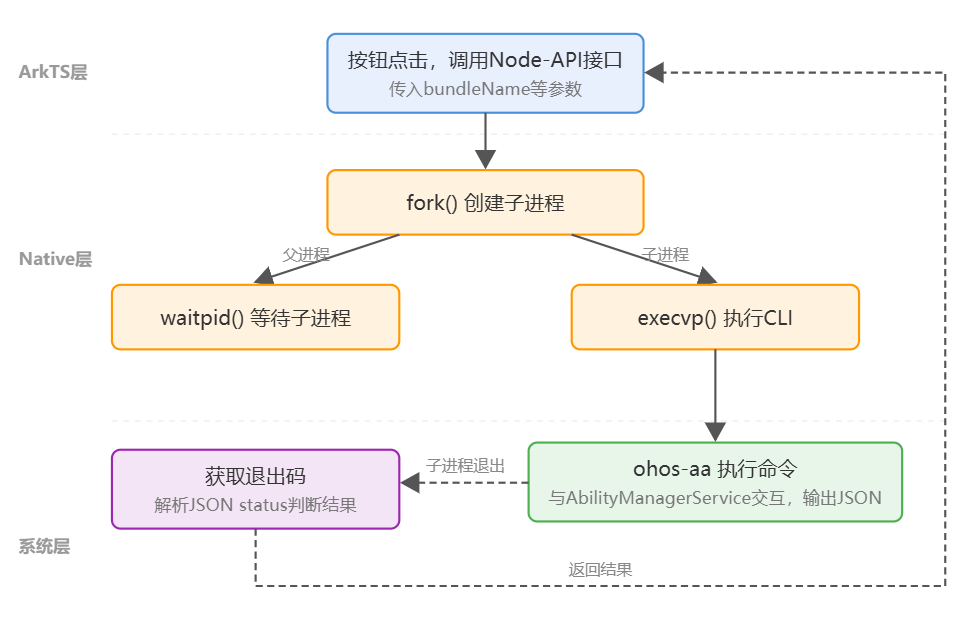

# 实现CLI调用

<!--Kit: Ability Kit-->
<!--Subsystem: Ability-->
<!--Owner: @zhu-feimo-->
<!--Designer: @ccllee1-->
<!--Tester: @liangchengguang-->
<!--Adviser: @HelloCrease-->

## 场景介绍

在PC/2in1设备上，Agent应用需要通过Native（C/C++）代码以fork+execvp方式调用CLI，实现对其他应用的启动和停止操作。应用内调用CLI的整体流程如下图所示：



具体步骤如下：

1. **构造命令参数**：ArkTS层通过Node-API接口调用Native函数，将子命令和参数组织为`char*`数组，数组末尾以`nullptr`结尾。
2. **fork子进程**：Native层调用`fork()`创建子进程。
3. **子进程执行CLI**：在子进程中调用`execvp()`执行CLI可执行程序。
4. **父进程等待**：父进程通过`waitpid()`等待子进程结束并获取退出状态。
5. **返回结果**：根据子进程退出状态（WEXITSTATUS）判断CLI进程是否正常执行完毕，退出码`0`表示进程正常退出。但退出码不反映业务层面的成败（如目标应用不存在、权限不足等业务错误时退出码仍为`0`），业务结果以解析CLI输出的JSON中`status`字段（`"success"`或`"failed"`）为准，详见[CLI命令规范-数据返回规范](cli-command-specification.md#数据返回规范)。

## 环境要求

- **设备与权限要求**：详见[面向Agent的CLI命令概述](cli-for-agent-overview.md)。
- **CLI工具**：确保设备已预置CLI工具，预置路径为`/system/bin/cli_tool/executable/`。

## 异常处理

CLI调用过程中可能出现的异常及处理建议：

| 异常场景 | 可能原因 | 处理建议 |
| -------- | -------- | -------- |
| fork失败 | 系统资源不足 | 检查返回的pid值，小于0表示fork失败，可重试。 |
| execvp失败 | CLI路径不存在或无执行权限 | 子进程中execvp失败后会调用`_exit(127)`退出，父进程获取退出码127。确认CLI已安装且路径正确。 |
| 子进程异常退出 | CLI执行过程中崩溃 | 通过WIFEXITED判断子进程是否正常退出，非正常退出时WEXITSTATUS无意义。 |
| 权限不足 | 未申请所需权限 | 检查module.json5中是否声明了`ohos.permission.CUSTOM_SANDBOX`及相关CLI权限。 |
| 目标应用不存在 | bundleName或abilityName错误 | 检查参数值是否正确，确认目标应用已安装。 |

## 调用步骤

应用内调用CLI的完整流程包括以下步骤：

1. **配置module.json5**：在[module.json5配置文件](../quick-start/module-configuration-file.md#配置文件示例)中声明`ohos.permission.CUSTOM_SANDBOX`权限和`PC/2in1`设备类型，详见[申请CLI访问权限](cli-permission-guide.md)。

    ```json5
    {
      "module": {
        "deviceTypes": ["2in1"],
        "requestPermissions": [
          { "name": "ohos.permission.CUSTOM_SANDBOX" }
        ]
      }
    }
    ```

2. **Native层实现fork+execvp**：通过`fork()`创建子进程，在子进程中使用`execvp()`执行CLI可执行程序，父进程通过`waitpid()`等待并获取退出码。

    ```cpp
    std::string aaCmd = "/system/bin/cli_tool/executable/ohos-aa";
    std::vector<char*> execArgs;
    // 构造命令参数...
    execArgs.push_back(nullptr);

    pid_t pid = fork();
    if (pid == 0) {
        execvp(aaCmd.c_str(), execArgs.data());
        _exit(127);
    }
    int status = 0;
    waitpid(pid, &status, 0);
    // WEXITSTATUS(status) 获取退出码
    ```

3. **ArkTS层声明Native接口**：在Index.d.ts中声明对应的接口类型。

    ```ts
    // Index.d.ts
    export const forkAndExecute: (bundleName: string, abilityName: string) => number;
    ```

4. **ArkTS层调用Native接口**：通过按钮点击等事件触发Native接口调用CLI命令。

    ```typescript
    import testNapi from 'libentry.so';

    Button($r('app.string.button_start_target_app'))
      .onClick(() => {
        const ret = testNapi.forkAndExecute('com.example.myapp', 'EntryAbility');
      })
    ```
