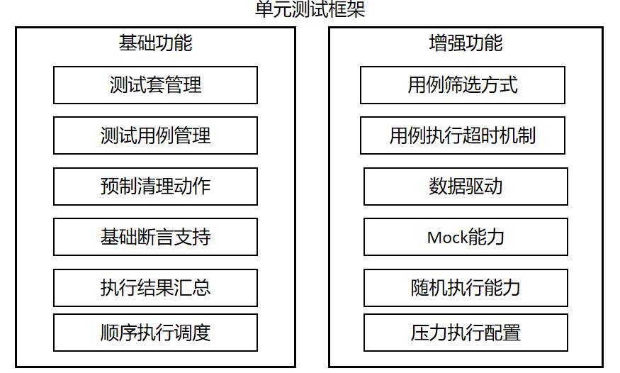

# 单元测试框架使用指导 

<!--Kit: Test Kit-->
<!--Subsystem: Test-->
<!--Owner: @inter515-->
<!--Designer: @inter515-->
<!--Tester: @laonie666-->
<!--Adviser: @chen8281-->

## 概述

单元测试框架（JsUnit），是自动化测试框架基础底座，提供测试脚本识别、调度、执行和结果汇总的能力。开发者可在测试脚本中调用UI测试框架和白盒性能测试框架接口编写测试用例。<br>
本指南介绍单元测试框架的主要功能、实现原理和开发步骤。


## 框架能力全景

单元测试框架支持的功能特性如下。
|   特性     | 功能说明                                                     |
|  -------- | ------------------------------------------------------------ |
|  [基础流程能力](#基础流程能力) | 支持测试用例识别调度及异步执行测试用例。                                 |
|  [断言能力](#断言能力)   | 判断用例实际结果值与预期值是否相符。                         |
|  [Mock能力](#mock能力) | 支持函数级Mock能力，对定义的函数进行Mock并修改函数的行为，使其返回指定的值或者执行指定操作。 |
|  [数据驱动能力](#数据驱动) | 提供数据驱动能力，支持复用同一个测试脚本，使用不同输入数据驱动测试脚本执行。 |
|  [专项能力](#命令行执行测试脚本) | 支持测试套与用例筛选、随机执行、压力测试、超时设置、遇错即停模式和跳过执行模式。 |

  **图1.单元测试框架主要功能**

  


## 单元测试框架发布方式
单元测试框架以ohpm包独立发布，版本信息详见[服务组件官网](https://ohpm.openharmony.cn/#/cn/detail/@ohos%2Fhypium)。开发者下载DevEco Studio后，在应用工程中的[oh-package.json5](https://developer.huawei.com/consumer/cn/doc/harmonyos-guides/ide-oh-package-json5)文件中devDependencies节点中配置版本号即可使用对应版本框架功能。

**配置示例**
```json
"devDependencies": {
    "@ohos/hypium": "1.0.25"
  }
```

## 基于ArkTS编写和执行测试脚本

### 搭建环境

测试脚本基于DevEco Studio编写，请下载[DevEco Studio](https://developer.huawei.com/consumer/cn/download/)并完成<!--RP1-->[hdc配置](../dfx/hdc.md)<!--RP1End-->。

### 新建测试脚本

参考[DevEco Studio指导](https://developer.huawei.com/consumer/cn/doc/harmonyos-guides/ide-instrument-test#section36049271219)创建ArkTS测试用例。

### 编写单元测试脚本

一个完整的测试脚本需要包含以下基本元素：

1. 依赖导包，以便使用单元测试框架提供的接口，以及其他测试脚本中需要依赖使用的接口。
2. 测试代码编写，编写测试用例的相关测试逻辑。
3. 断言接口调用，设置测试代码中的检查点，用于检查用例是否符合预期。

下面提供一个简单示例，测试场景：启动被测试页面，检查设备当前显示的页面是否为预期启动的页面。

<!-- @[basic_sample](https://gitcode.com/openharmony/applications_app_samples/blob/master/code/DocsSample/Test/jsunit/entry/src/ohosTest/ets/test/basicExampleTest/BasicExample.test.ets) --> 

``` TypeScript
import { beforeEach, describe, expect, it, Level, Size, TestType } from '@ohos/hypium';
import { UIAbility } from '@kit.AbilityKit';
import { Component, ON } from '@kit.TestKit';
import { hilog } from '@kit.PerformanceAnalysisKit';
import { delegator, driver, EXPECTED_BUNDLE, recoverMain, terminateMain } from '../JsUiSession';

export default function abilityTest(): void {
  describe('ActsAbilityTest', (): void => {
    beforeEach(async (): Promise<void> => {
      try {
        await recoverMain();
      } catch (error) {
        await terminateMain();
        throw error instanceof Error ? error as Error : new Error(String(error));
      }
    });

    /**
     * @tc.number testJsunitBasicHome0001
     * @tc.name testJsunitBasicHome0001
     * @tc.desc Observe the launched main ability, actual bundle and exact Hello World text
     * @tc.size MediumTest
     * @tc.type Function
     * @tc.level Level1
     */
    it('testJsunitBasicHome0001', TestType.FUNCTION | Size.MEDIUMTEST | Level.LEVEL1,
      async (): Promise<void> => {
        try {
          const ability: UIAbility = await delegator.getCurrentTopAbility();
          hilog.info(0x0000, 'BasicExample', 'top name=%{public}s', ability.context.abilityInfo.name);
          expect(ability.context.abilityInfo.name).assertEqual('EntryAbility');
          hilog.info(0x0000, 'BasicExample', 'top bundle=%{public}s', ability.context.abilityInfo.bundleName);
          expect(ability.context.abilityInfo.bundleName).assertEqual(EXPECTED_BUNDLE);
          const text: Component = await driver.waitForComponent(ON.text('Hello World').type('Text'), 3000);
          const actual: string = await text.getText();
          hilog.info(0x0000, 'BasicExample', 'main greeting=%{public}s', actual);
          expect(actual).assertEqual('Hello World');
        } finally {
          await terminateMain();
        }
      });
  });
}
```
### DevEco Studio执行测试脚本

连接目标测试设备（如手机），在DevEco Studio页面点击对应按钮执行测试脚本，当前支持以下四种方式：

1. 测试包级别执行，即执行测试包内的全部用例。
2. 测试类级别执行，即执行*.ets文件里的所有测试用例。
3. 测试套级别执行，即执行describe接口中定义的全部测试用例。
4. 测试用例级别执行，即执行指定it接口也就是单条测试用例。

下面给出测试类级别即测试文件执行示例，其他请参考[运行模式](https://developer.huawei.com/consumer/cn/doc/harmonyos-guides/ide-instrument-test#section1574003717165)。


* 查看测试结果

测试执行后可直接在DevEco Studio中查看测试结果。


* 查看测试用例覆盖率

执行测试用例后可以查看测试用例覆盖率，具体操作请参考[覆盖率统计模式](https://developer.huawei.com/consumer/cn/doc/harmonyos-guides/ide-instrument-test#section1989615417457)章节内的内容。

### 命令行执行测试脚本

脚本执行需连接硬件设备，开发者安装测试包到连接设备上，在命令行窗口中通过执行aa test命令并设置执行参数，触发执行测试用例。

* aa test工具命令列表

以下是单元测试过程中的常用命令，其他aa test命令及含义说明参考<!--RP2-->[命令指南说明](../tools/aa-tool.md)<!--RP2End-->。

| 参数  | 参数说明                          | 示例                       |
| ------------- |  -------------------------------------- | ---------------------------------- |
| --bundleName/-b  | 指定应用Bundle名称。                       | - b com.test.example               |
| --packageName/-p | 指定应用模块名，适用于FA模型应用。           | - p com.test.example.entry         |
| --moduleName/-m  | 指定应用模块名，适用于Stage模型应用。        | -m entry                           |
| -s            |  特定参数，以<key, value>键值对方式传入。框架支持通过-s参数键值配置多种用例执行方式，-s的参数及对应含义参见下表。 | - s unittest /ets/testrunner/OpenHarmonyTestRunner |


| 参数     | 参数含义及取值                                             | 示例                              |
| ------------ | -----------------------------------------------------------------------------     | ----------------------------------------- |
| unittest     | 用例执行所使用OpenHarmonyTestRunner对象，取值可为OpenHarmonyTestRunner或用户自定义runner名称。                  | -s unittest OpenHarmonyTestRunner        |
| class        | 筛选执行方式，即指定要执行的测试套或测试用例。取值为describeName，describeName#itName，其中describeName为测试套名称、itName为测试用例名称。 | -s class attributeTest#testAttributeIt    |
| notClass     | 排除执行方式，即指定不需要执行的测试套或测试用例。取值为describeName，describeName#itName，其中describeName为测试套名称、itName为测试用例名称。| -s notClass attributeTest#testAttributeIt |
| itName       |筛选执行方式， 指定要执行的测试用例。取值为itName。                              | -s itName testAttributeIt                 |
| timeout      | 设置测试用例执行的超时时间。取值为正整数（单位ms），默认值：5000。                      | -s timeout 15000                          |
| breakOnError | 遇错即停方式，设置是否在用例失败时立即停止测试。取值为true（停止）/false（继续），默认为false。<br> **说明**：从@ohos/hypium 1.0.6版本开始支持。 | -s breakOnError true                      |
| random | 随机执行方式，设置为true时随机顺序执行测试用例。取值为true（设置）/false（不设置），默认为false。<br> **说明**：从@ohos/hypium 1.0.3版本开始支持。  | -s random true                      |
| testType     | 筛选执行方式，指定筛选执行的用例类型。取值为function，performance，power，reliability，security，global，compatibility，user，standard，safety，resilience。 | -s testType function                      |
| level        | 筛选执行方式，指定筛选执行的用例级别。取值为0，1，2，3，4。                                              | -s level 0                                |
| size         | 筛选执行方式，指定筛选执行的用例规模。取值为small，medium，large。                                        | -s size small        |
| stress       | 压力执行方式，指定执行用例的执行次数，设置后框架按照设置次数重复执行。取值为正整数。<br> **说明**：从@ohos/hypium 1.0.5版本开始支持。                  | -s stress 1000                            |
| skipMessage       | 控制显示待执行的测试用例信息全集中，是否包含被设置跳过执行的测试套和用例的信息。取值为true（不显示相关信息）/false（显示相关信息），默认为false。<br>**说明**：从@ohos/hypium 1.0.17版本开始支持。 | -s skipMessage true                            |
| runSkipped       | 跳过执行方式，指定要执行的跳过测试套&跳过用例。取值为all，skipped，describeName#itName。<br>**说明**：从@ohos/hypium 1.0.17版本开始支持。 | -s runSkipped all                            |

* 执行测试脚本

> **说明：**<br>
>
> 下文参数配置和命令示例均基于Stage模型。
>
> 执行命令参数需基于@ohos/hypium框架发布版本，且测试应用包需集成该版本，否则命令参数无法响应，具体配置方式参考[发布方式](#单元测试框架发布方式)。  


**示例代码1**：执行所有测试用例

```shell  
 hdc shell aa test -b xxx -m xxx -s unittest OpenHarmonyTestRunner
```

**示例代码2**：执行指定的describe测试套用例，指定多个需用逗号隔开

```shell  
  hdc shell aa test -b xxx -m xxx -s unittest OpenHarmonyTestRunner -s class s1,s2
```

**示例代码3**：执行指定测试套中指定的用例，指定多个需用逗号隔开

```shell  
  hdc shell aa test -b xxx -m xxx -s unittest OpenHarmonyTestRunner -s class testStop#stop_1,testStop1#stop_0
```

**示例代码4**：执行除指定配置外的所有用例，设置不执行多个测试套需用逗号隔开

```shell  
  hdc shell aa test -b xxx -m xxx -s unittest OpenHarmonyTestRunner -s notClass testStop
```

**示例代码5**：执行指定it名称的所有用例，指定多个需用逗号隔开

```shell  
  hdc shell aa test -b xxx -m xxx -s unittest OpenHarmonyTestRunner -s itName stop_0
```

**示例代码6**：用例执行超时时长配置

```shell  
  hdc shell aa test -b xxx -m xxx -s unittest OpenHarmonyTestRunner -s timeout 15000
```

**示例代码7**：用例以遇错即停模式执行用例

```shell  
  hdc shell aa test -b xxx -m xxx -s unittest OpenHarmonyTestRunner -s breakOnError true
```

**示例代码8**：执行测试类型匹配的测试用例

```shell  
  hdc shell aa test -b xxx -m xxx -s unittest OpenHarmonyTestRunner -s testType function
```

**示例代码9**：执行测试级别匹配的测试用例

```shell  
  hdc shell aa test -b xxx -m xxx -s unittest OpenHarmonyTestRunner -s level 0
```

**示例代码10**：执行测试规模匹配的测试用例

```shell  
  hdc shell aa test -b xxx -m xxx -s unittest OpenHarmonyTestRunner -s size small
```

**示例代码11**：执行测试用例指定次数

```shell  
  hdc shell aa test -b xxx -m xxx -s unittest OpenHarmonyTestRunner -s stress 1000
```

* 查看测试结果

1. 在命令行模式执行过程中，框架会打印如下日志信息。
    ```txt
    OHOS_REPORT_STATUS: class=ActsAbilityTest
    OHOS_REPORT_STATUS: current=1
    OHOS_REPORT_STATUS: id=JS
    OHOS_REPORT_STATUS: numtests=447
    OHOS_REPORT_STATUS: stream=
    OHOS_REPORT_STATUS: test=testExample
    OHOS_REPORT_STATUS_CODE: 1
    
    OHOS_REPORT_STATUS: class=ActsAbilityTest
    OHOS_REPORT_STATUS: current=1
    OHOS_REPORT_STATUS: id=JS
    OHOS_REPORT_STATUS: numtests=447
    OHOS_REPORT_STATUS: stream=
    OHOS_REPORT_STATUS: test=testExample
    OHOS_REPORT_STATUS_CODE: 0
    OHOS_REPORT_STATUS: consuming=4
    ```
    | 日志输出字段               | 日志输出字段含义       |
    | -------           | -------------------------|
    | OHOS_REPORT_SUM    | 当前执行的测试套中用例总数。 |
    | OHOS_REPORT_STATUS: class | 当前执行用例所属测试套名称。|
    | OHOS_REPORT_STATUS: id | 当前用例执行语言，默认JS。  |
    | OHOS_REPORT_STATUS: numtests | 当前测试包中测试用例总数。|
    | OHOS_REPORT_STATUS: stream | 当前用例发生错误时，记录错误信息。 |
    | OHOS_REPORT_STATUS: test| 当前用例执行的it name。 |
    | OHOS_REPORT_STATUS_CODE | 当前用例执行状态。1表示用例开始执行，0表示用例执行通过，-1表示用例执行报错，-2表示用例执行失败。|
    | OHOS_REPORT_STATUS: consuming | 当前用例执行消耗的时长（ms）。 |
2. 命令行执行完成后，框架会打印如下相关日志信息。
    ```txt
    OHOS_REPORT_RESULT: stream=Tests run: 447, Failure: 0, Error: 1, Pass: 201, Ignore: 245
    OHOS_REPORT_CODE: 0
    
    OHOS_REPORT_RESULT: breakOnError model, Stopping whole test suite if one specific test case failed or error
    OHOS_REPORT_STATUS: taskconsuming=16029
    ```
    | 日志输出字段               | 日志输出字段含义           |
    | ------------------| -------------------------|
    | run    | 当前测试包用例总数。 |
    | Failure | 当前测试失败用例数量。 |
    | Error | 当前执行用例发生错误用例数量。  |
    | Pass | 当前执行用例通过用例数量。|
    | Ignore | 当前未执行用例数量。 |
    | taskconsuming| 执行当前测试用例总耗时（ms）。 |

    > **说明：**
    >
    > 当按照遇错即停方式执行时，用例发生错误时，注意查看Ignore字段以及错误中断时的提示信息。

## 单元测试框架能力使用说明
### 基础流程能力
单元测试框架提供执行测试脚本所需的基础流程接口，开发者需要实现相关接口，框架侧在运行时通过基础流程接口识别测试用例，调度执行并汇总测试结果。当前支持的基础流程接口如下表所示：
| 接口名               | 功能说明                                                                   |
| ----------------- |------------------------------------------------------------------------|
|  describe          | 定义一个测试套，测试套中可以定义多个测试用例函数，但不支持异步函数。                      |
|  it          | 定义一条测试用例。          |
|  beforeAll         | 在测试套内定义一个预置条件，在所有测试用例开始前执行且仅执行一次。                        |
|  beforeEach        | 在测试套内定义一个预置条件，在每条测试用例开始前执行，执行次数与it定义的测试用例数一致。          |
| beforeEachIt | 在测试套内定义一个单元预置条件，在每条测试用例开始前执行。<br/>外层测试套定义的beforeEachIt会在内部测试套中的测试用例执行前执行。<br/>**说明**：从@ohos/hypium 1.0.25版本开始支持。 |
|  afterEach         | 在测试套内定义一个单元清理条件，在每条测试用例结束后执行，执行次数与it定义的测试用例数一致。          |
| afterEachIt | 在测试套内定义一个单元预置条件，在每条测试用例结束后执行。<br/>外层测试套定义的afterEachIt会在内部测试套中的测试用例执行结束后执行。<br/>**说明**：从@ohos/hypium 1.0.25版本开始支持。 |
|  afterAll          | 在测试套内定义一个清理条件，在所有测试用例结束后执行且仅执行一次。                        |
|  beforeItSpecified | 在测试套内定义一个单元预置条件，仅在指定测试用例开始前执行。<br>**说明**：从@ohos/hypium 1.0.15版本开始支持。 |
|  afterItSpecified  | 在测试套内定义一个单元清理条件，仅在指定测试用例结束后执行。<br>**说明**：从@ohos/hypium 1.0.15版本开始支持。 |
|  expect            | 支持bool类型判断等多种断言能力。                        |
|  xdescribe    | 定义一个跳过的测试套，测试套中可以定义多个测试用例函数，但不支持异步函数。<br>**说明**：从@ohos/hypium 1.0.17版本开始支持。                             |
|  xit                | 定义一条跳过的测试用例。 <br>**说明**：从@ohos/hypium 1.0.17版本开始支持。                    |

**示例代码1**：beforeAll/beforeEach/afterEach/afterAll使用示例

<!-- @[order1_sample](https://gitcode.com/openharmony/applications_app_samples/blob/master/code/DocsSample/Test/jsunit/entry/src/ohosTest/ets/test/basicExampleTest/ExecuteOrder1.test.ets) --> 

``` TypeScript
import { afterEach, beforeAll, beforeEach, describe, expect, it, Level } from '@ohos/hypium';
import { hilog } from '@kit.PerformanceAnalysisKit';
import { paceTurn } from '../TestPace';

export default function exampleTest(): void {
  describe('order1_sample', (): void => {
    let testNumA: number = 0;
    let testNumB: number = 0;
    let seed: number = 0;
    let trace: string = '';
    beforeAll((): void => {
      seed = 1;
      seed++;
      trace = 'setup';
    });
    beforeEach(async (): Promise<void> => {
      await paceTurn();
      testNumA = seed;
      testNumB = 1;
      trace = 'before';
      testNumA++;
      testNumB++;
    });
    afterEach((): void => {
      testNumA++;
      trace += '>after';
      hilog.info(0x0000, 'OrderExample', 'afterEach total A=%{public}d', testNumA);
      expect(testNumA).assertEqual(4);
      hilog.info(0x0000, 'OrderExample', 'final hook trace=%{public}s', trace);
      expect(trace).assertEqual('before>after');
    });

    /**
     * @tc.number testJsunitGeneralHooks0001
     * @tc.name testJsunitGeneralHooks0001
     * @tc.desc Observe generic hook counters with per-case reset and assertions in the active afterEach
     * @tc.size MediumTest
     * @tc.type Function
     * @tc.level Level1
     */
    it('testJsunitGeneralHooks0001', Level.LEVEL1, (): void => {
      hilog.info(0x0000, 'OrderExample', 'beforeEach A=%{public}d', testNumA);
      expect(testNumA).assertEqual(3);
      hilog.info(0x0000, 'OrderExample', 'beforeEach B=%{public}d', testNumB);
      expect(testNumB).assertEqual(2);
      hilog.info(0x0000, 'OrderExample', 'before body trace=%{public}s', trace);
      expect(trace).assertEqual('before');
    });
  });
}
```
**示例代码2**：beforeItSpecified/afterItSpecified使用示例，从1.0.15版本开始支持

<!-- @[order2_sample](https://gitcode.com/openharmony/applications_app_samples/blob/master/code/DocsSample/Test/jsunit/entry/src/ohosTest/ets/test/basicExampleTest/ExecuteOrder2.test.ets) --> 

``` TypeScript
import { afterItSpecified, beforeItSpecified, beforeEach, SysTestKit } from '@ohos/hypium';
import { describe, expect, it, Level } from '@ohos/hypium';
import { hilog } from '@kit.PerformanceAnalysisKit';
import { paceTurn } from '../TestPace';

export default function exampleTest(): void {
  describe('order2_sample', (): void => {
    let testNumA: number = 1;
    let testNumB: number = 1;
    let specified: string = '';
    const reset: () => void = (): void => {
      testNumA = 1;
      testNumB = 1;
      specified = '';
    };
    const beforeA: () => void = (): void => {
      reset();
    };
    const beforeB: () => void = (): void => {
      reset();
      testNumB++;
      specified = 'before B';
    };
    beforeEach(async (): Promise<void> => {
      await paceTurn();
    });
    // 1.0.29 examines only the first specified-hook map entry; dispatch both targets in that entry.
    beforeItSpecified(['testJsunitSpecifiedHooks0001', 'testJsunitSpecifiedHooks0002'], (): void => {
      if (SysTestKit.getItName() === 'testJsunitSpecifiedHooks0001') {
        beforeA();
      } else {
        beforeB();
      }
    });
    afterItSpecified(['testJsunitSpecifiedHooks0001'], (): void => {
      testNumA++;
      hilog.info(0x0000, 'OrderExample', 'after specified A=%{public}d', testNumA);
      expect(testNumA).assertEqual(2);
    });

    /**
     * @tc.number testJsunitSpecifiedHooks0001
     * @tc.name testJsunitSpecifiedHooks0001
     * @tc.desc Run the case without the other case targeted before hook
     * @tc.size MediumTest
     * @tc.type Function
     * @tc.level Level1
     */
    it('testJsunitSpecifiedHooks0001', Level.LEVEL1, (): void => {
      hilog.info(0x0000, 'OrderExample', 'case A counter=%{public}d', testNumA);
      expect(testNumA).assertEqual(1);
      hilog.info(0x0000, 'OrderExample', 'case A B counter=%{public}d', testNumB);
      expect(testNumB).assertEqual(1);
      hilog.info(0x0000, 'OrderExample', 'case A specified hook=%{public}s', specified);
      expect(specified).assertEqual('');
    });

    /**
     * @tc.number testJsunitSpecifiedHooks0002
     * @tc.name testJsunitSpecifiedHooks0002
     * @tc.desc Run the explicitly targeted before hook independently of case A
     * @tc.size MediumTest
     * @tc.type Function
     * @tc.level Level1
     */
    it('testJsunitSpecifiedHooks0002', Level.LEVEL1, (): void => {
      hilog.info(0x0000, 'OrderExample', 'case B A reset=%{public}d', testNumA);
      expect(testNumA).assertEqual(1);
      hilog.info(0x0000, 'OrderExample', 'case B B counter=%{public}d', testNumB);
      expect(testNumB).assertEqual(2);
      hilog.info(0x0000, 'OrderExample', 'case B specified hook=%{public}s', specified);
      expect(specified).assertEqual('before B');
    });
  });
}
```
**示例代码3**：xit使用示例，从1.0.17版本开始支持

<!-- @[order3_sample](https://gitcode.com/openharmony/applications_app_samples/blob/master/code/DocsSample/Test/jsunit/entry/src/ohosTest/ets/test/basicExampleTest/ExecuteOrder3.test.ets) --> 

``` TypeScript
import { beforeEach, describe, expect, it, Level, SysTestKit, xit } from '@ohos/hypium';
import { hilog } from '@kit.PerformanceAnalysisKit';
import { paceTurn } from '../TestPace';

export default function describeExampleTest(): void {
  describe('order3_sample', (): void => {
    let skippedBodyRuns: number = 0;
    beforeEach(async (): Promise<void> => {
      await paceTurn();
    });

    // Original xit demonstration: intentionally excluded from effective/pass counts.
    xit('testJsunitSkippedExample0001', Level.LEVEL1, (done: () => void): void => {
      skippedBodyRuns++;
      done();
    });

    /**
     * @tc.number testJsunitSkipSelection0002
     * @tc.name testJsunitSkipSelection0002
     * @tc.desc Verify that the active example runs with its own identity while xit is excluded
     * @tc.size MediumTest
     * @tc.type Function
     * @tc.level Level1
     */
    it('testJsunitSkipSelection0002', Level.LEVEL1, (): void => {
      hilog.info(0x0000, 'SkipExample', 'skipped body runs=%{public}d', skippedBodyRuns);
      expect(skippedBodyRuns).assertEqual(0);
      const name: string = SysTestKit.getItName();
      hilog.info(0x0000, 'SkipExample', 'running case=%{public}s', name);
      expect(name).assertEqual('testJsunitSkipSelection0002');
      const suite: string = SysTestKit.getDescribeName();
      hilog.info(0x0000, 'SkipExample', 'running suite=%{public}s', suite);
      expect(suite).assertEqual('order3_sample');
    });
  });
}
```

**示例代码4**：beforeEachIt/afterEachIt使用示例，从1.0.25版本开始支持

<!-- @[order4_sample](https://gitcode.com/openharmony/applications_app_samples/blob/master/code/DocsSample/Test/jsunit/entry/src/ohosTest/ets/test/basicExampleTest/ExecuteOrder4.test.ets) --> 

``` TypeScript
import { describe, beforeEach, afterEach, beforeEachIt, afterEachIt, it, expect } from '@ohos/hypium';
import { hilog } from '@kit.PerformanceAnalysisKit';
import { paceTurn } from '../TestPace';

export default function test(): void {
  describe('test0', (): void => {
    let str: string = '';
    let parentCount: number = 0;
    let childCount: number = 0;
    beforeEachIt((): void => {
      str = 'B';
      parentCount = 0;
      childCount = 0;
    });
    beforeEach(async (): Promise<void> => {
      await paceTurn();
      str += 'A';
      parentCount++;
    });
    afterEach((): void => {
      str += 'C';
    });
    afterEachIt((): void => {
      str += 'D';
    });

    /**
     * @tc.number testJsunitParentHooks0001
     * @tc.name testJsunitParentHooks0001
     * @tc.desc Observe parent hook order with independent counters reset for every case
     * @tc.size MediumTest
     * @tc.type Function
     * @tc.level Level1
     */
    it('testJsunitParentHooks0001', 0, (): void => {
      hilog.info(0x0000, 'OrderExample', 'parent trace=%{public}s', str);
      expect(str).assertEqual('BA');
      hilog.info(0x0000, 'OrderExample', 'parent hook count=%{public}d', parentCount);
      expect(parentCount).assertEqual(1);
      hilog.info(0x0000, 'OrderExample', 'child hook count in parent=%{public}d', childCount);
      expect(childCount).assertEqual(0);
    });
    describe('test1', (): void => {
      beforeEachIt((): void => {
        str += 'F';
      });
      beforeEach(async (): Promise<void> => {
        await paceTurn();
        str += 'E';
        childCount++;
      });

      /**
       * @tc.number testJsunitChildHooks0002
       * @tc.name testJsunitChildHooks0002
       * @tc.desc Observe inherited per-it and child-local beforeEach hooks without prior parent case state
       * @tc.size MediumTest
       * @tc.type Function
       * @tc.level Level1
       */
      it('testJsunitChildHooks0002', 0, (): void => {
        hilog.info(0x0000, 'OrderExample', 'child trace=%{public}s', str);
        expect(str).assertEqual('BFE');
        hilog.info(0x0000, 'OrderExample', 'parent local hook count in child=%{public}d', parentCount);
        expect(parentCount).assertEqual(0);
        hilog.info(0x0000, 'OrderExample', 'child local hook count=%{public}d', childCount);
        expect(childCount).assertEqual(1);
      });
    });
  });
}
```

### 断言能力

单元测试框架提供了丰富的断言接口，供开发者在不同测试场景下使用，详细接口可查看下表。
| 接口名                | 功能说明                                                        |
| :------------------|-------------------------------------------------------------|
|  assertClose        | 检验实际值和预期值之间的数值差异是否在指定的允许误差范围内。         |
|  assertContain      | 检验实际值中是否包含预期值。                              |
|  assertEqual        | 检验实际值是否等于预期值。                            |
|  assertFail         | 抛出一个错误。                                                     |
|  assertFalse        | 检验实际值是否是false。                                      |
|  assertTrue         | 检验实际值是否是true。                                       |
|  assertInstanceOf   | 检验实际值是否是预期类型，支持基础类型。                       |
|  assertLarger       | 检验实际值是否大于预期值。                               |
|  assertLargerOrEqual       | 检验实际值是否大于或等于预期值。                             |
|  assertLess         | 检验实际值是否小于预期值。                               |
|  assertLessOrEqual         | 检验实际值是否小于或等于预期值。                             |
|  assertNull         | 检验实际值是否是null。                                       |
|  assertThrowError   | 检验实际值抛出Error内容是否为预期的异常类型。                      |
|  assertUndefined    | 检验实际值是否是undefined。                                  |
|  assertNaN          |  检验实际值是否是NaN。   <br> **说明**：从@ohos/hypium 1.0.4版本开始支持。                      |
|  assertNegUnlimited | 检验实际值是否等于Number.NEGATIVE_INFINITY。<br> **说明**：从@ohos/hypium 1.0.4版本开始支持。    |
|  assertPosUnlimited | 检验实际值是否等于Number.POSITIVE_INFINITY。<br> **说明**：从@ohos/hypium 1.0.4版本开始支持。     |
|  assertDeepEquals   | 检验实际值和预期值是否完全相等。<br> **说明**：从@ohos/hypium 1.0.4版本开始支持。               |
|  assertPromiseIsPending | 检验Promise是否处于Pending状态。<br>**说明**：从@ohos/hypium 1.0.4版本开始支持。                         |
|  assertPromiseIsRejected | 检验Promise是否处于Rejected状态。<br>**说明**：从@ohos/hypium 1.0.4版本开始支持。                        |
|  assertPromiseIsRejectedWith | 检验Promise是否处于Rejected状态，并且比较执行的结果值。<br>**说明**：从@ohos/hypium 1.0.4版本开始支持。             |
|  assertPromiseIsRejectedWithError |  检验Promise是否处于Rejected状态并包含异常，比较异常类型和异常信息。<br>**说明**：从@ohos/hypium 1.0.4版本开始支持。 |
|  assertPromiseIsResolved | 检验Promise是否处于Resolved状态。<br>**说明**：从@ohos/hypium 1.0.4版本开始支持。                        |
|  assertPromiseIsResolvedWith |检验Promise是否处于Resolved状态并比较结果值。<br> **说明**：从@ohos/hypium 1.0.4版本开始支持。            |
|  not                | 断言取反，支持上述所有断言功能。<br>**说明**：从@ohos/hypium 1.0.4版本开始支持。           |

**示例代码**：

<!-- @[assert_sample](https://gitcode.com/openharmony/applications_app_samples/blob/master/code/DocsSample/Test/jsunit/entry/src/ohosTest/ets/test/assertExampleTest/AssertExample.test.ets) --> 

``` TypeScript
import { paceTurn } from '../TestPace';
import { beforeEach, describe, expect, it, Level } from '@ohos/hypium';
import { hilog } from '@kit.PerformanceAnalysisKit';
import { AssertionObservation, LocalExpectService, observeAssertion } from '../AssertionObservation';

export default function exampleTest(): void {
  describe('ExampleTest', (): void => {
    beforeEach(async (): Promise<void> => {
      await paceTurn();
    });

    /**
     * @tc.number testJsunitAssertClose0001
     * @tc.name testJsunitAssertClose0001
     * @tc.desc Retain the relative tolerance example and check a genuinely rejected tighter tolerance
     * @tc.size MediumTest
     * @tc.type Function
     * @tc.level Level1
     */
    it('testJsunitAssertClose0001', Level.LEVEL1, (): void => {
      // Hypium uses relative error: |100-99|/100 = 0.01, therefore the original 0.1 passes.
      hilog.info(0x0000, 'AssertObserve', 'actual=100 expected=99 precision=0.1');
      expect(100).assertClose(99, 0.1);
      const failure: AssertionObservation = observeAssertion((service: LocalExpectService): void => {
        hilog.info(0x0000, 'AssertObserve', 'actual=100 expected=99 precision=0.001');
        service.expect(100).assertClose(99, 0.001);
      });
      hilog.info(0x0000, 'AssertObserve', 'rejected tolerance error name=%{public}s', failure.name);
      expect(failure.name).assertEqual('AssertException');
      hilog.info(0x0000, 'AssertObserve', 'rejected tolerance error message=%{public}s', failure.message);
      expect(failure.message).assertEqual('|100 - 99|/100 is not less than 0.001');
      hilog.info(0x0000, 'AssertObserve', 'failure reported=%{public}s', String(failure.reported));
      expect(failure.reported).assertTrue();
    });

    /**
     * @tc.number testJsunitAssertContain0004
     * @tc.name testJsunitAssertContain0004
     * @tc.desc Combine string and array membership with present and absent elements
     * @tc.size MediumTest
     * @tc.type Function
     * @tc.level Level1
     */
    it('testJsunitAssertContain0004', Level.LEVEL1, (): void => {
      const text: string = 'abc';
      const values: number[] = [1, 2, 3];
      hilog.info(0x0000, 'AssertExample', 'text=abc present=b absent=z; array=[1,2,3] present=1 absent=4');
      expect(text).assertContain('b');
      hilog.info(0x0000, 'AssertExample', 'array=%{public}s expected member=1', JSON.stringify(values));
      expect(values).assertContain(1);
      hilog.info(0x0000, 'AssertExample', 'text=%{public}s expected absent=z', text);
      expect(text).not().assertContain('z');
      hilog.info(0x0000, 'AssertExample', 'array=%{public}s expected absent=4', JSON.stringify(values));
      expect(values).not().assertContain(4);
    });

    /**
     * @tc.number testJsunitAssertScalar0005
     * @tc.name testJsunitAssertScalar0005
     * @tc.desc Combine equality and strict or inclusive ordering with distinct operands
     * @tc.size MediumTest
     * @tc.type Function
     * @tc.level Level1
     */
    it('testJsunitAssertScalar0005', Level.LEVEL1, (): void => {
      const sum: number = 1 + 2;
      hilog.info(0x0000, 'AssertExample', 'sum=%{public}d larger=5>2 less=2<3 inclusive=4>=4,6<=6', sum);
      expect(sum).assertEqual(3);
      hilog.info(0x0000, 'AssertExample', 'actual=5 expected greater than=2');
      expect(5).assertLarger(2);
      hilog.info(0x0000, 'AssertExample', 'actual=2 expected less than=3');
      expect(2).assertLess(3);
      hilog.info(0x0000, 'AssertExample', 'actual=4 expected greater than or equal=4');
      expect(4).assertLargerOrEqual(4);
      hilog.info(0x0000, 'AssertExample', 'actual=6 expected less than or equal=6');
      expect(6).assertLessOrEqual(6);
      hilog.info(0x0000, 'AssertExample', 'actual number=%{public}d expected unequal to string=3', sum);
      expect(sum).not().assertEqual('3');
    });

    /**
     * @tc.number testJsunitAssertFailure0002
     * @tc.name testJsunitAssertFailure0002
     * @tc.desc Observe the explicit Hypium failure instead of failing or skipping the demonstration
     * @tc.size MediumTest
     * @tc.type Function
     * @tc.level Level1
     */
    it('testJsunitAssertFailure0002', Level.LEVEL1, (): void => {
      const failure: AssertionObservation = observeAssertion((service: LocalExpectService): void => {
        hilog.info(0x0000, 'AssertObserve', 'explicit failure without actual value');
        service.expect().assertFail();
      });
      hilog.info(0x0000, 'AssertObserve', 'explicit failure name=%{public}s', failure.name);
      expect(failure.name).assertEqual('AssertException');
      hilog.info(0x0000, 'AssertObserve', 'explicit failure message=%{public}s', failure.message);
      expect(failure.message).assertEqual('fail ');
      hilog.info(0x0000, 'AssertObserve', 'explicit failure reported=%{public}s', String(failure.reported));
      expect(failure.reported).assertTrue();
    });

    /**
     * @tc.number testJsunitAssertBooleanType0006
     * @tc.name testJsunitAssertBooleanType0006
     * @tc.desc Assert membership outcomes and the original String type with a negative type check
     * @tc.size MediumTest
     * @tc.type Function
     * @tc.level Level1
     */
    it('testJsunitAssertBooleanType0006', Level.LEVEL1, (): void => {
      const present: boolean = 'abc'.includes('b');
      const absent: boolean = [1, 2, 3].includes(4);
      const text: string = 'strTest';
      hilog.info(0x0000, 'AssertExample', 'present=%{public}s absent=%{public}s type input=%{public}s',
        String(present), String(absent), text);
      expect(present).assertTrue();
      hilog.info(0x0000, 'AssertExample', 'array=[1,2,3] member=4 result=%{public}s expected=false', String(absent));
      expect(absent).assertFalse();
      hilog.info(0x0000, 'AssertExample', 'actual=%{public}s expected type=String', text);
      expect(text).assertInstanceOf('String');
      hilog.info(0x0000, 'AssertExample', 'actual=%{public}s expected not type=Number', text);
      expect(text).not().assertInstanceOf('Number');
    });

    /**
     * @tc.number testJsunitAssertSpecial0007
     * @tc.name testJsunitAssertSpecial0007
     * @tc.desc Combine null, missing, NaN and signed infinity results from distinct operations
     * @tc.size MediumTest
     * @tc.type Function
     * @tc.level Level1
     */
    it('testJsunitAssertSpecial0007', Level.LEVEL1, (): void => {
      const parsed: Object | null = JSON.parse('null') as Object | null;
      const values: Map<string, number> = new Map<string, number>();
      const missing: number | undefined = values.get('missing');
      const invalid: number = Number('not a number');
      const negative: number = -Number.MAX_VALUE * 2;
      const positive: number = Number.MAX_VALUE * 2;
      hilog.info(0x0000, 'AssertExample', 'null=%{public}s missing=%{public}s NaN=%{public}s infinities=%{public}s',
        String(parsed), String(missing), String(invalid), `${negative},${positive}`);
      expect(parsed).assertNull();
      hilog.info(0x0000, 'AssertExample', 'map key=missing result=%{public}s expected=undefined', String(missing));
      expect(missing).assertUndefined();
      hilog.info(0x0000, 'AssertExample', 'Number(not a number)=%{public}s expected=NaN', String(invalid));
      expect(invalid).assertNaN();
      hilog.info(0x0000, 'AssertExample', '-MAX_VALUE*2=%{public}s expected=-Infinity', String(negative));
      expect(negative).assertNegUnlimited();
      hilog.info(0x0000, 'AssertExample', 'MAX_VALUE*2=%{public}s expected=Infinity', String(positive));
      expect(positive).assertPosUnlimited();
    });

    /**
     * @tc.number testJsunitAssertThrow0008
     * @tc.name testJsunitAssertThrow0008
     * @tc.desc Match the original Error and require a recorded failure for a wrong expected message
     * @tc.size MediumTest
     * @tc.type Function
     * @tc.level Level1
     */
    it('testJsunitAssertThrow0008', Level.LEVEL1, (): void => {
      const action: () => void = (): void => {
        throw new Error('test');
      };
      hilog.info(0x0000, 'AssertExample', 'throw Error(test); matching message=test');
      expect(action).assertThrowError('test');
      const failure: AssertionObservation = observeAssertion((service: LocalExpectService): void => {
        hilog.info(0x0000, 'AssertExample', 'action throws Error(test); expected message=other');
        service.expect(action).assertThrowError('other');
      });
      hilog.info(0x0000, 'AssertExample', 'wrong message name=%{public}s reported=%{public}s',
        failure.name, String(failure.reported));
      expect(failure.name).assertEqual('AssertException');
      hilog.info(0x0000, 'AssertExample', 'wrong message diagnostic=%{public}s', failure.message);
      expect(failure.message).assertEqual('expected throw failed , test is not other');
      hilog.info(0x0000, 'AssertExample', 'wrong message reported=%{public}s expected=true', String(failure.reported));
      expect(failure.reported).assertTrue();
    });

    /**
     * @tc.number testJsunitAssertDeep0009
     * @tc.name testJsunitAssertDeep0009
     * @tc.desc Preserve null, array, map, object and regex comparison and detect changed content
     * @tc.size MediumTest
     * @tc.type Function
     * @tc.level Level1
     */
    it('testJsunitAssertDeep0009', Level.LEVEL1, (): void => {
      const parsed: Object | null = JSON.parse('null') as Object | null;
      const empty: number[] = [];
      const otherEmpty: number[] = [];
      const first: Map<number, number> = new Map<number, number>();
      const second: Map<number, number> = new Map<number, number>();
      first.set(1, 100);
      first.set(2, 200);
      second.set(1, 100);
      second.set(2, 200);
      const object: SampleTest = { x: 1 };
      const otherObject: SampleTest = { x: 1 };
      const regex: RegExp = new RegExp('/test/');
      const otherRegex: RegExp = new RegExp('/test/');
      hilog.info(0x0000, 'AssertExample', 'deep inputs: parsed null, empty arrays, map entries, x=1 and /test/');
      expect(parsed).assertDeepEquals(null);
      hilog.info(0x0000, 'AssertExample', 'array=%{public}s expected=%{public}s',
        JSON.stringify(empty), JSON.stringify(otherEmpty));
      expect(empty).assertDeepEquals(otherEmpty);
      hilog.info(0x0000, 'AssertExample', 'map=%{public}s expected=%{public}s',
        JSON.stringify(Array.from(first.entries())), JSON.stringify(Array.from(second.entries())));
      expect(first).assertDeepEquals(second);
      hilog.info(0x0000, 'AssertExample', 'object=%{public}s expected=%{public}s',
        JSON.stringify(object), JSON.stringify(otherObject));
      expect(object).assertDeepEquals(otherObject);
      hilog.info(0x0000, 'AssertExample', 'regex=%{public}s expected=%{public}s',
        regex.toString(), otherRegex.toString());
      expect(regex).assertDeepEquals(otherRegex);
      second.set(2, 201);
      otherObject.x = 2;
      hilog.info(0x0000, 'AssertExample', 'map=%{public}s expected different=%{public}s',
        JSON.stringify(Array.from(first.entries())), JSON.stringify(Array.from(second.entries())));
      expect(first).not().assertDeepEquals(second);
      hilog.info(0x0000, 'AssertExample', 'object=%{public}s expected different=%{public}s',
        JSON.stringify(object), JSON.stringify(otherObject));
      expect(object).not().assertDeepEquals(otherObject);
      hilog.info(0x0000, 'AssertExample', 'regex=%{public}s expected different pattern=/other/', regex.toString());
      expect(regex).not().assertDeepEquals(new RegExp('/other/'));
    });

    /**
     * @tc.number testJsunitAssertPromiseResolve0010
     * @tc.name testJsunitAssertPromiseResolve0010
     * @tc.desc Observe pending-to-resolved transition and the original resolved value example
     * @tc.size MediumTest
     * @tc.type Function
     * @tc.level Level1
     */
    it('testJsunitAssertPromiseResolve0010', Level.LEVEL1, async (): Promise<void> => {
      let finish: (value: string) => void = (value: string): void => {};
      const pending: Promise<string> = new Promise<string>((resolve: (value: string) => void): void => {
        finish = resolve;
      });
      try {
        hilog.info(0x0000, 'AssertExample', 'deferred promise before resolve');
        await expect(pending).assertPromiseIsPending();
        const info: PromiseInfo = { res: 'result value' };
        const resolved: Promise<PromiseInfo> = Promise.resolve(info);
        const expected: PromiseInfo = { res: 'result value' };
        hilog.info(0x0000, 'AssertExample', 'separate promise resolves to result value');
        await expect(resolved).assertPromiseIsResolved();
        hilog.info(0x0000, 'AssertExample', 'resolved input=%{public}s expected=%{public}s',
          JSON.stringify(info), JSON.stringify(expected));
        await expect(resolved).assertPromiseIsResolvedWith(expected);
        finish('completed');
        hilog.info(0x0000, 'AssertExample', 'deferred promise after resolve=completed');
        await expect(pending).assertPromiseIsResolvedWith('completed');
      } finally {
        finish('cleanup');
      }
    });

    /**
     * @tc.number testJsunitAssertPromiseReject0011
     * @tc.name testJsunitAssertPromiseReject0011
     * @tc.desc Combine original rejection state, rejection value and typed Error examples
     * @tc.size MediumTest
     * @tc.type Function
     * @tc.level Level1
     */
    it('testJsunitAssertPromiseReject0011', Level.LEVEL1, async (): Promise<void> => {
      const no: PromiseInfo = { res: 'no' };
      const value: PromiseInfo = { res: 'reject value' };
      const expected: PromiseInfo = { res: 'reject value' };
      hilog.info(0x0000, 'AssertExample', 'rejection inputs: no, reject value, TypeError(number)');
      await expect(Promise.reject(no)).assertPromiseIsRejected();
      hilog.info(0x0000, 'AssertExample', 'rejection input=%{public}s expected=%{public}s',
        JSON.stringify(value), JSON.stringify(expected));
      await expect(Promise.reject(value)).assertPromiseIsRejectedWith(expected);
      hilog.info(0x0000, 'AssertExample', 'rejection input=TypeError(number) expected type=TypeError message=number');
      await expect(Promise.reject(new TypeError('number'))).assertPromiseIsRejectedWithError(TypeError, 'number');
    });

    /**
     * @tc.number testJsunitAssertMessage0003
     * @tc.name testJsunitAssertMessage0003
     * @tc.desc Preserve unequal operands and verify assertion error plus the custom diagnostic message
     * @tc.size MediumTest
     * @tc.type Function
     * @tc.level Level1
     */
    it('testJsunitAssertMessage0003', Level.LEVEL1, (): void => {
      const failure: AssertionObservation = observeAssertion((service: LocalExpectService): void => {
        hilog.info(0x0000, 'AssertObserve', 'actual=1 expected=2 message=1 is not equal 2!');
        service.expect(1).message('1 is not equal 2!').assertEqual(2);
      });
      hilog.info(0x0000, 'AssertObserve', 'unequal operands error name=%{public}s', failure.name);
      expect(failure.name).assertEqual('AssertException');
      hilog.info(0x0000, 'AssertObserve', 'unequal operands error message=%{public}s', failure.message);
      expect(failure.message).assertEqual('expect 1 equals 2');
      hilog.info(0x0000, 'AssertObserve', 'custom diagnostic=%{public}s', failure.userMessage);
      expect(failure.userMessage).assertEqual('1 is not equal 2!');
      hilog.info(0x0000, 'AssertObserve', 'unequal operands reported=%{public}s', String(failure.reported));
      expect(failure.reported).assertTrue();
    });
  });
}

interface SampleTest {
  x: number;
}

interface PromiseInfo {
  res: string;
}
```
### Mock能力
从@ohos/hypium 1.0.1版本开始，单元测试框架支持Mock能力。配置方式参考上文[发布方式](#单元测试框架发布方式)。

> **说明：**
>
>仅支持Mock应用工程中自定义对象，不支持Mock系统API对象。如需Mock系统API，请参考[系统模块Mock指南](https://developer.huawei.com/consumer/cn/doc/harmonyos-guides/ide-test-mock#section8353132513310)。
>

**基础类**

MockKit是Mock的基础类，用于指定需要Mock的实例和函数。

| 接口名 | 功能说明                 |
| --- |-------------------------------------------------------------------------------------------------------------------------------------------------|
| mockFunc| Mock某个类实例中的函数，支持使用异步函数。                                                 |
| mockPrivateFunc | Mock某个类的实例上的私有方法。<br/>**说明**：从@ohos/hypium 1.0.25版本开始支持。 |
| mockProperty | Mock某个类的实例上的属性。<br/>**说明**：从@ohos/hypium 1.0.25版本开始支持。 |
| verify | 验证函数在对应参数下的执行行为是否符合预期，返回一个VerificationMode类。 |
| ignoreMock | 使用ignoreMock可以还原实例中被Mock后的函数，对被Mock后的函数有效。                                                                                                   |
| clear | 用例执行完毕后，对被Mock对象实例进行还原处理（还原之后对象恢复被Mock之前的功能）。                                                                       |
| clearAll | 用例执行完毕后，进行数据和内存清理，不会还原实例中被Mock后的函数。                                  |
| isMocked | 查询实例上的指定方法或属性是否处于Mock状态（方法需已通过when设置桩行为；属性需已调用mockProperty，与设置值是否等于原始值无关）。为只读查询，不修改Mock状态。<br/>**说明**：从@ohos/hypium 1.0.29版本开始支持。 |

**VerificationMode**

VerificationMode用于验证被Mock函数的被调用次数，需同verify函数结合使用。
| 接口名 | 功能说明                                                                                                                                         |
| --- |-------------------------------------------------------------------------------------------------------------------------------------------------|
| times | 验证函数被调用过的次数符合预期。                                                                                                                                  |
| once | 验证函数被调用过一次。                                                                                                                                      |
| atLeast | 验证函数最少被调用的次数符合预期。                                                                                                                                |
| atMost | 验证函数最多被调用的次数符合预期。                                                                                                                               |
| never | 验证函数从未被调用过。                                                                                                                                |

**when**

when是一个函数，用于设置函数期望被Mock的值。
| 接口名 | 功能说明                                                                                                                                            |
| --- |-------------------------------------------------------------------------------------------------------------------------------------------------|
| when | 对传入后函数做检查，检查是否被Mock并标记过，返回一个内置函数，函数执行后返回一个类用于设置Mock值。                                                                                                           |

使用when函数之后，需使用如下函数设置函数被Mock后的返回值。
| 接口名 | 功能说明                                                                                                                                            |
| --- |-------------------------------------------------------------------------------------------------------------------------------------------------|
| afterReturn | 设定一个自定义的期望返回值，比如某个字符串或者一个Promise。                                                                                                          |
| afterReturnNothing| 设定预期没有返回值，即undefined。                                                                                                                          |
| afterAction | 设定预期返回一个函数执行的操作。                                                                                                                                |
| afterThrow | 设定预期抛出异常，并指定异常描述信息。                                                                                                                              |

**ArgumentMatchers相关接口**

ArgumentMatchers用于用户自定义函数参数，当开发者想基于某类规则设定预期返回值时，可以使用。它以枚举值或函数的形式提供给开发者使用。
| 枚举名 | 功能说明                           |
| --- |-------------------------------------------------------------------------------------------------------------------------------------------------|
| any | 设定用户传任何类型参数（undefined和null除外），执行的结果返回所设置的预期值，使用ArgumentMatchers.any方式调用。                                                                           |
| anyString | 设定用户传任何字符串参数，执行的结果都是预期的值，使用ArgumentMatchers.anyString方式调用。                                                                                      |
| anyBoolean | 设定用户传任何boolean类型参数，执行的结果都是预期的值，使用ArgumentMatchers.anyBoolean方式调用。                                                                               |
| anyFunction | 设定用户传任何function类型参数，执行的结果都是预期的值，使用ArgumentMatchers.anyFunction方式调用。                                                                             |
| anyNumber | 设定用户传任何数字类型参数，执行的结果都是预期的值，使用ArgumentMatchers.anyNumber方式调用。                                                                                     |
| anyObj | 设定用户传任何对象类型参数，执行的结果都是预期的值，使用ArgumentMatchers.anyObj方式调用。 |
| notString | 设定用户传任何非字符串参数，执行的结果都是预期的值，使用ArgumentMatchers.notString方式调用。<br/> **说明**：从@ohos/hypium 1.0.28版本开始支持。 |
| notBoolean | 设定用户传任何非boolean类型参数，执行的结果都是预期的值，使用ArgumentMatchers.notBoolean方式调用。<br/> **说明**：从@ohos/hypium 1.0.28版本开始支持。 |
| notNumber | 设定用户传任何非数字类型参数，执行的结果都是预期的值，使用ArgumentMatchers.notNumber方式调用。<br/> **说明**：从@ohos/hypium 1.0.28版本开始支持。 |
| notObj | 设定用户传任何非对象类型参数，执行的结果都是预期的值，使用ArgumentMatchers.notObj方式调用。<br/> **说明**：从@ohos/hypium 1.0.28版本开始支持。 |
| notFunction | 设定用户传任何非function类型参数，执行的结果都是预期的值，使用ArgumentMatchers.notFunction方式调用。<br/> **说明**：从@ohos/hypium 1.0.28版本开始支持。 |

| 接口名 | 功能说明    |
| --- |--------------|
| matchRegexs | 设定用户传任何符合正则表达式验证的参数，执行的结果都是预期的值，使用ArgumentMatchers.matchRegexs(Regex)方式调用。 |
| notMatchRegexs | 设定用户传任何不符合正则表达式验证的参数，执行的结果都是预期的值，使用ArgumentMatchers.notMatchRegexs(RegExp)方式调用。<br/> **说明**：从@ohos/hypium 1.0.28版本开始支持。 |
| containSubstring | 设定用户传任何包含特定子串的字符串参数，执行的结果都是预期的值，使用ArgumentMatchers.containSubstring(subString)方式调用。<br/> **说明**：从@ohos/hypium 1.0.28版本开始支持。 |
| notContainSubstring | 设定用户传任何不包含特定子串的字符串参数，执行的结果都是预期的值，使用ArgumentMatchers.notContainSubstring(subString)方式调用。<br/> **说明**：从@ohos/hypium 1.0.28版本开始支持。 |
| containSubArray | 设定用户传任何包含特定数组的数组参数，执行的结果都是预期的值，使用ArgumentMatchers.containSubArray(subArray)方式调用。<br/> **说明**：从@ohos/hypium 1.0.28版本开始支持。 |
| notContainSubArray | 设定用户传任何不包含特定数组的数组参数，执行的结果都是预期的值，使用ArgumentMatchers.notContainSubArray(subArray)方式调用。<br/> **说明**：从@ohos/hypium 1.0.28版本开始支持。 |
| containValue | 设定用户传任何包含特定值的数组参数，执行的结果都是预期的值，使用ArgumentMatchers.containValue(value)方式调用。<br/> **说明**：从@ohos/hypium 1.0.28版本开始支持。 |
| notContainValue | 设定用户传任何不包含特定值的数组参数，执行的结果都是预期的值，使用ArgumentMatchers.notContainValue(value)方式调用。<br/> **说明**：从@ohos/hypium 1.0.28版本开始支持。 |


> **说明：**
>使用Mock能力时必须导入Mock能力模块： MockKit，when，开发者可根据实际需求导入对应模块。
>
>例如：`import { describe, expect, it, MockKit, when} from '@ohos/hypium'`

**示例代码1**：使用afterReturn/afterReturnNothing设置预期返回值

<!-- @[afterReturn_sample](https://gitcode.com/openharmony/applications_app_samples/blob/master/code/DocsSample/Test/jsunit/entry/src/ohosTest/ets/test/mock/AfterReturn.test.ets) --> 

``` TypeScript
import { beforeEach, describe, expect, it, MockKit, when } from '@ohos/hypium';
import { hilog } from '@kit.PerformanceAnalysisKit';
import { paceTurn } from '../TestPace';

class ClassName {
  method_1(arg: string): string {
    return '888888';
  }
}

export default function afterReturnTest(): void {
  describe('afterReturn_sample', (): void => {
    beforeEach(async (): Promise<void> => {
      await paceTurn();
    });

    /**
     * @tc.number testJsunitAfterReturn0001
     * @tc.name testJsunitAfterReturn0001
     * @tc.desc Distinguish an explicit return, no return and the unmatched original method
     * @tc.size MediumTest
     * @tc.type Function
     * @tc.level Level1
     */
    it('testJsunitAfterReturn0001', 0, (): void => {
      const mocker: MockKit = new MockKit();
      const claser: ClassName = new ClassName();
      try {
        const mocked: Function = mocker.mockFunc(claser, claser.method_1);
        when(mocked)('testA').afterReturn('1');
        when(mocked)('testB').afterReturnNothing();
        const explicit: string = claser.method_1('testA');
        const absent: string | undefined = claser.method_1('testB');
        const unmatched: string = claser.method_1('other');
        hilog.info(0x0000, 'AfterReturn', 'A=%{public}s B=%{public}s other=%{public}s',
          explicit, String(absent), unmatched);
        expect(explicit).assertEqual('1');
        hilog.info(0x0000, 'AfterReturn', 'input=testB result=%{public}s expected=undefined', String(absent));
        expect(absent).assertUndefined();
        hilog.info(0x0000, 'AfterReturn', 'input=other result=%{public}s expected=888888', unmatched);
        expect(unmatched).assertEqual('888888');
      } finally {
        mocker.clear(claser);
      }
    });
  });
}
```

**示例代码2**：使用ArgumentMatchers设定参数类型为any即接受任何参数（undefined和null除外）

<!-- @[argumentMatchersForAny_sample](https://gitcode.com/openharmony/applications_app_samples/blob/master/code/DocsSample/Test/jsunit/entry/src/ohosTest/ets/test/mock/ArgumentMatchersForAny.test.ets) --> 

``` TypeScript
import { ArgumentMatchers, beforeEach, describe, expect, it, MockKit, when } from '@ohos/hypium';
import { hilog } from '@kit.PerformanceAnalysisKit';
import { paceTurn } from '../TestPace';

class ClassName {
  method_1(arg: string | number | boolean): string {
    return '888888';
  }
}

export default function argumentMatchersAnyTest(): void {
  describe('argumentMatchersForAny_sample', (): void => {
    beforeEach(async (): Promise<void> => {
      await paceTurn();
    });

    /**
     * @tc.number testJsunitAnyMatcher0001
     * @tc.name testJsunitAnyMatcher0001
     * @tc.desc Match actual string, number and boolean arguments rather than three strings
     * @tc.size MediumTest
     * @tc.type Function
     * @tc.level Level1
     */
    it('testJsunitAnyMatcher0001', 0, (): void => {
      const mocker: MockKit = new MockKit();
      const claser: ClassName = new ClassName();
      try {
        const mocked: Function = mocker.mockFunc(claser, claser.method_1);
        when(mocked)(ArgumentMatchers.any).afterReturn('1');
        const stringResult: string = claser.method_1('test');
        hilog.info(0x0000, 'AnyMatcher', 'input string=test result=%{public}s expected=1', stringResult);
        expect(stringResult).assertEqual('1');
        const numberResult: string = claser.method_1(123);
        hilog.info(0x0000, 'AnyMatcher', 'input number=123 result=%{public}s expected=1', numberResult);
        expect(numberResult).assertEqual('1');
        const booleanResult: string = claser.method_1(true);
        hilog.info(0x0000, 'AnyMatcher', 'input boolean=true result=%{public}s expected=1', booleanResult);
        expect(booleanResult).assertEqual('1');
      } finally {
        mocker.clear(claser);
      }
    });
  });
}
```

**示例代码3**：使用ArgumentMatchers设定参数类型为String

<!-- @[argumentMatchersForString_sample](https://gitcode.com/openharmony/applications_app_samples/blob/master/code/DocsSample/Test/jsunit/entry/src/ohosTest/ets/test/mock/ArgumentMatchersForString.test.ets) --> 

``` TypeScript
import { ArgumentMatchers, beforeEach, describe, expect, it, MockKit, when } from '@ohos/hypium';
import { hilog } from '@kit.PerformanceAnalysisKit';
import { paceTurn } from '../TestPace';

class ClassName {
  method_1(arg: string | number): string {
    return '888888';
  }
}

export default function argumentMatchersTest(): void {
  describe('argumentMatchersForString_sample', (): void => {
    beforeEach(async (): Promise<void> => {
      await paceTurn();
    });

    /**
     * @tc.number testJsunitStringMatcher0001
     * @tc.name testJsunitStringMatcher0001
     * @tc.desc Match nonempty and empty strings but not a number
     * @tc.size MediumTest
     * @tc.type Function
     * @tc.level Level1
     */
    it('testJsunitStringMatcher0001', 0, (): void => {
      const mocker: MockKit = new MockKit();
      const claser: ClassName = new ClassName();
      try {
        const mocked: Function = mocker.mockFunc(claser, claser.method_1);
        when(mocked)(ArgumentMatchers.anyString).afterReturn('1');
        const nonemptyResult: string = claser.method_1('test');
        hilog.info(0x0000, 'StringMatcher', 'input string=test result=%{public}s expected=1', nonemptyResult);
        expect(nonemptyResult).assertEqual('1');
        const emptyResult: string = claser.method_1('');
        hilog.info(0x0000, 'StringMatcher', 'input empty string result=%{public}s expected=1', emptyResult);
        expect(emptyResult).assertEqual('1');
        const numberResult: string = claser.method_1(123);
        hilog.info(0x0000, 'StringMatcher', 'input number=123 result=%{public}s expected=888888', numberResult);
        expect(numberResult).assertEqual('888888');
      } finally {
        mocker.clear(claser);
      }
    });
  });
}
```

**示例代码4**：使用ArgumentMatchers设定参数类型为matchRegexs（Regex）即正则表达式

<!-- @[argumentMatchersForRegex_sample](https://gitcode.com/openharmony/applications_app_samples/blob/master/code/DocsSample/Test/jsunit/entry/src/ohosTest/ets/test/mock/ArgumentMatchersForRegex.test.ets) --> 

``` TypeScript
import { ArgumentMatchers, beforeEach, describe, expect, it, MockKit, when } from '@ohos/hypium';
import { hilog } from '@kit.PerformanceAnalysisKit';
import { paceTurn } from '../TestPace';

class ClassName {
  method_1(arg: string): string {
    return '888888';
  }
}

export default function matchRegexsTest(): void {
  describe('argumentMatchersForRegex_sample', (): void => {
    beforeEach(async (): Promise<void> => {
      await paceTurn();
    });

    /**
     * @tc.number testJsunitRegexMatcher0001
     * @tc.name testJsunitRegexMatcher0001
     * @tc.desc Match the regex in exact and containing strings and retain unmatched behavior
     * @tc.size MediumTest
     * @tc.type Function
     * @tc.level Level1
     */
    it('testJsunitRegexMatcher0001', 0, (): void => {
      const mocker: MockKit = new MockKit();
      const claser: ClassName = new ClassName();
      try {
        const mocked: Function = mocker.mockFunc(claser, claser.method_1);
        when(mocked)(ArgumentMatchers.matchRegexs(new RegExp('test'))).afterReturn('1');
        const exactResult: string = claser.method_1('test');
        hilog.info(0x0000, 'RegexMatcher', 'regex=test input=test result=%{public}s expected=1', exactResult);
        expect(exactResult).assertEqual('1');
        const containingResult: string = claser.method_1('prefix-test-suffix');
        hilog.info(0x0000, 'RegexMatcher', 'regex=test input=prefix-test-suffix result=%{public}s expected=1',
          containingResult);
        expect(containingResult).assertEqual('1');
        const unmatchedResult: string = claser.method_1('abc');
        hilog.info(0x0000, 'RegexMatcher', 'regex=test input=abc result=%{public}s expected=888888', unmatchedResult);
        expect(unmatchedResult).assertEqual('888888');
      } finally {
        mocker.clear(claser);
      }
    });
  });
}
```

**示例代码5**：使用verify函数验证被Mock函数在对应参数下的执行行为是否符合预期

<!-- @[verify_sample](https://gitcode.com/openharmony/applications_app_samples/blob/master/code/DocsSample/Test/jsunit/entry/src/ohosTest/ets/test/mock/Vertify.test.ets) --> 

``` TypeScript
import { beforeEach, describe, expect, it, MockKit } from '@ohos/hypium';
import { hilog } from '@kit.PerformanceAnalysisKit';
import { paceTurn } from '../TestPace';

class ClassName {
  method_1(...arg: string[]): string {
    return '888888';
  }

  method_2(...arg: string[]): string {
    return '999999';
  }
}

export default function verifyTest(): void {
  describe('verify_sample', (): void => {
    beforeEach(async (): Promise<void> => {
      await paceTurn();
    });

    /**
     * @tc.number testJsunitVerifyArguments0001
     * @tc.name testJsunitVerifyArguments0001
     * @tc.desc Record actual calls and distinguish a one-argument call from a two-argument call
     * @tc.size MediumTest
     * @tc.type Function
     * @tc.level Level1
     */
    it('testJsunitVerifyArguments0001', 0, (): void => {
      const mocker: MockKit = new MockKit();
      const claser: ClassName = new ClassName();
      try {
        mocker.mockFunc(claser, claser.method_1);
        mocker.mockFunc(claser, claser.method_2);
        const firstResults: string[] = [claser.method_1('abc', 'ppp'), claser.method_1('abc'),
          claser.method_1('xyz'), claser.method_1(), claser.method_1('abc', 'xxx', 'yyy'), claser.method_1()];
        const secondResults: string[] = [claser.method_2('111'), claser.method_2('111', '222')];
        hilog.info(0x0000, 'VerifyArguments', 'method_1 results=%{public}s', JSON.stringify(firstResults));
        expect(firstResults).assertDeepEquals(['888888', '888888', '888888', '888888', '888888', '888888']);
        hilog.info(0x0000, 'VerifyArguments', 'method_2 results=%{public}s', JSON.stringify(secondResults));
        expect(secondResults).assertDeepEquals(['999999', '999999']);
        hilog.info(0x0000, 'VerifyArguments', 'method_2 input=[111] result=%{public}s expected calls=1',
          secondResults[0]);
        mocker.verify('method_2', ['111']).once();
        hilog.info(0x0000, 'VerifyArguments', 'method_2 input=[111,222] result=%{public}s expected calls=1',
          secondResults[1]);
        mocker.verify('method_2', ['111', '222']).once();
        hilog.info(0x0000, 'VerifyArguments', 'method_2 called=[111],[111,222]; input=[222] expected calls=0');
        mocker.verify('method_2', ['222']).never();
      } finally {
        mocker.clear(claser);
      }
      const restoredResult: string = claser.method_2('111');
      hilog.info(0x0000, 'VerifyArguments', 'restored method_2 input=111 result=%{public}s expected=999999',
        restoredResult);
      expect(restoredResult).assertEqual('999999');
    });
  });
}
```

**示例代码6**：使用ignoreMock函数还原指定被Mock函数实现

<!-- @[ignoreMock_sample](https://gitcode.com/openharmony/applications_app_samples/blob/master/code/DocsSample/Test/jsunit/entry/src/ohosTest/ets/test/mock/IgnoreMock.test.ets) --> 

``` TypeScript
import { ArgumentMatchers, beforeEach, describe, expect, it, MockKit, when } from '@ohos/hypium';
import { hilog } from '@kit.PerformanceAnalysisKit';
import { paceTurn } from '../TestPace';

class ClassName {
  method_1(...arg: number[]): string {
    return '888888';
  }

  method_2(...arg: number[]): string {
    return '999999';
  }
}

export default function ignoreMockTest(): void {
  describe('ignoreMock_sample', (): void => {
    beforeEach(async (): Promise<void> => {
      await paceTurn();
    });

    /**
     * @tc.number testJsunitIgnoreMock0001
     * @tc.name testJsunitIgnoreMock0001
     * @tc.desc Restore one method while retaining the other method stub
     * @tc.size MediumTest
     * @tc.type Function
     * @tc.level Level1
     */
    it('testJsunitIgnoreMock0001', 0, (): void => {
      const mocker: MockKit = new MockKit();
      const claser: ClassName = new ClassName();
      try {
        const first: Function = mocker.mockFunc(claser, claser.method_1);
        const second: Function = mocker.mockFunc(claser, claser.method_2);
        when(first)(ArgumentMatchers.anyNumber).afterReturn('4');
        when(second)(ArgumentMatchers.anyNumber).afterReturn('5');
        const mockedResults: string[] = [claser.method_1(123), claser.method_2(456)];
        hilog.info(0x0000, 'IgnoreMock', 'method_1/2 inputs=123,456 results=%{public}s expected=[4,5]',
          JSON.stringify(mockedResults));
        expect(mockedResults).assertDeepEquals(['4', '5']);
        mocker.ignoreMock(claser, claser.method_1);
        const restoredResult: string = claser.method_1(123);
        hilog.info(0x0000, 'IgnoreMock', 'restored method_1 input=123 result=%{public}s expected=888888',
          restoredResult);
        expect(restoredResult).assertEqual('888888');
        const retainedResult: string = claser.method_2(456);
        hilog.info(0x0000, 'IgnoreMock', 'retained method_2 input=456 result=%{public}s expected=5', retainedResult);
        expect(retainedResult).assertEqual('5');
      } finally {
        mocker.clear(claser);
      }
    });
  });
}
```

**示例代码7**：使用clear函数还原类中所有被Mock函数原有实现

<!-- @[clearMock_sample](https://gitcode.com/openharmony/applications_app_samples/blob/master/code/DocsSample/Test/jsunit/entry/src/ohosTest/ets/test/mock/ClearMock.test.ets) --> 

``` TypeScript
import { ArgumentMatchers, beforeEach, describe, expect, it, MockKit, when } from '@ohos/hypium';
import { hilog } from '@kit.PerformanceAnalysisKit';
import { paceTurn } from '../TestPace';

class ClassName {
  method_1(...arg: number[]): string {
    return '888888';
  }

  method_2(...arg: number[]): string {
    return '999999';
  }
}

export default function clearTest(): void {
  describe('clearMock_sample', (): void => {
    beforeEach(async (): Promise<void> => {
      await paceTurn();
    });

    /**
     * @tc.number testJsunitClearMock0001
     * @tc.name testJsunitClearMock0001
     * @tc.desc Restore both mocked methods with a single clear operation
     * @tc.size MediumTest
     * @tc.type Function
     * @tc.level Level1
     */
    it('testJsunitClearMock0001', 0, (): void => {
      const mocker: MockKit = new MockKit();
      const claser: ClassName = new ClassName();
      try {
        const first: Function = mocker.mockFunc(claser, claser.method_1);
        const second: Function = mocker.mockFunc(claser, claser.method_2);
        when(first)(ArgumentMatchers.anyNumber).afterReturn('4');
        when(second)(ArgumentMatchers.anyNumber).afterReturn('5');
        const firstMocked: string = claser.method_1(123);
        hilog.info(0x0000, 'ClearMock', 'mocked method_1 input=123 result=%{public}s expected=4', firstMocked);
        expect(firstMocked).assertEqual('4');
        const secondMocked: string = claser.method_2(123);
        hilog.info(0x0000, 'ClearMock', 'mocked method_2 input=123 result=%{public}s expected=5', secondMocked);
        expect(secondMocked).assertEqual('5');
        mocker.clear(claser);
        const firstRestored: string = claser.method_1(123);
        hilog.info(0x0000, 'ClearMock', 'cleared method_1 input=123 result=%{public}s expected=888888', firstRestored);
        expect(firstRestored).assertEqual('888888');
        const secondRestored: string = claser.method_2(123);
        hilog.info(0x0000, 'ClearMock', 'cleared method_2 input=123 result=%{public}s expected=999999', secondRestored);
        expect(secondRestored).assertEqual('999999');
      } finally {
        mocker.clear(claser);
      }
    });
  });
}
```

**示例代码8**：使用afterThrow函数抛出指定异常信息

<!-- @[afterThrow_sample](https://gitcode.com/openharmony/applications_app_samples/blob/master/code/DocsSample/Test/jsunit/entry/src/ohosTest/ets/test/mock/AfterThrow.test.ets) --> 

``` TypeScript
import { beforeEach, describe, expect, it, MockKit, when } from '@ohos/hypium';
import { hilog } from '@kit.PerformanceAnalysisKit';
import { paceTurn } from '../TestPace';

class ClassName {
  method_1(arg: string): string {
    return '888888';
  }
}

export default function afterThrowTest(): void {
  describe('afterThrow_sample', (): void => {
    beforeEach(async (): Promise<void> => {
      await paceTurn();
    });

    /**
     * @tc.number testJsunitAfterThrow0001
     * @tc.name testJsunitAfterThrow0001
     * @tc.desc Verify original output, an actual primitive mock throw and restoration after clear
     * @tc.size MediumTest
     * @tc.type Function
     * @tc.level Level1
     */
    it('testJsunitAfterThrow0001', 0, (): void => {
      const mocker: MockKit = new MockKit();
      const claser: ClassName = new ClassName();
      const original: string = claser.method_1('test');
      hilog.info(0x0000, 'AfterThrow', 'original test result=%{public}s', original);
      expect(original).assertEqual('888888');
      let threw: boolean = false;
      let message: string = '';
      let wasError: boolean = false;
      try {
        const mocked: Function = mocker.mockFunc(claser, claser.method_1);
        when(mocked)('test').afterThrow('error xxx');
        try {
          claser.method_1('test');
        } catch (error) {
          threw = true;
          wasError = error instanceof Error;
          message = error as string;
        }
        hilog.info(0x0000, 'AfterThrow', 'threw=%{public}s value=%{public}s', String(threw), message);
        expect(threw).assertTrue();
        hilog.info(0x0000, 'AfterThrow', 'input=test thrown value=%{public}s expected=error xxx', message);
        expect(message).assertEqual('error xxx');
        hilog.info(0x0000, 'AfterThrow', 'input=test wasError=%{public}s expected=false', String(wasError));
        expect(wasError).assertFalse();
      } finally {
        mocker.clear(claser);
      }
      const restored: string = claser.method_1('test');
      hilog.info(0x0000, 'AfterThrow', 'restored test result=%{public}s', restored);
      expect(restored).assertEqual('888888');
    });
  });
}
```

**示例代码9**：Mock异步返回Promise对象

<!-- @[returnPromise_sample](https://gitcode.com/openharmony/applications_app_samples/blob/master/code/DocsSample/Test/jsunit/entry/src/ohosTest/ets/test/mock/ReturnPromise.test.ets) --> 

``` TypeScript
import { beforeEach, describe, expect, it, MockKit, when } from '@ohos/hypium';
import { hilog } from '@kit.PerformanceAnalysisKit';
import { paceTurn } from '../TestPace';

class ClassName {
  method_1(arg: string): Promise<string> {
    return new Promise<string>((resolve: (value: string) => void): void => {
      setTimeout((): void => {
        resolve('Data conversion');
      }, 2000);
    });
  }
}

export default function mockPromiseTest(): void {
  describe('returnPromise_sample', (): void => {
    beforeEach(async (): Promise<void> => {
      await paceTurn();
    });

    /**
     * @tc.number testJsunitReturnPromise0001
     * @tc.name testJsunitReturnPromise0001
     * @tc.desc Verify the returned mock promise and recover the original asynchronous output
     * @tc.size MediumTest
     * @tc.type Function
     * @tc.level Level1
     */
    it('testJsunitReturnPromise0001', 0, async (): Promise<void> => {
      const mocker: MockKit = new MockKit();
      const claser: ClassName = new ClassName();
      try {
        const mocked: Function = mocker.mockFunc(claser, claser.method_1);
        when(mocked)('test').afterReturn(Promise.resolve('success something'));
        const promise: Promise<string> = claser.method_1('test');
        hilog.info(0x0000, 'ReturnPromise', 'mocked input=test; expect resolved promise');
        await expect(promise).assertPromiseIsResolved();
        const result: string = await promise;
        hilog.info(0x0000, 'ReturnPromise', 'resolved mock result=%{public}s', result);
        expect(result).assertEqual('success something');
      } finally {
        mocker.clear(claser);
      }
      const restored: string = await claser.method_1('test');
      hilog.info(0x0000, 'ReturnPromise', 'restored async result=%{public}s', restored);
      expect(restored).assertEqual('Data conversion');
    });
  });
}
```

**示例代码10**：使用times/atLeast函数验证被Mock函数调用次数

<!-- @[verifyTimes_sample](https://gitcode.com/openharmony/applications_app_samples/blob/master/code/DocsSample/Test/jsunit/entry/src/ohosTest/ets/test/mock/VertifyTimes.test.ets) --> 

``` TypeScript
import { beforeEach, describe, expect, it, MockKit, when } from '@ohos/hypium';
import { hilog } from '@kit.PerformanceAnalysisKit';
import { paceTurn } from '../TestPace';

class ClassName {
  method_1(...arg: string[]): string {
    return '888888';
  }
}

export default function verifyTimesTest(): void {
  describe('verifyTimes_sample', (): void => {
    beforeEach(async (): Promise<void> => {
      await paceTurn();
    });

    /**
     * @tc.number testJsunitVerifyTimes0001
     * @tc.name testJsunitVerifyTimes0001
     * @tc.desc Verify repeated calls, unmatched prefixes and the installed zero-argument fallback
     * @tc.size MediumTest
     * @tc.type Function
     * @tc.level Level1
     */
    it('testJsunitVerifyTimes0001', 0, (): void => {
      const mocker: MockKit = new MockKit();
      const claser: ClassName = new ClassName();
      try {
        const mocked: Function = mocker.mockFunc(claser, claser.method_1);
        when(mocked)('123').afterReturn('4');
        const exactResult: string = claser.method_1('123');
        hilog.info(0x0000, 'VerifyTimes', 'exact stub input=123 result=%{public}s expected=4', exactResult);
        expect(exactResult).assertEqual('4');
        const results: string[] = [claser.method_1('123', 'ppp'), claser.method_1('abc'), claser.method_1('xyz'),
          claser.method_1(), claser.method_1('abc', 'xxx', 'yyy'), claser.method_1('abc'), claser.method_1()];
        // MockKit.getReturnInfo uses the current stub for zero arguments; other unmatched calls use the original.
        hilog.info(0x0000, 'VerifyTimes', 'unmatched/empty call results=%{public}s', JSON.stringify(results));
        expect(results).assertDeepEquals(['888888', '888888', '888888', '4', '888888', '888888', '4']);
        hilog.info(0x0000, 'VerifyTimes', 'method_1 input=[abc] results=%{public}s,%{public}s expected calls=2',
          results[1], results[5]);
        mocker.verify('method_1', ['abc']).times(2);
        hilog.info(0x0000, 'VerifyTimes', 'method_1 input=[] results=%{public}s,%{public}s expected calls>=2',
          results[3], results[6]);
        mocker.verify('method_1', []).atLeast(2);
      } finally {
        mocker.clear(claser);
      }
      const restoredResult: string = claser.method_1('123');
      hilog.info(0x0000, 'VerifyTimes', 'cleared stub input=123 result=%{public}s expected=888888', restoredResult);
      expect(restoredResult).assertEqual('888888');
    });
  });
}
```

**示例代码11**：Mock静态函数（从@ohos/hypium 1.0.16版本开始支持）

<!-- @[mockStatic_sample](https://gitcode.com/openharmony/applications_app_samples/blob/master/code/DocsSample/Test/jsunit/entry/src/ohosTest/ets/test/mock/MockStatic.test.ets) --> 

``` TypeScript
import { ArgumentMatchers, beforeEach, describe, expect, it, MockKit, when } from '@ohos/hypium';
import { hilog } from '@kit.PerformanceAnalysisKit';
import { paceTurn } from '../TestPace';

class ClassName {
  static method_1(): string {
    return 'ClassName_method_1_call';
  }
}

export default function staticTest(): void {
  describe('mockStatic_sample', (): void => {
    beforeEach(async (): Promise<void> => {
      await paceTurn();
    });

    /**
     * @tc.number testJsunitMockStatic0001
     * @tc.name testJsunitMockStatic0001
     * @tc.desc Observe original, mocked and restored static results without leaking class mutation
     * @tc.size MediumTest
     * @tc.type Function
     * @tc.level Level1
     */
    it('testJsunitMockStatic0001', 0, (): void => {
      const mocker: MockKit = new MockKit();
      const original: string = ClassName.method_1();
      hilog.info(0x0000, 'MockStatic', 'original=%{public}s', original);
      expect(original).assertEqual('ClassName_method_1_call');
      try {
        const mocked: Function = mocker.mockFunc(ClassName, ClassName.method_1);
        when(mocked)(ArgumentMatchers.any).afterReturn('mock_data');
        const result: string = ClassName.method_1();
        hilog.info(0x0000, 'MockStatic', 'mocked=%{public}s', result);
        expect(result).assertEqual('mock_data');
      } finally {
        mocker.clear(ClassName);
      }
      const restored: string = ClassName.method_1();
      hilog.info(0x0000, 'MockStatic', 'restored=%{public}s', restored);
      expect(restored).assertEqual('ClassName_method_1_call');
    });
  });
}
```

**示例代码12**：Mock私有函数（从@ohos/hypium 1.0.25版本开始支持）

<!-- @[mockPrivateFunc_sample](https://gitcode.com/openharmony/applications_app_samples/blob/master/code/DocsSample/Test/jsunit/entry/src/ohosTest/ets/test/mock/MockPrivateFunc.test.ets) --> 

``` TypeScript
import { ArgumentMatchers, beforeEach, describe, expect, it, MockKit, when } from '@ohos/hypium';
import { hilog } from '@kit.PerformanceAnalysisKit';
import { paceTurn } from '../TestPace';

class ClassName {
  method(arg: number): number {
    return this.method_1(arg);
  }

  private method_1(arg: number): number {
    return arg;
  }
}

export default function staticTest(): void {
  describe('privateTest', (): void => {
    beforeEach(async (): Promise<void> => {
      await paceTurn();
    });

    /**
     * @tc.number testJsunitMockPrivate0001
     * @tc.name testJsunitMockPrivate0001
     * @tc.desc Observe the private stub through its public caller and restore the original implementation
     * @tc.size MediumTest
     * @tc.type Function
     * @tc.level Level1
     */
    it('testJsunitMockPrivate0001', 0, (): void => {
      const mocker: MockKit = new MockKit();
      const claser: ClassName = new ClassName();
      hilog.info(0x0000, 'MockPrivate', 'original public caller input=123');
      expect(claser.method(123)).assertEqual(123);
      try {
        const mocked: Function = mocker.mockPrivateFunc(claser, 'method_1');
        when(mocked)(ArgumentMatchers.any).afterReturn(456);
        hilog.info(0x0000, 'MockPrivate', 'private stub through public caller input=123');
        expect(claser.method(123)).assertEqual(456);
      } finally {
        mocker.clear(claser);
      }
      hilog.info(0x0000, 'MockPrivate', 'restored public caller input=123');
      expect(claser.method(123)).assertEqual(123);
    });
  });
}
```

**示例代码13**：Mock成员变量（从@ohos/hypium 1.0.25版本开始支持）

<!-- @[mockProperty_sample](https://gitcode.com/openharmony/applications_app_samples/blob/master/code/DocsSample/Test/jsunit/entry/src/ohosTest/ets/test/mock/MockProperty.test.ets) --> 

``` TypeScript
import { beforeEach, describe, expect, it, MockKit } from '@ohos/hypium';
import { hilog } from '@kit.PerformanceAnalysisKit';
import { paceTurn } from '../TestPace';

class ClassName {
  data: number = 1;
  private priData: number = 2;

  method(): number {
    return this.priData;
  }
}

export default function staticTest(): void {
  describe('propertyTest', (): void => {
    beforeEach(async (): Promise<void> => {
      await paceTurn();
    });

    /**
     * @tc.number testJsunitMockProperty0001
     * @tc.name testJsunitMockProperty0001
     * @tc.desc Mock public and private fields and restore each independently
     * @tc.size MediumTest
     * @tc.type Function
     * @tc.level Level1
     */
    it('testJsunitMockProperty0001', 0, (): void => {
      const mocker: MockKit = new MockKit();
      const claser: ClassName = new ClassName();
      const originalValues: number[] = [claser.data, claser.method()];
      hilog.info(0x0000, 'MockProperty', 'original public/private results=%{public}s expected=[1,2]',
        JSON.stringify(originalValues));
      expect(originalValues).assertDeepEquals([1, 2]);
      try {
        mocker.mockProperty(claser, 'data', 3);
        mocker.mockProperty(claser, 'priData', 4);
        hilog.info(0x0000, 'MockProperty', 'mocked data=%{public}d expected=3', claser.data);
        expect(claser.data).assertEqual(3);
        const privateResult: number = claser.method();
        hilog.info(0x0000, 'MockProperty', 'mocked private result=%{public}d expected=4', privateResult);
        expect(privateResult).assertEqual(4);
        mocker.ignoreMock(claser, 'data');
        const publicRestoredValues: number[] = [claser.data, claser.method()];
        hilog.info(0x0000, 'MockProperty', 'public restored/private mocked results=%{public}s expected=[1,4]',
          JSON.stringify(publicRestoredValues));
        expect(publicRestoredValues).assertDeepEquals([1, 4]);
        mocker.ignoreMock(claser, 'priData');
        const restoredValues: number[] = [claser.data, claser.method()];
        hilog.info(0x0000, 'MockProperty', 'restored public/private results=%{public}s expected=[1,2]',
          JSON.stringify(restoredValues));
        expect(restoredValues).assertDeepEquals([1, 2]);
      } finally {
        mocker.clear(claser);
      }
    });
  });
}
```

**示例代码14**：使用isMocked查询实例上的指定方法或属性是否处于Mock状态（从@ohos/hypium 1.0.29版本开始支持）

<!-- @[isMocked_sample](https://gitcode.com/openharmony/applications_app_samples/blob/master/code/DocsSample/Test/jsunit/entry/src/ohosTest/ets/test/mock/IsMocked.test.ets) --> 

``` TypeScript
import { beforeEach, describe, expect, it, MockKit, when } from '@ohos/hypium';
import { hilog } from '@kit.PerformanceAnalysisKit';
import { paceTurn } from '../TestPace';

class ClassName {
  count: number = 0;

  method_1(arg: string): string {
    return '888888';
  }
}

export default function isMockedTest(): void {
  describe('isMockedTest', (): void => {
    beforeEach(async (): Promise<void> => {
      await paceTurn();
    });

    /**
     * @tc.number testJsunitMethodMockState0001
     * @tc.name testJsunitMethodMockState0001
     * @tc.desc Check method mock state against actual stub output and clear restoration
     * @tc.size MediumTest
     * @tc.type Function
     * @tc.level Level1
     */
    it('testJsunitMethodMockState0001', 0, (): void => {
      const mocker: MockKit = new MockKit();
      const claser: ClassName = new ClassName();
      try {
        const mocked: Function = mocker.mockFunc(claser, claser.method_1);
        when(mocked)('test').afterReturn('1');
        const mockedState: boolean = mocker.isMocked(claser, 'method_1');
        hilog.info(0x0000, 'MockState', 'method=method_1 isMocked=%{public}s expected=true', String(mockedState));
        expect(mockedState).assertTrue();
        const mockedResult: string = claser.method_1('test');
        hilog.info(0x0000, 'MockState', 'mocked method_1 input=test result=%{public}s expected=1', mockedResult);
        expect(mockedResult).assertEqual('1');
        mocker.clear(claser);
        const clearedState: boolean = mocker.isMocked(claser, 'method_1');
        hilog.info(0x0000, 'MockState', 'method=method_1 isMocked=%{public}s expected=false', String(clearedState));
        expect(clearedState).assertFalse();
        const restoredResult: string = claser.method_1('test');
        hilog.info(0x0000, 'MockState', 'cleared method_1 input=test result=%{public}s expected=888888',
          restoredResult);
        expect(restoredResult).assertEqual('888888');
      } finally {
        mocker.clear(claser);
      }
    });

    /**
     * @tc.number testJsunitPropertyMockState0002
     * @tc.name testJsunitPropertyMockState0002
     * @tc.desc Check property mock state against its value and selective restoration
     * @tc.size MediumTest
     * @tc.type Function
     * @tc.level Level1
     */
    it('testJsunitPropertyMockState0002', 0, (): void => {
      const mocker: MockKit = new MockKit();
      const claser: ClassName = new ClassName();
      try {
        mocker.mockProperty(claser, 'count', 999);
        const mockedState: boolean = mocker.isMocked(claser, 'count');
        hilog.info(0x0000, 'MockState', 'property=count isMocked=%{public}s expected=true', String(mockedState));
        expect(mockedState).assertTrue();
        hilog.info(0x0000, 'MockState', 'mocked count=%{public}d expected=999', claser.count);
        expect(claser.count).assertEqual(999);
        mocker.ignoreMock(claser, 'count');
        const restoredState: boolean = mocker.isMocked(claser, 'count');
        hilog.info(0x0000, 'MockState', 'property=count isMocked=%{public}s expected=false', String(restoredState));
        expect(restoredState).assertFalse();
        hilog.info(0x0000, 'MockState', 'restored count=%{public}d expected=0', claser.count);
        expect(claser.count).assertEqual(0);
      } finally {
        mocker.clear(claser);
      }
    });
  });
}
```
### 数据驱动

单元测试框架的数据驱动能力从[@ohos/hypium 1.0.2版本](https://ohpm.openharmony.cn/#/cn/detail/@ohos%2Fhypium)开始支持。开发者可以复用测试用例代码，通过数据配置文件配置输入数据和预期结果数据，在用例实现中获取数据进行相应实现和断言处理，减少冗余测试代码。

数据驱动能力可以根据测试数据配置来驱动测试用例的执行次数和每次执行时传入的参数，使用时依赖data.json配置文件，文件内容如下：

>**说明：**
>
> data.json与测试用例*.test.js或*.test.ets文件同目录。
>
> data.json文件中的参数配置名称需同测试用例中定义参数名称保持一致。

```json
{
  "suites": [{
    "describe": ["paramExampleTest"],
    "stress": 4,
    "params": {
      "suiteParams1": "suiteParams001",
      "suiteParams2": "suiteParams002"
    },
    "items": [{
      "it": "testDataDriverAsync"
    },
      {
        "it": "testDataDriverParam",
        "stress": 2,
        "params":[
          {
            "ts1": "ts1",
            "ts2": "ts2"
          }
        ]
      }]
  }]
}
```

配置参数说明：

| 配置项名称 | 功能                                  | 必填 |
| :--------- | :------------------------------------ | ---- |
|  "suite"    | 测试套配置。                         | 是   |
|  "describe"    | 测试套名称。                       | 是   |
|  "items" | 测试用例。                         | 是   |
|  "it"       | 测试用例名称。                       | 是   |
|  "params"   | 测试套/测试用例可传入使用的参数。 | 否   |
|  "stress"   | 测试套/测试用例指定执行次数。     | 否   |

**示例代码**

Stage模型在测试工程中的TestAbility目录下TestAbility.ets文件中导入data.json（FA模型在测试工程中的TestAbility目录下的app.js或app.ets文件中导入data.json），并在文件中的Hypium.hypiumTest()函数执行前设置参数数据，参考下面示例代码。

<!-- @[dataDriverAbility_sample](https://gitcode.com/openharmony/applications_app_samples/blob/master/code/DocsSample/Test/jsunit/entry/src/ohosTest/ets/testability/TestAbility.ets) --> 

``` TypeScript
import { AbilityConstant, UIAbility, Want } from '@kit.AbilityKit';
import { abilityDelegatorRegistry } from '@kit.TestKit';
import { Hypium } from '@ohos/hypium';
import testsuite from '../test/List.test';
import { setTestContext } from '../test/JsUiSession';
import data from '../test/data.json';
import Logger from '../util/Logger';
import { window } from '@kit.ArkUI';
import { BusinessError } from '@kit.BasicServicesKit';

const TAG: string = 'testTag';

export default class TestAbility extends UIAbility {
  onCreate(want: Want, launchParam: AbilityConstant.LaunchParam): void {
    setTestContext(this.context);
    Logger.info(TAG, 'TestAbility onCreate');
    Logger.info(TAG, 'want param:' + JSON.stringify(want));
    Logger.info(TAG, 'launchParam:' + JSON.stringify(launchParam));
    const abilityDelegator: abilityDelegatorRegistry.AbilityDelegator =
      abilityDelegatorRegistry.getAbilityDelegator();
    const abilityDelegatorArguments: abilityDelegatorRegistry.AbilityDelegatorArgs =
      abilityDelegatorRegistry.getArguments();
    Logger.info(TAG, 'start run testcase!!!');
    // 设置数据
    Hypium.setData(data);
    Hypium.hypiumTest(abilityDelegator, abilityDelegatorArguments, testsuite);
  }

  onDestroy(): void {
    Logger.info('testTag', '%{public}s', 'TestAbility onDestroy');
  }

  onWindowStageCreate(windowStage: window.WindowStage): void {
    Logger.info(TAG, 'TestAbility onWindowStageCreate');
    windowStage.loadContent('testability/pages/Index', (err: BusinessError, result: void): void => {
      if (err.code) {
        Logger.error(TAG, 'testTag', 'Failed to load the content. Cause: %{public}s', JSON.stringify(err) ?? '');
        return;
      }
      Logger.info(TAG, 'Succeeded in loading the content. Data: %{public}s',
        JSON.stringify(result) ?? '');
    });
  }

  onWindowStageDestroy(): void {
    Logger.info('testTag', '%{public}s', 'TestAbility onWindowStageDestroy');
  }

  onForeground(): void {
    Logger.info('testTag', '%{public}s', 'TestAbility onForeground');
  }

  onBackground(): void {
    Logger.info('testTag', '%{public}s', 'TestAbility onBackground');
  }
}
```

 <!-- @[dataDriver_sample](https://gitcode.com/openharmony/applications_app_samples/blob/master/code/DocsSample/Test/jsunit/entry/src/ohosTest/ets/test/dataDriver/DataDriver.test.ets) --> 
 
 ``` TypeScript
 import { dataDriverExampleTest } from '../paramExampleTest/paramExample.test';
 
 // Preserve the original List teaching entry without registering duplicate empty cases.
 export default function abilityTest(): void {
   dataDriverExampleTest();
 }
 ```

> **说明：** 
>
> 若要使用数据驱动传入参数功能，测试用例`it`的`func`必须传入两个参数：`done`和`data`，且入参顺序不可调整。若不使用数据驱动传入参数功能，`func`可以不传参或仅传入`done`。

### 专项能力
专项能力提供脚本执行配置能力，包括筛选执行、压力执行、随机执行等，通过命令行方式执行，具体用法请参考[命令行执行测试脚本](#命令行执行测试脚本)章节介绍。

## 单元测试框架常见问题

**用例中增加的打印日志在用例结果之后才打印**

**问题描述**

用例中新增的日志打印信息未在执行过程中出现，而是在执行结束之后才显示。

**可能原因**

此类情况仅在用例调用异步接口时出现。为确保日志正确捕获执行过程，用例中所有日志信息必须在用例执行结束前打印。

**解决方法**

当被调用的异步接口数量超过两个时，建议将接口调用封装成Promise方式调用。

**执行用例时报用例超时错误**

**问题描述**

用例执行结束，控制台提示execute time XXms错误，即用例执行超时。

**可能原因**

1. 用例执行异步接口时，如果未调用done函数，会导致用例无法正常结束，最终超时。
2. 用例调用函数耗时过长，超过用例执行设置的超时时间（默认5000ms）。
3. 用例调用函数时断言失败抛出异常，导致用例执行超时终止。  

**解决方法**

1. 检查用例代码逻辑，确保断言失败时能走到done函数，完成用例执行。
2. 可在DevEco Studio的Run/Debug Configurations中修改用例执行超时参数，避免执行超时。
3. 检查用例代码逻辑，确保断言通过。
## 完整示例
<!--RP3-->
[测试框架](https://gitcode.com/openharmony/applications_app_samples/tree/master/code/DocsSample/Test/jsunit)
<!--RP3End-->