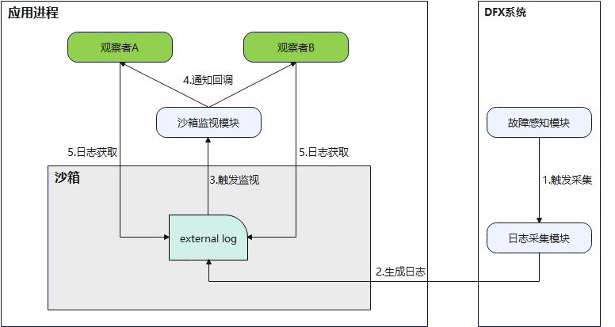

# external_log日志介绍

<!--Kit: Performance Analysis Kit-->
<!--Subsystem: HiviewDFX-->
<!--Owner: @liujiaxing2024-->
<!--Designer: @jiangwenhao-->
<!--Tester: @gcw_KuLfPSbe-->
<!--Adviser: @jinqiuheng-->

## 简介

从API版本26.0.1开始提供了external_log日志管理者注册接口，确保故障日志沙箱目录容量达到阈值时通知应用清理删除external_log文件。

external_log是应用沙箱内的故障日志文件路径，当应用通过HiAppEvent订阅系统事件后，若对应系统事件被触发，系统参数对象params中将包含external_log字段，开发者可依据该路径读取故障日志文件内容。

同一系统事件支持多个订阅者，每个订阅者获取的external_log路径均不同，以确保各订阅者间的操作相互不影响，最多支持前100个订阅者获取独立的日志路径，超出此数量的订阅者将复用相同的日志路径。

目前提供ArkTS和C/C++两种接口注册external_log日志管理者，按需选择。

- [external_log日志清理（ArkTS）](external-log-arkts.md)

- [external_log日志清理（C/C++）](external-log-ndk.md)

## 实现原理
应用通过订阅系统事件来获取对应系统事件发生时的external_log故障日志文件内容，其实现原理如下图所示：

详细步骤如下：
1. 应用运行过程中发生对应系统事件，DFX系统故障感知模块触发故障日志采集。
2. DFX系统将生成的external_log写入应用沙箱目录。
3. HiAppEvent监视到应用沙箱目录有新生成故障日志。
4. HiAppEvent将external_log字段写入系统事件的事件参数对象params中，随回调一同返回给应用观察者。
5. 应用开发者通过external_log字段获取故障日志文件内容。

## 日志规格

external_log目录包含/data/storage/el2/log/hiappevent、/data/storage/el2/log/watchdog、/data/storage/el2/log/resourcelimit。

日志规格可参考[系统事件故障日志目录规格](./hiappevent-intro.md#系统事件故障日志目录规格)。

沙箱故障日志目录阈值：

1. /data/storage/el2/log/hiappevent/ 目录达到4MB时通知应用清理删除external_log文件。

2. /data/storage/el2/log/resourcelimit/ 目录达到1500MB时通知应用清理删除external_log文件。

## 约束与限制

external_log日志管理者只允许被注册一次，已注册成功重复注册返回失败。

注册不会持久化，应用启动不会继承上一次的注册状态，需要重新注册。