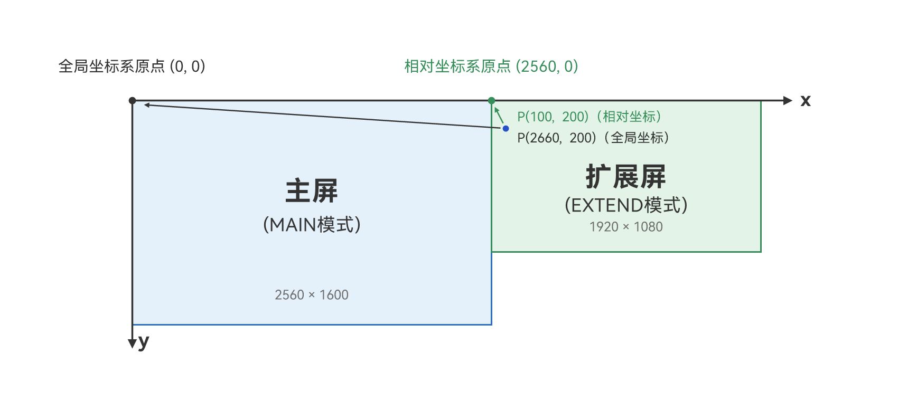

# 实现扩展屏坐标转换
<!--Kit: ArkUI-->
<!--Subsystem: Window-->
<!--Owner: @oh_wangxk-->
<!--Designer: @wulong158-->
<!--Tester: @LiTongguan2026-->
<!--Adviser: @ge-yafang-->

## 场景介绍

[扩展屏](display-terminology.md#扩展屏)是作为[主屏](display-terminology.md#主屏)延伸的逻辑屏，用于增加屏幕的使用空间。PC/2in1设备外接显示器进入多屏模式后，鼠标、窗口可以在主屏与扩展屏之间移动。

多屏场景下，系统与应用描述位置的参照不同：系统以主屏左上角为原点的[全局坐标系](../windowmanager/window-terminology.md#global-coordinate-system全局坐标系)描述整个多屏空间；应用的UI布局、触摸与鼠标事件坐标则以所在屏幕左上角为原点，即[相对坐标系](../windowmanager/window-terminology.md#relative-coordinate-system相对坐标系)。同一个位置在两套坐标系中取值不同，因此应用在跨屏业务中需要进行以下适配：

- 识别各屏幕的显示模式（主屏、扩展屏等）

- 获知屏幕在全局坐标系中的位置

- 在全局坐标与相对坐标之间相互转换

## 获取屏幕显示模式

屏幕的显示模式通过Display对象的sourceMode属性获取，类型为[DisplaySourceMode](../reference/apis-arkui/js-apis-display.md#displaysourcemode19)枚举。

设备外接屏幕进入多屏模式后，主要涉及以下几种显示模式：

| 名称   | 值  | 说明                                                |
| ------ | --- | -------------------------------------------------- |
| MAIN   | 1   | 表示设备当前为主屏。主屏是承载系统核心UI（如任务栏）和默认交互焦点的屏幕，应用窗口默认创建并显示在主屏上。设备未外接屏幕时，设备自带的屏幕即为主屏。    |
| EXTEND | 3   | 表示设备当前为扩展显示模式。处于该模式的屏幕即扩展屏，扩展屏与主屏构成一个连续的显示空间，可以设置与主屏的相对位置，鼠标、窗口可以在主屏与扩展屏之间移动。扩展屏左上角在全局坐标系中的位置可通过其Display对象的x、y属性获取，应用可以在扩展屏上创建窗口，显示与主屏不同的内容。 |

应用可以根据屏幕的显示模式适配多屏业务，例如：

- 仅在sourceMode为EXTEND的屏幕上创建窗口，利用扩展屏显示更多内容。
- 通过sourceMode为MAIN的屏幕获取主屏信息，用于多屏布局计算。

> **说明：**
>
> 设备外接屏幕后，外接屏幕的显示模式在系统设置中可由用户改变。
>
> 用户切换投屏模式、插拔显示器时，相关屏幕的sourceMode会随之变化，应用可通过[display.on('add' | 'remove' | 'change')](../reference/apis-arkui/js-apis-display.md#displayonadd--remove--change)监听变化后重新查询，具体可见下文开发步骤。

1. 获取所有屏幕的显示模式。

    通过[getAllDisplays()](../reference/apis-arkui/js-apis-display.md#displaygetalldisplays9)获取当前所有Display对象后，遍历读取sourceMode属性，即可得到每块屏幕当前的显示模式。

    <!-- @[get_all_displays_source_mode](https://gitcode.com/openharmony/applications_app_samples/blob/master/code/DocsSample/ArkUISample/DisplayBasicSample/entry/src/main/ets/pages/Index.ets) -->
    
    ``` TypeScript
    display.getAllDisplays().then((displays: Array<display.Display>) => {
      for (let i = 0; i < displays.length; i++) {
        // 获取屏幕ID
        hilog.info(DOMAIN, 'DisplayTest', `The display id is ${displays[i].id}`);
        // 获取屏幕显示模式
        hilog.info(DOMAIN, 'DisplayTest', `The display sourceMode is ${displays[i].sourceMode}`);
        if (displays[i].sourceMode === display.DisplaySourceMode.EXTEND) {
          // 对扩展屏进行相应的业务处理，例如在扩展屏上创建窗口显示内容
        }
      }
    }).catch((err: BusinessError) => {
      hilog.error(DOMAIN, 'DisplayTest',
        `Failed to get all displays. Code: ${err.code}, message: ${err.message}`);
    });
    ```

2. 获取指定屏幕的显示模式。

    若已知屏幕ID（可通过[WindowProperties](../reference/apis-arkui/arkts-apis-window-i.md#windowproperties)的displayId属性获得），可以通过[getDisplayByIdSync()](../reference/apis-arkui/js-apis-display.md#displaygetdisplaybyidsync12)获取对应Display对象的sourceMode属性。

    <!-- @[get_display_source_mode_by_id](https://gitcode.com/openharmony/applications_app_samples/blob/master/code/DocsSample/ArkUISample/DisplayBasicSample/entry/src/main/ets/pages/Index.ets) -->
    
    ``` TypeScript
    let displayClass: display.Display | null = null;
    try {
      // 此处displayId仅为示例，实际取值以业务场景为准
      let displayId: number = 1;
      displayClass = display.getDisplayByIdSync(displayId);
      // 获取指定屏幕的显示模式
      hilog.info(DOMAIN, 'DisplayTest', `The display sourceMode is ${displayClass.sourceMode}`);
    } catch (exception) {
      hilog.error(DOMAIN, 'DisplayTest',
        `Failed to get display. Code: ${exception.code}, message: ${exception.message}`);
    }
    ```

3. 监听屏幕显示模式变化。

    屏幕的接入、移除或显示模式切换（例如用户在系统设置中切换投屏模式）时，会触发'add'、'remove'或'change'事件，可通过[display.on('add' | 'remove' | 'change')](../reference/apis-arkui/js-apis-display.md#displayonadd--remove--change)进行监听，在回调中重新查询各屏幕的显示模式，及时更新应用的业务逻辑。

    <!-- @[listen_source_mode_change](https://gitcode.com/openharmony/applications_app_samples/blob/master/code/DocsSample/ArkUISample/DisplayBasicSample/entry/src/main/ets/pages/Index.ets) -->
    
    ``` TypeScript
    let callback: Callback<number> = (displayId: number) => {
      hilog.info(DOMAIN, 'DisplayTest', `Display changed. displayId: ${displayId}`);
      // 屏幕发生变化后，重新查询各屏幕的显示模式并更新业务逻辑
      display.getAllDisplays().then((displays: Array<display.Display>) => {
        for (let i = 0; i < displays.length; i++) {
          hilog.info(DOMAIN, 'DisplayTest',
            `The display ${displays[i].id} sourceMode is ${displays[i].sourceMode}`);
        }
      });
    };
    try {
      // 监听显示设备的增加，例如插入显示器
      display.on('add', callback);
      // 监听显示设备的移除，例如移除显示器
      display.on('remove', callback);
      // 监听显示设备的改变，例如显示模式切换
      display.on('change', callback);
      // 不需要监听时，关闭对应的监听
      display.off('add', callback);
      display.off('remove', callback);
      display.off('change', callback);
    } catch (exception) {
      hilog.error(DOMAIN, 'DisplayTest',
        `Failed to register/unregister callback. Code: ${exception.code}, message: ${exception.message}`);
    }
    ```

## 扩展屏中坐标系的使用

多屏场景下存在以下两种坐标系：

- [全局坐标系](../windowmanager/window-terminology.md#global-coordinate-system全局坐标系)：以主屏左上角为原点。在扩展显示模式下，主屏和扩展屏按照其实际相对位置排列，构成一个连续的显示空间。任意一块屏幕左上角在全局坐标系中的位置，可通过Display对象的x、y属性获取。需要注意的是，仅显示模式为MAIN（主屏）和EXTEND（扩展屏）的屏幕返回实际坐标值，其余显示模式（镜像屏、异源屏等）返回默认值0。
- [相对坐标系](../windowmanager/window-terminology.md#relative-coordinate-system相对坐标系)：以指定屏幕左上角为原点，坐标值表示在该屏幕内的位置。应用内UI组件的坐标、触摸或鼠标事件上报的坐标等，通常都是相对于应用所在屏幕的相对坐标。



如上图所示，以主屏分辨率为2560×1600、扩展屏位于主屏右侧且分辨率为1920×1080为例， 扩展显示模式下，主屏和扩展屏构成连续的显示空间，布局在同一个全局坐标系中。

- 主屏左上角即全局坐标系原点，坐标为(0, 0)，即主屏Display对象的x为0、y为0。
- 扩展屏左上角的全局坐标为(2560, 0)，即扩展屏Display对象的x为2560、y为0。示例中扩展屏位于主屏右侧，主屏的宽度2560即为两块屏幕左上角之间的横向偏移。
- 扩展屏内的点(100, 200)为相对坐标（以扩展屏左上角为原点），其对应的全局坐标为(2660, 200)。

之所以存在这两种坐标系，是因为多屏场景下，系统与应用描述位置时的参照不同：

- 从系统角度看，主屏与扩展屏构成一个连续的显示空间，窗口跨屏移动、鼠标指针在多屏间定位等操作，需要统一的坐标体系来描述对象位于哪块屏幕的什么位置，因此引入以主屏左上角为原点的全局坐标系。
- 从应用角度看，应用的UI布局、触摸或鼠标事件上报的坐标，天然以应用所在屏幕的左上角为参照，应用通常只需关心自身屏幕内的位置，无需感知整个连续显示空间，因此使用以所在屏幕左上角为原点的相对坐标系。

两套坐标系相互独立，当业务涉及跨屏操作时，就需要在两者之间进行坐标转换。例如：将鼠标点击位置的全局坐标转换为相对坐标，判断该位置落在哪块屏幕上；将窗口位置的相对坐标转换为全局坐标，实现窗口从主屏移动到扩展屏。

> **说明：**
>
> 两种坐标系的转换关系为：全局坐标 = 屏幕左上角的全局坐标（Display的x、y属性） + 相对坐标。
>
> 具体可见下文开发步骤与示例。

1. 获取屏幕在全局坐标系中的位置。

    通过[getAllDisplays()](../reference/apis-arkui/js-apis-display.md#displaygetalldisplays9)获取Display对象后，读取x、y属性即可得到该屏幕左上角在全局坐标系中的坐标。

    <!-- @[get_display_global_position](https://gitcode.com/openharmony/applications_app_samples/blob/master/code/DocsSample/ArkUISample/DisplayBasicSample/entry/src/main/ets/pages/Index.ets) -->
    
    ``` TypeScript
    display.getAllDisplays().then((displays: Array<display.Display>) => {
      for (let i = 0; i < displays.length; i++) {
        if (displays[i].sourceMode === display.DisplaySourceMode.EXTEND) {
          // 获取扩展屏左上角在全局坐标系中的坐标
          hilog.info(DOMAIN, 'DisplayTest',
            `The extended display top-left corner is (${displays[i].x}, ${displays[i].y})`);
        }
      }
    }).catch((err: BusinessError) => {
      hilog.error(DOMAIN, 'DisplayTest',
        `Failed to get all displays. Code: ${err.code}, message: ${err.message}`);
    });
    ```

2. 进行相对坐标和全局坐标的相互转换。

    - 通过[convertRelativeToGlobalCoordinate()](../reference/apis-arkui/js-apis-display.md#displayconvertrelativetoglobalcoordinate20)可以将相对坐标转换为全局坐标。

      <!-- @[convert_relative_to_global](https://gitcode.com/openharmony/applications_app_samples/blob/master/code/DocsSample/ArkUISample/DisplayBasicSample/entry/src/main/ets/pages/Index.ets) -->
      
      ``` TypeScript
      // 定义需要转换的相对坐标，displayId为相对坐标系原点所在的屏幕ID
      let relativePosition: display.RelativePosition = {
        displayId: 1,
        position: {
          x: 100,
          y: 200
        }
      };
      
      try {
        // 将相对坐标转换为全局坐标
        let position: display.Position = display.convertRelativeToGlobalCoordinate(relativePosition);
        hilog.info(DOMAIN, 'DisplayTest', `The global coordinate is (${position.x}, ${position.y})`);
      } catch (exception) {
        hilog.error(DOMAIN, 'DisplayTest',
          `Failed to convert the relative coordinate to the global coordinate. Code: ${exception.code}, ` +
          `message: ${exception.message}`);
      }
      ```

    - 通过[convertGlobalToRelativeCoordinate()](../reference/apis-arkui/js-apis-display.md#displayconvertglobaltorelativecoordinate20)可以将全局坐标转换为相对坐标。

      <!-- @[convert_global_to_relative](https://gitcode.com/openharmony/applications_app_samples/blob/master/code/DocsSample/ArkUISample/DisplayBasicSample/entry/src/main/ets/pages/Index.ets) -->
      
      ``` TypeScript
      // 定义需要转换的全局坐标
      let position: display.Position = {
        x: 2660,
        y: 200
      };
      
      try {
        // 将全局坐标转换为displayId为1的屏幕的相对坐标
        let relPos: display.RelativePosition = display.convertGlobalToRelativeCoordinate(position, 1);
        hilog.info(DOMAIN, 'DisplayTest',
          `The relative coordinate is displayId: ${relPos.displayId}, x: ${relPos.position.x}, y: ${relPos.position.y}`);
      } catch (exception) {
        hilog.error(DOMAIN, 'DisplayTest',
          `Failed to convert the global coordinate to the relative coordinate. Code: ${exception.code}, ` +
          `message: ${exception.message}`);
      }
      ```

3. 判断全局坐标所在的屏幕。

    调用[convertGlobalToRelativeCoordinate()](../reference/apis-arkui/js-apis-display.md#displayconvertglobaltorelativecoordinate20)时不传入displayId，返回的RelativePosition对象中，displayId即为该全局坐标所在屏幕的ID。该方式可用于判断鼠标点击等场景下，某个全局坐标落在哪块屏幕上。

    <!-- @[get_display_id_by_global_position](https://gitcode.com/openharmony/applications_app_samples/blob/master/code/DocsSample/ArkUISample/DisplayBasicSample/entry/src/main/ets/pages/Index.ets) -->
    
    ``` TypeScript
    // 定义需要判断的全局坐标
    let position: display.Position = {
      x: 2660,
      y: 200
    };
    
    try {
      // 不传入displayId，返回全局坐标所在屏幕的相对坐标
      let relPos: display.RelativePosition = display.convertGlobalToRelativeCoordinate(position);
      // relPos.displayId即该全局坐标所在屏幕的Id
      hilog.info(DOMAIN, 'DisplayTest', `The position is on the display ${relPos.displayId}`);
    } catch (exception) {
      hilog.error(DOMAIN, 'DisplayTest',
        `Failed to convert the global coordinate to the relative coordinate. Code: ${exception.code}, ` +
        `message: ${exception.message}`);
    }
    ```

