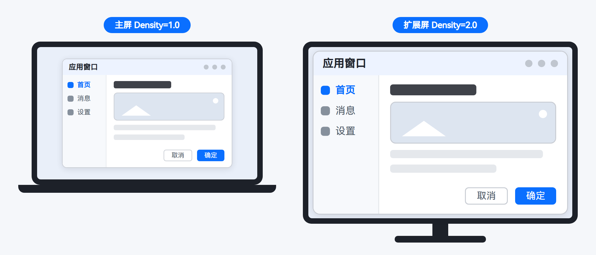
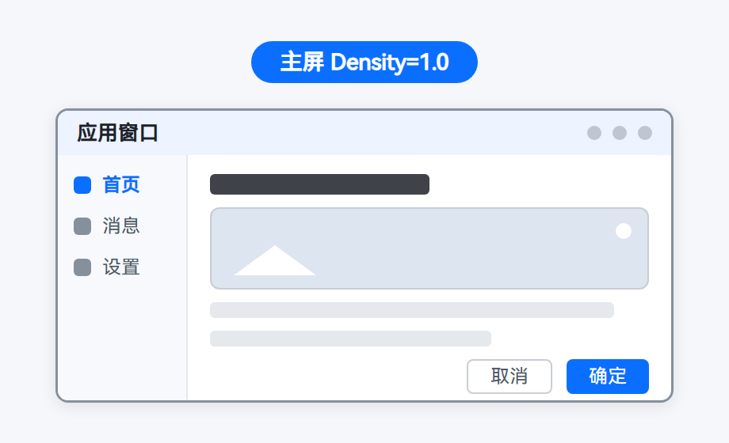
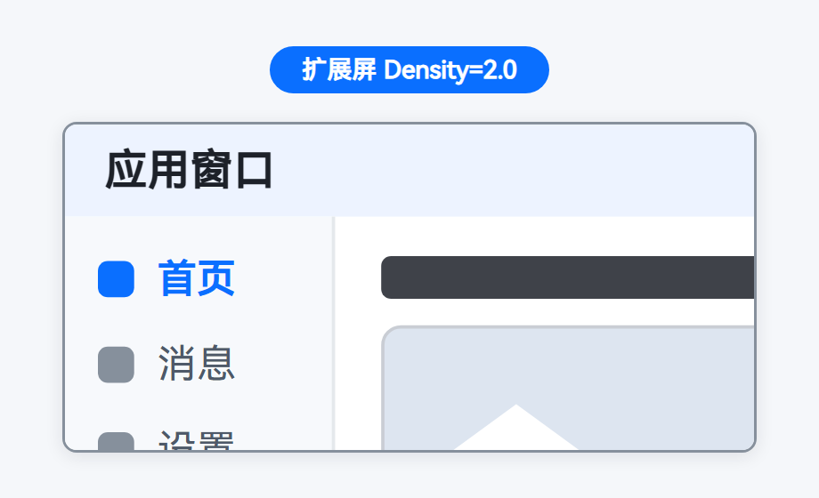

# 显示大小缩放系数（Density）适配

<!--Kit: ArkUI-->
<!--Subsystem: Window-->
<!--Owner: @fei_1007-->
<!--Designer: @gcw_sPCsris4-->
<!--Tester: @jingbotao-->
<!--Adviser: @ge-yafang-->

## 场景介绍

开发者通常按单一屏幕的显示规格设计和验证页面布局，应用运行的设备类型、Density等往往是开发阶段就确定的假设。扩展屏打破了这一假设。

在PC/2in1设备上连接[扩展屏](display-terminology.md#扩展屏)后，主屏与扩展屏可分别设置独立的显示大小，即两块屏幕可以拥有不同的显示大小缩放系数（Density）。鼠标与窗口可在主屏与扩展屏之间移动。窗口跨屏后，其Density会跟随所在屏幕变化（应用设置固定的自定义Density时除外）。通过拖拽方式跨屏移动窗口时，需抬手（松开鼠标或手指）后，窗口所在屏幕信息才会更新。



如上图所示，主屏与扩展屏分别设置了不同的Density，同一个应用窗口在两块屏幕上的元素显示尺寸不同。

### 触发Density变化的典型场景

触发Density变化的典型场景如下：

- **窗口在扩展屏上启动**：例如通过[startAbility()](../reference/apis-ability-kit/js-apis-inner-application-uiAbilityContext.md#startability-2)接口拉起主窗口时，在[StartOptions](../reference/apis-ability-kit/js-apis-app-ability-startOptions.md#startoptions)中指定displayId为扩展屏ID，窗口启动时即处于扩展屏上，初始Density为扩展屏的显示大小缩放系数，可能与主屏不同。

- **窗口跨屏移动**：用户将窗口从主屏拖拽到扩展屏（或应用调用[moveWindowToGlobal()](../reference/apis-arkui/arkts-apis-window-Window.md#movewindowtoglobal15)等接口主动移动窗口），窗口所在屏幕变化后，Density会跟随新屏幕变化。

以窗口跨屏移动为例，若应用未适配扩展屏的Density，可能出现以下显示问题：

| 跨屏前：窗口在主屏显示正常（Density=1.0） | 跨屏后：窗口在扩展屏元素过大（Density=2.0），出现内容截断 |
| ---------------------------------------- | ------------------------------------------ |
|  |  |

问题根源在于：窗口的Density不再是单一值，而是与窗口所在屏幕相关。窗口最终Density与以下三种显示大小缩放系数相关：

| 名称 | 取值范围 | 说明 |
| -------- | -------- | -------- |
| 系统显示大小缩放系数（systemDensity） | [0.5, 4.0] | 用户在系统设置中为窗口所在屏幕设置的显示大小缩放系数。 |
| 系统默认显示大小缩放系数（defaultDensity） | [0.5, 4.0] | 窗口所在屏幕的系统默认显示大小缩放系数，跟随窗口所在屏幕变化。 |
| 自定义显示大小缩放系数（customDensity） | [0.5, 4.0] | 应用为主窗口自定义设置的显示大小缩放系数。未设置时，跟随系统显示大小缩放系数变化。 |

其中，customDensity仅主窗口生效，在子窗、模态窗、全局悬浮窗或系统窗口上，customDensity等于systemDensity。

### 适配思路

窗口在扩展屏上启动或跨屏移动都会导致Density变化。应用若直接沿用主屏的Density进行像素计算或自定义绘制（如vp与px的换算），会出现界面元素过大或过小、布局截断等问题，且开发者往往难以快速定位问题的触发时机与根源。本文提供以下两种适配方式，以帮助开发者快速定位并解决问题：

- [使用自适应/响应式布局自动适配](#使用自适应响应式布局自动适配)：此适配方式无需感知Density，页面自动适应窗口尺寸变化。适用于常规页面布局。
- [使用Window接口适配多屏多Density](#使用window接口适配多屏多density)：此适配方式通过查询与监听接口获取窗口最新的Density信息，以用于布局计算，并在必要时设置窗口Density的跟随策略。适用于自定义绘制等依赖像素计算的场景。

> **说明：**
>
> 本文档面向PC/2in1设备连接扩展屏后的应用适配场景。本文中的接口可能在不同设备上的支持情况存在差异，具体请查阅对应接口的API参考文档。

## 使用自适应/响应式布局自动适配

日常使用ArkUI声明式布局开发时，元素尺寸多以vp声明，布局系统本就能响应窗口尺寸变化自动重新布局（px = vp * density），无需主动感知Density。

当窗口尺寸变化需要调整布局结构（如换行、重排）时，可使用ArkUI提供的以下布局能力自动适配：

- **自适应布局**：ArkUI提供拉伸、均分、占比、缩放、延伸、隐藏、折行共七种自适应布局能力，页面元素随容器尺寸变化自动调整尺寸与排布，可独立或叠加使用。详见[自适应布局](https://developer.huawei.com/consumer/cn/doc/doccenter-multi-device/bpta-multi-device-adaptive-layout)。
- **响应式布局**：基于响应式设计方法论，页面可根据窗口尺寸等特征自动调整布局，主要能力包括断点、媒体查询、栅格、响应式组件。详见[响应式布局](https://developer.huawei.com/consumer/cn/doc/doccenter-multi-device/bpta-multi-device-responsive-layout)。

> **说明：**
>
> 应用自定义绘制等依赖像素计算的场景，布局能力无法自动处理，需通过[使用Window接口适配多屏多Density](#使用window接口适配多屏多density)获取最新的Density信息后自行换算。

## 使用Window接口适配多屏多Density

应用依赖Density进行像素计算或自定义绘制时，可通过Window接口获取并监听窗口最新的Density信息，用于vp和px的换算；必要时，还可以设置窗口Density的跟随策略，决定窗口跟随哪个显示大小缩放系数重新布局。

### 获取并监听窗口最新Density

扩展屏场景下，与Density相关的查询和监听接口如下：

| 接口 | 功能 | 使用场景 |
| -------- | -------- | -------- |
| [getWindowDensityInfo()](../reference/apis-arkui/arkts-apis-window-Window.md#getwindowdensityinfo15) | 获取当前窗口所在屏幕的系统显示大小缩放系数、系统默认显示大小缩放系数和自定义显示大小缩放系数信息。 | 窗口启动时、跨屏移动后获取当前Density信息。 |
| [getWindowProperties()](../reference/apis-arkui/arkts-apis-window-Window.md#getwindowproperties9) | 获取当前窗口的属性，其中displayId表示窗口所在屏幕ID。 | 需要获取窗口所在屏幕ID时。 |
| [on('displayIdChange')](../reference/apis-arkui/arkts-apis-window-Window.md#ondisplayidchange14) | 开启本窗口所处屏幕变化事件的监听，回调返回窗口所处屏幕的displayId。 | 窗口跨屏移动时感知所在屏幕变化。 |
| [off('displayIdChange')](../reference/apis-arkui/arkts-apis-window-Window.md#offdisplayidchange14) | 关闭本窗口所处屏幕变化事件的监听。 | 不再需要监听时，注销监听。 |
| [on('systemDensityChange')](../reference/apis-arkui/arkts-apis-window-Window.md#onsystemdensitychange15) | 开启本窗口所处屏幕的系统显示大小缩放系数变化事件的监听，回调返回变化后的系统显示大小缩放系数。 | 用户调整窗口所在屏幕的显示大小，或窗口跨屏移动到系统显示大小缩放系数不同的屏幕时。 |
| [off('systemDensityChange')](../reference/apis-arkui/arkts-apis-window-Window.md#offsystemdensitychange15) | 关闭本窗口所处屏幕的系统显示大小缩放系数变化事件的监听。 | 不再需要监听时，注销监听。 |

此处提供以下两种典型场景下的Density查询与监听。

**窗口启动时查询Density**

窗口启动时（例如窗口在扩展屏上启动），需查询所在屏幕的Density信息，用于首帧布局计算。步骤如下：

1. 在EntryAbility的[loadContent()](../reference/apis-arkui/arkts-apis-window-WindowStage.md#loadcontent9)回调中保存WindowStage，供页面使用。

   <!--@[window_density_save_window_stage](https://gitcode.com/openharmony/applications_app_samples/blob/master/code/DocsSample/ArkUISample/ArkUIWindowSamples/WindowDensitySample/entry/src/main/ets/entryability/EntryAbility.ets)-->
   ```ts
   // EntryAbility.ets
   // 示例应用的入口
   import { UIAbility } from '@kit.AbilityKit';
   import { window } from '@kit.ArkUI';
   import { BusinessError } from '@kit.BasicServicesKit';

   export default class EntryAbility extends UIAbility {
     onWindowStageCreate(windowStage: window.WindowStage): void {
       windowStage.loadContent('pages/Index', (err: BusinessError) => {
         if (err.code) {
           console.error(`Failed to load the content. Cause code: ${err.code}, message: ${err.message}`);
           return;
         }
         // 保存windowStage，供页面查询density信息和设置density跟随策略
         AppStorage.setOrCreate<window.WindowStage>('windowStage', windowStage);
       });
     }
   }
   ```

2. 页面加载完成后，通过[getMainWindowSync()](../reference/apis-arkui/arkts-apis-window-WindowStage.md#getmainwindowsync9)获取主窗口，并调用[getWindowDensityInfo()](../reference/apis-arkui/arkts-apis-window-Window.md#getwindowdensityinfo15)查询Density信息。

   Density信息通过[WindowDensityInfo](../reference/apis-arkui/arkts-apis-window-i.md#windowdensityinfo15)返回，包含systemDensity、defaultDensity、customDensity三个字段，可存入AppStorage供页面布局计算使用。

   以下示例演示页面加载完成后（aboutToAppear中），如何获取主窗口并查询初始的屏幕ID和Density信息。

   > **说明：**
   >
   > [getWindowDensityInfo()](../reference/apis-arkui/arkts-apis-window-Window.md#getwindowdensityinfo15)返回值为[-1, -1, -1]时，表示当前设备不支持使用该接口。

   <!--@[window_density_query_density_info](https://gitcode.com/openharmony/applications_app_samples/blob/master/code/DocsSample/ArkUISample/ArkUIWindowSamples/WindowDensitySample/entry/src/main/ets/pages/Index.ets)-->
   ```ts
   // Index.ets
   // 示例应用的主页面
   import { window } from '@kit.ArkUI';
   // ...

   @Entry
   @Component
   struct Index {
     @State displayId: number = 0;
     @State systemDensity: number = 1.0;
     @State defaultDensity: number = 1.0;
     @State customDensity: number = 1.0;
     private mainWindow: window.Window | null = null;

     aboutToAppear(): void {
       let windowStage = AppStorage.get<window.WindowStage>('windowStage');
       if (!windowStage) {
         return;
       }
       this.mainWindow = windowStage.getMainWindowSync();
       // 查询初始的窗口所在屏幕ID和density信息
       this.queryDensityInfo();
   // ...
     }

   // ...
   // ...
     // 查询当前窗口所在屏幕的屏幕ID和density信息
     queryDensityInfo(): void {
       if (!this.mainWindow) {
         return;
       }
       try {
         this.displayId = this.mainWindow.getWindowProperties().displayId!;
         let densityInfo = this.mainWindow.getWindowDensityInfo();
         this.systemDensity = densityInfo.systemDensity;
         this.defaultDensity = densityInfo.defaultDensity;
         this.customDensity = densityInfo.customDensity;
       } catch (exception) {
         console.error(`Failed to obtain the window densityInfo. Cause code: ${exception.code}, message: ${exception.message}`);
       }
     }

     build() {
       Column({ space: 20 }) {
         Text(`窗口所在屏幕ID：${this.displayId}`)
           .fontSize(20)
         Text(`系统显示大小缩放系数：${this.systemDensity}`)
           .fontSize(20)
         Text(`系统默认显示大小缩放系数：${this.defaultDensity}`)
           .fontSize(20)
         Text(`自定义显示大小缩放系数：${this.customDensity}`)
           .fontSize(20)
   // ...
       }
       .width('100%')
       .height('100%')
       .justifyContent(FlexAlign.Center)
     }
   }
   ```

**窗口跨屏移动后监听Density变化**

窗口跨屏移动主要有以下几种方式。

- 用户直接拖拽窗口标题栏，将窗口从一块屏幕移动到另一块屏幕。

- 应用调用[startMoving()](../reference/apis-arkui/arkts-apis-window-Window.md#startmoving14)接口，在[onTouch](../reference/apis-arkui/arkui-ts/ts-universal-events-touch.md#ontouch)事件回调中（事件类型须为TouchType.Down）通过鼠标或触摸点拖拽移动窗口。

- 应用调用[moveWindowToGlobal()](../reference/apis-arkui/arkts-apis-window-Window.md#movewindowtoglobal15)接口，通过[MoveConfiguration](../reference/apis-arkui/arkts-apis-window-i.md#moveconfiguration15)的displayId参数指定目标屏幕，主动移动窗口。displayId仅支持主屏和扩展屏，不传、传undefined或传入目标屏幕ID不存在时，将移动到相对于当前屏幕左上角的指定位置。

窗口跨屏移动后，具体适配步骤如下：

1. 通过[on('displayIdChange')](../reference/apis-arkui/arkts-apis-window-Window.md#ondisplayidchange14)监听窗口所处屏幕变化，在回调中重新调用[getWindowDensityInfo()](../reference/apis-arkui/arkts-apis-window-Window.md#getwindowdensityinfo15)获取新屏幕的完整Density信息，无需依赖该事件与systemDensityChange事件的回调顺序。

2. 通过[on('systemDensityChange')](../reference/apis-arkui/arkts-apis-window-Window.md#onsystemdensitychange15)监听窗口所处屏幕的系统显示大小缩放系数变化，并在回调中直接使用返回值进行vp和px的换算，例如`px = vp * density`。

3. Density变化后，窗口的vp尺寸会随之变化。应用自定义绘制等依赖像素计算的场景，需要根据最新的Density信息自行处理。

以下示例演示了完整的查询与监听流程：页面加载完成时（aboutToAppear中）查询初始的屏幕ID和Density信息，窗口跨屏移动或系统显示大小缩放系数变化时刷新页面显示，页面销毁前（aboutToDisappear中）注销监听。

<!--@[window_density_cross_screen_index](https://gitcode.com/openharmony/applications_app_samples/blob/master/code/DocsSample/ArkUISample/ArkUIWindowSamples/WindowDensitySample/entry/src/main/ets/pages/Index.ets)-->
```ts
// Index.ets
// 示例应用的主页面
import { window } from '@kit.ArkUI';
// ...

@Entry
@Component
struct Index {
  @State displayId: number = 0;
  @State systemDensity: number = 1.0;
  @State defaultDensity: number = 1.0;
  @State customDensity: number = 1.0;
  private mainWindow: window.Window | null = null;

  aboutToAppear(): void {
    let windowStage = AppStorage.get<window.WindowStage>('windowStage');
    if (!windowStage) {
      return;
    }
    this.mainWindow = windowStage.getMainWindowSync();
    // 查询初始的窗口所在屏幕ID和density信息
    this.queryDensityInfo();
    try {
      // 监听窗口跨屏移动事件，窗口移动到新屏幕后重新查询density信息
      this.mainWindow.on('displayIdChange', (data: number) => {
        console.info('Window displayId changed, displayId=' + JSON.stringify(data));
        this.queryDensityInfo();
      });
      // 监听本窗口所处屏幕的系统显示大小缩放系数变化事件
      this.mainWindow.on('systemDensityChange', (data: number) => {
        console.info('System density changed, density=' + JSON.stringify(data));
        this.systemDensity = data;
      });
    } catch (exception) {
      console.error(`Failed to register callback. Cause code: ${exception.code}, message: ${exception.message}`);
    }
  }

// ...
  aboutToDisappear(): void {
    // 两个off()分别捕获异常，其中一个注销失败不影响另一个执行
    try {
      this.mainWindow?.off('displayIdChange');
    } catch (exception) {
      console.error(`Failed to unregister callback. Cause code: ${exception.code}, message: ${exception.message}`);
    }
    try {
      this.mainWindow?.off('systemDensityChange');
    } catch (exception) {
      console.error(`Failed to unregister callback. Cause code: ${exception.code}, message: ${exception.message}`);
    }
  }

  // 查询当前窗口所在屏幕的屏幕ID和density信息
  queryDensityInfo(): void {
    if (!this.mainWindow) {
      return;
    }
    try {
      this.displayId = this.mainWindow.getWindowProperties().displayId!;
      let densityInfo = this.mainWindow.getWindowDensityInfo();
      this.systemDensity = densityInfo.systemDensity;
      this.defaultDensity = densityInfo.defaultDensity;
      this.customDensity = densityInfo.customDensity;
    } catch (exception) {
      console.error(`Failed to obtain the window densityInfo. Cause code: ${exception.code}, message: ${exception.message}`);
    }
  }

  build() {
    Column({ space: 20 }) {
      Text(`窗口所在屏幕ID：${this.displayId}`)
        .fontSize(20)
      Text(`系统显示大小缩放系数：${this.systemDensity}`)
        .fontSize(20)
      Text(`系统默认显示大小缩放系数：${this.defaultDensity}`)
        .fontSize(20)
      Text(`自定义显示大小缩放系数：${this.customDensity}`)
        .fontSize(20)
// ...
    }
    .width('100%')
    .height('100%')
    .justifyContent(FlexAlign.Center)
  }
}
```

### 设置窗口Density（可选）

可根据业务需求，设置窗口Density。未设置时，窗口默认跟随用户设置的所在屏幕的系统显示大小缩放系数（systemDensity）变化重新布局，同时布局能力也会自动适应。多数应用无需主动设置，仅当应用有以下诉求时才需要设置：

- 希望界面尺寸不随用户调整系统设置中的【显示大小】而变化。

- 应用内提供界面缩放设置项（例如应用内将界面缩放设置为2.0倍）。

主窗口支持以下三种Density跟随策略，策略设置后子窗和系统窗口会跟随主窗生效。

| 跟随策略 | 调用接口 | 窗口行为 | 典型场景 |
| -------- | -------- | -------- | -------- |
| 跟随默认Density | 调用[setDefaultDensityEnabled()](../reference/apis-arkui/arkts-apis-window-WindowStage.md#setdefaultdensityenabled12)传入true | 窗口使用所在屏幕的系统默认显示大小缩放系数（defaultDensity），不跟随用户设置的显示大小（systemDensity）变化而重新布局。 | 应用界面尺寸不随用户调整系统设置中的【显示大小】变化的场景。 |
| 跟随系统Density | 不调用接口（默认行为）；或调用[setDefaultDensityEnabled()](../reference/apis-arkui/arkts-apis-window-WindowStage.md#setdefaultdensityenabled12)传入false | 窗口跟随用户设置的所在屏幕的系统显示大小缩放系数（systemDensity）变化而重新布局。 | 应用界面尺寸跟随用户系统设置变化的场景。 |
| 跟随自定义Density | [setCustomDensity()](../reference/apis-arkui/arkts-apis-window-WindowStage.md#setcustomdensity15) | 窗口使用应用自定义的显示大小缩放系数（customDensity），跨屏移动后保持该缩放系数不变。 | 应用内提供界面缩放设置项的场景。 |

> **说明：**
>
> - [setDefaultDensityEnabled()](../reference/apis-arkui/arkts-apis-window-WindowStage.md#setdefaultdensityenabled12)接口需在[loadContent()](../reference/apis-arkui/arkts-apis-window-WindowStage.md#loadcontent9)或[loadContentByName()](../reference/apis-arkui/arkts-apis-window-WindowStage.md#loadcontentbyname11)初始化布局之后调用，确保接口调用时序正确。
> - 当存在同时使用setDefaultDensityEnabled()传入true和setCustomDensity()的情况时，以最后调用的设置效果为准。
> - setCustomDensity()传入的自定义显示大小缩放系数取值范围为[0.5, 4.0]，传入-1.0表示窗口使用系统显示大小缩放系数（即恢复为系统Density策略）。
> - 已创建的子窗和系统窗口不会立即跟随主窗的customDensity变化重新布局，而是在其下一次位置、大小、系统缩放大小等窗口布局信息变化时跟随生效。从API version 20开始，支持调用[setCustomDensity()](../reference/apis-arkui/arkts-apis-window-WindowStage.md#setcustomdensity20)接口使用applyToSubWindow参数设置已创建的子窗和系统窗口立即跟随主窗重新布局。

具体开发步骤如下：

1. 设置Density跟随策略依赖WindowStage，需先在EntryAbility的[loadContent()](../reference/apis-arkui/arkts-apis-window-WindowStage.md#loadcontent9)回调中保存WindowStage，供策略设置页面使用。

   <!--@[window_density_save_window_stage](https://gitcode.com/openharmony/applications_app_samples/blob/master/code/DocsSample/ArkUISample/ArkUIWindowSamples/WindowDensitySample/entry/src/main/ets/entryability/EntryAbility.ets)-->
   ```ts
   // EntryAbility.ets
   // 示例应用的入口
   import { UIAbility } from '@kit.AbilityKit';
   import { window } from '@kit.ArkUI';
   import { BusinessError } from '@kit.BasicServicesKit';

   export default class EntryAbility extends UIAbility {
     onWindowStageCreate(windowStage: window.WindowStage): void {
       windowStage.loadContent('pages/Index', (err: BusinessError) => {
         if (err.code) {
           console.error(`Failed to load the content. Cause code: ${err.code}, message: ${err.message}`);
           return;
         }
         // 保存windowStage，供页面查询density信息和设置density跟随策略
         AppStorage.setOrCreate<window.WindowStage>('windowStage', windowStage);
       });
     }
   }
   ```

2. 设置跟随策略。此处以通过开关切换默认Density策略为例，开启后窗口使用所在屏幕的系统默认显示大小缩放系数，不跟随用户设置的显示大小变化重新布局；点击按钮设置自定义Density策略后，窗口使用固定的自定义显示大小缩放系数，跨屏移动后保持不变。

   <!--@[window_density_set_density_strategy](https://gitcode.com/openharmony/applications_app_samples/blob/master/code/DocsSample/ArkUISample/ArkUIWindowSamples/WindowDensitySample/entry/src/main/ets/pages/DensityStrategy.ets)-->
   ```ts
   // DensityStrategy.ets
   // 示例应用的Density跟随策略设置页面
   import { window } from '@kit.ArkUI';
   // ...

   @Entry
   @Component
   struct DensityStrategy {
     @State isDefaultDensityEnabled: boolean = false;
     @State strategyText: string = '当前density跟随策略：系统density策略';

     // 通过开关切换默认density策略：开启后窗口使用所在屏幕的系统默认显示大小缩放系数，不跟随用户设置的显示大小变化重新布局
     private updateDefaultDensityEnabled(value: boolean): void {
       let windowStage = AppStorage.get<window.WindowStage>('windowStage');
       if (!windowStage) {
         return;
       }
       try {
         windowStage.setDefaultDensityEnabled(value);
         console.info('Succeeded in setting default density enabled.');
       } catch (exception) {
         console.error(`Failed to set default density enabled. Cause code: ${exception.code}, message: ${exception.message}`);
       }
       this.strategyText = value ? '当前density跟随策略：默认density策略' : '当前density跟随策略：系统density策略';
     }

     // 设置自定义density策略：窗口使用固定的自定义显示大小缩放系数，跨屏移动后保持不变
     private setCustomDensityStrategy(): void {
       let windowStage = AppStorage.get<window.WindowStage>('windowStage');
       if (!windowStage) {
         return;
       }
       // 例如应用内将界面缩放设置为2.0倍
       windowStage.setCustomDensity(2.0);
       // 传入-1.0表示窗口使用系统显示大小缩放系数
       // windowStage.setCustomDensity(-1.0);
       // 从API version 20开始，支持设置已创建的子窗和系统窗口立即跟随主窗重新布局
       // windowStage.setCustomDensity(2.0, true);
       this.isDefaultDensityEnabled = false;
       this.strategyText = '当前density跟随策略：自定义density策略（2.0）';
     }

     build() {
       Column({ space: 20 }) {
         Text(this.strategyText)
           .id('strategyText')
           .fontSize(16)
           .fontColor(Color.Gray)
         Row({ space: 8 }) {
           Text('默认density策略')
             .fontSize(16)
           Toggle({ type: ToggleType.Switch, isOn: this.isDefaultDensityEnabled })
             .id('defaultDensitySwitch')
             .onChange((value: boolean) => {
               this.isDefaultDensityEnabled = value;
               this.updateDefaultDensityEnabled(value);
             })
         }
         Button('自定义density策略(2.0)')
           .id('customDensityButton')
           .fontSize(16)
           .width('80%')
           .margin({ top: 8 })
           .onClick(() => {
             this.setCustomDensityStrategy();
           })
   // ...
       }
       .width('100%')
       .height('100%')
       .justifyContent(FlexAlign.Center)
     }
   }
   ```
