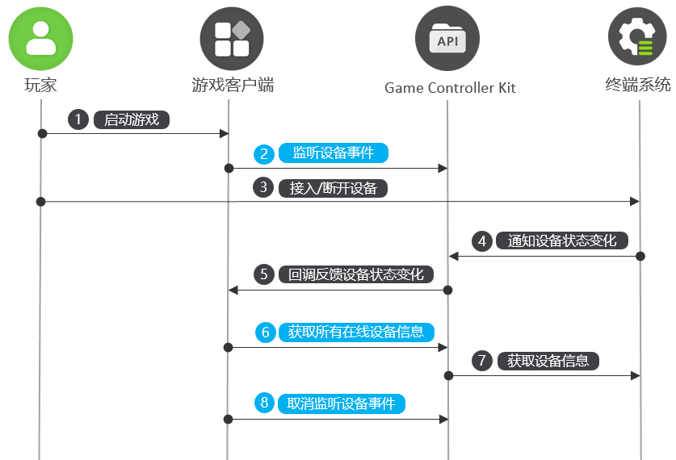

# 监听设备上下线（C/C++）
<!--Kit: Game Controller Kit-->
<!--Subsystem: Game-->
<!--Owner: @weixin_42784160-->
<!--Designer: @wudejun2025-->
<!--Tester: @fei_0805-->
<!--Adviser: @yuwenliang0514-->

## 功能介绍

Game Controller Kit提供设备上下线事件监听和查询在线设备信息的功能。注册监听事件后，设备拔插时可获取实时回调通知，同时支持查询当前所有在线设备的具体信息。


## 业务流程



1. 玩家启动游戏。

2. 游戏调用[OH_GameDevice_RegisterDeviceMonitor](../reference/apis-game-controller-kit/capi-game-device-h.md#oh_gamedevice_registerdevicemonitor)接口注册设备状态变化事件监听。

3. 玩家插拔设备。

4. 终端系统将设备状态变化通知Game Controller Kit。

5. Game Controller Kit向游戏反馈设备状态变化。

6. 游戏调用[OH_GameDevice_GetAllDeviceInfos](../reference/apis-game-controller-kit/capi-game-device-h.md#oh_gamedevice_getalldeviceinfos)接口向Game Controller Kit查询所有在线的游戏设备信息。

7. Game Controller Kit从终端系统获取所有在线的游戏设备信息。

8. 如果不再需要订阅，游戏可以调用[OH_GameDevice_UnregisterDeviceMonitor](../reference/apis-game-controller-kit/capi-game-device-h.md#oh_gamedevice_unregisterdevicemonitor)接口取消设备状态变化事件监听。


## 接口说明

接口详细介绍请参考[GameController](../reference/apis-game-controller-kit/capi-gamecontroller.md)。

| 接口名 | 描述 | 
| -------- | -------- |
| GameController_ErrorCode [OH_GameDevice_RegisterDeviceMonitor](../reference/apis-game-controller-kit/capi-game-device-h.md#oh_gamedevice_registerdevicemonitor) (GameDevice_DeviceMonitorCallback deviceMonitorCallback) | 注册设备状态变化事件的监听回调。 | 
| GameController_ErrorCode [OH_GameDevice_UnregisterDeviceMonitor](../reference/apis-game-controller-kit/capi-game-device-h.md#oh_gamedevice_unregisterdevicemonitor) (void) | 取消注册设备状态变化事件的监听回调。 | 
| GameController_ErrorCode [OH_GameDevice_GetAllDeviceInfos](../reference/apis-game-controller-kit/capi-game-device-h.md#oh_gamedevice_getalldeviceinfos) (GameDevice_AllDeviceInfos \*\*allDeviceInfos) | 获取所有在线设备的信息。 | 


## 开发步骤


### 链接动态库

<!-- @[link_game_controller_libs](https://gitcode.com/openharmony/applications_app_samples/blob/master/code/DocsSample/GameControllerKit/NdkGameControllerDemo/entry/src/main/cpp/CMakeLists.txt) -->

``` Text
target_link_libraries(entry PUBLIC libohgame_controller.z.so)
```


### 导入模块

<!-- @[header_include_game_device](https://gitcode.com/openharmony/applications_app_samples/blob/master/code/DocsSample/GameControllerKit/NdkGameControllerDemo/entry/src/main/cpp/device_api.cpp) -->

``` C++
#include "GameControllerKit/game_device.h"
```


### 注册设备上下线监听

调用[OH_GameDevice_RegisterDeviceMonitor](../reference/apis-game-controller-kit/capi-game-device-h.md#oh_gamedevice_registerdevicemonitor)接口注册设备状态变化监听，获取设备上下线的回调通知。

<!-- @[register_device_monitor](https://gitcode.com/openharmony/applications_app_samples/blob/master/code/DocsSample/GameControllerKit/NdkGameControllerDemo/entry/src/main/cpp/device_api.cpp) -->

``` C++
int32_t DeviceApi::RegisterDeviceMonitor()
{
    GameController_ErrorCode errorCode = OH_GameDevice_RegisterDeviceMonitor(DeviceApi::OnDeviceChanged);
    if (errorCode != GameController_ErrorCode::GAME_CONTROLLER_SUCCESS) {
        OH_LOG_ERROR(LOG_APP, "RegisterDeviceMonitor Failed, %{public}d", errorCode);
        return static_cast<int32_t>(errorCode);
    }
    OH_LOG_INFO(LOG_APP, "RegisterDeviceMonitor Success");
    return 0;
}

void DeviceApi::OnDeviceChanged(const struct GameDevice_DeviceEvent *deviceEvent)
{
    GameDevice_StatusChangedType type;
    OH_GameDevice_DeviceEvent_GetChangedType(deviceEvent, &type);
    GameDevice_DeviceInfo *deviceInfo;
    OH_GameDevice_DeviceEvent_GetDeviceInfo(deviceEvent, &deviceInfo);
    std::string temp = GetDeviceInfoStringForPrint(deviceInfo);
    Log::GetInstance()->PrintLog("OnDeviceChanged type[" + std::to_string(type) + "] DeviceInfo" + temp);
    OH_LOG_INFO(LOG_APP, "OnDeviceChanged type:%{public}d DeviceInfo:%{public}s", type, temp.c_str());
    OH_GameDevice_DestroyDeviceInfo(&deviceInfo);
}
```


### 取消注册设备上下线监听

如果不再需要订阅，可以调用[OH_GameDevice_UnregisterDeviceMonitor](../reference/apis-game-controller-kit/capi-game-device-h.md#oh_gamedevice_unregisterdevicemonitor)接口取消设备状态变化事件的监听。

<!-- @[unregister_device_monitor](https://gitcode.com/openharmony/applications_app_samples/blob/master/code/DocsSample/GameControllerKit/NdkGameControllerDemo/entry/src/main/cpp/device_api.cpp) -->

``` C++
int32_t DeviceApi::UnregisterDeviceMonitor()
{
    GameController_ErrorCode errorCode = OH_GameDevice_UnregisterDeviceMonitor();
    if (errorCode != GameController_ErrorCode::GAME_CONTROLLER_SUCCESS) {
        OH_LOG_ERROR(LOG_APP, "UnregisterDeviceMonitor Failed, %{public}d", errorCode);
        return static_cast<int32_t>(errorCode);
    }
    OH_LOG_INFO(LOG_APP, "UnregisterDeviceMonitor Success");
    return 0;
}
```


### 查询所有在线设备

调用[OH_GameDevice_GetAllDeviceInfos](../reference/apis-game-controller-kit/capi-game-device-h.md#oh_gamedevice_getalldeviceinfos)接口，查询所有在线游戏设备的信息。

<!-- @[query_all_device_infos](https://gitcode.com/openharmony/applications_app_samples/blob/master/code/DocsSample/GameControllerKit/NdkGameControllerDemo/entry/src/main/cpp/device_api.cpp) -->

``` C++
GameController_ErrorCode DeviceApi::DoQueryAllDeviceInfos()
{
    GameDevice_AllDeviceInfos *gameDeviceAllDeviceInfos;
    
    // Query all online devices.
    GameController_ErrorCode errorCode = OH_GameDevice_GetAllDeviceInfos(&gameDeviceAllDeviceInfos);
    if (errorCode != GameController_ErrorCode::GAME_CONTROLLER_SUCCESS) {
        OH_LOG_ERROR(LOG_APP, "GetAllDeviceInfos Failed, %{public}d", errorCode);
        Log::GetInstance()->PrintLog("GetAllDeviceInfos Failed, errorCode: " + std::to_string(errorCode));
        return errorCode;
    }
    
    // Obtain device info one by one.
    int count;
    OH_GameDevice_AllDeviceInfos_GetCount(gameDeviceAllDeviceInfos, &count);
    Log::GetInstance()->PrintLog("GetAllDeviceInfos Success, the count is " + std::to_string(count));
    for (int idx = 0; idx < count; idx++) {
        GameDevice_DeviceInfo *deviceInfo;
        errorCode = OH_GameDevice_AllDeviceInfos_GetDeviceInfo(gameDeviceAllDeviceInfos, idx, &deviceInfo);
        if (errorCode != GameController_ErrorCode::GAME_CONTROLLER_SUCCESS) {
            OH_LOG_ERROR(LOG_APP, "OH_GameDevice_AllDeviceInfos_GetDeviceInfo Failed, %{public}d", errorCode);
            Log::GetInstance()->PrintLog("OH_GameDevice_AllDeviceInfos_GetDeviceInfo Failed, errorCode: " +
                                         std::to_string(errorCode));
            OH_GameDevice_DestroyAllDeviceInfos(&gameDeviceAllDeviceInfos);
            return errorCode;
        }
        std::string temp = GetDeviceInfoStringForPrint(deviceInfo);
        Log::GetInstance()->PrintLog("AllDeviceInfos[" + std::to_string(idx) + "] " + temp);
        OH_LOG_INFO(LOG_APP, "AllDeviceInfos[%{public}d] DeviceInfo: %{public}s", idx, temp.c_str());
        OH_GameDevice_DestroyDeviceInfo(&deviceInfo);
    }
    
    // Destroy the pointer to the device query result.
    OH_GameDevice_DestroyAllDeviceInfos(&gameDeviceAllDeviceInfos);
    OH_LOG_INFO(LOG_APP, "GetAllDeviceInfos Success");
    return errorCode;
}

std::string DeviceApi::GetDeviceInfoStringForPrint(GameDevice_DeviceInfo *deviceInfo)
{
    // Obtain device info
    std::string log;
    char *deviceId = nullptr;
    OH_GameDevice_DeviceInfo_GetDeviceId(deviceInfo, &deviceId);
    log.append("deviceId:").append(deviceId);
    free(deviceId);
    char *name = nullptr;
    OH_GameDevice_DeviceInfo_GetName(deviceInfo, &name);
    log.append(", name:").append(name);
    free(name);
    int vendor;
    OH_GameDevice_DeviceInfo_GetVendor(deviceInfo, &vendor);
    log.append(", vendor:").append(std::to_string(vendor));
    int product;
    OH_GameDevice_DeviceInfo_GetProduct(deviceInfo, &product);
    log.append(", product:").append(std::to_string(product));
    int version;
    OH_GameDevice_DeviceInfo_GetVersion(deviceInfo, &version);
    log.append(", version:").append(std::to_string(version));
    char *physicalAddress = nullptr;
    OH_GameDevice_DeviceInfo_GetPhysicalAddress(deviceInfo, &physicalAddress);
    log.append(", physicalAddress:").append(physicalAddress);
    free(physicalAddress);
    GameDevice_DeviceType type;
    OH_GameDevice_DeviceInfo_GetDeviceType(deviceInfo, &type);
    log.append(", type:").append(std::to_string(type));
    return log;
}
```