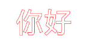
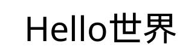
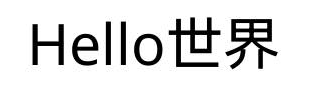
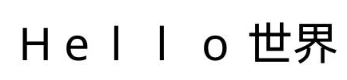
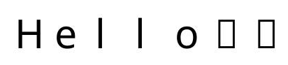

# 字块绘制（C/C++）

<!--Kit: ArkGraphics 2D-->
<!--Subsystem: Graphics-->
<!--Owner: @hangmengxin-->
<!--Designer: @wanyanglan-->
<!--Tester: @nobuggers-->
<!--Adviser: @ge-yafang-->

## 场景介绍

字块（TextBlob）是指文本的集合。无论是单个的文字还是大块的文本，都可以通过字块来绘制。

除了基本的字块绘制之外，还可以给文字添加各种绘制效果。常见的字块绘制场景包括[文字描边](#文字描边)、[文字渐变](#文字渐变)、[字体回退](#字体回退)等，更多效果请见[绘制效果](drawing-effect-overview.md)。

本节不涉及文本测量和布局排版相关内容，如需在开发中处理此类文本绘制需求，可参考[文本开发概述](text-overview.md)，该文档系统讲解了排版策略与相关使用指导。

## 基本字块绘制

使用OH_Drawing_CanvasDrawTextBlob()接口绘制字块，接口接受4个参数，分别为：画布Canvas对象、字块对象、文字基线左端点的x坐标和y坐标。

画布Canvas对象具体可见[画布的获取与绘制结果的显示（C/C++）](canvas-get-result-draw-c.md)。

字块对象可以通过多种方式创建得到，详细的字块创建方式请参考[drawing_text_blob.h](../reference/apis-arkgraphics2d/capi-drawing-text-blob-h.md)。

此处以使用OH_Drawing_TextBlobCreateFromString()接口创建字块为例，接口接受3个参数，分别为：

- 需要显示的文本字符串内容。

- 指向OH_Drawing_Font字体对象的指针。OH_Drawing_Font用于设置和获取字体的各种属性，如字体大小、文本样式、字体对齐方式、字体渲染方式、字体描边方式等，详细的API介绍请参考[drawing_font.h](../reference/apis-arkgraphics2d/capi-drawing-font-h.md)。

- 文本编码方式。

简单示例和示意图如下所示：

<!-- @[ndk_graphics_draw_base_text](https://gitcode.com/openharmony/applications_app_samples/blob/master/code/DocsSample/ArkGraphics2D/Drawing/NDKGraphicsDraw/entry/src/main/cpp/samples/sample_graphics.cpp) -->

``` C++
// 创建字体对象
OH_Drawing_Font *font = OH_Drawing_FontCreate();
// 设置字体大小
OH_Drawing_FontSetTextSize(font, value100_);
// 需要绘制的文字
const char *str = "Hello world";
// 创建字块对象
OH_Drawing_TextBlob *textBlob =
    OH_Drawing_TextBlobCreateFromString(str, font, TEXT_ENCODING_UTF8);
// 绘制字块
OH_Drawing_CanvasDrawTextBlob(canvas, textBlob, value200_, value800_);
// 释放字块对象
OH_Drawing_TextBlobDestroy(textBlob);
// 释放字体对象
OH_Drawing_FontDestroy(font);
```


## 文字描边

基于基本的字块绘制，还可以通过画笔实现文字描边效果，描边效果的更多介绍请参考[描边效果](basic-drawing-effect-c.md#描边效果)。

以下以英文文字描边和中文文字描边给出示例和指导。

### 英文文字描边

英文文字描边的简要示例和示意图如下：

<!-- @[ndk_graphics_draw_stroke_text](https://gitcode.com/openharmony/applications_app_samples/blob/master/code/DocsSample/ArkGraphics2D/Drawing/NDKGraphicsDraw/entry/src/main/cpp/samples/sample_graphics.cpp) -->

``` C++
// 创建画笔
OH_Drawing_Pen *pen = OH_Drawing_PenCreate();
// 设置抗锯齿
OH_Drawing_PenSetAntiAlias(pen, true);
// 设置描边颜色
OH_Drawing_PenSetColor(pen, OH_Drawing_ColorSetArgb(RGBA_MAX, RGBA_MAX, RGBA_MIN, RGBA_MIN));
// 设置描边线宽为3
OH_Drawing_PenSetWidth(pen, 3);
// 设置画笔描边效果
OH_Drawing_CanvasAttachPen(canvas, pen);
// 创建字型对象
OH_Drawing_Font *font = OH_Drawing_FontCreate();
// 设置字体大小
OH_Drawing_FontSetTextSize(font, value150_);
const char *str = "Hello world";
// 创建字块对象
OH_Drawing_TextBlob *textBlob =
    OH_Drawing_TextBlobCreateFromString(str, font, TEXT_ENCODING_UTF8);
// 绘制字块
OH_Drawing_CanvasDrawTextBlob(canvas, textBlob, value200_, value800_);
// 去除描边效果
OH_Drawing_CanvasDetachPen(canvas);
// 销毁各类对象
OH_Drawing_TextBlobDestroy(textBlob);
OH_Drawing_FontDestroy(font);
OH_Drawing_PenDestroy(pen);
```


### 中文文字描边

首先需要通过画笔描边，然后需要调用画刷填充内部颜色，去除字体中间的杂质和重叠部分，实现中文文字描边效果。

中文文字描边的简要示例和示意图如下：

<!-- @[ndk_graphics_draw_chinese_stroke_text](https://gitcode.com/openharmony/applications_app_samples/blob/master/code/DocsSample/ArkGraphics2D/Drawing/NDKGraphicsDraw/entry/src/main/cpp/samples/sample_graphics.cpp) -->

``` C++
// 创建画刷
OH_Drawing_Brush *brush = OH_Drawing_BrushCreate();
// 创建画笔
OH_Drawing_Pen *pen = OH_Drawing_PenCreate();
// 设置画刷抗锯齿
OH_Drawing_BrushSetAntiAlias(brush, true);
// 设置画刷填充颜色
OH_Drawing_BrushSetColor(brush, OH_Drawing_ColorSetArgb(0xFF, 0xFF, 0xFF, 0xFF));
// 设置画笔抗锯齿
OH_Drawing_PenSetAntiAlias(pen, true);
// 设置描边线宽为3
OH_Drawing_PenSetWidth(pen, 3);
// 设置画笔描边颜色
OH_Drawing_PenSetColor(pen, OH_Drawing_ColorSetArgb(0xFF, 0xFF, 0x00, 0x00));
// 设置画笔描边效果
OH_Drawing_CanvasAttachPen(canvas, pen);
// 创建字型对象
OH_Drawing_Font *font = OH_Drawing_FontCreate();
// 设置字体大小
OH_Drawing_FontSetTextSize(font, value150_);
const char *str = "你好";
// 创建字块对象
OH_Drawing_TextBlob *textBlob =
    OH_Drawing_TextBlobCreateFromString(str, font, TEXT_ENCODING_UTF8);
// 绘制字块
OH_Drawing_CanvasDrawTextBlob(canvas, textBlob, value200_, value800_);
// 去除描边效果
OH_Drawing_CanvasDetachPen(canvas);
// 设置画刷填充效果
OH_Drawing_CanvasAttachBrush(canvas, brush);
OH_Drawing_CanvasDrawTextBlob(canvas, textBlob, value200_, value800_);
// 去除画布中的画刷
OH_Drawing_CanvasDetachBrush(canvas);

// 销毁各类对象
OH_Drawing_TextBlobDestroy(textBlob);
OH_Drawing_FontDestroy(font);
OH_Drawing_PenDestroy(pen);
OH_Drawing_BrushDestroy(brush);
```



## 文字渐变

基于基本字块绘制，还可以通过着色器实现文字渐变的效果，着色器的更多介绍请参考[着色器效果](complex-drawing-effect-c.md#着色器效果)。

以下为文字添加了线性渐变着色器效果的简要示例和示意图：

<!-- @[ndk_graphics_draw_gradient_text](https://gitcode.com/openharmony/applications_app_samples/blob/master/code/DocsSample/ArkGraphics2D/Drawing/NDKGraphicsDraw/entry/src/main/cpp/samples/sample_graphics.cpp) -->

``` C++
// 开始点
OH_Drawing_Point *startPt = OH_Drawing_PointCreate(value100_, value100_);
// 结束点
OH_Drawing_Point *endPt = OH_Drawing_PointCreate(value900_, value900_);
// 颜色数组
uint32_t colors[] = {0xFFFFFF00, 0xFFFF0000, 0xFF0000FF};
// 相对位置数组
float pos[] = {0.0f, 0.5f, 1.0f};
// 创建线性渐变着色器效果
OH_Drawing_ShaderEffect *colorShaderEffect =
    OH_Drawing_ShaderEffectCreateLinearGradient(startPt, endPt, colors, pos, 3, CLAMP);
// 创建画刷对象
OH_Drawing_Brush *brush = OH_Drawing_BrushCreate();
// 基于画刷设置着色器效果
OH_Drawing_BrushSetShaderEffect(brush, colorShaderEffect);
// 设置画刷填充效果
OH_Drawing_CanvasAttachBrush(canvas, brush);
// 创建字型对象
OH_Drawing_Font *font = OH_Drawing_FontCreate();
// 设置字体大小
OH_Drawing_FontSetTextSize(font, value150_);
const char *str = "Hello world";
// 创建字块对象
OH_Drawing_TextBlob *textBlob =
    OH_Drawing_TextBlobCreateFromString(str, font, TEXT_ENCODING_UTF8);
// 绘制字块
OH_Drawing_CanvasDrawTextBlob(canvas, textBlob, value200_, value800_);
// 取消填充效果
OH_Drawing_CanvasDetachBrush(canvas);
// 销毁各类对象
OH_Drawing_TextBlobDestroy(textBlob);
OH_Drawing_FontDestroy(font);
OH_Drawing_BrushDestroy(brush);
OH_Drawing_ShaderEffectDestroy(colorShaderEffect);
OH_Drawing_PointDestroy(startPt);
OH_Drawing_PointDestroy(endPt);
```


## 主题字体

主题字体，特指系统**主题应用**中能使用的字体，属于一种特殊的自定义字体。如需涉及文本测量和布局排版相关内容，可参考[使用主题字体（C/C++）](theme-font-c.md)。

设置跟随主题字体的示例代码和效果图如下：

<!-- @[ndk_graphics_draw_theme_text](https://gitcode.com/openharmony/applications_app_samples/blob/master/code/DocsSample/ArkGraphics2D/Drawing/NDKGraphicsDraw/entry/src/main/cpp/samples/sample_graphics.cpp) -->

``` C++
// 创建字型对象
OH_Drawing_Font *font = OH_Drawing_FontCreate();
// 设置文字大小
OH_Drawing_FontSetTextSize(font, value100_);
// 设置跟随主题字体
OH_Drawing_FontSetThemeFontFollowed(font, true);
// 需要绘制的文字
const char *str = "Hello World";
// 创建字块对象
OH_Drawing_TextBlob *textBlob =
    OH_Drawing_TextBlobCreateFromString(str, font, TEXT_ENCODING_UTF8);
// 绘制字块
OH_Drawing_CanvasDrawTextBlob(canvas, textBlob, value200_, value800_);
// 释放字块对象
OH_Drawing_TextBlobDestroy(textBlob);
// 释放字型对象
OH_Drawing_FontDestroy(font);
```

| 未跟随主题字体的效果图 | 跟随主题字体的效果图（不同主题字体显示效果不同，此处仅示意） |
| -------- | -------- |
|  |  |

> **说明**
>
> 需要在应用入口文件（默认工程中为EntryAbility.ets）中重写onConfigurationUpdate函数，以响应切换主题字体的操作，确保切换后页面能够及时刷新并生效。具体实现可参考[使用主题字体（C/C++）](theme-font-c.md)。

## 单字绘制

单字绘制是图形渲染中针对文本渲染的一种精细化控制技术。相比字块绘制，其核心优势在于能够利用字体退化机制，在当前字体无法显示某字符时，自动退化到使用系统字体绘制字符，提升对特殊字符的兼容性，避免字符缺失。同时，单字绘制支持逐字符配置字体特征（如连字、替代字形），满足复杂排版需求，增强用户体验。详细API说明请见[drawing_canvas.h](../reference/apis-arkgraphics2d/capi-drawing-canvas-h.md#oh_drawing_canvasdrawsinglecharacter)。

基础场景：绘制无字体特征的字符。

对于无需字体特征的常规文本渲染场景，可以使用OH_Drawing_CanvasDrawSingleCharacter绘制单个字符，使用OH_Drawing_FontMeasureSingleCharacter测量单个字符的宽度，示例代码和效果图如下：

<!-- @[ndk_graphics_draw_single_text](https://gitcode.com/openharmony/applications_app_samples/blob/master/code/DocsSample/ArkGraphics2D/Drawing/NDKGraphicsDraw/entry/src/main/cpp/samples/sample_graphics.cpp) -->

``` C++
// 创建字型对象
OH_Drawing_Font *font = OH_Drawing_FontCreate();
// 设置文字大小
OH_Drawing_FontSetTextSize(font, value100_);
float startX = 100;
float startY = 100;
int strLen = 5;
const char* str = "Hello";
for (int i = 0; i < strLen; ++i) {
    // 单字绘制
    OH_Drawing_CanvasDrawSingleCharacter(canvas, &str[i], font, startX, startY);
    float textWidth = 0.f;
    // 测量单个字符的宽度
    OH_Drawing_FontMeasureSingleCharacter(font, &str[i], &textWidth);
    startX += textWidth;
}
// 释放字型对象
OH_Drawing_FontDestroy(font);
```


进阶场景：绘制带字体特征的字符。

对于需要字体特征的文本渲染场景，可以使用OH_Drawing_CanvasDrawSingleCharacterWithFeatures绘制单个字符，使用OH_Drawing_FontMeasureSingleCharacterWithFeatures测量单个字符的宽度，示例代码和效果图如下：

<!-- @[ndk_graphics_draw_feature_text](https://gitcode.com/openharmony/applications_app_samples/blob/master/code/DocsSample/ArkGraphics2D/Drawing/NDKGraphicsDraw/entry/src/main/cpp/samples/sample_graphics.cpp) -->

``` C++
// 创建字型对象
OH_Drawing_Font *font = OH_Drawing_FontCreate();
// 设置文字大小
OH_Drawing_FontSetTextSize(font, value100_);
// 创建字体特征对象
OH_Drawing_FontFeatures* features = OH_Drawing_FontFeaturesCreate();
OH_Drawing_FontFeaturesAddFeature(features, "frac", 1);
float startX = 100;
float startY = 100;
int strLen = 5;
const char* str = "a2+b2";
for (int i = 0; i < strLen; ++i) {
    // 单字绘制
    OH_Drawing_CanvasDrawSingleCharacterWithFeatures(canvas, &str[i], font, startX, startY, features);
    float textWidth = 0.f;
    // 测量单个字符的宽度
    OH_Drawing_FontMeasureSingleCharacterWithFeatures(font, &str[i], features, &textWidth);
    startX += textWidth;
}
// 释放字体特征对象
OH_Drawing_FontFeaturesDestroy(features);
// 释放字型对象
OH_Drawing_FontDestroy(font);
```


> **说明**
>
> 如果 `OH_Drawing_CanvasDrawSingleCharacterWithFeatures` 与 `OH_Drawing_FontMeasureSingleCharacter` 混合使用，或者 `OH_Drawing_CanvasDrawSingleCharacter` 与 `OH_Drawing_FontMeasureSingleCharacterWithFeatures` 混合使用，字体绘制可能会重叠。

## 字体回退

在实际开发中，开发者指定的字体未必能覆盖文本中的全部字符，例如一个仅包含拉丁字符的字体无法显示中文、阿拉伯文等字符。此时若直接使用该字体绘制文本，不在字体覆盖范围内的字符将无法正常显示。字体回退（Font Fallback）能力可以自动从系统字体中查找能够支持这些字符的字体进行显示，从而兼顾字体风格统一与文本的完整呈现，开发者无需自行判断字符覆盖范围，也无需为不同语言单独指定字体。若系统字体中仍无支持某字符的字体，则该字符依旧无法正常显示。

当需要注意字符覆盖范围、或需要在一段文本中混用多种语言时，即可使用本节介绍的支持字体回退的接口。[单字绘制](#单字绘制)也具备字体回退能力，适用于逐字符渲染场景；本节介绍的是字块创建、字形转换与文本测量场景下的字体回退接口。详细的API介绍请参考[drawing_text_blob.h](../reference/apis-arkgraphics2d/capi-drawing-text-blob-h.md)和[drawing_font.h](../reference/apis-arkgraphics2d/capi-drawing-font-h.md)。

> **说明**
>
> 从API版本26.0.1开始，新增字体回退功能。

### 字块绘制支持字体回退

当指定的字体无法覆盖文本中的所有字符时，可以使用支持字体回退的字块创建接口[OH_Drawing_TextBlobCreateFromTextWithFallback()](../reference/apis-arkgraphics2d/capi-drawing-text-blob-h.md#oh_drawing_textblobcreatefromtextwithfallback)、[OH_Drawing_TextBlobCreateFromPosTextWithFallback()](../reference/apis-arkgraphics2d/capi-drawing-text-blob-h.md#oh_drawing_textblobcreatefrompostextwithfallback)或[OH_Drawing_TextBlobCreateFromStringWithFallback()](../reference/apis-arkgraphics2d/capi-drawing-text-blob-h.md#oh_drawing_textblobcreatefromstringwithfallback)。接口会自动为不支持的字符查找系统回退字体，并按字体将文本分组，生成一组字块对象。绘制时，需将所有字块绘制在同一坐标原点，即可完整呈现整段文本。

主要实现步骤如下：创建字体与字型对象并设置字体 → 调用回退接口获取字块数组 → 遍历字块数组在同一坐标原点绘制 → 释放字块数组资源。

使用[OH_Drawing_TextBlobCreateFromStringWithFallback()](../reference/apis-arkgraphics2d/capi-drawing-text-blob-h.md#oh_drawing_textblobcreatefromstringwithfallback)接口从字符串创建支持字体回退的字块数组并绘制的示例代码如下：

<!-- @[ndk_graphics_draw_textblob_string_fallback](https://gitcode.com/openharmony/applications_app_samples/blob/master/code/DocsSample/ArkGraphics2D/Drawing/NDKGraphicsDraw/entry/src/main/cpp/samples/sample_graphics.cpp) -->

``` C++
// 通过文件创建字体对象
OH_Drawing_Typeface *typeface = OH_Drawing_TypefaceCreateFromFile(
    "/system/fonts/NotoSansArmenian[wdth,wght].ttf", 0);
// 创建字型对象
OH_Drawing_Font *font = OH_Drawing_FontCreate();
// 为字型设置字体
OH_Drawing_FontSetTypeface(font, typeface);
// 设置字体大小
OH_Drawing_FontSetTextSize(font, value100_);
// 需要绘制的文字
const char *str = "Hello世界";
// 声明输出参数
OH_Drawing_TextBlob **textBlobs = nullptr;
uint32_t textBlobsCount = 0;
// 创建支持字体回退的字块数组
OH_Drawing_TextBlobCreateFromStringWithFallback(str, font, TEXT_ENCODING_UTF8,
    &textBlobs, &textBlobsCount);
// 遍历字块数组并绘制，每个TextBlob绘制在相同原点
for (uint32_t i = 0; i < textBlobsCount; i++) {
    OH_Drawing_CanvasDrawTextBlob(canvas, textBlobs[i], value200_, value800_);
}
// 销毁字块数组
OH_Drawing_TextBlobsArrayDestroy(textBlobs, textBlobsCount);
// 释放字型对象
OH_Drawing_FontDestroy(font);
// 释放字体对象
OH_Drawing_TypefaceDestroy(typeface);
```

| 使用不回退接口OH_Drawing_TextBlobCreateFromString()的效果图 | 使用回退接口OH_Drawing_TextBlobCreateFromStringWithFallback()的效果图 |
| -------- | -------- |
|  |  |

使用[OH_Drawing_TextBlobCreateFromTextWithFallback()](../reference/apis-arkgraphics2d/capi-drawing-text-blob-h.md#oh_drawing_textblobcreatefromtextwithfallback)接口从文本创建支持字体回退的字块数组并绘制的示例代码如下：

<!-- @[ndk_graphics_draw_textblob_text_fallback](https://gitcode.com/openharmony/applications_app_samples/blob/master/code/DocsSample/ArkGraphics2D/Drawing/NDKGraphicsDraw/entry/src/main/cpp/samples/sample_graphics.cpp) -->

``` C++
// 通过文件创建字体对象
OH_Drawing_Typeface *typeface = OH_Drawing_TypefaceCreateFromFile(
    "/system/fonts/NotoSansArmenian[wdth,wght].ttf", 0);
// 创建字型对象
OH_Drawing_Font *font = OH_Drawing_FontCreate();
// 为字型设置字体
OH_Drawing_FontSetTypeface(font, typeface);
// 设置字体大小
OH_Drawing_FontSetTextSize(font, value100_);
// 需要绘制的文字
const char *text = "Hello世界";
uint32_t byteLength = strlen(text);
// 声明输出参数
OH_Drawing_TextBlob **textBlobs = nullptr;
uint32_t textBlobsCount = 0;
// 创建支持字体回退的字块数组
OH_Drawing_TextBlobCreateFromTextWithFallback(text, byteLength, font, TEXT_ENCODING_UTF8,
    &textBlobs, &textBlobsCount);
// 遍历字块数组并绘制
for (uint32_t i = 0; i < textBlobsCount; i++) {
    OH_Drawing_CanvasDrawTextBlob(canvas, textBlobs[i], value200_, value800_);
}
// 销毁字块数组
OH_Drawing_TextBlobsArrayDestroy(textBlobs, textBlobsCount);
// 释放字型对象
OH_Drawing_FontDestroy(font);
// 释放字体对象
OH_Drawing_TypefaceDestroy(typeface);
```

| 使用不回退接口OH_Drawing_TextBlobCreateFromText()的效果图 | 使用回退接口OH_Drawing_TextBlobCreateFromTextWithFallback()的效果图 |
| -------- | -------- |
|  |  |

使用[OH_Drawing_TextBlobCreateFromPosTextWithFallback()](../reference/apis-arkgraphics2d/capi-drawing-text-blob-h.md#oh_drawing_textblobcreatefrompostextwithfallback)接口从文本和坐标点数组创建支持字体回退的字块数组并绘制的示例代码如下：

<!-- @[ndk_graphics_draw_textblob_postext_fallback](https://gitcode.com/openharmony/applications_app_samples/blob/master/code/DocsSample/ArkGraphics2D/Drawing/NDKGraphicsDraw/entry/src/main/cpp/samples/sample_graphics.cpp) -->

``` C++
// 通过文件创建字体对象
OH_Drawing_Typeface *typeface = OH_Drawing_TypefaceCreateFromFile(
    "/system/fonts/NotoSansArmenian[wdth,wght].ttf", 0);
// 创建字型对象
OH_Drawing_Font *font = OH_Drawing_FontCreate();
// 为字型设置字体
OH_Drawing_FontSetTypeface(font, typeface);
// 设置字体大小
OH_Drawing_FontSetTextSize(font, value100_);
// 需要绘制的文字
const char *text = "Hello世界";
uint32_t byteLength = strlen(text);
// 获取glyph数量
int glyphCount = OH_Drawing_FontCountText(font, text, byteLength, TEXT_ENCODING_UTF8);
// 校验glyph数量合法性，避免申请非法大小的内存
if (glyphCount <= 0) {
    SAMPLE_LOGE("DrawTextBlobPosTextFallback: glyphCount is invalid");
    OH_Drawing_FontDestroy(font);
    OH_Drawing_TypefaceDestroy(typeface);
    return;
}
// 为每个字符指定坐标位置
OH_Drawing_Point2D *points = new OH_Drawing_Point2D[glyphCount];
float xOffset = 0;
for (int i = 0; i < glyphCount; i++) {
    points[i].x = value200_ + xOffset;
    points[i].y = value800_;
    xOffset += value100_;
}
// 声明输出参数
OH_Drawing_TextBlob **textBlobs = nullptr;
uint32_t textBlobsCount = 0;
// 创建支持字体回退的字块数组
OH_Drawing_TextBlobCreateFromPosTextWithFallback(text, byteLength, points, font,
    TEXT_ENCODING_UTF8, &textBlobs, &textBlobsCount);
// 遍历字块数组并绘制
for (uint32_t i = 0; i < textBlobsCount; i++) {
    OH_Drawing_CanvasDrawTextBlob(canvas, textBlobs[i], 0, 0);
}
// 销毁字块数组
OH_Drawing_TextBlobsArrayDestroy(textBlobs, textBlobsCount);
// 释放坐标点数组
delete[] points;
// 释放字型对象
OH_Drawing_FontDestroy(font);
// 释放字体对象
OH_Drawing_TypefaceDestroy(typeface);
```

| 使用不回退接口OH_Drawing_TextBlobCreateFromPosText()的效果图 | 使用回退接口OH_Drawing_TextBlobCreateFromPosTextWithFallback()的效果图 |
| -------- | -------- |
|  |  |

> **说明**
>
> 使用字块数组等资源后，请调用对应的销毁接口及时释放，避免内存泄漏；具体接口请参考[drawing_text_blob.h](../reference/apis-arkgraphics2d/capi-drawing-text-blob-h.md)。

### 字形转换与文本宽度测量支持字体回退

当需要将文本转换为字形进行绘制，或测量文本在字体回退后的实际宽度时，可以使用Font提供的支持字体回退的字形转换接口[OH_Drawing_FontTextToGlyphsWithFallback()](../reference/apis-arkgraphics2d/capi-drawing-font-h.md#oh_drawing_fonttexttoglyphswithfallback)和文本宽度测量接口[OH_Drawing_FontMeasureTextWithFallback()](../reference/apis-arkgraphics2d/capi-drawing-font-h.md#oh_drawing_fontmeasuretextwithfallback)、[OH_Drawing_FontMeasureTextWithBrushOrPenWithFallback()](../reference/apis-arkgraphics2d/capi-drawing-font-h.md#oh_drawing_fontmeasuretextwithbrushorpenwithfallback)。

使用[OH_Drawing_FontTextToGlyphsWithFallback()](../reference/apis-arkgraphics2d/capi-drawing-font-h.md#oh_drawing_fonttexttoglyphswithfallback)将文本转换为字形信息（转换时自动按回退字体分组），再逐组设置对应字体、根据字形宽度计算位置，最后通过[OH_Drawing_CanvasDrawGlyphs()](../reference/apis-arkgraphics2d/capi-drawing-canvas-h.md#oh_drawing_canvasdrawglyphs)绘制。示例代码如下：

<!-- @[ndk_graphics_draw_font_text_to_glyphs_fallback](https://gitcode.com/openharmony/applications_app_samples/blob/master/code/DocsSample/ArkGraphics2D/Drawing/NDKGraphicsDraw/entry/src/main/cpp/samples/sample_graphics.cpp) -->

``` C++
// 创建字型对象
OH_Drawing_Font *font = OH_Drawing_FontCreate();
// 设置字体大小
OH_Drawing_FontSetTextSize(font, value100_);
// 需要转换的文本
const char *text = "Hello世界";
uint32_t byteLength = strlen(text);
// 声明输出参数
OH_Drawing_TypefaceFallbackInfo *fallbackInfos = nullptr;
uint32_t infosCount = 0;
// 将文本转换为glyph索引，支持字体回退
OH_Drawing_FontTextToGlyphsWithFallback(font, text, byteLength, TEXT_ENCODING_UTF8,
    &fallbackInfos, &infosCount);
// 遍历回退信息，每个元素包含相同typeface的glyph ID数组
float xOffset = 0;
for (uint32_t i = 0; i < infosCount; i++) {
    uint32_t glyphCount = fallbackInfos[i].glyphCount;
    // 为该回退组设置typeface
    OH_Drawing_FontSetTypeface(font, fallbackInfos[i].typeface);
    // 将uint16_t的glyphIds转换为int数组
    int *intGlyphIds = new int[glyphCount];
    for (uint32_t j = 0; j < glyphCount; j++) {
        intGlyphIds[j] = fallbackInfos[i].glyphIds[j];
    }
    // 为每个字形指定坐标位置
    OH_Drawing_Point2D *positions = new OH_Drawing_Point2D[glyphCount];
    for (uint32_t j = 0; j < glyphCount; j++) {
        positions[j].x = value200_ + xOffset;
        positions[j].y = value800_;
        xOffset += value100_;
    }
    // 绘制字形数组
    OH_Drawing_CanvasDrawGlyphs(canvas, intGlyphIds, glyphCount, 0,
        positions, glyphCount, 0, glyphCount, font);
    delete[] intGlyphIds;
    delete[] positions;
}
// 释放回退信息数组
OH_Drawing_FontTypefaceFallbackInfoDestroy(fallbackInfos, infosCount);
// 释放字体对象
OH_Drawing_FontDestroy(font);
```

| 使用不回退接口OH_Drawing_FontTextToGlyphs()的效果图 | 使用回退接口OH_Drawing_FontTextToGlyphsWithFallback()的效果图 |
| -------- | -------- |
|  |  |

使用[OH_Drawing_FontMeasureTextWithFallback()](../reference/apis-arkgraphics2d/capi-drawing-font-h.md#oh_drawing_fontmeasuretextwithfallback)接口测量文本在字体回退后的实际宽度和边界框，并绘制文本与边界框的示例代码如下：

<!-- @[ndk_graphics_draw_font_measure_text_fallback](https://gitcode.com/openharmony/applications_app_samples/blob/master/code/DocsSample/ArkGraphics2D/Drawing/NDKGraphicsDraw/entry/src/main/cpp/samples/sample_graphics.cpp) -->

``` C++
// 创建字型对象
OH_Drawing_Font *font = OH_Drawing_FontCreate();
// 设置字体大小
OH_Drawing_FontSetTextSize(font, value100_);
// 需要测量的文本
const char *text = "Hello世界";
uint32_t byteLength = strlen(text);
// 创建矩形对象用于接收边界框
OH_Drawing_Rect *bounds = OH_Drawing_RectCreate(0, 0, 0, 0);
float textWidth = 0;
// 测量文本宽度，支持字体回退
OH_Drawing_FontMeasureTextWithFallback(font, text, byteLength, TEXT_ENCODING_UTF8,
    bounds, &textWidth);
SAMPLE_LOGI("DrawFontMeasureTextFallback: textWidth = %{public}f, bounds left = %{public}f, "
    "top = %{public}f, right = %{public}f, bottom = %{public}f",
    textWidth, OH_Drawing_RectGetLeft(bounds), OH_Drawing_RectGetTop(bounds),
    OH_Drawing_RectGetRight(bounds), OH_Drawing_RectGetBottom(bounds));
// 绘制文本的起点
float startX = value200_;
float startY = value800_;
// 创建支持字体回退的字块数组并绘制文本
OH_Drawing_TextBlob **textBlobs = nullptr;
uint32_t textBlobsCount = 0;
OH_Drawing_TextBlobCreateFromStringWithFallback(text, font, TEXT_ENCODING_UTF8,
    &textBlobs, &textBlobsCount);
SAMPLE_LOGI("DrawFontMeasureTextFallback: textBlobsCount = %{public}u", textBlobsCount);
for (uint32_t i = 0; i < textBlobsCount; i++) {
    OH_Drawing_CanvasDrawTextBlob(canvas, textBlobs[i], startX, startY);
}
OH_Drawing_TextBlobsArrayDestroy(textBlobs, textBlobsCount);
// 获取边界框坐标，并平移到文本绘制起点
float left = OH_Drawing_RectGetLeft(bounds) + startX;
float top = OH_Drawing_RectGetTop(bounds) + startY;
float right = OH_Drawing_RectGetRight(bounds) + startX;
float bottom = OH_Drawing_RectGetBottom(bounds) + startY;
// 创建画笔用于绘制边界框
OH_Drawing_Pen *pen = OH_Drawing_PenCreate();
OH_Drawing_PenSetAntiAlias(pen, true);
OH_Drawing_PenSetColor(pen, OH_Drawing_ColorSetArgb(RGBA_MAX, RGBA_MAX, RGBA_MIN, RGBA_MIN));
OH_Drawing_CanvasAttachPen(canvas, pen);
// 绘制边界框矩形
OH_Drawing_Rect *measureBounds = OH_Drawing_RectCreate(left, top, right, bottom);
OH_Drawing_CanvasDrawRect(canvas, measureBounds);
OH_Drawing_CanvasDetachPen(canvas);
// 销毁各类对象
OH_Drawing_RectDestroy(measureBounds);
OH_Drawing_PenDestroy(pen);
// 释放矩形对象
OH_Drawing_RectDestroy(bounds);
// 释放字体对象
OH_Drawing_FontDestroy(font);
```

使用[OH_Drawing_FontMeasureTextWithBrushOrPenWithFallback()](../reference/apis-arkgraphics2d/capi-drawing-font-h.md#oh_drawing_fontmeasuretextwithbrushorpenwithfallback)接口结合画刷或画笔测量文本在字体回退后的实际宽度和边界框，并绘制文本与边界框的示例代码如下：

<!-- @[ndk_graphics_draw_font_measure_text_with_brush_or_pen_fallback](https://gitcode.com/openharmony/applications_app_samples/blob/master/code/DocsSample/ArkGraphics2D/Drawing/NDKGraphicsDraw/entry/src/main/cpp/samples/sample_graphics.cpp) -->

``` C++
// 创建字型对象
OH_Drawing_Font *font = OH_Drawing_FontCreate();
// 设置字体大小
OH_Drawing_FontSetTextSize(font, value100_);
// 需要测量的文本
const char *text = "Hello世界";
uint32_t byteLength = strlen(text);
// 创建画刷对象
OH_Drawing_Brush *brush = OH_Drawing_BrushCreate();
OH_Drawing_BrushSetAntiAlias(brush, true);
OH_Drawing_BrushSetColor(brush, OH_Drawing_ColorSetArgb(RGBA_MAX, RGBA_MAX, RGBA_MIN, RGBA_MIN));
// 创建画笔对象
OH_Drawing_Pen *pen = OH_Drawing_PenCreate();
OH_Drawing_PenSetAntiAlias(pen, true);
OH_Drawing_PenSetColor(pen, OH_Drawing_ColorSetArgb(RGBA_MAX, RGBA_MAX, 0x00, 0x00));
// 绘制文本的起点
float startX = value200_;
float startY = value800_;
// 设置画刷填充效果并绘制文本
OH_Drawing_CanvasAttachBrush(canvas, brush);
OH_Drawing_TextBlob **textBlobs = nullptr;
uint32_t textBlobsCount = 0;
OH_Drawing_TextBlobCreateFromStringWithFallback(text, font, TEXT_ENCODING_UTF8,
    &textBlobs, &textBlobsCount);
SAMPLE_LOGI("DrawFontMeasureTextWithBrushOrPenFallback: textBlobsCount = %{public}u",
    textBlobsCount);
for (uint32_t i = 0; i < textBlobsCount; i++) {
    OH_Drawing_CanvasDrawTextBlob(canvas, textBlobs[i], startX, startY);
}
OH_Drawing_TextBlobsArrayDestroy(textBlobs, textBlobsCount);
OH_Drawing_CanvasDetachBrush(canvas);
// 创建矩形对象用于接收边界框
OH_Drawing_Rect *bounds = OH_Drawing_RectCreate(0, 0, 0, 0);
float textWidth = 0;
// 使用画刷测量文本宽度，支持字体回退（brush和pen不能同时传入）
OH_Drawing_FontMeasureTextWithBrushOrPenWithFallback(font, text, byteLength,
    TEXT_ENCODING_UTF8, brush, nullptr, bounds, &textWidth);
SAMPLE_LOGI("DrawFontMeasureTextWithBrushOrPenFallback: textWidth = %{public}f, bounds left = "
    "%{public}f, top = %{public}f, right = %{public}f, bottom = %{public}f",
    textWidth, OH_Drawing_RectGetLeft(bounds), OH_Drawing_RectGetTop(bounds),
    OH_Drawing_RectGetRight(bounds), OH_Drawing_RectGetBottom(bounds));
// 获取边界框坐标，并平移到文本绘制起点
float left = OH_Drawing_RectGetLeft(bounds) + startX;
float top = OH_Drawing_RectGetTop(bounds) + startY;
float right = OH_Drawing_RectGetRight(bounds) + startX;
float bottom = OH_Drawing_RectGetBottom(bounds) + startY;
// 设置画笔描边效果并绘制边界框矩形
OH_Drawing_CanvasAttachPen(canvas, pen);
OH_Drawing_Rect *measureBounds = OH_Drawing_RectCreate(left, top, right, bottom);
OH_Drawing_CanvasDrawRect(canvas, measureBounds);
OH_Drawing_CanvasDetachPen(canvas);
// 销毁各类对象
OH_Drawing_RectDestroy(measureBounds);
OH_Drawing_PenDestroy(pen);
// 释放矩形对象
OH_Drawing_RectDestroy(bounds);
// 释放画刷对象
OH_Drawing_BrushDestroy(brush);
// 释放字体对象
OH_Drawing_FontDestroy(font);
```

<!--RP1-->
## 相关实例

针对Drawing(C/C++)的开发，有以下相关实例可供参考：

- [NDKGraphicsDraw (API20)](https://gitcode.com/openharmony/applications_app_samples/tree/master/code/DocsSample/ArkGraphics2D/Drawing/NDKGraphicsDraw)
<!--RP1End-->