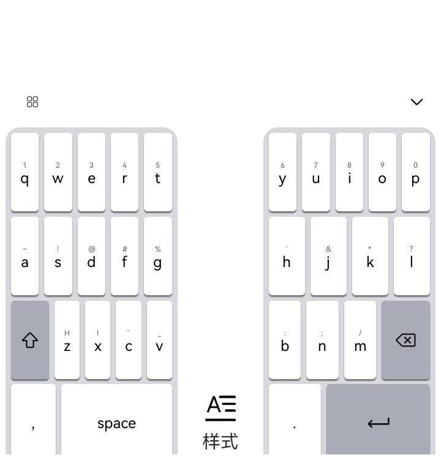

# 分离键盘开发指南
<!--Kit: IME Kit-->
<!--Subsystem: MiscServices-->
<!--Owner: @codexu62-->
<!--Designer: @zhaolinglan-->
<!--Tester: @murphy84-->
<!--Adviser: @zhang_yixin13-->

## 场景介绍

在大屏设备（折叠屏展开态、平板）上，用户双手握持设备两侧打字时，传统底部固定键盘无法满足舒适的握持体验。分离键盘（FLAG_DETACHED）将软键盘左右分离、中间镂空，双手自然落在分离键盘上，中间区域可显示更多应用内容。

本指南在已实现一个输入法应用的前提下，介绍如何适配分离键盘，包括切换分离态、分离态布局、热区设置、键盘拖动等功能。

## 框架原理

- 输入法应用可以调用[changeFlag](../reference/apis-ime-kit/js-apis-inputmethodengine.md#changeflag10)或[updatePanelRectSync](../reference/apis-ime-kit/js-apis-inputmethodengine.md#updatepanelrectsync)将面板切换至分离态。
- 分离态下，面板宽度强制等于屏幕宽度，面板仅可纵向移动（[moveTo](../reference/apis-ime-kit/js-apis-inputmethodengine.md#moveto10)仅y生效），支持[startMoving](../reference/apis-ime-kit/js-apis-inputmethodengine.md#startmoving15)拖动。
- 通过[updatePanelRect](../reference/apis-ime-kit/js-apis-inputmethodengine.md#updatepanelrect)或[updatePanelRectSync](../reference/apis-ime-kit/js-apis-inputmethodengine.md#updatepanelrectsync)设置分离态面板的位置和高度，宽度参数会被静默忽略。
- 通过[updateRegion](../reference/apis-ime-kit/js-apis-inputmethodengine.md#updateregion15)设置左右两部分区域为热区，中间镂空区域不接收触摸事件，触摸穿透到下层应用。

## 开发准备

在开始适配分离键盘前，需确保已完成以下准备工作：

- 已创建输入法应用工程，并成功创建SOFT_KEYBOARD类型的面板。
- 已了解[PanelFlag](../reference/apis-ime-kit/js-apis-inputmethodengine.md#panelflag10)枚举类型的基本概念。

## 开发步骤

### 切换面板到分离态

输入法应用创建SOFT_KEYBOARD类型面板后，可以调用[changeFlag](../reference/apis-ime-kit/js-apis-inputmethodengine.md#changeflag10)或[updatePanelRectSync](../reference/apis-ime-kit/js-apis-inputmethodengine.md#updatepanelrectsync)将面板切换至分离态。切换成功后，面板宽度自动等于屏幕宽度，无需手动设置，建议使用updatePanelRectSync同时切换PanelFlag和设置键盘窗口高度。

ArkTS-Dyn示例：

<!-- @[input_case_detached_switchToDetachedPanel](https://gitcode.com/openharmony/applications_app_samples/blob/master/code/DocsSample/InputMethod/DetachedKeyboard/entry/src/main/ets/InputMethodExtensionAbility/model/KeyboardController.ets) -->

``` TypeScript
public switchToDetachedPanel(): void {
  if (this.mPanel === undefined) {
    this.addLog('switchToDetachedPanel panel is undefined');
    return;
  }
  let dis: display.Display | undefined = undefined;
  try {
    dis = display.getPrimaryDisplaySync();
  } catch (err) {
    let error = err as BusinessError;
    this.addLog(`switchToDetachedPanel get display catch error: ${error.code} ${error.message}`);
    return;
  }
  if (dis === undefined) {
    this.addLog('switchToDetachedPanel display is undefined');
    return;
  }
  let screenWidth = dis.width;
  let screenHeight = dis.height;
  if (dis.width > dis.height) {
    screenWidth = dis.height;
    screenHeight = dis.width;
  }
  let detachedHeight = Math.floor(screenHeight * KEYBOARD_DETACHED_HEIGHT_RATE);
  let landHeight = Math.floor(screenWidth * KEYBOARD_DETACHED_HEIGHT_RATE)
  let landscapeRect: window.Rect = {
    left: 0,
    top: screenWidth - landHeight,
    width: screenHeight,
    height: landHeight
  };
  let portraitRect: window.Rect = {
    left: 0,
    top: screenHeight - detachedHeight,
    width: screenWidth,
    height: detachedHeight
  };
  let panelRect: inputMethodEngine.PanelRect = {
    landscapeRect: landscapeRect,
    portraitRect: portraitRect
  };
  try {
    this.mPanel.updatePanelRectSync(inputMethodEngine.PanelFlag.FLAG_DETACHED, panelRect);
    this.mPanelWidth = dis.width;
    this.mPanelHeight = dis.width > dis.height ? landHeight : detachedHeight;
    this.addLog(`switchToDetachedPanel success, width = ${dis.width}, height = ${detachedHeight}`);
  } catch (err) {
    let error = err as BusinessError;
    this.addLog(`switchToDetachedPanel catch error: ${error.code} ${error.message}`);
  }
  // 将左右两半键盘区域设置为热区，中间透明区域不接收输入事件
  this.refreshSplitHotZone(dis.width, detachedHeight);
}
```


ArkTS-Sta示例：

<!-- @[input_case_detached_switchToDetachedPanel](https://gitcode.com/openharmony/applications_app_samples/blob/OpenHarmony_feature_sta_20260331/code/DocsSample/InputMethod/DetachedKeyboardSta/entry/src/main/ets/InputMethodExtensionAbility/model/KeyboardController.ets) -->

``` TypeScript
public switchToDetachedPanel(): void {
  if (this.mPanel === undefined) {
    this.addLog('switchToDetachedPanel panel is undefined');
    return;
  }
  let dis: display.Display | undefined = undefined;
  try {
    dis = display.getDefaultDisplaySync();
  } catch (err) {
    let error = err as BusinessError;
    this.addLog(`switchToDetachedPanel get display catch error: ${error.code} ${error.message}`);
    return;
  }
  if (dis === undefined) {
    this.addLog('switchToDetachedPanel display is undefined');
    return;
  }
  let screenWidth = Double.toInt(dis.width);
  let screenHeight = Double.toInt(dis.height);
  if (dis.width > dis.height) {
    screenWidth = Double.toInt(dis.height);
    screenHeight = Double.toInt(dis.width);
  }
  let detachedHeight: int = Double.toInt(screenHeight * KEYBOARD_DETACHED_HEIGHT_RATE);
  let landHeight: int = Double.toInt(screenWidth * KEYBOARD_DETACHED_HEIGHT_RATE);
  let landscapeRect: window.Rect = {
    left: 0,
    top: screenWidth - landHeight,
    width: screenHeight,
    height: landHeight
  };
  let portraitRect: window.Rect = {
    left: 0,
    top: screenHeight - detachedHeight,
    width: screenWidth,
    height: detachedHeight
  };
  let panelRect: inputMethodEngine.PanelRect = {
    landscapeRect: landscapeRect,
    portraitRect: portraitRect
  };
  try {
    this.mPanel!.updatePanelRectSync(inputMethodEngine.PanelFlag.FLAG_DETACHED, panelRect);
    this.mPanelWidth = screenWidth;
    this.mPanelHeight = dis.width > dis.height ? landHeight : detachedHeight;
    this.addLog(`switchToDetachedPanel success, width = ${dis.width}, height = ${detachedHeight}`);
  } catch (err) {
    let error = err as BusinessError;
    this.addLog(`switchToDetachedPanel catch error: ${error.code} ${error.message}`);
  }
  // 将左右两半键盘区域设置为热区，中间透明区域不接收输入事件
  this.refreshSplitHotZone(this.mPanelWidth, detachedHeight);
}
```


### 设置分离态热区

分离键盘左右两部分区域为有效输入区域，中间镂空区域不接收触摸事件。通过[updateRegion](../reference/apis-ime-kit/js-apis-inputmethodengine.md#updateregion15)设置自定义热区。

ArkTS-Dyn示例：

<!-- @[input_case_detached_refreshSplitHotZone](https://gitcode.com/openharmony/applications_app_samples/blob/master/code/DocsSample/InputMethod/DetachedKeyboard/entry/src/main/ets/InputMethodExtensionAbility/model/KeyboardController.ets) -->

``` TypeScript
// 按分体面板尺寸刷新左右热区，中间透明区域不接收输入事件
public refreshSplitHotZone(width: number, height: number): void {
  if (this.mPanel === undefined) {
    this.addLog('refreshSplitHotZone panel is undefined');
    return;
  }
  if (width <= 0 || height <= 0) {
    this.addLog(`refreshSplitHotZone invalid size, width = ${width}, height = ${height}`);
    return;
  }
  let halfWidth = Math.floor(width * KEYBOARD_SPLIT_WIDTH_RATE);
  let inputRegion: window.Rect[] = [
    { left: 0, top: 0, width: halfWidth, height: height },
    { left: width - halfWidth, top: 0, width: halfWidth, height: height }
  ];
  try {
    this.mPanel.updateRegion(inputRegion);
    this.addLog(`refreshSplitHotZone success, width = ${width}, height = ${height}`);
  } catch (err) {
    let error = err as BusinessError;
    this.addLog(`refreshSplitHotZone catch error: ${error.code} ${error.message}`);
  }
}
```


ArkTS-Sta示例：

<!-- @[input_case_detached_refreshSplitHotZone](https://gitcode.com/openharmony/applications_app_samples/blob/OpenHarmony_feature_sta_20260331/code/DocsSample/InputMethod/DetachedKeyboardSta/entry/src/main/ets/InputMethodExtensionAbility/model/KeyboardController.ets) -->

``` TypeScript
// 按分体面板尺寸刷新左右热区，中间透明区域不接收输入事件
public refreshSplitHotZone(width: int, height: int): void {
  if (this.mPanel === undefined) {
    this.addLog('refreshSplitHotZone panel is undefined');
    return;
  }
  if (width <= 0 || height <= 0) {
    this.addLog(`refreshSplitHotZone invalid size, width = ${width}, height = ${height}`);
    return;
  }
  let halfWidth: int = Double.toInt(width * KEYBOARD_SPLIT_WIDTH_RATE);
  let w: int = width;
  let h: int = height;
  let inputRegion: Array<window.Rect> = [
    { left: 0, top: 0, width: halfWidth, height: h },
    { left: w - halfWidth, top: 0, width: halfWidth, height: h }
  ];
  try {
    this.mPanel!.updateRegion(inputRegion);
    this.addLog(`refreshSplitHotZone success, width = ${width}, height = ${height}`);
  } catch (err) {
    let error = err as BusinessError;
    this.addLog(`refreshSplitHotZone catch error: ${error.code} ${error.message}`);
  }
}
```


### 分离态键盘拖动

分离态面板支持通过[startMoving](../reference/apis-ime-kit/js-apis-inputmethodengine.md#startmoving15)启动拖动模式。

通过startMoving启动拖动模式，用户可手指拖动调整键盘位置。拖动结束后调用[moveTo](../reference/apis-ime-kit/js-apis-inputmethodengine.md#moveto10)同步位置并刷新热区。

ArkTS-Dyn示例：

<!-- @[input_case_detached_startMovingPanel](https://gitcode.com/openharmony/applications_app_samples/blob/master/code/DocsSample/InputMethod/DetachedKeyboard/entry/src/main/ets/InputMethodExtensionAbility/model/KeyboardController.ets) -->


ArkTS-Sta示例：

<!-- @[input_case_detached_startMovingPanel](https://gitcode.com/openharmony/applications_app_samples/blob/OpenHarmony_feature_sta_20260331/code/DocsSample/InputMethod/DetachedKeyboardSta/entry/src/main/ets/InputMethodExtensionAbility/model/KeyboardController.ets) -->


### 分离态UI布局

分离态下，键盘UI需要根据`isSplitKeyboard`状态切换布局：左右两半键盘区域+中间透明镂空区域。键盘根组件背景在分离态下设为透明，使中间镂空区域可穿透显示下层应用内容。

ArkTS-Dyn示例：

<!-- @[input_case_detached_detached_ui](https://gitcode.com/openharmony/applications_app_samples/blob/master/code/DocsSample/InputMethod/DetachedKeyboard/entry/src/main/ets/components/KeyMenu.ets) -->

ArkTS-Sta示例：

<!-- @[input_case_detached_detached_ui](https://gitcode.com/openharmony/applications_app_samples/blob/OpenHarmony_feature_sta_20260331/code/DocsSample/InputMethod/DetachedKeyboardSta/entry/src/main/ets/components/KeyMenu.ets) -->

### 切换回固定态

如需从分离态切换回固定态，调用updatePanelRectSync设置FLG_FIXED，并将热区恢复为整个面板区域。

ArkTS-Dyn示例：

<!-- @[input_case_detached_switchToFixedPanel](https://gitcode.com/openharmony/applications_app_samples/blob/master/code/DocsSample/InputMethod/DetachedKeyboard/entry/src/main/ets/InputMethodExtensionAbility/model/KeyboardController.ets) -->


ArkTS-Sta示例：

<!-- @[input_case_detached_switchToFixedPanel](https://gitcode.com/openharmony/applications_app_samples/blob/OpenHarmony_feature_sta_20260331/code/DocsSample/InputMethod/DetachedKeyboardSta/entry/src/main/ets/InputMethodExtensionAbility/model/KeyboardController.ets) -->


## 实现效果


