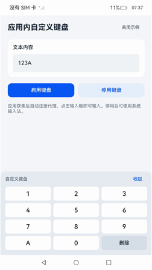

# 实现应用内自定义键盘
<!--Kit: IME Kit-->
<!--Subsystem: MiscServices-->
<!--Owner: @codexu62-->
<!--Designer: @zhaolinglan-->
<!--Tester: @murphy84-->
<!--Adviser: @zhang_yixin13-->

## 场景介绍

从API版本26.1.0开始，普通Stage模型应用可调用[registerInAppProxyIme](../reference/apis-ime-kit/js-apis-inputmethodengine.md#inputmethodengineregisterinappproxyime)注册应用内代理输入法，在自身界面中绘制键盘组件，并通过代理接口操作同进程内类型匹配的编辑框。类型匹配是指编辑框的输入类型包含在注册选项inputPatternTypes中，省略该选项时匹配全部编辑框类型。

该能力适用于需要自行提供输入界面的应用，例如：安全输入场景（银行密码键盘）、游戏输入场景（自定义游戏手柄）、特定领域输入场景（公式编辑器、符号面板）等。

应用内代理输入法的典型使用流程：获取ProxyInputMethodAbility和ProxyKeyboardDelegate实例 -> 订阅inputStart、keyboardShow、keyboardHide事件（ProxyInputMethodAbility）及物理键盘按键/编辑框文本、光标、选区、属性变化事件（ProxyKeyboardDelegate） -> 调用registerInAppProxyIme注册代理 -> 在onInputStart回调中获取ProxyTextInputClient和ProxyKeyboardController -> 应用自行绘制并显示键盘组件 -> 通过ProxyTextInputClient操作编辑框文本 -> 隐藏键盘后调用hideSelf通知框架。

## 约束与限制

**调用者限制：**
- 调用者为普通Stage模型应用。输入法Extension不能注册应用内代理，也不能获取代理相关对象，否则产生12800028错误码。
- 使用支持API版本26.1.0及SystemCapability.MiscServices.InputMethodFramework的系统和SDK。

**注册时机：**
- 先通过[ProxyInputMethodAbility](../reference/apis-ime-kit/js-apis-inputmethodengine.md#proxyinputmethodability)和[ProxyKeyboardDelegate](../reference/apis-ime-kit/js-apis-inputmethodengine.md#proxykeyboarddelegate)订阅所需回调，再调用[registerInAppProxyIme](../reference/apis-ime-kit/js-apis-inputmethodengine.md#inputmethodengineregisterinappproxyime)注册代理。注册后编辑框可能立即触发绑定，若未提前订阅，可能错过绑定、键盘显示、光标变化等回调，导致无法获取文本客户端实例、显示自定义键盘或操作编辑框文本。
- 调用者须在获焦状态下注册，未获焦时产生12800027错误。
- 推荐在应用首次启动并监听到窗口获焦时完成注册，应用退出时注销。不建议在每次页面获焦时注册、失焦时注销，否则注册可能晚于编辑框绑定，导致先显示系统键盘再切换为自定义键盘。

**参数约束：**
- 省略options或inputPatternTypes时代理全部编辑框类型；指定数组时，数组须非空且元素均为PATTERN_*常量。重复注册会替换原选项。
- 如需仅对特定类型的编辑框拉起自定义键盘（例如密码类型），则注册时通过[inputPatternTypes](../reference/apis-ime-kit/js-apis-inputmethodengine.md#registeroptions)指定对应的编辑框类型，未声明的类型仍使用系统输入法。

**使用约束：**
- 使用最近一次onInputStart回调传入的客户端实例。
- 收到被动注销通知后清理本地会话引用；若应用当前获焦且仍需使用代理，应立即重新注册，否则在再次获焦时注册。
- 自定义键盘使用过程中主动调用[unregisterInAppProxyIme](../reference/apis-ime-kit/js-apis-inputmethodengine.md#inputmethodengineunregisterinappproxyime)注销，会导致自定义键盘解绑并显示系统键盘。
- 用户通过自定义键盘上的隐藏按钮隐藏自定义键盘时，应用需要调用[hideSelf](../reference/apis-ime-kit/js-apis-inputmethodengine.md#hideself)通知框架和编辑框。

## 开发步骤

在DevEco Studio中新建普通Stage模型的Empty Ability工程，然后创建会话管理类、绘制键盘页面并配置页面路由。

工程目录结构如下：

```text
entry/src/main/
├── ets
│   ├── entryability
│   │   └── EntryAbility.ets                # 应用入口，加载键盘页面
│   ├── keyboard
│   │   └── InAppKeyboardSession.ets        # 代理输入法会话管理：订阅回调、注册/注销代理、编辑会话、退出清理
│   └── pages
│       └── Index.ets                       # 键盘页面：监听窗口获焦、绘制键盘组件、处理输入
├── module.json5                             # 模块配置文件
└── resources/base
    ├── element
    │   ├── color.json                      # 颜色资源
    │   └── string.json                     # 页面字符串资源
    └── profile
        └── main_pages.json                 # 页面路由配置
```

EntryAbility.ets为应用入口，在onWindowStageCreate中加载pages/Index页面即可，无需额外逻辑。

### 创建会话管理类

创建InAppKeyboardSession.ets文件，负责代理输入法的订阅、注册、回调处理和清理。

先订阅回调，再调用[registerInAppProxyIme](../reference/apis-ime-kit/js-apis-inputmethodengine.md#inputmethodengineregisterinappproxyime)注册代理。注册后编辑框可能立即绑定，若未提前订阅，可能错过绑定、键盘显示、光标变化等回调，导致文本操作失败或自定义键盘无法显示。

本示例使用PATTERN_TEXT，仅代理普通文本编辑框。

- 通过[getProxyInputMethodAbility](../reference/apis-ime-kit/js-apis-inputmethodengine.md#inputmethodenginegetproxyinputmethodability)和[getProxyKeyboardDelegate](../reference/apis-ime-kit/js-apis-inputmethodengine.md#inputmethodenginegetproxykeyboarddelegate)获取实例，获取后须检查是否为null。
- 订阅[ProxyInputMethodAbility](../reference/apis-ime-kit/js-apis-inputmethodengine.md#proxyinputmethodability)和[ProxyKeyboardDelegate](../reference/apis-ime-kit/js-apis-inputmethodengine.md#proxykeyboarddelegate)的回调，订阅须在注册代理前完成。在onInputStart回调中保存[ProxyTextInputClient](../reference/apis-ime-kit/js-apis-inputmethodengine.md#proxytextinputclient)和[ProxyKeyboardController](../reference/apis-ime-kit/js-apis-inputmethodengine.md#proxykeyboardcontroller)实例引用。
- 提供register、unregister、dispose方法：register调用[registerInAppProxyIme](../reference/apis-ime-kit/js-apis-inputmethodengine.md#inputmethodengineregisterinappproxyime)注册代理；unregister仅注销代理供手动停用，保留订阅；dispose注销代理并退订全部回调，供应用退出时调用。
- 收到onUnregister被动注销通知后，将ProxyTextInputClient和ProxyKeyboardController实例置为null，避免使用失效实例；若应用当前获焦且仍需使用代理，应立即重新注册，否则在再次获焦时注册。

<!-- @[manage_agent_sessions](https://gitcode.com/openharmony/applications_app_samples/blob/master/code/DocsSample/InputMethod/InAppCustomKeyboard/entry/src/main/ets/keyboard/InAppKeyboardSession.ets) -->

```ts
import { inputMethodEngine } from '@kit.IMEKit';
import type { KeyEvent } from '@kit.InputKit';
import { BusinessError } from '@kit.BasicServicesKit';
import { hilog } from '@kit.PerformanceAnalysisKit';

const DOMAIN: number = 0xF811;
const TAG: string = '[Sample_InAppCustomKeyboard]';

export class InAppKeyboardSession {
  // 保存代理对象和最近一次绑定的编辑会话，实例在获取前为空。
  private ability: inputMethodEngine.ProxyInputMethodAbility | null = null;
  private delegate: inputMethodEngine.ProxyKeyboardDelegate | null = null;
  private client: inputMethodEngine.ProxyTextInputClient | null = null;
  private controller: inputMethodEngine.ProxyKeyboardController | null = null;
  private active: boolean = true;
  private registered: boolean = false;
  private registering: boolean = false;
  private disposed: boolean = false;
  private generation: number = 0;
  private updateVisible: (visible: boolean) => void;

  constructor(updateVisible: (visible: boolean) => void) {
    this.updateVisible = updateVisible;
  }

  // 编辑框绑定时更新客户端和控制器，后续操作使用最新实例。
  private handleInputStart: inputMethodEngine.ProxyInputStartCallback =
    (client: inputMethodEngine.ProxyTextInputClient, controller: inputMethodEngine.ProxyKeyboardController) => {
    if (this.active) {
      this.client = client;
      this.controller = controller;
    }
  };
  private handleShow: () => void = () => {
    if (this.active) { this.updateVisible(true); }
  };
  private handleHide: () => void = () => {
    if (this.active) { this.updateVisible(false); }
  };
  // 被动注销后清理失效实例，并尝试在应用获焦时重新注册。
  private handleUnregister: () => void = () => {
    this.client = null;
    this.controller = null;
    this.registered = false;
    if (this.active) {
      this.updateVisible(false);
      // 未获焦时注册会失败，页面通过窗口获焦事件再次发起注册。
      this.register().catch((error: BusinessError) => {
        hilog.error(DOMAIN, TAG, 'Re-registration after passive unregister failed. Code: %{public}d, message: %{public}s',
          error.code, error.message);
      });
    }
  };
  // 返回false，将物理按键事件继续交给编辑框处理。
  private handleKeyEvent: inputMethodEngine.InputKeyEventCallback = (event: KeyEvent) => {
    return false;
  };

  /**
   * 允许当前页面注册代理输入法并进行文本操作。
   * 递增generation计数器，用于在注册完成后识别过期的注册结果。
   */
  activate(): void {
    this.generation++;
    this.active = true;
  }

  /**
   * 注册应用内代理输入法。先订阅输入法回调，再调用registerInAppProxyIme。
   * 通过registering标记避免重复注册。
   * 注册完成后比较generation计数器的值，判断该结果是否仍属于当前会话。
   * @returns Promise对象，无返回结果。注册失败时可捕获BusinessError。
   */
  async register(): Promise<void> {
    if (!this.active || this.registering || this.registered) { return; }
    this.registering = true;
    const generation: number = this.generation;
    try {
      // 先获取对象并订阅回调，再注册代理，避免错过立即触发的绑定事件。
      if (this.ability === null) {
        const ability: inputMethodEngine.ProxyInputMethodAbility | null =
          inputMethodEngine.getProxyInputMethodAbility();
        if (ability === null) {
          throw new Error('ProxyInputMethodAbility is unavailable.');
        }
        this.ability = ability;
        ability.onInputStart(this.handleInputStart);
        ability.onKeyboardShow(this.handleShow);
        ability.onKeyboardHide(this.handleHide);
        ability.onUnregister(this.handleUnregister);
      }
      if (this.delegate === null) {
        const delegate: inputMethodEngine.ProxyKeyboardDelegate | null = inputMethodEngine.getProxyKeyboardDelegate();
        if (delegate === null) {
          throw new Error('ProxyKeyboardDelegate is unavailable.');
        }
        this.delegate = delegate;
        delegate.onKeyEvent(this.handleKeyEvent);
      }
      // 仅为普通文本编辑框启用自定义键盘。
      await inputMethodEngine.registerInAppProxyIme({
        inputPatternTypes: [inputMethodEngine.PATTERN_TEXT]
      });
      this.registered = true;
      // 注册完成时若页面已离开，须立即注销，避免残留注册。
      if (!this.active || generation !== this.generation) {
        await inputMethodEngine.unregisterInAppProxyIme();
        this.registered = false;
      }
    } catch (error) {
      const err: BusinessError = error as BusinessError;
      hilog.error(DOMAIN, TAG, 'Code: %{public}d, message: %{public}s', err.code, err.message);
      return Promise.reject<void>(err);
    } finally {
      this.registering = false;
    }
  }

  /**
   * 通过代理文本客户端在当前编辑框的光标位置插入文本。
   * @param text - 待插入的文本。
   * @returns Promise对象，无返回结果。
   */
  async insert(text: string): Promise<void> {
    const client: inputMethodEngine.ProxyTextInputClient | null = this.client;
    if (!this.active || client === null) { return; }
    try {
      await client.insertText(text);
    } catch (error) {
      const err: BusinessError = error as BusinessError;
      hilog.error(DOMAIN, TAG, 'Code: %{public}d, message: %{public}s', err.code, err.message);
    }
  }

  /**
   * 通过代理文本客户端删除光标前的一个字符，实现退格操作。
   * @returns Promise对象，无返回结果。
   */
  async deleteBeforeCursor(): Promise<void> {
    const client: inputMethodEngine.ProxyTextInputClient | null = this.client;
    if (!this.active || client === null) { return; }
    try {
      await client.deleteForward(1);
    } catch (error) {
      const err: BusinessError = error as BusinessError;
      hilog.error(DOMAIN, TAG, 'Code: %{public}d, message: %{public}s', err.code, err.message);
    }
  }

  /**
   * 隐藏自定义键盘，再通过hideSelf通知框架和编辑框。
   * @returns Promise对象，无返回结果。
   */
  async hide(): Promise<void> {
    const controller: inputMethodEngine.ProxyKeyboardController | null = this.controller;
    if (!this.active || controller === null) { return; }
    this.updateVisible(false);
    try {
      await controller.hideSelf();
    } catch (error) {
      const err: BusinessError = error as BusinessError;
      hilog.error(DOMAIN, TAG, 'Code: %{public}d, message: %{public}s', err.code, err.message);
    }
  }

  /**
   * 注销应用内代理输入法，并清理文本客户端和键盘控制器引用。
   * @returns Promise对象，无返回结果。注销失败时可捕获BusinessError。
   */
  async unregister(): Promise<void> {
    if (!this.registered) { return; }
    this.registered = false;
    this.client = null;
    this.controller = null;
    try {
      await inputMethodEngine.unregisterInAppProxyIme();
    } catch (error) {
      const err: BusinessError = error as BusinessError;
      hilog.error(DOMAIN, TAG, 'Code: %{public}d, message: %{public}s', err.code, err.message);
      return Promise.reject<void>(err);
    }
  }

  /**
   * 释放会话，注销代理、退订全部输入法回调并清理引用。
   * 通过disposed标记避免重复释放。
   * @returns Promise对象，无返回结果。
   */
  async dispose(): Promise<void> {
    if (this.disposed) { return; }
    this.disposed = true;
    this.active = false;
    this.generation++;
    this.registered = false;
    this.client = null;
    this.controller = null;
    try {
      await inputMethodEngine.unregisterInAppProxyIme();
    } catch (error) {
      const err: BusinessError = error as BusinessError;
      hilog.error(DOMAIN, TAG, 'Code: %{public}d, message: %{public}s', err.code, err.message);
    } finally {
      const ability: inputMethodEngine.ProxyInputMethodAbility | null = this.ability;
      const delegate: inputMethodEngine.ProxyKeyboardDelegate | null = this.delegate;
      try {
        if (ability !== null) {
          ability.offInputStart(this.handleInputStart);
          ability.offKeyboardShow(this.handleShow);
          ability.offKeyboardHide(this.handleHide);
          ability.offUnregister(this.handleUnregister);
        }
        if (delegate !== null) {
          delegate.offKeyEvent(this.handleKeyEvent);
        }
      } catch (error) {
        const err: BusinessError = error as BusinessError;
        hilog.error(DOMAIN, TAG, 'Failed to remove proxy listeners. Code: %{public}d, message: %{public}s',
          err.code, err.message);
      }
      this.ability = null;
      this.delegate = null;
      this.updateVisible(false);
      hilog.info(DOMAIN, TAG, '%{public}s', 'InAppKeyboardSample: disposed');
    }
  }
}
```

### 绘制键盘页面

创建Index.ets文件，在应用页面中绘制键盘组件并处理用户输入。

页面需要完成以下操作。

1. 页面显示时调用session的register方法注册代理，并监听窗口获焦事件（WindowEventType.WINDOW_ACTIVE）处理后续获焦场景；应用退出（aboutToDisappear）或主动关闭页面时调用dispose完成注销与清理。
2. 收到onKeyboardShow回调后显示键盘组件，收到onKeyboardHide回调后隐藏键盘组件。
3. 键盘组件不可获焦，避免点击时触发编辑框失焦导致代理解绑。
4. 通过[ProxyTextInputClient](../reference/apis-ime-kit/js-apis-inputmethodengine.md#proxytextinputclient)的insertText、deleteForward等方法操作编辑框文本，所有异步调用均处理异常。
5. 用户点击隐藏按钮时，先隐藏键盘组件，再调用[hideSelf](../reference/apis-ime-kit/js-apis-inputmethodengine.md#hideself)通知框架和编辑框。

<!-- @[draw_keyboard](https://gitcode.com/openharmony/applications_app_samples/blob/master/code/DocsSample/InputMethod/InAppCustomKeyboard/entry/src/main/ets/pages/Index.ets) -->

```ts
import { BusinessError } from '@kit.BasicServicesKit';
import { common } from '@kit.AbilityKit';
import { window } from '@kit.ArkUI';
import { hilog } from '@kit.PerformanceAnalysisKit';
import { InAppKeyboardSession } from '../keyboard/InAppKeyboardSession';

const DOMAIN: number = 0xF811;
const TAG: string = '[Sample_InAppCustomKeyboard]';

@Entry
@Component
struct Index {
  @State private text: string = '';
  @State private keyboardVisible: boolean = false;
  private session: InAppKeyboardSession = new InAppKeyboardSession((visible: boolean) => {
    this.keyboardVisible = visible;
  });
  private windowListenerSet: boolean = false;

  private logError(error: BusinessError): void {
    hilog.error(DOMAIN, TAG, 'Code: %{public}d, message: %{public}s', error.code, error.message);
  }

  aboutToAppear(): void {
    this.session.activate();
  }

  // 首次显示时尝试注册，窗口后续获焦时再次尝试。
  onPageShow(): void {
    this.session.register().catch((error: BusinessError) => { this.logError(error); });
    if (this.windowListenerSet) { return; }
    this.windowListenerSet = true;
    const context = this.getUIContext().getHostContext() as common.UIAbilityContext;
    window.getLastWindow(context).then((win) => {
      win.on('windowEvent', (data) => {
        if (data === window.WindowEventType.WINDOW_ACTIVE) {
          this.session.register().catch((error: BusinessError) => { this.logError(error); });
        }
      });
    }).catch((error: BusinessError) => { this.logError(error); });
  }

  // 页面离开时释放代理输入法会话。
  aboutToDisappear(): void {
    this.session.dispose().catch((error: BusinessError) => { this.logError(error); });
  }

  private async closePage(): Promise<void> {
    try {
      const context = this.getUIContext().getHostContext() as common.UIAbilityContext | undefined;
      if (context === undefined) {
        return;
      }
      // 主动关闭时，先等待注销与监听清理完成，再销毁页面。
      await this.session.dispose();
      await context.terminateSelf();
    } catch (error) {
      this.logError(error as BusinessError);
    }
  }

  @Builder
  private characterKey(value: string) {
    Button(value, { type: ButtonType.Normal })
      .layoutWeight(1)
      .height(44)
      .borderRadius(8)
      .backgroundColor('#FFFFFF')
      .fontColor('#182431')
      .fontSize(20)
      // 按键不获取焦点，保持编辑框与代理输入法的绑定。
      .focusable(false)
      .onClick(() => {
        this.session.insert(value).catch((error: BusinessError) => { this.logError(error); });
      })
  }

  build() {
    Column() {
      Column({ space: 20 }) {
        Row({ space: 12 }) {
          Text($r('app.string.title'))
            .fontSize(24)
            .fontWeight(FontWeight.Bold)
            .fontColor('#182431')
            .layoutWeight(1)
          Button($r('app.string.close_sample'), { type: ButtonType.Normal })
            .height(36)
            .fontSize(14)
            .fontColor('#526071')
            .backgroundColor(Color.Transparent)
            .onClick(() => { this.closePage(); })
        }.width('100%')

        Column({ space: 12 }) {
          Text($r('app.string.text_content'))
            .fontSize(16)
            .fontWeight(FontWeight.Medium)
            .fontColor('#182431')
            .width('100%')
          // 注册代理后点击编辑框，框架将触发绑定及键盘显示回调。
          TextInput({ text: this.text, placeholder: $r('app.string.input_placeholder') })
            .height(56)
            .fontSize(18)
            .fontColor('#182431')
            .backgroundColor('#F2F4F7')
            .borderRadius(8)
            .type(InputType.Normal)
            .onChange((value: string) => { this.text = value; })
        }
        .width('100%')
        .padding(16)
        .borderRadius(16)
        .backgroundColor('#FFFFFF')

        Row({ space: 12 }) {
          Button($r('app.string.enable_keyboard'), { type: ButtonType.Normal })
            .layoutWeight(1)
            .height(44)
            .borderRadius(12)
            .fontSize(16)
            .backgroundColor('#0A59F7')
            .onClick(() => {
              this.session.register().catch((error: BusinessError) => { this.logError(error); });
            })
          Button($r('app.string.disable_keyboard'), { type: ButtonType.Normal })
            .layoutWeight(1)
            .height(44)
            .borderRadius(12)
            .fontSize(16)
            .fontColor('#0A59F7')
            .backgroundColor('#E8EFFD')
            .onClick(() => {
              this.session.unregister().catch((error: BusinessError) => { this.logError(error); });
            })
        }.width('100%')
        Text($r('app.string.description'))
          .fontSize(14)
          .fontColor('#657080')
          .width('100%')
      }
      .width('100%')
      .padding({ left: 24, right: 24, top: 20 })

      Blank().layoutWeight(1)

      if (this.keyboardVisible) {
        Column({ space: 8 }) {
          Row() {
            Text($r('app.string.custom_keyboard'))
              .fontSize(14)
              .fontColor('#526071')
            Blank()
            Button($r('app.string.collapse'), { type: ButtonType.Normal })
              .height(32)
              .fontSize(14)
              .fontColor('#0A59F7')
              .backgroundColor(Color.Transparent)
              .focusable(false)
              .onClick(() => {
                this.session.hide().catch((error: BusinessError) => { this.logError(error); });
              })
          }.width('100%')
          Row({ space: 8 }) {
            this.characterKey('1')
            this.characterKey('2')
            this.characterKey('3')
          }.width('100%')
          Row({ space: 8 }) {
            this.characterKey('4')
            this.characterKey('5')
            this.characterKey('6')
          }.width('100%')
          Row({ space: 8 }) {
            this.characterKey('7')
            this.characterKey('8')
            this.characterKey('9')
          }.width('100%')
          Row({ space: 8 }) {
            this.characterKey('A')
            this.characterKey('0')
            Button($r('app.string.delete'), { type: ButtonType.Normal })
              .layoutWeight(1)
              .height(44)
              .borderRadius(8)
              .fontSize(16)
              .fontColor('#182431')
              .backgroundColor('#D8DFE9')
              .focusable(false)
              .onClick(() => {
                this.session.deleteBeforeCursor().catch((error: BusinessError) => { this.logError(error); });
              })
          }.width('100%')
        }
        .width('100%')
        .padding({ left: 16, right: 16, top: 8, bottom: 16 })
        .borderRadius({ topLeft: 16, topRight: 16 })
        .backgroundColor('#E8ECF2')
      }
    }
    .width('100%')
    .height('100%')
    .backgroundColor('#F7F8FA')
  }
}
```

### 配置字符串资源

Index.ets通过$r引用字符串资源。在entry/src/main/resources/base/element/string.json的string数组中添加以下10个资源项。

```json
{
  "string": [
    {
      "name": "title",
      "value": "应用内自定义键盘"
    },
    {
      "name": "close_sample",
      "value": "关闭示例"
    },
    {
      "name": "text_content",
      "value": "文本内容"
    },
    {
      "name": "input_placeholder",
      "value": "点击此处输入"
    },
    {
      "name": "enable_keyboard",
      "value": "启用键盘"
    },
    {
      "name": "disable_keyboard",
      "value": "停用键盘"
    },
    {
      "name": "description",
      "value": "应用获焦后自动注册代理，点击输入框即可输入。停用后可使用系统输入法。"
    },
    {
      "name": "custom_keyboard",
      "value": "自定义键盘"
    },
    {
      "name": "collapse",
      "value": "收起"
    },
    {
      "name": "delete",
      "value": "删除"
    }
  ]
}
```

### 配置页面路由

在resources/base/profile/main_pages.json中配置ets/pages/路径下的键盘页面。

```json
{
  "src": [
    "pages/Index"
  ]
}
```

## 示例效果图


