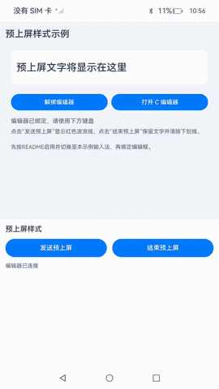

# 在自绘编辑框中接收预上屏样式（ArkTS）
<!--Kit: IME Kit-->
<!--Subsystem: MiscServices-->
<!--Owner: @codexu62-->
<!--Designer: @zhaolinglan-->
<!--Tester: @murphy84-->
<!--Adviser: @zhang_yixin13-->

## 场景介绍

从API版本26.1.0开始，ArkTS自绘编辑框可以接收输入法发送的预上屏文本及下划线样式，并自行绘制。输入法侧如何发送文本和样式，参见[设置预上屏文本样式](preview-text-style-guide.md)。

## 约束与限制

- 带样式的预上屏事件仅支持在Stage模型下订阅。
- 自绘编辑框须支持预上屏。绑定输入法前，须订阅带样式的预上屏事件和结束预上屏事件。接收预上屏文本和样式时，编辑框须已获焦并与输入法绑定。
- 自绘编辑框须根据回调提供的文本、范围和样式更新内容并自行绘制下划线，同时保留原有的文本编辑和结束预上屏处理。

## 开发步骤

先按[在自绘编辑框中使用输入法（ArkTS）](use-inputmethod-in-custom-edit-box.md)接入输入法框架。

自绘编辑框保存文本、范围和样式，在UI上绘制下划线。仅在提供`underlineColor`时使用其RGB值，否则由编辑框处理，默认跟随光标颜色。如果同时订阅[on('setPreviewText')](../reference/apis-ime-kit/js-apis-inputmethod.md#onsetpreviewtext17)和[onSetPreviewTextWithStyle](../reference/apis-ime-kit/js-apis-inputmethod.md#onsetpreviewtextwithstyle)，两种回调都会触发，应避免重复处理预上屏文本内容。

styledCallback保存文本、范围和下划线样式，并通过runScopedTask更新界面状态。legacyCallback处理setPreviewText事件，通过比较文本和范围，避免同一请求重复插入文本或覆盖已收到的样式。

<!-- @[preview_style_js_receive](https://gitcode.com/openharmony/applications_app_samples/blob/master/code/DocsSample/InputMethod/PreviewTextStyleJS/entry/src/main/ets/components/PreviewEditor.ets) -->

``` TypeScript
// 保留同一回调对象，用于解绑时取消本编辑框的订阅。
private styledCallback: inputMethod.SetPreviewTextWithStyleCallback =
  (text: string, range: inputMethod.Range, style: inputMethod.PreviewTextStyle): void => {
    if (!this.alive || !this.listening) {
      return;
    }
    this.getUIContext().runScopedTask((): void => {
      this.applyPreview(text, range);
      this.underline = style.underlineStyle;
      this.color = style.underlineColor === undefined ? $r('app.color.accent') :
        0xFF000000 + (style.underlineColor & 0x00FFFFFF);
      this.styledText = text;
      this.styledRangeStart = range.start;
      this.styledRangeEnd = range.end;
      this.status = $r('app.string.preview_displayed');
    });
  };

private legacyCallback: inputMethod.SetPreviewTextCallback = (text: string, range: inputMethod.Range): void => {
  if (!this.alive || !this.legacyListening) {
    return;
  }
  this.getUIContext().runScopedTask((): void => {
    // setPreviewText事件回调不覆盖同一请求已经收到的样式。
    if (text === this.styledText && range.start === this.styledRangeStart &&
      range.end === this.styledRangeEnd && this.previewStart >= 0) {
      return;
    }
    this.applyPreview(text, range);
    this.underline = inputMethod.UnderlineStyle.SOLID;
    this.color = $r('app.color.accent');
  });
};
```

在[attach](../reference/apis-ime-kit/js-apis-inputmethod.md#attach10)之前调用[onSetPreviewTextWithStyle](../reference/apis-ime-kit/js-apis-inputmethod.md#onsetpreviewtextwithstyle)注册样式回调。解绑或页面销毁时，调用[offSetPreviewTextWithStyle](../reference/apis-ime-kit/js-apis-inputmethod.md#offsetpreviewtextwithstyle)，使用注册时的同一回调对象取消订阅。

listening记录样式事件是否已订阅，防止重复注册；取消订阅时传入原先保存的styledCallback。

<!-- @[preview_style_js_subscribe](https://gitcode.com/openharmony/applications_app_samples/blob/master/code/DocsSample/InputMethod/PreviewTextStyleJS/entry/src/main/ets/components/PreviewEditor.ets) -->

``` TypeScript
private subscribeStyle(): void {
  if (!this.listening) {
    this.controller.onSetPreviewTextWithStyle(this.styledCallback);
    this.listening = true;
  }
}

private unsubscribeStyle(): void {
  if (this.listening) {
    this.controller.offSetPreviewTextWithStyle(this.styledCallback);
    this.listening = false;
  }
}
```

工程中的`connectEditor()`在绑定前注册预上屏及结束回调，绑定成功后订阅getTextIndexAtCursor、insertText和deleteLeft事件；离开页面时清理监听、解绑并丢弃过期更新。结束预上屏时保留文字并清除预上屏范围的下划线。

预上屏及结束事件先于attach注册；getTextIndexAtCursor用于提供光标位置，insertText和deleteLeft分别处理文本插入和向左删除。若绑定期间页面已经销毁，则立即解绑。

<!-- @[preview_style_js_attach](https://gitcode.com/openharmony/applications_app_samples/blob/master/code/DocsSample/InputMethod/PreviewTextStyleJS/entry/src/main/ets/components/PreviewEditor.ets) -->

``` TypeScript
private async connectEditor(): Promise<void> {
  this.controller.on('setPreviewText', this.legacyCallback);
  this.legacyListening = true;
  this.subscribeStyle();
  this.controller.on('finishTextPreview', this.finishCallback);
  this.finishListening = true;
  await this.controller.attach(true, {
    inputAttribute: { textInputType: inputMethod.TextInputType.TEXT, enterKeyType: inputMethod.EnterKeyType.DONE }
  });
  this.attached = true;
  if (!this.alive) {
    await this.disconnectEditor();
    return;
  }
  // 以下编辑回调需要在编辑框绑定成功后注册。
  this.controller.on('getTextIndexAtCursor', this.cursorCallback);
  this.cursorListening = true;
  this.controller.on('insertText', this.insertCallback);
  this.insertListening = true;
  this.controller.on('deleteLeft', this.deleteCallback);
  this.deleteListening = true;
  this.status = $r('app.string.editor_connected_hint');
}
```

以下为Sample中编辑框接收预上屏文本和样式后的实际运行效果。


