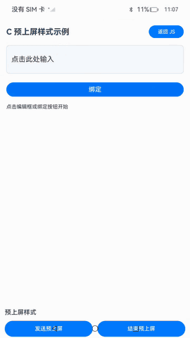

# 在自绘编辑框中接收预上屏样式（C/C++）
<!--Kit: IME Kit-->
<!--Subsystem: MiscServices-->
<!--Owner: @codexu62-->
<!--Designer: @zhaolinglan-->
<!--Tester: @murphy84-->
<!--Adviser: @zhang_yixin13-->

## 场景介绍

从API版本26.1.0开始，C/C++自绘编辑框可以接收输入法发送的预上屏文本及下划线样式，并自行绘制。输入法侧如何发送文本和样式，参见[设置预上屏文本样式](preview-text-style-guide.md)。

## 开发步骤

自绘编辑框接入输入法框架后，再注册预上屏样式回调。

PreviewTextStyleJS示例工程中的C页面包含一个自绘编辑框和绑定/解绑按钮，可从默认页面点击“打开C编辑器”进入。工程链接libohinputmethod.so并包含相应公开头文件；文本插入、删除等回调及资源清理见[C/C++开发指导](use-inputmethod-in-custom-edit-box-ndk.md)。

> **说明：**
>
> 回调传入的样式对象由输入法框架管理。自绘编辑框只能在回调中读取该对象，不得修改或销毁。

以下函数读取框架传入的样式对象。本示例使用g_textMutex互斥锁保护共享文本与样式状态的更新，页面随后读取该状态并绘制。样式对象是借用对象，不保存其指针，也不调用[OH_InputMethod_PreviewTextStyle_Destroy](../reference/apis-ime-kit/capi-inputmethod-preview-text-style-capi-h.md#oh_inputmethod_previewtextstyle_destroy)。该最小示例每次展示当前预上屏文本，光标固定在末尾；实际开发的自绘编辑框应结合start、end范围更新相应文本区间。

函数先检查指针并读取下划线样式、颜色及颜色是否已设置；任一步失败即返回对应结果。读取成功后，将文本和样式数值复制到本示例的共享显示状态中。

<!-- @[preview_style_c_receive](https://gitcode.com/openharmony/applications_app_samples/blob/master/code/DocsSample/InputMethod/PreviewTextStyleJS/entry/src/main/cpp/napi_init.cpp) -->

```cpp
int32_t SetPreviewTextWithStyleFunc(InputMethod_TextEditorProxy *proxy, const char16_t *text, uint32_t length,
    int32_t start, int32_t end, const OH_InputMethod_PreviewTextStyle *style)
{
    if (text == nullptr || style == nullptr) {
        return IME_ERR_NULL_POINTER;
    }
    OH_InputMethod_UnderlineStyle kind = OH_INPUTMETHOD_UNDERLINE_STYLE_NONE;
    uint32_t color = 0;
    bool hasColor = false;
    // 读取框架传入的样式对象，其生命周期由输入法框架管理。
    // C接口接收非const指针，但此处仅读取框架持有的对象。
    auto *readStyle = const_cast<OH_InputMethod_PreviewTextStyle *>(style);
    auto result = OH_InputMethod_PreviewTextStyle_GetUnderlineStyle(readStyle, &kind);
    if (result != IME_ERR_OK) {
        return result;
    }
    result = OH_InputMethod_PreviewTextStyle_GetUnderlineColor(readStyle, &color);
    if (result != IME_ERR_OK) {
        return result;
    }
    result = OH_InputMethod_PreviewTextStyle_HasUnderlineColor(readStyle, &hasColor);
    if (result != IME_ERR_OK) {
        return result;
    }
    std::lock_guard<std::mutex> lock(g_textMutex);
    g_display.ApplyStyled(text, length, static_cast<int32_t>(kind), color, hasColor);
    return IME_ERR_OK;
}
```

以下代码位于ConstructTextEditorProxy函数中，在其他必要编辑回调注册完成、调用[OH_InputMethodController_Attach](../reference/apis-ime-kit/capi-inputmethod-controller-capi-h.md#oh_inputmethodcontroller_attach)之前执行。示例同时调用OH_TextEditorProxy_SetSetPreviewTextFunc和OH_InputMethod_TextEditorProxy_SetSetPreviewTextWithStyleFunc注册回调。SetPreviewTextFunc不更新显示状态，文本和样式由SetPreviewTextWithStyleFunc处理，避免同一请求重复更新。

注册后读取样式回调并核对函数指针，确认注册结果；原有预上屏回调和结束预上屏回调仍然保留。

<!-- @[preview_style_c_register](https://gitcode.com/openharmony/applications_app_samples/blob/master/code/DocsSample/InputMethod/PreviewTextStyleJS/entry/src/main/cpp/napi_init.cpp) -->

```cpp
auto result = OH_TextEditorProxy_SetSetPreviewTextFunc(textEditorProxy, SetPreviewTextFunc);
if (result != IME_ERR_OK) {
    return result;
}
result = OH_InputMethod_TextEditorProxy_SetSetPreviewTextWithStyleFunc(
    textEditorProxy, SetPreviewTextWithStyleFunc);
if (result != IME_ERR_OK) {
    return result;
}
OH_InputMethod_TextEditorProxy_SetPreviewTextWithStyleFunc registered = nullptr;
result = OH_InputMethod_TextEditorProxy_GetSetPreviewTextWithStyleFunc(textEditorProxy, &registered);
if (result != IME_ERR_OK) {
    return result;
}
if (registered != SetPreviewTextWithStyleFunc) {
    return IME_ERR_UNDEFINED;
}
return OH_TextEditorProxy_SetFinishTextPreviewFunc(textEditorProxy, FinishTextPreviewFunc);
```

[OH_InputMethod_TextEditorProxy_GetSetPreviewTextWithStyleFunc](../reference/apis-ime-kit/capi-inputmethod-text-editor-proxy-capi-h.md#oh_inputmethod_texteditorproxy_getsetpreviewtextwithstylefunc)返回已注册的函数指针，不发送预上屏文本，也不代表完成绘制。[OH_TextEditorProxy_FinishTextPreviewFunc](../reference/apis-ime-kit/capi-inputmethod-text-editor-proxy-capi-h.md#oh_texteditorproxy_finishtextpreviewfunc)清除预上屏显示状态；解绑或离开页面时调用ReleaseCEditor释放输入连接和应用拥有的对象。

以下为同一Sample中C编辑框的实际运行效果。


