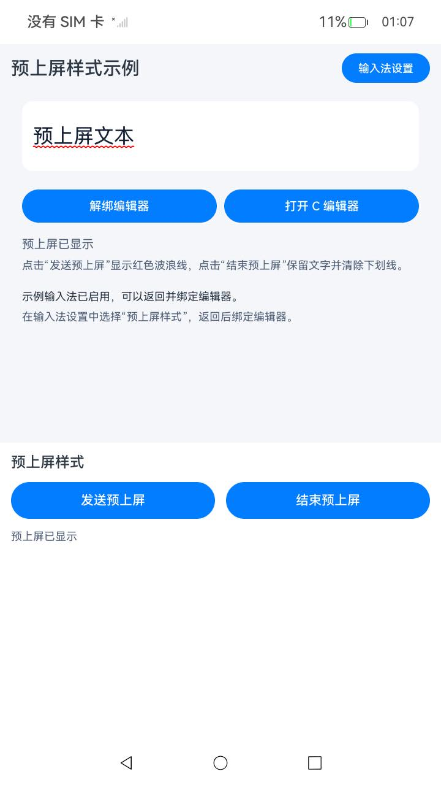
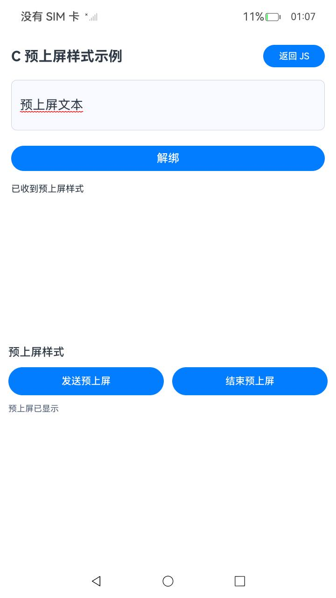

# 设置预上屏文本样式
<!--Kit: IME Kit-->
<!--Subsystem: MiscServices-->
<!--Owner: @codexu62-->
<!--Designer: @zhaolinglan-->
<!--Tester: @murphy84-->
<!--Adviser: @zhang_yixin13-->

## 场景介绍

预上屏文本是输入法正在编辑、尚未确认的内容。例如输入拼音时，输入法可以先在编辑框中显示正在组合的拼音，并用下划线标出可继续修改的范围。结束预上屏时，编辑框保留文字并清除下划线。

从API版本26.1.0开始，输入法可以在设置预上屏文本时指定无下划线、实线、波浪线或虚线，并选择下划线颜色。系统编辑框由对应组件处理样式，自绘编辑框需要接收样式信息并自行绘制。

输入法负责发送文本、范围和样式，编辑框负责显示。C接口提供自绘编辑框的接收回调和样式对象访问能力。本指南不将编辑框回调当作输入法发送接口使用。

## 开发准备

- 使用包含本次接口声明的SDK，运行设备须提供对应实现；仅更新SDK声明不能使设备获得运行能力。
- 输入法应用已启用，当前编辑框已获焦并与输入法绑定。
- 自绘编辑框已按[ArkTS开发指导](use-inputmethod-in-custom-edit-box.md)或[C/C++开发指导](use-inputmethod-in-custom-edit-box-ndk.md)实现文本插入、删除等编辑回调和绑定生命周期。

## 输入法发送预上屏文本

1. 在DevEco Studio打开下方示例代码所在的PreviewTextStyleJS工程并安装到设备。首次运行前，需启用并切换到本示例的输入法。在设备已开启开发者模式并连接HDC后，依次执行以下命令。

   ```shell
   # 启用本示例的输入法
   hdc shell ime -e com.samples.previewstylejs -f
   # 将当前输入法切换为本示例的输入法
   hdc shell ime -s com.samples.previewstylejs
   # 查询当前输入法，确认包名为com.samples.previewstylejs
   hdc shell ime -g
   ```

   `-f`用于完整体验模式，运行设备需支持该模式。确认当前输入法为com.samples.previewstylejs后，继续以下步骤。

2. 返回默认的编辑框页面，点击“绑定编辑器”。输入法通过[on('inputStart')](../reference/apis-ime-kit/js-apis-inputmethodengine.md#oninputstart9)监听绑定成功事件，并取得当前[InputClient](../reference/apis-ime-kit/js-apis-inputmethodengine.md#inputclient9)。输入法扩展从`app.string.preview_text`读取示例文本，交由`PreviewSender`保存。previewSender为同工程PreviewSender模块导出的实例。

   <!-- @[preview_style_js_input_start](https://gitcode.com/openharmony/applications_app_samples/blob/master/code/DocsSample/InputMethod/PreviewTextStyleJS/entry/src/main/ets/keyboard/PreviewInputMethod.ets) -->
   
   ``` TypeScript
   onCreate(): void {
     previewSender.setPreviewText(this.context.resourceManager.getStringSync($r('app.string.preview_text').id));
     this.active = true;
     this.ability.on('inputStart', (_keyboard: inputMethodEngine.KeyboardController,
       client: inputMethodEngine.InputClient): void => {
       previewSender.setClient(client);
     });
     this.ability.on('inputStop', this.inputStopCallback);
     this.createKeyboard();
   }
   ```

3. 点击“发送预上屏”，调用[setPreviewTextWithStyle](../reference/apis-ime-kit/js-apis-inputmethodengine.md#setpreviewtextwithstyle)，在当前预上屏范围显示红色波浪线。

   [PreviewTextStyle](../reference/apis-ime-kit/js-apis-inputmethodengine.md#previewtextstyle)的`underlineStyle`指定下划线样式。`underlineColor`为可选颜色值，颜色格式为0xRRGGBB。透明度通道无效，由编辑框忽略。省略时默认跟随光标颜色，显式传入0表示黑色。

   方法先检查输入连接和发送状态，再构造范围与样式并异步发送。发送期间busy用于阻止重复操作，finally中恢复该状态；调用失败时显示错误码。

   <!-- @[preview_style_js_send](https://gitcode.com/openharmony/applications_app_samples/blob/master/code/DocsSample/InputMethod/PreviewTextStyleJS/entry/src/main/ets/keyboard/PreviewSender.ets) -->

   ```typescript
   async send(): Promise<void> {
     const client = this.client;
     if (client === undefined || this.busy) {
       this.status(this.busy ? $r('app.string.operation_busy') : $r('app.string.bind_editor_first'));
       return;
     }
     this.busy = true;
     const range: inputMethodEngine.Range = { start: -1, end: -1 };
     const style: inputMethodEngine.PreviewTextStyle = {
       underlineStyle: inputMethodEngine.UnderlineStyle.WAVY,
       underlineColor: 0x00FF0000
     };
     // 省略underlineColor使用编辑框主题色；显式传入0表示黑色。
     try {
       await client.setPreviewTextWithStyle(this.previewText, range, style);
       this.status($r('app.string.preview_displayed'));
     } catch (error) {
       const detail = error as BusinessError;
       this.status($r('app.string.preview_send_failed', detail.code));
     } finally {
       this.busy = false;
     }
   }
   ```

4. 需要同步发送时，调用[setPreviewTextWithStyleSync](../reference/apis-ime-kit/js-apis-inputmethodengine.md#setpreviewtextwithstylesync)设置预上屏文本和样式。

   同步方法使用相同的范围和样式，通过try/catch处理调用失败。此方法用于说明同步接口的调用方式，示例页面仍使用前面的异步方法。

   <!-- @[preview_style_js_send_sync](https://gitcode.com/openharmony/applications_app_samples/blob/master/code/DocsSample/InputMethod/PreviewTextStyleJS/entry/src/main/ets/keyboard/PreviewSender.ets) -->

   ```typescript
   // 同步调用的等价写法。页面使用上面的异步方法。
   sendSync(): void {
     const client = this.client;
     if (client === undefined || this.busy) {
       this.status(this.busy ? $r('app.string.operation_busy') : $r('app.string.bind_editor_first'));
       return;
     }
     const range: inputMethodEngine.Range = { start: -1, end: -1 };
     const style: inputMethodEngine.PreviewTextStyle = {
       underlineStyle: inputMethodEngine.UnderlineStyle.WAVY,
       underlineColor: 0x00FF0000
     };
     try {
       client.setPreviewTextWithStyleSync(this.previewText, range, style);
       this.status($r('app.string.preview_displayed'));
     } catch (error) {
       const detail = error as BusinessError;
       this.status($r('app.string.preview_send_failed', detail.code));
     }
   }
   ```

5. 点击“结束预上屏”，调用[finishTextPreview](../reference/apis-ime-kit/js-apis-inputmethodengine.md#finishtextpreview12)。编辑框保留正文并清除下划线。

   方法先检查输入连接和操作状态，再结束预上屏；成功或失败时分别更新提示，finally中恢复busy状态。

   <!-- @[preview_style_js_finish](https://gitcode.com/openharmony/applications_app_samples/blob/master/code/DocsSample/InputMethod/PreviewTextStyleJS/entry/src/main/ets/keyboard/PreviewSender.ets) -->

   ```typescript
   async finish(): Promise<void> {
     const client = this.client;
     if (client === undefined || this.busy) {
       this.status(this.busy ? $r('app.string.operation_busy') : $r('app.string.bind_editor_first'));
       return;
     }
     this.busy = true;
     try {
       await client.finishTextPreview();
       this.status($r('app.string.preview_finished'));
     } catch (error) {
       const detail = error as BusinessError;
       this.status($r('app.string.preview_finish_failed', detail.code));
     } finally {
       this.busy = false;
     }
   }
   ```


以下为Sample中编辑框接收预上屏文本和样式后的实际运行效果。



## ArkTS自绘编辑框接收样式

自绘编辑框保存文本、范围和样式，在UI上绘制下划线。仅在提供`underlineColor`时使用其RGB值，否则由编辑框处理，默认跟随光标颜色。如果同时订阅[on('setPreviewText')](../reference/apis-ime-kit/js-apis-inputmethod.md#onsetpreviewtext17)和[onSetPreviewTextWithStyle](../reference/apis-ime-kit/js-apis-inputmethod.md#onsetpreviewtextwithstyle)，两种回调都会触发，应避免重复处理预上屏文本内容。

styledCallback保存文本、范围和下划线样式，并通过runScopedTask更新界面状态。legacyCallback处理setPreviewText事件，通过比较文本和范围，避免同一请求重复插入文本或覆盖已收到的样式。

<!-- @[preview_style_js_receive](https://gitcode.com/openharmony/applications_app_samples/blob/master/code/DocsSample/InputMethod/PreviewTextStyleJS/entry/src/main/ets/components/PreviewEditor.ets) -->

```typescript
// 保留同一回调对象，用于解绑时取消本编辑框的订阅。
private styledCallback: inputMethod.SetPreviewTextWithStyleCallback =
  (text: string, range: inputMethod.Range, style: inputMethod.PreviewTextStyle): void => {
    if (!this.alive || !this.listening) {
      return;
    }
    this.getUIContext().runScopedTask((): void => {
      this.applyPreview(text, range);
      this.underline = style.underlineStyle;
      this.color = style.underlineColor === undefined ? $r('app.color.accent') :
        0xFF000000 + (style.underlineColor & 0x00FFFFFF);
      this.styledText = text;
      this.styledRangeStart = range.start;
      this.styledRangeEnd = range.end;
      this.status = $r('app.string.preview_displayed');
    });
  };

private legacyCallback: inputMethod.SetPreviewTextCallback = (text: string, range: inputMethod.Range): void => {
  if (!this.alive || !this.legacyListening) {
    return;
  }
  this.getUIContext().runScopedTask((): void => {
    // setPreviewText事件回调不覆盖同一请求已经收到的样式。
    if (text === this.styledText && range.start === this.styledRangeStart &&
      range.end === this.styledRangeEnd && this.previewStart >= 0) {
      return;
    }
    this.applyPreview(text, range);
    this.underline = inputMethod.UnderlineStyle.SOLID;
    this.color = $r('app.color.accent');
  });
};
```

在[attach](../reference/apis-ime-kit/js-apis-inputmethod.md#attach10)之前调用[onSetPreviewTextWithStyle](../reference/apis-ime-kit/js-apis-inputmethod.md#onsetpreviewtextwithstyle)注册样式回调。解绑或页面销毁时，调用[offSetPreviewTextWithStyle](../reference/apis-ime-kit/js-apis-inputmethod.md#offsetpreviewtextwithstyle)，使用注册时的同一回调对象取消订阅。

listening记录样式事件是否已订阅，防止重复注册；取消订阅时传入原先保存的styledCallback。

<!-- @[preview_style_js_subscribe](https://gitcode.com/openharmony/applications_app_samples/blob/master/code/DocsSample/InputMethod/PreviewTextStyleJS/entry/src/main/ets/components/PreviewEditor.ets) -->

```typescript
private subscribeStyle(): void {
  if (!this.listening) {
    this.controller.onSetPreviewTextWithStyle(this.styledCallback);
    this.listening = true;
  }
}

private unsubscribeStyle(): void {
  if (this.listening) {
    this.controller.offSetPreviewTextWithStyle(this.styledCallback);
    this.listening = false;
  }
}
```

工程中的`connectEditor()`在绑定前注册预上屏及结束回调，绑定成功后订阅getTextIndexAtCursor、insertText和deleteLeft事件；离开页面时清理监听、解绑并丢弃过期更新。结束预上屏时保留文字并清除预上屏范围的下划线。

预上屏及结束事件先于attach注册；getTextIndexAtCursor用于提供光标位置，insertText和deleteLeft分别处理文本插入和向左删除。若绑定期间页面已经销毁，则立即解绑。

<!-- @[preview_style_js_attach](https://gitcode.com/openharmony/applications_app_samples/blob/master/code/DocsSample/InputMethod/PreviewTextStyleJS/entry/src/main/ets/components/PreviewEditor.ets) -->

```typescript
private async connectEditor(): Promise<void> {
  this.controller.on('setPreviewText', this.legacyCallback);
  this.legacyListening = true;
  this.subscribeStyle();
  this.controller.on('finishTextPreview', this.finishCallback);
  this.finishListening = true;
  await this.controller.attach(true, {
    inputAttribute: { textInputType: inputMethod.TextInputType.TEXT, enterKeyType: inputMethod.EnterKeyType.DONE }
  });
  this.attached = true;
  if (!this.alive) {
    await this.disconnectEditor();
    return;
  }
  // 以下编辑回调需要在编辑框绑定成功后注册。
  this.controller.on('getTextIndexAtCursor', this.cursorCallback);
  this.cursorListening = true;
  this.controller.on('insertText', this.insertCallback);
  this.insertListening = true;
  this.controller.on('deleteLeft', this.deleteCallback);
  this.deleteListening = true;
  this.status = $r('app.string.editor_connected_hint');
}
```

## C/C++自绘编辑框接收样式

PreviewTextStyleJS示例工程中的C页面包含一个自绘编辑框和绑定/解绑按钮，可从默认页面点击“打开C编辑器”进入。工程链接libohinputmethod.so并包含相应公开头文件；文本插入、删除等回调及资源清理见[C/C++开发指导](use-inputmethod-in-custom-edit-box-ndk.md)。

以下函数读取框架传入的样式对象。本示例使用g_textMutex互斥锁保护共享文本与样式状态的更新，页面随后读取该状态并绘制。样式对象是借用对象，不保存其指针，也不调用[OH_InputMethod_PreviewTextStyle_Destroy](../reference/apis-ime-kit/capi-inputmethod-preview-text-style-capi-h.md#oh_inputmethod_previewtextstyle_destroy)。该最小示例每次展示当前预上屏文本，光标固定在末尾；实际开发的自绘编辑框应结合start、end范围更新相应文本区间。

函数先检查指针并读取下划线样式、颜色及颜色是否已设置；任一步失败即返回对应结果。读取成功后，将文本和样式数值复制到本示例的共享显示状态中。

<!-- @[preview_style_c_receive](https://gitcode.com/openharmony/applications_app_samples/blob/master/code/DocsSample/InputMethod/PreviewTextStyleJS/entry/src/main/cpp/napi_init.cpp) -->

```cpp
int32_t SetPreviewTextWithStyleFunc(InputMethod_TextEditorProxy *proxy, const char16_t *text, uint32_t length,
    int32_t start, int32_t end, const OH_InputMethod_PreviewTextStyle *style)
{
    if (text == nullptr || style == nullptr) {
        return IME_ERR_NULL_POINTER;
    }
    OH_InputMethod_UnderlineStyle kind = OH_INPUTMETHOD_UNDERLINE_STYLE_NONE;
    uint32_t color = 0;
    bool hasColor = false;
    // 读取框架传入的样式对象，其生命周期由输入法框架管理。
    // C接口接收非const指针，但此处仅读取框架持有的对象。
    auto *readStyle = const_cast<OH_InputMethod_PreviewTextStyle *>(style);
    auto result = OH_InputMethod_PreviewTextStyle_GetUnderlineStyle(readStyle, &kind);
    if (result != IME_ERR_OK) {
        return result;
    }
    result = OH_InputMethod_PreviewTextStyle_GetUnderlineColor(readStyle, &color);
    if (result != IME_ERR_OK) {
        return result;
    }
    result = OH_InputMethod_PreviewTextStyle_HasUnderlineColor(readStyle, &hasColor);
    if (result != IME_ERR_OK) {
        return result;
    }
    std::lock_guard<std::mutex> lock(g_textMutex);
    g_display.ApplyStyled(text, length, static_cast<int32_t>(kind), color, hasColor);
    return IME_ERR_OK;
}
```

以下代码位于ConstructTextEditorProxy函数中，在其他必要编辑回调注册完成、调用[OH_InputMethodController_Attach](../reference/apis-ime-kit/capi-inputmethod-controller-capi-h.md#oh_inputmethodcontroller_attach)之前执行。示例同时调用OH_TextEditorProxy_SetSetPreviewTextFunc和OH_TextEditorProxy_SetSetPreviewTextWithStyleFunc注册回调。SetPreviewTextFunc不更新显示状态，文本和样式由SetPreviewTextWithStyleFunc处理，避免同一请求重复更新。

注册后读取样式回调并核对函数指针，确认注册结果；原有预上屏回调和结束预上屏回调仍然保留。

<!-- @[preview_style_c_register](https://gitcode.com/openharmony/applications_app_samples/blob/master/code/DocsSample/InputMethod/PreviewTextStyleJS/entry/src/main/cpp/napi_init.cpp) -->

```cpp
auto result = OH_TextEditorProxy_SetSetPreviewTextFunc(textEditorProxy, SetPreviewTextFunc);
if (result != IME_ERR_OK) {
    return result;
}
result = OH_InputMethod_TextEditorProxy_SetSetPreviewTextWithStyleFunc(
    textEditorProxy, SetPreviewTextWithStyleFunc);
if (result != IME_ERR_OK) {
    return result;
}
OH_InputMethod_TextEditorProxy_SetPreviewTextWithStyleFunc registered = nullptr;
result = OH_InputMethod_TextEditorProxy_GetSetPreviewTextWithStyleFunc(textEditorProxy, &registered);
if (result != IME_ERR_OK) {
    return result;
}
if (registered != SetPreviewTextWithStyleFunc) {
    return IME_ERR_UNDEFINED;
}
return OH_TextEditorProxy_SetFinishTextPreviewFunc(textEditorProxy, FinishTextPreviewFunc);
```

[OH_InputMethod_TextEditorProxy_GetSetPreviewTextWithStyleFunc](../reference/apis-ime-kit/capi-inputmethod-text-editor-proxy-capi-h.md#oh_inputmethod_texteditorproxy_getsetpreviewtextwithstylefunc)返回已注册的函数指针，不发送预上屏文本，也不代表完成绘制。[OH_TextEditorProxy_FinishTextPreviewFunc](../reference/apis-ime-kit/capi-inputmethod-text-editor-proxy-capi-h.md#oh_texteditorproxy_finishtextpreviewfunc)清除预上屏显示状态；解绑或离开页面时调用ReleaseCEditor释放输入连接和应用拥有的对象。

以下为同一Sample中C编辑框的实际运行效果。


