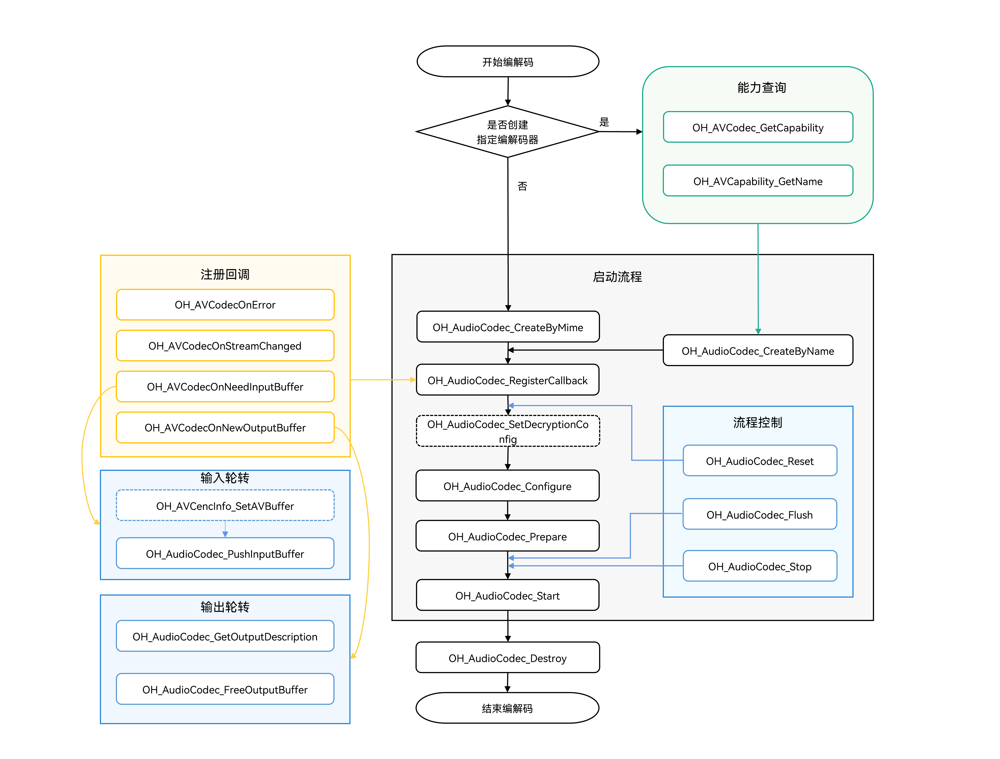
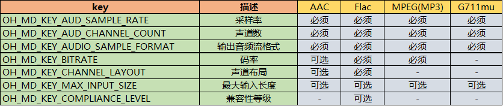
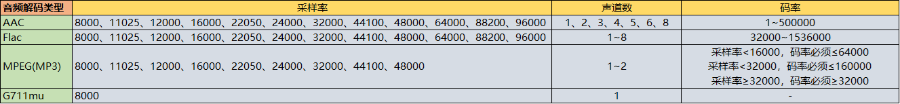

# 异步模式音频编码
<!--Kit: AVCodec Kit-->
<!--Subsystem: Multimedia-->
<!--Owner: @mr-chencxy-->
<!--Designer: @dpy2650--->
<!--Tester: @baotianhao-->
<!--Adviser: @w_Machine_cc-->

开发者可以调用本模块的Native API接口，完成音频编码，即将音频PCM编码压缩成不同的格式。

接口不限制PCM数据的来源，开发者可以调用麦克风录制获取、也可以导入编辑后的PCM数据，通过音频编码，输出对应格式的码流，最后封装为目标格式文件。

当前支持的编码能力请参考[AVCodec支持的格式](avcodec-support-formats.md#音频编码)。

**适用场景**

- 音频录制

  通过录制传入PCM，然后编码出对应格式的码流，最后[封装](audio-video-muxer.md)为所需格式的音频文件。
- 音频编辑

  编辑PCM后导出音频文件的场景，需要编码成对应音频格式后再[封装](audio-video-muxer.md)成文件。
> **说明：**
>
> - AAC编码器默认采用的VBR可变码率模式，与配置的预期参数可能存在偏差。
> - AAC编码器默认输出携带ADTS头部，帧数据的前7字节为ADTS头部。

## 开发指导

详细的API说明请参考[native_avcodec_audiocodec.h](../../reference/apis-avcodec-kit/capi-native-avcodec-audiocodec-h.md)。

参考以下示例代码，完成音频编码的全流程，包括：创建编码器、设置编码参数（采样率/码率/声道数等）、开始、刷新、重置、销毁资源。

示例代码引用了示例工程中自定义的工具宏与数据结构（如CHECK_AND_RETURN_RET_LOG、AVCODEC_SAMPLE_ERR_\*、AVCODEC_SAMPLE_LOG\*、CodecUserData、CodecBufferInfo、SampleInfo等），不属于SDK的接口，完整定义请参见示例工程，移植时需自行实现或替换。

在应用开发过程中，开发者应按一定顺序调用方法，执行对应操作，否则系统可能会抛出异常或生成其他未定义的行为。具体顺序可参考下列开发步骤及对应说明。

如下为音频编码调用关系图：

- 虚线表示可选。

- 实线表示必选。



### 在 CMake 脚本中链接动态库

```cmake
target_link_libraries(sample PUBLIC libnative_media_codecbase.so)
target_link_libraries(sample PUBLIC libnative_media_core.so)
target_link_libraries(sample PUBLIC libnative_media_acodec.so)
```
> **说明：**
>
> 上述'sample'字样仅为示例，此处由开发者根据实际工程目录自定义。

### 开发步骤

1. 添加所需的头文件。

   ```cpp
   #include <multimedia/player_framework/native_avcodec_audiocodec.h>
   #include <multimedia/native_audio_channel_layout.h>
   #include <multimedia/player_framework/native_avcapability.h>
   #include <multimedia/player_framework/native_avcodec_base.h>
   #include <multimedia/player_framework/native_avformat.h>
   #include <multimedia/player_framework/native_avbuffer.h>
   ```

2. 创建编码器实例对象，OH_AVCodec*为编码器实例指针。

   应用可以通过媒体类型或编解码器名称创建编码器。

   - 方法一：通过mime type创建编码器。

   <!-- @[AudioEncoder::Create](https://gitcode.com/openharmony/applications_app_samples/blob/master/code/DocsSample/Media/AVCodec/AVCodec/entry/src/main/cpp/capabilities/audio_encoder.cpp) -->
   
   ``` C++
   int32_t AudioEncoder::Create(const std::string &codecMime)
   {
       // 设置判定是否为编码。true表示当前是编码。
       constexpr bool isEncoder = true;
       // 通过mime type创建编码器。此处传入的mime type以实际编码格式为准。
       encoder_ = OH_AudioCodec_CreateByMime(codecMime.c_str(), isEncoder);
       CHECK_AND_RETURN_RET_LOG(encoder_ != nullptr, AVCODEC_SAMPLE_ERR_ERROR, "Create failed");
       return AVCODEC_SAMPLE_ERR_OK;
   }
   ```

   - 方法二：通过codec name创建编码器。

   <!-- @[AudioEncoder::CreateByName](https://gitcode.com/openharmony/applications_app_samples/blob/master/code/DocsSample/Media/AVCodec/AVCodec/entry/src/main/cpp/capabilities/audio_encoder.cpp) -->
   
   ``` C++
   int32_t AudioEncoder::CreateByName(const std::string &codecMime)
   {
       // 通过codec name创建编码器。
       OH_AVCapability *capability = OH_AVCodec_GetCapability(codecMime.c_str(), true);
       CHECK_AND_RETURN_RET_LOG(capability != nullptr, AVCODEC_SAMPLE_ERR_ERROR, "GetCapability failed");
       const char *name = OH_AVCapability_GetName(capability);
       encoder_ = OH_AudioCodec_CreateByName(name);
       CHECK_AND_RETURN_RET_LOG(encoder_ != nullptr, AVCODEC_SAMPLE_ERR_ERROR, "CreateByName failed");
       return AVCODEC_SAMPLE_ERR_OK;
   }
   ```

3. 调用OH_AudioCodec_RegisterCallback()注册回调函数。

   注册回调函数指针集合OH_AVCodecCallback，包括：

   - OH_AVCodecOnError：编码器运行错误。
   - OH_AVCodecOnStreamChanged：音频编码器暂未支持此回调。
   - OH_AVCodecOnNeedInputBuffer：运行过程中需要新的输入数据，即编码器已准备好，可以输入PCM数据。
   - OH_AVCodecOnNewOutputBuffer：运行过程中产生了新的输出数据，即编码完成。

   开发者可以通过处理该回调报告的信息，确保编码器正常运转。

   示例中的CodecUserData为应用自定义的透传数据结构，用于在回调线程与消费线程之间传递buffer队列。

   > **注意：**
   >
   > 请勿在回调中调用编码器的相关接口或进行耗时操作。

   <!-- @[SampleCallback::OnCodecError](https://gitcode.com/openharmony/applications_app_samples/blob/master/code/DocsSample/Media/AVCodec/AVCodec/entry/src/main/cpp/common/sample_callback.cpp) -->
   
   ``` C++
   void SampleCallback::OnCodecError(OH_AVCodec *codec, int32_t errorCode, void *userData)
   {
       (void)codec;
       auto *codecUserData = static_cast<CodecUserData *>(userData);
       if (codecUserData != nullptr && !codecUserData->isDestroyed.load()) {
           codecUserData->SignalError();
       }
       AVCODEC_SAMPLE_LOGE("On codec error, error code: %{public}d", errorCode);
   }
   ```

   <!-- @[SampleCallback::OnNeedInputBuffer](https://gitcode.com/openharmony/applications_app_samples/blob/master/code/DocsSample/Media/AVCodec/AVCodec/entry/src/main/cpp/common/sample_callback.cpp) -->
   
   ``` C++
   void SampleCallback::OnNeedInputBuffer(OH_AVCodec *codec, uint32_t index, OH_AVBuffer *buffer, void *userData)
   {
       auto *codecUserData = static_cast<CodecUserData *>(userData);
       if (codecUserData == nullptr || codecUserData->isDestroyed.load()) {
           return;
       }
       if (codec == nullptr || buffer == nullptr) {
           AVCODEC_SAMPLE_LOGE("Invalid codec input callback argument");
           codecUserData->SignalError();
           return;
       }
       UpdateEncoderFirstInputDescription(codec, codecUserData);
       // 输入帧的数据buffer和对应的index送入inputBufferQueue队列。
       codecUserData->inputBufferQueue.Enqueue(std::make_shared<CodecBufferInfo>(index, buffer));
   }
   ```

   OnNeedInputBuffer()中的UpdateEncoderFirstInputDescription()为视频编码首帧的信息获取逻辑（内部调用OH_VideoEncoder_GetInputDescription()），音频编码场景不会生效，可忽略。

   <!-- @[SampleCallback::OnNewOutputBuffer](https://gitcode.com/openharmony/applications_app_samples/blob/master/code/DocsSample/Media/AVCodec/AVCodec/entry/src/main/cpp/common/sample_callback.cpp) -->
   
   ``` C++
   void SampleCallback::OnNewOutputBuffer(OH_AVCodec *codec, uint32_t index, OH_AVBuffer *buffer, void *userData)
   {
       auto *codecUserData = static_cast<CodecUserData *>(userData);
       if (codecUserData == nullptr || codecUserData->isDestroyed.load()) {
           return;
       }
       if (codec == nullptr || buffer == nullptr) {
           AVCODEC_SAMPLE_LOGE("Invalid codec output callback argument");
           codecUserData->SignalError();
           return;
       }
       if (codecUserData->isDecFirstFrame) {
           OH_AVFormat *format = OH_VideoDecoder_GetOutputDescription(codec);
           if (format != nullptr) {
               UpdateVideoOutputInfo(format, codecUserData);
               OH_AVFormat_Destroy(format);
           }
           codecUserData->isDecFirstFrame = false;
       }
       // 输出帧的数据buffer和对应的index送入outputBufferQueue队列。
       codecUserData->outputBufferQueue.Enqueue(std::make_shared<CodecBufferInfo>(index, buffer));
   
       // 从AVBuffer中获取时域层级信息。
       int32_t layerID = GetTemporalLayerID(buffer);
       if (layerID >= 0 && index % LIMIT_LOGD_FREQUENCY == 0) {
           AVCODEC_SAMPLE_LOGD("Temporal layer ID: %{public}d", layerID);
       }
   }
   ```

   > **说明：**
   >
   > isDecFirstFrame分支内部调用OH_VideoDecoder_GetOutputDescription()，该接口声明于native_avcodec_videodecoder.h，属于视频解码库。示例中isDecFirstFrame分支与时域层级信息的获取（GetTemporalLayerID()）为视频场景的扩展逻辑，音频编码场景不会生效，可忽略。

   配置回调：

   <!-- @[AudioEncoder::SetCallback](https://gitcode.com/openharmony/applications_app_samples/blob/master/code/DocsSample/Media/AVCodec/AVCodec/entry/src/main/cpp/capabilities/audio_encoder.cpp) -->
   
   ``` C++
   int32_t AudioEncoder::SetCallback(CodecUserData *codecUserData)
   {
       // 编码器在内部线程回调userData；释放前应停止编码器并等待消费线程退出。
       int32_t ret = AV_ERR_OK;
       ret = OH_AudioCodec_RegisterCallback(encoder_,
                                            { SampleCallback::OnCodecError, SampleCallback::OnCodecFormatChange,
                                              SampleCallback::OnNeedInputBuffer, SampleCallback::OnNewOutputBuffer },
                                            codecUserData);
       CHECK_AND_RETURN_RET_LOG(ret == AV_ERR_OK, AVCODEC_SAMPLE_ERR_ERROR, "Set callback failed, ret: %{public}d", ret);
   
       return AVCODEC_SAMPLE_ERR_OK;
   }
   ```

4. 调用OH_AudioCodec_Configure设置编码器。

   配置选项key值说明：

   <!--RP2-->
   
   <!--RP2End-->

   各音频编码类型参数范围说明：

   <!--RP3-->
   
   <!--RP3End-->

   例如对一个44100Hz采样率、2声道立体声、SAMPLE_S16LE采样格式的PCM音频，以32000bps的码率进行AAC编码的调用流程如下：

   配置前建议先通过OH_AVCapability能力查询接口校验待配置参数是否在编码器支持范围内，再写入format并调用OH_AudioCodec_Configure()。

   <!--RP4-->
   <!-- @[AudioEncoder::Configure](https://gitcode.com/openharmony/applications_app_samples/blob/master/code/DocsSample/Media/AVCodec/AVCodec/entry/src/main/cpp/capabilities/audio_encoder.cpp) -->
   
   ``` C++
   int32_t AudioEncoder::Configure(const SampleInfo &sampleInfo)
   {
       CHECK_AND_RETURN_RET_LOG(CodecCapability::ValidateAudioConfiguration(sampleInfo, true),
           AVCODEC_SAMPLE_ERR_ERROR, "Audio encoder configuration is not supported");
       // 配置对象不被编码器接管；成功配置后由本函数销毁，调用方无需接管。
       OH_AVFormat *format = OH_AVFormat_Create();
       CHECK_AND_RETURN_RET_LOG(format != nullptr, AVCODEC_SAMPLE_ERR_ERROR, "AVFormat create failed");
   
       // 必选：采样格式、声道数、采样率、码率、声道布局。
       OH_AVFormat_SetIntValue(format, OH_MD_KEY_AUDIO_SAMPLE_FORMAT, sampleInfo.audio.audioSampleFormat);
       OH_AVFormat_SetIntValue(format, OH_MD_KEY_AUD_CHANNEL_COUNT, sampleInfo.audio.audioChannelCount);
       OH_AVFormat_SetIntValue(format, OH_MD_KEY_AUD_SAMPLE_RATE, sampleInfo.audio.audioSampleRate);
       OH_AVFormat_SetLongValue(format, OH_MD_KEY_BITRATE, sampleInfo.audio.audioBitRate);
       OH_AVFormat_SetLongValue(format, OH_MD_KEY_CHANNEL_LAYOUT, sampleInfo.audio.audioChannelLayout);
       // 可选：最大输入长度。FLAC、MP3等帧对齐编码器设置后允许输入数据不按帧大小对齐。
       OH_AVFormat_SetIntValue(format, OH_MD_KEY_MAX_INPUT_SIZE, sampleInfo.audio.audioMaxInputSize);
       if (sampleInfo.codec.codecSyncMode) {
           OH_AVFormat_SetIntValue(format, OH_MD_KEY_ENABLE_SYNC_MODE, sampleInfo.codec.codecSyncMode);
       }
   
       // 配置编码器。
       int ret = OH_AudioCodec_Configure(encoder_, format);
       CHECK_AND_RETURN_RET_LOG(ret == AV_ERR_OK, AVCODEC_SAMPLE_ERR_ERROR, "Config failed, ret: %{public}d", ret);
       OH_AVFormat_Destroy(format);
       format = nullptr;
   
       return AVCODEC_SAMPLE_ERR_OK;
   }
   ```
   <!--RP4End-->

   <!--RP1--><!--RP1End-->

   除上述配置的参数外，还可以在Configure阶段配置以下可选参数：

   - OH_MD_KEY_AUDIO_MAX_INPUT_BUFFER_SIZE：配置音频编码器最大输入缓冲区大小（单位：字节）。FLAC、MP3等帧对齐编码器设置该参数后会启用内部PCM缓存机制，允许输入数据无需按帧大小对齐，编码器会自动进行缓存与拆帧。实际缓冲区大小受编码器实现限制，如果设置的值超出上限，会被设置为上限值（上限为10MB）。

   - OH_MD_KEY_AUDIO_ENCODER_PTS_MODE：配置音频编码器输出PTS模式，值类型为[OH_AudioEncoderPTSMode](../../reference/apis-avcodec-kit/capi-native-avcodec-base-h.md#oh_audioencoderptsmode)。不同模式下输出帧的PTS计算方式不同：
     - OH_AUDIO_ENCODER_PTS_MODE_DEFAULT：默认行为，不同编码器的PTS输出方式可能不同。
     - OH_AUDIO_ENCODER_PTS_MODE_ZERO_START：PTS从0开始，按帧时长递增。适用于不依赖输入PTS、需要从0开始计时的场景。
     - OH_AUDIO_ENCODER_PTS_MODE_FIRST_INPUT_START：PTS从首个输入帧的PTS开始，按帧时长递增。适用于需要保持与输入流PTS连续性的场景。

   - OH_MD_KEY_AUDIO_ENCODER_ENABLE_SAMPLE_FORMAT_CONVERT：配置音频编码器采样格式转换开关，1表示开启，0表示关闭（默认）。音频编码器原生支持的采样格式有限（例如G711mu仅支持SAMPLE_S16LE），开启后编码器会自动将输入的PCM数据转换为编码器支持的格式进行编码，支持的输入采样格式扩展为：SAMPLE_U8、SAMPLE_S16LE、SAMPLE_S24LE、SAMPLE_S32LE、SAMPLE_F32LE。适用于输入PCM格式与编码器原生格式不一致的场景。

   ```cpp
   // 配置编码器最大输入缓冲区大小（可选），FLAC/MP3设置后可接受非帧对齐的输入数据。此处4096仅为参考值，开发者可按实际需要动态设置。
   OH_AVFormat_SetIntValue(format, OH_MD_KEY_AUDIO_MAX_INPUT_BUFFER_SIZE, 4096);
   // 配置编码器PTS输出模式（可选）。
   OH_AVFormat_SetIntValue(format, OH_MD_KEY_AUDIO_ENCODER_PTS_MODE,
       OH_AUDIO_ENCODER_PTS_MODE_FIRST_INPUT_START);
   // 配置编码器采样格式转换开关（可选），开启后支持更多采样格式输入。
   OH_AVFormat_SetIntValue(format, OH_MD_KEY_AUDIO_ENCODER_ENABLE_SAMPLE_FORMAT_CONVERT, 1);
   ```

5. 调用OH_AudioCodec_Prepare()，编码器就绪。

   示例工程将OH_AudioCodec_Prepare()封装在Config()函数中调用：在Config()函数中先完成Configure()配置与回调注册，之后再调用OH_AudioCodec_Prepare()使编码器就绪。以下为其中Prepare部分的代码：

   <!-- @[AudioEncoder::Config](https://gitcode.com/openharmony/applications_app_samples/blob/master/code/DocsSample/Media/AVCodec/AVCodec/entry/src/main/cpp/capabilities/audio_encoder.cpp) -->
   
   ``` C++
   {
       // 编码器就绪。
       int ret = OH_AudioCodec_Prepare(encoder_);
       CHECK_AND_RETURN_RET_LOG(ret == AV_ERR_OK, AVCODEC_SAMPLE_ERR_ERROR, "Prepare failed, ret: %{public}d", ret);
   }
   ```

6. 调用OH_AudioCodec_Start()启动编码器，进入运行态。

   <!-- @[AudioEncoder::Start](https://gitcode.com/openharmony/applications_app_samples/blob/master/code/DocsSample/Media/AVCodec/AVCodec/entry/src/main/cpp/capabilities/audio_encoder.cpp) -->
   
   ``` C++
   int32_t AudioEncoder::Start()
   {
       CHECK_AND_RETURN_RET_LOG(encoder_ != nullptr, AVCODEC_SAMPLE_ERR_ERROR, "Encoder is null");
   
       int ret = OH_AudioCodec_Start(encoder_);
       CHECK_AND_RETURN_RET_LOG(ret == AV_ERR_OK, AVCODEC_SAMPLE_ERR_ERROR, "Start failed, ret: %{public}d", ret);
       return AVCODEC_SAMPLE_ERR_OK;
   }
   ```

7. 调用OH_AudioCodec_PushInputBuffer()，写入待编码的数据。需开发者填充完整的输入数据后调用。

   每次输入的采样点数（SAMPLES_PER_FRAME）取值方法如下：

   AAC-LC编码每帧包含1024个PCM样点，建议单次输入1024个样点的数据量。

   <!--RP5--><!--RP5End-->

   flac比较特殊，需要根据如下表格进行设置。

   | 采样率 | 样点数 |
   | :----: | :----: |
   |  8000  |  576  |
   | 16000 |  1152  |
   | 22050 |  2304  |
   | 24000 |  2304  |
   | 32000 |  2304  |
   | 44100 |  4608  |
   | 48000 |  4608  |
   | 88200 |  8192  |
   | 96000 |  8192  |

   > **说明：**
   >
   > 单次编码输入的数据量（单位：字节）为：采样点数（SAMPLES_PER_FRAME） * 声道数 * 单个采样点的占用字节。
   >
   > flac编码的样点数建议参考表格根据采样率对应的样点数进行设置，否则可能出现编码文件损坏问题。

   <!-- @[AudioEncoder::PushInputData](https://gitcode.com/openharmony/applications_app_samples/blob/master/code/DocsSample/Media/AVCodec/AVCodec/entry/src/main/cpp/capabilities/audio_encoder.cpp) -->
   
   ``` C++
   int32_t AudioEncoder::PushInputData(CodecBufferInfo &info)
   {
       CHECK_AND_RETURN_RET_LOG(encoder_ != nullptr, AVCODEC_SAMPLE_ERR_ERROR, "Encoder is null");
       CHECK_AND_RETURN_RET_LOG(info.buffer != nullptr, AVCODEC_SAMPLE_ERR_ERROR, "Input buffer is null");
       int32_t ret = OH_AVBuffer_SetBufferAttr(info.buffer, &info.attr);
       CHECK_AND_RETURN_RET_LOG(ret == AV_ERR_OK, AVCODEC_SAMPLE_ERR_ERROR, "Set avbuffer attr failed");
       ret = OH_AudioCodec_PushInputBuffer(encoder_, info.bufferIndex);
       CHECK_AND_RETURN_RET_LOG(ret == AV_ERR_OK, AVCODEC_SAMPLE_ERR_ERROR, "Push input data failed");
       return AVCODEC_SAMPLE_ERR_OK;
   }
   ```

   示例中以麦克风录音（AudioCapturer）作为PCM数据来源，录音数据先写入应用自定义的PCM缓存，攒够一个输入buffer的数据量后填充到编码器输入buffer并送入编码器，输入线程示例如下：

   <!-- @[Recorder::AudioEncInputThread](https://gitcode.com/openharmony/applications_app_samples/blob/master/code/DocsSample/Media/AVCodec/AVCodec/entry/src/main/cpp/sample/recorder/Recorder.cpp) -->
   
   ``` C++
   void Recorder::AudioEncInputThread()
   {
       while (true) {
           CHECK_AND_BREAK_LOG(!isEos_, "Work done, thread out");
           CHECK_AND_BREAK_LOG(isStarted_, "Encoder input thread out");
           if (isStopping_.load()) {
               std::this_thread::sleep_for(std::chrono::milliseconds(AUDIO_INPUT_STOP_POLL_INTERVAL_MS));
               continue;
           }
           if (!WaitForAudioInputFrame(5s)) {
               continue;
           }
           std::shared_ptr<CodecBufferInfo> bufferInfo = audioEncContext_->inputBufferQueue.Dequeue();
           std::shared_lock<std::shared_mutex> codecLock(audioEncContext_->codecMutex);
           CHECK_AND_CONTINUE_LOG(bufferInfo != nullptr, "Audio buffer queue is empty, continue");
           if (!SubmitAudioInputFrame(*bufferInfo, bufferInfo->buffer, false)) {
               break;
           }
       }
   }
   ```

   在上方案例中，attr.flags代表缓冲区标记的类别。

   结束时需要将flags标识为AVCODEC_BUFFER_FLAGS_EOS。在示例中，当录制结束时获取一个输入buffer，填入长度为0的数据并标识EOS标志后送入编码器。

   <!-- @[AudioEncoder::NotifyEndOfStream](https://gitcode.com/openharmony/applications_app_samples/blob/master/code/DocsSample/Media/AVCodec/AVCodec/entry/src/main/cpp/capabilities/audio_encoder.cpp) -->
   
   ``` C++
   int32_t AudioEncoder::NotifyEndOfStream()
   {
       CHECK_AND_RETURN_RET_LOG(encoder_ != nullptr, AVCODEC_SAMPLE_ERR_ERROR, "Encoder is null");
   
       // 使用空输入Buffer携带EOS。即使没有媒体数据也必须提交该Buffer，编码器才会输出尾部数据。
       CodecBufferInfo bufferInfo;
       auto buffer = GetInputBuffer(bufferInfo, TIMEOUT_US);
       if (buffer == nullptr) {
           AVCODEC_SAMPLE_LOGW("GetInputBuffer for EOS failed");
           return AVCODEC_SAMPLE_ERR_ERROR;
       }
   
       // EOS不包含有效音频字节；调用PushInputBuffer后该Buffer立即归codec管理。
       bufferInfo.attr.size = 0;
       bufferInfo.attr.flags = AVCODEC_BUFFER_FLAGS_EOS;
       int32_t ret = OH_AVBuffer_SetBufferAttr(buffer, &bufferInfo.attr);
       if (ret != AV_ERR_OK) {
           AVCODEC_SAMPLE_LOGE("SetBufferAttr for EOS failed, ret: %{public}d", ret);
           return AVCODEC_SAMPLE_ERR_ERROR;
       }
   
       bufferInfo.buffer = buffer;
       ret = OH_AudioCodec_PushInputBuffer(encoder_, bufferInfo.bufferIndex);
       CHECK_AND_RETURN_RET_LOG(ret == AV_ERR_OK, AVCODEC_SAMPLE_ERR_ERROR,
                                "PushInputBuffer for EOS failed, ret: %{public}d", ret);
       return AVCODEC_SAMPLE_ERR_OK;
   }
   ```

   | 枚举值 | 描述 |
   | -------- | -------- |
   | AVCODEC_BUFFER_FLAGS_NONE | 表示为普通帧。 |
   | AVCODEC_BUFFER_FLAGS_EOS | 表示缓冲区是流结束帧。 |
   | AVCODEC_BUFFER_FLAGS_CODEC_DATA | 表示缓冲区包含编解码特定数据。 |

8. 调用OH_AudioCodec_FreeOutputBuffer()，释放编码后的数据。

   在取走编码码流后，就应及时调用OH_AudioCodec_FreeOutputBuffer()进行释放。

   <!-- @[AudioEncoder::FreeOutputData](https://gitcode.com/openharmony/applications_app_samples/blob/master/code/DocsSample/Media/AVCodec/AVCodec/entry/src/main/cpp/capabilities/audio_encoder.cpp) -->
   
   ``` C++
   int32_t AudioEncoder::FreeOutputData(uint32_t bufferIndex)
   {
       CHECK_AND_RETURN_RET_LOG(encoder_ != nullptr, AVCODEC_SAMPLE_ERR_ERROR, "Encoder is null");
   
       int32_t ret = AVCODEC_SAMPLE_ERR_OK;
       ret = OH_AudioCodec_FreeOutputBuffer(encoder_, bufferIndex);
       CHECK_AND_RETURN_RET_LOG(ret == AV_ERR_OK, AVCODEC_SAMPLE_ERR_ERROR, "Free output data failed");
       return AVCODEC_SAMPLE_ERR_OK;
   }
   ```

   示例中编码输出的码流写入封装模块，写完一帧后及时释放输出buffer，输出消费示例如下：

   <!-- @[Recorder::AudioEncOutputThread](https://gitcode.com/openharmony/applications_app_samples/blob/master/code/DocsSample/Media/AVCodec/AVCodec/entry/src/main/cpp/sample/recorder/Recorder.cpp) -->
   
   ``` C++
   void Recorder::AudioEncOutputThread()
   {
       while (true) {
           CHECK_AND_BREAK_LOG(isStarted_, "Work done, thread out");

           std::shared_ptr<CodecBufferInfo> bufferInfo = audioEncContext_->outputBufferQueue.Dequeue();
           std::shared_lock<std::shared_mutex> codecLock(audioEncContext_->codecMutex);
           CHECK_AND_BREAK_LOG(isStarted_, "Work done, thread out");
           CHECK_AND_CONTINUE_LOG(bufferInfo != nullptr, "Buffer queue is empty, continue");

           audioEncContext_->outputFrameCount++;
           AVCODEC_SAMPLE_LOGW(
               "Audio Out buffer count: %{public}u, size: %{public}d, flag: %{public}u, pts: %{public}" PRId64,
               audioEncContext_->outputFrameCount, bufferInfo->attr.size, bufferInfo->attr.flags, bufferInfo->attr.pts);
           const bool isEosBuffer = (bufferInfo->attr.flags & AVCODEC_BUFFER_FLAGS_EOS) != 0;
           int32_t writeRet = AVCODEC_SAMPLE_ERR_OK;
           if (!isEosBuffer && bufferInfo->attr.size > 0) {
               // AAC只编码一次；同一输出Buffer依次写入两个Muxer，之后仍按原索引归还。
               writeRet = muxer_->WriteSample(muxer_->GetAudioTrackId(), bufferInfo->buffer, bufferInfo->attr);
               if (writeRet == AVCODEC_SAMPLE_ERR_OK && secondaryMuxer_ != nullptr) {
                   writeRet = secondaryMuxer_->WriteSample(secondaryMuxer_->GetAudioTrackId(), bufferInfo->buffer,
                       bufferInfo->attr);
               }
           }
           int32_t ret = audioEncoder_->FreeOutputData(bufferInfo->bufferIndex);
           CHECK_AND_BREAK_LOG(ret == AVCODEC_SAMPLE_ERR_OK, "Encoder output thread out");
           if (writeRet != AVCODEC_SAMPLE_ERR_OK) {
               AbortRecording("Write encoded audio sample failed");
               break;
           }
           if (isEosBuffer) {
               AVCODEC_SAMPLE_LOGI("Audio EOS processed, exiting output thread");
               isAudioEos_.store(true);
               videoEosCond_.notify_all();
               break;
           }
       }
       AVCODEC_SAMPLE_LOGI("Exit, frame count: %{public}u", audioEncContext_->inputFrameCount);
   }
   ```

9. （可选）调用OH_AudioCodec_Flush()刷新编码器。

   调用OH_AudioCodec_Flush()后，编码器处于Flush状态，会将当前编码队列清空。

   此时需要调用OH_AudioCodec_Start()重新开始编码。

   使用情况：

   * 在编码输出buffer属性为AVCODEC_BUFFER_FLAGS_EOS后，若想重新使用相同配置进行编码时，需要调用刷新。
   * 在执行过程中遇到可继续执行的错误时（即OH_AudioCodec_IsValid()为true）可以调用刷新，然后调用OH_AudioCodec_Start()重新开始编码。

   <!-- @[AudioEncoder::Flush](https://gitcode.com/openharmony/applications_app_samples/blob/master/code/DocsSample/Media/AVCodec/AVCodec/entry/src/main/cpp/capabilities/audio_encoder.cpp) -->
   
   ``` C++
   int32_t AudioEncoder::Flush()
   {
       CHECK_AND_RETURN_RET_LOG(encoder_ != nullptr, AVCODEC_SAMPLE_ERR_ERROR, "Encoder is null");
   
       // 刷新编码器，清空当前队列，之后需要调用Start()重新开始编码。
       int32_t ret = OH_AudioCodec_Flush(encoder_);
       CHECK_AND_RETURN_RET_LOG(ret == AV_ERR_OK, AVCODEC_SAMPLE_ERR_ERROR, "Flush failed, ret: %{public}d", ret);
       return AVCODEC_SAMPLE_ERR_OK;
   }
   ```

10. （可选）调用OH_AudioCodec_Reset()重置编码器。

    调用OH_AudioCodec_Reset()后，编码器回到初始化状态，重置前获取到的输入/输出buffer都无法继续使用，需先调用OH_AudioCodec_Configure()重新配置，再调用OH_AudioCodec_Start()重新开始编码。启动后重新获取输入/输出buffer。

    <!-- @[AudioEncoder::Reset](https://gitcode.com/openharmony/applications_app_samples/blob/master/code/DocsSample/Media/AVCodec/AVCodec/entry/src/main/cpp/capabilities/audio_encoder.cpp) -->
    
    ``` C++
    int32_t AudioEncoder::Reset()
    {
        CHECK_AND_RETURN_RET_LOG(encoder_ != nullptr, AVCODEC_SAMPLE_ERR_ERROR, "Encoder is null");
    
        // 重置编码器，之后需要重新调用Configure()配置、Start()启动。
        int32_t ret = OH_AudioCodec_Reset(encoder_);
        CHECK_AND_RETURN_RET_LOG(ret == AV_ERR_OK, AVCODEC_SAMPLE_ERR_ERROR, "Reset failed, ret: %{public}d", ret);
        return AVCODEC_SAMPLE_ERR_OK;
    }
    ```

11. 调用OH_AudioCodec_Stop()停止编码器。

    停止后，可以通过调用OH_AudioCodec_Start()重新进入已启动状态（started）。停止前获取到的输入/输出buffer都无法继续使用，需要在启动后重新获取输入/输出buffer。

    <!-- @[AudioEncoder::Stop](https://gitcode.com/openharmony/applications_app_samples/blob/master/code/DocsSample/Media/AVCodec/AVCodec/entry/src/main/cpp/capabilities/audio_encoder.cpp) -->
    
    ``` C++
    int32_t AudioEncoder::Stop()
    {
        CHECK_AND_RETURN_RET_LOG(encoder_ != nullptr, AVCODEC_SAMPLE_ERR_ERROR, "Encoder is null");
    
        int ret = Flush();
        CHECK_AND_RETURN_RET_LOG(ret == AVCODEC_SAMPLE_ERR_OK, AVCODEC_SAMPLE_ERR_ERROR,
                                 "Flush failed, ret: %{public}d", ret);
    
        ret = OH_AudioCodec_Stop(encoder_);
        CHECK_AND_RETURN_RET_LOG(ret == AV_ERR_OK, AVCODEC_SAMPLE_ERR_ERROR, "Stop failed, ret: %{public}d", ret);
        return AVCODEC_SAMPLE_ERR_OK;
    }
    ```

12. 调用OH_AudioCodec_Destroy()销毁编码器实例，释放资源。

    > **说明：**
    >
    > 禁止重复销毁编码器。

    <!-- @[AudioEncoder::Release](https://gitcode.com/openharmony/applications_app_samples/blob/master/code/DocsSample/Media/AVCodec/AVCodec/entry/src/main/cpp/capabilities/audio_encoder.cpp) -->
    
    ``` C++
    int32_t AudioEncoder::Release()
    {
        if (encoder_ != nullptr) {
            // 销毁前刷新并停止编码器，不可重复destroy。
            Flush();
            Stop();
            OH_AudioCodec_Destroy(encoder_);
            encoder_ = nullptr;
        }
        return AVCODEC_SAMPLE_ERR_OK;
    }
    ```
