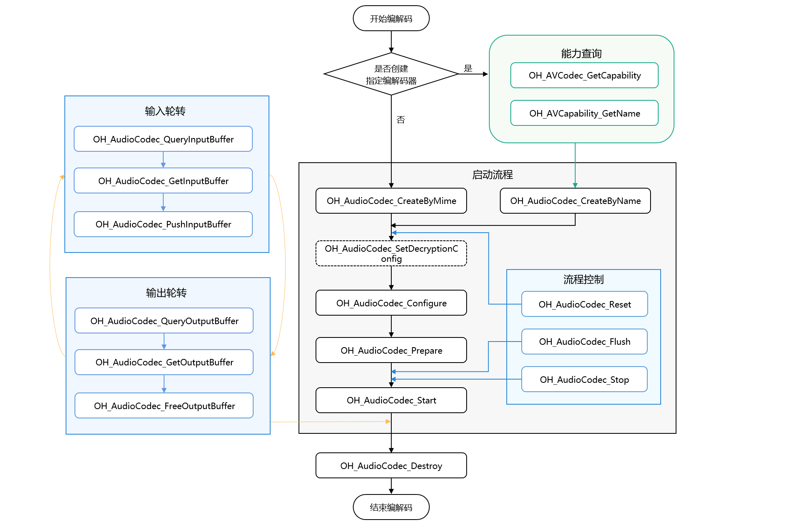
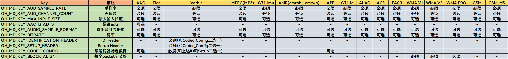
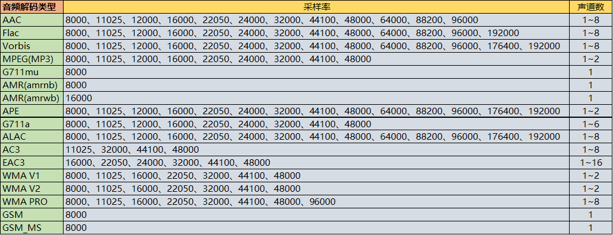

# 同步模式音频解码

<!--Kit: AVCodec Kit-->
<!--Subsystem: Multimedia-->
<!--Owner: @mr-chencxy-->
<!--Designer: @dpy2650--->
<!--Tester: @baotianhao-->
<!--Adviser: @w_Machine_cc-->

从API version 20开始，支持音频解码同步模式。

开发者可以调用本模块的Native API接口，完成同步模式的音频解码，即将媒体数据解码为PCM码流。

具体实现可参考[示例工程](https://gitcode.com/openharmony/applications_app_samples/tree/master/code/DocsSample/Media/AVCodec/AVCodec)。

支持的解码能力请参考[AVCodec支持的格式](avcodec-support-formats.md#音频解码)。

**适用场景**

通常推荐使用异步模式，详细内容请参考[异步模式音频解码](audio-decoding.md)。若需要主动请求buffer去送帧，则可以使用同步模式。

将音视频文件解码为PCM码流，通常需要以下步骤：[媒体数据解封装](audio-video-demuxer.md) -> 音频解码。

本指南描述音频解码过程：输入音频帧和解码出PCM码流。

## 开发指导

详细的API说明请参考[AudioCodec](../../reference/apis-avcodec-kit/capi-native-avcodec-audiocodec-h.md)。

参考以下示例代码，完成音频解码的全流程，包括：创建解码器、设置解码参数（采样率/码率/声道数等）、开始/刷新/重置/销毁资源。

示例代码引用了示例工程中自定义的工具宏与数据结构（如CHECK_AND_RETURN_RET_LOG、AVCODEC_SAMPLE_ERR_\*、AVCODEC_SAMPLE_LOG\*、CodecUserData、CodecBufferInfo、SampleInfo等），不属于SDK的接口，完整定义请参见示例工程，移植时需自行实现或替换。

在应用开发过程中，开发者应按顺序调用方法，执行操作，否则系统可能会抛出异常或生成其他未定义的行为。具体顺序可参考下列开发步骤及对应说明。

音频编解码同步模式调用关系图如下所示：

- 虚线表示可选。

- 实线表示必选。



### 在 CMake 脚本中链接动态库

```cmake
target_link_libraries(sample PUBLIC libnative_media_codecbase.so)
target_link_libraries(sample PUBLIC libnative_media_core.so)
target_link_libraries(sample PUBLIC libnative_media_acodec.so)
```
> **说明：**
>
> 上述'sample'字样仅为示例，开发者需根据实际工程目录进行自定义。

### 开发步骤

1. 添加头文件和命名空间。

   ```cpp
   #include <multimedia/player_framework/native_avcodec_audiocodec.h>
   #include <multimedia/native_audio_channel_layout.h>
   #include <multimedia/player_framework/native_avcapability.h>
   #include <multimedia/player_framework/native_avcodec_base.h>
   #include <multimedia/player_framework/native_avformat.h>
   #include <multimedia/player_framework/native_avbuffer.h>

   // c++标准库命名空间。
   using namespace std;
   ```

2. 创建解码器实例对象，OH_AVCodec *为解码器实例指针。

   应用可以通过媒体类型或编解码器名称创建解码器。

   - 方法一：通过mime type创建解码器。

   <!-- @[AudioDecoder::Create](https://gitcode.com/openharmony/applications_app_samples/blob/master/code/DocsSample/Media/AVCodec/AVCodec/entry/src/main/cpp/capabilities/audio_decoder.cpp) -->
   
   ``` C++
   int32_t AudioDecoder::Create(const std::string &codecMime)
   {
       // 设置判定是否为编码。false表示当前是解码。
       constexpr bool isEncoder = false;
       // 通过mime type创建解码器。此处传入的mime type以实际解码格式为准。
       decoder_ = OH_AudioCodec_CreateByMime(codecMime.c_str(), isEncoder);
       CHECK_AND_RETURN_RET_LOG(decoder_ != nullptr, AVCODEC_SAMPLE_ERR_ERROR, "Create failed");
       return AVCODEC_SAMPLE_ERR_OK;
   }
   ```

   - 方法二：通过codec name创建解码器。

   <!-- @[AudioDecoder::CreateByName](https://gitcode.com/openharmony/applications_app_samples/blob/master/code/DocsSample/Media/AVCodec/AVCodec/entry/src/main/cpp/capabilities/audio_decoder.cpp) -->
   
   ``` C++
   int32_t AudioDecoder::CreateByName(const std::string &codecMime)
   {
       // 通过codec name创建解码器。
       OH_AVCapability *capability = OH_AVCodec_GetCapability(codecMime.c_str(), false);
       CHECK_AND_RETURN_RET_LOG(capability != nullptr, AVCODEC_SAMPLE_ERR_ERROR, "GetCapability failed");
       const char *name = OH_AVCapability_GetName(capability);
       decoder_ = OH_AudioCodec_CreateByName(name);
       CHECK_AND_RETURN_RET_LOG(decoder_ != nullptr, AVCODEC_SAMPLE_ERR_ERROR, "CreateByName failed");
       return AVCODEC_SAMPLE_ERR_OK;
   }
   ```

3. （可选）OH_AudioCodec_SetDecryptionConfig设置解密配置。

   当获取到DRM信息（参考[音视频解封装](audio-video-demuxer.md)开发步骤第4步）后，通过此接口进行解密配置。

   DRM相关接口详见[DRM](../../reference/apis-drm-kit/capi-drm.md)。

   此接口需在Prepare前调用。

   添加头文件：

   ```c++
   #include <multimedia/drm_framework/native_mediakeysystem.h>
   #include <multimedia/drm_framework/native_mediakeysession.h>
   #include <multimedia/drm_framework/native_drm_err.h>
   #include <multimedia/drm_framework/native_drm_common.h>
   ```
   在CMake脚本中链接动态库：

   ``` cmake
   target_link_libraries(sample PUBLIC libnative_drm.so)
   ```

   使用示例：
   ```c++
   // 根据DRM信息创建指定的DRM系统, 以创建"com.clearplay.drm"为例。
   MediaKeySystem *system = nullptr;
   int32_t ret = OH_MediaKeySystem_Create("com.clearplay.drm", &system);
   if (system == nullptr) {
       printf("create media key system failed");
       return;
   }

   // 创建解密会话。
   MediaKeySession *session = nullptr;
   DRM_ContentProtectionLevel contentProtectionLevel = CONTENT_PROTECTION_LEVEL_SW_CRYPTO;
   ret = OH_MediaKeySystem_CreateMediaKeySession(system, &contentProtectionLevel, &session);
   if (ret != DRM_ERR_OK) {
       // 如果创建失败，请查看DRM接口文档及日志信息。
       printf("create media key session failed.");
       return;
   }
   if (session == nullptr) {
       printf("media key session is nullptr.");
       return;
   }
   // 获取许可证请求、设置许可证响应等。
   // 设置解密信息。将解密会话设置到解码器中。当前音频解密不支持安全解码器，设置为false。
   bool secureAudio = false;
   ret = OH_AudioCodec_SetDecryptionConfig(audioDec_, session, secureAudio);
   ```

4. 调用OH_AudioCodec_Configure()配置解码器。

   配置选项key值说明：

   <!--RP1-->
   
   <!--RP1End-->

   各音频解码类型参数范围说明：

   <!--RP2-->
   
   <!--RP2End-->

   从API version 20开始，支持通过[OH_AVCapability_GetAudioSupportedSampleRateRanges](../../reference/apis-avcodec-kit/capi-native-avcapability-h.md#oh_avcapability_getaudiosupportedsamplerateranges)接口进行采样率范围能力查询，以下几种音频解码类型支持对范围内的任意采样率进行解码：

   | 音频解码类型 |    采样率(Hz)   |
   | ----------- | --------------- |
   | Flac        | 8000 ~ 384000   |
   | Vorbis      | 8000 ~ 192000   |
   | APE         | 1 ~ 2147483647  |

   同步模式通过OH_MD_KEY_ENABLE_SYNC_MODE开启：需要使用同步模式时，在Configure传入的OH_AVFormat中将OH_MD_KEY_ENABLE_SYNC_MODE设置为1。示例中根据是否使用同步模式决定是否设置该参数：

   <!-- @[AudioDecoder::Configure](https://gitcode.com/openharmony/applications_app_samples/blob/master/code/DocsSample/Media/AVCodec/AVCodec/entry/src/main/cpp/capabilities/audio_decoder.cpp) -->
   
   ``` C++
   int32_t AudioDecoder::Configure(const SampleInfo &sampleInfo)
   {
       // 解码能力表可能未完整列出部分容器编码格式的采样率/声道信息。
       // 解码器Configure调用的返回值才是最终判定依据，此处仅将能力查询结果作为参考日志。
       if (!CodecCapability::ValidateAudioConfiguration(sampleInfo, false)) {
           AVCODEC_SAMPLE_LOGW("Audio capability query did not fully describe mime: %{public}s; "
               "continue with decoder configure", sampleInfo.audio.audioCodecMime.c_str());
       }
       // format仅用于本次Configure；所有失败路径和成功路径都要在返回前销毁。
       OH_AVFormat *format = OH_AVFormat_Create();
       CHECK_AND_RETURN_RET_LOG(format != nullptr, AVCODEC_SAMPLE_ERR_ERROR, "AVFormat create failed");
   
       // 必选：采样格式、声道数、声道布局、采样率。
       OH_AVFormat_SetIntValue(format, OH_MD_KEY_AUDIO_SAMPLE_FORMAT, SAMPLE_S16LE);
       OH_AVFormat_SetIntValue(format, OH_MD_KEY_AUD_CHANNEL_COUNT, sampleInfo.audio.audioChannelCount);
       OH_AVFormat_SetLongValue(format, OH_MD_KEY_CHANNEL_LAYOUT, sampleInfo.audio.audioChannelLayout);
       OH_AVFormat_SetIntValue(format, OH_MD_KEY_AUD_SAMPLE_RATE, sampleInfo.audio.audioSampleRate);
       // 可选：同步模式，按需设置。
       if (sampleInfo.codec.codecSyncMode) {
           OH_AVFormat_SetIntValue(format, OH_MD_KEY_ENABLE_SYNC_MODE, sampleInfo.codec.codecSyncMode);
       }
   
       // 可选：编解码器特定数据（codec config），由解封装获取，没有则不设置。
       if (sampleInfo.audio.codecConfigLen > 0 &&
           sampleInfo.audio.codecConfig.size() >= sampleInfo.audio.codecConfigLen) {
           OH_AVFormat_SetBuffer(format, OH_MD_KEY_CODEC_CONFIG, sampleInfo.audio.codecConfig.data(),
               sampleInfo.audio.codecConfigLen);
       }
   
       // 配置解码器。
       int ret = OH_AudioCodec_Configure(decoder_, format);
       CHECK_AND_RETURN_RET_LOG(ret == AV_ERR_OK, AVCODEC_SAMPLE_ERR_ERROR, "Config failed, ret: %{public}d", ret);
       OH_AVFormat_Destroy(format);
       format = nullptr;
   
       return AVCODEC_SAMPLE_ERR_OK;
   }
   ```

5. 调用OH_AudioCodec_Prepare()，解码器就绪。

   示例工程将OH_AudioCodec_Prepare()封装在Config()函数中调用：在Config()函数中先完成Configure()配置，之后再调用OH_AudioCodec_Prepare()使解码器就绪。以下为其中Prepare部分的代码：

   <!-- @[AudioDecoder::Config](https://gitcode.com/openharmony/applications_app_samples/blob/master/code/DocsSample/Media/AVCodec/AVCodec/entry/src/main/cpp/capabilities/audio_decoder.cpp) -->
   
   ``` C++
   {
       // 解码器就绪。
       int ret = OH_AudioCodec_Prepare(decoder_);
       CHECK_AND_RETURN_RET_LOG(ret == AV_ERR_OK, AVCODEC_SAMPLE_ERR_ERROR, "Prepare failed, ret: %{public}d", ret);
   }
   ```

6. 调用OH_AudioCodec_Start()启动解码器，进入运行态。

   <!-- @[AudioDecoder::Start](https://gitcode.com/openharmony/applications_app_samples/blob/master/code/DocsSample/Media/AVCodec/AVCodec/entry/src/main/cpp/capabilities/audio_decoder.cpp) -->
   
   ``` C++
   int32_t AudioDecoder::Start()
   {
       CHECK_AND_RETURN_RET_LOG(decoder_ != nullptr, AVCODEC_SAMPLE_ERR_ERROR, "Decoder is null");
   
       int ret = OH_AudioCodec_Start(decoder_);
       CHECK_AND_RETURN_RET_LOG(ret == AV_ERR_OK, AVCODEC_SAMPLE_ERR_ERROR, "Start failed, ret: %{public}d", ret);
       return AVCODEC_SAMPLE_ERR_OK;
   }
   ```

7. （可选）调用OH_AVCencInfo_SetAVBuffer()，设置cencInfo。

   如果当前播放的节目是DRM加密节目，并且由上层应用进行[媒体数据解封装](audio-video-demuxer.md)，则需要调用OH_AVCencInfo_SetAVBuffer()将cencInfo设置给AVBuffer，以实现媒体数据的解密。

   添加头文件：

   ```c++
   #include <multimedia/player_framework/native_cencinfo.h>
   ```
   在CMake脚本中链接动态库：

   ``` cmake
   target_link_libraries(sample PUBLIC libnative_media_avcencinfo.so)
   ```

   使用示例：
   ```c++
   OH_AVBuffer *buffer = ...; // 待解密的输入buffer，获取方式可参考步骤8。
   uint32_t keyIdLen = DRM_KEY_ID_SIZE;
   uint8_t keyId[] = {
       0xd4, 0xb2, 0x01, 0xe4, 0x61, 0xc8, 0x98, 0x96,
       0xcf, 0x05, 0x22, 0x39, 0x8d, 0x09, 0xe6, 0x28};
   uint32_t ivLen = DRM_KEY_IV_SIZE;
   uint8_t iv[] = {
       0xbf, 0x77, 0xed, 0x51, 0x81, 0xde, 0x36, 0x3e,
       0x52, 0xf7, 0x20, 0x4f, 0x72, 0x14, 0xa3, 0x95};
   uint32_t encryptedBlockCount = 0;
   uint32_t skippedBlockCount = 0;
   uint32_t firstEncryptedOffset = 0;
   uint32_t subsampleCount = 1;
   DrmSubsample subsamples[1] = { {0x10, 0x16} };
   // 创建CencInfo实例。
   OH_AVCencInfo *cencInfo = OH_AVCencInfo_Create();
   if (cencInfo == nullptr) {
       // 异常处理。
   }
   // 设置解密算法。
   OH_AVErrCode errNo = OH_AVCencInfo_SetAlgorithm(cencInfo, DRM_ALG_CENC_AES_CTR);
   if (errNo != AV_ERR_OK) {
       // 异常处理。
   }
   // 设置KeyId和Iv。
   errNo = OH_AVCencInfo_SetKeyIdAndIv(cencInfo, keyId, keyIdLen, iv, ivLen);
   if (errNo != AV_ERR_OK) {
       // 异常处理。
   }
   // 设置Sample信息。
   errNo = OH_AVCencInfo_SetSubsampleInfo(cencInfo, encryptedBlockCount, skippedBlockCount, firstEncryptedOffset,
       subsampleCount, subsamples);
   if (errNo != AV_ERR_OK) {
       // 异常处理。
   }
   // 设置模式：KeyId、Iv和SubSamples已被设置。
   errNo = OH_AVCencInfo_SetMode(cencInfo, DRM_CENC_INFO_KEY_IV_SUBSAMPLES_SET);
   if (errNo != AV_ERR_OK) {
       // 异常处理。
   }
   // 将CencInfo设置到AVBuffer中。
   errNo = OH_AVCencInfo_SetAVBuffer(cencInfo, buffer);
   if (errNo != AV_ERR_OK) {
       // 异常处理。
   }
   // 销毁CencInfo实例。
   errNo = OH_AVCencInfo_Destroy(cencInfo);
   if (errNo != AV_ERR_OK) {
       // 异常处理。
   }
   cencInfo = nullptr;
   ```

8. 同步模式调用，写入待解码的数据，获取解码的输出。

   主动请求输入buffer：先通过OH_AudioCodec_QueryInputBuffer()查询可用的输入buffer索引，超时返回AV_ERR_TRY_AGAIN_LATER，再通过OH_AudioCodec_GetInputBuffer()获取该输入buffer。

   <!-- @[AudioDecoder::GetInputBuffer](https://gitcode.com/openharmony/applications_app_samples/blob/master/code/DocsSample/Media/AVCodec/AVCodec/entry/src/main/cpp/capabilities/audio_decoder.cpp) -->
   
   ``` C++
   OH_AVBuffer *AudioDecoder::GetInputBuffer(CodecBufferInfo &info, int64_t timeoutUs)
   {
       CHECK_AND_RETURN_RET_LOG(decoder_ != nullptr, nullptr, "Decoder is null");
       int32_t ret = OH_AudioCodec_QueryInputBuffer(decoder_, &info.bufferIndex, timeoutUs);
       switch (ret) {
           case AV_ERR_OK: {
               OH_AVBuffer *buffer = OH_AudioCodec_GetInputBuffer(decoder_, info.bufferIndex);
               CHECK_AND_RETURN_RET_LOG(buffer != nullptr, nullptr, "Input buffer is null");
               // Buffer由codec管理，业务侧只在PushInputBuffer前写入，不能缓存地址或跨线程长期持有。
               info.buffer = buffer;
               return buffer;
           }
           case AV_ERR_TRY_AGAIN_LATER: {
               AVCODEC_SAMPLE_LOGE("Get input buffer timeout.");
               return nullptr;
           }
           default: {
               return nullptr;
           }
       }
       return nullptr;
   }
   ```

   需开发者填充完整的输入数据后调用。示例中待解码的数据从解封装模块读取，pts、size、flags由OH_AVDemuxer_ReadSampleBuffer写入buffer属性，同步输入线程示例如下：

   <!-- @[Player::AudioDecInputSyncThread](https://gitcode.com/openharmony/applications_app_samples/blob/master/code/DocsSample/Media/AVCodec/AVCodec/entry/src/main/cpp/sample/player/output/audio/PlayerAudioOutput.cpp) -->   
   
   ``` C++
   void Player::AudioDecInputSyncThread()
   {
       while (isStarted_ && audioWorkerRunning_) {
           WaitIfPaused(true);
           CHECK_AND_BREAK_LOG(isStarted_ && audioWorkerRunning_, "Decoder input thread out");
           std::unique_lock<std::mutex> lock(audioDecContext_->inputMutex);
           CodecBufferInfo bufferInfo;
           auto buffer = audioDecoder_->GetInputBuffer(bufferInfo, CODEC_BUFFER_TIMEOUT_US);
           CHECK_AND_CONTINUE_LOG(buffer != nullptr, "Get input buffer timeout, retry");
           CHECK_AND_BREAK_LOG(isStarted_ && audioWorkerRunning_, "Work done, thread out");
           bufferInfo.buffer = buffer;
           // ...
           audioDecContext_->inputFrameCount++;
           lock.unlock();
           int32_t ret = demuxer_->ReadSample(demuxer_->GetAudioTrackId(), buffer, bufferInfo.attr);
           if (ret != AVCODEC_SAMPLE_ERR_OK) {
               AVCODEC_SAMPLE_LOGE("Read audio sample failed");
               playbackFailed_ = true;
               isStarted_ = false;
               break;
           }
           if ((bufferInfo.attr.flags & AVCODEC_BUFFER_FLAGS_EOS) && isLoop_) {
               ret = demuxer_->Seek(0);
               if (ret != AVCODEC_SAMPLE_ERR_OK) {
                   playbackFailed_ = true;
                   isStarted_ = false;
                   break;
               }
               ret = demuxer_->ReadSample(demuxer_->GetAudioTrackId(), bufferInfo.buffer, bufferInfo.attr);
               if (ret != AVCODEC_SAMPLE_ERR_OK) {
                   playbackFailed_ = true;
                   isStarted_ = false;
                   break;
               }
           }
           ret = audioDecoder_->PushInputBuffer(bufferInfo);
           if (ret != AVCODEC_SAMPLE_ERR_OK) {
               playbackFailed_ = true;
               isStarted_ = false;
               break;
           }
           CHECK_AND_BREAK_LOG(!(bufferInfo.attr.flags & AVCODEC_BUFFER_FLAGS_EOS), "Catch EOS, thread out");
       }
   }
   ```

   结束时需要将flags标识为AVCODEC_BUFFER_FLAGS_EOS。

   获取解码输出：通过OH_AudioCodec_QueryOutputBuffer()查询可用输出buffer，超时返回AV_ERR_TRY_AGAIN_LATER。若返回AV_ERR_STREAM_CHANGED，表示码流信息变化（如采样率、声道数、采样格式变化），应用可通过OH_AudioCodec_GetOutputDescription()获取新的码流信息，处理后继续查询解码输出：

   <!-- @[AudioDecoder::GetOutputBuffer](https://gitcode.com/openharmony/applications_app_samples/blob/master/code/DocsSample/Media/AVCodec/AVCodec/entry/src/main/cpp/capabilities/audio_decoder.cpp) -->
   
   ``` C++
   int32_t AudioDecoder::GetOutputBuffer(CodecBufferInfo &info, int64_t timeoutUs)
   {
       info.buffer = nullptr;
       CHECK_AND_RETURN_RET_LOG(decoder_ != nullptr, AVCODEC_SAMPLE_ERR_ERROR, "Decoder is null");
       OH_AVErrCode ret = OH_AudioCodec_QueryOutputBuffer(decoder_, &info.bufferIndex, timeoutUs);
       if (ret == AV_ERR_TRY_AGAIN_LATER) {
           // 超时通常说明等待时间过短，或已有输出Buffer未及时归还导致codec暂无可用Buffer。
           AVCODEC_SAMPLE_LOGW("Get output buffer timeout.");
           return AVCODEC_SAMPLE_ERR_AGAIN; // continue;
       }
       if (ret != AV_ERR_OK) {
           AVCODEC_SAMPLE_LOGE("query output buffer failed, ret: %{public}d", ret);
           return AVCODEC_SAMPLE_ERR_ERROR; // break;
       }
   
       OH_AVBuffer *outputBuf = OH_AudioCodec_GetOutputBuffer(decoder_, info.bufferIndex);
       if (outputBuf == nullptr) {
           // 已取得输出索引，后续取Buffer失败也必须归还，避免占满codec的输出队列。
           const int32_t freeRet = OH_AudioCodec_FreeOutputBuffer(decoder_, info.bufferIndex);
           AVCODEC_SAMPLE_LOGE("Get output buffer failed, free ret: %{public}d", freeRet);
           return AVCODEC_SAMPLE_ERR_ERROR; // break;
       }
   
       ret = OH_AVBuffer_GetBufferAttr(outputBuf, &info.attr);
       if (ret != AV_ERR_OK) {
           const int32_t freeRet = OH_AudioCodec_FreeOutputBuffer(decoder_, info.bufferIndex);
           AVCODEC_SAMPLE_LOGE("Get output buffer attr failed, ret: %{public}d, free ret: %{public}d", ret, freeRet);
           return AVCODEC_SAMPLE_ERR_ERROR; // break;
       }
       info.buffer = outputBuf;
       if (info.attr.flags & AVCODEC_BUFFER_FLAGS_EOS) {
           // EOS输出也必须归还，之后不再访问outputBuf或该索引。
           OH_AudioCodec_FreeOutputBuffer(decoder_, info.bufferIndex);
           info.buffer = nullptr;
           AVCODEC_SAMPLE_LOGI("Out buffer end");
           // 解码输出结束。
           return AVCODEC_SAMPLE_ERR_END;
       }
       return AVCODEC_SAMPLE_ERR_OK;
   }
   ```

   取走解码PCM码流后，应及时调用OH_AudioCodec_FreeOutputBuffer()释放输出buffer，同步输出线程示例如下：

   <!-- @[AudioOutputPump::ProcessSyncOutput](https://gitcode.com/openharmony/applications_app_samples/blob/master/code/DocsSample/Media/AVCodec/AVCodec/entry/src/main/cpp/sample/player/output/audio/AudioOutputPump.cpp) -->
   
   ``` C++
   bool AudioOutputPump::ProcessSyncOutput()
   {
       CHECK_AND_RETURN_RET_LOG(running_, false, "Audio decoder output sync thread out");
       CodecBufferInfo bufferInfo;
       int32_t errCode = decoder_.GetOutputBuffer(bufferInfo, CODEC_BUFFER_TIMEOUT_US);
       if (errCode == AVCODEC_SAMPLE_ERR_END) {
           // 同步解码器已在GetOutputBuffer()内归还EOS索引，此处不能重复释放。
           AVCODEC_SAMPLE_LOGI("Audio decoder reached EOS");
           return false;
       }
       if (errCode == AVCODEC_SAMPLE_ERR_ERROR) {
           // 查询成功但读取属性失败时，封装层可能仍留下已取得的Buffer；仅在指针有效时归还。
           (void)ReleaseOutputBuffer(bufferInfo, "get audio output buffer failed");
           MarkPlaybackFailed("Audio decoder output failed");
           return false;
       }
       if (errCode != AVCODEC_SAMPLE_ERR_OK) {
           AVCODEC_SAMPLE_LOGI("No audio output buffer available, continue");
           return true;
       }
       return HandleOutputBuffer(bufferInfo, false);
   }
   ```

9. （可选）调用OH_AudioCodec_Flush()刷新解码器。

   调用OH_AudioCodec_Flush()后，解码器仍处于运行态，但会清空当前队列，释放已解码的数据。刷新前获取到的输入/输出buffer都无法继续使用。

   此时需要调用OH_AudioCodec_Start()重新开始解码。

   使用情况：
   * 之前输入的数据不再使用的场景，例如在解封装seek之后，调用刷新。
   * 在解码输出buffer属性为AVCODEC_BUFFER_FLAGS_EOS后，若想重新使用相同配置进行解码时，需要调用刷新。
   * 在执行过程中遇到可继续执行的错误时（即OH_AudioCodec_IsValid()为true）可以调用刷新，然后调用OH_AudioCodec_Start()重新开始解码。

   <!-- @[AudioDecoder::Flush](https://gitcode.com/openharmony/applications_app_samples/blob/master/code/DocsSample/Media/AVCodec/AVCodec/entry/src/main/cpp/capabilities/audio_decoder.cpp) -->
   
   ``` C++
   int32_t AudioDecoder::Flush()
   {
       CHECK_AND_RETURN_RET_LOG(decoder_ != nullptr, AVCODEC_SAMPLE_ERR_ERROR, "Decoder is null");
   
       // 刷新解码器，清空当前队列，之后需要调用Start()重新开始解码。
       int32_t ret = OH_AudioCodec_Flush(decoder_);
       CHECK_AND_RETURN_RET_LOG(ret == AV_ERR_OK, AVCODEC_SAMPLE_ERR_ERROR, "Flush failed, ret: %{public}d", ret);
       return AVCODEC_SAMPLE_ERR_OK;
   }
   ```

10. （可选）调用OH_AudioCodec_Reset()重置解码器。

    调用OH_AudioCodec_Reset()后，解码器回到初始化状态，重置前获取到的输入/输出buffer都无法继续使用，需先调用OH_AudioCodec_Configure()重新配置，再调用OH_AudioCodec_Start()重新开始解码。启动后重新获取输入/输出buffer。

    <!-- @[AudioDecoder::Reset](https://gitcode.com/openharmony/applications_app_samples/blob/master/code/DocsSample/Media/AVCodec/AVCodec/entry/src/main/cpp/capabilities/audio_decoder.cpp) -->
    
    ``` C++
    int32_t AudioDecoder::Reset()
    {
        CHECK_AND_RETURN_RET_LOG(decoder_ != nullptr, AVCODEC_SAMPLE_ERR_ERROR, "Decoder is null");
    
        // 重置解码器，之后需要重新调用Configure()配置、Start()启动。
        int32_t ret = OH_AudioCodec_Reset(decoder_);
        CHECK_AND_RETURN_RET_LOG(ret == AV_ERR_OK, AVCODEC_SAMPLE_ERR_ERROR, "Reset failed, ret: %{public}d", ret);
        return AVCODEC_SAMPLE_ERR_OK;
    }
    ```

11. 调用OH_AudioCodec_Stop()停止解码器。

    停止后，可以通过调用OH_AudioCodec_Start()重新进入已启动状态（started）。停止前获取到的输入/输出buffer都无法继续使用，需要在启动后重新获取输入/输出buffer。

    <!-- @[AudioDecoder::Stop](https://gitcode.com/openharmony/applications_app_samples/blob/master/code/DocsSample/Media/AVCodec/AVCodec/entry/src/main/cpp/capabilities/audio_decoder.cpp) -->
    
    ``` C++
    int32_t AudioDecoder::Stop()
    {
        CHECK_AND_RETURN_RET_LOG(decoder_ != nullptr, AVCODEC_SAMPLE_ERR_ERROR, "Decoder is null");
    
        int32_t ret = OH_AudioCodec_Stop(decoder_);
        CHECK_AND_RETURN_RET_LOG(ret == AV_ERR_OK, AVCODEC_SAMPLE_ERR_ERROR, "Stop failed, ret: %{public}d", ret);
        return AVCODEC_SAMPLE_ERR_OK;
    }
    ```

12. 调用OH_AudioCodec_Destroy()销毁解码器实例，释放资源。

    > **说明：**
    >
    > 禁止重复销毁解码器。

    <!-- @[AudioDecoder::Release](https://gitcode.com/openharmony/applications_app_samples/blob/master/code/DocsSample/Media/AVCodec/AVCodec/entry/src/main/cpp/capabilities/audio_decoder.cpp) -->
    
    ``` C++
    int32_t AudioDecoder::Release()
    {
        if (decoder_ != nullptr) {
            // 销毁前刷新并停止解码器，不可重复destroy。
            Flush();
            Stop();
            OH_AudioCodec_Destroy(decoder_);
            decoder_ = nullptr;
        }
        return AVCODEC_SAMPLE_ERR_OK;
    }
    ```
