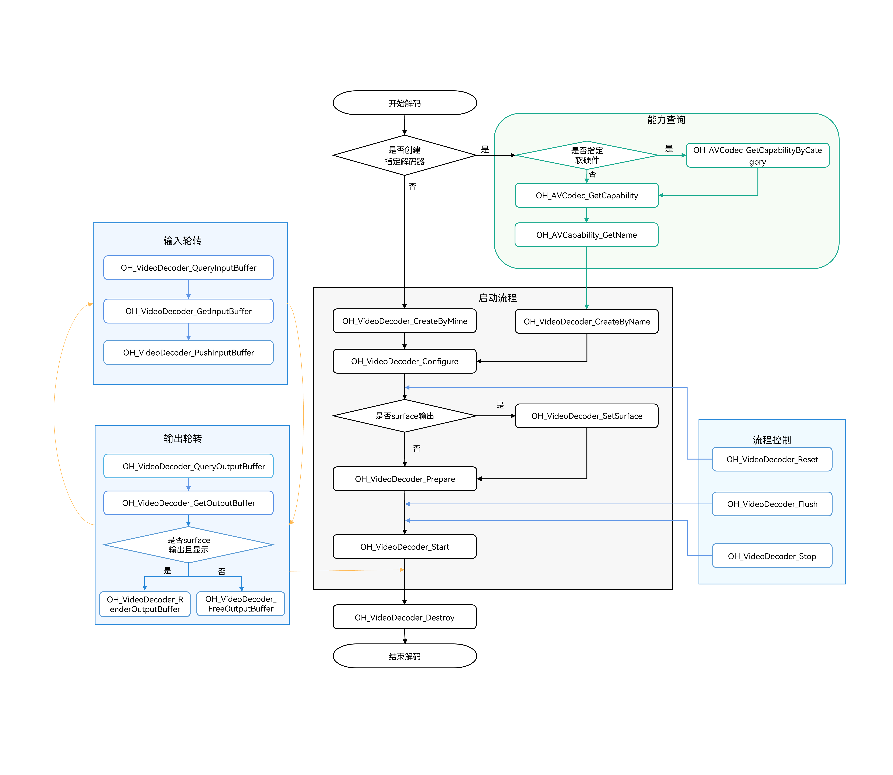

# 同步模式视频解码

<!--Kit: AVCodec Kit-->
<!--Subsystem: Multimedia-->
<!--Owner: @rchdlee-->
<!--Designer: @dpy2650--->
<!--Tester: @cyakee-->
<!--Adviser: @w_Machine_cc-->

本文档主要介绍同步模式视频解码的实现流程。同步模式下开发者通过主动轮询获取输入和输出Buffer，若业务需要主动申请Buffer发送帧数据时可选用该模式。优先推荐使用[异步模式视频解码](video-decoding.md)。

同步模式视频解码也同样包含Surface模式和Buffer模式两种输出模式。其状态机调用关系、支持的能力与异步模式视频解码一致，详细信息请参考[异步模式视频解码](video-decoding.md)。

从API version 20开始支持同步模式视频解码，视频解码支持的格式请参考[视频解码](avcodec-support-formats.md#视频解码)。

具体实现可参考[示例工程](https://gitcode.com/openharmony/applications_app_samples/tree/master/code/DocsSample/Media/AVCodec/AVCodec)。

## 适用场景

通常情况下，推荐使用异步模式。若需要主动请求buffer去送帧，则可以采用同步模式。

## 开发指导

详细的API说明请参考[native_avcodec_videodecoder.h](../../reference/apis-avcodec-kit/capi-native-avcodec-videodecoder-h.md)。



### 在CMake脚本中链接动态库

```cmake
target_link_libraries(sample PUBLIC libnative_media_codecbase.so)
target_link_libraries(sample PUBLIC libnative_media_core.so)
target_link_libraries(sample PUBLIC libnative_media_vdec.so)
```

> **说明：**
>
> 上述'sample'字样仅为示例，此处由开发者根据实际工程目录自定义。

### 定义基础结构

本部分示例代码按照C++17标准编写，仅作参考。

1. 添加头文件。

   ```c++
   #include <multimedia/player_framework/native_avcodec_videodecoder.h>
   #include <multimedia/player_framework/native_avcapability.h>
   #include <multimedia/player_framework/native_avcodec_base.h>
   #include <multimedia/player_framework/native_avformat.h>
   #include <multimedia/player_framework/native_avbuffer.h>
   #include <multimedia/player_framework/native_averrors.h>
   #include <native_window/external_window.h>
   #include <memory>
   #include <fstream>
   #include <mutex>
   #include <shared_mutex>
   #include <string.h>
   ```

2. 定义全局变量（仅作示例，具体参数值，请根据能力查询接口获取相应值范围来参考配置）。

   ```c++
   struct CodecUserData {
   public:
       bool isDecFirstFrame = false;

       int32_t width = 0;
       int32_t height = 0;
       int32_t widthStride = 0;
       int32_t heightStride = 0;

       std::shared_mutex codecMutex;
       uint32_t inputFrameCount = 0;
       std::mutex inputMutex;
       uint32_t outputFrameCount = 0;
       std::mutex outputMutex;

       void ClearQueue()
       {
           inputBufferQueue.Flush();
           outputBufferQueue.Flush();
       }
   };

   struct VideoSampleInfo {
       // 解码器MIME类型。
       std::string videoCodecMime;
       // 视频帧宽度。
       int32_t videoWidth = 0;
       // 视频帧高度。
       int32_t videoHeight = 0;
       // 视频帧率。
       double frameRate = 0.0;
       // 视频像素格式。
       OH_AVPixelFormat pixelFormat = AV_PIXEL_FORMAT_NV12;
       // surface旋转角度的键。
       int32_t rotation = 0;
       // 图形接口。
       OHNativeWindow *window = nullptr;
   };

   struct CodecOptions {
       int32_t codecSyncMode = 0;
   };

   struct SampleInfo {
       VideoSampleInfo video;
       CodecOptions codec;
   };

   // 解码器实例指针。
   OH_AVCodec *decoder_ = nullptr;
   // 输出保存文件。
   std::unique_ptr<std::ofstream> outputFile_ = nullptr;
   std::unique_ptr<CodecUserData> videoDecContext_ = nullptr;
   std::unique_ptr<VideoDecoder> videoDecoder_ = nullptr;
   ```

3. 解码器buffer的信息。

   <!-- @[codec_buffer_info](https://gitcode.com/openharmony/applications_app_samples/blob/master/code/DocsSample/Media/AVCodec/AVCodec/entry/src/main/cpp/common/codec_buffer.h)-->

   ```c++
   // buffer信息。
   struct CodecBufferInfo {
       // buffer。
       OH_AVBuffer *buffer = nullptr;
       // buffer对应的bufferIndex。
       uint32_t bufferIndex = 0;
       // buffer的输入尺寸（size）、偏移量（offset）、时间戳（pts）、缓冲区标记（flags）信息。
       OH_AVCodecBufferAttr attr = {0, 0, 0, AVCODEC_BUFFER_FLAGS_NONE};

       CodecBufferInfo() = default;

       CodecBufferInfo(uint32_t index, OH_AVBuffer *avBuffer)
           : buffer(avBuffer), bufferIndex(index)
       {
           // 获取buffer的attr信息。
           if (buffer != nullptr) {
               (void)OH_AVBuffer_GetBufferAttr(buffer, &attr);
           }
       }
   };
   ```

### Surface模式

参考以下示例代码，可以完成Surface模式下视频解码的全流程，实现同步模式的数据轮转。此处以输入H.264码流文件，解码送显输出为例。

1. 创建解码器实例。

   通过名称创建解码器。示例中的变量说明如下：

   - mime：视频格式，如OH_AVCODEC_MIMETYPE_VIDEO_AVC(H.264)，OH_AVCODEC_MIMETYPE_VIDEO_HEVC(H.265)。
   - isEncoder：编码器为true，解码器为false。
   - category：编解码器类别，HARDWARE硬件编解码，SOFTWARE为软件编解码。
   - capability：解码器能力查询实例的指针。
   - decoder_：视频解码器实例的指针。

   方式一：通过名称创建解码器。

   <!-- @[decoder_create_byname](https://gitcode.com/openharmony/applications_app_samples/blob/master/code/DocsSample/Media/AVCodec/AVCodec/entry/src/main/cpp/capabilities/video_decoder.cpp)-->

   ```c++
   // 通过codec name创建解码器，应用有特殊需求，比如选择支持某种分辨率规格的解码器，可先查询capability，再根据codec name创建解码器。
   OH_AVCodec *VideoDecoder::GetCodecByCategory(const char *mime, bool isEncoder, OH_AVCodecCategory category)
   {
       OH_AVCapability *capability = OH_AVCodec_GetCapabilityByCategory(mime, isEncoder, category);
       CHECK_AND_RETURN_RET_LOG(capability != nullptr, nullptr, "Capability is nullptr");
       const char *codecName = OH_AVCapability_GetName(capability);
       CHECK_AND_RETURN_RET_LOG(codecName != nullptr, nullptr, "Codec name is nullptr");
       return OH_VideoDecoder_CreateByName(codecName);
   }
   ```

2. 调用OH_VideoDecoder_Configure()配置解码器。

   - 详细可配置选项的说明请参考[媒体数据键值对](../../reference/apis-avcodec-kit/capi-codecbase.md#媒体数据键值对)。
   - 参数校验规则请参考[OH_VideoDecoder_Configure()](../../reference/apis-avcodec-kit/capi-native-avcodec-videodecoder-h.md#oh_videodecoder_configure)。
   - 参数取值范围可以通过能力查询接口获取，具体示例请参考[获取支持的编解码能力](obtain-supported-codecs.md)。

   目前支持的所有格式都必须配置以下选项：视频帧宽度、视频帧高度。

   <!-- @[decoder_sync_mode](https://gitcode.com/openharmony/applications_app_samples/blob/master/code/DocsSample/Media/AVCodec/AVCodec/entry/src/main/cpp/capabilities/video_decoder.cpp)-->

   ```c++
   // 同步模式配置。
   if (sampleInfo.codec.codecSyncMode) {
       OH_AVFormat_SetIntValue(format, OH_MD_KEY_ENABLE_SYNC_MODE, sampleInfo.codec.codecSyncMode);
   }
   ```

   <!-- @[decoder_configure](https://gitcode.com/openharmony/applications_app_samples/blob/master/code/DocsSample/Media/AVCodec/AVCodec/entry/src/main/cpp/capabilities/video_decoder.cpp)-->

   ```c++
   int32_t VideoDecoder::Configure(const SampleInfo &sampleInfo)
   {
       // 建议在配置解码器前进行能力校验，确认当前设备是否支持配置的参数。
       // ...
       OH_AVFormat *format = OH_AVFormat_Create();
       CHECK_AND_RETURN_RET_LOG(format != nullptr, AVCODEC_SAMPLE_ERR_ERROR, "AVFormat create failed");

       OH_AVFormat_SetIntValue(format, OH_MD_KEY_WIDTH, sampleInfo.video.videoWidth);
       OH_AVFormat_SetIntValue(format, OH_MD_KEY_HEIGHT, sampleInfo.video.videoHeight);
       OH_AVFormat_SetDoubleValue(format, OH_MD_KEY_FRAME_RATE, sampleInfo.video.frameRate);
       OH_AVFormat_SetIntValue(format, OH_MD_KEY_PIXEL_FORMAT, sampleInfo.video.pixelFormat);
       OH_AVFormat_SetIntValue(format, OH_MD_KEY_ROTATION, sampleInfo.video.rotation);
       // ...
       int ret = OH_VideoDecoder_Configure(decoder_, format);
       OH_AVFormat_Destroy(format);
       format = nullptr;
       CHECK_AND_RETURN_RET_LOG(ret == AV_ERR_OK, AVCODEC_SAMPLE_ERR_ERROR, "Config failed, ret: %{public}d", ret);
       return AVCODEC_SAMPLE_ERR_OK;
   }
   ```

   > **注意：**
   >
   > 1. 要使能视频解码同步模式，必须将OH_MD_KEY_ENABLE_SYNC_MODE配置为1。
   > 2. 同步模式在调用OH_VideoDecoder_Configure接口前不能调用OH_VideoDecoder_RegisterCallback接口，否则为异步模式。

3. 设置surface。

   示例中的变量说明如下：

   window：获取方式请参考异步模式视频解码[Surface模式](video-decoding.md#surface模式)的“步骤-6：设置surface”。

   <!-- @[decoder_set_surface](https://gitcode.com/openharmony/applications_app_samples/blob/master/code/DocsSample/Media/AVCodec/AVCodec/entry/src/main/cpp/capabilities/video_decoder.cpp)-->

   ```c++
   // 设置解码器的送显窗口。调用时必须已经完成Configure，window的生命周期由调用方保证。
   int32_t VideoDecoder::SetSurface(OHNativeWindow *window)
   {
       CHECK_AND_RETURN_RET_LOG(decoder_ != nullptr, AVCODEC_SAMPLE_ERR_ERROR, "Decoder is null");
       CHECK_AND_RETURN_RET_LOG(window != nullptr, AVCODEC_SAMPLE_ERR_ERROR, "Surface window is null");
       const int32_t ret = OH_VideoDecoder_SetSurface(decoder_, window);
       CHECK_AND_RETURN_RET_LOG(ret == AV_ERR_OK, AVCODEC_SAMPLE_ERR_ERROR,
           "Set surface failed, ret: %{public}d", ret);
       // 配置视频与显示屏匹配模式（缓冲区按原比例缩放，使得缓冲区的较小边与窗口匹配，较长边超出窗口的部分被视为透明）。
       // 可选缩放接口：OH_NativeWindow_NativeWindowSetScalingModeV2(nativeWindow, OH_SCALING_MODE_SCALE_CROP_V2);
       return AVCODEC_SAMPLE_ERR_OK;
   }
   ```

4. 调用OH_VideoDecoder_Prepare()解码器就绪。

   该接口将在解码器运行前进行一些数据的准备工作。

   <!-- @[decoder_prepare](https://gitcode.com/openharmony/applications_app_samples/blob/master/code/DocsSample/Media/AVCodec/AVCodec/entry/src/main/cpp/capabilities/video_decoder.cpp)-->

   ```c++
   // 申请解码器运行所需资源。Prepare成功后才能调用Start。
   int32_t VideoDecoder::Prepare()
   {
       CHECK_AND_RETURN_RET_LOG(decoder_ != nullptr, AVCODEC_SAMPLE_ERR_ERROR, "Decoder is null");
       const int32_t ret = OH_VideoDecoder_Prepare(decoder_);
       CHECK_AND_RETURN_RET_LOG(ret == AV_ERR_OK, AVCODEC_SAMPLE_ERR_ERROR,
           "Prepare failed, ret: %{public}d", ret);
       return AVCODEC_SAMPLE_ERR_OK;
   }
   ```

5. 调用OH_VideoDecoder_Start()启动解码器。

   <!-- @[decoder_start](https://gitcode.com/openharmony/applications_app_samples/blob/master/code/DocsSample/Media/AVCodec/AVCodec/entry/src/main/cpp/capabilities/video_decoder.cpp)-->

   ```c++
   int32_t VideoDecoder::Start()
   {
       CHECK_AND_RETURN_RET_LOG(decoder_ != nullptr, AVCODEC_SAMPLE_ERR_ERROR, "Decoder is null");

       int ret = OH_VideoDecoder_Start(decoder_);
       CHECK_AND_RETURN_RET_LOG(ret == AV_ERR_OK, AVCODEC_SAMPLE_ERR_ERROR, "Start failed, ret: %{public}d", ret);
       return AVCODEC_SAMPLE_ERR_OK;
   }
   ```

6. 获取可用buffer并写入码流至解码器。

   - 调用[OH_VideoDecoder_QueryInputBuffer](../../reference/apis-avcodec-kit/capi-native-avcodec-videodecoder-h.md#oh_videodecoder_queryinputbuffer)接口获取下一个可用的输入缓冲区（buffer）的索引（bufferIndex）。
   - 根据获取的索引（bufferIndex），调用[OH_VideoDecoder_GetInputBuffer](../../reference/apis-avcodec-kit/capi-native-avcodec-videodecoder-h.md#oh_videodecoder_getinputbuffer)接口获取对应的缓冲区（buffer）实例。
   - 将待解码数据写入该缓冲区（buffer）后，调用[OH_VideoDecoder_PushInputBuffer](../../reference/apis-avcodec-kit/capi-native-avcodec-videodecoder-h.md#oh_videodecoder_pushinputbuffer)接口提交至解码器进行解码。当所有待处理数据全部传递给解码器后，需要将flag标识成AVCODEC_BUFFER_FLAGS_EOS，通知解码器输入结束。

   送入输入队列进行解码，示例中的变量说明如下：
   - size、offset、pts、frameData：输入尺寸、偏移量、时间戳、帧数据等字段信息，获取方式可以参考媒体数据解封装[开发步骤](./audio-video-demuxer.md#开发步骤)中的“步骤-9：开始解封装，循环获取sample”。
   - flags：缓冲区标记的类别，请参考[OH_AVCodecBufferFlags](../../reference/apis-avcodec-kit/capi-native-avbuffer-info-h.md#oh_avcodecbufferflags)。
   - timeoutUs：超时时长，单位为微秒（μs）。负值：无限等待；0：立即退出；正值：等待指定时长后退出。

   解码器送帧处理循环：

   <!-- @[decoder_sync_input_buffer](https://gitcode.com/openharmony/applications_app_samples/blob/master/code/DocsSample/Media/AVCodec/AVCodec/entry/src/main/cpp/sample/player/output/video/PlayerVideoOutput.cpp)-->

   ```c++
   while (isStarted_) {
       // ...
       CHECK_AND_BREAK_LOG(isStarted_, "Decoder input thread out");
       CodecBufferInfo bufferInfo;
       int32_t ret = videoDecoder_->GetInputBuffer(bufferInfo, CODEC_BUFFER_TIMEOUT_US);
       // ...
       ret = videoDecoder_->PushInputBuffer(bufferInfo);
       if (ret != AVCODEC_SAMPLE_ERR_OK) {
           playbackFailed_ = true;
           isStarted_ = false;
           break;
       }
       CHECK_AND_BREAK_LOG(!(bufferInfo.attr.flags & AVCODEC_BUFFER_FLAGS_EOS), "Catch EOS, thread out");
   }
   ```

   <!-- @[decoder_sync_get_inputbuffer](https://gitcode.com/openharmony/applications_app_samples/blob/master/code/DocsSample/Media/AVCodec/AVCodec/entry/src/main/cpp/capabilities/video_decoder.cpp)-->

   ```c++
   int32_t VideoDecoder::GetInputBuffer(CodecBufferInfo &info, int64_t timeoutUs)
   {
       info.buffer = nullptr;
       CHECK_AND_RETURN_RET_LOG(decoder_ != nullptr, AVCODEC_SAMPLE_ERR_ERROR, "Decoder is null");
       int32_t ret = OH_VideoDecoder_QueryInputBuffer(decoder_, &info.bufferIndex, timeoutUs);
       switch (ret) {
           case AV_ERR_OK: {
               OH_AVBuffer *buffer = OH_VideoDecoder_GetInputBuffer(decoder_, info.bufferIndex);
               CHECK_AND_RETURN_RET_LOG(buffer != nullptr, AVCODEC_SAMPLE_ERR_ERROR, "Input buffer is null");
               info.buffer = buffer;
               /**
                * // 示例：调用方将待解码帧的数据与属性写入buffer。
                * uint8_t *addr = OH_AVBuffer_GetAddr(buffer);
                * CHECK_AND_RETURN_RET_LOG(addr != nullptr, AVCODEC_SAMPLE_ERR_ERROR, "Input buffer addr is null");
                * // buffer数据填充。
                * int32_t capacity = OH_AVBuffer_GetCapacity(buffer);
                * if (size > capacity) {
                *     // 异常处理。
                * }
                * memcpy(addr, frameData, size);
                * OH_AVCodecBufferAttr attrInfo;
                * // buffer属性配置。
                * // 配置帧数据的输入尺寸、偏移量、时间戳等字段信息。
                * attrInfo.size = size;
                * attrInfo.offset = offset;
                * attrInfo.pts = pts;
                * if (inFile_->eof()) {
                *     attrInfo.flags = AVCODEC_BUFFER_FLAGS_EOS;
                * } else {
                *     attrInfo.flags = flags;
                * }
                * OH_AVErrCode setBufferRet = OH_AVBuffer_SetBufferAttr(buffer, &attrInfo);
                * if (setBufferRet != AV_ERR_OK) {
                *     // 异常处理。
                * }
                */
               return AVCODEC_SAMPLE_ERR_OK;
           }
           case AV_ERR_TRY_AGAIN_LATER: {
               AVCODEC_SAMPLE_LOGE("Get input buffer timeout.");
               return AVCODEC_SAMPLE_ERR_AGAIN;
           }
           default: {
               AVCODEC_SAMPLE_LOGE("Query input buffer failed, ret: %{public}d", ret);
               return AVCODEC_SAMPLE_ERR_ERROR;
           }
       }
       return AVCODEC_SAMPLE_ERR_ERROR;
   }
   ```

   <!-- @[decoder_push_input_buffer](https://gitcode.com/openharmony/applications_app_samples/blob/master/code/DocsSample/Media/AVCodec/AVCodec/entry/src/main/cpp/capabilities/video_decoder.cpp)-->

   ```c++
   // 送入解码输入队列进行解码，将填充好码流数据的buffer推送给解码器。
   int32_t VideoDecoder::PushInputBuffer(CodecBufferInfo &info)
   {
       CHECK_AND_RETURN_RET_LOG(decoder_ != nullptr, AVCODEC_SAMPLE_ERR_ERROR, "Decoder is null");
       CHECK_AND_RETURN_RET_LOG(info.buffer != nullptr, AVCODEC_SAMPLE_ERR_ERROR, "Input buffer is null");
       int32_t ret = OH_VideoDecoder_PushInputBuffer(decoder_, info.bufferIndex);
       CHECK_AND_RETURN_RET_LOG(ret == AV_ERR_OK, AVCODEC_SAMPLE_ERR_ERROR, "Push input data failed");
       return AVCODEC_SAMPLE_ERR_OK;
   }
   ```

7. 获取可用buffer显示并释放解码帧。

   - 调用[OH_VideoDecoder_QueryOutputBuffer](../../reference/apis-avcodec-kit/capi-native-avcodec-videodecoder-h.md#oh_videodecoder_queryoutputbuffer)接口获取下一个可用的输出缓冲区（buffer）的索引（bufferIndex）。
   - 根据获取的索引（bufferIndex），调用[OH_VideoDecoder_GetOutputBuffer](../../reference/apis-avcodec-kit/capi-native-avcodec-videodecoder-h.md#oh_videodecoder_getoutputbuffer)接口获取对应的缓冲区（buffer）实例。
   - 根据开发者设置的render标志决定后续操作：若无需送显，则调用[OH_VideoDecoder_FreeOutputBuffer](../../reference/apis-avcodec-kit/capi-native-avcodec-videodecoder-h.md#oh_videodecoder_freeoutputbuffer)接口释放解码帧。若需送显，则可调用[OH_VideoDecoder_RenderOutputBuffer](../../reference/apis-avcodec-kit/capi-native-avcodec-videodecoder-h.md#oh_videodecoder_renderoutputbuffer)接口显示并自动释放解码帧，或调用[OH_VideoDecoder_RenderOutputBufferAtTime](../../reference/apis-avcodec-kit/capi-native-avcodec-videodecoder-h.md#oh_videodecoder_renderoutputbufferattime)接口在指定时间点显示并释放解码帧。

   解码器出帧处理循环：

   <!-- @[decoder_sync_output_buffer](https://gitcode.com/openharmony/applications_app_samples/blob/master/code/DocsSample/Media/AVCodec/AVCodec/entry/src/main/cpp/sample/player/output/video/PlayerVideoOutput.cpp)-->

   ```c++
   while (isStarted_) {
       // ...
       CodecBufferInfo bufferInfo;
       const int32_t ret = videoDecoder_->GetOutputBuffer(bufferInfo, CODEC_BUFFER_TIMEOUT_US);
       if (!isStarted_) {
           if (ret == AVCODEC_SAMPLE_ERR_OK &&
               videoDecoder_->FreeOutputBuffer(bufferInfo, false) != AVCODEC_SAMPLE_ERR_OK) {
               playbackFailed_ = true;
           }
           break;
       }
       CHECK_AND_CONTINUE_LOG(ret != AVCODEC_SAMPLE_ERR_AGAIN, "Get output buffer timeout, retry");
       if (ret != AVCODEC_SAMPLE_ERR_OK) {
           AVCODEC_SAMPLE_LOGE("Get video output buffer failed, ret: %{public}d", ret);
           playbackFailed_ = true;
           isStarted_ = false;
           break;
       }
       if (bufferInfo.attr.flags & AVCODEC_BUFFER_FLAGS_EOS) {
           if (videoDecoder_->FreeOutputBuffer(bufferInfo, false) != AVCODEC_SAMPLE_ERR_OK) {
               playbackFailed_ = true;
               isStarted_ = false;
           }
           AVCODEC_SAMPLE_LOGI("Catch EOS, video output thread out");
           break;
       }
       // ...
   }
   ```

   <!-- @[decoder_sync_get_outputbuffer](https://gitcode.com/openharmony/applications_app_samples/blob/master/code/DocsSample/Media/AVCodec/AVCodec/entry/src/main/cpp/capabilities/video_decoder.cpp)-->

   ```c++
   int32_t VideoDecoder::GetOutputBuffer(CodecBufferInfo &info, int64_t timeoutUs)
   {
       info.buffer = nullptr;
       CHECK_AND_RETURN_RET_LOG(decoder_ != nullptr, AVCODEC_SAMPLE_ERR_ERROR, "Decoder is null.");

       int32_t ret = OH_VideoDecoder_QueryOutputBuffer(decoder_, &info.bufferIndex, timeoutUs);
       switch (ret) {
           case AV_ERR_OK: {
               OH_AVBuffer *buffer = OH_VideoDecoder_GetOutputBuffer(decoder_, info.bufferIndex);
               CHECK_AND_RETURN_RET_LOG(buffer != nullptr, AVCODEC_SAMPLE_ERR_ERROR, "Output buffer is null");
               OH_AVErrCode getBufferRet = OH_AVBuffer_GetBufferAttr(buffer, &info.attr);
               CHECK_AND_RETURN_RET_LOG(getBufferRet == AV_ERR_OK, AVCODEC_SAMPLE_ERR_ERROR,
                   "Get buffer attr error, ret: %{public}d", getBufferRet);
               info.buffer = buffer;
               // 开发者可根据业务需要，对输出数据进行送显/保存/释放处理。
               return AVCODEC_SAMPLE_ERR_OK;
           }
           case AV_ERR_TRY_AGAIN_LATER: {
               AVCODEC_SAMPLE_LOGD("Get output buffer timeout.");
               return AVCODEC_SAMPLE_ERR_AGAIN;
           }
           case AV_ERR_STREAM_CHANGED: {
               int32_t width = 0;
               int32_t height = 0;
               auto format =
                   std::shared_ptr<OH_AVFormat>(OH_VideoDecoder_GetOutputDescription(decoder_), OH_AVFormat_Destroy);
               CHECK_AND_BREAK_LOG(format != nullptr, "Format is nullptr.");
               // 获取到变化后的视频宽、高、跨距。
               bool getIntRet = OH_AVFormat_GetIntValue(format.get(), OH_MD_KEY_VIDEO_PIC_WIDTH, &width) &&
                                OH_AVFormat_GetIntValue(format.get(), OH_MD_KEY_VIDEO_PIC_HEIGHT, &height);
               /**
                * OH_AVFormat_GetIntValue(format.get(), OH_MD_KEY_VIDEO_STRIDE, &widthStride);
                * OH_AVFormat_GetIntValue(format.get(), OH_MD_KEY_VIDEO_SLICE_HEIGHT, &heightStride);
                * 获取裁剪矩形信息可选。
                * OH_AVFormat_GetIntValue(format.get(), OH_MD_KEY_VIDEO_CROP_TOP, &cropTop);
                * OH_AVFormat_GetIntValue(format.get(), OH_MD_KEY_VIDEO_CROP_BOTTOM, &cropBottom);
                * OH_AVFormat_GetIntValue(format.get(), OH_MD_KEY_VIDEO_CROP_LEFT, &cropLeft);
                * OH_AVFormat_GetIntValue(format.get(), OH_MD_KEY_VIDEO_CROP_RIGHT, &cropRight);
                */
               CHECK_AND_BREAK_LOG(getIntRet, "Decoder get int value failed.");
               AVCODEC_SAMPLE_LOGI("Stream Changed. Width: %{public}i, height: %{public}i", width, height);
               return GetOutputBuffer(info, timeoutUs);
           }
           default: {
               AVCODEC_SAMPLE_LOGE("Query output buffer failed, ret: %{public}d", ret);
               return AVCODEC_SAMPLE_ERR_ERROR;
           }
       }
       return AVCODEC_SAMPLE_ERR_ERROR;
   }
   ```

   输出buffer送显/释放处理：

   <!-- @[decoder_render_output](https://gitcode.com/openharmony/applications_app_samples/blob/master/code/DocsSample/Media/AVCodec/AVCodec/entry/src/main/cpp/capabilities/video_decoder.cpp)-->

   ```c++
   int32_t VideoDecoder::FreeOutputBuffer(const CodecBufferInfo &info, bool render)
   {
       CHECK_AND_RETURN_RET_LOG(decoder_ != nullptr, AVCODEC_SAMPLE_ERR_ERROR, "Decoder is null");

       int32_t ret = AVCODEC_SAMPLE_ERR_OK;
       if (render) {
           // 显示并释放解码帧。
           ret = OH_VideoDecoder_RenderOutputBuffer(decoder_, info.bufferIndex);
       } else {
           // 释放解码帧。
           ret = OH_VideoDecoder_FreeOutputBuffer(decoder_, info.bufferIndex);
       }
       CHECK_AND_RETURN_RET_LOG(ret == AV_ERR_OK, AVCODEC_SAMPLE_ERR_ERROR, "Free output data failed");
       return AVCODEC_SAMPLE_ERR_OK;
   }
   ```

   <!-- @[decoder_render_output_attime](https://gitcode.com/openharmony/applications_app_samples/blob/master/code/DocsSample/Media/AVCodec/AVCodec/entry/src/main/cpp/capabilities/video_decoder.cpp)-->

   ```c++
   int32_t VideoDecoder::FreeOutputBuffer(const CodecBufferInfo &info, bool render, int64_t timeStamp)
   {
       CHECK_AND_RETURN_RET_LOG(decoder_ != nullptr, AVCODEC_SAMPLE_ERR_ERROR, "Decoder is null");

       int32_t ret = AVCODEC_SAMPLE_ERR_OK;
       if (render) {
           // 在指定时间点显示并释放解码帧，用于实现音画同步或控制显示速度。
           // timeStamp由开发者结合业务指定显示时间。
           ret = OH_VideoDecoder_RenderOutputBufferAtTime(decoder_, info.bufferIndex, timeStamp);
       } else {
           // 释放解码帧。
           ret = OH_VideoDecoder_FreeOutputBuffer(decoder_, info.bufferIndex);
       }
       CHECK_AND_RETURN_RET_LOG(ret == AV_ERR_OK, AVCODEC_SAMPLE_ERR_ERROR, "Free output data failed");
       return AVCODEC_SAMPLE_ERR_OK;
   }
   ```

8. （可选）调用OH_VideoDecoder_Flush()刷新解码器。

   调用OH_VideoDecoder_Flush接口后，解码器仍处于运行态，但会清除解码器中缓存的输入和输出数据及参数集（如H.264格式的PPS/SPS）。此时需要调用OH_VideoDecoder_Start接口重新开始解码，并重新推送视频帧PPS/SPS数据。

   <!-- @[decoder_flush](https://gitcode.com/openharmony/applications_app_samples/blob/master/code/DocsSample/Media/AVCodec/AVCodec/entry/src/main/cpp/capabilities/video_decoder.cpp)-->

   ```c++
   int32_t VideoDecoder::Flush()
   {
       CHECK_AND_RETURN_RET_LOG(decoder_ != nullptr, AVCODEC_SAMPLE_ERR_ERROR, "Decoder is null");
       const int32_t ret = OH_VideoDecoder_Flush(decoder_);
       CHECK_AND_RETURN_RET_LOG(ret == AV_ERR_OK, AVCODEC_SAMPLE_ERR_ERROR, "Flush failed, ret: %{public}d", ret);
       return AVCODEC_SAMPLE_ERR_OK;
   }
   ```

   输入、输出buffer清理：

   <!-- @[buffer_clean](https://gitcode.com/openharmony/applications_app_samples/blob/master/code/DocsSample/Media/AVCodec/AVCodec/entry/src/main/cpp/common/codec_user_data.h)-->

   ```c++
   void ClearQueue()
   {
       inputBufferQueue.Flush();
       outputBufferQueue.Flush();
   }
   ```

   若需重新开始解码，可参考上述[Surface模式](#surface模式)-步骤5启动解码器，[Surface模式](#surface模式)-步骤6重新推送视频帧PPS/SPS数据。

9. （可选）调用OH_VideoDecoder_Reset()重置解码器。

   调用OH_VideoDecoder_Reset接口后，解码器回到初始化的状态，需要调用接口[OH_VideoDecoder_Configure](../../reference/apis-avcodec-kit/capi-native-avcodec-videodecoder-h.md#oh_videodecoder_configure)、[OH_VideoDecoder_SetSurface](../../reference/apis-avcodec-kit/capi-native-avcodec-videodecoder-h.md#oh_videodecoder_setsurface)和[OH_VideoDecoder_Prepare](../../reference/apis-avcodec-kit/capi-native-avcodec-videodecoder-h.md#oh_videodecoder_prepare)重新配置。

   <!-- @[decoder_reset](https://gitcode.com/openharmony/applications_app_samples/blob/master/code/DocsSample/Media/AVCodec/AVCodec/entry/src/main/cpp/capabilities/video_decoder.cpp)-->

   ```c++
   int32_t VideoDecoder::Reset()
   {
       CHECK_AND_RETURN_RET_LOG(decoder_ != nullptr, AVCODEC_SAMPLE_ERR_ERROR, "Decoder is null");

       // Reset将codec恢复到初始状态。之后必须重新Configure、SetSurface（Surface模式）和Prepare。
       const int32_t ret = OH_VideoDecoder_Reset(decoder_);
       CHECK_AND_RETURN_RET_LOG(ret == AV_ERR_OK, AVCODEC_SAMPLE_ERR_ERROR, "Reset failed, ret: %{public}d", ret);
       return AVCODEC_SAMPLE_ERR_OK;
   }
   ```

   输入、输出buffer清理：

   <!-- @[buffer_clean](https://gitcode.com/openharmony/applications_app_samples/blob/master/code/DocsSample/Media/AVCodec/AVCodec/entry/src/main/cpp/common/codec_user_data.h)-->

   ```c++
   void ClearQueue()
   {
       inputBufferQueue.Flush();
       outputBufferQueue.Flush();
   }
   ```

   若需重新开始解码，可参考上述[Surface模式](#surface模式)-步骤2至5配置并启动解码器。

   > **注意：**
   >
   > 解码器回到初始化的状态，调用OH_VideoDecoder_Configure接口重新配置解码器参数时，同步模式需要重新配置OH_MD_KEY_ENABLE_SYNC_MODE为1，否则为异步模式。

10. （可选）调用OH_VideoDecoder_Stop()停止解码器。

    调用OH_VideoDecoder_Stop()后，解码器保留解码实例，释放输入输出buffer。开发者可以直接调用OH_VideoDecoder_Start接口继续解码，首帧需要携带参数集如PPS/SPS数据，且从IDR帧开始送入。

    <!-- @[decoder_stop](https://gitcode.com/openharmony/applications_app_samples/blob/master/code/DocsSample/Media/AVCodec/AVCodec/entry/src/main/cpp/capabilities/video_decoder.cpp)-->

    ```c++
    int32_t VideoDecoder::Stop()
    {
        CHECK_AND_RETURN_RET_LOG(decoder_ != nullptr, AVCODEC_SAMPLE_ERR_ERROR, "Decoder is null");

        const int32_t ret = OH_VideoDecoder_Stop(decoder_);
        CHECK_AND_RETURN_RET_LOG(ret == AV_ERR_OK, AVCODEC_SAMPLE_ERR_ERROR, "Stop failed, ret: %{public}d", ret);
        return AVCODEC_SAMPLE_ERR_OK;
    }
    ```

    输入、输出buffer清理：

    <!-- @[buffer_clean](https://gitcode.com/openharmony/applications_app_samples/blob/master/code/DocsSample/Media/AVCodec/AVCodec/entry/src/main/cpp/common/codec_user_data.h)-->

    ```c++
    void ClearQueue()
    {
        inputBufferQueue.Flush();
        outputBufferQueue.Flush();
    }
    ```

    若需重新开始解码，可参考上述[Surface模式](#surface模式)-步骤5启动解码器。

11. 调用OH_VideoDecoder_Destroy()销毁解码器实例，释放资源。

    <!-- @[player_release](https://gitcode.com/openharmony/applications_app_samples/blob/master/code/DocsSample/Media/AVCodec/AVCodec/entry/src/main/cpp/sample/player/core/PlayerRelease.cpp)-->

    ```c++
    void Player::ReleaseVideoDecoder()
    {
        OHNativeWindow *decoderWindow = decoderWindowLease_.GetWindow();
        if (videoDecoder_ != nullptr) {
            // ...
            videoDecoder_->Release();
            videoDecoder_.reset();
        }
        if (sampleInfo_.video.window == decoderWindow) {
            sampleInfo_.video.window = nullptr;
        }
        // OH_VideoDecoder_Destroy()完成后，codec不再访问输出surface，才能解除窗口引用。
        decoderWindowLease_ = {};
        if (videoDecContext_ != nullptr) {
            std::unique_lock<std::shared_mutex> codecLock(videoDecContext_->codecMutex);
            videoDecContext_->ClearQueue();
            codecLock.unlock();
            videoDecContext_.reset();
        }
    }
    ```

    <!-- @[decoder_destroy](https://gitcode.com/openharmony/applications_app_samples/blob/master/code/DocsSample/Media/AVCodec/AVCodec/entry/src/main/cpp/capabilities/video_decoder.cpp)-->

    ```c++
    // 调用OH_VideoDecoder_Destroy，注销解码器，释放资源。
    int32_t VideoDecoder::Release()
    {
        if (decoder_ != nullptr) {
            OH_VideoDecoder_Destroy(decoder_);
            decoder_ = nullptr;
        }
        return AVCODEC_SAMPLE_ERR_OK;
    }
    ```

    > **说明：**
    >
    > 执行该步骤之后，需要开发者将decoder_指向nullptr，防止野指针导致程序错误。

### Buffer模式

参考以下示例代码，可以完成Buffer模式下视频解码的全流程，实现同步模式的数据轮转。此处以输入H.264码流文件，解码成YUV文件为例。

1. 创建解码器实例。

   与Surface模式相同，此处不再赘述。

   <!-- @[decoder_create_byname](https://gitcode.com/openharmony/applications_app_samples/blob/master/code/DocsSample/Media/AVCodec/AVCodec/entry/src/main/cpp/capabilities/video_decoder.cpp)-->

   ```c++
   // 通过codec name创建解码器，应用有特殊需求，比如选择支持某种分辨率规格的解码器，可先查询capability，再根据codec name创建解码器。
   OH_AVCodec *VideoDecoder::GetCodecByCategory(const char *mime, bool isEncoder, OH_AVCodecCategory category)
   {
       OH_AVCapability *capability = OH_AVCodec_GetCapabilityByCategory(mime, isEncoder, category);
       CHECK_AND_RETURN_RET_LOG(capability != nullptr, nullptr, "Capability is nullptr");
       const char *codecName = OH_AVCapability_GetName(capability);
       CHECK_AND_RETURN_RET_LOG(codecName != nullptr, nullptr, "Codec name is nullptr");
       return OH_VideoDecoder_CreateByName(codecName);
   }
   ```

2. 调用OH_VideoDecoder_Configure()配置解码器。

   与Surface模式相同，此处不再赘述。

   <!-- @[decoder_sync_mode](https://gitcode.com/openharmony/applications_app_samples/blob/master/code/DocsSample/Media/AVCodec/AVCodec/entry/src/main/cpp/capabilities/video_decoder.cpp)-->

   ```c++
   // 同步模式配置。
   if (sampleInfo.codec.codecSyncMode) {
       OH_AVFormat_SetIntValue(format, OH_MD_KEY_ENABLE_SYNC_MODE, sampleInfo.codec.codecSyncMode);
   }
   ```

   <!-- @[decoder_configure](https://gitcode.com/openharmony/applications_app_samples/blob/master/code/DocsSample/Media/AVCodec/AVCodec/entry/src/main/cpp/capabilities/video_decoder.cpp)-->

   ```c++
   int32_t VideoDecoder::Configure(const SampleInfo &sampleInfo)
   {
       // 建议在配置解码器前进行能力校验，确认当前设备是否支持配置的参数。
       // ...
       OH_AVFormat *format = OH_AVFormat_Create();
       CHECK_AND_RETURN_RET_LOG(format != nullptr, AVCODEC_SAMPLE_ERR_ERROR, "AVFormat create failed");

       OH_AVFormat_SetIntValue(format, OH_MD_KEY_WIDTH, sampleInfo.video.videoWidth);
       OH_AVFormat_SetIntValue(format, OH_MD_KEY_HEIGHT, sampleInfo.video.videoHeight);
       OH_AVFormat_SetDoubleValue(format, OH_MD_KEY_FRAME_RATE, sampleInfo.video.frameRate);
       OH_AVFormat_SetIntValue(format, OH_MD_KEY_PIXEL_FORMAT, sampleInfo.video.pixelFormat);
       OH_AVFormat_SetIntValue(format, OH_MD_KEY_ROTATION, sampleInfo.video.rotation);
       // ...
       int ret = OH_VideoDecoder_Configure(decoder_, format);
       OH_AVFormat_Destroy(format);
       format = nullptr;
       CHECK_AND_RETURN_RET_LOG(ret == AV_ERR_OK, AVCODEC_SAMPLE_ERR_ERROR, "Config failed, ret: %{public}d", ret);
       return AVCODEC_SAMPLE_ERR_OK;
   }
   ```

   > **注意：**
   >
   > 1. 要使能视频解码同步模式，必须将OH_MD_KEY_ENABLE_SYNC_MODE配置为1。
   > 2. 同步模式在调用OH_VideoDecoder_Configure接口前不能调用OH_VideoDecoder_RegisterCallback接口，否则为异步模式。

3. 调用OH_VideoDecoder_Prepare()解码器就绪。

   该接口将在解码器运行前进行一些数据的准备工作。

   <!-- @[decoder_prepare](https://gitcode.com/openharmony/applications_app_samples/blob/master/code/DocsSample/Media/AVCodec/AVCodec/entry/src/main/cpp/capabilities/video_decoder.cpp)-->

   ```c++
   // 申请解码器运行所需资源。Prepare成功后才能调用Start。
   int32_t VideoDecoder::Prepare()
   {
       CHECK_AND_RETURN_RET_LOG(decoder_ != nullptr, AVCODEC_SAMPLE_ERR_ERROR, "Decoder is null");
       const int32_t ret = OH_VideoDecoder_Prepare(decoder_);
       CHECK_AND_RETURN_RET_LOG(ret == AV_ERR_OK, AVCODEC_SAMPLE_ERR_ERROR,
           "Prepare failed, ret: %{public}d", ret);
       return AVCODEC_SAMPLE_ERR_OK;
   }
   ```

4. 调用OH_VideoDecoder_Start()启动解码器。

   <!-- @[decoder_start](https://gitcode.com/openharmony/applications_app_samples/blob/master/code/DocsSample/Media/AVCodec/AVCodec/entry/src/main/cpp/capabilities/video_decoder.cpp)-->

   ```c++
   int32_t VideoDecoder::Start()
   {
       CHECK_AND_RETURN_RET_LOG(decoder_ != nullptr, AVCODEC_SAMPLE_ERR_ERROR, "Decoder is null");

       int ret = OH_VideoDecoder_Start(decoder_);
       CHECK_AND_RETURN_RET_LOG(ret == AV_ERR_OK, AVCODEC_SAMPLE_ERR_ERROR, "Start failed, ret: %{public}d", ret);
       return AVCODEC_SAMPLE_ERR_OK;
   }
   ```

5. 获取可用buffer并写入码流至解码器。

   - 调用[OH_VideoDecoder_QueryInputBuffer](../../reference/apis-avcodec-kit/capi-native-avcodec-videodecoder-h.md#oh_videodecoder_queryinputbuffer)接口获取下一个可用的输入缓冲区（buffer）的索引（bufferIndex）。
   - 根据获取的索引（bufferIndex），调用[OH_VideoDecoder_GetInputBuffer](../../reference/apis-avcodec-kit/capi-native-avcodec-videodecoder-h.md#oh_videodecoder_getinputbuffer)接口获取对应的缓冲区（buffer）实例。
   - 将待解码数据写入该缓冲区（buffer）后，调用[OH_VideoDecoder_PushInputBuffer](../../reference/apis-avcodec-kit/capi-native-avcodec-videodecoder-h.md#oh_videodecoder_pushinputbuffer)接口提交至解码器进行解码。当所有待处理数据全部传递给解码器后，需要将flag标识成AVCODEC_BUFFER_FLAGS_EOS，通知解码器输入结束。

   示例中的变量size、offset、pts、frameData、flags说明与Surface模式相同，此处不再赘述。

   解码器送帧处理循环：

   <!-- @[decoder_sync_input_buffer](https://gitcode.com/openharmony/applications_app_samples/blob/master/code/DocsSample/Media/AVCodec/AVCodec/entry/src/main/cpp/sample/player/output/video/PlayerVideoOutput.cpp)-->

   ```c++
   while (isStarted_) {
       // ...
       CHECK_AND_BREAK_LOG(isStarted_, "Decoder input thread out");
       CodecBufferInfo bufferInfo;
       int32_t ret = videoDecoder_->GetInputBuffer(bufferInfo, CODEC_BUFFER_TIMEOUT_US);
       // ...
       ret = videoDecoder_->PushInputBuffer(bufferInfo);
       if (ret != AVCODEC_SAMPLE_ERR_OK) {
           playbackFailed_ = true;
           isStarted_ = false;
           break;
       }
       CHECK_AND_BREAK_LOG(!(bufferInfo.attr.flags & AVCODEC_BUFFER_FLAGS_EOS), "Catch EOS, thread out");
   }
   ```

   <!-- @[decoder_sync_get_inputbuffer](https://gitcode.com/openharmony/applications_app_samples/blob/master/code/DocsSample/Media/AVCodec/AVCodec/entry/src/main/cpp/capabilities/video_decoder.cpp)-->

   ```c++
   int32_t VideoDecoder::GetInputBuffer(CodecBufferInfo &info, int64_t timeoutUs)
   {
       info.buffer = nullptr;
       CHECK_AND_RETURN_RET_LOG(decoder_ != nullptr, AVCODEC_SAMPLE_ERR_ERROR, "Decoder is null");
       int32_t ret = OH_VideoDecoder_QueryInputBuffer(decoder_, &info.bufferIndex, timeoutUs);
       switch (ret) {
           case AV_ERR_OK: {
               OH_AVBuffer *buffer = OH_VideoDecoder_GetInputBuffer(decoder_, info.bufferIndex);
               CHECK_AND_RETURN_RET_LOG(buffer != nullptr, AVCODEC_SAMPLE_ERR_ERROR, "Input buffer is null");
               info.buffer = buffer;
               /**
                * // 示例：调用方将待解码帧的数据与属性写入buffer。
                * uint8_t *addr = OH_AVBuffer_GetAddr(buffer);
                * CHECK_AND_RETURN_RET_LOG(addr != nullptr, AVCODEC_SAMPLE_ERR_ERROR, "Input buffer addr is null");
                * // buffer数据填充。
                * int32_t capacity = OH_AVBuffer_GetCapacity(buffer);
                * if (size > capacity) {
                *     // 异常处理。
                * }
                * memcpy(addr, frameData, size);
                * OH_AVCodecBufferAttr attrInfo;
                * // buffer属性配置。
                * // 配置帧数据的输入尺寸、偏移量、时间戳等字段信息。
                * attrInfo.size = size;
                * attrInfo.offset = offset;
                * attrInfo.pts = pts;
                * if (inFile_->eof()) {
                *     attrInfo.flags = AVCODEC_BUFFER_FLAGS_EOS;
                * } else {
                *     attrInfo.flags = flags;
                * }
                * OH_AVErrCode setBufferRet = OH_AVBuffer_SetBufferAttr(buffer, &attrInfo);
                * if (setBufferRet != AV_ERR_OK) {
                *     // 异常处理。
                * }
                */
               return AVCODEC_SAMPLE_ERR_OK;
           }
           case AV_ERR_TRY_AGAIN_LATER: {
               AVCODEC_SAMPLE_LOGE("Get input buffer timeout.");
               return AVCODEC_SAMPLE_ERR_AGAIN;
           }
           default: {
               AVCODEC_SAMPLE_LOGE("Query input buffer failed, ret: %{public}d", ret);
               return AVCODEC_SAMPLE_ERR_ERROR;
           }
       }
       return AVCODEC_SAMPLE_ERR_ERROR;
   }
   ```

   <!-- @[decoder_push_input_buffer](https://gitcode.com/openharmony/applications_app_samples/blob/master/code/DocsSample/Media/AVCodec/AVCodec/entry/src/main/cpp/capabilities/video_decoder.cpp)-->

   ```c++
   // 送入解码输入队列进行解码，将填充好码流数据的buffer推送给解码器。
   int32_t VideoDecoder::PushInputBuffer(CodecBufferInfo &info)
   {
       CHECK_AND_RETURN_RET_LOG(decoder_ != nullptr, AVCODEC_SAMPLE_ERR_ERROR, "Decoder is null");
       CHECK_AND_RETURN_RET_LOG(info.buffer != nullptr, AVCODEC_SAMPLE_ERR_ERROR, "Input buffer is null");
       int32_t ret = OH_VideoDecoder_PushInputBuffer(decoder_, info.bufferIndex);
       CHECK_AND_RETURN_RET_LOG(ret == AV_ERR_OK, AVCODEC_SAMPLE_ERR_ERROR, "Push input data failed");
       return AVCODEC_SAMPLE_ERR_OK;
   }
   ```

6. 获取可用buffer并释放解码帧。

   - 调用[OH_VideoDecoder_QueryOutputBuffer](../../reference/apis-avcodec-kit/capi-native-avcodec-videodecoder-h.md#oh_videodecoder_queryoutputbuffer)接口获取下一个可用的输出缓冲区（buffer）的索引（bufferIndex）。
   - 根据获取的索引（bufferIndex），调用[OH_VideoDecoder_GetOutputBuffer](../../reference/apis-avcodec-kit/capi-native-avcodec-videodecoder-h.md#oh_videodecoder_getoutputbuffer)接口获取对应的缓冲区（buffer）实例。
   - 调用[OH_VideoDecoder_FreeOutputBuffer](../../reference/apis-avcodec-kit/capi-native-avcodec-videodecoder-h.md#oh_videodecoder_freeoutputbuffer)接口释放解码帧。

   解码器出帧处理循环：

   <!-- @[decoder_sync_output_buffer](https://gitcode.com/openharmony/applications_app_samples/blob/master/code/DocsSample/Media/AVCodec/AVCodec/entry/src/main/cpp/sample/player/output/video/PlayerVideoOutput.cpp)-->

   ```c++
   while (isStarted_) {
       // ...
       CodecBufferInfo bufferInfo;
       const int32_t ret = videoDecoder_->GetOutputBuffer(bufferInfo, CODEC_BUFFER_TIMEOUT_US);
       if (!isStarted_) {
           if (ret == AVCODEC_SAMPLE_ERR_OK &&
               videoDecoder_->FreeOutputBuffer(bufferInfo, false) != AVCODEC_SAMPLE_ERR_OK) {
               playbackFailed_ = true;
           }
           break;
       }
       CHECK_AND_CONTINUE_LOG(ret != AVCODEC_SAMPLE_ERR_AGAIN, "Get output buffer timeout, retry");
       if (ret != AVCODEC_SAMPLE_ERR_OK) {
           AVCODEC_SAMPLE_LOGE("Get video output buffer failed, ret: %{public}d", ret);
           playbackFailed_ = true;
           isStarted_ = false;
           break;
       }
       if (bufferInfo.attr.flags & AVCODEC_BUFFER_FLAGS_EOS) {
           if (videoDecoder_->FreeOutputBuffer(bufferInfo, false) != AVCODEC_SAMPLE_ERR_OK) {
               playbackFailed_ = true;
               isStarted_ = false;
           }
           AVCODEC_SAMPLE_LOGI("Catch EOS, video output thread out");
           break;
       }
       // ...
   }
   ```

   <!-- @[decoder_sync_get_outputbuffer](https://gitcode.com/openharmony/applications_app_samples/blob/master/code/DocsSample/Media/AVCodec/AVCodec/entry/src/main/cpp/capabilities/video_decoder.cpp)-->

   ```c++
   int32_t VideoDecoder::GetOutputBuffer(CodecBufferInfo &info, int64_t timeoutUs)
   {
       info.buffer = nullptr;
       CHECK_AND_RETURN_RET_LOG(decoder_ != nullptr, AVCODEC_SAMPLE_ERR_ERROR, "Decoder is null.");

       int32_t ret = OH_VideoDecoder_QueryOutputBuffer(decoder_, &info.bufferIndex, timeoutUs);
       switch (ret) {
           case AV_ERR_OK: {
               OH_AVBuffer *buffer = OH_VideoDecoder_GetOutputBuffer(decoder_, info.bufferIndex);
               CHECK_AND_RETURN_RET_LOG(buffer != nullptr, AVCODEC_SAMPLE_ERR_ERROR, "Output buffer is null");
               OH_AVErrCode getBufferRet = OH_AVBuffer_GetBufferAttr(buffer, &info.attr);
               CHECK_AND_RETURN_RET_LOG(getBufferRet == AV_ERR_OK, AVCODEC_SAMPLE_ERR_ERROR,
                   "Get buffer attr error, ret: %{public}d", getBufferRet);
               info.buffer = buffer;
               // 开发者可根据业务需要，对输出数据进行送显/保存/释放处理。
               return AVCODEC_SAMPLE_ERR_OK;
           }
           case AV_ERR_TRY_AGAIN_LATER: {
               AVCODEC_SAMPLE_LOGD("Get output buffer timeout.");
               return AVCODEC_SAMPLE_ERR_AGAIN;
           }
           case AV_ERR_STREAM_CHANGED: {
               int32_t width = 0;
               int32_t height = 0;
               auto format =
                   std::shared_ptr<OH_AVFormat>(OH_VideoDecoder_GetOutputDescription(decoder_), OH_AVFormat_Destroy);
               CHECK_AND_BREAK_LOG(format != nullptr, "Format is nullptr.");
               // 获取到变化后的视频宽、高、跨距。
               bool getIntRet = OH_AVFormat_GetIntValue(format.get(), OH_MD_KEY_VIDEO_PIC_WIDTH, &width) &&
                                OH_AVFormat_GetIntValue(format.get(), OH_MD_KEY_VIDEO_PIC_HEIGHT, &height);
               /**
                * OH_AVFormat_GetIntValue(format.get(), OH_MD_KEY_VIDEO_STRIDE, &widthStride);
                * OH_AVFormat_GetIntValue(format.get(), OH_MD_KEY_VIDEO_SLICE_HEIGHT, &heightStride);
                * 获取裁剪矩形信息可选。
                * OH_AVFormat_GetIntValue(format.get(), OH_MD_KEY_VIDEO_CROP_TOP, &cropTop);
                * OH_AVFormat_GetIntValue(format.get(), OH_MD_KEY_VIDEO_CROP_BOTTOM, &cropBottom);
                * OH_AVFormat_GetIntValue(format.get(), OH_MD_KEY_VIDEO_CROP_LEFT, &cropLeft);
                * OH_AVFormat_GetIntValue(format.get(), OH_MD_KEY_VIDEO_CROP_RIGHT, &cropRight);
                */
               CHECK_AND_BREAK_LOG(getIntRet, "Decoder get int value failed.");
               AVCODEC_SAMPLE_LOGI("Stream Changed. Width: %{public}i, height: %{public}i", width, height);
               return GetOutputBuffer(info, timeoutUs);
           }
           default: {
               AVCODEC_SAMPLE_LOGE("Query output buffer failed, ret: %{public}d", ret);
               return AVCODEC_SAMPLE_ERR_ERROR;
           }
       }
       return AVCODEC_SAMPLE_ERR_ERROR;
   }
   ```

   输出buffer释放处理：

   <!-- @[decoder_free_output](https://gitcode.com/openharmony/applications_app_samples/blob/master/code/DocsSample/Media/AVCodec/AVCodec/entry/src/main/cpp/capabilities/video_decoder.cpp)-->

   ```c++
   int32_t VideoDecoder::FreeOutputBuffer(const CodecBufferInfo &info)
   {
       CHECK_AND_RETURN_RET_LOG(decoder_ != nullptr, AVCODEC_SAMPLE_ERR_ERROR, "Decoder is null");

       const int32_t ret = OH_VideoDecoder_FreeOutputBuffer(decoder_, info.bufferIndex);
       CHECK_AND_RETURN_RET_LOG(ret == AV_ERR_OK, AVCODEC_SAMPLE_ERR_ERROR,
           "Free output buffer failed, ret: %{public}d", ret);
       return AVCODEC_SAMPLE_ERR_OK;
   }
   ```

后续流程（包括刷新、重置、停止和销毁解码器）与Surface模式基本一致，请参考[Surface模式](#surface模式)的步骤8-11。
