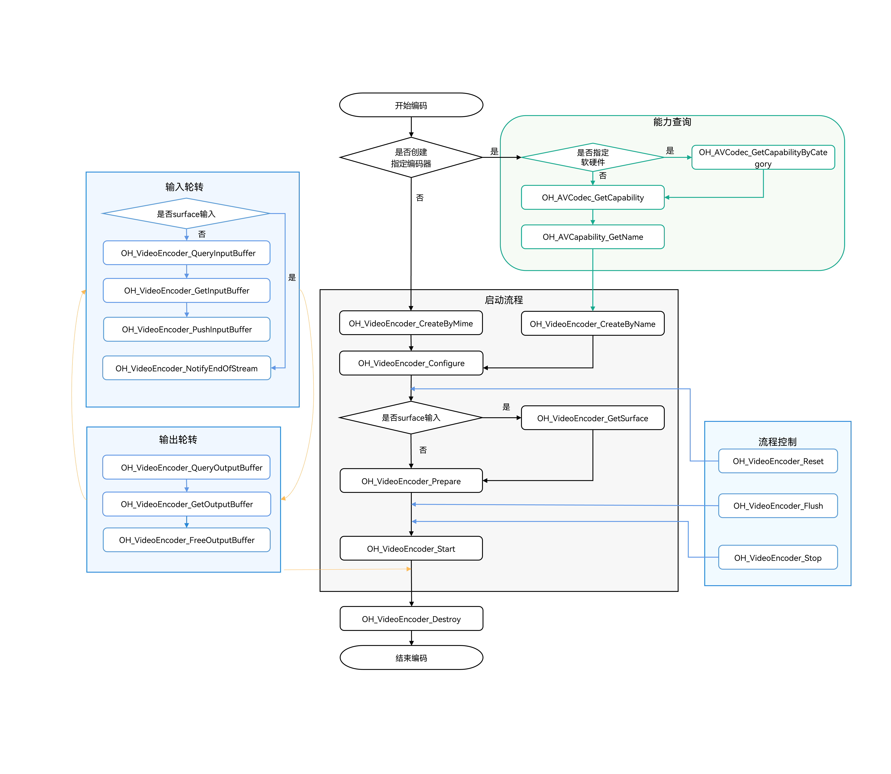

# 同步模式视频编码

<!--Kit: AVCodec Kit-->
<!--Subsystem: Multimedia-->
<!--Owner: @rchdlee-->
<!--Designer: @dpy2650--->
<!--Tester: @cyakee-->
<!--Adviser: @w_Machine_cc-->

本文档主要介绍同步模式视频编码的实现流程。同步模式下开发者通过主动轮询获取输入和输出buffer，若业务需要主动申请buffer发送帧数据时可选用该模式。优先推荐使用[异步模式视频编码](video-encoding.md)。

同步模式视频编码也同样包含Surface模式和Buffer模式两种输出模式。其状态机调用关系、支持的能力与异步模式视频编码一致，详细信息请参考[异步模式视频编码](video-encoding.md)。

从API version 20开始支持同步模式视频编码，视频编码支持的格式请参考[视频编码](avcodec-support-formats.md#视频编码)。

具体实现可参考[示例工程](https://gitcode.com/openharmony/applications_app_samples/tree/master/code/DocsSample/Media/AVCodec/AVCodec)。

## 适用场景

通常情况下，推荐使用异步模式。若需要主动请求buffer去送帧，则可以采用同步模式。

## 开发指导

详细的API说明请参考[VideoEncoder](../../reference/apis-avcodec-kit/capi-native-avcodec-videoencoder-h.md)。



### 在CMake脚本中链接动态库

```cmake
target_link_libraries(sample PUBLIC libnative_media_codecbase.so)
target_link_libraries(sample PUBLIC libnative_media_core.so)
target_link_libraries(sample PUBLIC libnative_media_venc.so)
```

> **说明：**
>
> 上述'sample'字样仅为示例，此处由开发者根据实际工程目录自定义。
>

### 定义基础结构

本部分示例代码按照C++17标准编写，仅作参考。

1. 添加头文件。

   ```c++
   #include <multimedia/player_framework/native_avcodec_videoencoder.h>
   #include <multimedia/player_framework/native_avcapability.h>
   #include <multimedia/player_framework/native_avcodec_base.h>
   #include <multimedia/player_framework/native_avbuffer.h>
   #include <multimedia/player_framework/native_averrors.h>
   #include <native_buffer/native_buffer.h>
   #include <memory>
   #include <fstream>
   #include <mutex>
   #include <shared_mutex>
   ```

2. 定义全局变量（仅作示例，具体参数值，请根据能力查询接口获取相应值范围来参考配置）。

   ```c++
   struct CodecUserData {
       SampleInfo *sampleInfo = nullptr;
       bool isEncFirstFrame = false;

       int32_t width = 0;
       int32_t height = 0;
       int32_t widthStride = 0;
       int32_t heightStride = 0;
       OH_AVPixelFormat outputPixelFormat = AV_PIXEL_FORMAT_NV12;
       // 编码器同步锁。
       std::shared_mutex codecMutex;
       // 编码器输入队列。
       CodecBufferQueue inputBufferQueue;
       // 编码器输出队列。
       CodecBufferQueue outputBufferQueue;

       void ClearQueue()
       {
           inputBufferQueue.Flush();
           outputBufferQueue.Flush();
       }
   };

   struct VideoSampleInfo {
       // 视频帧宽度。
       int32_t videoWidth = 0;
       // 视频帧高度。
       int32_t videoHeight = 0;
       // 视频像素格式。
       OH_AVPixelFormat pixelFormat = AV_PIXEL_FORMAT_NV12;
       // 视频帧率。
       double frameRate = 0.0;
       // 码率模式。
       uint32_t bitrateMode = CBR;
       // 码率。
       int64_t bitrate = BITRATE_10M;
       // HEVC档次。
       int32_t hevcProfile = HEVC_PROFILE_MAIN;
       // 关键帧间隔时间，单位为ms。
       int32_t iFrameInterval = 100;
       // 图形接口。
       OHNativeWindow *window = nullptr;
   };

   struct SampleInfo {
       VideoSampleInfo video;
   };

   // 编码器实例指针。
   OH_AVCodec *encoder_ = nullptr;
   std::unique_ptr<VideoEncoder> videoEncoder_ = nullptr;
   CodecUserData *encContext_ = nullptr;
   ```

### Surface模式

参考以下示例代码，可以完成Surface模式下视频编码的全流程，实现同步模式的数据轮转。此处以输入surface数据，编码成H.264格式为例。

1. 创建编码器实例。

   通过名称创建编码器。示例中的变量说明如下：

   - mime：视频格式，如OH_AVCODEC_MIMETYPE_VIDEO_AVC(H.264)，OH_AVCODEC_MIMETYPE_VIDEO_HEVC(H.265)。
   - isEncoder：编码器为true，解码器为false。
   - category：编解码器类别，HARDWARE硬件编解码，SOFTWARE为软件编解码。
   - capability：编码器能力查询实例的指针。

   <!-- @[encoder_create_byname](https://gitcode.com/openharmony/applications_app_samples/blob/master/code/DocsSample/Media/AVCodec/AVCodec/entry/src/main/cpp/capabilities/video_encoder.cpp) -->

   ```c++
   // 通过codec name创建编码器，应用有特殊需求，比如选择支持某种分辨率规格的编码器，可先查询capability，再根据codec name创建编码器。
   OH_AVCodec *VideoEncoder::GetCodecByCategory(const char *mime, bool isEncoder, OH_AVCodecCategory category)
   {
       CHECK_AND_RETURN_RET_LOG(mime != nullptr, nullptr, "Codec mime is nullptr");
       CHECK_AND_RETURN_RET_LOG(isEncoder, nullptr, "Encoder capability requires isEncoder=true");
       OH_AVCapability *capability = OH_AVCodec_GetCapabilityByCategory(mime, isEncoder, category);
       CHECK_AND_RETURN_RET_LOG(capability != nullptr, nullptr, "Encoder capability is nullptr");
       const char *codecName = OH_AVCapability_GetName(capability);
       CHECK_AND_RETURN_RET_LOG(codecName != nullptr, nullptr, "Encoder codec name is nullptr");
       return OH_VideoEncoder_CreateByName(codecName);
   }
   ```

2. 调用OH_VideoEncoder_Configure()配置编码器。

   - 详细可配置选项的说明请参考[媒体数据键值对](../../reference/apis-avcodec-kit/capi-codecbase.md#媒体数据键值对)。
   - 参数校验规则请参考[OH_VideoEncoder_Configure()](../../reference/apis-avcodec-kit/capi-native-avcodec-videoencoder-h.md#oh_videoencoder_configure)。
   - 参数取值范围可以通过能力查询接口获取，具体示例请参考[获取支持的编解码能力](obtain-supported-codecs.md)。

   目前支持的所有格式都必须配置以下选项：视频帧宽度、视频帧高度、视频像素格式。

   <!-- @[encoder_sync_mode](https://gitcode.com/openharmony/applications_app_samples/blob/master/code/DocsSample/Media/AVCodec/AVCodec/entry/src/main/cpp/capabilities/video_encoder.cpp) -->

   ```c++
   // 同步模式配置。
   if (codec.codecSyncMode) {
       OH_AVFormat_SetIntValue(format, OH_MD_KEY_ENABLE_SYNC_MODE, codec.codecSyncMode);
   }
   ```

   <!-- @[encoder_configure](https://gitcode.com/openharmony/applications_app_samples/blob/master/code/DocsSample/Media/AVCodec/AVCodec/entry/src/main/cpp/capabilities/video_encoder.cpp) -->

   ```c++
   int32_t VideoEncoder::Configure(const SampleInfo &sampleInfo)
   {
       // 建议在配置编码器前进行能力校验，确认当前设备是否支持配置的参数。
       // ...
       OH_AVFormat *format = OH_AVFormat_Create();
       CHECK_AND_RETURN_RET_LOG(format != nullptr, AVCODEC_SAMPLE_ERR_ERROR, "AVFormat create failed");

       OH_AVFormat_SetIntValue(format, OH_MD_KEY_WIDTH, sampleInfo.video.videoWidth);
       OH_AVFormat_SetIntValue(format, OH_MD_KEY_HEIGHT, sampleInfo.video.videoHeight);
       OH_AVFormat_SetDoubleValue(format, OH_MD_KEY_FRAME_RATE, sampleInfo.video.frameRate);
       OH_AVFormat_SetIntValue(format, OH_MD_KEY_PIXEL_FORMAT, sampleInfo.video.pixelFormat);
       OH_AVFormat_SetIntValue(format, OH_MD_KEY_VIDEO_ENCODE_BITRATE_MODE, sampleInfo.video.bitrateMode);
       OH_AVFormat_SetLongValue(format, OH_MD_KEY_BITRATE, sampleInfo.video.bitrate);
       OH_AVFormat_SetIntValue(format, OH_MD_KEY_PROFILE, sampleInfo.video.hevcProfile);
       OH_AVFormat_SetIntValue(format, OH_MD_KEY_I_FRAME_INTERVAL, sampleInfo.video.iFrameInterval);
       // ...

       int ret = OH_VideoEncoder_Configure(encoder_, format);
       OH_AVFormat_Destroy(format);
       format = nullptr;
       CHECK_AND_RETURN_RET_LOG(ret == AV_ERR_OK, AVCODEC_SAMPLE_ERR_ERROR, "Config failed, ret: %{public}d", ret);
       return AVCODEC_SAMPLE_ERR_OK;
   }
   ```

   > **注意：**
   >
   > 1. 要使能视频编码同步模式，必须将OH_MD_KEY_ENABLE_SYNC_MODE配置为1。
   > 2. 同步模式在调用OH_VideoEncoder_Configure接口前不能调用OH_VideoEncoder_RegisterCallback或OH_VideoEncoder_RegisterParameterCallback接口，否则为异步模式。
   > 3. 不支持Surface模式的随帧通路的同步模式。

3. 设置surface。

   示例中的变量说明如下：

   sampleInfo.video.window：送显窗口，类型为OHNativeWindow，获取方式请参考异步模式视频编码[Surface模式](video-encoding.md#surface模式)的“步骤-6：获取surface”。

   <!-- @[encoder_get_surface](https://gitcode.com/openharmony/applications_app_samples/blob/master/code/DocsSample/Media/AVCodec/AVCodec/entry/src/main/cpp/capabilities/video_encoder.cpp) -->

   ```c++
   // 获取编码器Surface模式的OHNativeWindow输入，需要在调用OH_VideoEncoder_Prepare接口之前完成。
   // 通过OHNativeWindow*获取生产者待填充数据地址。
   int32_t VideoEncoder::GetSurface(SampleInfo &sampleInfo)
   {
       int32_t ret = OH_VideoEncoder_GetSurface(encoder_, &sampleInfo.video.window);
       CHECK_AND_RETURN_RET_LOG(ret == AV_ERR_OK && sampleInfo.video.window, AVCODEC_SAMPLE_ERR_ERROR,
           "Get surface failed, ret: %{public}d", ret);
       return AVCODEC_SAMPLE_ERR_OK;
   }
   ```

4. 调用OH_VideoEncoder_Prepare()编码器就绪。

   该接口将在编码器运行前进行一些数据的准备工作。

   <!-- @[encoder_prepare](https://gitcode.com/openharmony/applications_app_samples/blob/master/code/DocsSample/Media/AVCodec/AVCodec/entry/src/main/cpp/capabilities/video_encoder.cpp) -->

   ```c++
   // 申请编码器运行所需资源。Prepare成功后才能调用Start。
   int32_t VideoEncoder::Prepare()
   {
       CHECK_AND_RETURN_RET_LOG(encoder_ != nullptr, AVCODEC_SAMPLE_ERR_ERROR, "Encoder is null");
       const int32_t ret = OH_VideoEncoder_Prepare(encoder_);
       CHECK_AND_RETURN_RET_LOG(ret == AV_ERR_OK, AVCODEC_SAMPLE_ERR_ERROR,
           "Prepare failed, ret: %{public}d", ret);
       return AVCODEC_SAMPLE_ERR_OK;
   }
   ```

5. 调用OH_VideoEncoder_Start()启动编码器。

   <!-- @[encoder_start](https://gitcode.com/openharmony/applications_app_samples/blob/master/code/DocsSample/Media/AVCodec/AVCodec/entry/src/main/cpp/capabilities/video_encoder.cpp) -->

   ```c++
   int32_t VideoEncoder::Start()
   {
       CHECK_AND_RETURN_RET_LOG(encoder_ != nullptr, AVCODEC_SAMPLE_ERR_ERROR, "Encoder is null");

       const int32_t ret = OH_VideoEncoder_Start(encoder_);
       CHECK_AND_RETURN_RET_LOG(ret == AV_ERR_OK, AVCODEC_SAMPLE_ERR_ERROR, "Start failed, ret: %{public}d", ret);
       return AVCODEC_SAMPLE_ERR_OK;
   }
   ```

6. 获取可用buffer并释放编码帧。

   - 调用[OH_VideoEncoder_QueryOutputBuffer](../../reference/apis-avcodec-kit/capi-native-avcodec-videoencoder-h.md#oh_videoencoder_queryoutputbuffer)接口获取下一个可用的输出缓冲区（buffer）的索引（index）。
   - 根据获取的索引（index），调用[OH_VideoEncoder_GetOutputBuffer](../../reference/apis-avcodec-kit/capi-native-avcodec-videoencoder-h.md#oh_videoencoder_getoutputbuffer)接口获取对应的缓冲区（buffer）实例。
   - 调用[OH_VideoEncoder_FreeOutputBuffer](../../reference/apis-avcodec-kit/capi-native-avcodec-videoencoder-h.md#oh_videoencoder_freeoutputbuffer)接口释放编码帧。

   编码器出帧处理循环：

   <!-- @[encoder_sync_output_buffer](https://gitcode.com/openharmony/applications_app_samples/blob/master/code/DocsSample/Media/AVCodec/AVCodec/entry/src/main/cpp/sample/recorder/Recorder.cpp) -->

   ```c++
   while (true) {
       CHECK_AND_BREAK_LOG(isStarted_, "Work done, thread out");
       const int64_t waitStart = RecorderClockUs();
       CodecBufferInfo bufferInfo;
       if (!encoder->GetOutputBuffer(bufferInfo, TIMEOUT_US)) {
           // ...
           break;
       }
       // ...
   }
   ```

   获取输出buffer：

   <!-- @[encoder_sync_get_outputbuffer](https://gitcode.com/openharmony/applications_app_samples/blob/master/code/DocsSample/Media/AVCodec/AVCodec/entry/src/main/cpp/capabilities/video_encoder.cpp) -->

   ```c++
   bool VideoEncoder::GetOutputBuffer(CodecBufferInfo &info, int64_t timeoutUs)
   {
       info.buffer = nullptr;
       CHECK_AND_RETURN_RET_LOG(encoder_ != nullptr, false, "Encoder is null");
       // ...
           const int32_t ret = OH_VideoEncoder_QueryOutputBuffer(encoder_, &info.bufferIndex, timeoutUs);
           switch (ret) {
               case AV_ERR_OK: {
                   OH_AVBuffer *buffer = OH_VideoEncoder_GetOutputBuffer(encoder_, info.bufferIndex);
                   CHECK_AND_RETURN_RET_LOG(buffer != nullptr, false, "Output buffer is null");
                   const OH_AVErrCode getBufferRet = OH_AVBuffer_GetBufferAttr(buffer, &info.attr);
                   CHECK_AND_RETURN_RET_LOG(getBufferRet == AV_ERR_OK, false,
                       "Get buffer attr error, ret: %{public}d", getBufferRet);
                   info.buffer = buffer;
                   // 开发者可根据业务需要，对输出数据进行保存/释放处理。
                   return true;
               }
               case AV_ERR_TRY_AGAIN_LATER: {
                   AVCODEC_SAMPLE_LOGE("Get output buffer timeout.");
                   return false;
               }
               case AV_ERR_STREAM_CHANGED: {
                   int32_t width = 0;
                   int32_t height = 0;
                   auto format =
                       std::shared_ptr<OH_AVFormat>(OH_VideoEncoder_GetOutputDescription(encoder_), OH_AVFormat_Destroy);
                   CHECK_AND_BREAK_LOG(format != nullptr, "Format is nullptr.");
                   const bool getIntRet = OH_AVFormat_GetIntValue(format.get(), OH_MD_KEY_WIDTH, &width) &&
                                          OH_AVFormat_GetIntValue(format.get(), OH_MD_KEY_HEIGHT, &height);
                   CHECK_AND_BREAK_LOG(getIntRet, "Encoder get int value failed.");
                   AVCODEC_SAMPLE_LOGI("Stream Changed. Width: %{public}i, height: %{public}i", width, height);
                   continue;
               }
               default: {
                   return false;
               }
           }
       // ...
       AVCODEC_SAMPLE_LOGE("Output stream changed repeatedly, defer buffer acquisition to next poll");
       return false;
   }
   ```

   输出buffer释放处理：

   <!-- @[encoder_free_output](https://gitcode.com/openharmony/applications_app_samples/blob/master/code/DocsSample/Media/AVCodec/AVCodec/entry/src/main/cpp/capabilities/video_encoder.cpp) -->

   ```c++
   int32_t VideoEncoder::FreeOutputBuffer(const CodecBufferInfo &info)
   {
       CHECK_AND_RETURN_RET_LOG(encoder_ != nullptr, AVCODEC_SAMPLE_ERR_ERROR, "Encoder is null");

       int32_t ret = OH_VideoEncoder_FreeOutputBuffer(encoder_, info.bufferIndex);
       CHECK_AND_RETURN_RET_LOG(ret == AV_ERR_OK, AVCODEC_SAMPLE_ERR_ERROR,
           "Free output data failed, ret: %{public}d", ret);
       return AVCODEC_SAMPLE_ERR_OK;
   }
   ```

   > **说明：**
   >
   > 本例将编码完成帧数据buffer写入Muxer封装。开发者也可以通过[OH_AVBuffer_GetAddr](../../reference/apis-avcodec-kit/capi-native-avbuffer-h.md#oh_avbuffer_getaddr)接口得到共享内存地址的指针后，将编码完成帧数据写入到对应输出文件中。

7. 调用OH_VideoEncoder_NotifyEndOfStream()通知编码器结束。

   <!-- @[encoder_notify_end_of_stream](https://gitcode.com/openharmony/applications_app_samples/blob/master/code/DocsSample/Media/AVCodec/AVCodec/entry/src/main/cpp/capabilities/video_encoder.cpp) -->

   ```c++
   // Surface模式：通知视频编码器输入流已结束，只能使用此接口进行通知。
   // 不能像Buffer模式中将flag设为AVCODEC_BUFFER_FLAGS_EOS，再调用OH_VideoEncoder_PushInputBuffer接口通知编码器输入结束。
   int32_t VideoEncoder::NotifyEndOfStream()
   {
       CHECK_AND_RETURN_RET_LOG(encoder_ != nullptr, AVCODEC_SAMPLE_ERR_ERROR, "Encoder is null");

       int32_t ret = OH_VideoEncoder_NotifyEndOfStream(encoder_);
       CHECK_AND_RETURN_RET_LOG(ret == AV_ERR_OK, AVCODEC_SAMPLE_ERR_ERROR,
           "Notify end of stream failed, ret: %{public}d", ret);
       return AVCODEC_SAMPLE_ERR_OK;
   }
   ```

8. （可选）调用OH_VideoEncoder_Flush()刷新编码器。

   调用OH_VideoEncoder_Flush接口后，编码器仍处于运行态，但会清除编码器中缓存的输入和输出数据及参数集（如H.264格式的PPS/SPS）。此时需要调用OH_VideoEncoder_Start接口重新开始编码。

   <!-- @[encoder_flush](https://gitcode.com/openharmony/applications_app_samples/blob/master/code/DocsSample/Media/AVCodec/AVCodec/entry/src/main/cpp/capabilities/video_encoder.cpp) -->

   ```c++
   int32_t VideoEncoder::Flush()
   {
       // Flush会使此前通过回调或同步查询取得的buffer索引失效，调用方需先结束对这些buffer的访问。
       CHECK_AND_RETURN_RET_LOG(encoder_ != nullptr, AVCODEC_SAMPLE_ERR_ERROR, "Encoder is null");
       const int32_t ret = OH_VideoEncoder_Flush(encoder_);
       CHECK_AND_RETURN_RET_LOG(ret == AV_ERR_OK, AVCODEC_SAMPLE_ERR_ERROR,
           "Flush failed, ret: %{public}d", ret);
       return AVCODEC_SAMPLE_ERR_OK;
   }
   ```

   输入、输出buffer清理：

   <!-- @[buffer_clean](https://gitcode.com/openharmony/applications_app_samples/blob/master/code/DocsSample/Media/AVCodec/AVCodec/entry/src/main/cpp/common/codec_user_data.h) -->

   ```c++
   void ClearQueue()
   {
       inputBufferQueue.Flush();
       outputBufferQueue.Flush();
   }
   ```

   若需重新开始编码，可参考上述[Surface模式](#surface模式)-步骤5启动编码器。

9. （可选）调用OH_VideoEncoder_Reset()重置编码器。

   调用OH_VideoEncoder_Reset接口后，编码器回到初始化的状态，需要调用接口[OH_VideoEncoder_Configure](../../reference/apis-avcodec-kit/capi-native-avcodec-videoencoder-h.md#oh_videoencoder_configure)和[OH_VideoEncoder_Prepare](../../reference/apis-avcodec-kit/capi-native-avcodec-videoencoder-h.md#oh_videoencoder_prepare)重新配置。

   <!-- @[encoder_reset](https://gitcode.com/openharmony/applications_app_samples/blob/master/code/DocsSample/Media/AVCodec/AVCodec/entry/src/main/cpp/capabilities/video_encoder.cpp) -->

   ```c++
   int32_t VideoEncoder::Reset()
   {
       // Reset会丢弃当前配置与缓存，编码器回到初始状态；不能将其当作可直接继续编码的Flush使用。
       CHECK_AND_RETURN_RET_LOG(encoder_ != nullptr, AVCODEC_SAMPLE_ERR_ERROR, "Encoder is null");
       const int32_t ret = OH_VideoEncoder_Reset(encoder_);
       CHECK_AND_RETURN_RET_LOG(ret == AV_ERR_OK, AVCODEC_SAMPLE_ERR_ERROR,
           "Reset failed, ret: %{public}d", ret);
       return AVCODEC_SAMPLE_ERR_OK;
   }
   ```

   输入、输出buffer清理：

   <!-- @[buffer_clean](https://gitcode.com/openharmony/applications_app_samples/blob/master/code/DocsSample/Media/AVCodec/AVCodec/entry/src/main/cpp/common/codec_user_data.h) -->

   ```c++
   void ClearQueue()
   {
       inputBufferQueue.Flush();
       outputBufferQueue.Flush();
   }
   ```

    若需重新开始编码，可参考上述[Surface模式](#surface模式)-步骤2至5配置并启动编码器。

   > **注意：**
   >
   > 编码器回到初始化的状态，调用OH_VideoEncoder_Configure接口重新配置编码器参数时，同步模式需要重新配置OH_MD_KEY_ENABLE_SYNC_MODE为1，否则为异步模式。

10. （可选）调用OH_VideoEncoder_Stop()停止编码器。

    调用OH_VideoEncoder_Stop接口后，编码器仍保留编码实例，释放输入输出buffer。开发者可以直接调用OH_VideoEncoder_Start接口继续编码。

    <!-- @[encoder_stop](https://gitcode.com/openharmony/applications_app_samples/blob/master/code/DocsSample/Media/AVCodec/AVCodec/entry/src/main/cpp/capabilities/video_encoder.cpp) -->

    ```c++
    int32_t VideoEncoder::Stop()
    {
        // Stop前先清除缓存，确保已排队但尚未输出的编码数据不会落入下一次Start。
        CHECK_AND_RETURN_RET_LOG(encoder_ != nullptr, AVCODEC_SAMPLE_ERR_ERROR, "Encoder is null");

        int32_t ret = OH_VideoEncoder_Flush(encoder_);
        CHECK_AND_RETURN_RET_LOG(ret == AV_ERR_OK, AVCODEC_SAMPLE_ERR_ERROR, "Flush failed, ret: %{public}d", ret);

        ret = OH_VideoEncoder_Stop(encoder_);
        CHECK_AND_RETURN_RET_LOG(ret == AV_ERR_OK, AVCODEC_SAMPLE_ERR_ERROR, "Stop failed, ret: %{public}d", ret);
        return AVCODEC_SAMPLE_ERR_OK;
    }
    ```

    输入、输出buffer清理：

    <!-- @[buffer_clean](https://gitcode.com/openharmony/applications_app_samples/blob/master/code/DocsSample/Media/AVCodec/AVCodec/entry/src/main/cpp/common/codec_user_data.h) -->

    ```c++
    void ClearQueue()
    {
        inputBufferQueue.Flush();
        outputBufferQueue.Flush();
    }
    ```

    若需重新开始编码，可参考上述[Surface模式](#surface模式)-步骤5启动编码器。

11. 调用OH_VideoEncoder_Destroy()销毁编码器实例，释放资源。

    <!-- @[recorder_release](https://gitcode.com/openharmony/applications_app_samples/blob/master/code/DocsSample/Media/AVCodec/AVCodec/entry/src/main/cpp/sample/recorder/Recorder.cpp) -->

    ```c++
    void Recorder::ReleaseVideoEncoder()
    {
        // 相机停止供帧、视频输入线程退出后才释放Receiver。
        frameReceiver_.reset();
        // ...
        if (videoEncoder_ != nullptr) {
            if (encContext_ != nullptr) {
                // 回调只借用上下文。先拒绝迟到回调，再销毁codec和上下文。
                encContext_->isDestroyed.store(true);
                // 清空回调队列并取得写锁后，再释放codec buffer。
                std::unique_lock<std::shared_mutex> codecLock(encContext_->codecMutex);
                encContext_->ClearQueue();
            }
            // codec销毁前仍可能访问其输出surface，因此先释放codec，再归还应用持有的窗口引用。
            videoEncoder_->Release();
            videoEncoder_.reset();
            if (sampleInfo_.video.window != nullptr) {
                OH_NativeWindow_DestroyNativeWindow(sampleInfo_.video.window);
                sampleInfo_.video.window = nullptr;
            }
        }
    }
    ```

    <!-- @[encoder_destroy](https://gitcode.com/openharmony/applications_app_samples/blob/master/code/DocsSample/Media/AVCodec/AVCodec/entry/src/main/cpp/capabilities/video_encoder.cpp) -->

    ```c++
    // 调用OH_VideoEncoder_Destroy，注销编码器，释放资源。
    int32_t VideoEncoder::Release()
    {
        if (encoder_ != nullptr) {
            // Destroy是编码器句柄的最终释放点。销毁后立即置空，避免后续调用继续使用失效句柄。
            const int32_t ret = OH_VideoEncoder_Destroy(encoder_);
            encoder_ = nullptr;
            CHECK_AND_RETURN_RET_LOG(ret == AV_ERR_OK, AVCODEC_SAMPLE_ERR_ERROR,
                "Destroy failed, ret: %{public}d", ret);
        }
        return AVCODEC_SAMPLE_ERR_OK;
    }
    ```

    > **说明：**
    >
    > 执行该步骤之后，开发者需要将encoder_置为nullptr，防止野指针导致程序错误。

### Buffer模式

参考以下示例代码，可以完成Buffer模式下视频编码的全流程，实现同步模式的数据轮转。此处以相机端读取视频帧推送至编码器，编码成H.264格式为例。

1. 创建编码器实例。

   与Surface模式相同，此处不再赘述。

   方式一：通过名称创建编码器。

   <!-- @[encoder_create_byname](https://gitcode.com/openharmony/applications_app_samples/blob/master/code/DocsSample/Media/AVCodec/AVCodec/entry/src/main/cpp/capabilities/video_encoder.cpp) -->

   ```c++
   // 通过codec name创建编码器，应用有特殊需求，比如选择支持某种分辨率规格的编码器，可先查询capability，再根据codec name创建编码器。
   OH_AVCodec *VideoEncoder::GetCodecByCategory(const char *mime, bool isEncoder, OH_AVCodecCategory category)
   {
       CHECK_AND_RETURN_RET_LOG(mime != nullptr, nullptr, "Codec mime is nullptr");
       CHECK_AND_RETURN_RET_LOG(isEncoder, nullptr, "Encoder capability requires isEncoder=true");
       OH_AVCapability *capability = OH_AVCodec_GetCapabilityByCategory(mime, isEncoder, category);
       CHECK_AND_RETURN_RET_LOG(capability != nullptr, nullptr, "Encoder capability is nullptr");
       const char *codecName = OH_AVCapability_GetName(capability);
       CHECK_AND_RETURN_RET_LOG(codecName != nullptr, nullptr, "Encoder codec name is nullptr");
       return OH_VideoEncoder_CreateByName(codecName);
   }
   ```

   方式二：通过媒体类型创建编码器。

   <!-- @[encoder_create_bymime](https://gitcode.com/openharmony/applications_app_samples/blob/master/code/DocsSample/Media/AVCodec/AVCodec/entry/src/main/cpp/capabilities/video_encoder.cpp) -->

   ```c++
   // 通过MIME TYPE创建编码器，由系统选择对应的编码器实现。
   OH_AVCodec *VideoEncoder::GetCodecByMime(const char *mime)
   {
       CHECK_AND_RETURN_RET_LOG(mime != nullptr, nullptr, "Codec mime is nullptr");
       return OH_VideoEncoder_CreateByMime(mime);
   }
   ```

2. 调用OH_VideoEncoder_Configure()配置编码器。

   与Surface模式相同，此处不再赘述。

   <!-- @[encoder_sync_mode](https://gitcode.com/openharmony/applications_app_samples/blob/master/code/DocsSample/Media/AVCodec/AVCodec/entry/src/main/cpp/capabilities/video_encoder.cpp) -->

   ```c++
   // 同步模式配置。
   if (codec.codecSyncMode) {
       OH_AVFormat_SetIntValue(format, OH_MD_KEY_ENABLE_SYNC_MODE, codec.codecSyncMode);
   }
   ```

   <!-- @[encoder_configure](https://gitcode.com/openharmony/applications_app_samples/blob/master/code/DocsSample/Media/AVCodec/AVCodec/entry/src/main/cpp/capabilities/video_encoder.cpp) -->

   ```c++
   int32_t VideoEncoder::Configure(const SampleInfo &sampleInfo)
   {
       // 建议在配置编码器前进行能力校验，确认当前设备是否支持配置的参数。
       // ...
       OH_AVFormat *format = OH_AVFormat_Create();
       CHECK_AND_RETURN_RET_LOG(format != nullptr, AVCODEC_SAMPLE_ERR_ERROR, "AVFormat create failed");

       OH_AVFormat_SetIntValue(format, OH_MD_KEY_WIDTH, sampleInfo.video.videoWidth);
       OH_AVFormat_SetIntValue(format, OH_MD_KEY_HEIGHT, sampleInfo.video.videoHeight);
       OH_AVFormat_SetDoubleValue(format, OH_MD_KEY_FRAME_RATE, sampleInfo.video.frameRate);
       OH_AVFormat_SetIntValue(format, OH_MD_KEY_PIXEL_FORMAT, sampleInfo.video.pixelFormat);
       OH_AVFormat_SetIntValue(format, OH_MD_KEY_VIDEO_ENCODE_BITRATE_MODE, sampleInfo.video.bitrateMode);
       OH_AVFormat_SetLongValue(format, OH_MD_KEY_BITRATE, sampleInfo.video.bitrate);
       OH_AVFormat_SetIntValue(format, OH_MD_KEY_PROFILE, sampleInfo.video.hevcProfile);
       OH_AVFormat_SetIntValue(format, OH_MD_KEY_I_FRAME_INTERVAL, sampleInfo.video.iFrameInterval);
       // ...

       int ret = OH_VideoEncoder_Configure(encoder_, format);
       OH_AVFormat_Destroy(format);
       format = nullptr;
       CHECK_AND_RETURN_RET_LOG(ret == AV_ERR_OK, AVCODEC_SAMPLE_ERR_ERROR, "Config failed, ret: %{public}d", ret);
       return AVCODEC_SAMPLE_ERR_OK;
   }
   ```

   > **注意：**
   >
   > 1. 要使能视频编码同步模式，必须将OH_MD_KEY_ENABLE_SYNC_MODE配置为1。
   > 2. 同步模式在调用OH_VideoEncoder_Configure接口前不能调用OH_VideoEncoder_RegisterCallback或OH_VideoEncoder_RegisterParameterCallback接口，否则为异步模式。

3. 调用OH_VideoEncoder_Prepare()编码器就绪。

   与Surface模式相同，此处不再赘述。

   <!-- @[encoder_prepare](https://gitcode.com/openharmony/applications_app_samples/blob/master/code/DocsSample/Media/AVCodec/AVCodec/entry/src/main/cpp/capabilities/video_encoder.cpp) -->

   ```c++
   // 申请编码器运行所需资源。Prepare成功后才能调用Start。
   int32_t VideoEncoder::Prepare()
   {
       CHECK_AND_RETURN_RET_LOG(encoder_ != nullptr, AVCODEC_SAMPLE_ERR_ERROR, "Encoder is null");
       const int32_t ret = OH_VideoEncoder_Prepare(encoder_);
       CHECK_AND_RETURN_RET_LOG(ret == AV_ERR_OK, AVCODEC_SAMPLE_ERR_ERROR,
           "Prepare failed, ret: %{public}d", ret);
       return AVCODEC_SAMPLE_ERR_OK;
   }
   ```

4. 调用OH_VideoEncoder_Start()启动编码器。

   <!-- @[encoder_start](https://gitcode.com/openharmony/applications_app_samples/blob/master/code/DocsSample/Media/AVCodec/AVCodec/entry/src/main/cpp/capabilities/video_encoder.cpp) -->

   ```c++
   int32_t VideoEncoder::Start()
   {
       CHECK_AND_RETURN_RET_LOG(encoder_ != nullptr, AVCODEC_SAMPLE_ERR_ERROR, "Encoder is null");

       const int32_t ret = OH_VideoEncoder_Start(encoder_);
       CHECK_AND_RETURN_RET_LOG(ret == AV_ERR_OK, AVCODEC_SAMPLE_ERR_ERROR, "Start failed, ret: %{public}d", ret);
       return AVCODEC_SAMPLE_ERR_OK;
   }
   ```

5. 获取可用buffer并写入码流至编码器。

   - 调用[OH_VideoEncoder_QueryInputBuffer](../../reference/apis-avcodec-kit/capi-native-avcodec-videoencoder-h.md#oh_videoencoder_queryinputbuffer)接口获取下一个可用的输入缓冲区（buffer）的索引（index）。
   - 根据获取的索引（index），调用[OH_VideoEncoder_GetInputBuffer](../../reference/apis-avcodec-kit/capi-native-avcodec-videoencoder-h.md#oh_videoencoder_getinputbuffer)接口获取对应的缓冲区（buffer）实例。
   - 将需要编码的数据写入该缓冲区（buffer）后，调用[OH_VideoEncoder_PushInputBuffer](../../reference/apis-avcodec-kit/capi-native-avcodec-videoencoder-h.md#oh_videoencoder_pushinputbuffer)接口将其送入编码输入队列进行编码。当最后一帧数据被送入编码输入队列时，需要将flag标识成[AVCODEC_BUFFER_FLAGS_EOS](../../reference/apis-avcodec-kit/capi-native-avbuffer-info-h.md#oh_avcodecbufferflags)，通知编码器输入结束。

   示例中的变量说明如下：
   - width、height、widthStride、heightStride：视频宽、高及宽跨距、高跨距。
   - frameData、size、offset、pts、flags：帧数据、输入尺寸、偏移量、时间戳、缓冲区标记等字段信息。

   编码器送帧处理循环：

   <!-- @[recorder_video_buffer_input_sync](https://gitcode.com/openharmony/applications_app_samples/blob/master/code/DocsSample/Media/AVCodec/AVCodec/entry/src/main/cpp/sample/recorder/RecorderVideoInput.cpp) -->

   ```c++
   void Recorder::VideoEncInputSyncThread()
   {
       VideoInputState state;
       // 先初始化心跳时间，避免启动瞬间被误判为停滞。
       state.lastSubmittedUs = RecorderClockUs();
       while (isStarted_.load() && !videoInputStopping_.load()) {
           // 示例：读取相机最新视频帧数据。
           const CameraImage image(ReadVideoInputImage(state.lastSubmittedUs), OH_ImageNative_Release);
           if (image == nullptr) {
               continue;
           }
           /**
            * 示例：配置输入文件。
            * std::string_view inputFilePath = "/*yourpath*.yuv";
            * std::unique_ptr<std::ifstream> inputFile = std::make_unique<std::ifstream>();
            * if (inputFile != nullptr) {
            *     inputFile->open(inputFilePath.data(), std::ios::in | std::ios::binary);
            * }
            */
           const int64_t receivedAtUs = RecorderClockUs();
           CodecBufferInfo info;
           // 同步模式主动Query输入索引，再Get对应的编码器Buffer。
           if (videoEncoder_->GetInputBuffer(info, INPUT_WAIT_US) == nullptr) {
               continue;
           }
           if (!SubmitVideoInputImage(image.get(), info, state, receivedAtUs)) {
               break;
           }
       }
   }
   ```


   获取输入buffer：

   <!-- @[encoder_sync_get_inputbuffer](https://gitcode.com/openharmony/applications_app_samples/blob/master/code/DocsSample/Media/AVCodec/AVCodec/entry/src/main/cpp/capabilities/video_encoder.cpp) -->

   ```c++
   OH_AVBuffer *VideoEncoder::GetInputBuffer(CodecBufferInfo &info, int64_t timeoutUs)
   {
       CHECK_AND_RETURN_RET_LOG(encoder_ != nullptr, nullptr, "Encoder is null");
       const int32_t ret = OH_VideoEncoder_QueryInputBuffer(encoder_, &info.bufferIndex, timeoutUs);
       if (ret == AV_ERR_TRY_AGAIN_LATER) {
           AVCODEC_SAMPLE_LOGD("Get input buffer timeout.");
           return nullptr;
       }
       CHECK_AND_RETURN_RET_LOG(ret == AV_ERR_OK, nullptr, "Query input buffer failed, ret: %{public}d", ret);
       OH_AVBuffer *buffer = OH_VideoEncoder_GetInputBuffer(encoder_, info.bufferIndex);
       CHECK_AND_RETURN_RET_LOG(buffer != nullptr, nullptr, "Input buffer is null");
       // buffer和bufferIndex必须成对保存，后续PushInputBuffer会使用同一个索引归还给编码器。
       info.buffer = buffer;
       /**
        * // 示例：待编码帧写入buffer。
        * uint8_t *addr = OH_AVBuffer_GetAddr(buffer);
        * CHECK_AND_RETURN_RET_LOG(addr != nullptr, AVCODEC_SAMPLE_ERR_ERROR, "Input buffer addr is null");
        * // 写入图像数据。
        * int32_t frameSize = 0;
        * if (widthStride == width && heightStride == height) {
        *     // NV12像素格式下，每帧数据大小的计算公式。
        *     frameSize = width * height * 3 / 2;
        *     int32_t capacity = OH_AVBuffer_GetCapacity(buffer);
        *     if (frameSize > capacity) {
        *         // 异常处理。
        *     }
        *     // 处理文件流得到帧的长度，再将需要编码的数据写入到对应index的buffer中。
        *     memcpy(addr, frameData, frameSize);
        * } else {
        *     // 如果跨距不等于宽，需要开发者按照跨距进行偏移。
        * }
        *
        * OH_AVCodecBufferAttr attr;
        * // buffer属性配置。
        * // 配置帧数据的输入尺寸、偏移量、时间戳等字段信息。
        * attr.size = frameSize;
        * attr.offset = offset;
        * attr.pts = pts;
        * // 避免flags随机初始化为AVCODEC_BUFFER_FLAGS_EOS导致使用异常，flags需要赋值如0（普通帧标识）。
        * attr.flags = flags;
        * OH_AVErrCode setBufferRet = OH_AVBuffer_SetBufferAttr(buffer, &attr);
        * if (setBufferRet != AV_ERR_OK) {
        *     // 异常处理。
        *     return false;
        * }
        */
       return buffer;
   }
   ```

   送入编码输入队列：

   <!-- @[encoder_push_input_buffer](https://gitcode.com/openharmony/applications_app_samples/blob/master/code/DocsSample/Media/AVCodec/AVCodec/entry/src/main/cpp/capabilities/video_encoder.cpp) -->

   ```c++
   // 送入编码输入队列进行编码，将填充好图像数据的buffer推送给编码器。
   int32_t VideoEncoder::PushInputBuffer(CodecBufferInfo &info)
   {
       // GetInputBuffer返回的buffer只在归还给codec前有效；空指针不可传给OH_AVBuffer_SetBufferAttr。
       CHECK_AND_RETURN_RET_LOG(info.buffer != nullptr, AVCODEC_SAMPLE_ERR_ERROR, "Input buffer is null");
       CHECK_AND_RETURN_RET_LOG(encoder_ != nullptr, AVCODEC_SAMPLE_ERR_ERROR, "Encoder is null");

       int32_t ret = OH_AVBuffer_SetBufferAttr(info.buffer, &info.attr);
       CHECK_AND_RETURN_RET_LOG(ret == AV_ERR_OK, AVCODEC_SAMPLE_ERR_ERROR, "Set avbuffer attr failed");
       ret = OH_VideoEncoder_PushInputBuffer(encoder_, info.bufferIndex);
       CHECK_AND_RETURN_RET_LOG(ret == AV_ERR_OK, AVCODEC_SAMPLE_ERR_ERROR, "Push input data failed");
       return AVCODEC_SAMPLE_ERR_OK;
   }
   ```

6. 获取可用buffer并释放编码帧。

   - 调用[OH_VideoEncoder_QueryOutputBuffer](../../reference/apis-avcodec-kit/capi-native-avcodec-videoencoder-h.md#oh_videoencoder_queryoutputbuffer)接口获取下一个可用的输出缓冲区（buffer）的索引（index）。
   - 根据获取的索引（index），调用[OH_VideoEncoder_GetOutputBuffer](../../reference/apis-avcodec-kit/capi-native-avcodec-videoencoder-h.md#oh_videoencoder_getoutputbuffer)接口获取对应的缓冲区（buffer）实例。
   - 调用[OH_VideoEncoder_FreeOutputBuffer](../../reference/apis-avcodec-kit/capi-native-avcodec-videoencoder-h.md#oh_videoencoder_freeoutputbuffer)接口释放编码帧。

   与Surface模式相同，此处不再赘述。

   编码器送帧处理循环：

   <!-- @[encoder_sync_output_buffer](https://gitcode.com/openharmony/applications_app_samples/blob/master/code/DocsSample/Media/AVCodec/AVCodec/entry/src/main/cpp/sample/recorder/Recorder.cpp) -->

   ```c++
   while (true) {
       CHECK_AND_BREAK_LOG(isStarted_, "Work done, thread out");
       const int64_t waitStart = RecorderClockUs();
       CodecBufferInfo bufferInfo;
       if (!encoder->GetOutputBuffer(bufferInfo, TIMEOUT_US)) {
           // ...
           break;
       }
       // ...
   }
   ```


   获取输出buffer：

   <!-- @[encoder_sync_get_outputbuffer](https://gitcode.com/openharmony/applications_app_samples/blob/master/code/DocsSample/Media/AVCodec/AVCodec/entry/src/main/cpp/capabilities/video_encoder.cpp) -->

   ```c++
   bool VideoEncoder::GetOutputBuffer(CodecBufferInfo &info, int64_t timeoutUs)
   {
       info.buffer = nullptr;
       CHECK_AND_RETURN_RET_LOG(encoder_ != nullptr, false, "Encoder is null");
       // ...
           const int32_t ret = OH_VideoEncoder_QueryOutputBuffer(encoder_, &info.bufferIndex, timeoutUs);
           switch (ret) {
               case AV_ERR_OK: {
                   OH_AVBuffer *buffer = OH_VideoEncoder_GetOutputBuffer(encoder_, info.bufferIndex);
                   CHECK_AND_RETURN_RET_LOG(buffer != nullptr, false, "Output buffer is null");
                   const OH_AVErrCode getBufferRet = OH_AVBuffer_GetBufferAttr(buffer, &info.attr);
                   CHECK_AND_RETURN_RET_LOG(getBufferRet == AV_ERR_OK, false,
                       "Get buffer attr error, ret: %{public}d", getBufferRet);
                   info.buffer = buffer;
                   // 开发者可根据业务需要，对输出数据进行保存/释放处理。
                   return true;
               }
               case AV_ERR_TRY_AGAIN_LATER: {
                   AVCODEC_SAMPLE_LOGE("Get output buffer timeout.");
                   return false;
               }
               case AV_ERR_STREAM_CHANGED: {
                   int32_t width = 0;
                   int32_t height = 0;
                   auto format =
                       std::shared_ptr<OH_AVFormat>(OH_VideoEncoder_GetOutputDescription(encoder_), OH_AVFormat_Destroy);
                   CHECK_AND_BREAK_LOG(format != nullptr, "Format is nullptr.");
                   const bool getIntRet = OH_AVFormat_GetIntValue(format.get(), OH_MD_KEY_WIDTH, &width) &&
                                          OH_AVFormat_GetIntValue(format.get(), OH_MD_KEY_HEIGHT, &height);
                   CHECK_AND_BREAK_LOG(getIntRet, "Encoder get int value failed.");
                   AVCODEC_SAMPLE_LOGI("Stream Changed. Width: %{public}i, height: %{public}i", width, height);
                   continue;
               }
               default: {
                   return false;
               }
           }
       // ...
       AVCODEC_SAMPLE_LOGE("Output stream changed repeatedly, defer buffer acquisition to next poll");
       return false;
   }
   ```

   输出buffer释放处理：

   <!-- @[encoder_free_output](https://gitcode.com/openharmony/applications_app_samples/blob/master/code/DocsSample/Media/AVCodec/AVCodec/entry/src/main/cpp/capabilities/video_encoder.cpp) -->

   ```c++
   int32_t VideoEncoder::FreeOutputBuffer(const CodecBufferInfo &info)
   {
       CHECK_AND_RETURN_RET_LOG(encoder_ != nullptr, AVCODEC_SAMPLE_ERR_ERROR, "Encoder is null");

       int32_t ret = OH_VideoEncoder_FreeOutputBuffer(encoder_, info.bufferIndex);
       CHECK_AND_RETURN_RET_LOG(ret == AV_ERR_OK, AVCODEC_SAMPLE_ERR_ERROR,
           "Free output data failed, ret: %{public}d", ret);
       return AVCODEC_SAMPLE_ERR_OK;
   }
   ```


后续流程（包括刷新、重置、停止和销毁编码器）与Surface模式基本一致，请参考[Surface模式](#surface模式)的步骤8-11。
