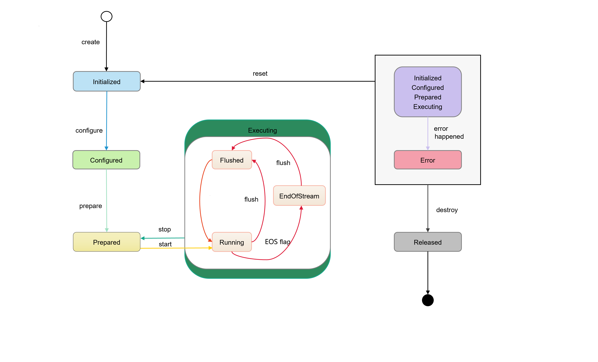
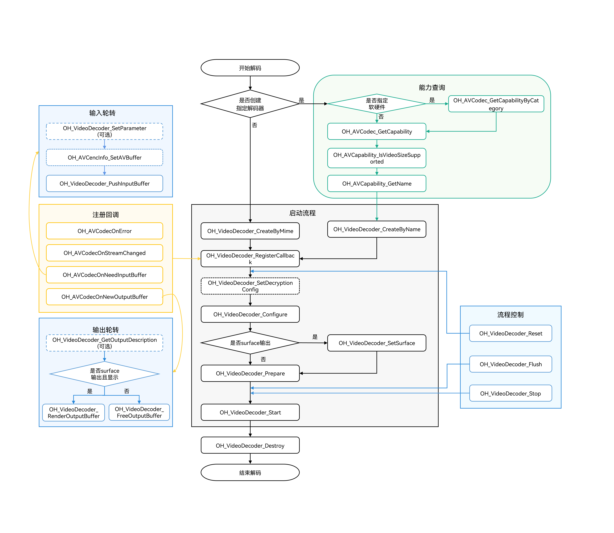
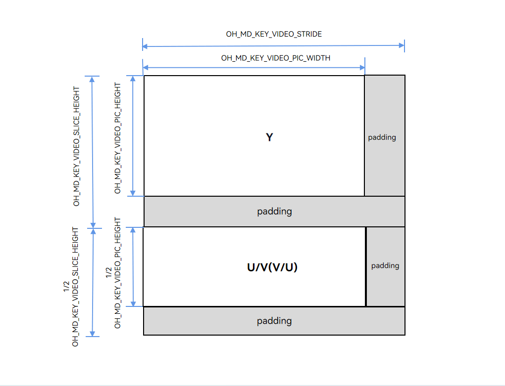

# 异步模式视频解码

<!--Kit: AVCodec Kit-->
<!--Subsystem: Multimedia-->
<!--Owner: @rchdlee-->
<!--Designer: @dpy2650--->
<!--Tester: @cyakee-->
<!--Adviser: @w_Machine_cc-->

视频解码是多媒体处理的核心环节，功能是将压缩的视频码流解码为原始像素数据。视频解码支持同步模式与异步模式两种运行机制，两者主要区别为buffer获取方式的同异步之分，开发者可根据自身业务选择适合的接口调用模式。

本文档主要介绍异步模式视频解码的实现流程，同步模式视频解码请参考[同步模式视频解码](synchronous-video-decoding.md)。根据解码后数据处理方式的不同，视频解码支持Surface模式和Buffer模式两种输出模式，适用于不同的应用场景。

- Surface模式

  解码后的图像帧通过[NativeWindow](../../reference/apis-arkgraphics2d/capi-nativewindow-nativewindow.md)来传递输出数据，可以与其他模块对接（如显示模块[自定义渲染(XComponent)](../../ui/napi-xcomponent-guidelines.md)）。适用于视频播放、实时预览等需要将画面渲染到屏幕的解码场景。

- Buffer模式

  解码后的原始YUV数据通过共享内存输出，开发者可直接访问和处理每一帧图像数据。适用于视频编辑、YUV原始数据保存等需要获取并处理原始数据的解码场景。

|    差异    |         Surface模式            |             Buffer模式            |
|---------- |------------------------------- | -------------------------------- |
|    配置    | 在调用OH_VideoDecoder_Prepare接口前，必须调用OH_VideoDecoder_SetSurface接口设置OHNativeWindow。 | 　-　 |
|    输出处理    | 不送显：调用OH_VideoDecoder_FreeOutputBuffer接口丢弃解码帧。<br>送显：调用OH_VideoDecoder_RenderOutputBuffer接口显示并释放解码帧，或调用OH_VideoDecoder_RenderOutputBufferAtTime接口在指定时间点显示并释放解码帧。如需实现音画同步或者控制显示速度，建议优先调用OH_VideoDecoder_RenderOutputBufferAtTime接口送显。| 输出数据处理后，必须调用OH_VideoDecoder_FreeOutputBuffer接口释放数据。|
|  回调数据  | 在Surface模式下，只能获取到输出回调buffer的数据信息。 | 在Buffer模式下，可以获取到输出回调buffer的共享内存的地址和数据信息。 |

AVCodec支持的视频解码格式请参考[视频解码](avcodec-support-formats.md#视频解码)。

具体实现可参考[示例工程](https://gitcode.com/openharmony/applications_app_samples/tree/master/code/DocsSample/Media/AVCodec/AVCodec)。

## 状态机调用关系

1. 初始化状态（Initialized）。
   - 初始创建解码器实例时，解码器处于Initialized状态。
   - 任何状态下，调用OH_VideoDecoder_Reset接口，可返回Initialized状态。
2. 配置状态（Configured）。
   - Initialized状态下，调用OH_VideoDecoder_Configure接口配置解码器，配置成功后解码器进入Configured状态。
3. 就绪状态（Prepared）。
   - Configured状态下，调用OH_VideoDecoder_Prepare接口进入Prepared状态。
   - Executing状态下，调用OH_VideoDecoder_Stop接口，可返回到Prepared状态。
4. 运行状态（Executing）。
   - Prepared状态下，调用OH_VideoDecoder_Start接口进入Executing状态。
   - Executing状态包含三个子状态：
     - 运行子状态（Running）：调用OH_VideoDecoder_Start接口进入Running子状态。
     - 刷新子状态（Flushed）：调用OH_VideoDecoder_Flush接口进入Flushed子状态。
     - 结束子状态（End-of-Stream）：解码器接收到输入buffer的flag为[OH_AVCodecBufferFlags](../../reference/apis-avcodec-kit/capi-native-avbuffer-info-h.md#oh_avcodecbufferflags)中的AVCODEC_BUFFER_FLAGS_EOS时，进入End-of-Stream子状态。在此状态下，解码器不再接受新的输入，但是仍然会继续生成输出，直到输出尾帧。
5. 错误状态（Error）。
   - 极少数情况下，解码器异常时进入Error状态，接口会返回错误码或通过OH_AVCodecOnError回调抛出异常。
   - Error状态下，可以调用OH_VideoDecoder_Reset接口返回Initialized状态，或者调用OH_VideoDecoder_Destroy接口进入最后的Released状态。
6. 释放状态（Released）。
   - 使用完解码器后，必须调用OH_VideoDecoder_Destroy接口销毁解码器实例，使解码器进入Released状态。

**图1** 状态机调用关系示意图



## 开发指导

详细的API说明请参考[native_avcodec_videodecoder.h](../../reference/apis-avcodec-kit/capi-native-avcodec-videodecoder-h.md)。

参考以下示例代码，完成视频解码的基础流程，包括：创建解码器、设置解码参数、开始、刷新、重置、停止、销毁资源。

**图2** 视频解码调用关系示意图

- 虚线表示可选。

- 实线表示必选。



### 在CMake脚本中链接动态库

```cmake
target_link_libraries(sample PUBLIC libnative_media_codecbase.so)
target_link_libraries(sample PUBLIC libnative_media_core.so)
target_link_libraries(sample PUBLIC libnative_media_vdec.so)
```

> **说明：**
>
> 上述'sample'字样仅为示例，此处由开发者根据实际工程目录自定义。

### 定义基础结构

本部分示例代码按照C++17标准编写，仅作参考。开发者可以参考此部分，定义自己的buffer对象。

1. 添加头文件。

   ```c++
   #include <chrono>
   #include <condition_variable>
   #include <cstdint>
   #include <memory>
   #include <mutex>
   #include <queue>
   #include <fstream>
   #include <multimedia/player_framework/native_avbuffer.h>
   #include <native_window/external_window.h>
   ```

2. 解码器回调buffer的信息。

   <!-- @[codec_buffer_info](https://gitcode.com/openharmony/applications_app_samples/blob/master/code/DocsSample/Media/AVCodec/AVCodec/entry/src/main/cpp/common/codec_buffer.h)-->

   ```c++
   // buffer信息。
   struct CodecBufferInfo {
       // buffer。
       OH_AVBuffer *buffer = nullptr;
       // buffer对应的bufferIndex。
       uint32_t bufferIndex = 0;
       // buffer的输入尺寸（size）、偏移量（offset）、时间戳（pts）、缓冲区标记（flags）信息。
       OH_AVCodecBufferAttr attr = {0, 0, 0, AVCODEC_BUFFER_FLAGS_NONE};

       CodecBufferInfo() = default;

       CodecBufferInfo(uint32_t index, OH_AVBuffer *avBuffer)
           : buffer(avBuffer), bufferIndex(index)
       {
           // 获取buffer的attr信息。
           if (buffer != nullptr) {
               (void)OH_AVBuffer_GetBufferAttr(buffer, &attr);
           }
       }
   };
   ```

3. 解码输入输出队列。


   ```c++
   // 回调buffer输入输出队列。
   class CodecBufferQueue {
   public:
       void Enqueue(const std::shared_ptr<CodecBufferInfo> bufferInfo)
       {
           std::unique_lock<std::mutex> lock(mutex_);
           // 队列只共享描述对象，不取得 OH_AVBuffer 的所有权。消费者必须按所属编解码器归还bufferIndex。
           bufferQueue_.push(bufferInfo);
           cond_.notify_all();
       }

       std::shared_ptr<CodecBufferInfo> Dequeue(int32_t timeoutMs = 1000)
       {
           std::unique_lock<std::mutex> lock(mutex_);
           (void)cond_.wait_for(lock, std::chrono::milliseconds(timeoutMs),
               [this]() { return cancelled_ || !bufferQueue_.empty(); });
           // 返回空既可能是超时，也可能是解码器不处于Running状态；调用方应结合所属流水线的运行状态决定后续动作。
           if (cancelled_ || bufferQueue_.empty()) {
               return nullptr;
           }
           std::shared_ptr<CodecBufferInfo> bufferInfo = bufferQueue_.front();
           bufferQueue_.pop();
           return bufferInfo;
       }

       void Flush()
       {
           std::unique_lock<std::mutex> lock(mutex_);
           // 清空回调buffer队列。
           // 调用方需先与 codec 的 Flush/Stop 及工作线程完成同步，避免在其他线程仍访问 Buffer 时清空队列。
           while (!bufferQueue_.empty()) {
               bufferQueue_.pop();
           }
       }

   private:
       std::mutex mutex_;
       std::condition_variable cond_;
       std::queue<std::shared_ptr<CodecBufferInfo>> bufferQueue_;
       bool cancelled_ = false;
   };
   ```

4. 变量定义。

   仅作参考，可以根据实际情况将其封装到对象中。

   ```c++
   struct CodecUserData {
   public:
       bool isDecFirstFrame = false;

       int32_t width = 0;
       int32_t height = 0;
       int32_t widthStride = 0;
       int32_t heightStride = 0;

       std::shared_mutex codecMutex;
       // 解码器输入队列。
       CodecBufferQueue inputBufferQueue;
       // 解码器输出队列。
       CodecBufferQueue outputBufferQueue;

       void ClearQueue()
       {
           inputBufferQueue.Flush();
           outputBufferQueue.Flush();
       }
   };

   struct VideoSampleInfo {
       // 解码器MIME类型。
       std::string videoCodecMime;
       // 视频帧宽度。
       int32_t videoWidth = 0;
       // 视频帧高度。
       int32_t videoHeight = 0;
       // 视频帧率。
       double frameRate = 0.0;
       // 视频像素格式。
       OH_AVPixelFormat pixelFormat = AV_PIXEL_FORMAT_NV12;
       // surface旋转角度的键。
       int32_t rotation = 0;
       // 图形接口。
       OHNativeWindow *window = nullptr;
   };

   struct OutputOptions {
       std::string outputFilePath;
   };

   struct SampleInfo {
       VideoSampleInfo video;
       OutputOptions output;
   };

   // 解码器实例指针。
   OH_AVCodec *decoder_ = nullptr;
   // 输出保存文件。
   std::unique_ptr<std::ofstream> outputFile_ = nullptr;
   std::unique_ptr<CodecUserData> videoDecContext_ = nullptr;
   std::unique_ptr<VideoDecoder> videoDecoder_ = nullptr;
   ```

### Surface模式

参考以下示例代码，可以完成Surface模式下视频解码的全流程，实现异步模式的数据轮转。此处以输入H.264码流文件，解码送显输出为例。

1. 添加头文件。

   ```c++
   #include <multimedia/player_framework/native_avcodec_videodecoder.h>
   #include <multimedia/player_framework/native_avcapability.h>
   #include <multimedia/player_framework/native_avbuffer_info.h>
   #include <multimedia/player_framework/native_averrors.h>
   ```

2. 创建解码器实例。

   开发者可以通过名称或媒体类型创建解码器。
   - mime：视频格式，如OH_AVCODEC_MIMETYPE_VIDEO_AVC(H.264)，OH_AVCODEC_MIMETYPE_VIDEO_HEVC(H.265)。
   - isEncoder：编码器为true，解码器为false。
   - category：编解码器类别，HARDWARE硬件编解码，SOFTWARE为软件编解码。
   - capability：解码器能力查询实例的指针。
   - decoder_：视频解码器实例的指针。

   方式一：通过名称创建解码器。

   <!-- @[decoder_create_byname](https://gitcode.com/openharmony/applications_app_samples/blob/master/code/DocsSample/Media/AVCodec/AVCodec/entry/src/main/cpp/capabilities/video_decoder.cpp)-->

   ```c++
   // 通过codec name创建解码器，应用有特殊需求，比如选择支持某种分辨率规格的解码器，可先查询capability，再根据codec name创建解码器。
   OH_AVCodec *VideoDecoder::GetCodecByCategory(const char *mime, bool isEncoder, OH_AVCodecCategory category)
   {
       OH_AVCapability *capability = OH_AVCodec_GetCapabilityByCategory(mime, isEncoder, category);
       CHECK_AND_RETURN_RET_LOG(capability != nullptr, nullptr, "Capability is nullptr");
       const char *codecName = OH_AVCapability_GetName(capability);
       CHECK_AND_RETURN_RET_LOG(codecName != nullptr, nullptr, "Codec name is nullptr");
       return OH_VideoDecoder_CreateByName(codecName);
   }
   ```

   方式二：通过媒体类型创建解码器。

   <!-- @[decoder_create_bymime](https://gitcode.com/openharmony/applications_app_samples/blob/master/code/DocsSample/Media/AVCodec/AVCodec/entry/src/main/cpp/capabilities/video_decoder.cpp)-->

   ```c++
   // 通过 MIME TYPE 创建解码器，只能创建系统推荐的特定编解码器。
   // 涉及创建多路编解码器时，优先创建硬件解码器实例，硬件资源不够时再创建软件解码器实例。
   OH_AVCodec *VideoDecoder::GetCodecByMime(const char *mime)
   {
       CHECK_AND_RETURN_RET_LOG(mime != nullptr, nullptr, "Codec mime is nullptr");
       return OH_VideoDecoder_CreateByMime(mime);
   }
   ```

3. 调用OH_VideoDecoder_RegisterCallback()设置回调函数。

   注册回调函数指针集合OH_AVCodecCallback，包括：

   - OH_AVCodecOnError解码器运行错误，返回的错误码详情请参见：[OH_AVCodecOnError](../../reference/apis-avcodec-kit/capi-native-avcodec-base-h.md#oh_avcodeconerror)；
   - OH_AVCodecOnStreamChanged码流信息变化，如码流宽、高变化；
   - OH_AVCodecOnNeedInputBuffer运行过程中需要新的输入数据，即解码器已准备好，可以输入数据；
   - OH_AVCodecOnNewOutputBuffer运行过程中产生了新的输出数据，即解码完成。

   开发者可以通过处理该回调报告的信息，确保解码器正常运转。

   <!--RP2--><!--RP2End-->

   ```c++
   // 解码异常回调OH_AVCodecOnError实现。
   void SampleCallback::OnCodecError(OH_AVCodec *codec, int32_t errorCode, void *userData)
   {
       (void)codec;
       (void)userData;
       AVCODEC_SAMPLE_LOGE("On codec error, error code: %{public}d", errorCode);
   }

   // 解码数据流变化回调OH_AVCodecOnStreamChanged实现。
   // 解码输入码流分辨率发生变化时触发此回调函数。
   void SampleCallback::OnCodecFormatChange(OH_AVCodec *codec, OH_AVFormat *format, void *userData)
   {
       (void)codec;
       AVCODEC_SAMPLE_LOGI("On codec format change");
       auto *codecUserData = static_cast<CodecUserData *>(userData);

       // 可通过format获取到变化后的视频宽、高等。
       OH_AVFormat_GetIntValue(format, OH_MD_KEY_VIDEO_PIC_WIDTH, &codecUserData->width);
       OH_AVFormat_GetIntValue(format, OH_MD_KEY_VIDEO_PIC_HEIGHT, &codecUserData->height);
   }

   // 解码输入回调OH_AVCodecOnNeedInputBuffer实现。
   void SampleCallback::OnNeedInputBuffer(OH_AVCodec *codec, uint32_t index, OH_AVBuffer *buffer, void *userData)
   {
       auto *codecUserData = static_cast<CodecUserData *>(userData);

       // 输入帧的数据buffer和对应的index送入inputBufferQueue队列。
       codecUserData->inputBufferQueue.Enqueue(std::make_shared<CodecBufferInfo>(index, buffer));
   }

   // 解码输出回调OH_AVCodecOnNewOutputBuffer实现。
   void SampleCallback::OnNewOutputBuffer(OH_AVCodec *codec, uint32_t index, OH_AVBuffer *buffer, void *userData)
   {
       auto *codecUserData = static_cast<CodecUserData *>(userData);

       // 输出帧的数据buffer和对应的index送入outputBufferQueue队列。
       codecUserData->outputBufferQueue.Enqueue(std::make_shared<CodecBufferInfo>(index, buffer));
   }
   ```

   <!-- @[decoder_set_callback](https://gitcode.com/openharmony/applications_app_samples/blob/master/code/DocsSample/Media/AVCodec/AVCodec/entry/src/main/cpp/capabilities/video_decoder.cpp)-->

   ```c++
   // 配置异步回调，调用OH_VideoDecoder_RegisterCallback()接口。
   // 注册回调包括：解码器运行错误OH_AVCodecOnError、码流信息变化OH_AVCodecOnStreamChanged、
   // 输入回调OH_AVCodecOnNeedInputBuffer、输出回调OH_AVCodecOnNewOutputBuffer。
   int32_t VideoDecoder::SetCallback(CodecUserData *codecUserData)
   {
       int32_t ret = AV_ERR_OK;
       ret = OH_VideoDecoder_RegisterCallback(decoder_,
                                              {SampleCallback::OnCodecError, SampleCallback::OnCodecFormatChange,
                                               SampleCallback::OnNeedInputBuffer, SampleCallback::OnNewOutputBuffer},
                                              codecUserData);
       CHECK_AND_RETURN_RET_LOG(ret == AV_ERR_OK, AVCODEC_SAMPLE_ERR_ERROR, "Set callback failed, ret: %{public}d", ret);

       return AVCODEC_SAMPLE_ERR_OK;
   }
   ```

   > **说明：**
   >
   > 1. 在回调函数中，对数据队列进行操作时，需要注意多线程同步的问题。
   > 2. 播放视频时，若视频码流的SPS（Sequence Parameter Set）中包含颜色信息（如RangeFlag、ColorPrimary、MatrixCoefficient、TransferCharacteristic），解码器会把这些信息通过OH_AVCodecOnStreamChanged接口中的OH_AVFormat返回。
   > 3. 视频解码的Surface模式下，内部数据默认是走HEBC（High Efficiency Bandwidth Compression，高效带宽压缩），无法获取到widthStride和heightStride的值。

4. （可选）OH_VideoDecoder_SetDecryptionConfig设置解密配置。在获取到DRM信息（参考[音视频解封装](audio-video-demuxer.md)开发步骤第4步），完成DRM许可证申请后，通过此接口进行解密配置。此接口需在Prepare前调用。在Surface模式下，DRM解密能力既支持安全视频通路，也支持非安全视频通路。DRM相关接口详见[DRM API文档](../../reference/apis-drm-kit/capi-drm.md)。

   添加头文件。

   ```c++
   #include <multimedia/drm_framework/native_mediakeysystem.h>
   #include <multimedia/drm_framework/native_mediakeysession.h>
   #include <multimedia/drm_framework/native_drm_err.h>
   #include <multimedia/drm_framework/native_drm_common.h>
   ```

   在CMake脚本中链接动态库。

   ```cmake
   target_link_libraries(sample PUBLIC libnative_drm.so)
   ```

   <!--RP4-->使用示例：<!--RP4End-->

   ```c++
   // 根据DRM信息创建指定的DRM系统，以创建"com.clearplay.drm"为例。
   MediaKeySystem *system = nullptr;
   int32_t ret = OH_MediaKeySystem_Create("com.clearplay.drm", &system);
   if (system == nullptr) {
       printf("create media key system failed");
       return;
   }

   // 创建解密会话，如果使用安全视频通路，应创建CONTENT_PROTECTION_LEVEL_HW_CRYPTO及其以上内容保护级别的MediaKeySession。
   // 如果使用非安全视频通路，应创建CONTENT_PROTECTION_LEVEL_SW_CRYPTO及以上内容保护级别的MediaKeySession。
   MediaKeySession *session = nullptr;
   DRM_ContentProtectionLevel contentProtectionLevel = CONTENT_PROTECTION_LEVEL_SW_CRYPTO;
   ret = OH_MediaKeySystem_CreateMediaKeySession(system, &contentProtectionLevel, &session);
   if (ret != DRM_ERR_OK) {
       // 如创建失败，请查看DRM接口文档及日志信息。
       printf("create media key session failed.");
       return;
   }
   if (session == nullptr) {
       printf("media key session is nullptr.");
       return;
   }

   // 获取许可证请求、设置许可证响应等。

   // 设置解密配置，即将解密会话、安全视频通路标志设置到解码器中。
   // 如果DRM解决方案支持安全视频通路，在使用安全视频通路时，需将secureVideoPath设置为true，并在此之前须创建安全解码器。
   // 即在步骤2使用OH_VideoDecoder_CreateByName函数、参数为解码器名称后拼接.secure（如“[CodecName].secure”）创建安全解码器。
   bool secureVideoPath = false;
   ret = OH_VideoDecoder_SetDecryptionConfig(decoder_, session, secureVideoPath);
   ```

5. 调用OH_VideoDecoder_Configure()配置解码器。

   详细可配置选项的说明请参考[媒体数据键值对](../../reference/apis-avcodec-kit/capi-codecbase.md#媒体数据键值对)中的视频专有键值对。

   参数校验规则请参考[OH_VideoDecoder_Configure()参考文档](../../reference/apis-avcodec-kit/capi-native-avcodec-videodecoder-h.md#oh_videodecoder_configure)。

   参数取值范围可以通过能力查询接口获取，具体示例请参考[获取支持的编解码能力](obtain-supported-codecs.md)。

   目前支持的所有格式都必须配置以下选项：视频帧宽度、视频帧高度。

   <!-- @[decoder_configure](https://gitcode.com/openharmony/applications_app_samples/blob/master/code/DocsSample/Media/AVCodec/AVCodec/entry/src/main/cpp/capabilities/video_decoder.cpp)-->

   ```c++
   int32_t VideoDecoder::Configure(const SampleInfo &sampleInfo)
   {
       // 建议在配置解码器前进行能力校验，确认当前设备是否支持配置的参数。
       // ...
       OH_AVFormat *format = OH_AVFormat_Create();
       CHECK_AND_RETURN_RET_LOG(format != nullptr, AVCODEC_SAMPLE_ERR_ERROR, "AVFormat create failed");

       OH_AVFormat_SetIntValue(format, OH_MD_KEY_WIDTH, sampleInfo.video.videoWidth);
       OH_AVFormat_SetIntValue(format, OH_MD_KEY_HEIGHT, sampleInfo.video.videoHeight);
       OH_AVFormat_SetDoubleValue(format, OH_MD_KEY_FRAME_RATE, sampleInfo.video.frameRate);
       OH_AVFormat_SetIntValue(format, OH_MD_KEY_PIXEL_FORMAT, sampleInfo.video.pixelFormat);
       OH_AVFormat_SetIntValue(format, OH_MD_KEY_ROTATION, sampleInfo.video.rotation);
       // ...
       int ret = OH_VideoDecoder_Configure(decoder_, format);
       OH_AVFormat_Destroy(format);
       format = nullptr;
       CHECK_AND_RETURN_RET_LOG(ret == AV_ERR_OK, AVCODEC_SAMPLE_ERR_ERROR, "Config failed, ret: %{public}d", ret);
       return AVCODEC_SAMPLE_ERR_OK;
   }
   ```

6. 设置surface。

   本例中的nativeWindow，有两种方式获取：

   方式一： 如果解码后直接显示，则从XComponent组件获取。

   添加头文件。

   ```c++
   #include <native_window/external_window.h>
   ```

   在CMake脚本中链接动态库。

   ```cmake
   target_link_libraries(sample PUBLIC libnative_window.so)
   ```

   - 在ArkTS侧，通过xComponentController组件的getXComponentSurfaceId()接口获取XComponent对应的surface的ID。详情请参考[自定义渲染 (XComponent)](../../ui/napi-xcomponent-guidelines.md)。

   - 在Native侧，调用OH_NativeWindow_CreateNativeWindowFromSurfaceId接口创建出NativeWindow实例。

   ```c++
   OHNativeWindow* nativeWindow;
   // 基于ArkTS侧中获取的surfaceId，创建对应的nativeWindow实例。
   OH_NativeWindow_CreateNativeWindowFromSurfaceId(surfaceId, &nativeWindow);
   ```

   方式二： 如果解码后接OpenGL后处理，则从NativeImage获取，获取方式请参考 [NativeImage](../../graphics/native-image-guidelines.md)。

   设置surface，开发者可以在解码过程中执行该步骤，实现动态切换surface。

   <!-- @[decoder_set_surface](https://gitcode.com/openharmony/applications_app_samples/blob/master/code/DocsSample/Media/AVCodec/AVCodec/entry/src/main/cpp/capabilities/video_decoder.cpp)-->

   ```c++
   // 设置解码器的送显窗口。调用时必须已经完成 Configure，window 的生命周期由调用方保证。
   int32_t VideoDecoder::SetSurface(OHNativeWindow *window)
   {
       CHECK_AND_RETURN_RET_LOG(decoder_ != nullptr, AVCODEC_SAMPLE_ERR_ERROR, "Decoder is null");
       CHECK_AND_RETURN_RET_LOG(window != nullptr, AVCODEC_SAMPLE_ERR_ERROR, "Surface window is null");
       const int32_t ret = OH_VideoDecoder_SetSurface(decoder_, window);
       CHECK_AND_RETURN_RET_LOG(ret == AV_ERR_OK, AVCODEC_SAMPLE_ERR_ERROR,
           "Set surface failed, ret: %{public}d", ret);
       // 配置视频与显示屏匹配模式（缓冲区按原比例缩放，使得缓冲区的较小边与窗口匹配，较长边超出窗口的部分被视为透明）。
       // 可选缩放接口：OH_NativeWindow_NativeWindowSetScalingModeV2(nativeWindow, OH_SCALING_MODE_SCALE_CROP_V2);
       return AVCODEC_SAMPLE_ERR_OK;
   }
   ```

   > **注意：**
   > 若应用对1号和2号解码器均通过调用OH_VideoDecoder_SetSurface接口绑定至同一个NativeWindow。在2号解码器处于Running状态时，1号解码器调用OH_VideoDecoder_Destroy接口后，会导致2号解码器的视频播放画面卡住。
   >
   > 可以采用以下方案进行更改：
   > 1. 等1号解码器完全释放后，再调用OH_VideoDecoder_Start接口启动2号解码器。
   > 2. 1号解码器用surface1，2号解码器先调用OH_ConsumerSurface_Create接口创建临时surface，等1号解码器释放后，再调用OH_VideoDecoder_SetSurface接口将2号解码器绑定至surface1上，详情请参见：[创建视频解码器和NativeWindow初始化并行](../../media/avcodec/parallel-decoding-nativeWindow.md)。


7. 调用OH_VideoDecoder_Prepare()解码器就绪。

   该接口将在解码器运行前进行一些数据的准备工作。

   <!-- @[decoder_prepare](https://gitcode.com/openharmony/applications_app_samples/blob/master/code/DocsSample/Media/AVCodec/AVCodec/entry/src/main/cpp/capabilities/video_decoder.cpp)-->

   ```c++
   // 申请解码器运行所需资源。Prepare 成功后才能调用 Start。
   int32_t VideoDecoder::Prepare()
   {
       CHECK_AND_RETURN_RET_LOG(decoder_ != nullptr, AVCODEC_SAMPLE_ERR_ERROR, "Decoder is null");
       const int32_t ret = OH_VideoDecoder_Prepare(decoder_);
       CHECK_AND_RETURN_RET_LOG(ret == AV_ERR_OK, AVCODEC_SAMPLE_ERR_ERROR,
           "Prepare failed, ret: %{public}d", ret);
       return AVCODEC_SAMPLE_ERR_OK;
   }
   ```

8. 调用OH_VideoDecoder_Start()启动解码器。

   <!-- @[decoder_start](https://gitcode.com/openharmony/applications_app_samples/blob/master/code/DocsSample/Media/AVCodec/AVCodec/entry/src/main/cpp/capabilities/video_decoder.cpp)-->

   ```c++
   int32_t VideoDecoder::Start()
   {
       CHECK_AND_RETURN_RET_LOG(decoder_ != nullptr, AVCODEC_SAMPLE_ERR_ERROR, "Decoder is null");

       int ret = OH_VideoDecoder_Start(decoder_);
       CHECK_AND_RETURN_RET_LOG(ret == AV_ERR_OK, AVCODEC_SAMPLE_ERR_ERROR, "Start failed, ret: %{public}d", ret);
       return AVCODEC_SAMPLE_ERR_OK;
   }
   ```

9. （可选）OH_VideoDecoder_SetParameter()动态配置解码器surface参数。

   详细可配置选项的说明请参考[媒体数据键值对](../../reference/apis-avcodec-kit/capi-codecbase.md#媒体数据键值对)中的视频专有键值对。

   <!-- @[decoder_setparameter](https://gitcode.com/openharmony/applications_app_samples/blob/master/code/DocsSample/Media/AVCodec/AVCodec/entry/src/main/cpp/capabilities/video_decoder.cpp)-->

   ```c++
   int32_t VideoDecoder::SetParameter(OH_AVFormat *format)
   {
       CHECK_AND_RETURN_RET_LOG(decoder_ != nullptr, AVCODEC_SAMPLE_ERR_ERROR, "Decoder is null");
       CHECK_AND_RETURN_RET_LOG(format != nullptr, AVCODEC_SAMPLE_ERR_ERROR, "Parameter format is null");

       // 配置显示旋转角度。
       const int32_t ret = OH_VideoDecoder_SetParameter(decoder_, format);
       CHECK_AND_RETURN_RET_LOG(ret == AV_ERR_OK, AVCODEC_SAMPLE_ERR_ERROR,
           "Set parameter failed, ret: %{public}d", ret);
       return AVCODEC_SAMPLE_ERR_OK;
   }
   ```

10. （可选）调用OH_AVCencInfo_SetAVBuffer()，设置cencInfo。

    若当前播放的节目是DRM加密节目，应用自行实现媒体解封装功能而非使用系统[解封装](audio-video-demuxer.md)功能时，需调用OH_AVCencInfo_SetAVBuffer()将cencInfo设置到AVBuffer，这样AVBuffer携带待解密的数据以及cencInfo，以实现AVBuffer中媒体数据的解密。当应用使用系统[解封装](audio-video-demuxer.md)功能时，则无需调用此接口。

    添加头文件。

    ```c++
    #include <multimedia/player_framework/native_cencinfo.h>
    ```

    在CMake脚本中链接动态库。

    ```cmake
    target_link_libraries(sample PUBLIC libnative_media_avcencinfo.so)
    ```

    使用示例：
    - buffer：回调函数OnNeedInputBuffer传入的参数。
    ```c++
    uint32_t keyIdLen = DRM_KEY_ID_SIZE;
    uint8_t keyId[] = {
        0xd4, 0xb2, 0x01, 0xe4, 0x61, 0xc8, 0x98, 0x96,
        0xcf, 0x05, 0x22, 0x39, 0x8d, 0x09, 0xe6, 0x28};
    uint32_t ivLen = DRM_KEY_IV_SIZE;
    uint8_t iv[] = {
        0xbf, 0x77, 0xed, 0x51, 0x81, 0xde, 0x36, 0x3e,
        0x52, 0xf7, 0x20, 0x4f, 0x72, 0x14, 0xa3, 0x95};
    uint32_t encryptedBlockCount = 0;
    uint32_t skippedBlockCount = 0;
    uint32_t firstEncryptedOffset = 0;
    uint32_t subsampleCount = 1;
    DrmSubsample subsamples[1] = { {0x10, 0x16} };
    // 创建CencInfo实例。
    OH_AVCencInfo *cencInfo = OH_AVCencInfo_Create();
    if (cencInfo == nullptr) {
        // 异常处理。
    }
    // 设置解密算法。
    OH_AVErrCode errNo = OH_AVCencInfo_SetAlgorithm(cencInfo, DRM_ALG_CENC_AES_CTR);
    if (errNo != AV_ERR_OK) {
        // 异常处理。
    }
    // 设置KeyId和Iv。
    errNo = OH_AVCencInfo_SetKeyIdAndIv(cencInfo, keyId, keyIdLen, iv, ivLen);
    if (errNo != AV_ERR_OK) {
        // 异常处理。
    }
    // 设置Sample信息。
    errNo = OH_AVCencInfo_SetSubsampleInfo(cencInfo, encryptedBlockCount, skippedBlockCount, firstEncryptedOffset,
        subsampleCount, subsamples);
    if (errNo != AV_ERR_OK) {
        // 异常处理。
    }
    // 设置模式：KeyId、Iv和SubSamples已被设置。
    errNo = OH_AVCencInfo_SetMode(cencInfo, DRM_CENC_INFO_KEY_IV_SUBSAMPLES_SET);
    if (errNo != AV_ERR_OK) {
        // 异常处理。
    }
    // 将CencInfo设置到AVBuffer中。
    errNo = OH_AVCencInfo_SetAVBuffer(cencInfo, buffer);
    if (errNo != AV_ERR_OK) {
        // 异常处理。
    }
    // 销毁CencInfo实例。
    errNo = OH_AVCencInfo_Destroy(cencInfo);
    if (errNo != AV_ERR_OK) {
        // 异常处理。
    }
    ```

11. 调用OH_VideoDecoder_PushInputBuffer()写入解码码流。

    送入输入队列进行解码，以下示例中bufferInfo的成员变量：

    - buffer：回调函数OnNeedInputBuffer传入的参数，用于存放帧数据，可以通过[OH_AVBuffer_GetAddr](../../reference/apis-avcodec-kit/capi-native-avbuffer-h.md#oh_avbuffer_getaddr)接口获取输入码流虚拟地址。
    - bufferIndex：回调函数OnNeedInputBuffer传入的参数，与buffer唯一对应的标识。
    - attr：帧数据的配置信息，包含输入尺寸（size）、偏移量（offset）、时间戳（pts）、缓冲区标记（flags），获取方式可以参考[音视频解封装](./audio-video-demuxer.md)“步骤-9：开始解封装，循环获取sample”。flags的类别，请参考[OH_AVCodecBufferFlags](../../reference/apis-avcodec-kit/capi-native-avbuffer-info-h.md#oh_avcodecbufferflags)。

    <!-- @[decoder_input_buffer](https://gitcode.com/openharmony/applications_app_samples/blob/master/code/DocsSample/Media/AVCodec/AVCodec/entry/src/main/cpp/sample/player/output/video/PlayerVideoOutput.cpp)-->

    ```c++
    std::shared_ptr<CodecBufferInfo> bufferInfo = videoDecContext_->inputBufferQueue.Dequeue();
    std::shared_lock<std::shared_mutex> codecLock(videoDecContext_->codecMutex);
    /**
       *
       * // 示例：将数据写入 Buffer，设置属性后送入解码器。
       * uint8_t *addr = OH_AVBuffer_GetAddr(bufferInfo->buffer);
       * CHECK_AND_RETURN_RET_LOG(addr != nullptr, AVCODEC_SAMPLE_ERR_ERROR, "Input buffer addr is null");
       * int32_t capacity = OH_AVBuffer_GetCapacity(bufferInfo->buffer);
       * if (size > capacity) {
       *     // 异常处理。
       * }
       * memcpy(addr, frameData, size);
       * OH_AVCodecBufferAttr attrInfo;
       * attrInfo.size = size;
       * attrInfo.offset = offset;
       * attrInfo.pts = pts;
       * attrInfo.flags = flags;
       * OH_AVErrCode setBufferRet = OH_AVBuffer_SetBufferAttr(bufferInfo->buffer, &attrInfo);
       * if (setBufferRet != AV_ERR_OK) {
       *     // 异常处理。
       * }
       *
       */
    // ...
    // 送入解码输入队列进行解码。
    ret = videoDecoder_->PushInputBuffer(*bufferInfo);
    ```

    <!-- @[decoder_push_input_buffer](https://gitcode.com/openharmony/applications_app_samples/blob/master/code/DocsSample/Media/AVCodec/AVCodec/entry/src/main/cpp/capabilities/video_decoder.cpp)-->

    ```c++
    // 送入解码输入队列进行解码，将填充好码流数据的buffer推送给解码器。
    int32_t VideoDecoder::PushInputBuffer(CodecBufferInfo &info)
    {
        CHECK_AND_RETURN_RET_LOG(decoder_ != nullptr, AVCODEC_SAMPLE_ERR_ERROR, "Decoder is null");
        CHECK_AND_RETURN_RET_LOG(info.buffer != nullptr, AVCODEC_SAMPLE_ERR_ERROR, "Input buffer is null");
        int32_t ret = OH_VideoDecoder_PushInputBuffer(decoder_, info.bufferIndex);
        CHECK_AND_RETURN_RET_LOG(ret == AV_ERR_OK, AVCODEC_SAMPLE_ERR_ERROR, "Push input data failed");
        return AVCODEC_SAMPLE_ERR_OK;
    }
    ```

12. 调用OH_VideoDecoder_RenderOutputBuffer()/OH_VideoDecoder_RenderOutputBufferAtTime()显示并释放解码帧，或调用OH_VideoDecoder_FreeOutputBuffer()释放解码帧。

    以下示例中，变量说明：
    - bufferInfo的成员变量：
      - bufferIndex：回调函数OnNewOutputBuffer传入的参数，与buffer唯一对应的标识。
      - buffer：回调函数OnNewOutputBuffer传入的参数，Surface模式开发者无法通过[OH_AVBuffer_GetAddr](../../reference/apis-avcodec-kit/capi-native-avbuffer-h.md#oh_avbuffer_getaddr)接口获取图像虚拟地址。
    - timeStamp：由开发者结合业务指定显示时间。
    - render：true表示送显，false表示只释放不送显。

    <!-- @[decoder_output_buffer](https://gitcode.com/openharmony/applications_app_samples/blob/master/code/DocsSample/Media/AVCodec/AVCodec/entry/src/main/cpp/sample/player/output/video/PlayerVideoOutput.cpp)-->

    ```c++
    // 获取输出buffer。
    std::shared_ptr<CodecBufferInfo> bufferInfo = videoDecContext_->outputBufferQueue.Dequeue();
    std::shared_lock<std::shared_mutex> codecLock(videoDecContext_->codecMutex);
    // 开发者可根据业务需要，对输出数据进行送显/保存/释放处理。
    ```

    <!-- @[decoder_render_output](https://gitcode.com/openharmony/applications_app_samples/blob/master/code/DocsSample/Media/AVCodec/AVCodec/entry/src/main/cpp/capabilities/video_decoder.cpp)-->

    ```c++
    int32_t VideoDecoder::FreeOutputBuffer(const CodecBufferInfo &info, bool render)
    {
        CHECK_AND_RETURN_RET_LOG(decoder_ != nullptr, AVCODEC_SAMPLE_ERR_ERROR, "Decoder is null");

        int32_t ret = AVCODEC_SAMPLE_ERR_OK;
        if (render) {
            // 显示并释放解码帧。
            ret = OH_VideoDecoder_RenderOutputBuffer(decoder_, info.bufferIndex);
        } else {
            // 释放解码帧。
            ret = OH_VideoDecoder_FreeOutputBuffer(decoder_, info.bufferIndex);
        }
        CHECK_AND_RETURN_RET_LOG(ret == AV_ERR_OK, AVCODEC_SAMPLE_ERR_ERROR, "Free output data failed");
        return AVCODEC_SAMPLE_ERR_OK;
    }
    ```

    <!-- @[decoder_render_output_attime](https://gitcode.com/openharmony/applications_app_samples/blob/master/code/DocsSample/Media/AVCodec/AVCodec/entry/src/main/cpp/capabilities/video_decoder.cpp)-->

    ```c++
    int32_t VideoDecoder::FreeOutputBuffer(const CodecBufferInfo &info, bool render, int64_t timeStamp)
    {
        CHECK_AND_RETURN_RET_LOG(decoder_ != nullptr, AVCODEC_SAMPLE_ERR_ERROR, "Decoder is null");

        int32_t ret = AVCODEC_SAMPLE_ERR_OK;
        if (render) {
            // 在指定时间点显示并释放解码帧，用于实现音画同步或控制显示速度。
            // timeStamp由开发者结合业务指定显示时间。
            ret = OH_VideoDecoder_RenderOutputBufferAtTime(decoder_, info.bufferIndex, timeStamp);
        } else {
            // 释放解码帧。
            ret = OH_VideoDecoder_FreeOutputBuffer(decoder_, info.bufferIndex);
        }
        CHECK_AND_RETURN_RET_LOG(ret == AV_ERR_OK, AVCODEC_SAMPLE_ERR_ERROR, "Free output data failed");
        return AVCODEC_SAMPLE_ERR_OK;
    }
    ```

    > **注意：**
    >
    > 1. 如果要获取buffer的属性，如pixel_format、stride等可通过调用[OH_NativeWindow_NativeWindowHandleOpt](../../reference/apis-arkgraphics2d/capi-external-window-h.md#oh_nativewindow_nativewindowhandleopt)接口获取。
    > 2. 显示并释放解码帧时，推荐优先调用[OH_VideoDecoder_RenderOutputBufferAtTime](../../reference/apis-avcodec-kit/capi-native-avcodec-videodecoder-h.md#oh_videodecoder_renderoutputbufferattime)接口。

13. （可选）调用OH_VideoDecoder_Flush()刷新解码器。

    调用OH_VideoDecoder_Flush接口后，解码器仍处于运行态，但会清除解码器中缓存的输入和输出数据及参数集如H.264格式的PPS/SPS。重新开始解码时，需要调用OH_VideoDecoder_Start接口，并重新推送视频帧PPS/SPS数据。

    以下示例中：

    - xpsData、xpsSize：PPS/SPS信息，获取方式可以参考[音视频解封装](./audio-video-demuxer.md)。

    <!-- @[decoder_flush](https://gitcode.com/openharmony/applications_app_samples/blob/master/code/DocsSample/Media/AVCodec/AVCodec/entry/src/main/cpp/capabilities/video_decoder.cpp)-->

    ```c++
    int32_t VideoDecoder::Flush()
    {
        CHECK_AND_RETURN_RET_LOG(decoder_ != nullptr, AVCODEC_SAMPLE_ERR_ERROR, "Decoder is null");
        const int32_t ret = OH_VideoDecoder_Flush(decoder_);
        CHECK_AND_RETURN_RET_LOG(ret == AV_ERR_OK, AVCODEC_SAMPLE_ERR_ERROR, "Flush failed, ret: %{public}d", ret);
        return AVCODEC_SAMPLE_ERR_OK;
    }
    ```

    输入、输出buffer清理：

    <!-- @[buffer_clean](https://gitcode.com/openharmony/applications_app_samples/blob/master/code/DocsSample/Media/AVCodec/AVCodec/entry/src/main/cpp/common/codec_user_data.h)-->

    ```c++
    void ClearQueue()
    {
        inputBufferQueue.Flush();
        outputBufferQueue.Flush();
    }
    ```

    若需重新开始解码，可参考上述[Surface模式](#surface模式)-步骤8启动解码器，[Surface模式](#surface模式)-步骤11重新推送视频帧PPS/SPS数据。

14. （可选）调用OH_VideoDecoder_Reset()重置解码器。

    调用OH_VideoDecoder_Reset接口后，解码器回到初始化的状态。重新开始解码时，需要调用OH_VideoDecoder_Configure接口、OH_VideoDecoder_SetSurface接口和OH_VideoDecoder_Prepare接口重新配置，再调用OH_VideoDecoder_Start接口启动解码器。

    <!-- @[decoder_reset](https://gitcode.com/openharmony/applications_app_samples/blob/master/code/DocsSample/Media/AVCodec/AVCodec/entry/src/main/cpp/capabilities/video_decoder.cpp)-->

    ```c++
    int32_t VideoDecoder::Reset()
    {
        CHECK_AND_RETURN_RET_LOG(decoder_ != nullptr, AVCODEC_SAMPLE_ERR_ERROR, "Decoder is null");

        // Reset 将codec恢复到初始状态。之后必须重新 Configure、SetSurface（Surface模式）和 Prepare。
        const int32_t ret = OH_VideoDecoder_Reset(decoder_);
        CHECK_AND_RETURN_RET_LOG(ret == AV_ERR_OK, AVCODEC_SAMPLE_ERR_ERROR, "Reset failed, ret: %{public}d", ret);
        return AVCODEC_SAMPLE_ERR_OK;
    }
    ```

    输入、输出buffer清理：

    <!-- @[buffer_clean](https://gitcode.com/openharmony/applications_app_samples/blob/master/code/DocsSample/Media/AVCodec/AVCodec/entry/src/main/cpp/common/codec_user_data.h)-->

    ```c++
    void ClearQueue()
    {
        inputBufferQueue.Flush();
        outputBufferQueue.Flush();
    }
    ```

    若需重新开始解码，可参考上述[Surface模式](#surface模式)-步骤5至8配置并启动解码器。

15. （可选）调用OH_VideoDecoder_Stop()停止解码器。

    调用OH_VideoDecoder_Stop()后，解码器保留了解码实例，释放输入输出buffer。开发者可以直接调用OH_VideoDecoder_Start接口继续解码，首帧需要携带参数集如PPS/SPS数据，且从IDR帧开始送入。

    <!-- @[decoder_stop](https://gitcode.com/openharmony/applications_app_samples/blob/master/code/DocsSample/Media/AVCodec/AVCodec/entry/src/main/cpp/capabilities/video_decoder.cpp)-->

    ```c++
    int32_t VideoDecoder::Stop()
    {
        CHECK_AND_RETURN_RET_LOG(decoder_ != nullptr, AVCODEC_SAMPLE_ERR_ERROR, "Decoder is null");

        const int32_t ret = OH_VideoDecoder_Stop(decoder_);
        CHECK_AND_RETURN_RET_LOG(ret == AV_ERR_OK, AVCODEC_SAMPLE_ERR_ERROR, "Stop failed, ret: %{public}d", ret);
        return AVCODEC_SAMPLE_ERR_OK;
    }
    ```

    输入、输出buffer清理：

    <!-- @[buffer_clean](https://gitcode.com/openharmony/applications_app_samples/blob/master/code/DocsSample/Media/AVCodec/AVCodec/entry/src/main/cpp/common/codec_user_data.h)-->

    ```c++
    void ClearQueue()
    {
        inputBufferQueue.Flush();
        outputBufferQueue.Flush();
    }
    ```

    若需重新开始解码，可参考上述[Surface模式](#surface模式)-步骤8启动解码器。

16. 调用OH_VideoDecoder_Destroy()销毁解码器实例，释放资源。

    <!-- @[player_release](https://gitcode.com/openharmony/applications_app_samples/blob/master/code/DocsSample/Media/AVCodec/AVCodec/entry/src/main/cpp/sample/player/core/PlayerRelease.cpp)-->

    ```c++
    void Player::ReleaseVideoDecoder()
    {
        OHNativeWindow *decoderWindow = decoderWindowLease_.GetWindow();
        if (videoDecoder_ != nullptr) {
            // ...
            videoDecoder_->Release();
            videoDecoder_.reset();
        }
        if (sampleInfo_.video.window == decoderWindow) {
            sampleInfo_.video.window = nullptr;
        }
        // OH_VideoDecoder_Destroy() 完成后，codec 不再访问输出 Surface，才能解除窗口引用。
        decoderWindowLease_ = {};
        if (videoDecContext_ != nullptr) {
            std::unique_lock<std::shared_mutex> codecLock(videoDecContext_->codecMutex);
            videoDecContext_->ClearQueue();
            codecLock.unlock();
            videoDecContext_.reset();
        }
    }
    ```

    <!-- @[decoder_destroy](https://gitcode.com/openharmony/applications_app_samples/blob/master/code/DocsSample/Media/AVCodec/AVCodec/entry/src/main/cpp/capabilities/video_decoder.cpp)-->

    ```c++
    // 调用OH_VideoDecoder_Destroy，注销解码器，释放资源。
    int32_t VideoDecoder::Release()
    {
        if (decoder_ != nullptr) {
            OH_VideoDecoder_Destroy(decoder_);
            decoder_ = nullptr;
        }
        return AVCODEC_SAMPLE_ERR_OK;
    }
    ```

    > **说明：**
    >
    > 1. 不能在回调函数中调用；
    > 2. 执行该步骤之后，需要开发者将decoder_指向nullptr，防止野指针导致程序错误。

### Buffer模式

参考以下示例代码，可以完成Buffer模式下视频解码的全流程，实现异步模式的数据轮转。此处以输入H.264码流文件，解码成YUV文件为例。

1. 添加头文件。

   ```c++
   #include <multimedia/player_framework/native_avcodec_videodecoder.h>
   #include <multimedia/player_framework/native_avcapability.h>
   #include <multimedia/player_framework/native_avbuffer_info.h>
   #include <multimedia/player_framework/native_averrors.h>
   ```

2. 创建解码器实例。

   与Surface模式相同，此处不再赘述。

   方式一：通过名称创建解码器。

   <!-- @[decoder_create_byname](https://gitcode.com/openharmony/applications_app_samples/blob/master/code/DocsSample/Media/AVCodec/AVCodec/entry/src/main/cpp/capabilities/video_decoder.cpp)-->

   ```c++
   // 通过codec name创建解码器，应用有特殊需求，比如选择支持某种分辨率规格的解码器，可先查询capability，再根据codec name创建解码器。
   OH_AVCodec *VideoDecoder::GetCodecByCategory(const char *mime, bool isEncoder, OH_AVCodecCategory category)
   {
       OH_AVCapability *capability = OH_AVCodec_GetCapabilityByCategory(mime, isEncoder, category);
       CHECK_AND_RETURN_RET_LOG(capability != nullptr, nullptr, "Capability is nullptr");
       const char *codecName = OH_AVCapability_GetName(capability);
       CHECK_AND_RETURN_RET_LOG(codecName != nullptr, nullptr, "Codec name is nullptr");
       return OH_VideoDecoder_CreateByName(codecName);
   }
   ```

   方式二：通过媒体类型创建解码器。

   <!-- @[decoder_create_bymime](https://gitcode.com/openharmony/applications_app_samples/blob/master/code/DocsSample/Media/AVCodec/AVCodec/entry/src/main/cpp/capabilities/video_decoder.cpp)-->

   ```c++
   // 通过 MIME TYPE 创建解码器，只能创建系统推荐的特定编解码器。
   // 涉及创建多路编解码器时，优先创建硬件解码器实例，硬件资源不够时再创建软件解码器实例。
   OH_AVCodec *VideoDecoder::GetCodecByMime(const char *mime)
   {
       CHECK_AND_RETURN_RET_LOG(mime != nullptr, nullptr, "Codec mime is nullptr");
       return OH_VideoDecoder_CreateByMime(mime);
   }
   ```

3. 调用OH_VideoDecoder_RegisterCallback()设置回调函数。

   注册回调函数指针集合OH_AVCodecCallback，包括：

   - OH_AVCodecOnError解码器运行错误，返回的错误码详情请参见：[OH_AVCodecOnError](../../reference/apis-avcodec-kit/capi-native-avcodec-base-h.md#oh_avcodeconerror)；
   - OH_AVCodecOnStreamChanged码流信息变化，如码流宽、高变化；
   - OH_AVCodecOnNeedInputBuffer运行过程中需要新的输入数据，即解码器已准备好，可以输入数据；
   - OH_AVCodecOnNewOutputBuffer运行过程中产生了新的输出数据，即解码完成。

   开发者可以通过处理该回调报告的信息，确保解码器正常运转。

   ```c++
   // 异常回调OH_AVCodecOnError实现。
   void SampleCallback::OnCodecError(OH_AVCodec *codec, int32_t errorCode, void *userData)
   {
       (void)codec;
       (void)userData;
       AVCODEC_SAMPLE_LOGE("On codec error, error code: %{public}d", errorCode);
   }

   // 解码数据流变化回调OH_AVCodecOnStreamChanged实现。
   // 解码输入码流分辨率发生变化时触发此回调函数。
   void SampleCallback::OnCodecFormatChange(OH_AVCodec *codec, OH_AVFormat *format, void *userData)
   {
       (void)codec;
       AVCODEC_SAMPLE_LOGI("On codec format change");
       auto *codecUserData = static_cast<CodecUserData *>(userData);

       // 可选，可通过format获取到变化后的视频宽、高、跨距等。
       std::unique_lock<std::shared_mutex> codecLock(codecUserData->codecMutex);
       OH_AVFormat_GetIntValue(format, OH_MD_KEY_VIDEO_PIC_WIDTH, &codecUserData->width);
       OH_AVFormat_GetIntValue(format, OH_MD_KEY_VIDEO_PIC_HEIGHT, &codecUserData->height);
       OH_AVFormat_GetIntValue(format, OH_MD_KEY_VIDEO_STRIDE, &codecUserData->widthStride);
       OH_AVFormat_GetIntValue(format, OH_MD_KEY_VIDEO_SLICE_HEIGHT, &codecUserData->heightStride);
       // 可选，获取裁剪矩形信息。
       //OH_AVFormat_GetIntValue(format, OH_MD_KEY_VIDEO_CROP_TOP, &cropTop) &&
       //OH_AVFormat_GetIntValue(format, OH_MD_KEY_VIDEO_CROP_BOTTOM, &cropBottom) &&
       //OH_AVFormat_GetIntValue(format, OH_MD_KEY_VIDEO_CROP_LEFT, &cropLeft) &&
       //OH_AVFormat_GetIntValue(format, OH_MD_KEY_VIDEO_CROP_RIGHT, &cropRight);
       AVCODEC_SAMPLE_LOGI("Format changed: %{public}d*%{public}d, stride: %{public}d*%{public}d",
                           codecUserData->width, codecUserData->height,
                           codecUserData->widthStride, codecUserData->heightStride);
   }

   // 解码输入回调OH_AVCodecOnNeedInputBuffer实现。
   void SampleCallback::OnNeedInputBuffer(OH_AVCodec *codec, uint32_t index, OH_AVBuffer *buffer, void *userData)
   {
       auto *codecUserData = static_cast<CodecUserData *>(userData);

       // 输入帧的数据buffer和对应的index送入inputBufferQueue队列。
       codecUserData->inputBufferQueue.Enqueue(std::make_shared<CodecBufferInfo>(index, buffer));
   }

   // 解码输出回调OH_AVCodecOnNewOutputBuffer实现。
   void SampleCallback::OnNewOutputBuffer(OH_AVCodec *codec, uint32_t index, OH_AVBuffer *buffer, void *userData)
   {
       auto *codecUserData = static_cast<CodecUserData *>(userData);

       // 可选，开发者需要获取视频宽、高、跨距等时可配置。
       if (codecUserData->isDecFirstFrame) {
           OH_AVFormat *format = OH_VideoDecoder_GetOutputDescription(codec);
           if (format != nullptr) {
               OH_AVFormat_GetIntValue(format, OH_MD_KEY_VIDEO_PIC_WIDTH, &codecUserData->width);
               OH_AVFormat_GetIntValue(format, OH_MD_KEY_VIDEO_PIC_HEIGHT, &codecUserData->height);
               OH_AVFormat_GetIntValue(format, OH_MD_KEY_VIDEO_STRIDE, &codecUserData->widthStride);
               OH_AVFormat_GetIntValue(format, OH_MD_KEY_VIDEO_SLICE_HEIGHT, &codecUserData->heightStride);
               // 获取裁剪矩形信息可选。
               //OH_AVFormat_GetIntValue(format, OH_MD_KEY_VIDEO_CROP_TOP, &cropTop) &&
               //OH_AVFormat_GetIntValue(format, OH_MD_KEY_VIDEO_CROP_BOTTOM, &cropBottom) &&
               //OH_AVFormat_GetIntValue(format, OH_MD_KEY_VIDEO_CROP_LEFT, &cropLeft) &&
               //OH_AVFormat_GetIntValue(format, OH_MD_KEY_VIDEO_CROP_RIGHT, &cropRight);
               OH_AVFormat_Destroy(format);
           }
           codecUserData->isDecFirstFrame = false;
       }
       // 输出帧的数据buffer和对应的index送入outputBufferQueue队列。
       codecUserData->outputBufferQueue.Enqueue(std::make_shared<CodecBufferInfo>(index, buffer));
   }
   ```

   <!-- @[decoder_set_callback](https://gitcode.com/openharmony/applications_app_samples/blob/master/code/DocsSample/Media/AVCodec/AVCodec/entry/src/main/cpp/capabilities/video_decoder.cpp)-->

   ```c++
   // 配置异步回调，调用OH_VideoDecoder_RegisterCallback()接口。
   // 注册回调包括：解码器运行错误OH_AVCodecOnError、码流信息变化OH_AVCodecOnStreamChanged、
   // 输入回调OH_AVCodecOnNeedInputBuffer、输出回调OH_AVCodecOnNewOutputBuffer。
   int32_t VideoDecoder::SetCallback(CodecUserData *codecUserData)
   {
       int32_t ret = AV_ERR_OK;
       ret = OH_VideoDecoder_RegisterCallback(decoder_,
                                              {SampleCallback::OnCodecError, SampleCallback::OnCodecFormatChange,
                                               SampleCallback::OnNeedInputBuffer, SampleCallback::OnNewOutputBuffer},
                                              codecUserData);
       CHECK_AND_RETURN_RET_LOG(ret == AV_ERR_OK, AVCODEC_SAMPLE_ERR_ERROR, "Set callback failed, ret: %{public}d", ret);

       return AVCODEC_SAMPLE_ERR_OK;
   }
   ```

   > **说明：**
   >
   > 在回调函数中，对数据队列进行操作时，需要注意多线程同步的问题。

4. （可选）OH_VideoDecoder_SetDecryptionConfig设置解密配置。在获取到DRM信息（参考[音视频解封装](audio-video-demuxer.md)开发步骤第4步），完成DRM许可证申请后，通过此接口进行解密配置。此接口需在Prepare前调用。在Buffer模式下，DRM解密能力仅支持非安全视频通路。DRM相关接口详见[DRM API文档](../../reference/apis-drm-kit/capi-drm.md)。

   添加头文件。

   ```c++
   #include <multimedia/drm_framework/native_mediakeysystem.h>
   #include <multimedia/drm_framework/native_mediakeysession.h>
   #include <multimedia/drm_framework/native_drm_err.h>
   #include <multimedia/drm_framework/native_drm_common.h>
   ```

   在CMake脚本中链接动态库。

   ```cmake
   target_link_libraries(sample PUBLIC libnative_drm.so)
   ```

   使用示例：

   ```c++
   // 根据DRM信息创建指定的DRM系统，以创建"com.clearplay.drm"为例。
   MediaKeySystem *system = nullptr;
   int32_t ret = OH_MediaKeySystem_Create("com.clearplay.drm", &system);
   if (system == nullptr) {
       printf("create media key system failed");
       return;
   }

   // 创建解密会话。
   // 使用非安全视频通路，应创建CONTENT_PROTECTION_LEVEL_SW_CRYPTO及以上内容保护级别的MediaKeySession。
   MediaKeySession *session = nullptr;
   DRM_ContentProtectionLevel contentProtectionLevel = CONTENT_PROTECTION_LEVEL_SW_CRYPTO;
   ret = OH_MediaKeySystem_CreateMediaKeySession(system, &contentProtectionLevel, &session);
   if (ret != DRM_ERR_OK) {
       // 如创建失败，请查看DRM接口文档及日志信息。
       printf("create media key session failed.");
       return;
   }
   if (session == nullptr) {
       printf("media key session is nullptr.");
       return;
   }
   // 获取许可证请求、设置许可证响应等。
   // 设置解密配置，即将解密会话、安全视频通路标志设置到解码器中。
   bool secureVideoPath = false;
   ret = OH_VideoDecoder_SetDecryptionConfig(decoder_, session, secureVideoPath);
   ```

5. 调用OH_VideoDecoder_Configure()配置解码器。

   与Surface模式相同，此处不再赘述。

   <!-- @[decoder_configure](https://gitcode.com/openharmony/applications_app_samples/blob/master/code/DocsSample/Media/AVCodec/AVCodec/entry/src/main/cpp/capabilities/video_decoder.cpp)-->

   ```c++
   int32_t VideoDecoder::Configure(const SampleInfo &sampleInfo)
   {
       // 建议在配置解码器前进行能力校验，确认当前设备是否支持配置的参数。
       // ...
       OH_AVFormat *format = OH_AVFormat_Create();
       CHECK_AND_RETURN_RET_LOG(format != nullptr, AVCODEC_SAMPLE_ERR_ERROR, "AVFormat create failed");

       OH_AVFormat_SetIntValue(format, OH_MD_KEY_WIDTH, sampleInfo.video.videoWidth);
       OH_AVFormat_SetIntValue(format, OH_MD_KEY_HEIGHT, sampleInfo.video.videoHeight);
       OH_AVFormat_SetDoubleValue(format, OH_MD_KEY_FRAME_RATE, sampleInfo.video.frameRate);
       OH_AVFormat_SetIntValue(format, OH_MD_KEY_PIXEL_FORMAT, sampleInfo.video.pixelFormat);
       OH_AVFormat_SetIntValue(format, OH_MD_KEY_ROTATION, sampleInfo.video.rotation);
       // ...
       int ret = OH_VideoDecoder_Configure(decoder_, format);
       OH_AVFormat_Destroy(format);
       format = nullptr;
       CHECK_AND_RETURN_RET_LOG(ret == AV_ERR_OK, AVCODEC_SAMPLE_ERR_ERROR, "Config failed, ret: %{public}d", ret);
       return AVCODEC_SAMPLE_ERR_OK;
   }
   ```

6. 调用OH_VideoDecoder_Prepare()解码器就绪。

   该接口将在解码器运行前进行一些数据的准备工作。

   <!-- @[decoder_prepare](https://gitcode.com/openharmony/applications_app_samples/blob/master/code/DocsSample/Media/AVCodec/AVCodec/entry/src/main/cpp/capabilities/video_decoder.cpp)-->

   ```c++
   // 申请解码器运行所需资源。Prepare 成功后才能调用 Start。
   int32_t VideoDecoder::Prepare()
   {
       CHECK_AND_RETURN_RET_LOG(decoder_ != nullptr, AVCODEC_SAMPLE_ERR_ERROR, "Decoder is null");
       const int32_t ret = OH_VideoDecoder_Prepare(decoder_);
       CHECK_AND_RETURN_RET_LOG(ret == AV_ERR_OK, AVCODEC_SAMPLE_ERR_ERROR,
           "Prepare failed, ret: %{public}d", ret);
       return AVCODEC_SAMPLE_ERR_OK;
   }
   ```

7. 调用OH_VideoDecoder_Start()启动解码器。

   <!-- @[decoder_start](https://gitcode.com/openharmony/applications_app_samples/blob/master/code/DocsSample/Media/AVCodec/AVCodec/entry/src/main/cpp/capabilities/video_decoder.cpp)-->

   ```c++
   int32_t VideoDecoder::Start()
   {
       CHECK_AND_RETURN_RET_LOG(decoder_ != nullptr, AVCODEC_SAMPLE_ERR_ERROR, "Decoder is null");

       int ret = OH_VideoDecoder_Start(decoder_);
       CHECK_AND_RETURN_RET_LOG(ret == AV_ERR_OK, AVCODEC_SAMPLE_ERR_ERROR, "Start failed, ret: %{public}d", ret);
       return AVCODEC_SAMPLE_ERR_OK;
   }
   ```

8. （可选）OH_VideoDecoder_SetParameter()动态配置解码器参数。

   详细可配置选项的说明请参考[媒体数据键值对](../../reference/apis-avcodec-kit/capi-codecbase.md#媒体数据键值对)中的视频专有键值对。

   <!-- @[decoder_setparameter](https://gitcode.com/openharmony/applications_app_samples/blob/master/code/DocsSample/Media/AVCodec/AVCodec/entry/src/main/cpp/capabilities/video_decoder.cpp)-->

   ```c++
   int32_t VideoDecoder::SetParameter(OH_AVFormat *format)
   {
       CHECK_AND_RETURN_RET_LOG(decoder_ != nullptr, AVCODEC_SAMPLE_ERR_ERROR, "Decoder is null");
       CHECK_AND_RETURN_RET_LOG(format != nullptr, AVCODEC_SAMPLE_ERR_ERROR, "Parameter format is null");

       // 配置显示旋转角度。
       const int32_t ret = OH_VideoDecoder_SetParameter(decoder_, format);
       CHECK_AND_RETURN_RET_LOG(ret == AV_ERR_OK, AVCODEC_SAMPLE_ERR_ERROR,
           "Set parameter failed, ret: %{public}d", ret);
       return AVCODEC_SAMPLE_ERR_OK;
   }
   ```

9. （可选）调用OH_AVCencInfo_SetAVBuffer()，设置cencInfo。

   与Surface模式相同，此处不再赘述。

   使用示例：

   ```c++
   uint32_t keyIdLen = DRM_KEY_ID_SIZE;
   uint8_t keyId[] = {
       0xd4, 0xb2, 0x01, 0xe4, 0x61, 0xc8, 0x98, 0x96,
       0xcf, 0x05, 0x22, 0x39, 0x8d, 0x09, 0xe6, 0x28};
   uint32_t ivLen = DRM_KEY_IV_SIZE;
   uint8_t iv[] = {
       0xbf, 0x77, 0xed, 0x51, 0x81, 0xde, 0x36, 0x3e,
       0x52, 0xf7, 0x20, 0x4f, 0x72, 0x14, 0xa3, 0x95};
   uint32_t encryptedBlockCount = 0;
   uint32_t skippedBlockCount = 0;
   uint32_t firstEncryptedOffset = 0;
   uint32_t subsampleCount = 1;
   DrmSubsample subsamples[1] = { {0x10, 0x16} };
   // 创建CencInfo实例。
   OH_AVCencInfo *cencInfo = OH_AVCencInfo_Create();
   if (cencInfo == nullptr) {
       // 异常处理。
   }
   // 设置解密算法。
   OH_AVErrCode errNo = OH_AVCencInfo_SetAlgorithm(cencInfo, DRM_ALG_CENC_AES_CTR);
   if (errNo != AV_ERR_OK) {
       // 异常处理。
   }
   // 设置KeyId和Iv。
   errNo = OH_AVCencInfo_SetKeyIdAndIv(cencInfo, keyId, keyIdLen, iv, ivLen);
   if (errNo != AV_ERR_OK) {
       // 异常处理。
   }
   // 设置Sample信息。
   errNo = OH_AVCencInfo_SetSubsampleInfo(cencInfo, encryptedBlockCount, skippedBlockCount, firstEncryptedOffset,
       subsampleCount, subsamples);
   if (errNo != AV_ERR_OK) {
       // 异常处理。
   }
   // 设置模式：KeyId、Iv和SubSamples已被设置。
   errNo = OH_AVCencInfo_SetMode(cencInfo, DRM_CENC_INFO_KEY_IV_SUBSAMPLES_SET);
   if (errNo != AV_ERR_OK) {
       // 异常处理。
   }
   // 将CencInfo设置到AVBuffer中。
   errNo = OH_AVCencInfo_SetAVBuffer(cencInfo, buffer);
   if (errNo != AV_ERR_OK) {
       // 异常处理。
   }
   // 销毁CencInfo实例。
   errNo = OH_AVCencInfo_Destroy(cencInfo);
   if (errNo != AV_ERR_OK) {
       // 异常处理。
   }
   ```

10. 调用OH_VideoDecoder_PushInputBuffer()写入解码码流。

    与Surface模式相同，此处不再赘述。

    <!-- @[decoder_input_buffer](https://gitcode.com/openharmony/applications_app_samples/blob/master/code/DocsSample/Media/AVCodec/AVCodec/entry/src/main/cpp/sample/player/output/video/PlayerVideoOutput.cpp)-->

    ```c++
    std::shared_ptr<CodecBufferInfo> bufferInfo = videoDecContext_->inputBufferQueue.Dequeue();
    std::shared_lock<std::shared_mutex> codecLock(videoDecContext_->codecMutex);
    /**
       *
       * // 示例：将数据写入 Buffer，设置属性后送入解码器。
       * uint8_t *addr = OH_AVBuffer_GetAddr(bufferInfo->buffer);
       * CHECK_AND_RETURN_RET_LOG(addr != nullptr, AVCODEC_SAMPLE_ERR_ERROR, "Input buffer addr is null");
       * int32_t capacity = OH_AVBuffer_GetCapacity(bufferInfo->buffer);
       * if (size > capacity) {
       *     // 异常处理。
       * }
       * memcpy(addr, frameData, size);
       * OH_AVCodecBufferAttr attrInfo;
       * attrInfo.size = size;
       * attrInfo.offset = offset;
       * attrInfo.pts = pts;
       * attrInfo.flags = flags;
       * OH_AVErrCode setBufferRet = OH_AVBuffer_SetBufferAttr(bufferInfo->buffer, &attrInfo);
       * if (setBufferRet != AV_ERR_OK) {
       *     // 异常处理。
       * }
       *
       */
    // ...
    // 送入解码输入队列进行解码。
    ret = videoDecoder_->PushInputBuffer(*bufferInfo);
    ```

    <!-- @[decoder_push_input_buffer](https://gitcode.com/openharmony/applications_app_samples/blob/master/code/DocsSample/Media/AVCodec/AVCodec/entry/src/main/cpp/capabilities/video_decoder.cpp)-->

    ```c++
    // 送入解码输入队列进行解码，将填充好码流数据的buffer推送给解码器。
    int32_t VideoDecoder::PushInputBuffer(CodecBufferInfo &info)
    {
        CHECK_AND_RETURN_RET_LOG(decoder_ != nullptr, AVCODEC_SAMPLE_ERR_ERROR, "Decoder is null");
        CHECK_AND_RETURN_RET_LOG(info.buffer != nullptr, AVCODEC_SAMPLE_ERR_ERROR, "Input buffer is null");
        int32_t ret = OH_VideoDecoder_PushInputBuffer(decoder_, info.bufferIndex);
        CHECK_AND_RETURN_RET_LOG(ret == AV_ERR_OK, AVCODEC_SAMPLE_ERR_ERROR, "Push input data failed");
        return AVCODEC_SAMPLE_ERR_OK;
    }
    ```

11. 调用OH_VideoDecoder_FreeOutputBuffer()释放解码帧。

    以下示例中，变量说明：

    - bufferIndex：回调函数OnNewOutputBuffer传入的参数，与buffer唯一对应的标识。
    - bufferAddr：回调buffer对应的地址，可以通过[OH_AVBuffer_GetAddr](../../reference/apis-avcodec-kit/capi-native-avbuffer-h.md#oh_avbuffer_getaddr)接口获取回调buffer的虚拟地址。

    <!-- @[decoder_output_buffer](https://gitcode.com/openharmony/applications_app_samples/blob/master/code/DocsSample/Media/AVCodec/AVCodec/entry/src/main/cpp/sample/player/output/video/PlayerVideoOutput.cpp)-->

    ```c++
    // 获取输出buffer。
    std::shared_ptr<CodecBufferInfo> bufferInfo = videoDecContext_->outputBufferQueue.Dequeue();
    std::shared_lock<std::shared_mutex> codecLock(videoDecContext_->codecMutex);
    // 开发者可根据业务需要，对输出数据进行送显/保存/释放处理。
    ```

    输出buffer释放：

    <!-- @[decoder_free_output](https://gitcode.com/openharmony/applications_app_samples/blob/master/code/DocsSample/Media/AVCodec/AVCodec/entry/src/main/cpp/capabilities/video_decoder.cpp)-->

    ```c++
    int32_t VideoDecoder::FreeOutputBuffer(const CodecBufferInfo &info)
    {
        CHECK_AND_RETURN_RET_LOG(decoder_ != nullptr, AVCODEC_SAMPLE_ERR_ERROR, "Decoder is null");

        const int32_t ret = OH_VideoDecoder_FreeOutputBuffer(decoder_, info.bufferIndex);
        CHECK_AND_RETURN_RET_LOG(ret == AV_ERR_OK, AVCODEC_SAMPLE_ERR_ERROR,
            "Free output buffer failed, ret: %{public}d", ret);
        return AVCODEC_SAMPLE_ERR_OK;
    }
    ```

    输出buffer数据保存：

    <!-- @[decoder_outputFile](https://gitcode.com/openharmony/applications_app_samples/blob/master/code/DocsSample/Media/AVCodec/AVCodec/entry/src/main/cpp/sample/player/output/video/PlayerVideoPresentation.cpp)-->

    ```c++
    if (outputFile_ == nullptr) {
        const auto time = std::chrono::duration_cast<std::chrono::microseconds>(
            std::chrono::system_clock::now().time_since_epoch()).count();
        if (info.output.outputFilePath.empty()) {
            info.output.outputFilePath = "/data/storage/el2/base/haps/entry/files/VideoDecoderOut_"s +
                ToString(pixelFormat) + "_" + std::to_string(info.video.videoWidth) + "_" +
                std::to_string(info.video.videoHeight) + "_" + std::to_string(time) + ".yuv";
        }
        dumpStarted_ = std::chrono::steady_clock::now();
        outputFile_ = std::make_unique<std::ofstream>(info.output.outputFilePath,
            std::ios::out | std::ios::binary | std::ios::trunc);
        dumpSession_.Open(info.output.outputFilePath, "sessionId=" + info.output.sessionId +
            "\nmime=" + info.video.videoCodecMime +
            "\nmaxMiB=" + std::to_string(info.output.dumpMaxMiB) +
            "\nmaxSeconds=" + std::to_string(info.output.dumpMaxSeconds));
        if (!outputFile_->is_open()) {
            dumpSession_.Stop("open_failed");
            info.output.enableVideoDump = false;
            outputFile_ = nullptr;
            AVCODEC_SAMPLE_LOGE("Output file open failed");
            return;
        }
        // ...
    }
    ```

    硬件解码器输出的buffer图像数据，为适配硬件内存对齐规则，存在填充冗余数据。对解码输出数据进行保存或处理时，需要获取数据的宽、高、跨距、像素格式来保证解码输出数据被正确的处理。

    以NV12图像为例，width、height、wStride、hStride图像排布参考下图：

    - OH_MD_KEY_VIDEO_PIC_WIDTH表示width；
    - OH_MD_KEY_VIDEO_PIC_HEIGHT表示height；
    - OH_MD_KEY_VIDEO_STRIDE表示widthStride；
    - OH_MD_KEY_VIDEO_SLICE_HEIGHT表示heightStride。

     width、height、widthStride与heightStride的获取参考[Buffer模式](#buffer模式)步骤3-调用OH_VideoDecoder_RegisterCallback()设置回调函数。

    

    <!-- @[decoder_save_file_YUV420](https://gitcode.com/openharmony/applications_app_samples/blob/master/code/DocsSample/Media/AVCodec/AVCodec/entry/src/main/cpp/sample/player/output/video/PlayerVideoPresentation.cpp)-->

    ```c++
    void Player::WriteOutputFileWithStrideYUV420SP(uint8_t *bufferAddr)
    {
        CHECK_AND_RETURN_LOG(bufferAddr != nullptr, "Buffer is nullptr");
        const auto &info = sampleInfo_;
        const int32_t videoWidth = videoDecContext_->width *
            (IsTenBitOutput(info, videoDecContext_.get()) ? TEN_BIT_OUTPUT_BYTES_PER_COMPONENT : 1);
        const int32_t stride = videoDecContext_->widthStride;
        for (int32_t row = 0; row < videoDecContext_->height; row++) {
            outputFile_->write(reinterpret_cast<char *>(bufferAddr), videoWidth);
            bufferAddr += stride;
        }
        bufferAddr += (videoDecContext_->heightStride - videoDecContext_->height) * stride;
        for (int32_t row = 0; row < videoDecContext_->height / YUV420_SAMPLE_RATIO; row++) {
            outputFile_->write(reinterpret_cast<char *>(bufferAddr), videoWidth);
            bufferAddr += stride;
        }
    }
    ```

> **说明：**
>
> 上述示例兼容8bit NV12/NV21和10bit HEVC Main10格式。需要注意的是，8bit NV12/NV21的Y分量每个像素占1字节，10bit HEVC Main10的Y分量每个像素占2字节。

后续流程（包括刷新、重置、停止和销毁解码器）与Surface模式基本一致，请参考[Surface模式](#surface模式)的步骤13-16。

## 注意事项

1. 解码器执行Flush/Reset/Stop操作之后，再次调用OH_VideoDecoder_Start接口重新开始解码时，必须重新向解码器发送SPS/PPS码流参数集。具体示例请参考[Surface模式](#surface模式)中的“步骤-13. 调用OH_VideoDecoder_Flush()刷新解码器”。
2. Flush、Reset、Stop、Destroy接口需在非回调线程中调用。接口执行时会阻塞等待所有已触发的回调执行完毕，再将执行结果返回给开发者。
3. 由于硬件解码器资源有限，每个解码器在使用完毕后都必须调用OH_VideoDecoder_Destroy接口销毁实例，释放资源。
4. 视频解码输入码流仅支持AnnexB格式，且同一帧的多个slice需一次送入解码器。
5. 一旦调用Flush、Reset、Stop接口，会触发系统回收OH_AVBuffer，开发者不可对之前回调函数获取到的OH_AVBuffer继续进行操作。
6. DRM解密能力在Surface模式下既支持非安全视频通路，也支持安全视频通路。在Buffer模式下仅支持非安全视频通路。
7. 在Buffer模式下，开发者通过输出回调函数OH_AVCodecOnNewOutputBuffer获取到OH_AVBuffer后，必须调用OH_VideoDecoder_FreeOutputBuffer接口释放，确保系统能够将后续解码的数据写入到相应的位置。如果开发者通过调用OH_AVBuffer_GetNativeBuffer接口获取OH_NativeBuffer指针实例，并且该实例的生命周期超过了当前的OH_AVBuffer指针实例，那么开发者需手动拷贝数据，并自行管理新生成的OH_NativeBuffer实例的生命周期，确保其正确使用和释放。
<!--RP6--><!--RP6End-->

<!--RP5--><!--RP5End-->

## 视频解码支持的能力

|          支持的能力                       |             使用简述                                                    |
| --------------------------------------- | ----------------------------------------------------------------------- |
| 动态分辨率切换         | 仅硬件解码器支持输入码流分辨率发生变化，发生变化后会触发OH_VideoDecoder_RegisterCallback接口设置的回调函数OnStreamChanged()。<br>具体可参考上文中：Surface模式步骤-3或Buffer模式步骤-3。  |
| 动态切换surface  | 通过调用OH_VideoDecoder_SetSurface可动态切换OHNativeWindow，仅Surface模式支持。<br>具体可参考上文中：Surface模式步骤-6。    |
| 低时延解码  | 通过调用OH_VideoDecoder_Configure接口配置低时延键值。<br>具体可参考上文中：Surface模式的步骤-5或Buffer模式步骤-5。      |
