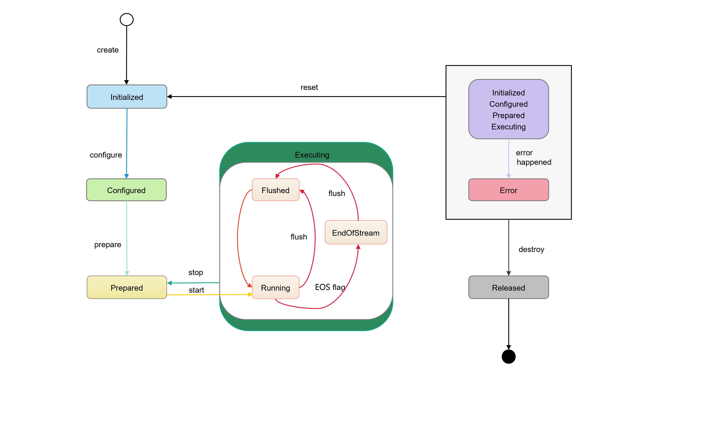
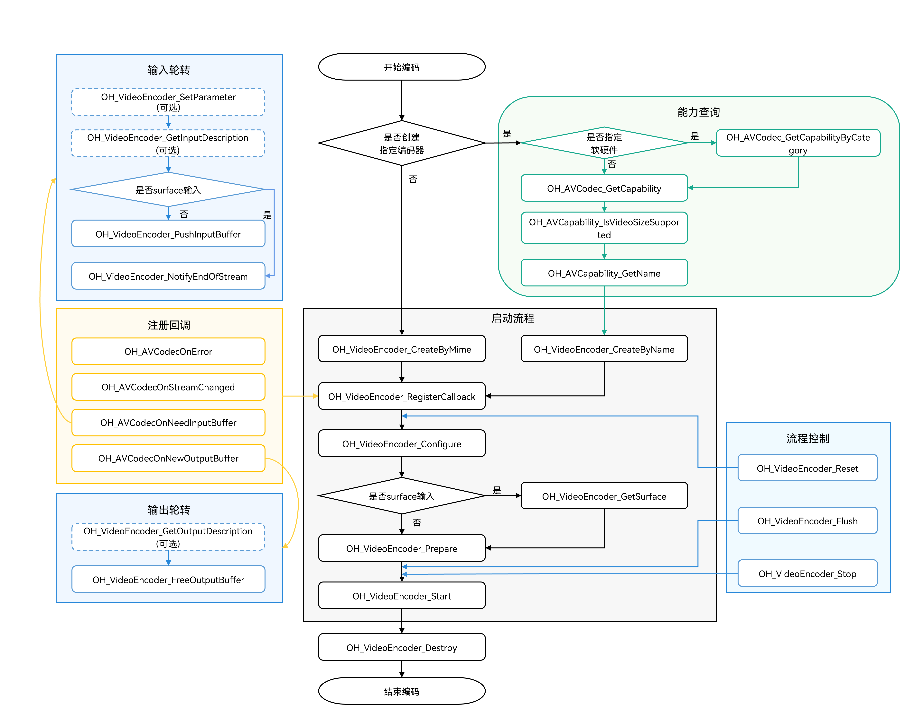
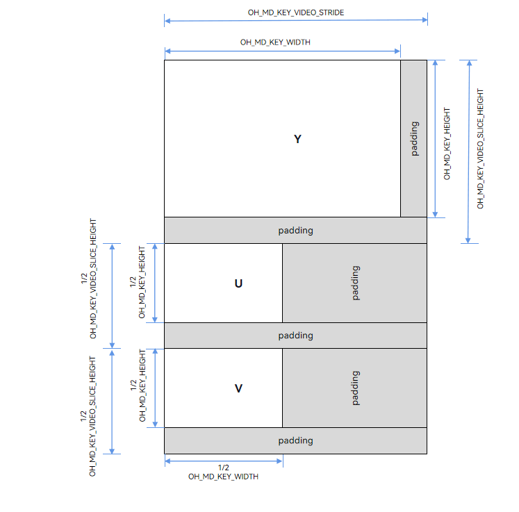
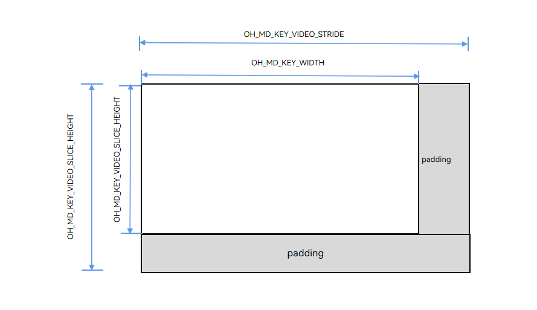

# 异步模式视频编码

<!--Kit: AVCodec Kit-->
<!--Subsystem: Multimedia-->
<!--Owner: @rchdlee-->
<!--Designer: @dpy2650--->
<!--Tester: @cyakee-->
<!--Adviser: @w_Machine_cc-->

视频编码是多媒体处理流程中的重要环节，功能是将未压缩的视频数据压缩成视频码流，旨在降低原始视频数据的大小以便存储或传输。视频编码支持同步模式与异步模式两种运行机制，两者主要区别为buffer获取方式的同异步之分，开发者可根据自身业务选择适合的接口调用模式。

本文档主要介绍异步模式视频编码的实现流程，同步模式视频编码请参考[同步模式视频编码](synchronous-video-encoding.md)。根据编码前数据输入方式的不同，编码器支持Surface模式和Buffer模式两种输入模式，适用于不同的应用场景。

- Surface模式

  编码器通过[NativeWindow](../../reference/apis-arkgraphics2d/capi-nativewindow-nativewindow.md)来获取输入数据，可以与其他模块对接（如相机模块）。适用于与相机、屏幕录制等数据源直接对接的编码场景。

- Buffer模式

  编码器通过预分配的共享内存获取输入数据，开发者需将原始视频数据拷贝到预分配的共享内存中。适用于对文件或内存中的原始视频数据进行编码处理的场景。

|    差异    |       Surface模式       |      Buffer模式        |
| ----------- | ------------------ | ---------------------------------------- |
|    配置    | 在调用OH_VideoEncoder_Prepare接口前，必须调用OH_VideoEncoder_GetSurface接口获取OHNativeWindow，用于传递视频数据。 |      -      |
|  数据输入   | 通过OHNativeWindow获取输入帧，数据通常由生产者模块（如相机）直接写入。| 通过OnNeedInputBuffer回调函数获取共享内存buffer信息，调用OH_VideoEncoder_PushInputBuffer送入数据。 |
|   输入结束  | 必须调用OH_VideoEncoder_NotifyEndOfStream接口通知编码器输入结束。 | 编码至最后一帧数据时，需将输入buffer的flags字段设置为AVCODEC_BUFFER_FLAGS_EOS标志，以通知编码器输入结束。|

AVCodec支持的视频编码格式请参考[视频编码](avcodec-support-formats.md#视频编码)。

具体实现可参考[示例工程](https://gitcode.com/openharmony/applications_app_samples/tree/master/code/DocsSample/Media/AVCodec/AVCodec)。

## 状态机调用关系

1. 初始化状态（Initialized）。
   - 初始创建编码器实例时，编码器处于Initialized状态。
   - 任何状态下，调用OH_VideoEncoder_Reset接口，可返回Initialized状态。
2. 配置状态（Configured）。
   - Initialized状态下，调用OH_VideoEncoder_Configure接口配置编码器，配置成功后编码器进入Configured状态。
3. 就绪状态（Prepared）。
   - Configured状态下，调用OH_VideoEncoder_Prepare接口进入Prepared状态。
   - 处于Executing状态时，调用OH_VideoEncoder_Stop接口可以使编码器返回到Prepared状态。
4. 运行状态（Executing）。
   - Prepared状态下，调用OH_VideoEncoder_Start接口进入Executing状态。
   - Executing状态具有三个子状态：Running、Flushed和End-of-Stream。
     - 运行子状态（Running）：调用OH_VideoEncoder_Start接口进入Running子状态。
     - 刷新子状态（Flushed）：调用OH_VideoEncoder_Flush接口进入Flushed子状态。
     - 结束子状态（End-of-Stream）：编码器接收到输入buffer的flags为[OH_AVCodecBufferFlags](../../reference/apis-avcodec-kit/capi-native-avbuffer-info-h.md#oh_avcodecbufferflags)中的AVCODEC_BUFFER_FLAGS_EOS，或者调用OH_VideoEncoder_NotifyEndOfStream接口时，进入End-of-Stream子状态。在此状态下，编码器不再接受新的输入，但是仍然会继续生成输出，直到输出到达尾帧。
5. 错误状态（Error）。
   - 在极少数情况下，编码器异常时进入Error状态。接口会返回错误码或通过OH_AVCodecOnError回调抛出异常。
   - Error状态下，可以调用OH_VideoEncoder_Reset接口返回Initialized状态，或者调用OH_VideoEncoder_Destroy接口进入到最后的Released状态。
6. 释放状态（Released）。
   - 使用完编码器后，必须调用OH_VideoEncoder_Destroy接口销毁编码器实例，使编码器进入Released状态。

**图1** 状态机调用关系示意图



## 开发指导

详细的API说明请参考[native_avcodec_videoencoder.h](../../reference/apis-avcodec-kit/capi-native-avcodec-videoencoder-h.md)。

**图2** 视频编码调用关系示意图

- 虚线表示可选。

- 实线表示必选。



### 在CMake脚本中链接动态库

```cmake
target_link_libraries(sample PUBLIC libnative_media_codecbase.so)
target_link_libraries(sample PUBLIC libnative_media_core.so)
target_link_libraries(sample PUBLIC libnative_media_venc.so)
```

> **说明：**
>
> 上述'sample'字样仅为示例，此处由开发者根据实际工程目录自定义。

### 定义基础结构

本部分示例代码按照C++17标准编写，仅作参考。开发者可以参考此部分，定义自己的buffer对象。

1. 添加头文件。

   ```c++
   #include <chrono>
   #include <condition_variable>
   #include <cstdint>
   #include <memory>
   #include <mutex>
   #include <queue>
   #include <multimedia/player_framework/native_avbuffer.h>
   #include <native_window/external_window.h>
   ```

2. 编码器回调buffer的信息。

   <!-- @[codec_buffer_info](https://gitcode.com/openharmony/applications_app_samples/blob/master/code/DocsSample/Media/AVCodec/AVCodec/entry/src/main/cpp/common/codec_buffer.h) -->

   ```c++
   // buffer信息。
   struct CodecBufferInfo {
       // buffer。
       OH_AVBuffer *buffer = nullptr;
       // buffer对应的bufferIndex。
       uint32_t bufferIndex = 0;
       // buffer的输入尺寸（size）、偏移量（offset）、时间戳（pts）、缓冲区标记（flags）信息。
       OH_AVCodecBufferAttr attr = {0, 0, 0, AVCODEC_BUFFER_FLAGS_NONE};

       CodecBufferInfo() = default;

       CodecBufferInfo(uint32_t index, OH_AVBuffer *avBuffer)
           : buffer(avBuffer), bufferIndex(index)
       {
           // 获取buffer的attr信息。
           if (buffer != nullptr) {
               (void)OH_AVBuffer_GetBufferAttr(buffer, &attr);
           }
       }
   };
   ```

3. 编码输入输出队列。

   ```c++
   // 回调buffer输入输出队列。
   class CodecBufferQueue {
   public:
       // 将回调buffer的信息传入队列。
       void Enqueue(const std::shared_ptr<CodecBufferInfo> bufferInfo)
       {
           std::unique_lock<std::mutex> lock(mutex_);
           // 队列只共享描述对象，不取得 OH_AVBuffer 的所有权。消费者必须按所属编解码器归还bufferIndex。
           bufferQueue_.push(bufferInfo);
           cond_.notify_all();
       }

       // 获取回调buffer的信息。
       std::shared_ptr<CodecBufferInfo> Dequeue(int32_t timeoutMs = 1000)
       {
           std::unique_lock<std::mutex> lock(mutex_);
           (void)cond_.wait_for(lock, std::chrono::milliseconds(timeoutMs),
               [this]() { return cancelled_ || !bufferQueue_.empty(); });
           // 返回空既可能是超时，也可能是解码器不处于Running状态；调用方应结合所属流水线的运行状态决定后续动作。
           if (cancelled_ || bufferQueue_.empty()) {
               return nullptr;
           }
           std::shared_ptr<CodecBufferInfo> bufferInfo = bufferQueue_.front();
           bufferQueue_.pop();
           return bufferInfo;
       }

       void Flush()
       {
           std::unique_lock<std::mutex> lock(mutex_);
           // 清空回调buffer队列。
           // 调用方需先与codec 的 Flush/Stop 及工作线程完成同步，避免在其他线程仍访问 Buffer 时清空队列。
           while (!bufferQueue_.empty()) {
               bufferQueue_.pop();
           }
       }

   private:
       std::mutex mutex_;
       std::condition_variable cond_;
       std::queue<std::shared_ptr<CodecBufferInfo>> bufferQueue_;
       bool cancelled_ = false;
   };
   ```

4. 全局变量。

   仅作参考，可以根据实际情况将其封装到对象中。

   ```c++
   struct CodecUserData {
       SampleInfo *sampleInfo = nullptr;
       bool isEncFirstFrame = false;

       int32_t width = 0;
       int32_t height = 0;
       int32_t widthStride = 0;
       int32_t heightStride = 0;
       OH_AVPixelFormat outputPixelFormat = AV_PIXEL_FORMAT_NV12;
       // 编码器同步锁。
       std::shared_mutex codecMutex;
       // 编码器输入队列。
       CodecBufferQueue inputBufferQueue;
       // 编码器输出队列。
       CodecBufferQueue outputBufferQueue;

       void ClearQueue()
       {
           inputBufferQueue.Flush();
           outputBufferQueue.Flush();
       }
   };

   struct VideoSampleInfo {
       // 视频帧宽度。
       int32_t videoWidth = 0;
       // 视频帧高度。
       int32_t videoHeight = 0;
       // 视频像素格式。
       OH_AVPixelFormat pixelFormat = AV_PIXEL_FORMAT_NV12;
       // 视频帧率。
       double frameRate = 0.0;
       // 码率模式。
       uint32_t bitrateMode = CBR;
       // 码率。
       int64_t bitrate = BITRATE_10M;
       // HEVC档次。
       int32_t hevcProfile = HEVC_PROFILE_MAIN;
       // 关键帧间隔时间，单位为ms。
       int32_t iFrameInterval = 100;
       // 图形接口。
       OHNativeWindow *window = nullptr;
   };

   struct SampleInfo {
       VideoSampleInfo video;
   };

   // 编码器实例指针。
   OH_AVCodec *encoder_ = nullptr;
   std::unique_ptr<VideoEncoder> videoEncoder_ = nullptr;
   CodecUserData *encContext_ = nullptr;
   ```

### Surface模式

参考以下示例代码，可以完成Surface模式下视频编码的全流程，实现异步模式的数据轮转。此处以输入surface数据，编码成H.264格式为例。

1. 添加头文件。

   ```c++
   #include <multimedia/player_framework/native_avcodec_videoencoder.h>
   #include <multimedia/player_framework/native_avcapability.h>
   #include <multimedia/player_framework/native_avcodec_base.h>
   #include <multimedia/player_framework/native_avbuffer.h>
   #include <fstream>
   ```

2. 创建编码器实例。

   开发者可以通过名称或媒体类型创建编码器。

   - mime：视频格式，如OH_AVCODEC_MIMETYPE_VIDEO_AVC(H.264)，OH_AVCODEC_MIMETYPE_VIDEO_HEVC(H.265)。
   - isEncoder：编码器为true，解码器为false。
   - category：编解码器类别，HARDWARE硬件编解码，SOFTWARE为软件编解码。
   - capability：编码器能力查询实例的指针。

   方式一：通过名称创建编码器。

   <!-- @[encoder_create_byname](https://gitcode.com/openharmony/applications_app_samples/blob/master/code/DocsSample/Media/AVCodec/AVCodec/entry/src/main/cpp/capabilities/video_encoder.cpp) -->

   ```c++
   // 通过codec name创建编码器，应用有特殊需求，比如选择支持某种分辨率规格的编码器，可先查询capability，再根据codec name创建编码器。
   OH_AVCodec *VideoEncoder::GetCodecByCategory(const char *mime, bool isEncoder, OH_AVCodecCategory category)
   {
       CHECK_AND_RETURN_RET_LOG(mime != nullptr, nullptr, "Codec mime is nullptr");
       CHECK_AND_RETURN_RET_LOG(isEncoder, nullptr, "Encoder capability requires isEncoder=true");
       OH_AVCapability *capability = OH_AVCodec_GetCapabilityByCategory(mime, isEncoder, category);
       CHECK_AND_RETURN_RET_LOG(capability != nullptr, nullptr, "Encoder capability is nullptr");
       const char *codecName = OH_AVCapability_GetName(capability);
       CHECK_AND_RETURN_RET_LOG(codecName != nullptr, nullptr, "Encoder codec name is nullptr");
       return OH_VideoEncoder_CreateByName(codecName);
   }
   ```

   方式二：通过媒体类型创建编码器。

   <!-- @[encoder_create_bymime](https://gitcode.com/openharmony/applications_app_samples/blob/master/code/DocsSample/Media/AVCodec/AVCodec/entry/src/main/cpp/capabilities/video_encoder.cpp) -->

   ```c++
   // 通过 MIME TYPE 创建编码器，由系统选择对应的编码器实现。
   OH_AVCodec *VideoEncoder::GetCodecByMime(const char *mime)
   {
       CHECK_AND_RETURN_RET_LOG(mime != nullptr, nullptr, "Codec mime is nullptr");
       return OH_VideoEncoder_CreateByMime(mime);
   }
   ```

3. 调用OH_VideoEncoder_RegisterCallback()设置回调函数。

   注册回调函数指针集合OH_AVCodecCallback，包括：

   - OH_AVCodecOnError编码器运行错误，返回的错误码详情请参见[OH_AVCodecOnError](../../reference/apis-avcodec-kit/capi-native-avcodec-base-h.md#oh_avcodeconerror)；
   - OH_AVCodecOnStreamChanged码流信息变化，如格式变化等；
   - OH_AVCodecOnNeedInputBuffer输入回调无作用，开发者通过获取的surface输入数据；
   - OH_AVCodecOnNewOutputBuffer运行过程中产生了新的输出数据，即编码完成。

   示例如下所示：

   ```c++
   // 编码异常回调OH_AVCodecOnError实现。
   void SampleCallback::OnCodecError(OH_AVCodec *codec, int32_t errorCode, void *userData)
   {
       (void)codec;
       (void)userData;
       AVCODEC_SAMPLE_LOGE("On codec error, error code: %{public}d", errorCode);
   }

   // 编码数据流变化回调OH_AVCodecOnStreamChanged实现。
   void SampleCallback::OnCodecFormatChange(OH_AVCodec *codec, OH_AVFormat *format, void *userData)
   {
       (void)codec;
       AVCODEC_SAMPLE_LOGI("On codec format change");
       auto *codecUserData = static_cast<CodecUserData *>(userData);
       if (codecUserData == nullptr || codecUserData->isDestroyed.load() || format == nullptr) {
           return;
       }

       // 可通过format获取到变化后的视频宽、高、跨距等。
       OH_AVFormat_GetIntValue(format, OH_MD_KEY_VIDEO_PIC_WIDTH, &codecUserData->width);
       OH_AVFormat_GetIntValue(format, OH_MD_KEY_VIDEO_PIC_HEIGHT, &codecUserData->height);
       OH_AVFormat_GetIntValue(format, OH_MD_KEY_VIDEO_STRIDE, &codecUserData->widthStride);
       OH_AVFormat_GetIntValue(format, OH_MD_KEY_VIDEO_SLICE_HEIGHT, &codecUserData->heightStride);
       const int32_t pixelFormat = static_cast<int32_t>(codecUserData->outputPixelFormat);
   }

   // 编码输入回调OH_AVCodecOnNeedInputBuffer实现。
   void SampleCallback::OnNeedInputBuffer(OH_AVCodec *codec, uint32_t index, OH_AVBuffer *buffer, void *userData)
   {
       // Surface模式下，该回调函数无作用，开发者通过获取的surface输入数据。
       (void)userData;
       (void)index;
       (void)buffer;
   }

   // 编码输出回调OH_AVCodecOnNewOutputBuffer实现。
   void SampleCallback::OnNewOutputBuffer(OH_AVCodec *codec, uint32_t index, OH_AVBuffer *buffer, void *userData)
   {
       auto *codecUserData = static_cast<CodecUserData *>(userData);
       if (codecUserData == nullptr || codecUserData->isDestroyed.load()) {
           return;
       }
       if (codec == nullptr || buffer == nullptr) {
           AVCODEC_SAMPLE_LOGE("Invalid codec output callback argument");
           return;
       }

       // 输出帧的数据buffer和对应的index送入outputBufferQueue队列。
       codecUserData->outputBufferQueue.Enqueue(std::make_shared<CodecBufferInfo>(index, buffer));
   }
   ```

   <!-- @[encoder_set_callback](https://gitcode.com/openharmony/applications_app_samples/blob/master/code/DocsSample/Media/AVCodec/AVCodec/entry/src/main/cpp/capabilities/video_encoder.cpp) -->

   ```c++
   // 配置异步回调，调用OH_VideoEncoder_RegisterCallback()接口。
   // 注册回调包括：编码器运行错误OH_AVCodecOnError、码流信息变化OH_AVCodecOnStreamChanged、
   // 输入回调OH_AVCodecOnNeedInputBuffer、输出回调OH_AVCodecOnNewOutputBuffer。
   int32_t VideoEncoder::SetCallback(CodecUserData *codecUserData)
   {
       int32_t ret = OH_VideoEncoder_RegisterCallback(encoder_,
       {SampleCallback::OnCodecError, SampleCallback::OnCodecFormatChange,
           SampleCallback::OnNeedInputBuffer, SampleCallback::OnNewOutputBuffer},
           codecUserData);
       CHECK_AND_RETURN_RET_LOG(ret == AV_ERR_OK, AVCODEC_SAMPLE_ERR_ERROR, "Set callback failed, ret: %{public}d", ret);

       return AVCODEC_SAMPLE_ERR_OK;
   }
   ```

   > **说明：**
   >
   > 在回调函数中，对数据队列进行操作时，需要注意多线程同步的问题。

4. （可选）调用OH_VideoEncoder_RegisterParameterCallback()在Configure接口之前注册随帧通路回调。

   详情请参考[时域可分层视频编码](video-encoding-temporal-scalability.md)。

   <!--RP7-->
   ```c++
   // 4.1 编码输入参数回调OH_VideoEncoder_OnNeedInputParameter实现。
   static void OnNeedInputParameter(OH_AVCodec *codec, uint32_t index, OH_AVFormat *parameter, void *userData)
   {
       // 输入帧的数据parameter和对应的index送入inQueue队列。
       inQueue.Enqueue(std::make_shared<CodecBufferInfo>(index, parameter));
   }

   // 4.2 注册随帧参数回调。
   OH_VideoEncoder_OnNeedInputParameter inParaCb = OnNeedInputParameter;
   OH_VideoEncoder_RegisterParameterCallback(videoEnc, inParaCb, nullptr); // nullptr:开发者执行回调所依赖的数据userData为空。
   ```
   <!--RP7End-->

5. 调用OH_VideoEncoder_Configure()配置编码器。

   详细可配置选项的说明请参考[媒体数据键值对](../../reference/apis-avcodec-kit/capi-codecbase.md#媒体数据键值对)中的视频专有键值对。

   参数校验规则请参考[OH_VideoEncoder_Configure()参考文档](../../reference/apis-avcodec-kit/capi-native-avcodec-videoencoder-h.md#oh_videoencoder_configure)。

   参数取值范围可以通过能力查询接口获取，具体示例请参考[获取支持的编解码能力文档](obtain-supported-codecs.md)。

   目前支持的所有格式都必须配置以下选项：视频帧宽度、视频帧高度、视频像素格式。

   <!-- @[encoder_configure](https://gitcode.com/openharmony/applications_app_samples/blob/master/code/DocsSample/Media/AVCodec/AVCodec/entry/src/main/cpp/capabilities/video_encoder.cpp) -->

   ```c++
   int32_t VideoEncoder::Configure(const SampleInfo &sampleInfo)
   {
       // 建议在配置编码器前进行能力校验，确认当前设备是否支持配置的参数。
       // ...
       OH_AVFormat *format = OH_AVFormat_Create();
       CHECK_AND_RETURN_RET_LOG(format != nullptr, AVCODEC_SAMPLE_ERR_ERROR, "AVFormat create failed");

       OH_AVFormat_SetIntValue(format, OH_MD_KEY_WIDTH, sampleInfo.video.videoWidth);
       OH_AVFormat_SetIntValue(format, OH_MD_KEY_HEIGHT, sampleInfo.video.videoHeight);
       OH_AVFormat_SetDoubleValue(format, OH_MD_KEY_FRAME_RATE, sampleInfo.video.frameRate);
       OH_AVFormat_SetIntValue(format, OH_MD_KEY_PIXEL_FORMAT, sampleInfo.video.pixelFormat);
       OH_AVFormat_SetIntValue(format, OH_MD_KEY_VIDEO_ENCODE_BITRATE_MODE, sampleInfo.video.bitrateMode);
       OH_AVFormat_SetLongValue(format, OH_MD_KEY_BITRATE, sampleInfo.video.bitrate);
       OH_AVFormat_SetIntValue(format, OH_MD_KEY_PROFILE, sampleInfo.video.hevcProfile);
       OH_AVFormat_SetIntValue(format, OH_MD_KEY_I_FRAME_INTERVAL, sampleInfo.video.iFrameInterval);
       // ...

       int ret = OH_VideoEncoder_Configure(encoder_, format);
       OH_AVFormat_Destroy(format);
       format = nullptr;
       CHECK_AND_RETURN_RET_LOG(ret == AV_ERR_OK, AVCODEC_SAMPLE_ERR_ERROR, "Config failed, ret: %{public}d", ret);
       return AVCODEC_SAMPLE_ERR_OK;
   }
   ```

   > **注意：**
   > 配置非必须参数错误时，会返回AV_ERR_INVALID_VAL错误码。但OH_VideoEncoder_Configure()不会失败，而是使用默认值继续执行。

6. 获取surface。

   获取编码器Surface模式的OHNativeWindow输入，获取surface需要在调用OH_VideoEncoder_Prepare接口之前完成。

   <!-- @[encoder_get_surface](https://gitcode.com/openharmony/applications_app_samples/blob/master/code/DocsSample/Media/AVCodec/AVCodec/entry/src/main/cpp/capabilities/video_encoder.cpp) -->

   ```c++
   // 获取编码器Surface模式的OHNativeWindow输入，需要在调用OH_VideoEncoder_Prepare接口之前完成。
   // 通过OHNativeWindow*获取生产者待填充数据地址。
   int32_t VideoEncoder::GetSurface(SampleInfo &sampleInfo)
   {
       int32_t ret = OH_VideoEncoder_GetSurface(encoder_, &sampleInfo.video.window);
       CHECK_AND_RETURN_RET_LOG(ret == AV_ERR_OK && sampleInfo.video.window, AVCODEC_SAMPLE_ERR_ERROR,
           "Get surface failed, ret: %{public}d", ret);
       return AVCODEC_SAMPLE_ERR_OK;
   }
   ```

   通过OHNativeWindow*获取生产者待填充数据地址。使用方法请参考图形子系统 [OHNativeWindow](../../reference/apis-arkgraphics2d/capi-nativewindow.md)。

7. 调用OH_VideoEncoder_Prepare()编码器就绪。

   该接口将在编码器运行前进行一些数据的准备工作。

   <!-- @[encoder_prepare](https://gitcode.com/openharmony/applications_app_samples/blob/master/code/DocsSample/Media/AVCodec/AVCodec/entry/src/main/cpp/capabilities/video_encoder.cpp) -->

   ```c++
   // 申请编码器运行所需资源。Prepare 成功后才能调用 Start。
   int32_t VideoEncoder::Prepare()
   {
       CHECK_AND_RETURN_RET_LOG(encoder_ != nullptr, AVCODEC_SAMPLE_ERR_ERROR, "Encoder is null");
       const int32_t ret = OH_VideoEncoder_Prepare(encoder_);
       CHECK_AND_RETURN_RET_LOG(ret == AV_ERR_OK, AVCODEC_SAMPLE_ERR_ERROR,
           "Prepare failed, ret: %{public}d", ret);
       return AVCODEC_SAMPLE_ERR_OK;
   }
   ```

8. 调用OH_VideoEncoder_Start()启动编码器。

   配置编码输出文件路径。可填写应用沙箱路径等可访问目录。

   ```c++
   // 配置待编码文件路径。
   std::string_view outputFilePath = "/*yourpath*.h264";
   std::unique_ptr<std::ofstream> outputFile = std::make_unique<std::ofstream>();
   if (outputFile != nullptr) {
       outputFile->open(outputFilePath.data(), std::ios::out | std::ios::binary | std::ios::ate);
   }
   ```

   <!-- @[encoder_start](https://gitcode.com/openharmony/applications_app_samples/blob/master/code/DocsSample/Media/AVCodec/AVCodec/entry/src/main/cpp/capabilities/video_encoder.cpp) -->

   ```c++
   int32_t VideoEncoder::Start()
   {
       CHECK_AND_RETURN_RET_LOG(encoder_ != nullptr, AVCODEC_SAMPLE_ERR_ERROR, "Encoder is null");

       const int32_t ret = OH_VideoEncoder_Start(encoder_);
       CHECK_AND_RETURN_RET_LOG(ret == AV_ERR_OK, AVCODEC_SAMPLE_ERR_ERROR, "Start failed, ret: %{public}d", ret);
       return AVCODEC_SAMPLE_ERR_OK;
   }
   ```

9. （可选）OH_VideoEncoder_SetParameter()在运行过程中动态配置编码器参数。

   <!-- @[encoder_setparameter](https://gitcode.com/openharmony/applications_app_samples/blob/master/code/DocsSample/Media/AVCodec/AVCodec/entry/src/main/cpp/capabilities/video_encoder.cpp) -->

   ```c++
   int32_t VideoEncoder::SetParameter(OH_AVFormat *format)
   {
       // 参数对象由调用方创建和销毁。本方法仅在编码器已启动期间转交参数，不保存 format 指针。
       CHECK_AND_RETURN_RET_LOG(format != nullptr, AVCODEC_SAMPLE_ERR_ERROR, "Parameter format is null");
       CHECK_AND_RETURN_RET_LOG(encoder_ != nullptr, AVCODEC_SAMPLE_ERR_ERROR, "Encoder is null");
       const int32_t ret = OH_VideoEncoder_SetParameter(encoder_, format);
       CHECK_AND_RETURN_RET_LOG(ret == AV_ERR_OK, AVCODEC_SAMPLE_ERR_ERROR,
           "Set parameter failed, ret: %{public}d", ret);
       return AVCODEC_SAMPLE_ERR_OK;
   }
   ```

10. 写入编码图像。

    在之前的第6步中，开发者已经对OH_VideoEncoder_GetSurface接口返回的OHNativeWindow*类型变量进行配置。因为编码所需的数据，由配置的surface进行持续地输入，所以开发者无需对OnNeedInputBuffer回调函数进行处理，也无需使用OH_VideoEncoder_PushInputBuffer接口输入数据。
    <!--RP13--><!--RP13End-->

11. （可选）调用OH_VideoEncoder_PushInputParameter()通知编码器随帧参数配置输入完成。

    在之前的第4步中，开发者已经注册随帧通路回调。

    以下示例中：

    - index：回调函数OnNeedInputParameter传入的参数，与buffer唯一对应的标识。

    ```c++
    std::shared_ptr<CodecBufferInfo> bufferInfo = inQueue.Dequeue();
    std::shared_lock<std::shared_mutex> lock(codecMutex);
    if (bufferInfo == nullptr || !bufferInfo->isValid) {
        // 异常处理。
    }
    // 值由开发者决定。
    int32_t isIFrame;
    OH_AVFormat_SetIntValue(bufferInfo->parameter, OH_MD_KEY_REQUEST_I_FRAME, isIFrame);
    OH_AVErrCode ret = OH_VideoEncoder_PushInputParameter(videoEnc, bufferInfo->index);
    if (ret != AV_ERR_OK) {
        // 异常处理。
    }
    ```

12. 调用OH_VideoEncoder_NotifyEndOfStream()通知编码器结束。

    <!-- @[encoder_notify_end_of_stream](https://gitcode.com/openharmony/applications_app_samples/blob/master/code/DocsSample/Media/AVCodec/AVCodec/entry/src/main/cpp/capabilities/video_encoder.cpp) -->

    ```c++
    // Surface模式：通知视频编码器输入流已结束，只能使用此接口进行通知。
    // 不能像Buffer模式中将flag设为AVCODEC_BUFFER_FLAGS_EOS，再调用OH_VideoEncoder_PushInputBuffer接口通知编码器输入结束。
    int32_t VideoEncoder::NotifyEndOfStream()
    {
        CHECK_AND_RETURN_RET_LOG(encoder_ != nullptr, AVCODEC_SAMPLE_ERR_ERROR, "Encoder is null");

        int32_t ret = OH_VideoEncoder_NotifyEndOfStream(encoder_);
        CHECK_AND_RETURN_RET_LOG(ret == AV_ERR_OK, AVCODEC_SAMPLE_ERR_ERROR,
            "Notify end of stream failed, ret: %{public}d", ret);
        return AVCODEC_SAMPLE_ERR_OK;
    }
    ```

13. 调用OH_VideoEncoder_FreeOutputBuffer()释放编码帧。

    以下示例中，bufferInfo的成员变量：

    - bufferIndex：回调函数OnNewOutputBuffer传入的参数，与buffer唯一对应的标识；
    - buffer：回调函数OnNewOutputBuffer传入的参数，可以通过[OH_AVBuffer_GetAddr](../../reference/apis-avcodec-kit/capi-native-avbuffer-h.md#oh_avbuffer_getaddr)接口得到共享内存地址的指针；
    - attr：buffer的输入尺寸（size）、偏移量（offset）、时间戳（pts）、缓冲区标记（flags）信息。

    编码器出帧处理循环：

    <!-- @[encoder_output_buffer](https://gitcode.com/openharmony/applications_app_samples/blob/master/code/DocsSample/Media/AVCodec/AVCodec/entry/src/main/cpp/sample/recorder/Recorder.cpp) -->

    ```c++
    while (true) {
        CHECK_AND_BREAK_LOG(isStarted_, "Work done, thread out");
        // 获取输出buffer。
        std::shared_ptr<CodecBufferInfo> bufferInfo = context->outputBufferQueue.Dequeue();
        std::shared_lock<std::shared_mutex> codecLock(context->codecMutex);
        // 开发者可根据业务需要，对输出数据进行保存/释放处理。
        // ...
    }
    ```

    释放处理：
    ```c++
    int32_t VideoEncoder::FreeOutputBuffer(const CodecBufferInfo &info)
    {
        CHECK_AND_RETURN_RET_LOG(encoder_ != nullptr, AVCODEC_SAMPLE_ERR_ERROR, "Encoder is null");

        int32_t ret = OH_VideoEncoder_FreeOutputBuffer(encoder_, info.bufferIndex);
        CHECK_AND_RETURN_RET_LOG(ret == AV_ERR_OK, AVCODEC_SAMPLE_ERR_ERROR,
            "Free output data failed, ret: %{public}d", ret);
        return AVCODEC_SAMPLE_ERR_OK;
    }
    ```

    > **说明：**
    >
    > 本例将编码完成帧数据buffer写入Muxer封装。开发者也可以通过[OH_AVBuffer_GetAddr](../../reference/apis-avcodec-kit/capi-native-avbuffer-h.md#oh_avbuffer_getaddr)接口得到共享内存地址的指针后，将编码完成帧数据写入到对应输出文件中。

14. （可选）调用OH_VideoEncoder_Flush()刷新编码器。

    调用OH_VideoEncoder_Flush接口后，编码器仍处于运行态，但会清除编码器中缓存的输入和输出数据及参数集如H.264格式的PPS/SPS。

    此时需要调用OH_VideoEncoder_Start接口重新开始编码。

    <!-- @[encoder_flush](https://gitcode.com/openharmony/applications_app_samples/blob/master/code/DocsSample/Media/AVCodec/AVCodec/entry/src/main/cpp/capabilities/video_encoder.cpp) -->

    ```c++
    int32_t VideoEncoder::Flush()
    {
        // Flush 会使此前通过回调或同步查询取得的 Buffer 索引失效，调用方需先结束对这些 Buffer 的访问。
        CHECK_AND_RETURN_RET_LOG(encoder_ != nullptr, AVCODEC_SAMPLE_ERR_ERROR, "Encoder is null");
        const int32_t ret = OH_VideoEncoder_Flush(encoder_);
        CHECK_AND_RETURN_RET_LOG(ret == AV_ERR_OK, AVCODEC_SAMPLE_ERR_ERROR,
            "Flush failed, ret: %{public}d", ret);
        return AVCODEC_SAMPLE_ERR_OK;
    }
    ```

    输入、输出buffer清理：

    <!-- @[buffer_clean](https://gitcode.com/openharmony/applications_app_samples/blob/master/code/DocsSample/Media/AVCodec/AVCodec/entry/src/main/cpp/common/codec_user_data.h) -->

    ```c++
    void ClearQueue()
    {
        inputBufferQueue.Flush();
        outputBufferQueue.Flush();
    }
    ```

    若需重新开始编码，可参考上述[Surface模式](#surface模式)-步骤8启动编码器。

15. （可选）调用OH_VideoEncoder_Reset()重置编码器。

    调用OH_VideoEncoder_Reset接口后，编码器将回到初始化的状态，需要调用OH_VideoEncoder_Configure接口和OH_VideoEncoder_Prepare接口重新配置。

    <!-- @[encoder_reset](https://gitcode.com/openharmony/applications_app_samples/blob/master/code/DocsSample/Media/AVCodec/AVCodec/entry/src/main/cpp/capabilities/video_encoder.cpp) -->

    ```c++
    int32_t VideoEncoder::Reset()
    {
        // Reset 会丢弃当前配置与缓存，编码器回到初始状态；不能将其当作可直接继续编码的 Flush 使用。
        CHECK_AND_RETURN_RET_LOG(encoder_ != nullptr, AVCODEC_SAMPLE_ERR_ERROR, "Encoder is null");
        const int32_t ret = OH_VideoEncoder_Reset(encoder_);
        CHECK_AND_RETURN_RET_LOG(ret == AV_ERR_OK, AVCODEC_SAMPLE_ERR_ERROR,
            "Reset failed, ret: %{public}d", ret);
        return AVCODEC_SAMPLE_ERR_OK;
    }
    ```

    输入、输出buffer清理：

    <!-- @[buffer_clean](https://gitcode.com/openharmony/applications_app_samples/blob/master/code/DocsSample/Media/AVCodec/AVCodec/entry/src/main/cpp/common/codec_user_data.h) -->

    ```c++
    void ClearQueue()
    {
        inputBufferQueue.Flush();
        outputBufferQueue.Flush();
    }
    ```

    若需重新开始编码，可参考上述[Surface模式](#surface模式)-步骤5至8配置并启动编码器。

16. （可选）调用OH_VideoEncoder_Stop()停止编码器。

    调用OH_VideoEncoder_Stop接口后，编码器保留了编码实例，释放输入输出buffer。开发者可以直接调用OH_VideoEncoder_Start接口继续编码。

    <!-- @[encoder_stop](https://gitcode.com/openharmony/applications_app_samples/blob/master/code/DocsSample/Media/AVCodec/AVCodec/entry/src/main/cpp/capabilities/video_encoder.cpp) -->

    ```c++
    int32_t VideoEncoder::Stop()
    {
        // Stop 前先清除缓存，确保已排队但尚未输出的编码数据不会落入下一次 Start。
        CHECK_AND_RETURN_RET_LOG(encoder_ != nullptr, AVCODEC_SAMPLE_ERR_ERROR, "Encoder is null");

        int32_t ret = OH_VideoEncoder_Flush(encoder_);
        CHECK_AND_RETURN_RET_LOG(ret == AV_ERR_OK, AVCODEC_SAMPLE_ERR_ERROR, "Flush failed, ret: %{public}d", ret);

        ret = OH_VideoEncoder_Stop(encoder_);
        CHECK_AND_RETURN_RET_LOG(ret == AV_ERR_OK, AVCODEC_SAMPLE_ERR_ERROR, "Stop failed, ret: %{public}d", ret);
        return AVCODEC_SAMPLE_ERR_OK;
    }
    ```

    输入、输出buffer清理：

    <!-- @[buffer_clean](https://gitcode.com/openharmony/applications_app_samples/blob/master/code/DocsSample/Media/AVCodec/AVCodec/entry/src/main/cpp/common/codec_user_data.h) -->

    ```c++
    void ClearQueue()
    {
        inputBufferQueue.Flush();
        outputBufferQueue.Flush();
    }
    ```

    若需重新开始编码，可参考上述[Surface模式](#surface模式)-步骤8启动编码器。

17. 调用OH_VideoEncoder_Destroy()销毁编码器实例，释放资源。

    <!-- @[recorder_release](https://gitcode.com/openharmony/applications_app_samples/blob/master/code/DocsSample/Media/AVCodec/AVCodec/entry/src/main/cpp/sample/recorder/Recorder.cpp) -->

    ```c++
    void Recorder::ReleaseVideoEncoder()
    {
        // API 26 要求先销毁副编码器，再销毁主编码器；主路拥有共享输入的生命周期。
        if (secondaryVideoEncoder_ != nullptr) {
            if (secondaryEncContext_ != nullptr) {
                secondaryEncContext_->isDestroyed.store(true);
                std::unique_lock<std::shared_mutex> codecLock(secondaryEncContext_->codecMutex);
                secondaryEncContext_->ClearQueue();
            }
            secondaryVideoEncoder_->Release();
            secondaryVideoEncoder_.reset();
            if (secondaryEncContext_ != nullptr) {
                delete secondaryEncContext_;
                secondaryEncContext_ = nullptr;
            }
        }
        if (videoEncoder_ != nullptr) {
            if (encContext_ != nullptr) {
                // 回调只借用上下文。先拒绝迟到回调，再销毁 codec 和上下文。
                encContext_->isDestroyed.store(true);
                // 清空回调队列并取得写锁后，再释放 codec Buffer。
                std::unique_lock<std::shared_mutex> codecLock(encContext_->codecMutex);
                encContext_->ClearQueue();
            }
            // codec 销毁前仍可能访问其输出 Surface，因此先释放 codec，再归还应用持有的窗口引用。
            videoEncoder_->Release();
            videoEncoder_.reset();
            if (sampleInfo_.video.window != nullptr) {
                OH_NativeWindow_DestroyNativeWindow(sampleInfo_.video.window);
                sampleInfo_.video.window = nullptr;
            }
        }
    }
    ```

    <!-- @[encoder_destroy](https://gitcode.com/openharmony/applications_app_samples/blob/master/code/DocsSample/Media/AVCodec/AVCodec/entry/src/main/cpp/capabilities/video_encoder.cpp) -->

    ```c++
    // 调用OH_VideoEncoder_Destroy，注销编码器，释放资源。
    int32_t VideoEncoder::Release()
    {
        if (encoder_ != nullptr) {
            // Destroy 是编码器句柄的最终释放点。销毁后立即置空，避免后续调用继续使用失效句柄。
            const int32_t ret = OH_VideoEncoder_Destroy(encoder_);
            encoder_ = nullptr;
            CHECK_AND_RETURN_RET_LOG(ret == AV_ERR_OK, AVCODEC_SAMPLE_ERR_ERROR,
                "Destroy failed, ret: %{public}d", ret);
        }
        return AVCODEC_SAMPLE_ERR_OK;
    }
    ```

    > **说明：**
    >
    > 1. 不能在回调函数中调用；
    > 2. 执行该步骤之后，需要开发者将encoder_指向nullptr，防止野指针导致程序错误。

### Buffer模式

参考以下示例代码，可以完成Buffer模式下视频编码的全流程，实现异步模式的数据轮转。此处以输入YUV文件，编码成H.264格式为例。

1. 添加头文件。

   ```c++
   #include <multimedia/player_framework/native_avcodec_videoencoder.h>
   #include <multimedia/player_framework/native_avcapability.h>
   #include <multimedia/player_framework/native_avcodec_base.h>
   #include <multimedia/player_framework/native_avbuffer.h>
   #include <fstream>
   ```

2. 创建编码器实例。

   与Surface模式相同，此处不再赘述。

   方式一：通过名称创建编码器。

   <!-- @[encoder_create_byname](https://gitcode.com/openharmony/applications_app_samples/blob/master/code/DocsSample/Media/AVCodec/AVCodec/entry/src/main/cpp/capabilities/video_encoder.cpp) -->

   ```c++
   // 通过codec name创建编码器，应用有特殊需求，比如选择支持某种分辨率规格的编码器，可先查询capability，再根据codec name创建编码器。
   OH_AVCodec *VideoEncoder::GetCodecByCategory(const char *mime, bool isEncoder, OH_AVCodecCategory category)
   {
       CHECK_AND_RETURN_RET_LOG(mime != nullptr, nullptr, "Codec mime is nullptr");
       CHECK_AND_RETURN_RET_LOG(isEncoder, nullptr, "Encoder capability requires isEncoder=true");
       OH_AVCapability *capability = OH_AVCodec_GetCapabilityByCategory(mime, isEncoder, category);
       CHECK_AND_RETURN_RET_LOG(capability != nullptr, nullptr, "Encoder capability is nullptr");
       const char *codecName = OH_AVCapability_GetName(capability);
       CHECK_AND_RETURN_RET_LOG(codecName != nullptr, nullptr, "Encoder codec name is nullptr");
       return OH_VideoEncoder_CreateByName(codecName);
   }
   ```

   方式二：通过媒体类型创建编码器。

   <!-- @[encoder_create_bymime](https://gitcode.com/openharmony/applications_app_samples/blob/master/code/DocsSample/Media/AVCodec/AVCodec/entry/src/main/cpp/capabilities/video_encoder.cpp) -->

   ```c++
   // 通过 MIME TYPE 创建编码器，由系统选择对应的编码器实现。
   OH_AVCodec *VideoEncoder::GetCodecByMime(const char *mime)
   {
       CHECK_AND_RETURN_RET_LOG(mime != nullptr, nullptr, "Codec mime is nullptr");
       return OH_VideoEncoder_CreateByMime(mime);
   }
   ```

3. 调用OH_VideoEncoder_RegisterCallback()设置回调函数。

   注册回调函数指针集合OH_AVCodecCallback，包括：
   - OH_AVCodecOnError编码器运行错误，返回的错误码详情请参见[OH_AVCodecOnError](../../reference/apis-avcodec-kit/capi-native-avcodec-base-h.md#oh_avcodeconerror)；
   - OH_AVCodecOnStreamChanged码流信息变化，如格式变化等；
   - OH_AVCodecOnNeedInputBuffer运行过程中需要新的输入数据，即编码器已准备好，可以输入YUV/RGB数据；
   - OH_AVCodecOnNewOutputBuffer运行过程中产生了新的输出数据，即编码完成。

   开发者可以通过处理该回调报告的信息，确保编码器正常运转。

   ```c++
   // 编码异常回调OH_AVCodecOnError实现。
   void SampleCallback::OnCodecError(OH_AVCodec *codec, int32_t errorCode, void *userData)
   {
       (void)codec;
       (void)userData;
       AVCODEC_SAMPLE_LOGE("On codec error, error code: %{public}d", errorCode);
   }

   // 编码数据流变化回调OH_AVCodecOnStreamChanged实现。
   void SampleCallback::OnCodecFormatChange(OH_AVCodec *codec, OH_AVFormat *format, void *userData)
   {
       // Buffer模式下，该回调函数无作用。
       (void)codec;
       (void)format;
       (void)userData;
   }

   // 编码输入回调OH_AVCodecOnNeedInputBuffer实现。
   void SampleCallback::OnNeedInputBuffer(OH_AVCodec *codec, uint32_t index, OH_AVBuffer *buffer, void *userData)
   {
       auto *codecUserData = static_cast<CodecUserData *>(userData);
       if (codecUserData == nullptr || codecUserData->isDestroyed.load()) {
           return;
       }
       if (codec == nullptr || buffer == nullptr) {
           AVCODEC_SAMPLE_LOGE("Invalid codec input callback argument");
           return;
       }
       // 视频编码首帧：从输入描述中读取宽高/stride信息。
       if (codecUserData->isEncFirstFrame) {
           OH_AVFormat *format = OH_VideoEncoder_GetInputDescription(codec);
           if (format != nullptr) {
               OH_AVFormat_GetIntValue(format, OH_MD_KEY_VIDEO_PIC_WIDTH, &codecUserData->width);
               OH_AVFormat_GetIntValue(format, OH_MD_KEY_VIDEO_PIC_HEIGHT, &codecUserData->height);
               OH_AVFormat_GetIntValue(format, OH_MD_KEY_VIDEO_STRIDE, &codecUserData->widthStride);
               OH_AVFormat_GetIntValue(format, OH_MD_KEY_VIDEO_SLICE_HEIGHT, &codecUserData->heightStride);
               OH_AVFormat_Destroy(format);
           }
           codecUserData->isEncFirstFrame = false;
       }

       // 输入帧的数据buffer和对应的index送入inputBufferQueue队列。
       codecUserData->inputBufferQueue.Enqueue(std::make_shared<CodecBufferInfo>(index, buffer));
   }

   // 编码输出回调OH_AVCodecOnNewOutputBuffer实现。
   void SampleCallback::OnNewOutputBuffer(OH_AVCodec *codec, uint32_t index, OH_AVBuffer *buffer, void *userData)
   {
       auto *codecUserData = static_cast<CodecUserData *>(userData);
       if (codecUserData == nullptr || codecUserData->isDestroyed.load()) {
           return;
       }
       if (codec == nullptr || buffer == nullptr) {
           AVCODEC_SAMPLE_LOGE("Invalid codec output callback argument");
           return;
       }

       // 输出帧的数据buffer和对应的index送入outputBufferQueue队列。
       codecUserData->outputBufferQueue.Enqueue(std::make_shared<CodecBufferInfo>(index, buffer));
   }
   ```

   <!-- @[encoder_set_callback](https://gitcode.com/openharmony/applications_app_samples/blob/master/code/DocsSample/Media/AVCodec/AVCodec/entry/src/main/cpp/capabilities/video_encoder.cpp) -->

   ```c++
   // 配置异步回调，调用OH_VideoEncoder_RegisterCallback()接口。
   // 注册回调包括：编码器运行错误OH_AVCodecOnError、码流信息变化OH_AVCodecOnStreamChanged、
   // 输入回调OH_AVCodecOnNeedInputBuffer、输出回调OH_AVCodecOnNewOutputBuffer。
   int32_t VideoEncoder::SetCallback(CodecUserData *codecUserData)
   {
       int32_t ret = OH_VideoEncoder_RegisterCallback(encoder_,
       {SampleCallback::OnCodecError, SampleCallback::OnCodecFormatChange,
           SampleCallback::OnNeedInputBuffer, SampleCallback::OnNewOutputBuffer},
           codecUserData);
       CHECK_AND_RETURN_RET_LOG(ret == AV_ERR_OK, AVCODEC_SAMPLE_ERR_ERROR, "Set callback failed, ret: %{public}d", ret);

       return AVCODEC_SAMPLE_ERR_OK;
   }
   ```

   > **说明：**
   >
   > 在回调函数中，对数据队列进行操作时，需要注意多线程同步的问题。

4. 调用OH_VideoEncoder_Configure()配置编码器。

   与Surface模式相同，此处不再赘述。

   <!-- @[encoder_configure](https://gitcode.com/openharmony/applications_app_samples/blob/master/code/DocsSample/Media/AVCodec/AVCodec/entry/src/main/cpp/capabilities/video_encoder.cpp) -->

   ```c++
   int32_t VideoEncoder::Configure(const SampleInfo &sampleInfo)
   {
       // 建议在配置编码器前进行能力校验，确认当前设备是否支持配置的参数。
       // ...
       OH_AVFormat *format = OH_AVFormat_Create();
       CHECK_AND_RETURN_RET_LOG(format != nullptr, AVCODEC_SAMPLE_ERR_ERROR, "AVFormat create failed");

       OH_AVFormat_SetIntValue(format, OH_MD_KEY_WIDTH, sampleInfo.video.videoWidth);
       OH_AVFormat_SetIntValue(format, OH_MD_KEY_HEIGHT, sampleInfo.video.videoHeight);
       OH_AVFormat_SetDoubleValue(format, OH_MD_KEY_FRAME_RATE, sampleInfo.video.frameRate);
       OH_AVFormat_SetIntValue(format, OH_MD_KEY_PIXEL_FORMAT, sampleInfo.video.pixelFormat);
       OH_AVFormat_SetIntValue(format, OH_MD_KEY_VIDEO_ENCODE_BITRATE_MODE, sampleInfo.video.bitrateMode);
       OH_AVFormat_SetLongValue(format, OH_MD_KEY_BITRATE, sampleInfo.video.bitrate);
       OH_AVFormat_SetIntValue(format, OH_MD_KEY_PROFILE, sampleInfo.video.hevcProfile);
       OH_AVFormat_SetIntValue(format, OH_MD_KEY_I_FRAME_INTERVAL, sampleInfo.video.iFrameInterval);
       // ...

       int ret = OH_VideoEncoder_Configure(encoder_, format);
       OH_AVFormat_Destroy(format);
       format = nullptr;
       CHECK_AND_RETURN_RET_LOG(ret == AV_ERR_OK, AVCODEC_SAMPLE_ERR_ERROR, "Config failed, ret: %{public}d", ret);
       return AVCODEC_SAMPLE_ERR_OK;
   }
   ```

5. 调用OH_VideoEncoder_Prepare()编码器就绪。

   与Surface模式相同，此处不再赘述。

   <!-- @[encoder_prepare](https://gitcode.com/openharmony/applications_app_samples/blob/master/code/DocsSample/Media/AVCodec/AVCodec/entry/src/main/cpp/capabilities/video_encoder.cpp) -->

   ```c++
   // 申请编码器运行所需资源。Prepare 成功后才能调用 Start。
   int32_t VideoEncoder::Prepare()
   {
       CHECK_AND_RETURN_RET_LOG(encoder_ != nullptr, AVCODEC_SAMPLE_ERR_ERROR, "Encoder is null");
       const int32_t ret = OH_VideoEncoder_Prepare(encoder_);
       CHECK_AND_RETURN_RET_LOG(ret == AV_ERR_OK, AVCODEC_SAMPLE_ERR_ERROR,
           "Prepare failed, ret: %{public}d", ret);
       return AVCODEC_SAMPLE_ERR_OK;
   }
   ```

6. 调用OH_VideoEncoder_Start()启动编码器，进入运行态。

   启动编码器后，回调函数将开始响应事件。所以，需要先配置输入文件、输出文件。

   ```c++
   // 配置待编码文件路径。
   std::string_view inputFilePath = "/*yourpath*.yuv";
   std::string_view outputFilePath = "/*yourpath*.h264";
   std::unique_ptr<std::ifstream> inputFile = std::make_unique<std::ifstream>();
   std::unique_ptr<std::ofstream> outputFile = std::make_unique<std::ofstream>();
   if (inputFile != nullptr) {
       inputFile->open(inputFilePath.data(), std::ios::in | std::ios::binary);
   }
   if (outputFile != nullptr) {
       outputFile->open(outputFilePath.data(), std::ios::out | std::ios::binary | std::ios::ate);
   }
   ```

   <!-- @[encoder_start](https://gitcode.com/openharmony/applications_app_samples/blob/master/code/DocsSample/Media/AVCodec/AVCodec/entry/src/main/cpp/capabilities/video_encoder.cpp) -->

   ```c++
   int32_t VideoEncoder::Start()
   {
       CHECK_AND_RETURN_RET_LOG(encoder_ != nullptr, AVCODEC_SAMPLE_ERR_ERROR, "Encoder is null");

       const int32_t ret = OH_VideoEncoder_Start(encoder_);
       CHECK_AND_RETURN_RET_LOG(ret == AV_ERR_OK, AVCODEC_SAMPLE_ERR_ERROR, "Start failed, ret: %{public}d", ret);
       return AVCODEC_SAMPLE_ERR_OK;
   }
   ```

7. （可选）在运行过程中动态配置编码器参数。

   <!--RP11-->
   ```c++
   auto format = std::shared_ptr<OH_AVFormat>(OH_AVFormat_Create(), OH_AVFormat_Destroy);
   if (format == nullptr) {
       // 异常处理。
   }
   // 支持动态请求IDR帧。
   OH_AVFormat_SetIntValue(format.get(), OH_MD_KEY_REQUEST_I_FRAME, true);
   OH_AVErrCode ret = OH_VideoEncoder_SetParameter(videoEnc, format.get());
   if (ret != AV_ERR_OK) {
       // 异常处理。
   }
   ```
   <!--RP11End-->

8. 调用OH_VideoEncoder_PushInputBuffer()写入编码图像。

   送入输入队列进行编码，以下示例中：
   - widthStride: 获取到的buffer数据的宽跨距。
   - heightStride：获取到的buffer数据的高跨距。

   bufferInfo的成员变量：
   - buffer：回调函数OnNeedInputBuffer传入的参数，可以通过[OH_AVBuffer_GetAddr](../../reference/apis-avcodec-kit/capi-native-avbuffer-h.md#oh_avbuffer_getaddr)接口得到共享内存地址的指针；
   - bufferIndex：回调函数OnNeedInputBuffer传入的参数，与buffer唯一对应的标识；
   - attr：buffer的输入尺寸（size）、偏移量（offset）、时间戳（pts）、缓冲区标记（flags）信息。

   ```c++
   std::shared_ptr<CodecBufferInfo> bufferInfo = inputBufferQueue.Dequeue();
   std::shared_lock<std::shared_mutex> lock(codecMutex);
   if (bufferInfo == nullptr) {
       // 异常处理。
   }
   // 写入图像数据。
   int32_t frameSize = 0;
   if (widthStride == width && heightStride == height) {
       frameSize = width * height * 3 / 2; // NV12像素格式下，每帧数据大小的计算公式
       int32_t capacity = OH_AVBuffer_GetCapacity(bufferInfo->buffer);
       if (frameSize > capacity) {
           // 异常处理。
       }
       // 处理文件流得到帧的长度，再将需要编码的数据写入到对应index的buffer中。
       uint8_t *addr = OH_AVBuffer_GetAddr(bufferInfo->buffer);
       if (addr == nullptr) {
          // 异常处理。
       }
       if (inputFile != nullptr && inputFile->is_open()) {
           inputFile->read(reinterpret_cast<char *>(addr), frameSize);
       }
   } else {
       // 如果跨距不等于宽，需要开发者按照跨距进行偏移，具体可参考以下示例。
   }
   // 配置buffer info信息。
   OH_AVCodecBufferAttr info;
   info.size = frameSize;
   info.offset = 0;
   // 注意此处和Surface模式不同，pts需要应用填充，可根据预期显示的时间进行计算写入，如：帧数 * 1000000 / frameRate。
   info.pts = 0;
   // 避免flags随机初始化为AVCODEC_BUFFER_FLAGS_EOS导致使用异常，flags需要赋值如0（普通帧标识）。
   info.flags = 0;
   OH_AVErrCode setBufferRet = OH_AVBuffer_SetBufferAttr(bufferInfo->buffer, &info);
   if (setBufferRet != AV_ERR_OK) {
       // 异常处理。
   }
   // 配置buffer 随帧信息。
   // 值由开发者决定。
   int32_t isIFrame;
   auto parameter = std::shared_ptr<OH_AVFormat>(OH_AVBuffer_GetParameter(bufferInfo->buffer), OH_AVFormat_Destroy);
   if (parameter == nullptr) {
       // 异常处理。
   }
   OH_AVFormat_SetIntValue(parameter.get(), OH_MD_KEY_REQUEST_I_FRAME, isIFrame);
   OH_AVErrCode parameterRet = OH_AVBuffer_SetParameter(bufferInfo->buffer, parameter.get());
   if (parameterRet != AV_ERR_OK) {
       // 异常处理。
   }
   // 送入编码输入队列进行编码，index为对应输入队列的下标。
   OH_AVErrCode pushInputRet = OH_VideoEncoder_PushInputBuffer(videoEnc, bufferInfo->bufferIndex);
   if (pushInputRet != AV_ERR_OK) {
       // 异常处理。
   }
   ```

   跨距偏移处理用于去除图像内存中填充占位（padding）区域，不同像素格式内存排布逻辑不同，开发者需结合图像格式进行适配。

   以NV12图像为例，结合示意图讲解跨距偏移实现方式，width、height、wStride、hStride图像排布参考下图：

   - OH_MD_KEY_WIDTH表示width；
   - OH_MD_KEY_HEIGHT表示height；
   - OH_MD_KEY_VIDEO_STRIDE表示wStride；
   - OH_MD_KEY_VIDEO_SLICE_HEIGHT表示hStride。

   **图3** NV12图像排布示意图

   

   添加头文件。

   ```c++
   #include <string.h>
   ```

   使用示例：

   ```c++
   struct Rect   // 源内存区域的宽、高，由开发者自行设置。
   {
       int32_t width;
       int32_t height;
   };

   struct DstRect // 目标内存区域的宽跨距、高跨距，通过接口OH_VideoEncoder_GetInputDescription获取。
   {
       int32_t wStride;
       int32_t hStride;
   };

   struct SrcRect // 源内存区域的宽跨距、高跨距，由开发者自行设置。
   {
       int32_t wStride;
       int32_t hStride;
   };

   Rect rect = {320, 240};
   DstRect dstRect = {320, 256};
   SrcRect srcRect = {320, 250};
   uint8_t* dst = new uint8_t[dstRect.hStride * dstRect.wStride * 3 / 2]; // 目标内存区域的指针。
   uint8_t* src = new uint8_t[srcRect.hStride * srcRect.wStride * 3 / 2]; // 源内存区域的指针。
   uint8_t* dstTemp = dst;
   uint8_t* srcTemp = src;
   rect.height = ((rect.height + 1) / 2)  * 2; // 避免height为奇数。
   rect.width = ((rect.width + 1) / 2)  * 2; // 避免width为奇数。

   // Y 将Y区域的源数据复制到另一个区域的目标数据中。
   for (int32_t i = 0; i < rect.height; ++i) {
       // 将源数据的一行数据复制到目标数据的一行中。
       memcpy(dstTemp, srcTemp, rect.width);
       // 更新源数据和目标数据的指针，进行下一行的复制。每更新一次源数据和目标数据的指针都向下移动一个wStride。
       dstTemp += dstRect.wStride;
       srcTemp += srcRect.wStride;
   }
   // padding。
   // 更新源数据和目标数据的指针，指针都向下移动一个padding。
   dstTemp += (dstRect.hStride - rect.height) * dstRect.wStride;
   srcTemp += (srcRect.hStride - rect.height) * srcRect.wStride;
   rect.height >>= 1;
   // UV 将UV区域的源数据复制到另一个区域的目标数据中。
   for (int32_t i = 0; i < rect.height; ++i) {
       memcpy(dstTemp, srcTemp, rect.width);
       dstTemp += dstRect.wStride;
       srcTemp += srcRect.wStride;
   }

   delete[] dst;
   dst = nullptr;
   delete[] src;
   src = nullptr;
   ```

   硬件编码在处理buffer数据时（推送数据前），需要开发者拷贝宽、高对齐后的图像数据到输入回调的AVbuffer中。

   一般需要获取数据的宽、高、跨距、像素格式来保证编码输入数据被正确的处理。

   具体实现请参考：[Buffer模式](#buffer模式)的步骤3-调用OH_VideoEncoder_RegisterCallback接口设置回调函数来获取数据的宽、高、跨距、像素格式。

   常见图像格式排布示意图如下：

   **图4** YUVI420图像排布示意图

   

   **图5** RGBA1010102图像排布示意图

   

9. 通知编码器结束。

   在编码过程中，当最后一帧数据被送入编码输入队列时，需要设置bufferInfo的flag标识为AVCODEC_BUFFER_FLAGS_EOS，通知编码器输入结束。

   以下示例中，bufferInfo的成员变量：
   - bufferIndex：回调函数OnNeedInputBuffer传入的参数，与buffer唯一对应的标识；
   - buffer：回调函数OnNeedInputBuffer传入的参数，可以通过[OH_AVBuffer_GetAddr](../../reference/apis-avcodec-kit/capi-native-avbuffer-h.md#oh_avbuffer_getaddr)接口得到共享内存地址的指针;
   - attr：buffer的输入尺寸（size）、偏移量（offset）、时间戳（pts）、缓冲区标记（flags）信息。

   ```c++
   std::shared_ptr<CodecBufferInfo> bufferInfo = inputBufferQueue.Dequeue();
   std::shared_lock<std::shared_mutex> lock(codecMutex);
   if (bufferInfo == nullptr) {
       // 异常处理。
   }
   // 写入最后一帧图像数据，参考"步骤-8. 写入编码图像"。
   // 配置buffer info信息，设置AVCODEC_BUFFER_FLAGS_EOS标识。
   OH_AVCodecBufferAttr info;
   info.size = frameSize;
   info.offset = 0;
   // 注意此处和Surface模式不同，pts需要应用填充，可根据预期显示的时间进行计算写入，如：帧数 * 1000000 / frameRate。
   info.pts = 0;
   info.flags = AVCODEC_BUFFER_FLAGS_EOS;
   OH_AVErrCode setBufferRet = OH_AVBuffer_SetBufferAttr(bufferInfo->buffer, &info);
   if (setBufferRet != AV_ERR_OK) {
       // 异常处理。
   }
   OH_AVErrCode pushInputRet = OH_VideoEncoder_PushInputBuffer(videoEnc, bufferInfo->bufferIndex);
   if (pushInputRet != AV_ERR_OK) {
       // 异常处理。
   }
   ```

10. 调用OH_VideoEncoder_FreeOutputBuffer()释放编码帧。

    与Surface模式相同，此处不再赘述。

    ```c++
    std::shared_ptr<CodecBufferInfo> bufferInfo = outputBufferQueue.Dequeue();
    std::shared_lock<std::shared_mutex> lock(codecMutex);
    if (bufferInfo == nullptr) {
        // 异常处理。
    }
    // 获取编码后信息。
    OH_AVCodecBufferAttr info;
    OH_AVErrCode getBufferRet = OH_AVBuffer_GetBufferAttr(bufferInfo->buffer, &info);
    if (getBufferRet != AV_ERR_OK) {
        // 异常处理。
    }
    // 将编码完成帧数据buffer写入到对应输出文件中。
    uint8_t *addr = OH_AVBuffer_GetAddr(bufferInfo->buffer);
    if (addr == nullptr) {
       // 异常处理。
    }
    if (outputFile != nullptr && outputFile->is_open()) {
        outputFile->write(reinterpret_cast<char *>(addr), info.size);
    }
    // 释放已完成写入的数据，index为对应输出队列的下标。
    OH_AVErrCode freeOutputRet = OH_VideoEncoder_FreeOutputBuffer(videoEnc, bufferInfo->bufferIndex);
    if (freeOutputRet != AV_ERR_OK) {
        // 异常处理。
    }
    ```

后续流程（包括刷新、重置、停止和销毁编码器）与Surface模式一致，请参考[Surface模式](#surface模式)的步骤14-17。

## 注意事项

1. Buffer模式不支持10bit的图像数据。
2. 由于硬件编码器资源有限，每个编码器在使用完毕后都必须调用OH_VideoEncoder_Destroy接口销毁实例，并释放资源。
3. Flush，Reset，Stop，Destroy接口需在非回调线程中调用。接口执行时会阻塞等待所有已触发的回调执行完毕，再将执行结果返回给开发者。
4. 一旦调用Flush，Reset，Stop接口，会触发系统回收OH_AVBuffer，开发者不可对之前回调函数获取到的OH_AVBuffer继续进行操作。
5. 在Buffer模式下，开发者通过输入回调函数OH_AVCodecOnNeedInputBuffer获取到OH_AVBuffer的指针实例后，必须调用OH_VideoEncoder_PushInputBuffer接口来通知系统该实例已被使用完毕。确保系统能够将该实例里面的数据进行编码。如果开发者通过调用OH_AVBuffer_GetNativeBuffer接口获取到OH_NativeBuffer指针实例，并且该实例的生命周期超过了当前的OH_AVBuffer指针实例，那么开发者需手动拷贝数据，并自行管理新生成的OH_NativeBuffer实例的生命周期，确保其正确使用和释放。
<!--RP14--><!--RP14End-->

## 视频编码支持的能力

<!--RP4-->
|          支持的能力                       |                              使用简述                                            |
| --------------------------------------- | ---------------------------------------------------------------------------------- |
| 分层编码、设置LTR帧、参考帧                      | 具体可参考：[时域可分层视频编码](video-encoding-temporal-scalability.md)。       |
| 支持历史帧重复编码                    | 具体可参考：native_avcodec_base.h[变量][OH_MD_KEY_VIDEO_ENCODER_REPEAT_PREVIOUS_FRAME_AFTER](../../reference/apis-avcodec-kit/capi-native-avcodec-base-h.md#变量)中的OH_MD_KEY_VIDEO_ENCODER_REPEAT_PREVIOUS_FRAME_AFTER和OH_MD_KEY_VIDEO_ENCODER_REPEAT_PREVIOUS_MAX_COUNT。    |
<!--RP4End-->
