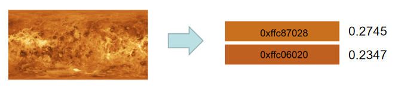

# @ohos.effectKit (图像效果)(系统接口)

<!--Kit: ArkGraphics 2D-->
<!--Subsystem: Multimedia-->
<!--Owner: @hanamaru-->
<!--Designer: @chensiyi_CE-->
<!--Tester: @yhl0101-->
<!--Adviser: @ge-yafang-->

图像效果模块提供了处理图像的基础能力，包括亮度调节、模糊化、灰度调节和智能取色等，适用于图片编辑应用中添加滤镜效果、应用启动页背景图模糊处理、UI主题色自动提取、图片配色分析等场景。

本模块用于离线处理[image.PixelMap](../apis-image-kit/arkts-apis-image-PixelMap.md)以获得视觉效果，而uiEffect（UI效果服务）则实时接入渲染服务，针对屏幕帧缓存进行处理以获得动态视觉效果。

该模块提供以下图像效果相关的常用功能：

- [ColorPicker](#colorpicker)：智能取色器。
- [Filter](#filter)：效果类，用于添加指定效果到图像源。

> **说明：**
>
> - 本模块首批接口从API version 9开始支持。后续版本的新增接口，采用上角标单独标记接口的起始版本。
> - 页面仅包含本模块的系统接口，其他公开接口参见[ohos.effectKit (图像效果)](js-apis-effectKit.md)。

## 导入模块

```ts
import { effectKit } from '@kit.ArkGraphics2D';
```

## PictureComplexityDegree<sup>22+</sup>

图片内容复杂度的枚举。

**系统能力：** SystemCapability.Multimedia.Image.Core

**系统接口：** 此接口为系统接口。

| 名称                   | 值   | 说明                           |
| ---------------------- | ---- | ------------------------------ |
| UNKNOWN_COMPLEXITY_DEGREE_PICTURE | 0 | 默认值，图片内容复杂度未知。 |
| PURE_PICTURE    | 1    | 图片内容复杂度为纯净。 |
| MODERATE_COMPLEXITY_PICTURE    | 2    | 图片内容复杂度为一般。 |
| VERY_FLOWERY_PICTURE     | 3    | 图片内容复杂度为复杂。 |

## PictureShadeDegree<sup>22+</sup>

图片颜色深浅度的枚举。

**系统能力：** SystemCapability.Multimedia.Image.Core

**系统接口：** 此接口为系统接口。

| 名称                   | 值   | 说明                           |
| ---------------------- | ---- | ------------------------------ |
| UNKNOWN_SHADE_DEGREE_PICTURE     | 0    | 默认值，图片颜色深浅度未知。 |
| EXTREMELY_LIGHT_PICTURE    | 1    | 图片颜色深浅度为极浅。 |
| VERY_LIGHT_PICTURE    | 2    | 图片颜色深浅度为较浅。 |
| LIGHT_PICTURE     | 3    | 图片颜色深浅度为略浅。|
| MODERATE_SHADE_PICTURE     | 4    | 图片颜色深浅度为一般。|
| DARK_PICTURE     | 5    | 图片颜色深浅度为较深。|
| EXTREMELY_DARK_PICTURE     | 6    | 图片颜色深浅度为极深。|

## PictureLightDegree

图片颜色明亮度的枚举。

**起始版本：** 26.0.0

**模型约束：** 此接口仅可在Stage模型下使用。

**系统接口：** 此接口为系统接口。

**系统能力：** SystemCapability.Multimedia.Image.Core

**卡片能力：** 从API版本26.0.0开始，该接口支持在ArkTS卡片中使用。

| 名称                   | 值   | 说明                           |
| ---------------------- | ---- | ------------------------------ |
| UNKNOWN_LIGHT_COLOR_DEGREE_PICTURE | 0 | 未知明亮度的图片。 |
| EXTREMELY_LIGHT_COLOR_PICTURE | 1 | 极亮色图片。 |
| LIGHT_COLOR_PICTURE | 2 | 亮色图片。 |
| DARK_COLOR_PICTURE | 3 | 暗色图片。 |
| EXTREMELY_DARK_COLOR_PICTURE | 4 | 极暗色图片。 |
| FLOWERY_PICTURE | 5 | 花色图片。 |
| EXTREMELY_FLOWERY_PICTURE | 6 | 极花色图片。 |

## ColorPicker

取色类，用于从一张图像数据中获取它的主要颜色。在调用ColorPicker的方法前，需要先通过[createColorPicker](js-apis-effectKit.md#effectkitcreatecolorpicker)创建一个ColorPicker实例。

### getTopProportionColorsAndPercentage<sup>22+</sup>

getTopProportionColorsAndPercentage(colorCount: number): Map<Color | null, number | null>

同步返回图像占比靠前的颜色值及其对应比例，个数由`colorCount`指定。

**卡片能力：** 从API version 22开始，该接口支持在ArkTS卡片中使用。

**系统能力：** SystemCapability.Multimedia.Image.Core

**系统接口：** 此接口为系统接口。

**参数：**
| 参数名      | 类型   | 必填 | 说明              |
| ---------- | ------ | ---- | ------------------------------------------- |
| colorCount | number | 是   | 颜色值及对应比例的个数，向下取整。<br>**说明：** 在<!--RP1-->OpenHarmony 6.1<!--RP1End-->之前，取值范围为[1, 10]，取色个数大于10视为取前10个；从<!--RP1-->OpenHarmony 6.1<!--RP1End-->开始，取值范围为[1, 20]，取色个数大于20视为取前20个。   |

**返回值：**

| 类型                                     | 说明                                            |
| :--------------------------------------- | :---------------------------------------------- |
| Map<Color \| null, number \| null> | 图像占比前`colorCount`的颜色值及比例的Map，比例的取值范围为[0, 1]。<br>- 当实际读取的特征色个数小于`colorCount`时，字典大小为实际特征色个数。<br>- 取色失败或取色个数小于1返回`Map()`。 |

**错误码：**

以下错误码详细介绍请参考[通用错误码](../errorcode-universal.md)。

| 错误码ID | 错误信息 |
| ------- | -------------------------------- |
| 202  | Permission verification failed. A non-system application calls a system API. |

**示例：**

```js
import { image } from '@kit.ImageKit';
import { effectKit } from '@kit.ArkGraphics2D';

const color = new ArrayBuffer(96);
let opts: image.InitializationOptions = {
  editable: true,
  pixelFormat: 3,
  size: {
    height: 4,
    width: 6
  }
};
image.createPixelMap(color, opts).then((pixelMap) => {
  effectKit.createColorPicker(pixelMap, (error, colorPicker) => {
    if (error) {
      console.error('Failed to create color picker.');
    } else {
      console.info('Succeeded in creating color picker.');
      let colors: Map<effectKit.Color | null, number | null> = colorPicker.getTopProportionColorsAndPercentage(2);
      colors.forEach((value: number | null, key: effectKit.Color | null) => {
        console.info('get top proportion colors and percentages: color ' + key + ', percentage ' + value);
      })
    }
  });
});
```


### getShadeDegree<sup>22+</sup>

getShadeDegree(): PictureShadeDegree

获取图像颜色深浅度。当无法判别图像颜色深浅度时，返回默认值UNKNOWN_SHADE_DEGREE_PICTURE。

**卡片能力：** 从API version 22开始，该接口支持在ArkTS卡片中使用。

**系统能力：** SystemCapability.Multimedia.Image.Core

**系统接口：** 此接口为系统接口。

**返回值：**

| 类型                                     | 说明                                            |
| :--------------------------------------- | :---------------------------------------------- |
| [PictureShadeDegree](#pictureshadedegree22) | 图像颜色深浅度。 |

**错误码：**

以下错误码详细介绍请参考[通用错误码](../errorcode-universal.md)。

| 错误码ID | 错误信息 |
| ------- | -------------------------------- |
| 202  | Permission verification failed. A non-system application calls a system API. |

**示例：**

```js
import { image } from '@kit.ImageKit';
import { effectKit } from '@kit.ArkGraphics2D';

const color = new ArrayBuffer(96);
let opts: image.InitializationOptions = {
  editable: true,
  pixelFormat: 3,
  size: {
    height: 4,
    width: 6
  }
};
image.createPixelMap(color, opts).then((pixelMap) => {
  effectKit.createColorPicker(pixelMap, (error, colorPicker) => {
    if (error) {
      console.error('Failed to create color picker.');
    } else {
      console.info('Succeeded in creating color picker.');
      let shadeDegree: effectKit.PictureShadeDegree = colorPicker.getShadeDegree();
      console.info('The shade degree of the image is ' + shadeDegree);
    }
  });
});
```

### getComplexityDegree<sup>22+</sup>

getComplexityDegree(): PictureComplexityDegree

获取图像内容复杂度。当无法判别图像内容复杂度时，返回默认值UNKNOWN_COMPLEXITY_DEGREE_PICTURE。

**卡片能力：** 从API version 22开始，该接口支持在ArkTS卡片中使用。

**系统能力：** SystemCapability.Multimedia.Image.Core

**系统接口：** 此接口为系统接口。

**返回值：**

| 类型                                     | 说明                                            |
| :--------------------------------------- | :---------------------------------------------- |
| [PictureComplexityDegree](#picturecomplexitydegree22) | 图像内容复杂度。 |

**错误码：**

以下错误码详细介绍请参考[通用错误码](../errorcode-universal.md)。

| 错误码ID | 错误信息 |
| ------- | -------------------------------- |
| 202  | Permission verification failed. A non-system application calls a system API. |

**示例：**

```js
import { image } from '@kit.ImageKit';
import { effectKit } from '@kit.ArkGraphics2D';

const color = new ArrayBuffer(96);
let opts: image.InitializationOptions = {
  editable: true,
  pixelFormat: 3,
  size: {
    height: 4,
    width: 6
  }
};
image.createPixelMap(color, opts).then((pixelMap) => {
  effectKit.createColorPicker(pixelMap, (error, colorPicker) => {
    if (error) {
      console.error('Failed to create color picker.');
    } else {
      console.info('Succeeded in creating color picker.');
      let complexityDegree: effectKit.PictureComplexityDegree = colorPicker.getComplexityDegree();
      console.info('The complexity degree of the image is ' + complexityDegree);
    }
  });
});
```

### getAlphaZeroTransparentProportion<sup>23+</sup>

getAlphaZeroTransparentProportion(): number

获取图像中完全透明的像素占比。

**卡片能力：** 从API version 23开始，该接口支持在ArkTS卡片中使用。

**系统能力：** SystemCapability.Multimedia.Image.Core

**系统接口：** 此接口为系统接口。

**返回值：**

| 类型                                     | 说明                                            |
| :--------------------------------------- | :---------------------------------------------- |
| number | 完全透明的像素占比，比例的取值范围为[0, 1]。 |

**错误码：**

以下错误码详细介绍请参考[通用错误码](../errorcode-universal.md)。

| 错误码ID | 错误信息 |
| ------- | -------------------------------- |
| 202  | Permission verification failed. A non-system application calls a system API. |

**示例：**

```js
import { image } from '@kit.ImageKit';
import { effectKit } from '@kit.ArkGraphics2D';

const color = new ArrayBuffer(96);
let opts: image.InitializationOptions = {
  editable: true,
  pixelFormat: 3,
  size: {
    height: 4,
    width: 6
  }
};
image.createPixelMap(color, opts).then((pixelMap) => {
  effectKit.createColorPicker(pixelMap, (error, colorPicker) => {
    if (error) {
      console.error('Failed to create color picker.');
    } else {
      console.info('Succeeded in creating color picker.');
      let percentage: number = colorPicker.getAlphaZeroTransparentProportion();
      console.info('Get proportion of fully transparent pixels: ' + percentage);
    }
  });
});
```

### getMorandiShadowColor

getMorandiShadowColor(): Color

从图像的主色中获取莫兰迪阴影色，并将结果写入[Color](js-apis-effectKit.md#color)。该接口通过特定的颜色转换算法，将主色调转换为具有莫兰迪风格的阴影色调。

**起始版本：** 26.0.0

**模型约束：** 此接口仅可在Stage模型下使用。

**系统接口：** 此接口为系统接口。

**系统能力：** SystemCapability.Multimedia.Image.Core

**卡片能力：** 从API版本26.0.0开始，该接口支持在ArkTS卡片中使用。

**返回值：**

| 类型     | 说明                                  |
| :------- | :----------------------------------- |
| [Color](js-apis-effectKit.md#color)   | Color实例，即图像莫兰迪阴影色对应的颜色值。当图像处理失败或无法获取莫兰迪阴影色时返回null。 |

**示例：**

```ts
import { image } from '@kit.ImageKit';
import { effectKit } from '@kit.ArkGraphics2D';

const color = new ArrayBuffer(96);
let opts: image.InitializationOptions = {
  editable: true,
  pixelFormat: 3,
  size: {
    height: 4,
    width: 6
  }
};
image.createPixelMap(color, opts).then((pixelMap) => {
  effectKit.createColorPicker(pixelMap, (error, colorPicker) => {
    if (error) {
      console.error('Failed to create color picker.');
    } else {
      console.info('Succeeded in creating color picker.');
      let morandiColor = colorPicker.getMorandiShadowColor();
      console.info('get Morandi shadow color =' + morandiColor);
    }
  });
});
```

### getDeepenImmersionColor

getDeepenImmersionColor(): Color

生成与背景色融合且比背景色更深的强沉浸感颜色，并将结果写入[Color](js-apis-effectKit.md#color)里。该接口通过颜色混合算法，创建一种既与背景色协调又具有更强沉浸感的颜色效果。

**起始版本：** 26.0.0

**模型约束：** 此接口仅可在Stage模型下使用。

**系统接口：** 此接口为系统接口。

**系统能力：** SystemCapability.Multimedia.Image.Core

**卡片能力：** 从API版本26.0.0开始，该接口支持在ArkTS卡片中使用。

**返回值：**

| 类型     | 说明                                  |
| :------- | :----------------------------------- |
| [Color](js-apis-effectKit.md#color)    | Color实例，即图像强沉浸色对应的颜色值。当图像处理失败或无法生成沉浸色时返回null。 |

**示例：**

```ts
import { image } from '@kit.ImageKit';
import { effectKit } from '@kit.ArkGraphics2D';

const color = new ArrayBuffer(96);
let opts: image.InitializationOptions = {
  editable: true,
  pixelFormat: 3,
  size: {
    height: 4,
    width: 6
  }
};
image.createPixelMap(color, opts).then((pixelMap) => {
  effectKit.createColorPicker(pixelMap, (error, colorPicker) => {
    if (error) {
      console.error('Failed to create color picker.');
    } else {
      console.info('Succeeded in creating color picker.');
      let deepenImmersionColor = colorPicker.getDeepenImmersionColor();
      console.info('get deepen immersion color =' + deepenImmersionColor);
    }
  });
});
```

### getImmersiveBackgroundColor

getImmersiveBackgroundColor(): Color

生成能够创造沉浸式视觉效果的沉浸式背景色，并将结果写入[Color](js-apis-effectKit.md#color)里。该接口基于主色生成适合作为沉浸式背景的颜色值。

**起始版本：** 26.0.0

**模型约束：** 此接口仅可在Stage模型下使用。

**系统接口：** 此接口为系统接口。

**系统能力：** SystemCapability.Multimedia.Image.Core

**卡片能力：** 从API版本26.0.0开始，该接口支持在ArkTS卡片中使用。

**返回值：**

| 类型     | 说明                                  |
| :------- | :----------------------------------- |
| [Color](js-apis-effectKit.md#color)    | Color实例，即图像沉浸式背景色对应的颜色值。当图像处理失败或无法生成沉浸式背景色时返回null。 |

**示例：**

```ts
import { image } from '@kit.ImageKit';
import { effectKit } from '@kit.ArkGraphics2D';

const color = new ArrayBuffer(96);
let opts: image.InitializationOptions = {
  editable: true,
  pixelFormat: 3,
  size: {
    height: 4,
    width: 6
  }
};
image.createPixelMap(color, opts).then((pixelMap) => {
  effectKit.createColorPicker(pixelMap, (error, colorPicker) => {
    if (error) {
      console.error('Failed to create color picker.');
    } else {
      console.info('Succeeded in creating color picker.');
      let immersiveBackgroundColor = colorPicker.getImmersiveBackgroundColor();
      console.info('get immersive background color =' + immersiveBackgroundColor);
    }
  })
});
```

### getImmersiveForegroundColor

getImmersiveForegroundColor(): Color

生成能够创造沉浸式视觉效果的沉浸式前景色，并将结果写入[Color](js-apis-effectKit.md#color)里。该接口基于主色生成适合作为沉浸式前景的颜色值。

**起始版本：** 26.0.0

**模型约束：** 此接口仅可在Stage模型下使用。

**系统接口：** 此接口为系统接口。

**系统能力：** SystemCapability.Multimedia.Image.Core

**卡片能力：** 从API版本26.0.0开始，该接口支持在ArkTS卡片中使用。

**返回值：**

| 类型     | 说明                                  |
| :------- | :----------------------------------- |
| [Color](js-apis-effectKit.md#color)    | Color实例，即图像沉浸式前景色对应的颜色值。当图像处理失败或无法生成沉浸式前景色时返回null。 |

**示例：**

```ts
import { image } from '@kit.ImageKit';
import { effectKit } from '@kit.ArkGraphics2D';

const color = new ArrayBuffer(96);
let opts: image.InitializationOptions = {
  editable: true,
  pixelFormat: 3,
  size: {
    height: 4,
    width: 6
  }
};
image.createPixelMap(color, opts).then((pixelMap) => {
  effectKit.createColorPicker(pixelMap, (error, colorPicker) => {
    if (error) {
      console.error('Failed to create color picker.');
    } else {
      console.info('Succeeded in creating color picker.');
      let immersiveForegroundColor = colorPicker.getImmersiveForegroundColor();
      console.info('get immersive foreground color =' + immersiveForegroundColor);
    }
  });
});
```

### discriminatePictureLightDegree

discriminatePictureLightDegree(): PictureLightDegree

获取图片的明亮程度。当无法判别图片明亮程度时，返回UNKNOWN_LIGHT_COLOR_DEGREE_PICTURE。

**起始版本：** 26.0.0

**模型约束：** 此接口仅可在Stage模型下使用。

**系统接口：** 此接口为系统接口。

**系统能力：** SystemCapability.Multimedia.Image.Core

**卡片能力：** 从API版本26.0.0开始，该接口支持在ArkTS卡片中使用。

**返回值：**

| 类型                                     | 说明                                            |
| :--------------------------------------- | :---------------------------------------------- |
| [PictureLightDegree](#picturelightdegree) | 图像颜色明亮程度。 |

**示例：**

```js
import { image } from '@kit.ImageKit';
import { effectKit } from '@kit.ArkGraphics2D';

const color = new ArrayBuffer(96);
let opts: image.InitializationOptions = {
  editable: true,
  pixelFormat: 3,
  size: {
    height: 4,
    width: 6
  }
};
image.createPixelMap(color, opts).then((pixelMap) => {
  effectKit.createColorPicker(pixelMap, (error, colorPicker) => {
    if (error) {
      console.error('Failed to create color picker.');
    } else {
      console.info('Succeeded in creating color picker.');
      let pictureLightDegree: effectKit.PictureLightDegree = colorPicker.discriminatePictureLightDegree();
      console.info('The color light degree of the image is ' + pictureLightDegree);
    }
  });
});
```

### getReverseColor

getReverseColor(): Color

基于图像亮度判别结果生成反向颜色，并将结果写入[Color](js-apis-effectKit.md#color)里。根据[discriminatePictureLightDegree](#discriminatepicturelightdegree)接口获取的图片明亮类型得到一个反色，仅极亮色图片（EXTREMELY_LIGHT_COLOR_PICTURE）类型返回黑色，其他类型返回白色。用于界面主题或对比度计算。

**起始版本：** 26.0.0

**模型约束：** 此接口仅可在Stage模型下使用。

**系统接口：** 此接口为系统接口。

**系统能力：** SystemCapability.Multimedia.Image.Core

**卡片能力：** 从API版本26.0.0开始，该接口支持在ArkTS卡片中使用。

**返回值：**

| 类型     | 说明                                  |
| :------- | :----------------------------------- |
| [Color](js-apis-effectKit.md#color)    | Color实例，即图像反向颜色对应的颜色值。当图像处理失败或无法生成反向颜色时返回null。 |

**示例：**

```ts
import { image } from '@kit.ImageKit';
import { effectKit } from '@kit.ArkGraphics2D';

const color = new ArrayBuffer(96);
let opts: image.InitializationOptions = {
  editable: true,
  pixelFormat: 3,
  size: {
    height: 4,
    width: 6
  }
};
image.createPixelMap(color, opts).then((pixelMap) => {
  effectKit.createColorPicker(pixelMap, (error, colorPicker) => {
    if (error) {
      console.error('Failed to create color picker.');
    } else {
      console.info('Succeeded in creating color picker.');
      let reverseColor = colorPicker.getReverseColor();
      console.info('get reverse color =' + reverseColor);
    }
  });
});
```

## Filter

图像效果类用于将指定效果添加到输入图像。调用Filter方法前，需先通过[createEffect](js-apis-effectKit.md#effectkitcreateeffect)创建Filter实例。


### ellipticalGradientBlur<sup>23+</sup>

ellipticalGradientBlur(blurRadius: number, center: EllipticalMaskCenter, maskRadius: EllipticalMaskRadius, fractionStops: FractionStop[]): Filter

将带有椭圆形遮罩的渐变模糊效果添加到效果链表中，返回链表的头节点。

> **说明：**
>
> 该接口为静态图像处理接口，为静态图像提供含有椭圆形遮罩的渐变模糊化效果。

**系统能力：** SystemCapability.Multimedia.Image.Core

**系统接口：** 此接口为系统接口。

**模型约束：** 此接口仅可在Stage模型下使用。

**参数：**

| 参数名 | 类型        | 必填 | 说明                                                         |
| ------ | ----------- | ---- | ------------------------------------------------------------ |
|  blurRadius   | number | 是   | 模糊半径，取正整数，单位为px，模糊半径大于60px时自动截断，小于等于0px时无效果。模糊效果与所设置的模糊半径值成正比，值越大效果越明显。 |
|  center   | [EllipticalMaskCenter](#ellipticalmaskcenter23) | 是 | 椭圆形遮罩的中心点坐标。 |
|  maskRadius   | [EllipticalMaskRadius](#ellipticalmaskradius23) | 是 | 椭圆形遮罩在X轴和Y轴方向的半径。 |
|  fractionStops   | [FractionStop](../apis-arkui/arkui-ts/ts-universal-attributes-image-effect.md#fractionstop12)[] | 是 | 渐变模糊位置与程度数组。数组元素为二元数组，第一个元素表示位置，第二个元素表示模糊程度。位置取值范围为[0, 1]，椭圆中心对应位置0，椭圆边界对应位置1。模糊程度取值范围为[0, 1]，0表示无模糊，大于1的值自动转为1。位置参数值需严格递增，数组长度不能小于2，最大为12。 |

**返回值：**

| 类型           | 说明                                            |
| :------------- | :---------------------------------------------- |
| [Filter](#filter) | 返回已添加的图像效果。 |

**错误码：**

以下错误码详细介绍请参考[通用错误码](../errorcode-universal.md)。

| 错误码ID | 错误信息 |
| ------- | -------------------------------- |
| 202  | Permission verification failed. A non-system application calls a system API. |

**示例：**

``` ts
import { image } from '@kit.ImageKit';
import { effectKit } from '@kit.ArkGraphics2D';
import { common } from '@kit.AbilityKit';
import { BusinessError } from '@kit.BasicServicesKit';
// 传入读取的图片数据
function ImageEllipticalGradientBlur(imageBuffer: ArrayBuffer): Promise<image.PixelMap> {
  return new Promise((resolve, reject) => {
    let imageSource = image.createImageSource(imageBuffer);
    let blurRadius:number = 25;
    let fractionStops:FractionStop[] = [[0, 0.2], [0.5, 0.7]];
    let maskRadius:effectKit.EllipticalMaskRadius = [1, 1];
    let center:effectKit.EllipticalMaskCenter = [0.5, 0.5];
    imageSource.createPixelMap().then((pixelMap: image.PixelMap) => {
      // 图像源使用完毕后及时释放
      imageSource.release();
      let headFilter = effectKit.createEffect(pixelMap);
      if (headFilter != null) {
        // 对图片添加效果标识
        headFilter.ellipticalGradientBlur(blurRadius, center, maskRadius, fractionStops);
        // 按照添加的效果标识对图片进行处理并且返回处理好的图片数据
        headFilter.getEffectPixelMap(false).then(imageData => {
          resolve(imageData);
        }).catch((err: BusinessError) => {
          reject(err);
        });
      } else {
        // 创建Filter实例失败，通过reject将错误传递给调用方
        reject(new Error('Failed to create filter.'));
      }
    }).catch((err: BusinessError) => {
      reject(err);
    }).finally(() => {
      imageSource.release();
    });
  });
}

@Entry
@Component
struct Index {
  @State imagePixelMap: image.PixelMap | null = null;
  private imageBuffer: ArrayBuffer | undefined = undefined;
  // 读取rawfile文件夹下的图片文件，也可根据需求更换读取方式，保证最终得到的是ArrayBuffer格式的图片数据即可
  async getFileBuffer(): Promise<ArrayBuffer | undefined> {
    try {
      const context: Context = this.getUIContext().getHostContext() as common.UIAbilityContext;
      const fileData: Uint8Array = await context.resourceManager.getRawFileContent('image.png');
      const buffer: ArrayBuffer = fileData.buffer.slice(0);
      return buffer;
    } catch (err) {
      return undefined;
    }
  }

  async aboutToAppear(): Promise<void> {
    this.imageBuffer = await this.getFileBuffer();
    if (this.imageBuffer == undefined) {
      return;
    }
    // 图片处理为异步操作，可以依据是否需要拿到处理好的图片数据再进行下一步逻辑，按需添加await进行同步
    this.imagePixelMap = await ImageEllipticalGradientBlur(this.imageBuffer);
  }

  build() {
    Column() {
      Image(this.imagePixelMap)
        .width(304)
        .height(305)
    }
    .height('100%')
    .width('100%')
  }
}
```

### halftone

halftone(halftoneParam: HalftoneParam, outlineWidth?: number, shadowOptions?: ShadowOptions): Filter

将网点效果、描边和阴影效果添加到效果链表中，并返回链表头节点。该效果将原图划分为规则网格，根据各网格中心的采样颜色及其亮度生成网点。每个网格以白色为背景，网点由黑色内圈和彩色圆环组成。

> **说明：** 
> 
> 输入图像应为仅包含单个主体、轮廓清晰的抠图图像，主体部分完全不透明，背景区域完全透明，不符合该标准的输入图像可能产生异常效果。
>
> 输入PixelMap的像素格式应为RGBA_8888、BGRA_8888、RGBA_F16或RGBA_1010102，不符合该标准的像素格式会导致输出异常。

**起始版本：** 26.1.0

**模型约束：** 此接口仅可在Stage模型下使用。

**系统接口：** 此接口为系统接口。

**系统能力：** SystemCapability.Multimedia.Image.Core

**参数：**

| 参数名 | 类型 | 必填 | 说明 |
| --- | --- | --- | --- |
| halftoneParam | [HalftoneParam](#halftoneparam) | 是 | 网点的配置参数。 |
| outlineWidth | number | 否 | 可选参数，描边宽度，单位为px。主体向外扩展出宽度为outlineWidth的白色边缘，超过作用的图像范围时自动截断。取值范围为[0, +∞)，超出取值范围时按边界值截断。默认值为0.0。 |
| shadowOptions | [ShadowOptions](#shadowoptions) | 否 | 可选参数，阴影的配置参数，不传时使用默认阴影配置。 |

**返回值：**

| 类型 | 说明 |
| --- | --- |
| [Filter](#filter) | 返回已添加效果的Filter实例，用于继续添加效果或获取处理后的图像。 |

**示例：**

``` ts
import { image } from '@kit.ImageKit';
import { effectKit } from '@kit.ArkGraphics2D';
import { common } from '@kit.AbilityKit';
import { BusinessError } from '@kit.BasicServicesKit';
// 传入读取的抠图图像数据，添加网点效果
function imageHalftone(imageBuffer: ArrayBuffer): Promise<image.PixelMap> {
  return new Promise((resolve, reject) => {
    let imageSource = image.createImageSource(imageBuffer);
    imageSource.createPixelMap().then((pixelMap: image.PixelMap) => {
      // 图像源使用完毕后及时释放
      imageSource.release();
      // 配置网点参数
      let halftoneParam: effectKit.HalftoneParam = {
        gridSize: 8,
        maxRadiusRatio: 1,
        lumCoeff: 0,
        colorWidthRatio: 0.5,
        saturation: 1,
        smoothness: 0.1,
        angle: -0.2
      };
      // 设置描边宽度
      let outlineWidth = 9;
      // 配置阴影参数
      let shadowOptions: effectKit.ShadowOptions = {
        radius: 16,
        lightDirection: [0, 1],
        shadowDistance: 9,
        color: [0, 0, 0, 26]
      };
      // 创建Filter实例
      let headFilter = effectKit.createEffect(pixelMap);
      if (headFilter != null) {
        // 对图片添加网点效果，同时配置描边宽度和阴影
        headFilter.halftone(halftoneParam, outlineWidth, shadowOptions);
        // 按照添加的效果标识对图片进行处理并且返回处理好的图片数据
        headFilter.getEffectPixelMap(false).then(imageData => {
          resolve(imageData);
        }).catch((err: BusinessError) => {
          reject(err);
        });
      } else {
        // 创建Filter实例失败，通过reject将错误传递给调用方
        reject(new Error('Failed to create filter.'));
      }
    }).catch((err: BusinessError) => {
      reject(err);
    }).finally(() => {
      imageSource.release();
    });
  });
}

@Entry
@Component
struct Index {
  @State imagePixelMap: image.PixelMap | null = null;
  private imageBuffer: ArrayBuffer | undefined = undefined;
  // 读取rawfile文件夹下的抠图图像文件，也可根据需求更换读取方式，保证最终得到的是ArrayBuffer格式的图片数据即可
  async getFileBuffer(): Promise<ArrayBuffer | undefined> {
    try {
      const context: Context = this.getUIContext().getHostContext() as common.UIAbilityContext;
      const fileData: Uint8Array = await context.resourceManager.getRawFileContent('picture.png');
      const buffer: ArrayBuffer = fileData.buffer.slice(0);
      return buffer;
    } catch (err) {
      return undefined;
    }
  }

  async aboutToAppear(): Promise<void> {
    this.imageBuffer = await this.getFileBuffer();
    if (this.imageBuffer == undefined) {
      return;
    }
    // 图片处理为异步操作，可以依据是否需要拿到处理好的图片数据再进行下一步逻辑，按需添加await进行同步
    this.imagePixelMap = await imageHalftone(this.imageBuffer);
  }

  build() {
    Column() {
      Image(this.imagePixelMap)
        .width(304)
        .height(305)
    }
    .height('100%')
    .width('100%')
  }
}
```

### outline

outline(outlineWidth: number, shadowOptions?: ShadowOptions): Filter

将描边和阴影效果添加到效果链表中，并返回链表的头节点。该效果提取图像中非透明区域的轮廓生成描边，并根据阴影配置生成投影。

> **说明：** 
> 
> 输入图像应为仅包含单个主体、轮廓清晰的抠图图像，主体部分完全不透明，背景区域完全透明，不符合该标准的输入图像可能产生异常效果。
>
> 输入PixelMap的像素格式应为RGBA_8888、BGRA_8888、RGBA_F16或RGBA_1010102，不符合该标准的像素格式会导致输出异常。

**起始版本：** 26.1.0

**模型约束：** 此接口仅可在Stage模型下使用。

**系统接口：** 此接口为系统接口。

**系统能力：** SystemCapability.Multimedia.Image.Core

**参数：**

| 参数名 | 类型 | 必填 | 说明 |
| --- | --- | --- | --- |
| outlineWidth | number | 是 | 描边宽度，单位为px。主体向外扩展出宽度为outlineWidth的白色边缘，超过作用的图像范围时自动截断。取值范围为[0, +∞)，超出取值范围时按边界值截断。 |
| shadowOptions | [ShadowOptions](#shadowoptions) | 否 | 可选参数，阴影的配置参数，不传时使用默认阴影配置。 |

**返回值：**

| 类型 | 说明 |
| --- | --- |
| [Filter](#filter) | 返回已添加效果的Filter实例，用于继续添加效果或获取处理后的图像。 |

**示例：**

``` ts
import { image } from '@kit.ImageKit';
import { effectKit } from '@kit.ArkGraphics2D';
import { common } from '@kit.AbilityKit';
import { BusinessError } from '@kit.BasicServicesKit';
// 传入读取的抠图图像数据，添加描边和阴影效果
function imageOutline(imageBuffer: ArrayBuffer): Promise<image.PixelMap> {
  return new Promise((resolve, reject) => {
    let imageSource = image.createImageSource(imageBuffer);
    imageSource.createPixelMap().then((pixelMap: image.PixelMap) => {
      // 图像源使用完毕后及时释放
      imageSource.release();
      // 设置描边宽度
      let outlineWidth = 9;
      // 配置阴影参数
      let shadowOptions: effectKit.ShadowOptions = {
        radius: 16,
        lightDirection: [0, 1],
        shadowDistance: 9,
        color: [0, 0, 0, 26]
      };
      // 创建Filter实例
      let headFilter = effectKit.createEffect(pixelMap);
      if (headFilter != null) {
        // 对图片添加描边和阴影效果
        headFilter.outline(outlineWidth, shadowOptions);
        // 按照添加的效果标识对图片进行处理并且返回处理好的图片数据
        headFilter.getEffectPixelMap(false).then(imageData => {
          resolve(imageData);
        }).catch((err: BusinessError) => {
          reject(err);
        });
      } else {
        // 创建Filter实例失败，通过reject将错误传递给调用方
        reject(new Error('Failed to create filter.'));
      }
    }).catch((err: BusinessError) => {
      reject(err);
    }).finally(() => {
      imageSource.release();
    });
  });
}

@Entry
@Component
struct Index {
  @State imagePixelMap: image.PixelMap | null = null;
  private imageBuffer: ArrayBuffer | undefined = undefined;
  // 读取rawfile文件夹下的抠图图像文件，也可根据需求更换读取方式，保证最终得到的是ArrayBuffer格式的图片数据即可
  async getFileBuffer(): Promise<ArrayBuffer | undefined> {
    try {
      const context: Context = this.getUIContext().getHostContext() as common.UIAbilityContext;
      const fileData: Uint8Array = await context.resourceManager.getRawFileContent('picture.png');
      const buffer: ArrayBuffer = fileData.buffer.slice(0);
      return buffer;
    } catch (err) {
      return undefined;
    }
  }

  async aboutToAppear(): Promise<void> {
    this.imageBuffer = await this.getFileBuffer();
    if (this.imageBuffer == undefined) {
      return;
    }
    // 图片处理为异步操作，可以依据是否需要拿到处理好的图片数据再进行下一步逻辑，按需添加await进行同步
    this.imagePixelMap = await imageOutline(this.imageBuffer);
  }

  build() {
    Column() {
      Image(this.imagePixelMap)
        .width(304)
        .height(305)
    }
    .height('100%')
    .width('100%')
  }
}
```

## EllipticalMaskRadius<sup>23+</sup>

type EllipticalMaskRadius = [ number, number ]

定义椭圆形遮罩的半径，取值为相对于组件宽和高的比例值。

**系统能力：** SystemCapability.Multimedia.Image.Core

**系统接口：** 此接口为系统接口。

**模型约束：** 此接口仅可在Stage模型下使用。

| 类型           | 说明                                            |
| :------------- | :---------------------------------------------- |
| [ number, number ] | 椭圆形遮罩在X轴和Y轴方向上的半径，单位分别为相对于组件宽和高的比例，取值均需大于0。<br>例如：[0.5, 1]表示遮罩的X轴半径等于组件宽的一半，Y轴半径等于组件高。|

## EllipticalMaskCenter<sup>23+</sup>
type EllipticalMaskCenter = [ number, number ]

定义椭圆形遮罩的中心点。

**系统能力：** SystemCapability.Multimedia.Image.Core

**系统接口：** 此接口为系统接口。

**模型约束：** 此接口仅可在Stage模型下使用。

| 类型           | 说明                                            |
| :------------- | :---------------------------------------------- |
| [ number, number ] | 椭圆形遮罩的中心点坐标。<br>第一个值表示X轴坐标，取值为正表示在原点右方，取值为负表示在原点左方。<br>第二个值表示Y轴坐标，取值为正表示在原点下方，取值为负表示在原点上方。<br>原点坐标为[0,0]，对应为组件的左上角，[1, 1]对应为组件的右下角。|

## HalftoneParam

网点的配置参数。

**起始版本：** 26.1.0

**模型约束：** 此接口仅可在Stage模型下使用。

**系统接口：** 此接口为系统接口。

**系统能力：** SystemCapability.Multimedia.Image.Core

| 名称 | 类型 | 只读 | 可选 | 说明 |
| --- | --- | --- | --- | --- |
| gridSize | number | 否 | 否 | 网格单元边长，即相邻网点的中心间距，单位为px。取值范围为[3, +∞)，超出取值范围时按边界值截断。值越大，网点整体尺寸越大，排列越稀疏。 |
| maxRadiusRatio | number | 否 | 是 | 可选参数，外圆直径上限与网格边长的比值。取值范围为[0, 1]，默认值为1，超出取值范围时按边界值截断。外圆直径会被maxRadiusRatio * gridSize截断。值为1时，允许的外圆最大直径等于网格边长。 |
| lumCoeff | number | 否 | 是 | 可选参数，亮度对外圆半径的影响系数，取值范围为[0, +∞)，默认值为0，超出取值范围时按边界值截断。实际外圆半径为clamp(1 - lum * lumCoeff, 0, maxRadiusRatio) * gridSize / 2，其中lum为网格中心采样颜色的亮度，该值为采样所得，不需要设置。其他参数不变时，lumCoeff越大，亮度对外圆半径的缩小作用越强。 |
| colorWidthRatio | number | 否 | 是 | 可选参数，彩色圆环宽度系数，取值范围为[0, 1]，默认值为0.5，超出取值范围时按边界值截断。设定宽度为colorWidthRatio * gridSize / 2。黑色内圆半径为实际外圆半径减去该宽度，结果小于0时按0处理。值为0时无彩色圆环；设定宽度大于或等于外圆半径时，效果等同于外圆半径内全部为彩色区域。 |
| saturation | number | 否 | 是 | 可选参数，彩色区域的饱和度插值系数，用于在采样颜色对应的灰度颜色与采样颜色之间进行插值。取值范围为[0, 1]，默认值为1，超出取值范围时按边界值截断。值为0时使用灰度颜色，值为1时保留采样颜色。 |
| smoothness | number | 否 | 是 | 可选参数，边缘过渡带半宽与gridSize的比值，取值范围为[0, +∞)，默认值为0，超出取值范围时按边界值截断。分别以内圆和外圆的边界为中心，向两侧各延伸smoothness * gridSize，形成总宽度为2 * smoothness * gridSize的过渡带，先处理内圆边缘，再处理外圆边缘。值为0时无过渡带，边缘无平滑过渡，值越大，过渡带越宽，边缘越柔和。 |
| angle | number | 否 | 是 | 可选参数，网格坐标的旋转角度，以逆时针为正方向，单位为rad（弧度），用于调整网点排列方向。取值范围为(-∞, +∞)，默认值为0。值为0时网格不旋转，网点排列方向为水平向右。 |

## ShadowOptions

阴影的配置参数。

> **说明：** 
> 
> 超出图像范围的阴影会被截断。

**起始版本：** 26.1.0

**模型约束：** 此接口仅可在Stage模型下使用。

**系统接口：** 此接口为系统接口。

**系统能力：** SystemCapability.Multimedia.Image.Core

| 名称 | 类型 | 只读 | 可选 | 说明 |
| --- | --- | --- | --- | --- |
| radius | number | 否 | 是 | 可选参数，阴影模糊半径，单位为px，取值范围为[0, +∞)，默认值为0，超出取值范围时按边界值截断。值为0时无阴影效果，值越大阴影边缘越柔和。 |
| lightDirection | [common2D.Point](js-apis-graphics-common2D.md#point12) | 否 | 是 | 可选参数，光照方向向量，默认值为(0, 0)，取值范围为(-∞, +∞)。X轴向右为正，Y轴向下为正。光照方向向量表示阴影偏移的方向。当向量为(0, 0)时，shadowDistance取任何值，阴影均不发生偏移。 |
| shadowDistance | number | 否 | 是 | 可选参数，阴影偏移距离，单位为px，取值范围为[0, +∞)，默认值为0，超出取值范围时按边界值截断。该参数决定阴影偏移距离，与lightDirection共同确定阴影覆盖区域，当值为0时，lightDirection为任意方向时，阴影均不发生偏移。 |
| color | [common2D.Color](js-apis-graphics-common2D.md#color) | 否 | 是 | 可选参数，阴影颜色，默认值为黑色{red:0, green:0, blue:0, alpha:26}。可通过Alpha通道设置阴影透明度。 |