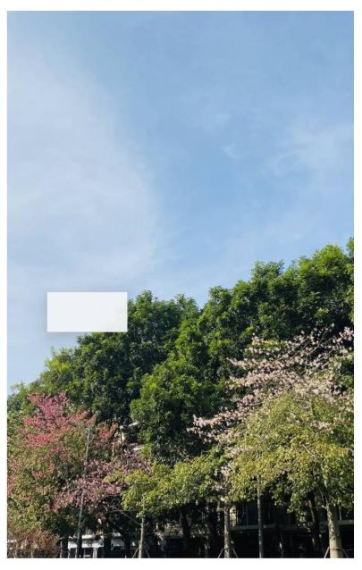

# @ohos.arkui.uiMaterial (系统材质)(系统接口)
<!--Kit: ArkUI-->
<!--Subsystem: ArkUI-->
<!--Owner: @hehongyang3-->
<!--Designer: @zhanghaibo0-->
<!--Tester: @lxl007-->
<!--Adviser: @Brilliantry_Rui-->

本模块提供系统材质的接口定义。不同的系统材质对应不同的UI效果，包括背景色[backgroundColor](arkui-ts/ts-universal-attributes-background.md#backgroundcolor)、边框颜色[borderColor](arkui-ts/ts-universal-attributes-border.md#bordercolor)、边框宽度[borderWidth](arkui-ts/ts-universal-attributes-border.md#borderwidth)、阴影[shadow](arkui-ts/ts-universal-attributes-image-effect.md#shadow)效果。

> **说明：**
>
> - 本模块首批接口从API version 23开始支持。后续版本的新增接口，采用上角标单独标记接口的起始版本。
>
> - 当前页面仅包含本模块的系统接口，公开接口参见[系统材质](arkts-apis-uimaterial.md)。

## 导入模块

``` ts
import { uiMaterial } from '@kit.ArkUI';
```

## MaterialType

系统材质类型枚举，当前页面仅包含本模块的系统接口，其他公开类型参见[MaterialType](arkts-apis-uimaterial.md#materialtype)。

**模型约束：** 此接口仅可在Stage模型下使用。

**系统能力：** SystemCapability.ArkUI.ArkUI.Full

| 名称     | 值 | 说明              |
| ------ | --- | --------------- |
| NONE | 0 | 无系统材质效果。对应的效果为背景色[backgroundColor](arkui-ts/ts-universal-attributes-background.md#backgroundcolor)为透明色，边框颜色[borderColor](arkui-ts/ts-universal-attributes-border.md#bordercolor)为透明色，边框宽度[borderWidth](arkui-ts/ts-universal-attributes-border.md#borderwidth)为0，无阴影[shadow](arkui-ts/ts-universal-attributes-image-effect.md#shadow)。<br>**卡片能力：** 从API version 23开始，该接口支持在ArkTS卡片中使用。<br>**系统接口：** 此接口为系统接口。|
| SEMI_TRANSPARENT | 1 | 半透明系统材质效果。对应的效果为：<br>背景色[backgroundColor](arkui-ts/ts-universal-attributes-background.md#backgroundcolor)：浅色模式为"#f2f1f3f5"，深色模式为"#f2303131"。<br>边框颜色[borderColor](arkui-ts/ts-universal-attributes-border.md#bordercolor)为theme.colors.compForegroundPrimary的[token](../../ui/theme-skinning.md#系统缺省token色值)值以10%透明度（alpha值）进行混合叠加。<br>边框宽度[borderWidth](arkui-ts/ts-universal-attributes-border.md#borderwidth)为1vp。<br>阴影[shadow](arkui-ts/ts-universal-attributes-image-effect.md#shadow)为ShadowStyle.OUTER_DEFAULT_SM。<br>**卡片能力：** 从API version 23开始，该接口支持在ArkTS卡片中使用。<br>**系统接口：** 此接口为系统接口。|

## ImmersiveStyle

材质样式枚举。以EC为后缀的部分枚举设置在[EffectComponent](arkui-ts/ts-container-effectcomponent-sys.md)上，以EC_SUB为后缀的部分枚举设置在EffectComponent的子组件上，两者配合实现材质效果绘制的合并优化。若未按照上述对应关系设置，材质效果可能无法正确生效或无法实现合并优化效果。设置在EffectComponent上的材质模糊最终将生效在子组件上。不同的材质样式对应不同的材质参数，主要包括材质的模糊程度、高光效果等，具体参见[ImmersiveStyle](arkts-apis-uimaterial.md#immersivestyle)。

**起始版本：** 26.0.0

**模型约束：** 此接口仅可在Stage模型下使用。

**原子化服务API：** 从API版本26.0.0开始，该接口支持在原子化服务中使用。

**系统能力：** SystemCapability.ArkUI.ArkUI.Full

**系统接口：** 此接口为系统接口。

| 名称     | 值 | 说明              |
| ------ | --- | --------------- |
| ULTRA_THIN_EC | 5 | 超薄样式。材质层超薄，具有很强的透明效果。<br>适用于[EffectComponent](arkui-ts/ts-container-effectcomponent-sys.md)。配合对应的ULTRA_THICK_EC_SUB后缀样式枚举一起使用，以实现材质效果绘制的合并优化。设置在EffectComponent上的材质模糊最终将生效在子组件上。 |
| THIN_EC | 6 | 薄样式。材质层薄，具有较强的透明效果。<br>适用于EffectComponent。配合对应的THIN_EC_SUB后缀样式枚举一起使用，以实现材质效果绘制的合并优化。 |
| REGULAR_EC | 7 | 常规样式。材质层厚度适中，具有适度的透明与模糊效果。<br>适用于EffectComponent。配合对应的REGULAR_EC_SUB后缀样式枚举一起使用，以实现材质效果绘制的合并优化。 |
| THICK_EC | 8 | 厚样式。模糊效果强。<br>适用于EffectComponent。配合对应的THICK_EC_SUB后缀样式枚举一起使用，以实现材质效果绘制的合并优化。 |
| ULTRA_THICK_EC | 9 | 超厚样式。模糊效果很强。<br>适用于EffectComponent。配合对应的ULTRA_THICK_EC_SUB后缀样式枚举一起使用，以实现材质效果绘制的合并优化。 |
| ULTRA_THIN_EC_SUB | 10 | 超薄样式。材质层超薄，具有很强的透明效果。<br>适用于EffectComponent的子组件。配合对应的ULTRA_THIN_EC样式枚举一起使用，以实现材质效果绘制的合并优化。 |
| THIN_EC_SUB | 11 | 薄样式。材质层薄，具有较强的透明效果。<br>适用于EffectComponent的子组件。配合对应的THIN_EC样式枚举一起使用，以实现材质效果绘制的合并优化。 |
| REGULAR_EC_SUB | 12 | 常规样式。材质层厚度适中，具有适度的透明与模糊效果。<br>适用于EffectComponent的子组件。配合对应的REGULAR_EC样式枚举一起使用，以实现材质效果绘制的合并优化。 |
| THICK_EC_SUB | 13 | 厚样式。模糊效果强。<br>适用于EffectComponent的子组件。配合对应的THICK_EC样式枚举一起使用，以实现材质效果绘制的合并优化。 |
| ULTRA_THICK_EC_SUB | 14 | 超厚样式。模糊效果很强。<br>适用于EffectComponent的子组件。配合对应的ULTRA_THICK_EC样式枚举一起使用，以实现材质效果绘制的合并优化。 |

## MaterialColorBlendMode

材质颜色混合模式枚举。用于指定材质颜色（[materialColor](arkts-apis-uimaterial.md#immersiveoptions)）与材质背景的混合方式。

**起始版本：** 26.1.0

**模型约束：** 此接口仅可在Stage模型下使用。

**系统能力：** SystemCapability.ArkUI.ArkUI.Full

**系统接口：** 此接口为系统接口。

| 名称     | 值 | 说明              |
| ------ | --- | --------------- |
| LINEAR_MIX | 0 | 普通混合模式。材质颜色与材质背景以线性方式混合。 |
| TINTED_GLASS | 1 | 彩色玻璃模式。材质颜色以彩色玻璃效果呈现，保持背景通透。 |

## ImmersiveOptions

沉浸式材质参数。当前页面仅包含本模块的系统接口，其他公开接口参见[ImmersiveOptions](arkts-apis-uimaterial.md#immersiveoptions)。

**起始版本：** 26.0.0

**模型约束：** 此接口仅可在Stage模型下使用。

**系统能力：** SystemCapability.ArkUI.ArkUI.Full

| 名称       | 类型                                                        | 只读 | 可选 | 说明                                                     |
| ---------- | ----------------------------------------------------------- | ---- | ------- | ----------------------------------------------------- |
| colorBlendMode   | [MaterialColorBlendMode](#materialcolorblendmode)                                   | 否 | 是   | 材质颜色混合模式。用于指定材质颜色（[materialColor](arkts-apis-uimaterial.md#immersiveoptions)）与材质背景的混合方式。<br>默认值：uiMaterial.MaterialColorBlendMode.LINEAR_MIX。<br>**说明：**<br>1. 该参数仅对支持沉浸式材质的高算力和中算力设备的显示效果生效。<br>2. TINTED_GLASS仅对部分组件生效，当前支持的组件包括：[Button](arkui-ts/ts-basic-components-button.md)、[Chip](arkui-ts/ohos-arkui-advanced-Chip.md)、[ChipGroup](arkui-ts/ohos-arkui-advanced-ChipGroup.md)、[Toggle](arkui-ts/ts-basic-components-toggle.md)，其他组件设置无效。<br>**起始版本：** 26.1.0<br>**系统接口：** 此接口为系统接口。 |

**示例：**

本示例介绍如何通过[ImmersiveOptions](#immersiveoptions)中的colorBlendMode属性，设置材质颜色的混合模式。示例在Navigation标题栏中的Button组件上分别展示普通混合模式（LINEAR_MIX）和彩色玻璃模式（TINTED_GLASS）的效果差异。

```ts
import { uiMaterial } from '@kit.ArkUI';

@Styles
function systemMaterialStyle() {
  .margin(5)
  .width(120)
  .height(50)
  .borderRadius(25)
}

@Entry
@Component
struct ColorBlendModeDemo {
  @State myMaterialLinearMix: uiMaterial.ImmersiveMaterial = new uiMaterial.ImmersiveMaterial({
    style: uiMaterial.ImmersiveStyle.ULTRA_THIN,
    materialColor: Color.Blue,
    colorBlendMode: uiMaterial.MaterialColorBlendMode.LINEAR_MIX,
  });
  @State myMaterialTintedGlass: uiMaterial.ImmersiveMaterial = new uiMaterial.ImmersiveMaterial({
    style: uiMaterial.ImmersiveStyle.ULTRA_THIN,
    materialColor: Color.Blue,
    colorBlendMode: uiMaterial.MaterialColorBlendMode.TINTED_GLASS,
  });
  @State titleHeight: number = 100;

  @Builder
  CustomMenuBuilder() {
    Stack() {
      Row() {
        // 普通混合模式：材质颜色与材质背景以线性方式混合
        Button('LINEAR_MIX')
          .systemMaterialStyle()
          .systemMaterial(this.myMaterialLinearMix)

        // 彩色玻璃模式：材质颜色以彩色玻璃效果呈现，保持背景通透
        Button('TINTED_GLASS')
          .systemMaterialStyle()
          .systemMaterial(this.myMaterialTintedGlass)
      }
      .justifyContent(FlexAlign.End)
    }
    .width('100%')
    .height(this.titleHeight)
  }

  build() {
    Stack() {
      // $r('app.media.bg1')需要替换为开发者所需的图像资源文件
      Image($r('app.media.bg1'))
        .width('100%')
        .height('100%')
      Navigation() {
        // 页面内容
      }
      .title({ builder: this.CustomMenuBuilder(), height: this.titleHeight })
    }
    .width('100%')
    .height('100%')
  }
}
```


## uiMaterial.convertToECMaterial

convertToECMaterial(material: uiMaterial.ImmersiveMaterial): uiMaterial.ImmersiveMaterial

将一个[ImmersiveMaterial](arkts-apis-uimaterial.md#immersivematerial)材质转换为适用于[EffectComponent](arkui-ts/ts-container-effectcomponent-sys.md)的ImmersiveMaterial材质。与convertToECSubMaterial的区别：本方法转换后的材质适用于EffectComponent本身，且materialColor、applyShadow、interactive、lightEffect属性不会生效；convertToECSubMaterial转换后的材质适用于EffectComponent的子组件。两者通常配合使用，以实现材质效果绘制的合并优化。

EffectComponent组件上不生效材质中的[materialColor](arkts-apis-uimaterial.md#immersiveoptions)、[applyShadow](arkts-apis-uimaterial.md#immersiveoptions)、[interactive](arkts-apis-uimaterial.md#immersiveoptions)、[lightEffect](arkts-apis-uimaterial.md#immersiveoptions)属性，经过该接口转换后的材质若配置了上述属性，也将不会生效。

**起始版本：** 26.0.0

**模型约束：** 此接口仅可在Stage模型下使用。

**原子化服务API：** 从API版本26.0.0开始，该接口支持在原子化服务中使用。

**系统能力：** SystemCapability.ArkUI.ArkUI.Full

**系统接口：** 此接口为系统接口。

**参数：**

| 参数名       | 类型                                                       | 必填 | 说明                                                         |
| ---------- | ----------------------------------------------------------- | ---- | ------------------------------------------------------------ |
| material | [uiMaterial.ImmersiveMaterial](arkts-apis-uimaterial.md#immersivematerial) | 是 | 待转换的沉浸式材质。注意：转换后材质中的[materialColor](arkts-apis-uimaterial.md#immersiveoptions)、[applyShadow](arkts-apis-uimaterial.md#immersiveoptions)、[interactive](arkts-apis-uimaterial.md#immersiveoptions)、[lightEffect](arkts-apis-uimaterial.md#immersiveoptions)属性将不会生效。 |

**返回值：**

| 类型   | 说明                     |
| ------ | ------------------------ |
| [uiMaterial.ImmersiveMaterial](arkts-apis-uimaterial.md#immersivematerial) | 经过转换后适用于[EffectComponent](arkui-ts/ts-container-effectcomponent-sys.md)的沉浸式材质。转换后的材质不生效[materialColor](arkts-apis-uimaterial.md#immersiveoptions)、[applyShadow](arkts-apis-uimaterial.md#immersiveoptions)、[interactive](arkts-apis-uimaterial.md#immersiveoptions)、[lightEffect](arkts-apis-uimaterial.md#immersiveoptions)属性。 |

## uiMaterial.convertToECSubMaterial

convertToECSubMaterial(material: uiMaterial.ImmersiveMaterial): uiMaterial.ImmersiveMaterial

将一个[ImmersiveMaterial](arkts-apis-uimaterial.md#immersivematerial)材质转换为适用于[EffectComponent](arkui-ts/ts-container-effectcomponent-sys.md)子组件的ImmersiveMaterial材质。

**起始版本：** 26.0.0

**模型约束：** 此接口仅可在Stage模型下使用。

**原子化服务API：** 从API版本26.0.0开始，该接口支持在原子化服务中使用。

**系统能力：** SystemCapability.ArkUI.ArkUI.Full

**系统接口：** 此接口为系统接口。

**参数：**

| 参数名       | 类型                                                       | 必填 | 说明                                                         |
| ---------- | ----------------------------------------------------------- | ---- | ------------------------------------------------------------ |
| material | [uiMaterial.ImmersiveMaterial](arkts-apis-uimaterial.md#immersivematerial) | 是 | 经过转换后适用于[EffectComponent](arkui-ts/ts-container-effectcomponent-sys.md)子组件的沉浸式材质，该材质配合EffectComponent使用以实现材质效果绘制的合并优化。 |

**返回值：**

| 类型   | 说明                     |
| ------ | ------------------------ |
| [uiMaterial.ImmersiveMaterial](arkts-apis-uimaterial.md#immersivematerial) | 经过转换后适用于[EffectComponent](arkui-ts/ts-container-effectcomponent-sys.md)子组件的沉浸式材质。 |

## MaterialOptions

系统材质选项。

**模型约束：** 此接口仅可在Stage模型下使用。

**系统能力：** SystemCapability.ArkUI.ArkUI.Full

**系统接口：** 此接口为系统接口。

| 名称       | 类型                                                        | 只读 | 可选 | 说明                                                     |
| ---------- | ----------------------------------------------------------- | ---- | ------- | ----------------------------------------------------- |
| type   | [MaterialType](#materialtype)                                   | 否 | 是   | 材质类型。当不需要材质效果时选择MaterialType.NONE，当需要半透明背景效果时选择MaterialType.SEMI_TRANSPARENT。<br>默认值：MaterialType.NONE <br>**卡片能力：** 从API version 23开始，该接口支持在ArkTS卡片中使用。|

## Material

系统材质对象基类。

### constructor

constructor(options?: MaterialOptions)

Material的构造函数。

**模型约束：** 此接口仅可在Stage模型下使用。

**卡片能力：** 从API version 23开始，该接口支持在ArkTS卡片中使用。

**系统能力：** SystemCapability.ArkUI.ArkUI.Full

**系统接口：** 此接口为系统接口。

**参数：** 

| 参数名       | 类型                                                       | 必填 | 说明                                                         |
| ---------- | ----------------------------------------------------------- | ---- | ------------------------------------------------------------ |
|  options      | [MaterialOptions](#materialoptions)                      | 否   | 系统材质配置选项，包括材质类型。当需要指定材质类型（如半透明效果）时传入此参数，不传入时使用默认材质配置`{type:MaterialType.NONE}`，即无系统材质效果。    |

## 示例

### 示例1（设置系统材质）

本示例介绍如何将半透明材质的Material对象通过[systemMaterial](arkui-ts/ts-universal-attributes-image-effect.md#systemmaterial)属性设置给组件。

``` ts
import { uiMaterial } from '@kit.ArkUI';

@Entry
@Component
struct SystemMaterialPage {
  build() {
    Column() {
      Stack() {
        Image($r('app.media.bg1')) // $r('app.media.bg1')需要替换为开发者所需的图像资源文件
          .width('100%')
          .height('100%')

        Column()
          .width(100)
          .height(50)
          .position({ x: 50, y: 350 })
          .systemMaterial(new uiMaterial.Material({ type: uiMaterial.MaterialType.SEMI_TRANSPARENT })) // 使用半透明的系统材质效果
      }
      .height('90%')
      .width('90%')
    }
    .height('100%')
    .width('100%')
    .alignItems(HorizontalAlign.Center)
    .justifyContent(FlexAlign.Center)
  }
}
```



### 示例2（使用EffectComponent设置系统材质）

本示例介绍如何将[uiMaterial.ImmersiveMaterial](arkts-apis-uimaterial.md#immersivematerial)设置到[EffectComponent](arkui-ts/ts-container-effectcomponent-sys.md)及其子组件上，包括直接使用EC样式材质，以及通过[uiMaterial.convertToECMaterial](#uimaterialconverttoecmaterial)、[uiMaterial.convertToECSubMaterial](#uimaterialconverttoecsubmaterial)将材质经过转换后设置两种方式。

从API版本26.0.0开始，新增uiMaterial.convertToECMaterial、uiMaterial.convertToECSubMaterial接口。

```ts
import { uiMaterial } from '@kit.ArkUI';

@Entry
@Component
struct Index {
  @State myMaterialBase: uiMaterial.ImmersiveMaterial | undefined = new uiMaterial.ImmersiveMaterial({
    style: uiMaterial.ImmersiveStyle.ULTRA_THIN,
  });
  @State myMaterialEC: uiMaterial.ImmersiveMaterial | undefined = new uiMaterial.ImmersiveMaterial({
    style: uiMaterial.ImmersiveStyle.ULTRA_THIN_EC,
  });
  @State myMaterialECSub: uiMaterial.ImmersiveMaterial | undefined = new uiMaterial.ImmersiveMaterial({
    style: uiMaterial.ImmersiveStyle.ULTRA_THIN_EC_SUB,
  });

  build() {
    Stack() {
      // 请将$r('app.media.startIcon')替换为实际资源文件
      Image($r('app.media.startIcon'))
      Row() {
        // 推荐使用不同style为EffectComponent及其子组件设置材质
        EffectComponent() {
          Row() {
            Column()
              .width(100)
              .height(100)
              .systemMaterial(this.myMaterialECSub)
              .margin(5)
          }
        }
        .systemMaterial(this.myMaterialEC)

        EffectComponent() {
          Row() {
            Column()
              .width(100)
              .height(100)
              .systemMaterial(uiMaterial.convertToECSubMaterial(this.myMaterialBase))
              .margin(5)

            Column()
              .width(100)
              .height(100)
              .systemMaterial(uiMaterial.convertToECSubMaterial(this.myMaterialBase))
              .margin(5)
          }
        }
        .systemMaterial(uiMaterial.convertToECMaterial(this.myMaterialBase))
      }.height('100%').width('100%').justifyContent(FlexAlign.Center)
    }
  }
}
```
