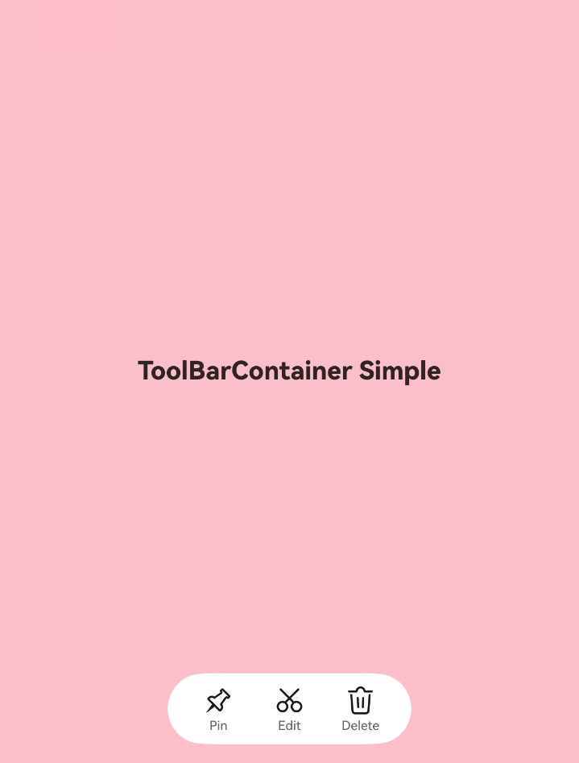

# ToolBarContainer
<!--Kit: ArkUI-->
<!--Subsystem: ArkUI-->
<!--Owner: @song-song-song-->
<!--Designer: @fenglinbailu-->
<!--Tester: @ybhou1993-->
<!--Adviser: @Brilliantry_Rui-->

ToolBarContainer用于在业务内容上方承载一个或多个工具栏，统一提供拖拽与吸附的交互方式，支持固定态、悬浮态、最小化悬浮球三种状态，支持智感握姿等。每个工具栏通过[ToolBarConfigs](#toolbarconfigs)独立配置子项、初始状态、悬浮行为、控制器和回调；多个工具栏共享[ToolBarContainerConfigs](#toolbarcontainerconfigs)中的停靠间距、内容避让和握姿适配配置。<br />
该组件基于[状态管理（V2）](../../../ui/state-management/arkts-state-management-overview.md)实现，工具栏子项及工具栏样式复用[ToolBarV2](ohos-arkui-advanced-ToolBarV2.md)提供的能力。

> **说明：**
>
> - 该组件从API version 26.1.0开始支持。后续版本如有新增内容，则采用上角标单独标记该内容的起始版本。
>
> - 该组件仅可在Stage模型下使用。
>
> - 工具栏始终停靠在容器的某条边或某个角，不支持拖拽释放后停留在任意位置。

## 导入模块

```ts
import { ToolBarContainer } from '@kit.ArkUI';
```

## 子组件

无

## ToolBarContainer

ToolBarContainer({toolbars: ToolBarConfigs\[], containerConfigs?: ToolBarContainerConfigs, content: Callback\<void>})

工具栏容器。业务内容通过尾随闭包传入，工具栏覆盖在业务内容上方。

**装饰器类型：**@ComponentV2

**原子化服务API：** 从API版本26.1.0开始，该接口支持在原子化服务中使用。

**系统能力：** SystemCapability.ArkUI.ArkUI.Full

| 名称 | 类型 | 必填 | 装饰器类型 | 说明 |
| ---- | ---- | ---- | ---------- | ---- |
| toolbars | [ToolBarConfigs](#toolbarconfigs)\[] | 是 | @Param<br/>@Require | 工具栏配置列表。每个元素对应一个独立的工具栏实例。 |
| containerConfigs | [ToolBarContainerConfigs](#toolbarcontainerconfigs) | 否 | @Param | 容器级配置，包括停靠偏移、工具栏间距、内容避让和智感握姿适配。<br/>默认值：undefined，即使用各项默认配置。 |
| content | [Callback](../../apis-basic-services-kit/js-apis-base.md#callback)\<void> | 是 | @BuilderParam | 业务内容构建器。内容显示在容器内，工具栏覆盖在其上方。 |

## ToolBarConfigs

定义单个工具栏的完整配置。

**装饰器类型：**@ObservedV2

**原子化服务API：** 从API版本26.1.0开始，该接口支持在原子化服务中使用。

**系统能力：** SystemCapability.ArkUI.ArkUI.Full

### 属性

| 名称 | 类型 | 只读 | 可选 | 说明 |
| ---- | ---- | ---- | ---- | ---- |
| toolBarList | [AdvancedToolBarV2Item](ohos-arkui-advanced-ToolBarV2.md#advancedtoolbarv2item)\[] | 否 | 否 | 工具栏子项列表，子项能力与普通ToolBarV2高级工具栏一致。<br/>装饰器类型：@Trace |
| initialParams | [ToolBarInitialParams](#toolbarinitialparams) | 否 | 否 | 工具栏初始停靠位置、布局和状态。 |
| advancedToolBarModifier | [AdvancedToolBarV2Modifier](ohos-arkui-advanced-ToolBarV2.md#advancedtoolbarv2modifier) | 否 | 是 | 高级工具栏属性，用于设置主轴长度、交叉轴长度、布局方向、工具栏样式和溢出菜单样式。<br/>默认值：new AdvancedToolBarV2Modifier()。<br/>装饰器类型：@Trace |
| floatingConfigs | [ToolBarFloatingConfigs](#toolbarfloatingconfigs) | 否 | 是 | 悬浮行为配置，包括拖拽开关、可停靠热区、角热区类型和最小化配置。<br/>默认值：undefined，即使用默认悬浮行为。<br/>装饰器类型：@Trace |
| controller | [ToolBarController](#toolbarcontroller) | 否 | 是 | 工具栏控制器，用于命令式切换状态、停靠和查询当前状态。<br/>默认值：undefined。需要主动控制工具栏时，应传入由开发者持有的控制器实例。 |
| callbacks | [ToolBarCallbacks](#toolbarcallbacks) | 否 | 是 | 工具栏回调集合。<br/>默认值：undefined，即不注册回调。<br/>装饰器类型：@Trace |

### constructor

constructor(params: ToolBarParams)

ToolBarConfigs的构造函数。

**原子化服务API：** 从API版本26.1.0开始，该接口支持在原子化服务中使用。

**系统能力：** SystemCapability.ArkUI.ArkUI.Full

**参数：**

| 参数名 | 类型 | 必填 | 说明 |
| ------ | ---- | ---- | ---- |
| params | [ToolBarParams](#toolbarparams) | 是 | 单个工具栏的配置参数。 |

## ToolBarParams

用于构建ToolBarConfigs对象。

**原子化服务API：** 从API版本26.1.0开始，该接口支持在原子化服务中使用。

**系统能力：** SystemCapability.ArkUI.ArkUI.Full

| 名称 | 类型 | 只读 | 可选 | 说明 |
| ---- | ---- | ---- | ---- | ---- |
| toolBarList | [AdvancedToolBarV2Item](ohos-arkui-advanced-ToolBarV2.md#advancedtoolbarv2item)\[] | 否 | 否 | 工具栏子项列表。 |
| initialParams | [ToolBarInitialParams](#toolbarinitialparams) | 否 | 否 | 工具栏初始停靠位置、布局和状态。 |
| advancedToolBarModifier | [AdvancedToolBarV2Modifier](ohos-arkui-advanced-ToolBarV2.md#advancedtoolbarv2modifier) | 否 | 是 | 高级工具栏属性。<br/>默认值：new AdvancedToolBarV2Modifier()。 |
| floatingConfigs | [ToolBarFloatingConfigs](#toolbarfloatingconfigs) | 否 | 是 | 悬浮行为配置。<br/>默认值：undefined。 |
| controller | [ToolBarController](#toolbarcontroller) | 否 | 是 | 工具栏控制器。<br/>默认值：undefined。 |
| callbacks | [ToolBarCallbacks](#toolbarcallbacks) | 否 | 是 | 工具栏回调集合。<br/>默认值：undefined。 |

## ToolBarInitialParams

定义工具栏的初始停靠位置、布局和状态。

**原子化服务API：** 从API版本26.1.0开始，该接口支持在原子化服务中使用。

**系统能力：** SystemCapability.ArkUI.ArkUI.Full

| 名称 | 类型 | 只读 | 可选 | 说明 |
| ---- | ---- | ---- | ---- | ---- |
| dockArea | [DockArea](#dockarea) | 否 | 否 | 初始停靠位置，支持四条边和四个角。 |
| direction | [Axis](ts-appendix-enums.md#axis) | 否 | 是 | 初始布局方向。停靠到TOP或BOTTOM时为Axis.Horizontal，停靠到LEFT或RIGHT时为Axis.Vertical。<br/>默认值：Axis.Horizontal。 |
| state | [ToolBarState](#toolbarstate) | 否 | 是 | 初始状态。<br/>默认值：ToolBarState.FLOATING。 |

## ToolBarFloatingConfigs

定义工具栏的悬浮行为。

**装饰器类型：**@ObservedV2

**原子化服务API：** 从API版本26.1.0开始，该接口支持在原子化服务中使用。

**系统能力：** SystemCapability.ArkUI.ArkUI.Full

### 属性

| 名称 | 类型 | 只读 | 可选 | 说明 |
| ---- | ---- | ---- | ---- | ---- |
| draggable | boolean | 否 | 是 | 是否允许拖拽。true表示允许FLOATING和MINIMIZED状态的工具栏拖拽；false表示忽略拖拽手势，且不触发拖拽回调。<br/>默认值：true。<br/>当工具栏数量大于2时，拖拽手势不生效，其余能力不受影响。<br/>装饰器类型：@Trace |
| dockAreas | [DockArea](#dockarea)\[] | 否 | 是 | 拖拽释放时允许停靠的热区集合。该配置不影响[setDock](#setdock)命令。<br/>默认值：DockArea的全部边和角。<br/>装饰器类型：@Trace |
| minimizeConfigs | [ToolBarMinimizeConfigs](#toolbarminimizeconfigs) | 否 | 是 | 最小化配置。<br/>默认值：undefined，即使用默认最小化配置。<br/>装饰器类型：@Trace |
| cornerMode | [DockCornerMode](#dockcornermode) | 否 | 是 | 角热区类型。MINIMIZED表示拖拽释放到角后切换为MINIMIZED状态，EXPAND表示保持展开状态并贴角停靠。<br/>默认值：DockCornerMode.MINIMIZED。<br/>装饰器类型：@Trace |

### constructor

constructor(options?: ToolBarFloatingOptions)

ToolBarFloatingConfigs的构造函数。

**原子化服务API：** 从API版本26.1.0开始，该接口支持在原子化服务中使用。

**系统能力：** SystemCapability.ArkUI.ArkUI.Full

**参数：**

| 参数名 | 类型 | 必填 | 说明 |
| ------ | ---- | ---- | ---- |
| options | [ToolBarFloatingOptions](#toolbarfloatingoptions) | 否 | 悬浮行为配置。未传入时使用默认配置。 |

## ToolBarFloatingOptions

用于构建ToolBarFloatingConfigs对象。

**原子化服务API：** 从API版本26.1.0开始，该接口支持在原子化服务中使用。

**系统能力：** SystemCapability.ArkUI.ArkUI.Full

| 名称 | 类型 | 只读 | 可选 | 说明 |
| ---- | ---- | ---- | ---- | ---- |
| draggable | boolean | 否 | 是 | 是否允许拖拽。<br/>默认值：true。 |
| dockAreas | [DockArea](#dockarea)\[] | 否 | 是 | 拖拽释放时允许停靠的热区集合。<br/>默认值：DockArea的全部边和角。 |
| minimizeConfigs | [ToolBarMinimizeConfigs](#toolbarminimizeconfigs) | 否 | 是 | 最小化配置。<br/>默认值：undefined。 |
| cornerMode | [DockCornerMode](#dockcornermode) | 否 | 是 | 角热区类型。<br/>默认值：DockCornerMode.MINIMIZED。 |

## ToolBarMinimizeConfigs

定义最小化悬浮球的文本、图标、自定义内容和尺寸。配置builder时优先使用自定义内容，icon和text不生效；未配置builder时，使用icon和text构建悬浮球。未配置icon时，优先使用首个激活态子项的图标；无激活态子项时，使用首个非激活态子项的图标。

**装饰器类型：**@Observed

**原子化服务API：** 从API版本26.1.0开始，该接口支持在原子化服务中使用。

**系统能力：** SystemCapability.ArkUI.ArkUI.Full

### 属性

| 名称 | 类型 | 只读 | 可选 | 说明 |
| ---- | ---- | ---- | ---- | ---- |
| text | [ResourceStr](ts-types.md#resourcestr) | 否 | 是 | 悬浮球文本。builder未配置时生效。<br/>默认值：undefined，即不显示自定义文本。<br/>装饰器类型：@Trace |
| icon | [ResourceStr](ts-types.md#resourcestr) \| [SymbolGlyphModifier](ts-universal-attributes-attribute-symbolglyphmodifier.md#symbolglyphmodifier) | 否 | 是 | 悬浮球图标。builder未配置时生效。<br/>默认值：undefined，按工具栏子项状态选择图标。<br/>装饰器类型：@Trace |
| textColor | [ColorMetrics](../js-apis-arkui-graphics.md#colormetrics12) | 否 | 是 | 悬浮球文本颜色。<br/>默认值：$r('sys.color.font_primary')。<br/>装饰器类型：@Trace |
| iconColor | [ColorMetrics](../js-apis-arkui-graphics.md#colormetrics12) | 否 | 是 | 悬浮球图标颜色。<br/>默认值：$r('sys.color.icon_primary')。<br/>装饰器类型：@Trace |
| builder | [CustomBuilder](ts-types.md#custombuilder8) | 否 | 是 | 悬浮球自定义内容构造器。优先级高于icon和text，配置后icon和text不生效。<br/>默认值：undefined。<br/>装饰器类型：@Trace |
| iconSize | [LengthMetrics](../js-apis-arkui-graphics.md#lengthmetrics12) | 否 | 是 | 图标尺寸。<br/>默认值：undefined，按图标资源的尺寸取。<br/>装饰器类型：@Trace |
| buoySize | [LengthMetrics](../js-apis-arkui-graphics.md#lengthmetrics12) | 否 | 是 | 悬浮球尺寸。<br/>默认值：工具栏交叉轴长度，即水平工具栏的高度或垂直工具栏的宽度。<br/>装饰器类型：@Trace |

### constructor

constructor(options?: ToolBarMinimizeOptions)

ToolBarMinimizeConfigs的构造函数。

**原子化服务API：** 从API版本26.1.0开始，该接口支持在原子化服务中使用。

**系统能力：** SystemCapability.ArkUI.ArkUI.Full

**参数：**

| 参数名 | 类型 | 必填 | 说明 |
| ------ | ---- | ---- | ---- |
| options | [ToolBarMinimizeOptions](#toolbarminimizeoptions) | 否 | 最小化配置。未传入时使用默认配置。 |

## ToolBarMinimizeOptions

用于构建ToolBarMinimizeConfigs对象。

**原子化服务API：** 从API版本26.1.0开始，该接口支持在原子化服务中使用。

**系统能力：** SystemCapability.ArkUI.ArkUI.Full

| 名称 | 类型 | 只读 | 可选 | 说明 |
| ---- | ---- | ---- | ---- | ---- |
| text | [ResourceStr](ts-types.md#resourcestr) | 否 | 是 | 悬浮球文本。builder未配置时生效。<br/>默认值：undefined。 |
| icon | [ResourceStr](ts-types.md#resourcestr) \| [SymbolGlyphModifier](ts-universal-attributes-attribute-symbolglyphmodifier.md#symbolglyphmodifier) | 否 | 是 | 悬浮球图标。builder未配置时生效。<br/>默认值：undefined，按工具栏子项状态选择图标。 |
| textColor | [ColorMetrics](../js-apis-arkui-graphics.md#colormetrics12) | 否 | 是 | 悬浮球文本颜色。<br/>默认值：$r('sys.color.font_primary')。 |
| iconColor | [ColorMetrics](../js-apis-arkui-graphics.md#colormetrics12) | 否 | 是 | 悬浮球图标颜色。<br/>默认值：$r('sys.color.icon_primary')。 |
| builder | [CustomBuilder](ts-types.md#custombuilder8) | 否 | 是 | 悬浮球自定义内容构造器。配置后优先于icon和text生效。<br/>默认值：undefined。 |
| iconSize | [LengthMetrics](../js-apis-arkui-graphics.md#lengthmetrics12) | 否 | 是 | 图标尺寸。<br/>默认值：undefined，按图标资源的尺寸取。 |
| buoySize | [LengthMetrics](../js-apis-arkui-graphics.md#lengthmetrics12) | 否 | 是 | 悬浮球尺寸。<br/>默认值：工具栏交叉轴长度，即水平工具栏的高度或垂直工具栏的宽度。 |

## ToolBarController

工具栏控制器。开发者持有控制器实例并传入[ToolBarConfigs](#toolbarconfigs)后，可通过该实例切换状态、设置停靠位置以及查询当前状态和布局方向。不合法的命令会被静默忽略，不触发状态变化回调，也不抛出异常。

**原子化服务API：** 从API版本26.1.0开始，该接口支持在原子化服务中使用。

**系统能力：** SystemCapability.ArkUI.ArkUI.Full

### setDock

setDock(area: DockArea, direction?: Axis): void

设置工具栏的停靠位置和布局方向。该命令不受[dockAreas](#toolbarfloatingconfigs)配置限制。停靠到边时忽略direction，由停靠边确定布局方向；停靠到角且省略direction时保持当前方向。目标位置和方向均未变化时不触发[onDock](#toolbarcallbacks)。

**原子化服务API：** 从API版本26.1.0开始，该接口支持在原子化服务中使用。

**系统能力：** SystemCapability.ArkUI.ArkUI.Full

**参数：**

| 参数名 | 类型 | 必填 | 说明 |
| ------ | ---- | ---- | ---- |
| area | [DockArea](#dockarea) | 是 | 目标停靠位置。 |
| direction | [Axis](ts-appendix-enums.md#axis) | 否 | 目标布局方向。停靠到角时有效；省略时保持当前方向。 |

### pin

pin(): void

将工具栏切换为FIXED状态。FIXED状态下调用无效果；FLOATING或MINIMIZED状态下切换为FIXED状态，并触发一次onStateChange。切换后停靠位置和方向不变。

**原子化服务API：** 从API版本26.1.0开始，该接口支持在原子化服务中使用。

**系统能力：** SystemCapability.ArkUI.ArkUI.Full

### unpin

unpin(): void

取消固定并将工具栏切换为FLOATING状态。仅FIXED状态下生效；FLOATING或MINIMIZED状态下调用无效果。切换后停靠位置和方向不变。

**原子化服务API：** 从API版本26.1.0开始，该接口支持在原子化服务中使用。

**系统能力：** SystemCapability.ArkUI.ArkUI.Full

### minimize

minimize(): void

将工具栏切换为MINIMIZED状态并显示悬浮球。仅FLOATING状态下生效；其他状态下调用无效果。边停靠的工具栏最小化后悬浮球沿该边居中，角停靠的工具栏最小化后悬浮球保持在同一角。切换后停靠位置和方向不变。

**原子化服务API：** 从API版本26.1.0开始，该接口支持在原子化服务中使用。

**系统能力：** SystemCapability.ArkUI.ArkUI.Full

### restore

restore(): void

将MINIMIZED状态的工具栏切换为FLOATING状态。仅MINIMIZED状态下生效；其他状态下调用无效果。切换后停靠位置和方向不变。

**原子化服务API：** 从API版本26.1.0开始，该接口支持在原子化服务中使用。

**系统能力：** SystemCapability.ArkUI.ArkUI.Full

### getState

getState(): ToolBarState

查询工具栏当前状态。

**原子化服务API：** 从API版本26.1.0开始，该接口支持在原子化服务中使用。

**系统能力：** SystemCapability.ArkUI.ArkUI.Full

**返回值：**

| 类型 | 说明 |
| ---- | ---- |
| [ToolBarState](#toolbarstate) | 当前工具栏状态。 |

### getDockArea

getDockArea(): DockArea

查询工具栏当前停靠位置。

**原子化服务API：** 从API版本26.1.0开始，该接口支持在原子化服务中使用。

**系统能力：** SystemCapability.ArkUI.ArkUI.Full

**返回值：**

| 类型 | 说明 |
| ---- | ---- |
| [DockArea](#dockarea) | 当前停靠的边或角。 |

### getDirection

getDirection(): Axis

查询工具栏当前布局方向。

**原子化服务API：** 从API版本26.1.0开始，该接口支持在原子化服务中使用。

**系统能力：** SystemCapability.ArkUI.ArkUI.Full

**返回值：**

| 类型 | 说明 |
| ---- | ---- |
| [Axis](ts-appendix-enums.md#axis) | 当前布局方向。 |

## ToolBarCallbacks

定义单个工具栏的回调集合。所有回调均可选，未配置时不影响工具栏的状态切换、拖拽和停靠行为。

**原子化服务API：** 从API版本26.1.0开始，该接口支持在原子化服务中使用。

**系统能力：** SystemCapability.ArkUI.ArkUI.Full

| 名称 | 类型 | 只读 | 可选 | 说明 |
| ---- | ---- | ---- | ---- | ---- |
| onDock | [ToolBarDockCallback](#toolbardockcallback) | 否 | 是 | 停靠位置或布局方向实际变化时触发。回弹、容器尺寸变化引起的位置重校准以及仅展开或最小化形态变化不触发该回调。 |
| onDragStart | [ToolBarDragStateCallback](#toolbardragstatecallback) | 否 | 是 | 拖拽会话建立时触发一次，先于首次onDrag。 |
| onDrag | [ToolBarDragOffsetCallback](#toolbardragoffsetcallback) | 否 | 是 | 拖拽过程中持续触发，用于报告悬浮球当前位置。 |
| onDragEnd | [ToolBarDragStateCallback](#toolbardragstatecallback) | 否 | 是 | 拖拽会话结束时触发一次。该回调不提供释放坐标，最终停靠结果通过[getDockArea](#getdockarea)和[getDirection](#getdirection)查询。 |
| onStateChange | [ToolBarStateCallback](#toolbarstatecallback) | 否 | 是 | 工具栏逻辑状态成功切换时触发一次。非法或重复命令以及拖拽过程中的临时悬浮球形态不触发该回调。 |

## ToolBarDragStateCallback

type ToolBarDragStateCallback = () => void

拖拽开始或结束回调类型，无参数。

**原子化服务API：** 从API版本26.1.0开始，该接口支持在原子化服务中使用。

**系统能力：** SystemCapability.ArkUI.ArkUI.Full

## ToolBarDragOffsetCallback

type ToolBarDragOffsetCallback = (x: number, y: number) => void

拖拽位置回调类型。

**原子化服务API：** 从API版本26.1.0开始，该接口支持在原子化服务中使用。

**系统能力：** SystemCapability.ArkUI.ArkUI.Full

**参数：**

| 参数名 | 类型 | 必填 | 说明 |
| ------ | ---- | ---- | ---- |
| x | number | 是 | 悬浮球左上角相对ToolBarContainer内容区左上角的横向坐标，单位为vp。 |
| y | number | 是 | 悬浮球左上角相对ToolBarContainer内容区左上角的纵向坐标，单位为vp。 |

## ToolBarStateCallback

type ToolBarStateCallback = (state: ToolBarState) => void

工具栏状态变化回调类型。

**原子化服务API：** 从API版本26.1.0开始，该接口支持在原子化服务中使用。

**系统能力：** SystemCapability.ArkUI.ArkUI.Full

**参数：**

| 参数名 | 类型 | 必填 | 说明 |
| ------ | ---- | ---- | ---- |
| state | [ToolBarState](#toolbarstate) | 是 | 切换完成后的新状态。 |

## ToolBarDockCallback

type ToolBarDockCallback = (area: DockArea, direction: Axis) => void

工具栏停靠变化回调类型。

**原子化服务API：** 从API版本26.1.0开始，该接口支持在原子化服务中使用。

**系统能力：** SystemCapability.ArkUI.ArkUI.Full

**参数：**

| 参数名 | 类型 | 必填 | 说明 |
| ------ | ---- | ---- | ---- |
| area | [DockArea](#dockarea) | 是 | 新的停靠位置。 |
| direction | [Axis](ts-appendix-enums.md#axis) | 是 | 新的布局方向。 |

## ToolBarContainerConfigs

定义多个工具栏共享的容器级配置。

**装饰器类型：**@ObservedV2

**原子化服务API：** 从API版本26.1.0开始，该接口支持在原子化服务中使用。

**系统能力：** SystemCapability.ArkUI.ArkUI.Full

### 属性

| 名称 | 类型 | 只读 | 可选 | 说明 |
| ---- | ---- | ---- | ---- | ---- |
| dockOffset | [ToolBarDockOffsetOptions](#toolbardockoffsetoptions) | 否 | 是 | 工具栏与容器各边之间的停靠偏移。边停靠时使用对应边的偏移，角停靠时分别使用两条邻边的偏移。<br/>默认值：undefined，即各边使用默认偏移。<br/>装饰器类型：@Trace |
| gutter | [LengthMetrics](../js-apis-arkui-graphics.md#lengthmetrics12) | 否 | 是 | 多个工具栏之间的间距。<br/>默认值：根据容器宽度自适应调整。<br/>装饰器类型：@Trace |
| safeArea | [ToolBarSafeAreaOptions](#toolbarsafeareaoptions) | 否 | 是 | 业务内容的逐边避让策略，用于容器内业务内容与工具栏之间的布局避让。<br/>默认值：undefined，即四边均为ToolBarSafeAreaMode.NONE。<br/>装饰器类型：@Trace |
| adaptToHandedness | [HandednessAdaptionMode](#handednessadaptionmode) | 否 | 是 | 智感握姿适配模式。<br/>默认值：HandednessAdaptionMode.NONE。<br/>装饰器类型：@Trace |

### constructor

constructor(options: ToolBarContainerOptions)

ToolBarContainerConfigs的构造函数。

**原子化服务API：** 从API版本26.1.0开始，该接口支持在原子化服务中使用。

**系统能力：** SystemCapability.ArkUI.ArkUI.Full

**参数：**

| 参数名 | 类型 | 必填 | 说明 |
| ------ | ---- | ---- | ---- |
| options | [ToolBarContainerOptions](#toolbarcontaineroptions) | 是 | 容器级配置参数。 |

## ToolBarContainerOptions

用于构建ToolBarContainerConfigs对象。

**原子化服务API：** 从API版本26.1.0开始，该接口支持在原子化服务中使用。

**系统能力：** SystemCapability.ArkUI.ArkUI.Full

| 名称 | 类型 | 只读 | 可选 | 说明 |
| ---- | ---- | ---- | ---- | ---- |
| dockOffset | [ToolBarDockOffsetOptions](#toolbardockoffsetoptions) | 否 | 是 | 工具栏与容器各边之间的停靠偏移。<br/>默认值：undefined。 |
| gutter | [LengthMetrics](../js-apis-arkui-graphics.md#lengthmetrics12) | 否 | 是 | 多个工具栏之间的间距。<br/>默认值：根据容器宽度自适应调整。 |
| safeArea | [ToolBarSafeAreaOptions](#toolbarsafeareaoptions) | 否 | 是 | 业务内容的逐边避让策略。<br/>默认值：undefined。 |
| adaptToHandedness | [HandednessAdaptionMode](#handednessadaptionmode) | 否 | 是 | 智感握姿适配模式。<br/>默认值：HandednessAdaptionMode.NONE。 |

## ToolBarDockOffsetOptions

定义工具栏相对容器四条边的停靠偏移。

**原子化服务API：** 从API版本26.1.0开始，该接口支持在原子化服务中使用。

**系统能力：** SystemCapability.ArkUI.ArkUI.Full

| 名称 | 类型 | 只读 | 可选 | 说明 |
| ---- | ---- | ---- | ---- | ---- |
| top | [LengthMetrics](../js-apis-arkui-graphics.md#lengthmetrics12) | 否 | 是 | 工具栏与容器上边的偏移。<br/>默认值：16vp。<br/>负值按默认值处理。 |
| right | [LengthMetrics](../js-apis-arkui-graphics.md#lengthmetrics12) | 否 | 是 | 工具栏与容器右边的偏移。<br/>默认值：根据容器宽度自适应调整。<br/>负值按默认值处理。 |
| bottom | [LengthMetrics](../js-apis-arkui-graphics.md#lengthmetrics12) | 否 | 是 | 工具栏与容器下边的偏移。<br/>默认值：16vp。<br/>负值按默认值处理。 |
| left | [LengthMetrics](../js-apis-arkui-graphics.md#lengthmetrics12) | 否 | 是 | 工具栏与容器左边的偏移。<br/>默认值：根据容器宽度自适应调整。<br/>负值按默认值处理。 |

## ToolBarSafeAreaOptions

定义业务内容在容器四条边上的避让策略。

**原子化服务API：** 从API版本26.1.0开始，该接口支持在原子化服务中使用。

**系统能力：** SystemCapability.ArkUI.ArkUI.Full

| 名称 | 类型 | 只读 | 可选 | 说明 |
| ---- | ---- | ---- | ---- | ---- |
| top | [ToolBarSafeAreaMode](#toolbarsafeareamode) | 否 | 是 | 上边的避让策略。<br/>默认值：ToolBarSafeAreaMode.NONE。 |
| right | [ToolBarSafeAreaMode](#toolbarsafeareamode) | 否 | 是 | 右边的避让策略。<br/>默认值：ToolBarSafeAreaMode.NONE。 |
| bottom | [ToolBarSafeAreaMode](#toolbarsafeareamode) | 否 | 是 | 下边的避让策略。<br/>默认值：ToolBarSafeAreaMode.NONE。 |
| left | [ToolBarSafeAreaMode](#toolbarsafeareamode) | 否 | 是 | 左边的避让策略。<br/>默认值：ToolBarSafeAreaMode.NONE。 |

## HandednessAdaptionMode

智感握姿适配模式枚举。适配仅在容器宽度大于600vp、容器内只有一个工具栏且工具栏不处于FIXED状态时生效，与draggable是否开启无关。垂直停靠在左右侧时，工具栏根据操作手调整到对应侧；水平停靠时，工具栏调整到操作手对应边的相邻角。

**原子化服务API：** 从API版本26.1.0开始，该接口支持在原子化服务中使用。

**系统能力：** SystemCapability.ArkUI.ArkUI.Full

| 名称 | 值 | 说明 |
| ---- | -- | ---- |
| NONE | 0 | 不启用智感握姿适配。<br/>默认值：NONE。 |
| DEFAULT | 1 | 启用智感握姿适配。 |

## ToolBarState

工具栏状态枚举。

**原子化服务API：** 从API版本26.1.0开始，该接口支持在原子化服务中使用。

**系统能力：** SystemCapability.ArkUI.ArkUI.Full

| 名称 | 值 | 说明 |
| ---- | -- | ---- |
| FIXED | 0 | FIXED状态。不响应拖拽和智感握姿，可通过setDock调整停靠位置。 |
| FLOATING | 1 | FLOATING状态。工具栏展开并覆盖在业务内容上方，可按配置拖拽和停靠。 |
| MINIMIZED | 2 | MINIMIZED状态。工具栏主体隐藏并显示悬浮球，可通过restore、单击悬浮球或拖拽到边热区恢复。 |

## DockArea

工具栏停靠位置枚举。

**原子化服务API：** 从API版本26.1.0开始，该接口支持在原子化服务中使用。

**系统能力：** SystemCapability.ArkUI.ArkUI.Full

| 名称 | 值 | 说明 |
| ---- | -- | ---- |
| TOP | 0 | 容器上边。 |
| BOTTOM | 1 | 容器下边。 |
| LEFT | 2 | 容器左边。 |
| RIGHT | 3 | 容器右边。 |
| TOP_LEFT | 4 | 容器左上角。 |
| TOP_RIGHT | 5 | 容器右上角。 |
| BOTTOM_LEFT | 6 | 容器左下角。 |
| BOTTOM_RIGHT | 7 | 容器右下角。 |

## DockCornerMode

角热区类型枚举。

**原子化服务API：** 从API版本26.1.0开始，该接口支持在原子化服务中使用。

**系统能力：** SystemCapability.ArkUI.ArkUI.Full

| 名称 | 值 | 说明 |
| ---- | -- | ---- |
| MINIMIZED | 0 | 最小化型角热区。拖拽释放到角后切换为MINIMIZED状态。 |
| EXPAND | 1 | 展开型角热区。拖拽释放到角后保持展开状态并贴角停靠。 |

## ToolBarSafeAreaMode

业务内容避让策略枚举。

**原子化服务API：** 从API版本26.1.0开始，该接口支持在原子化服务中使用。

**系统能力：** SystemCapability.ArkUI.ArkUI.Full

| 名称 | 值 | 说明 |
| ---- | -- | ---- |
| NONE | 0 | 不进行避让，工具栏覆盖在业务内容上方。<br/>默认值：NONE。 |
| PADDING | 1 | 通过内边距使业务内容和背景均避开工具栏区域。 |
| SAFEAREA_PADDING | 2 | 通过安全区内边距使可交互内容避开工具栏区域，业务内容背景可延伸至工具栏下方。 |

## 示例

该示例创建一个底部停靠的工具栏，并通过工具栏子项切换固定和悬浮状态。

```ts
// Index.ets
import {
  ToolBarContainer,
  ToolBarController,
  DockArea,
  ToolBarConfigs,
  ToolBarState,
  ToolBarContainerConfigs,
} from '@ohos.arkui.advanced.ToolBarContainer'
import {
  ToolBarV2ItemState,
  AdvancedToolBarV2Item,
  ToolBarV2ItemPlacement,
  ToolBarV2ItemText
} from '@ohos.arkui.advanced.ToolBarV2'
import {
  promptAction, SymbolGlyphModifier, ToolBarV2SymbolGlyph
} from '@kit.ArkUI';

@Entry
@ComponentV2
struct ToolBarContainerExample {
  private controller = new ToolBarController();

  private togglePin(): void {
    if (this.controller.getState() === ToolBarState.FLOATING) {
      this.controller.pin();
      this.item1.state = ToolBarV2ItemState.ACTIVATE;
    } else {
      this.controller.unpin();
      this.item1.state = ToolBarV2ItemState.ENABLE;
    }
  }

  @Local
  private item1: AdvancedToolBarV2Item = new AdvancedToolBarV2Item({
    content: new ToolBarV2ItemText({ text: 'Pin' }),
    icon: new ToolBarV2SymbolGlyph({
      normal: new SymbolGlyphModifier($r('sys.symbol.pin')),
      activated: new SymbolGlyphModifier($r('sys.symbol.pin_fill')),
    }),
    groupID: 'A',
    state: ToolBarV2ItemState.ENABLE,
    placement: ToolBarV2ItemPlacement.LEADING,
    action: () => {
      this.togglePin();
    }
  })
  @Local
  private item2: AdvancedToolBarV2Item = new AdvancedToolBarV2Item({
    content: new ToolBarV2ItemText({ text: 'Edit' }),
    icon: new ToolBarV2SymbolGlyph({
      normal: new SymbolGlyphModifier($r('sys.symbol.cut')),
    }),
    groupID: 'A',
    action: () => {
      promptAction.showToast({ message: 'edit' })
    }
  })
  @Local
  private item3: AdvancedToolBarV2Item = new AdvancedToolBarV2Item({
    content: new ToolBarV2ItemText({ text: 'Delete' }),
    icon: new ToolBarV2SymbolGlyph({
      normal: new SymbolGlyphModifier($r('sys.symbol.trash')),
    }),
    groupID: 'A',
    action: () => {
      promptAction.showToast({ message: 'delete' })
    }
  })
  private toolbarConfig: ToolBarConfigs = new ToolBarConfigs({
    toolBarList: [this.item1, this.item2, this.item3],
    controller: this.controller,
    initialParams: {
      dockArea: DockArea.BOTTOM
    }
  })

  build() {
    Stack(){
      ToolBarContainer({
        toolbars: [this.toolbarConfig],
        containerConfigs: new ToolBarContainerConfigs({})
      }) {
        Stack() {
          Text('ToolBarContainer Simple')
            .fontSize(20)
            .fontWeight(FontWeight.Bold)
            .margin({ bottom: 16 })
        }
        .width('100%')
        .height('100%')
        .backgroundColor(Color.Pink)
      }
    }
    .width('100%')
    .height('100%')
  }
}
```


