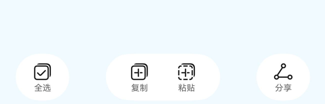
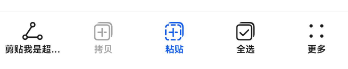
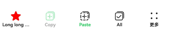

# ToolBarV2
<!--Kit: ArkUI-->
<!--Subsystem: ArkUI-->
<!--Owner: @song-song-song-->
<!--Designer: @fenglinbailu-->
<!--Tester: @ybhou1993-->
<!--Adviser: @Brilliantry_Rui-->

工具栏用于展示针对当前界面内容的操作选项，在界面底部显示，适用于需要为用户提供快速操作入口的场景。底部最多显示5个入口，超过则收纳入“更多”子项中，在最右侧显示。适用于需要对当前页面内容进行快捷操作的场景，可帮助用户快速访问常用功能，提升操作效率。<br />
该组件基于[状态管理（V2）](../../../ui/state-management/arkts-state-management-overview.md#状态管理v2)实现，相较于[状态管理（V1）](../../../ui/state-management/arkts-state-management-overview.md#状态管理v1)，状态管理（V2）增强了对数据对象的深度观察与管理能力，不再局限于组件层级。借助状态管理（V2），开发者可以通过该组件更灵活地控制工具栏的数据和状态，实现更高效的用户界面刷新。<br>
从API版本26.1.0开始，当ToolBarV2设置[AdvancedToolBarV2Modifier](#advancedtoolbarv2modifier)参数时，可使用高级工具栏功能，支持通过[AdvancedToolbarV2Item](#advancedtoolbarv2item)（继承自[ToolBarV2Item](#toolbarv2item)）配置高级工具栏子项。配置了高级子项的工具栏更为灵活，允许溢出菜单、子项分组等。<br>

> **说明：**
>
> - 该组件从API version 18开始支持。后续版本如有新增内容，则采用上角标单独标记该内容的起始版本。
>
> - 该组件仅可在Stage模型下使用。
>
> - 如果ToolBarV2设置[通用属性](ts-component-general-attributes.md)和[通用事件](ts-component-general-events.md)，编译工具链会额外生成节点__Common__，并将通用属性或通用事件挂载在__Common__上，而不是直接应用到ToolBarV2本身。这可能导致开发者设置的通用属性或通用事件不生效或不符合预期，因此，不建议ToolBarV2设置通用属性和通用事件。
>
> - 当系统切换深浅色模式时，工具栏背景色不会自动跟随切换。

## 导入模块

```ts
import { ToolBarV2 } from '@kit.ArkUI';
```

## 子组件

无


## ToolBarV2

ToolBarV2({toolBarList: ToolBarV2Item\[], activatedIndex?: number, dividerModifier?: DividerModifier, toolBarModifier?: ToolBarV2Modifier, advancedToolBarModifier?: AdvancedToolBarV2Modifier})

工具栏。

**装饰器类型：**@ComponentV2

**原子化服务API：** 从API version 18开始，该接口支持在原子化服务中使用。

**系统能力：** SystemCapability.ArkUI.ArkUI.Full

**设备行为差异：** 该接口在Wearable设备上使用时，应用程序运行异常，异常信息中提示接口未定义，在其他设备中可正常调用。

| 名称                   | 类型                                                               | 必填 | 装饰器类型               | 说明                                                           |
| -------------------- | ---------------------------------------------------------------- | -- |---------------------|--------------------------------------------------------------|
| toolBarList          | [ToolBarV2Item](#toolbarv2item)\[]                               | 是  | @Param<br/>@Require | 工具栏子项列表，最多显示5个子项，超过则收纳至"更多"子项中。                                                       |
| activatedIndex    | number                                                           | 否  | @Param              | 被激活的子项索引。<br />默认值：-1，即无工具栏子项为激活态。<br />取值范围：[-1,4]。      |
| dividerModifier | [DividerModifier](ts-universal-attributes-attribute-modifier.md#自定义modifier) | 否  | @Param              | 工具栏头部分割线属性，可设置分割线高度、颜色等。设置后在工具栏顶部显示指定样式的分割线。<br />默认不生效。                         |
| toolBarModifier | [ToolBarV2Modifier](#toolbarv2modifier)                          | 否  | @Param              | 工具栏属性，可设置工具栏高度、背景色、内边距（仅在工具栏子项数量小于5时生效）、是否显示按压态。设置后工具栏将按指定样式自定义外观。<br />默认不生效。 |
| advancedToolBarModifier | [AdvancedToolBarV2Modifier](#advancedtoolbarv2modifier) | 否 | @Param | 高级工具栏属性，将布局属性、样式配置和溢出菜单样式合并至单个modifier中，可设置工具栏主轴长度、交叉轴长度、布局方向。其中，主轴指沿布局方向的长度（水平布局时即宽度），交叉轴指垂直于布局方向的长度（水平布局时即高度）；溢出菜单指工具栏空间不足时收纳剩余子项的菜单。设置后工具栏将按指定样式自定义外观，并可使用高级工具栏功能（如配置[AdvancedToolbarV2Item](#advancedtoolbarv2item)、溢出菜单、子项分组等）。<br />默认不生效。<br />**起始版本：** 26.1.0<br />**模型约束：** 此接口仅可在Stage模型下使用。 |

## ToolBarV2Item

定义工具栏子项。

**装饰器类型：**@ObservedV2

**原子化服务API：** 从API version 18开始，该接口支持在原子化服务中使用。

**系统能力：** SystemCapability.ArkUI.ArkUI.Full

**设备行为差异：** 该接口在Wearable设备上使用时，应用程序运行异常，异常信息中提示接口未定义，在其他设备中可正常调用。

### 属性

| 名称                           | 类型                                              | 只读 | 可选 | 说明                                                                                                                                                                                                                  |
| ---------------------------- | ----------------------------------------------- | -- | -- | ---------------------------------------------------------------------------------------------------------------------------------------------------------------------------------------------------------------------|
| content                      | [ToolBarV2ItemText](#toolbarv2itemtext)         | 否  | 否 | 工具栏子项的文本。<br />装饰器类型：@Trace                                                                                                                                                                                                           |
| action                       | [ToolBarV2ItemAction](#toolbarv2itemaction)     | 否  | 是  | 工具栏子项点击事件。 <br ></div>默认无点击事件。<br />装饰器类型：@Trace                                                                                                                                                                                      |
| icon                         | [ToolBarV2ItemIconType](#toolbarv2itemicontype) | 否  | 是 | 工具栏子项的图标。<br ></div>默认不显示图标。<br />装饰器类型：@Trace                                                                                                                                                                                        |
| state                        | [ToolBarV2ItemState](#toolbarv2itemstate)       | 否  | 是 | 工具栏子项的状态。<br />默认值：ToolBarV2ItemState.ENABLE。<br />装饰器类型：@Trace                                                                                                                                                                           |
| accessibilityText     | [ResourceStr](ts-types.md#resourcestr)          | 否  | 是 | 工具栏子项的无障碍文本属性。当组件不包含文本属性时，屏幕朗读选中此组件时不播报，使用者无法清楚地知道当前选中了什么组件。为了解决此场景，开发人员可为不包含文字信息的组件设置无障碍文本，当屏幕朗读选中此组件时播报无障碍文本的内容，帮助屏幕朗读的使用者清楚地知道自己选中了什么组件。<br ></div>默认值为当前项content属性内容。<br />装饰器类型：@Trace                                           |
| accessibilityDescription | [ResourceStr](ts-types.md#resourcestr)          | 否  | 是 |  工具栏子项的无障碍描述。此描述用于向用户详细解释当前组件，开发人员应为组件的这一属性提供较为详尽的文本说明，以协助用户理解即将执行的操作及其可能产生的后果。特别是当这些后果无法仅从组件的属性和无障碍文本中直接获知时。如果组件同时具备文本属性和无障碍说明属性，当组件被选中时，系统将首先播报组件的文本属性，随后播报无障碍说明属性的内容。<br />默认值：“单指双击即可执行”。<br />装饰器类型：@Trace                        |
| accessibilityLevel  | string                                          | 否  | 是 | 工具栏子项无障碍重要性。用于控制当前项是否可被无障碍辅助服务所识别。<br ></div>支持的值为：<br />"auto"：当前值转换为"yes"。<br />"yes"：当前组件可被无障碍辅助服务所识别。<br />"no"：当前组件不可被无障碍辅助服务所识别。<br />"no-hide-descendants"：当前组件及其所有子组件不可被无障碍辅助服务所识别。<br />默认值："auto"<br />装饰器类型：@Trace |

### constructor

constructor(options: ToolBarV2ItemOptions)

ToolBarV2Item的构造函数。

**原子化服务API：** 从API version 18开始，该接口支持在原子化服务中使用。

**系统能力：** SystemCapability.ArkUI.ArkUI.Full

**设备行为差异：** 该接口在Wearable设备上使用时，应用程序运行异常，异常信息中提示接口未定义，在其他设备中可正常调用。

**参数：**

| 参数名       | 类型                                            | 必填 | 说明       |
| :------ |:----------------------------------------------| :- | :------- |
| options | [ToolBarV2ItemOptions](#toolbarv2itemoptions) | 是  | 工具栏子项信息。 |

## ToolBarV2ItemOptions

用于构建ToolBarV2Item对象。

**原子化服务API：** 从API version 18开始，该接口支持在原子化服务中使用。

**系统能力：** SystemCapability.ArkUI.ArkUI.Full

**设备行为差异：** 该接口在Wearable设备上使用时，应用程序运行异常，异常信息中提示接口未定义，在其他设备中可正常调用。

| 名称                       | 类型                                              | 只读 | 可选 | 说明                                                                                                                                                                                                                  |
|:-------------------------| :---------------------------------------------- |:---|:---|:--------------------------------------------------------------------------------------------------------------------------------------------------------------------------------------------------------------------|
| content                  | [ToolBarV2ItemText](#toolbarv2itemtext)         | 否  | 否  | 工具栏子项的文本。                                                                                                                                                                                                           |
| action                   | [ToolBarV2ItemAction](#toolbarv2itemaction)     | 否  | 是  | 工具栏子项点击事件。<br />默认无点击事件。                                                                                                                                                                                            |
| icon                     | [ToolBarV2ItemIconType](#toolbarv2itemicontype) | 否  | 是  | 工具栏子项的图标。<br />默认不显示图标。                                                                                                                                                                                             |
| state                    | [ToolBarV2ItemState](#toolbarv2itemstate)       | 否  | 是  | 工具栏子项的状态。<br />默认为ToolBarV2ItemState.ENABLE。<br />                                                                                                                                                                  |
| accessibilityText        | [ResourceStr](ts-types.md#resourcestr)          | 否  | 是  | 工具栏子项的无障碍文本属性。当组件不包含文本属性时，屏幕朗读选中此组件时不播报，使用者无法清楚地知道当前选中了什么组件。为了解决此场景，开发人员可为不包含文字信息的组件设置无障碍文本，当屏幕朗读选中此组件时播报无障碍文本的内容，帮助屏幕朗读的使用者清楚地知道自己选中了什么组件。<br />默认值为当前项content属性内容。<br />                                          |
| accessibilityDescription | [ResourceStr](ts-types.md#resourcestr)          | 否  | 是  | 工具栏子项的无障碍描述。此描述用于向用户详细解释当前组件，开发人员应为组件的这一属性提供较为详尽的文本说明，以协助用户理解即将执行的操作及其可能产生的后果。特别是当这些后果无法仅从组件的属性和无障碍文本中直接获知时。如果组件同时具备文本属性和无障碍说明属性，当组件被选中时，系统将首先播报组件的文本属性，随后播报无障碍说明属性的内容。<br />默认值为“单指双击即可执行”。                        |
| accessibilityLevel       | string                                          | 否  | 是  | 工具栏子项无障碍重要性。用于控制当前项是否可被无障碍辅助服务所识别。<br ></div>支持的值为：<br />"auto"：当前值转换为"yes"。<br />"yes"：当前组件可被无障碍辅助服务所识别。<br />"no"：当前组件不可被无障碍辅助服务所识别。<br />"no-hide-descendants"：当前组件及其所有子组件不可被无障碍辅助服务所识别。<br />默认值："auto"<br /> |

## ToolBarV2ItemAction

type ToolBarV2ItemAction = (index: number) => void

工具栏子项点击事件回调类型。

**原子化服务API：** 从API version 18开始，该接口支持在原子化服务中使用。

**系统能力：** SystemCapability.ArkUI.ArkUI.Full

**设备行为差异：** 该接口在Wearable设备上使用时，应用程序运行异常，异常信息中提示接口未定义，在其他设备中可正常调用。

**参数：**

| 参数名   | 类型     | 必填 | 说明 |
|:------|:-------|:---|----|
| index | number | 是  | 触发点击事件的工具栏子项索引。 |

## ToolBarV2ItemText

定义工具栏子项的文本。

**装饰器类型：**@ObservedV2

**原子化服务API：** 从API version 18开始，该接口支持在原子化服务中使用。

**系统能力：** SystemCapability.ArkUI.ArkUI.Full

**设备行为差异：** 该接口在Wearable设备上使用时，应用程序运行异常，异常信息中提示接口未定义，在其他设备中可正常调用。

### 属性

| 名称                  | 类型                                                          | 只读 | 可选 | 说明                                                       |
|:--------------------|:------------------------------------------------------------|:---|:---|:---------------------------------------------------------|
| text                | [ResourceStr](ts-types.md#resourcestr)                      | 否  | 否  | 工具栏子项的文本。<br/>装饰器类型：@Trace                                                |
| color               | [ColorMetrics](../js-apis-arkui-graphics.md#colormetrics12) | 否  | 是  | 工具栏子项的文本的颜色。<br/>默认值：$r('sys.color.font_primary')<br/>装饰器类型：@Trace       |
| activatedColor | [ColorMetrics](../js-apis-arkui-graphics.md#colormetrics12) | 否  | 是  | 工具栏子项在激活态下文本的颜色。<br></div>默认值：$r('sys.color.font_emphasize')<br/>装饰器类型：@Trace |

### constructor

constructor(options: ToolBarV2ItemTextOptions)

ToolBarV2ItemText的构造函数。

**原子化服务API：** 从API version 18开始，该接口支持在原子化服务中使用。

**系统能力：** SystemCapability.ArkUI.ArkUI.Full

**设备行为差异：** 该接口在Wearable设备上使用时，应用程序运行异常，异常信息中提示接口未定义，在其他设备中可正常调用。

**参数：**

| 参数名       | 类型                                                    | 必填 | 说明         |
| :------ |:------------------------------------------------------| :- | :--------- |
| options | [ToolBarV2ItemTextOptions](#toolbarv2itemtextoptions) | 是  | 工具栏子项文本信息。 |

## ToolBarV2ItemTextOptions

用于构建ToolBarV2ItemText对象。

**原子化服务API：** 从API version 18开始，该接口支持在原子化服务中使用。

**系统能力：** SystemCapability.ArkUI.ArkUI.Full

**设备行为差异：** 该接口在Wearable设备上使用时，应用程序运行异常，异常信息中提示接口未定义，在其他设备中可正常调用。

| 名称                  | 类型                                                          | 只读 | 可选 | 说明                                                       |
| :------------------ |:------------------------------------------------------------|:---|:---|:---------------------------------------------------------|
| text                | [ResourceStr](ts-types.md#resourcestr)                      | 否  | 否  | 工具栏子项的文本。                                                |
| color          | [ColorMetrics](../js-apis-arkui-graphics.md#colormetrics12) | 否  | 是  | 工具栏子项的文本的颜色。<br/>默认值：$r('sys.color.font_primary')       |
| activatedColor | [ColorMetrics](../js-apis-arkui-graphics.md#colormetrics12) | 否  | 是  | 工具栏子项在激活态下文本的颜色。<br/>默认值：$r('sys.color.font_emphasize') |

## ToolBarV2ItemImage

定义工具栏子项的普通图标。

**装饰器类型：**@ObservedV2

**原子化服务API：** 从API version 18开始，该接口支持在原子化服务中使用。

**系统能力：** SystemCapability.ArkUI.ArkUI.Full

**设备行为差异：** 该接口在Wearable设备上使用时，应用程序运行异常，异常信息中提示接口未定义，在其他设备中可正常调用。

### 属性

| 名称                 | 类型                                                          | 只读 | 可选 | 说明                                                       |
|:-------------------|:------------------------------------------------------------|:---|:---| :---------------------------------------------------------|
| src                | [ResourceStr](ts-types.md#resourcestr)                      | 否  | 否 |  工具栏子项的图标。<br/>装饰器类型：@Trace                                                |
| color              | [ColorMetrics](../js-apis-arkui-graphics.md#colormetrics12) | 否  | 是 |  工具栏子项的图标的颜色。<br/>默认值：$r('sys.color.icon_primary')<br/>装饰器类型：@Trace       |
| activatedColor     | [ColorMetrics](../js-apis-arkui-graphics.md#colormetrics12) | 否  | 是 | 工具栏子项在激活态下图标的颜色。<br/>默认值：$r('sys.color.icon_emphasize')<br/>装饰器类型：@Trace |

### constructor

constructor(options: ToolBarV2ItemImageOptions)

ToolBarV2ItemImage的构造函数。

**原子化服务API：** 从API version 18开始，该接口支持在原子化服务中使用。

**系统能力：** SystemCapability.ArkUI.ArkUI.Full

**设备行为差异：** 该接口在Wearable设备上使用时，应用程序运行异常，异常信息中提示接口未定义，在其他设备中可正常调用。

**参数：**

| 参数名       | 类型                                                    | 必填 | 说明         |
| :------ | :------------------------------------------------------ | :- | :--------- |
| options | [ToolBarV2ItemImageOptions](#toolbarv2itemimageoptions) | 是  | 工具栏子项图标信息。 |

## ToolBarV2ItemImageOptions

用于构建ToolBarV2ItemImage对象。

**原子化服务API：** 从API version 18开始，该接口支持在原子化服务中使用。

**系统能力：** SystemCapability.ArkUI.ArkUI.Full

**设备行为差异：** 该接口在Wearable设备上使用时，应用程序运行异常，异常信息中提示接口未定义，在其他设备中可正常调用。

| 名称                  | 类型                                                          | 只读 | 可选 | 说明                                                       |
|:--------------------|:------------------------------------------------------------|:---|:---|:---------------------------------------------------------|
| src                 | [ResourceStr](ts-types.md#resourcestr)                      | 否  | 否  | 工具栏子项的图标。                                                |
| color               | [ColorMetrics](../js-apis-arkui-graphics.md#colormetrics12) | 否  | 是  | 工具栏子项的图标的颜色。<br/>默认值：$r('sys.color.icon_primary')       |
| activatedColor | [ColorMetrics](../js-apis-arkui-graphics.md#colormetrics12) | 否  | 是  | 工具栏子项在激活态下图标的颜色。<br/>默认值：$r('sys.color.icon_emphasize') |

## ToolBarV2ItemIconType

type ToolBarV2ItemIconType = ToolBarV2ItemImage | ToolBarV2SymbolGlyph

工具栏子项图标内容的联合类型。

**原子化服务API：** 从API version 18开始，该接口支持在原子化服务中使用。

**系统能力：** SystemCapability.ArkUI.ArkUI.Full

**设备行为差异：** 该接口在Wearable设备上使用时，应用程序运行异常，异常信息中提示接口未定义，在其他设备中可正常调用。

| 类型                                            | 说明            |
|:----------------------------------------------| :------------ |
| [ToolBarV2ItemImage](#toolbarv2itemimage)     | 用于定义普通图标。     |
| [ToolBarV2SymbolGlyph](#toolbarv2symbolglyph) | 用于定义Symbol图标。 |

## ToolBarV2Modifier

ToolBarV2Modifier提供设置工具栏高度(height)、背景色(backgroundColor)、左右内边距（padding，仅在子项数量小于5个时生效）、是否显示按压态（stateEffect）的方法。

**原子化服务API：** 从API version 18开始，该接口支持在原子化服务中使用。

**系统能力：** SystemCapability.ArkUI.ArkUI.Full

**设备行为差异：** 该接口在Wearable设备上使用时，应用程序运行异常，异常信息中提示接口未定义，在其他设备中可正常调用。

### backgroundColor

backgroundColor(backgroundColor: ColorMetrics): ToolBarV2Modifier

设置工具栏背景色的接口，调用该方法可自定义绘制。


**原子化服务API：** 从API version 18开始，该接口支持在原子化服务中使用。

**系统能力：** SystemCapability.ArkUI.ArkUI.Full

**设备行为差异：** 该接口在Wearable设备上使用时，应用程序运行异常，异常信息中提示接口未定义，在其他设备中可正常调用。

**参数：**

| 参数名             | 类型                                                          | 必填 | 说明                                                                |
| --------------- |-------------------------------------------------------------| -- | ----------------------------------------------------------------- |
| backgroundColor | [ColorMetrics](../js-apis-arkui-graphics.md#colormetrics12) | 是  | 工具栏背景色。<br />默认背景色为\$r('sys.color.ohos\_id\_color\_toolbar\_bg')。 |

**返回值：**

| 类型                                      | 说明                                      |
|-----------------------------------------|-----------------------------------------|
| [ToolBarV2Modifier](#toolbarv2modifier) | 设置背景色后的ToolBarV2Modifier对象，可用于链式调用其他方法进一步自定义工具栏样式。 |

### padding

padding(padding: LengthMetrics): ToolBarV2Modifier

设置工具栏左右内边距的接口，调用该方法可自定义绘制。

**原子化服务API：** 从API version 18开始，该接口支持在原子化服务中使用。

**系统能力：** SystemCapability.ArkUI.ArkUI.Full

**设备行为差异：** 该接口在Wearable设备上使用时，应用程序运行异常，异常信息中提示接口未定义，在其他设备中可正常调用。

**参数：**

| 参数名     | 类型                                                            | 必填 | 说明                                                                  |
| ------- |---------------------------------------------------------------| -- | ------------------------------------------------------------------- |
| padding | [LengthMetrics](../js-apis-arkui-graphics.md#lengthmetrics12) | 是  | 工具栏左右内边距，仅在子项数量小于5个时生效，超过则设置值无效。<br ></div>当子项数量少于5个时，工具栏默认左右内边距为24vp；当子项数量达到或超过5个时，工具栏默认左右内边距为0vp。 |

**返回值：**

| 类型                                      | 说明                              |
|-----------------------------------------|---------------------------------|
| [ToolBarV2Modifier](#toolbarv2modifier) | 设置内边距后的ToolBarV2Modifier对象，可用于链式调用其他方法进一步自定义工具栏样式。 |
### height

height(height: LengthMetrics): ToolBarV2Modifier

设置工具栏高度的接口，调用该方法可自定义绘制，此高度不包含分割线高度。

**原子化服务API：** 从API version 18开始，该接口支持在原子化服务中使用。

**系统能力：** SystemCapability.ArkUI.ArkUI.Full

**设备行为差异：** 该接口在Wearable设备上使用时，应用程序运行异常，异常信息中提示接口未定义，在其他设备中可正常调用。

**参数：**

| 参数名    | 类型                                                                 | 必填 | 说明                                |
| ------ | ------------------------------------------------------------------ | -- | --------------------------------- |
| height | [LengthMetrics](../js-apis-arkui-graphics.md#lengthmetrics12) | 是  | 工具栏高度。<br />工具栏高度默认为56vp（不包含分割线）。 |

**返回值：**

| 类型                                      | 说明                             |
|-----------------------------------------|--------------------------------|
| [ToolBarV2Modifier](#toolbarv2modifier) | 设置高度后的ToolBarV2Modifier对象，可用于链式调用其他方法进一步自定义工具栏样式。 |

### stateEffect

stateEffect(stateEffect: boolean): ToolBarV2Modifier

设置是否显示按压态效果的接口。

**原子化服务API：** 从API version 18开始，该接口支持在原子化服务中使用。

**系统能力：** SystemCapability.ArkUI.ArkUI.Full

**设备行为差异：** 该接口在Wearable设备上使用时，应用程序运行异常，异常信息中提示接口未定义，在其他设备中可正常调用。

**参数：**

| 参数名         | 类型      | 必填 | 说明                                                     |
| ----------- | ------- | -- |--------------------------------------------------------|
| stateEffect | boolean | 是  | 工具栏是否显示按压态效果。<br />true为显示按压态效果，false为移除按压态效果。默认为true。 |

**返回值：**

| 类型                                      | 说明                                  |
|-----------------------------------------|-------------------------------------|
| [ToolBarV2Modifier](#toolbarv2modifier) | 设置按压态效果后的ToolBarV2Modifier对象，可用于链式调用其他方法进一步自定义工具栏样式。 |

## ToolBarV2ItemState

工具栏子项状态枚举。

**原子化服务API：** 从API version 18开始，该接口支持在原子化服务中使用。

**系统能力：** SystemCapability.ArkUI.ArkUI.Full

**设备行为差异：** 该接口在Wearable设备上使用时，应用程序运行异常，异常信息中提示接口未定义，在其他设备中可正常调用。

| 名称       | 值 | 说明              |
| -------- | - | --------------- |
| ENABLE   | 1 | 工具栏子项为正常可点击状态。  |
| DISABLE  | 2 | 工具栏子项为不可点击状态。   |
| ACTIVATE | 3 | 工具栏子项为激活状态，可点击。 |

## ToolBarV2SymbolGlyph

ToolBarV2SymbolGlyph定义Symbol图标的属性。

**装饰器类型**：@ObservedV2

**原子化服务API：** 从API version 18开始，该接口支持在原子化服务中使用。

**系统能力：** SystemCapability.ArkUI.ArkUI.Full

**设备行为差异：** 该接口在Wearable设备上使用时，应用程序运行异常，异常信息中提示接口未定义，在其他设备中可正常调用。

### 属性

| 名称        | 类型                                                                   | 只读 | 可选 | 说明                                                                                   |
| :-------- | :------------------------------------------------------------------- |:---|:---|  :----------------------------------------------------------------------------------- |
| normal    | [SymbolGlyphModifier](ts-universal-attributes-attribute-symbolglyphmodifier.md#symbolglyphmodifier) | 否  | 否  | 工具栏symbol图标普通态样式。<br/>装饰器类型：@Trace   |
| activated | [SymbolGlyphModifier](ts-universal-attributes-attribute-symbolglyphmodifier.md#symbolglyphmodifier) | 否  | 是  | 工具栏symbol图标激活态样式。<br />默认值：fontColor：\$r('sys.color.icon\_emphasize')，fontSize：24vp。<br/>装饰器类型：@Trace |

### constructor

constructor(options: ToolBarV2SymbolGlyphOptions)

ToolBarV2SymbolGlyph的构造函数。

**原子化服务API：** 从API version 18开始，该接口支持在原子化服务中使用。

**系统能力：** SystemCapability.ArkUI.ArkUI.Full

**设备行为差异：** 该接口在Wearable设备上使用时，应用程序运行异常，异常信息中提示接口未定义，在其他设备中可正常调用。

**参数：**

| 参数名     | 类型                                                        | 必填 | 说明          |
| :------ | :---------------------------------------------------------- | :- | :---------- |
| options | [ToolBarV2SymbolGlyphOptions](#toolbarv2symbolglyphoptions) | 是  | Symbol图标信息。 |

## ToolBarV2SymbolGlyphOptions

ToolBarV2SymbolGlyphOptions定义Symbol图标的属性。

**原子化服务API：** 从API version 18开始，该接口支持在原子化服务中使用。

**系统能力：** SystemCapability.ArkUI.ArkUI.Full

**设备行为差异：** 该接口在Wearable设备上使用时，应用程序运行异常，异常信息中提示接口未定义，在其他设备中可正常调用。

| 名称        | 类型                                                                   | 只读 | 可选 | 说明                                                                                   |
| --------- | -------------------------------------------------------------------- | -- | -- | ------------------------------------------------------------------------------------ |
| normal    | [SymbolGlyphModifier](ts-universal-attributes-attribute-symbolglyphmodifier.md#symbolglyphmodifier) | 否 | 否  | 工具栏symbol图标普通态样式。   |
| activated | [SymbolGlyphModifier](ts-universal-attributes-attribute-symbolglyphmodifier.md#symbolglyphmodifier) | 否 | 是  | 工具栏symbol图标激活态样式。<br />默认值：fontColor：\$r('sys.color.icon\_emphasize')，fontSize：24vp。 |

## ToolbarV2ItemPlacement

工具栏子项放置位置枚举。

**起始版本：** 26.1.0

**模型约束：** 此接口仅可在Stage模型下使用。

**原子化服务API：** 从API版本26.1.0开始，该接口支持在原子化服务中使用。

**系统能力：** SystemCapability.ArkUI.ArkUI.Full

**设备行为差异：** 该接口在Wearable设备上使用时，应用程序运行异常，异常信息中提示接口未定义，在其他设备中可正常调用。

| 名称      | 值 | 说明                                                   |
| --------- | - | ------------------------------------------------------ |
| MAIN      | 0 | 中间区域（默认）。适用于主内容区域显示的主要工具栏操作。 |
| LEADING   | 1 | 前导半区。适用于在主内容之前放置的主要操作。           |
| TRAILING  | 2 | 尾随半区。适用于在主内容之后放置的次要或溢出操作。      |

**示例：**

请参考[AdvancedToolbarV2Item](#advancedtoolbarv2item)接口的示例。

## AdvancedToolbarV2Item

定义高级工具栏子项，继承自[ToolBarV2Item](#toolbarv2item)，在其基础上扩展了高级布局能力，支持自定义构造器、放置位置、显示优先级、激活背景色、子项尺寸、分割线、文本可见性、溢出菜单、子项分组等。

具有相同非空groupID的子项构成一个分组。分组级别的配置（放置位置）从数组中携带该groupID的第一个子项读取。

**起始版本：** 26.1.0

**装饰器类型：** @ObservedV2

**模型约束：** 此接口仅可在Stage模型下使用。

**原子化服务API：** 从API版本26.1.0开始，该接口支持在原子化服务中使用。

**系统能力：** SystemCapability.ArkUI.ArkUI.Full

**设备行为差异：** 该接口在Wearable设备上使用时，应用程序运行异常，异常信息中提示接口未定义，在其他设备中可正常调用。

### 属性

**起始版本：** 26.1.0

**原子化服务API：** 从API版本26.1.0开始，该接口支持在原子化服务中使用。

**系统能力：** SystemCapability.ArkUI.ArkUI.Full

**模型约束：** 此接口仅可在Stage模型下使用。

**设备行为差异：** 该接口在Wearable设备上使用时，应用程序运行异常，异常信息中提示接口未定义，在其他设备中可正常调用。


| 名称                     | 类型                                              | 只读 | 可选 | 说明                                                                                                                                                                                                                  |
| :----------------------- | :------------------------------------------------ | :--- | :--- | :-------------------------------------------------------------------------------------------------------------------------------------------------------------------------------------------------------------------- |
| builder                  | [CustomBuilder](ts-types.md#custombuilder8)       | 否   | 是   | 工具栏子项的自定义内容构造器。设置后，文本和图标不生效。<br />默认值：undefined。<br />值为undefined时，不使用自定义构造器，文本和图标正常生效。<br />装饰器类型：@Trace                                                                                                          |
| placement                | [ToolbarV2ItemPlacement](#toolbarv2itemplacement) | 否   | 是   | 工具栏子项的放置位置。<br />默认值：ToolbarV2ItemPlacement.MAIN。<br />装饰器类型：@Trace                                                                                                                              |
| displayPriority          | number                                            | 否   | 是   | 工具栏子项在布局容器中的显示优先级。值越大优先级越高。<br />取值范围：[0, 10]。<br />默认值：1。<br />装饰器类型：@Trace                                                                                               |
| activatedBackgroundColor | [ColorMetrics](../js-apis-arkui-graphics.md#colormetrics12) | 否 | 是 | 子项在激活态（[ACTIVATE](#toolbarv2itemstate)）下的背景色。当子项仅纯图标渲染时生效；当子项同时渲染图标与文本时该属性被忽略且不报错。未指定时默认透明，建议使用$r('sys.color.comp_background_emphasize')。<br />默认值：Color.Transparent。<br />装饰器类型：@Trace |
| id                       | string                                            | 否   | 是   | 工具栏子项的唯一标识。<br />默认值：undefined。<br />值为undefined时，不设置唯一标识。<br />装饰器类型：@Trace                                                                                                                                                                        |
| itemSize                 | [Size](../js-apis-arkui-graphics.md#size)          | 否   | 是   | 工具栏子项的尺寸（宽×高）。<br />水平方向：56vp（宽）× 48vp（高）；垂直方向：48vp（宽）× 56vp（高）。<br />默认值：主轴56vp × 交叉轴48vp。<br />装饰器类型：@Trace                                                              |
| isShowSeparator          | boolean                                           | 否   | 是   | 是否在该子项后显示分割线。true表示在该子项后显示分割线（工具栏最后一个子项后不显示）；false表示在该子项后不显示分割线。<br />默认值：false。<br />装饰器类型：@Trace                                                                                          |
| isShowText               | boolean                                           | 否   | 是   | 是否显示子项的文本内容。true表示显示子项的文本内容；false表示不显示content指定的文本，但content仍用于无障碍和溢出菜单识别，适用于纯图标子项仍需在溢出菜单中通过文本识别的场景。<br />默认值：true。<br />装饰器类型：@Trace                                   |
| groupID                  | string                                            | 否   | 是   | 分组标识。具有相同非空groupID的子项将作为一个可视分组渲染。分组级别的配置从数组中携带该groupID的第一个子项读取。<br />默认值：undefined。<br />值为undefined时，该子项不参与分组。<br />装饰器类型：@Trace                                                              |

### constructor

constructor(options: AdvancedToolbarV2ItemOptions)

AdvancedToolbarV2Item的构造函数。

**起始版本：** 26.1.0

**模型约束：** 此接口仅可在Stage模型下使用。

**原子化服务API：** 从API版本26.1.0开始，该接口支持在原子化服务中使用。

**系统能力：** SystemCapability.ArkUI.ArkUI.Full

**设备行为差异：** 该接口在Wearable设备上使用时，应用程序运行异常，异常信息中提示接口未定义，在其他设备中可正常调用。

**参数：**

| 参数名   | 类型                                                            | 必填 | 说明         |
| :------- | :-------------------------------------------------------------- | :--- | :----------- |
| options  | [AdvancedToolbarV2ItemOptions](#advancedtoolbarv2itemoptions) | 是   | 工具栏子项信息。 |

**示例：**

该示例通过设置[AdvancedToolBarV2Modifier](#advancedtoolbarv2modifier)启用高级工具栏功能，使用[AdvancedToolbarV2Item](#advancedtoolbarv2item)配置[ToolbarV2ItemPlacement](#toolbarv2itemplacement)放置位置（LEADING/MAIN/TRAILING）与groupID分组，展示子项在不同区域的放置效果及分组展示。

```ts
import {
  AdvancedToolbarV2Item, AdvancedToolBarV2Modifier, ToolbarV2ItemPlacement, ToolBarV2ItemText,
  ToolBarV2ItemImage, ToolBarV2, LengthMetrics
} from '@kit.ArkUI';

@Entry
@ComponentV2
struct Index {
  @Local toolbarList: AdvancedToolbarV2Item[] = [];
  private advancedToolBarModifier: AdvancedToolBarV2Modifier =
    new AdvancedToolBarV2Modifier().mainAxisLength(LengthMetrics.vp(350));

  aboutToAppear() {
    // 分组一：具有相同groupID的子项构成一个可视分组
    // 中间区域（默认）：主内容区域显示的主要操作
    this.toolbarList.push(
      new AdvancedToolbarV2Item({
        content: new ToolBarV2ItemText({ text: '复制' }),
        icon: new ToolBarV2ItemImage({ src: $r('sys.media.ohos_ic_public_copy') }),
        groupID: 'group1',
        action: () => {
        },
      })
    );
    this.toolbarList.push(
      new AdvancedToolbarV2Item({
        content: new ToolBarV2ItemText({ text: '粘贴' }),
        icon: new ToolBarV2ItemImage({ src: $r('sys.media.ohos_ic_public_paste') }),
        groupID: 'group1',
        action: () => {
        },
      })
    );
    // 前导半区：放置在主内容之前的操作
    this.toolbarList.push(
      new AdvancedToolbarV2Item({
        content: new ToolBarV2ItemText({ text: '全选' }),
        icon: new ToolBarV2ItemImage({ src: $r('sys.media.ohos_ic_public_select_all') }),
        placement: ToolbarV2ItemPlacement.LEADING,
        action: () => {
        },
      })
    );
    // 尾随半区：放置在主内容之后的操作
    this.toolbarList.push(
      new AdvancedToolbarV2Item({
        content: new ToolBarV2ItemText({ text: '分享' }),
        icon: new ToolBarV2ItemImage({ src: $r('sys.media.ohos_ic_public_share') }),
        placement: ToolbarV2ItemPlacement.TRAILING,
        action: () => {
        },
      })
    );
  }

  build() {
    Row() {
      Stack() {
        Column() {
          ToolBarV2({
            advancedToolBarModifier: this.advancedToolBarModifier,
            toolBarList: this.toolbarList,
          })
        }
      }
      .backgroundColor('#F0FAFF')
      .align(Alignment.Bottom)
      .width('100%')
      .height('50%')
      .padding({ bottom: 10 })
    }
  }
}
```



## AdvancedToolbarV2ItemOptions

用于构建AdvancedToolbarV2Item对象，继承自[ToolBarV2ItemOptions](#toolbarv2itemoptions)，在其基础上扩展了高级字段。

**起始版本：** 26.1.0

**模型约束：** 此接口仅可在Stage模型下使用。

**原子化服务API：** 从API版本26.1.0开始，该接口支持在原子化服务中使用。

**系统能力：** SystemCapability.ArkUI.ArkUI.Full

**设备行为差异：** 该接口在Wearable设备上使用时，应用程序运行异常，异常信息中提示接口未定义，在其他设备中可正常调用。

| 名称                     | 类型                                              | 只读 | 可选 | 说明                                                                                                                                                                                                                  |
| :----------------------- | :------------------------------------------------ | :--- | :--- | :-------------------------------------------------------------------------------------------------------------------------------------------------------------------------------------------------------------------- |
| builder                  | [CustomBuilder](ts-types.md#custombuilder8)       | 否   | 是   | 工具栏子项的自定义内容构造器。设置后，文本和图标不生效。<br />默认值：undefined。<br />值为undefined时，不使用自定义构造器，文本和图标正常生效。                                                                                                                                  |
| placement                | [ToolbarV2ItemPlacement](#toolbarv2itemplacement) | 否   | 是   | 工具栏子项的放置位置。<br />默认值：ToolbarV2ItemPlacement.MAIN。                                                                                                                                                     |
| displayPriority          | number                                            | 否   | 是   | 工具栏子项在布局容器中的显示优先级。值越大优先级越高。<br />取值范围：[0, 10]。<br />默认值：1。                                                                                                                       |
| activatedBackgroundColor | [ColorMetrics](../js-apis-arkui-graphics.md#colormetrics12) | 否 | 是 | 子项在激活态（[ACTIVATE](#toolbarv2itemstate)）下的背景色。当子项仅纯图标渲染时生效；当子项同时渲染图标与文本时该属性被忽略且不报错。未指定时默认透明，建议使用$r('sys.color.comp_background_emphasize')。<br />默认值：Color.Transparent。                                 |
| id                       | string                                            | 否   | 是   | 工具栏子项的唯一标识。<br />默认值：undefined。<br />值为undefined时，不设置唯一标识。                                                                                                                                                                       |
| itemSize                 | [Size](../js-apis-arkui-graphics.md#size)          | 否   | 是   | 工具栏子项的尺寸（宽×高）。<br />水平方向：56vp（宽）× 48vp（高）；垂直方向：48vp（宽）× 56vp（高）。<br />默认值：主轴56vp × 交叉轴48vp。                                                                                  |
| isShowSeparator          | boolean                                           | 否   | 是   | 是否在该子项后显示分割线。true表示在该子项后显示分割线（工具栏最后一个子项后不显示）；false表示在该子项后不显示分割线。<br />默认值：false。                                                                                                            |
| isShowText               | boolean                                           | 否   | 是   | 是否显示子项的文本内容。true表示显示子项的文本内容；false表示不显示content指定的文本，但content仍用于无障碍和溢出菜单识别，适用于纯图标子项仍需在溢出菜单中通过文本识别的场景。<br />默认值：true。                                                |
| groupID                  | string                                            | 否   | 是   | 分组标识。具有相同非空groupID的子项将作为一个可视分组渲染。<br />默认值：undefined。<br />值为undefined时，该子项不参与分组。                                                                                                                                   |

## AdvancedToolBarV2Modifier

AdvancedToolBarV2Modifier是ToolBarV2的高级modifier，将布局属性、样式配置和溢出菜单样式合并至单个modifier类中，提供设置工具栏主轴长度（mainAxisLength）、交叉轴长度（crossAxisLength）、布局方向（direction）的方法，方法支持链式调用。

**起始版本：** 26.1.0

**装饰器类型：** @ObservedV2

**模型约束：** 此接口仅可在Stage模型下使用。

**原子化服务API：** 从API版本26.1.0开始，该接口支持在原子化服务中使用。

**系统能力：** SystemCapability.ArkUI.ArkUI.Full

**设备行为差异：** 该接口在Wearable设备上使用时，应用程序运行异常，异常信息中提示接口未定义，在其他设备中可正常调用。

### mainAxisLength

mainAxisLength(value: LengthMetrics): AdvancedToolBarV2Modifier

设置工具栏沿布局方向长度的接口。

水平方向：控制宽度。垂直方向：控制高度。

**起始版本：** 26.1.0

**模型约束：** 此接口仅可在Stage模型下使用。

**原子化服务API：** 从API版本26.1.0开始，该接口支持在原子化服务中使用。

**系统能力：** SystemCapability.ArkUI.ArkUI.Full

**设备行为差异：** 该接口在Wearable设备上使用时，应用程序运行异常，异常信息中提示接口未定义，在其他设备中可正常调用。

**参数：**

| 参数名 | 类型                                                            | 必填 | 说明                                 |
| ------ | --------------------------------------------------------------- | :--- | ------------------------------------ |
| value  | [LengthMetrics](../js-apis-arkui-graphics.md#lengthmetrics12) | 是   | 沿布局方向的长度值。 |

**返回值：**

| 类型                                                     | 说明                                       |
| -------------------------------------------------------- | ------------------------------------------ |
| [AdvancedToolBarV2Modifier](#advancedtoolbarv2modifier) | 返回该modifier对象，可用于链式调用其他方法。 |

### crossAxisLength

crossAxisLength(value: LengthMetrics): AdvancedToolBarV2Modifier

设置工具栏垂直于布局方向宽度的接口。

水平方向：控制高度。垂直方向：控制宽度。未设置时交叉轴按内容自适应。

**起始版本：** 26.1.0

**模型约束：** 此接口仅可在Stage模型下使用。

**原子化服务API：** 从API版本26.1.0开始，该接口支持在原子化服务中使用。

**系统能力：** SystemCapability.ArkUI.ArkUI.Full

**设备行为差异：** 该接口在Wearable设备上使用时，应用程序运行异常，异常信息中提示接口未定义，在其他设备中可正常调用。

**参数：**

| 参数名 | 类型                                                            | 必填 | 说明                           |
| ------ | --------------------------------------------------------------- | :--- | ------------------------------ |
| value  | [LengthMetrics](../js-apis-arkui-graphics.md#lengthmetrics12) | 是   | 垂直于布局方向的宽度值。 |

**返回值：**

| 类型                                                     | 说明                                       |
| -------------------------------------------------------- | ------------------------------------------ |
| [AdvancedToolBarV2Modifier](#advancedtoolbarv2modifier) | 返回该modifier对象，可用于链式调用其他方法。 |

### direction

direction(value: Axis): AdvancedToolBarV2Modifier

设置工具栏布局方向的接口。未通过该接口设置时，默认值为Axis.Horizontal。

**起始版本：** 26.1.0

**模型约束：** 此接口仅可在Stage模型下使用。

**原子化服务API：** 从API版本26.1.0开始，该接口支持在原子化服务中使用。

**系统能力：** SystemCapability.ArkUI.ArkUI.Full

**设备行为差异：** 该接口在Wearable设备上使用时，应用程序运行异常，异常信息中提示接口未定义，在其他设备中可正常调用。

**参数：**

| 参数名 | 类型                               | 必填 | 说明                           |
| ------ | ---------------------------------- | :--- | ------------------------------ |
| value  | [Axis](ts-appendix-enums.md#axis) | 是   | 布局方向。 |

**返回值：**

| 类型                                                     | 说明                                       |
| -------------------------------------------------------- | ------------------------------------------ |
| [AdvancedToolBarV2Modifier](#advancedtoolbarv2modifier) | 返回该modifier对象，可用于链式调用其他方法。 |

**示例：**

请参考[AdvancedToolbarV2Item](#advancedtoolbarv2item)接口的示例。

## 示例

### 示例1（工具栏不同状态的默认效果）

该示例展示了工具栏子项state属性分别设置ENABLE、DISABLE、ACTIVATE状态的不同显示效果。

```ts
import { ToolBarV2ItemImage, ToolBarV2ItemState, ToolBarV2ItemText, ToolBarV2Item, ToolBarV2 } from '@kit.ArkUI';

@Entry
@ComponentV2
struct Index {
  @Local toolbarList: ToolBarV2Item[] = []

  aboutToAppear() {
    this.toolbarList.push(new ToolBarV2Item({
      content: new ToolBarV2ItemText(
        {
          text: '剪贴我是超超超超超超超超超长样式'
        }
      ),
      icon: new ToolBarV2ItemImage({
        src: $r('sys.media.ohos_ic_public_share')
      }),
      action: () => {
      },
    }))
    this.toolbarList.push(
      new ToolBarV2Item({
        content: new ToolBarV2ItemText(
          {
            text: '拷贝'
          }
        ),
        icon: new ToolBarV2ItemImage({
          src: $r('sys.media.ohos_ic_public_copy')
        }),
        action: () => {
        },
        state: ToolBarV2ItemState.DISABLE
      })
    )
    this.toolbarList.push(
      new ToolBarV2Item({
        content: new ToolBarV2ItemText(
          {
            text: '粘贴'
          }
        ),
        icon: new ToolBarV2ItemImage({
          src: $r('sys.media.ohos_ic_public_paste')
        }),
        action: () => {
        },
        state: ToolBarV2ItemState.ACTIVATE
      })
    )
    this.toolbarList.push(
      new ToolBarV2Item({
        content: new ToolBarV2ItemText(
          {
            text: '全选'
          }
        ),
        icon: new ToolBarV2ItemImage({
          src: $r('sys.media.ohos_ic_public_select_all')
        }),
        action: () => {
        },
      })
    )
    this.toolbarList.push(
      new ToolBarV2Item({
        content: new ToolBarV2ItemText(
          {
            text: '分享'
          }
        ),
        icon: new ToolBarV2ItemImage({
          src: $r('sys.media.ohos_ic_public_share')
        }),
        action: () => {
        },
      })
    )
    this.toolbarList.push(
      new ToolBarV2Item({
        content: new ToolBarV2ItemText(
          {
            text: '分享'
          }
        ),
        icon: new ToolBarV2ItemImage({
          src: $r('sys.media.ohos_ic_public_share')
        }),
        action: () => {
        },
      })
    )
  }

  build() {
    Row() {
      Stack() {
        Column() {
          ToolBarV2({
            activatedIndex: 2,
            toolBarList: this.toolbarList,
          })
        }
      }.align(Alignment.Bottom)
      .width('100%').height('100%')
    }
  }
}
```



### 示例2（设置工具栏自定义样式）

该示例通过设置属性ToolBarV2Modifier自定义工具栏高度、背景色、按压效果等样式。

```ts
import {
  SymbolGlyphModifier,
  DividerModifier,
  LengthMetrics,
  ColorMetrics,
  ToolBarV2Item,
  ToolBarV2Modifier,
  ToolBarV2ItemText,
  ToolBarV2ItemImage,
  ToolBarV2,
  ToolBarV2ItemState,
  ToolBarV2SymbolGlyph
} from '@kit.ArkUI';

@Entry
@ComponentV2
struct Index {
  @Local toolbarList: ToolBarV2Item[] = [];
  private toolBarModifier: ToolBarV2Modifier =
    new ToolBarV2Modifier().height(LengthMetrics.vp(52))
      .backgroundColor(ColorMetrics.resourceColor(Color.Transparent))
      .stateEffect(false);
  @Local dividerModifier: DividerModifier = new DividerModifier().height(0);

  aboutToAppear() {
    this.toolbarList.push(
      new ToolBarV2Item({
        content: new ToolBarV2ItemText({
          text: 'Long long long long long long long long text',
          activatedColor: ColorMetrics.resourceColor($r('sys.color.font_primary'))
        }),
        icon: new ToolBarV2SymbolGlyph({
          normal: new SymbolGlyphModifier($r('sys.symbol.ohos_star')).fontColor([Color.Green]),
          activated: new SymbolGlyphModifier($r('sys.symbol.ohos_star')).fontColor([Color.Red]),
        }),
        action: () => {
        },
        state: ToolBarV2ItemState.ACTIVATE,
      })
    )
    this.toolbarList.push(
      new ToolBarV2Item({
        content: new ToolBarV2ItemText({
          text: 'Copy',
          activatedColor: ColorMetrics.resourceColor('#ffec5d5d')
        }),
        icon: new ToolBarV2ItemImage({
          src: $r('sys.media.ohos_ic_public_copy'),
          color: ColorMetrics.resourceColor('#ff18cb53'),
          activatedColor: ColorMetrics.resourceColor('#ffec5d5d'),
        }),
        action: () => {
        },
        state: ToolBarV2ItemState.DISABLE,
      }))
    this.toolbarList.push(
      new ToolBarV2Item({
        content: new ToolBarV2ItemText({
          text: 'Paste',
          color: ColorMetrics.resourceColor('#ff18cb53')
        }),
        icon: new ToolBarV2ItemImage({
          src: $r('sys.media.ohos_ic_public_paste'),
        }),
        action: () => {
        },
        state: ToolBarV2ItemState.ACTIVATE,
      })
    )
    this.toolbarList.push(
      new ToolBarV2Item({
        content: new ToolBarV2ItemText({
          text: 'All',
        }),
        icon: new ToolBarV2ItemImage({
          src: $r('sys.media.ohos_ic_public_select_all'),
        }),
        action: () => {
        },
        state: ToolBarV2ItemState.ACTIVATE,
      }))
    this.toolbarList.push(
      new ToolBarV2Item({
        content: new ToolBarV2ItemText({
          text: '分享',
        }),
        icon: new ToolBarV2ItemImage({
          src: $r('sys.media.ohos_ic_public_share'),
        }),
        action: () => {
        },
      }))
    this.toolbarList.push(
      new ToolBarV2Item({
        content: new ToolBarV2ItemText({
          text: '分享',
        }),
        icon: new ToolBarV2ItemImage({
          src: $r('sys.media.ohos_ic_public_share'),
        }),
        action: () => {
        },
      })
    )
  }

  build() {
    Row() {
      Stack() {
        Column() {
          ToolBarV2({
            toolBarModifier: this.toolBarModifier,
            dividerModifier: this.dividerModifier,
            activatedIndex: 0,
            toolBarList: this.toolbarList,
          })
            .height(52)
        }
      }.align(Alignment.Bottom)
      .width('100%').height('100%')
    }
  }
}
```



### 示例3（设置工具栏自定义播报）

该示例通过设置工具栏子项属性accessibilityText、accessibilityDescription、accessibilityLevel自定义屏幕朗读播报文本。

```ts
import {
  DividerModifier,
  LengthMetrics,
  ColorMetrics,
  ToolBarV2Item,
  ToolBarV2Modifier,
  ToolBarV2ItemText,
  ToolBarV2ItemImage,
  ToolBarV2,
  ToolBarV2ItemState,
} from '@kit.ArkUI';

@Entry
@ComponentV2
struct Index {
  @Local toolbarList: ToolBarV2Item[] = [];
  private toolBarModifier: ToolBarV2Modifier =
    new ToolBarV2Modifier().height(LengthMetrics.vp(52))
      .backgroundColor(ColorMetrics.resourceColor(Color.Transparent))
      .stateEffect(false);
  @Local dividerModifier: DividerModifier = new DividerModifier().height(0);

  aboutToAppear() {
    this.toolbarList.push(
      new ToolBarV2Item({
        content: new ToolBarV2ItemText({
          text: '剪贴我是超超超超超超超超超长样式',
        }),
        icon: new ToolBarV2ItemImage({
          src: $r('sys.media.ohos_ic_public_share')
        }),
        action: () => {
        },
        accessibilityText: '剪贴', // 该项屏幕朗读播报文本为‘剪贴’
        accessibilityDescription: '单指双击即可剪贴', // 该项屏幕朗读播报描述为'单指双击即可剪贴'
        accessibilityLevel: 'yes'  // 该项可被无障碍屏幕朗读聚焦
      })
    )
    this.toolbarList.push(
      new ToolBarV2Item({
        content: new ToolBarV2ItemText({
          text: '拷贝',
        }),
        icon: new ToolBarV2ItemImage({
          src: $r('sys.media.ohos_ic_public_copy'),
        }),
        action: () => {
        },
        state: ToolBarV2ItemState.DISABLE,
        accessibilityLevel: 'no'  // 该项将无法被无障碍屏幕朗读聚焦
      }))
    this.toolbarList.push(
      new ToolBarV2Item({
        content: new ToolBarV2ItemText({
          text: '粘贴',
        }),
        icon: new ToolBarV2ItemImage({
          src: $r('sys.media.ohos_ic_public_paste'),
        }),
        action: () => {
        },
        state: ToolBarV2ItemState.ACTIVATE,
      })
    )
    this.toolbarList.push(
      new ToolBarV2Item({
        content: new ToolBarV2ItemText({
          text: '全选',
        }),
        icon: new ToolBarV2ItemImage({
          src: $r('sys.media.ohos_ic_public_select_all'),
        }),
        action: () => {
        },
      }))
    this.toolbarList.push(
      new ToolBarV2Item({
        content: new ToolBarV2ItemText({
          text: '分享',
        }),
        icon: new ToolBarV2ItemImage({
          src: $r('sys.media.ohos_ic_public_share'),
        }),
        action: () => {
        },
      }))
    this.toolbarList.push(
      new ToolBarV2Item({
        content: new ToolBarV2ItemText({
          text: '分享',
        }),
        icon: new ToolBarV2ItemImage({
          src: $r('sys.media.ohos_ic_public_share'),
        }),
        action: () => {
        },
      })
    )
  }

  build() {
    Row() {
      Stack() {
        Column() {
          ToolBarV2({
            toolBarModifier: this.toolBarModifier,
            dividerModifier: this.dividerModifier,
            activatedIndex: 0,
            toolBarList: this.toolbarList,
          })
            .height(52)
        }
      }.align(Alignment.Bottom)
      .width('100%').height('100%')
    }
  }
}
```


