# 安全区域 (系统接口)
<!--Kit: ArkUI-->
<!--Subsystem: ArkUI-->
<!--Owner: @camlostshi-->
<!--Designer: @fenglinbailu-->
<!--Tester: @liuli0427-->
<!--Adviser: @Brilliantry_Rui-->

在组件的一个或多个边缘放置自定义内容，并按其实际占用为主体内容留出组件级安全区域。适用于边缘工具栏、操作区或占位内容。

> **说明：**
>
> - 本模块同时支持ArkTS-Dyn、ArkTS-Sta。
> - 本文接口为系统接口，仅供系统应用使用，需使用包含相应声明的系统SDK。
> - 本模块接口仅可在Stage模型下使用。
> - 当前页面仅包含本模块的系统接口，其他公开接口参见[安全区域](ts-universal-attributes-expand-safe-area.md)。

**起始版本：** 26.1.0

## safeAreaInset

ArkTS-Dyn: safeAreaInset(options?: SafeAreaInsetOptions): T

ArkTS-Sta: safeAreaInset(options?: SafeAreaInsetOptions): this

在组件的一个或多个边缘放置自定义内容，并按其实际占用为主体内容留出组件级安全区域。

适用于边缘工具栏、操作区或占位内容。再次调用时整体替换四边配置，未提供的边不保留旧内容。未提供的边指本次options中省略对应属性的边。

基本用法参见[示例1](#示例1创建底部操作区)，与滚动容器组合使用参见[示例4](#示例4在悬浮操作区下方延伸滚动内容)。多边内容的布局与重叠说明参见[SafeAreaInsetOptions](#safeareainsetoptions)。

内容从宿主普通padding的内边界附着；同宿主同物理边的有效安全区取已有[safeAreaPadding](ts-universal-attributes-size.md#safeareapadding14)与边缘内容占用的较大值，不将两者相加。跨祖先和系统安全区沿用既有[safeAreaPadding](ts-universal-attributes-size.md#safeareapadding14)的累计规则。

组件采用自适应尺寸时，top、bottom对应的有效组件级安全区域计入高度，start、end对应的有效组件级安全区域计入宽度。自适应高度的计算参见[示例5](#示例5根据主体内容和边缘操作区自适应高度)。

**原子化服务API（仅ArkTS-Dyn）：** 从API版本26.1.0开始，该接口支持在原子化服务中使用。

**系统接口：** 此接口为系统接口。

**模型约束：** 此接口仅可在Stage模型下使用。

**系统能力：** SystemCapability.ArkUI.ArkUI.Full

**ArkTS-Dyn起始版本：** 26.1.0

**ArkTS-Sta起始版本：** 26.1.0

**参数：**

| 参数名 | 类型 | 必填 | 说明 |
| --- | --- | --- | --- |
| options | [SafeAreaInsetOptions](#safeareainsetoptions) | 否 | 四边完整配置。默认值：undefined，重置四边。空配置也重置四边；省略的边或构建结果为空的边只清除该边。不支持的spacing值回退为0vp，不清除有效内容。 |

**返回值：**

| 类型 | 说明 |
| --- | --- |
| ArkTS-Dyn: T<br/>ArkTS-Sta: this | 当前组件。 |

## SafeAreaInsetOptions

组件四边的完整边缘内容配置。

各边内容独立测量、定位，不会在交角处自动避让。内容尺寸或对齐位置使其相交时，会发生重叠；可通过调整内容尺寸或对齐方式避免重叠。参见[示例2](#示例2配置多边内容并切换布局方向)。

**原子化服务API（仅ArkTS-Dyn）：** 从API版本26.1.0开始，该接口支持在原子化服务中使用。

**系统接口：** 此接口为系统接口。

**模型约束：** 此接口仅可在Stage模型下使用。

**系统能力：** SystemCapability.ArkUI.ArkUI.Full

**ArkTS-Dyn起始版本：** 26.1.0

**ArkTS-Sta起始版本：** 26.1.0

| 名称 | 类型 | 只读 | 可选 | 说明 |
| --- | --- | --- | --- | --- |
| top | [SafeAreaInsetEdgeConfig](#safeareainsetedgeconfig) | 否 | 是 | 附着在物理上边的内容配置。默认值：undefined，不设置该边内容。省略该边或传入undefined时清除该边原有内容，不影响其他有效边。 |
| end | [SafeAreaInsetEdgeConfig](#safeareainsetedgeconfig) | 否 | 是 | 附着在逻辑结束边的内容配置：从左到右布局时为右边，从右到左布局时为左边。默认值：undefined，不设置该边内容。省略该边或传入undefined时清除该边原有内容，不影响其他有效边。 |
| bottom | [SafeAreaInsetEdgeConfig](#safeareainsetedgeconfig) | 否 | 是 | 附着在物理下边的内容配置。默认值：undefined，不设置该边内容。省略该边或传入undefined时清除该边原有内容，不影响其他有效边。 |
| start | [SafeAreaInsetEdgeConfig](#safeareainsetedgeconfig) | 否 | 是 | 附着在逻辑起始边的内容配置：从左到右布局时为左边，从右到左布局时为右边。默认值：undefined，不设置该边内容。省略该边或传入undefined时清除该边原有内容，不影响其他有效边。 |

## SafeAreaInsetEdgeConfig

单个边缘内容及其布局配置。

边缘内容以设置safeAreaInset的组件扣除border和普通padding后的区域为定位基准；主体内容是该组件原有的子组件。top、bottom的占用为根组件实测高度（含上下margin）加spacing，start、end的占用为根组件实测宽度（含左右margin）加spacing。spacing在内容测量后计入占用，只增加向内预留的空间，不改变边缘内容的测量范围或附着位置。参见[示例1](#示例1创建底部操作区)。

**原子化服务API（仅ArkTS-Dyn）：** 从API版本26.1.0开始，该接口支持在原子化服务中使用。

**系统接口：** 此接口为系统接口。

**模型约束：** 此接口仅可在Stage模型下使用。

**系统能力：** SystemCapability.ArkUI.ArkUI.Full

**ArkTS-Dyn起始版本：** 26.1.0

**ArkTS-Sta起始版本：** 26.1.0

| 名称 | 类型 | 只读 | 可选 | 说明 |
| --- | --- | --- | --- | --- |
| content | [CustomBuilder](ts-types.md#custombuilder8) | 否 | 否 | 用于创建该边内容的必填构建函数。构建结果为空时清除该边，不影响其他有效边。该边预留的空间等于内容在垂直于附着边方向上的实测尺寸加上[spacing](#safeareainsetedgeconfig)。每边builder应生成一个根组件，可以是普通组件或自定义组件。多个组件应由容器组成单根；多根构建结果不作保证。 |
| spacing | [LengthMetrics](../js-apis-arkui-graphics.md#lengthmetrics12) | 否 | 是 | 边缘内容与主体内容之间、指向容器内部的间隔。支持的单位为vp、px、fp、lpx，取值须为非负有限值；不支持百分比或资源值。默认值：0vp。省略或传入非法值时回退为0vp，不清除有效内容。间隔在内容测量之后计入占用，不预先扣减内容的测量空间。 |
| alignment | [SafeAreaInsetAlignment](#safeareainsetalignment) | 否 | 是 | 内容沿附着边的对齐方式。默认值：SafeAreaInsetAlignment.CENTER。省略时使用SafeAreaInsetAlignment.CENTER，不清除有效内容。 |

## SafeAreaInsetAlignment

沿边方向的内容对齐方式。上、下边沿水平方向对齐；起始边、结束边沿垂直方向对齐。

上述“上、下边”指top、bottom配置的内容。枚举START、END表示沿边方向的对齐位置，与start、end边配置不同。

**原子化服务API（仅ArkTS-Dyn）：** 从API版本26.1.0开始，该接口支持在原子化服务中使用。

**系统接口：** 此接口为系统接口。

**模型约束：** 此接口仅可在Stage模型下使用。

**系统能力：** SystemCapability.ArkUI.ArkUI.Full

**ArkTS-Dyn起始版本：** 26.1.0

**ArkTS-Sta起始版本：** 26.1.0

| 名称 | 值 | 说明 |
| --- | --- | --- |
| START | 0 | 对齐到沿边方向的起点。上、下边在从左到右布局时靠左，在从右到左布局时靠右；起始边、结束边靠上。 |
| CENTER | 1 | 在沿边方向居中对齐。 |
| END | 2 | 对齐到沿边方向的终点。上、下边在从左到右布局时靠右，在从右到左布局时靠左；起始边、结束边靠下。 |

## 示例

### 示例1（创建底部操作区）

本示例通过[safeAreaInset](#safeareainset)接口使用单根builder创建底部操作区。操作区高40vp、spacing为8vp，与底部safeAreaPadding的60vp取较大值，为主体内容预留60vp的组件级安全区域。普通padding的12vp另外保留。示例中的内层Column及其Text为主体内容，BottomContent构建的Row为边缘内容。

从API版本26.1.0开始，新增[safeAreaInset](#safeareainset)接口。

ArkTS-Dyn示例：

```ts
import { LengthMetrics } from '@kit.ArkUI';

@Entry
@Component
struct SafeAreaInsetBottomExample {
  @State clicks: number = 0;

  @Builder
  BottomContent() {
    Row() {
      Button('Action')
        .onClick(() => {
          this.clicks++;
        })
    }
    .height(40)
  }

  build() {
    Column() {
      Column() {
        Text('Main content\nClicks: ' + this.clicks)
          .width('100%')
          .height('100%')
          .textAlign(TextAlign.Center)
          .backgroundColor('#D1C4E9')
      }
      .width(300)
      .height(240)
      .padding(12)
      // 底部安全区取max(60, 40 + 8)，普通padding另外保留。
      .safeAreaPadding({ bottom: LengthMetrics.vp(60) })
      .backgroundColor('#F5F5F5')
      .safeAreaInset({
        bottom: {
          content: () => { this.BottomContent(); },
          spacing: LengthMetrics.vp(8)
        }
      })
    }
    .width('100%')
    .height('100%')
  }
}
```

ArkTS-Sta示例：

```ts
import { Entry, Component, Builder, Column, Row, Button, Text, TextAlign, LengthMetrics, SafeAreaInsetOptions, LocalizedPadding, State } from '@kit.ArkUI';

@Entry
@Component
struct SafeAreaInsetBottomExample {
  @State clicks: number = 0;

  @Builder
  BottomContent() {
    Row() {
      Button('Action')
        .onClick(() => {
          this.clicks++;
        })
    }
    .height(40)
  }

  build() {
    Column() {
      Column() {
        Text('Main content\nClicks: ' + this.clicks)
          .width('100%')
          .height('100%')
          .textAlign(TextAlign.Center)
          .backgroundColor('#D1C4E9')
      }
      .width(300)
      .height(240)
      .padding(12)
      // 底部安全区取max(60, 40 + 8)，普通padding另外保留。
      .safeAreaPadding({ bottom: LengthMetrics.vp(60) } as LocalizedPadding)
      .backgroundColor('#F5F5F5')
      .safeAreaInset({
        bottom: {
          content: () => { this.BottomContent(); },
          spacing: LengthMetrics.vp(8)
        }
      } as SafeAreaInsetOptions)
    }
    .width('100%')
    .height('100%')
  }
}
```

示例效果：点击“Action”按钮后，点击次数变为1。

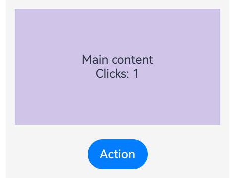

### 示例2（配置多边内容并切换布局方向）

本示例通过[safeAreaInset](#safeareainset)接口同时配置四边内容。切换布局方向时，start和end交换物理位置，top和bottom保持在上、下边；上边的START对齐和下边的END对齐随LTR/RTL变化，起始边和结束边的内容沿垂直方向居中，避免在角落与顶部、底部内容重叠。

从API版本26.1.0开始，新增[safeAreaInset](#safeareainset)接口。

ArkTS-Dyn示例：

```ts
@Entry
@Component
struct SafeAreaInsetDirectionExample {
  @State rtl: boolean = false;

  @Builder
  TopContent() {
    Text('Top')
      .width(80)
      .height(28)
      .backgroundColor('#E3F2FD')
  }

  @Builder
  EndContent() {
    Text('End')
      .fontSize(14)
      .width(32)
      .height(80)
      .backgroundColor('#FFF3E0')
  }

  @Builder
  BottomContent() {
    Text('Bottom')
      .width(80)
      .height(28)
      .backgroundColor('#E3F2FD')
  }

  @Builder
  StartContent() {
    Text('Start')
      .fontSize(14)
      .width(32)
      .height(80)
      .backgroundColor('#E8F5E9')
  }

  build() {
    Column({ space: 12 }) {
      Button('Toggle LTR/RTL')
        .onClick(() => {
          this.rtl = !this.rtl;
        })
      Stack() {
        Text('Main content')
          .width('100%')
          .height('100%')
          .textAlign(TextAlign.Center)
          .backgroundColor('#D1C4E9')
      }
      .width(300)
      .height(260)
      .padding(12)
      .backgroundColor('#F5F5F5')
      // start/end随布局方向交换位置。
      .direction(this.rtl ? Direction.Rtl : Direction.Ltr)
      .safeAreaInset({
        top: { content: () => { this.TopContent(); }, alignment: SafeAreaInsetAlignment.START },
        end: { content: () => { this.EndContent(); }, alignment: SafeAreaInsetAlignment.CENTER },
        bottom: { content: () => { this.BottomContent(); }, alignment: SafeAreaInsetAlignment.END },
        start: { content: () => { this.StartContent(); }, alignment: SafeAreaInsetAlignment.CENTER }
      })
    }
    .width('100%')
    .height('100%')
  }
}
```

ArkTS-Sta示例：

```ts
import { Entry, Component, Builder, Column, Stack, Button, Text, TextAlign, Direction, SafeAreaInsetAlignment, SafeAreaInsetOptions, ColumnOptions, State } from '@kit.ArkUI';

@Entry
@Component
struct SafeAreaInsetDirectionExample {
  @State rtl: boolean = false;

  @Builder
  TopContent() {
    Text('Top')
      .width(80)
      .height(28)
      .backgroundColor('#E3F2FD')
  }

  @Builder
  EndContent() {
    Text('End')
      .fontSize(14)
      .width(32)
      .height(80)
      .backgroundColor('#FFF3E0')
  }

  @Builder
  BottomContent() {
    Text('Bottom')
      .width(80)
      .height(28)
      .backgroundColor('#E3F2FD')
  }

  @Builder
  StartContent() {
    Text('Start')
      .fontSize(14)
      .width(32)
      .height(80)
      .backgroundColor('#E8F5E9')
  }

  build() {
    Column({ space: 12 } as ColumnOptions) {
      Button('Toggle LTR/RTL')
        .onClick(() => {
          this.rtl = !this.rtl;
        })
      Stack() {
        Text('Main content')
          .width('100%')
          .height('100%')
          .textAlign(TextAlign.Center)
          .backgroundColor('#D1C4E9')
      }
      .width(300)
      .height(260)
      .padding(12)
      .backgroundColor('#F5F5F5')
      // start/end随布局方向交换位置。
      .direction(this.rtl ? Direction.Rtl : Direction.Ltr)
      .safeAreaInset({
        top: { content: () => { this.TopContent(); }, alignment: SafeAreaInsetAlignment.START },
        end: { content: () => { this.EndContent(); }, alignment: SafeAreaInsetAlignment.CENTER },
        bottom: { content: () => { this.BottomContent(); }, alignment: SafeAreaInsetAlignment.END },
        start: { content: () => { this.StartContent(); }, alignment: SafeAreaInsetAlignment.CENTER }
      } as SafeAreaInsetOptions)
    }
    .width('100%')
    .height('100%')
  }
}
```

示例效果：

| LTR布局 | RTL布局 |
| --- | --- |
| 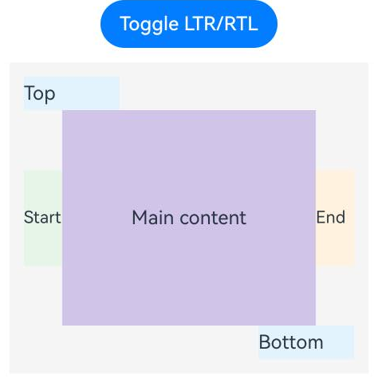 | 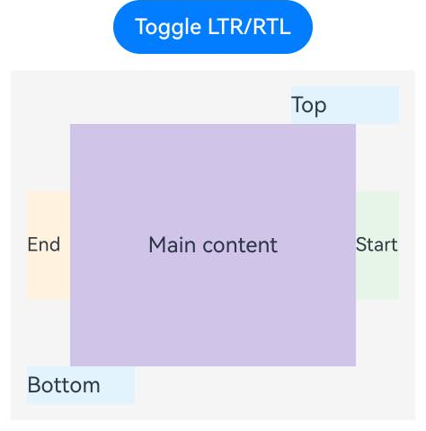 |

### 示例3（更新、清除和重置边缘内容）

本示例通过[safeAreaInset](#safeareainset)接口切换顶部builder以替换内容，设置top为undefined以清除顶部，同时继续提供bottom配置保留底部；若本次只提供top，原bottom也会被清除。传入undefined时重置全部边，重新提供完整配置时恢复内容。

从API版本26.1.0开始，新增[safeAreaInset](#safeareainset)接口。

ArkTS-Dyn示例：

```ts
import { LengthMetrics } from '@kit.ArkUI';

@Entry
@Component
struct SafeAreaInsetUpdateExample {
  @State insetEnabled: boolean = true;
  @State showTop: boolean = true;
  @State alternateTop: boolean = false;

  @Builder
  TopContent() {
    Text('Top toolbar')
      .height(28)
      .backgroundColor('#E3F2FD')
  }

  @Builder
  AlternateTopContent() {
    Text('Updated top toolbar')
      .height(48)
      .backgroundColor('#FFF3E0')
  }

  @Builder
  BottomContent() {
    Text('Bottom actions')
      .height(40)
      .backgroundColor('#E8F5E9')
  }

  build() {
    Column({ space: 12 }) {
      Button('Replace top')
        .onClick(() => {
          this.alternateTop = !this.alternateTop;
        })
      Button('Toggle top')
        .onClick(() => {
          this.showTop = !this.showTop;
        })
      Button('Reset / Restore')
        .onClick(() => {
          this.insetEnabled = !this.insetEnabled;
        })
      Stack() {
        Text('Main content')
          .width('100%')
          .height('100%')
          .textAlign(TextAlign.Center)
          .backgroundColor('#D1C4E9')
      }
      .width(300)
      .height(240)
      .padding(12)
      .backgroundColor('#F5F5F5')
      // 每次提供完整配置；undefined清除全部边缘内容。
      .safeAreaInset(this.insetEnabled ? {
        top: this.showTop ? {
          content: this.alternateTop ? () => { this.AlternateTopContent(); } : () => { this.TopContent(); },
          spacing: LengthMetrics.vp(4)
        } : undefined,
        bottom: {
          content: () => { this.BottomContent(); },
          spacing: LengthMetrics.vp(8)
        }
      } : undefined)
    }
    .width('100%')
    .height('100%')
  }
}
```

ArkTS-Sta示例：

```ts
import { Entry, Component, Builder, Column, Stack, Button, Text, TextAlign, LengthMetrics, SafeAreaInsetOptions, ColumnOptions, State } from '@kit.ArkUI';

@Entry
@Component
struct SafeAreaInsetUpdateExample {
  @State insetEnabled: boolean = true;
  @State showTop: boolean = true;
  @State alternateTop: boolean = false;

  @Builder
  TopContent() {
    Text('Top toolbar')
      .height(28)
      .backgroundColor('#E3F2FD')
  }

  @Builder
  AlternateTopContent() {
    Text('Updated top toolbar')
      .height(48)
      .backgroundColor('#FFF3E0')
  }

  @Builder
  BottomContent() {
    Text('Bottom actions')
      .height(40)
      .backgroundColor('#E8F5E9')
  }

  build() {
    Column({ space: 12 } as ColumnOptions) {
      Button('Replace top')
        .onClick(() => {
          this.alternateTop = !this.alternateTop;
        })
      Button('Toggle top')
        .onClick(() => {
          this.showTop = !this.showTop;
        })
      Button('Reset / Restore')
        .onClick(() => {
          this.insetEnabled = !this.insetEnabled;
        })
      Stack() {
        Text('Main content')
          .width('100%')
          .height('100%')
          .textAlign(TextAlign.Center)
          .backgroundColor('#D1C4E9')
      }
      .width(300)
      .height(240)
      .padding(12)
      .backgroundColor('#F5F5F5')
      // 每次提供完整配置；undefined清除全部边缘内容。
      .safeAreaInset(this.insetEnabled ? {
        top: this.showTop ? {
          content: this.alternateTop ? () => { this.AlternateTopContent(); } : () => { this.TopContent(); },
          spacing: LengthMetrics.vp(4)
        } : undefined,
        bottom: {
          content: () => { this.BottomContent(); },
          spacing: LengthMetrics.vp(8)
        }
      } as SafeAreaInsetOptions : undefined)
    }
    .width('100%')
    .height('100%')
  }
}
```

示例效果：

| 初始状态 | 替换顶部内容 |
| --- | --- |
| 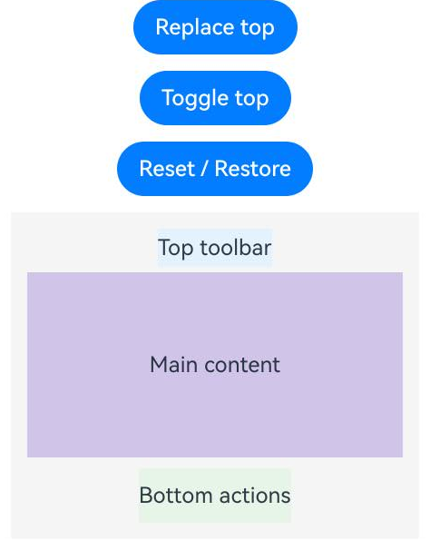 | 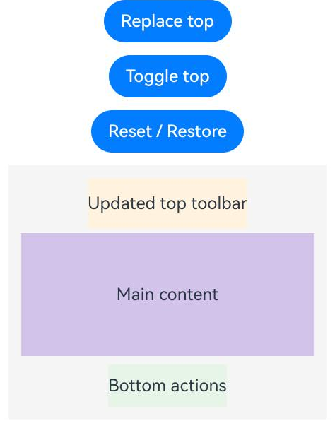 |

| 清除顶部，保留底部 | 重置全部边 |
| --- | --- |
| 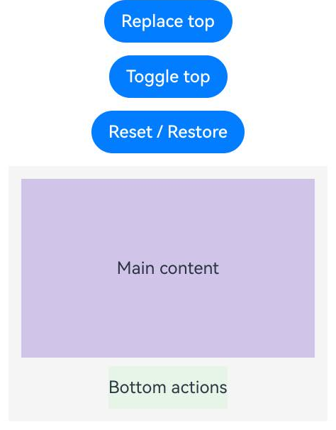 | 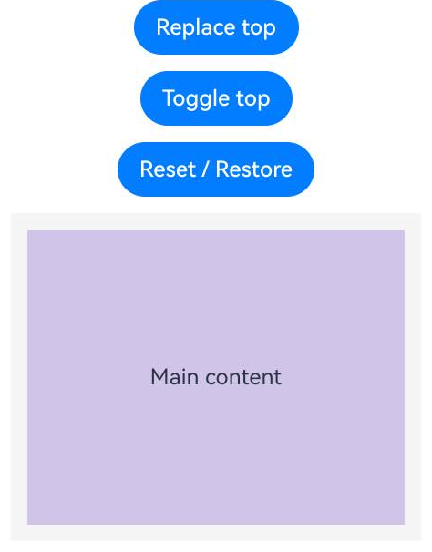 |

### 示例4（在悬浮操作区下方延伸滚动内容）

本示例通过[safeAreaInset](#safeareainset)创建固定的底部操作区，并切换Scroll的[clipContent](ts-container-scrollable-common.md#clipcontent14)。CONTENT_ONLY将滚动内容裁剪在主体内容区内；SAFE_AREA允许内容绘制到组件级安全区域，从半透明操作区下方经过。

从API版本26.1.0开始，新增[safeAreaInset](#safeareainset)接口。

ArkTS-Dyn示例：

```ts
import { LengthMetrics } from '@kit.ArkUI';

@Entry
@Component
struct SafeAreaInsetScrollExample {
  @State extendClip: boolean = false;
  private items: number[] = [1, 2, 3, 4, 5, 6, 7, 8, 9, 10, 11, 12];

  @Builder
  BottomContent() {
    Row() {
      Text('Floating actions')
        .fontColor('#FFFFFF')
    }
    .width('100%')
    .height(40)
    .justifyContent(FlexAlign.Center)
    // 半透明背景便于观察滚动内容经过操作区下方；边缘内容保持固定。
    .backgroundColor('#990078D4')
  }

  build() {
    Column({ space: 12 }) {
      Button(this.extendClip ? 'SAFE_AREA' : 'CONTENT_ONLY')
        .onClick(() => {
          this.extendClip = !this.extendClip;
        })
      Stack() {
        Scroll() {
          Column({ space: 8 }) {
            ForEach(this.items, (item: number) => {
              Text('Item ' + item)
                .width('100%')
                .height(48)
                .backgroundColor('#D1C4E9')
            }, (item: number) => item.toString())
          }
          .width('100%')
        }
        .width(LayoutPolicy.matchParent)
        .height(LayoutPolicy.matchParent)
        .scrollBar(BarState.Off)
        // SAFE_AREA将裁剪范围延伸到外层组件预留的安全区域。
        .clipContent(this.extendClip ? ContentClipMode.SAFE_AREA : ContentClipMode.CONTENT_ONLY)
      }
      .width(300)
      .height(280)
      .padding(12)
      .backgroundColor('#F5F5F5')
      .safeAreaInset({
        bottom: {
          content: () => { this.BottomContent(); },
          spacing: LengthMetrics.vp(8)
        }
      })
    }
    .width('100%')
    .height('100%')
  }
}
```

ArkTS-Sta示例：

```ts
import { Entry, Component, Builder, State, Column, Row, Button, Text, Stack, Scroll, ForEach, FlexAlign, BarState, ContentClipMode, LayoutPolicy, LengthMetrics, SafeAreaInsetOptions } from '@kit.ArkUI';

@Entry
@Component
struct SafeAreaInsetScrollExample {
  @State extendClip: boolean = false;
  private items: number[] = [1, 2, 3, 4, 5, 6, 7, 8, 9, 10, 11, 12];

  @Builder
  BottomContent() {
    Row() {
      Text('Floating actions')
        .fontColor('#FFFFFF')
    }
    .width('100%')
    .height(40)
    .justifyContent(FlexAlign.Center)
    // 半透明背景便于观察滚动内容经过操作区下方；边缘内容保持固定。
    .backgroundColor('#990078D4')
  }

  build() {
    Column({ space: 12 }) {
      Button(this.extendClip ? 'SAFE_AREA' : 'CONTENT_ONLY')
        .onClick(() => {
          this.extendClip = !this.extendClip;
        })
      Stack() {
        Scroll() {
          Column({ space: 8 }) {
            ForEach(this.items, (item: number) => {
              Text('Item ' + item)
                .width('100%')
                .height(48)
                .backgroundColor('#D1C4E9')
            }, (item: number) => item.toString())
          }
          .width('100%')
        }
        .width(LayoutPolicy.matchParent)
        .height(LayoutPolicy.matchParent)
        .scrollBar(BarState.Off)
        // SAFE_AREA将裁剪范围延伸到外层组件预留的安全区域。
        .clipContent(this.extendClip ? ContentClipMode.SAFE_AREA : ContentClipMode.CONTENT_ONLY)
      }
      .width(300)
      .height(280)
      .padding(12)
      .backgroundColor('#F5F5F5')
      .safeAreaInset({
        bottom: {
          content: () => { this.BottomContent(); },
          spacing: LengthMetrics.vp(8)
        }
      } as SafeAreaInsetOptions)
    }
    .width('100%')
    .height('100%')
  }
}
```

运行效果：点击按钮切换裁剪模式，上下滑动列表观察底部操作区下方的内容。

| CONTENT_ONLY | SAFE_AREA |
| --- | --- |
| 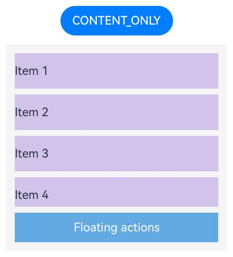 | 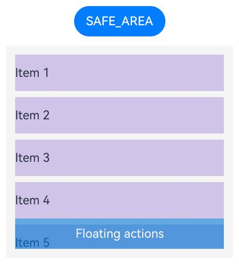 |

### 示例5（根据主体内容和边缘操作区自适应高度）

本示例通过[safeAreaInset](#safeareainset)配置底部操作区，使用[LayoutPolicy.wrapContent](ts-universal-attributes-size.md#layoutpolicy15)计算容器高度。主体内容高100vp，上下padding各12vp，底部占用48vp。父容器空间充足时，底部safeAreaPadding为20vp，容器高172vp（100 + 24 + 48）；切换为60vp后，容器高184vp（100 + 24 + 60），主体内容高度不变。

从API版本26.1.0开始，新增[safeAreaInset](#safeareainset)接口。

ArkTS-Dyn示例：

```ts
import { LengthMetrics } from '@kit.ArkUI';

@Entry
@Component
struct SafeAreaInsetLayoutPolicyExample {
  @State useLargePadding: boolean = false;

  @Builder
  BottomContent() {
    Text('Bottom actions')
      .width(160)
      .height(40)
      .backgroundColor('#E8F5E9')
  }

  build() {
    Column({ space: 12 }) {
      Button('Toggle safeAreaPadding 20 / 60')
        .onClick(() => {
          this.useLargePadding = !this.useLargePadding;
        })
      Stack() {
        // 主体内容高度固定，避免父子都自适应时无法确定尺寸。
        Text('Main content: 100vp')
          .width(240)
          .height(100)
          .textAlign(TextAlign.Center)
          .backgroundColor('#D1C4E9')
      }
      .width(300)
      .height(LayoutPolicy.wrapContent)
      .padding(12)
      .backgroundColor('#F5F5F5')
      // 同一底边取最大值：max(20, 40 + 8) = 48；max(60, 40 + 8) = 60。
      .safeAreaPadding({ bottom: LengthMetrics.vp(this.useLargePadding ? 60 : 20) })
      .safeAreaInset({
        bottom: {
          content: () => { this.BottomContent(); },
          spacing: LengthMetrics.vp(8)
        }
      })
    }
    .width('100%')
    .height('100%')
  }
}
```

ArkTS-Sta示例：

```ts
import { Entry, Component, Builder, State, Column, Button, Text, Stack, TextAlign, LayoutPolicy, LengthMetrics, SafeAreaInsetOptions, LocalizedPadding } from '@kit.ArkUI';

@Entry
@Component
struct SafeAreaInsetLayoutPolicyExample {
  @State useLargePadding: boolean = false;

  @Builder
  BottomContent() {
    Text('Bottom actions')
      .width(160)
      .height(40)
      .backgroundColor('#E8F5E9')
  }

  build() {
    Column({ space: 12 }) {
      Button('Toggle safeAreaPadding 20 / 60')
        .onClick(() => {
          this.useLargePadding = !this.useLargePadding;
        })
      Stack() {
        // 主体内容高度固定，避免父子都自适应时无法确定尺寸。
        Text('Main content: 100vp')
          .width(240)
          .height(100)
          .textAlign(TextAlign.Center)
          .backgroundColor('#D1C4E9')
      }
      .width(300)
      .height(LayoutPolicy.wrapContent)
      .padding(12)
      .backgroundColor('#F5F5F5')
      // 同一底边取最大值：max(20, 40 + 8) = 48；max(60, 40 + 8) = 60。
      .safeAreaPadding({ bottom: LengthMetrics.vp(this.useLargePadding ? 60 : 20) } as LocalizedPadding)
      .safeAreaInset({
        bottom: {
          content: () => { this.BottomContent(); },
          spacing: LengthMetrics.vp(8)
        }
      } as SafeAreaInsetOptions)
    }
    .width('100%')
    .height('100%')
  }
}
```

运行效果：点击按钮切换底部safeAreaPadding，观察容器高度和主体内容下方的预留空间。

| safeAreaPadding为20vp | safeAreaPadding为60vp |
| --- | --- |
| 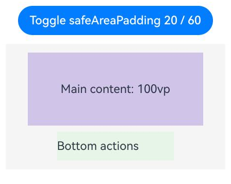 | 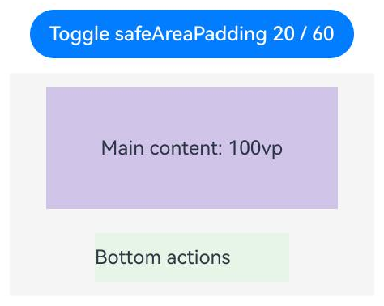 |
